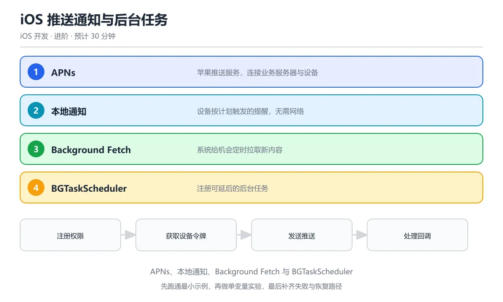

# iOS 推送通知与后台任务

> 内容更新时间：2026-10-06 · 学习阶段：进阶 · 预计用时：40 分钟



## 本节知识框架

**课程定位**：分类「ios_development」· 学习阶段 中级 · 建议用时 30 分钟。

本课主线：掌握 iOS 本地通知与远程推送（APNs）、后台任务调度（BGTaskScheduler）、以及 App 生命周期管理。

**复习清单**

- [ ] 能说出本地通知与远程推送的区别和各自的触发方式
- [ ] 能配置 APNs 证书并处理推送通知的接收与展示
- [ ] 能使用 BGTaskScheduler 注册和调度后台刷新任务
- [ ] 能说出 App 从活跃到挂起的完整生命周期
- [ ] 能运行本课示例，修改一个输入后观察输出变化
- [ ] 能解释为什么后台任务有严格的时间和资源限制

## 核心概念定义

| 术语 | 一句话说明 |
| --- | --- |
| 本地通知（Local Notification） | 由 App 自己在设备上触发的通知，不需要服务器参与，适合闹钟、提醒类场景 |
| 远程推送（Remote Push / APNs） | 由服务器通过 Apple Push Notification service 发送到设备的通知，适合消息提醒、订单更新 |
| APNs | Apple Push Notification service，苹果官方的推送通知服务器 |
| BGTaskScheduler | iOS 13+ 引入的后台任务调度框架，替代了旧的 UIBackgroundTask |
| App 生命周期 | App 从启动到终止经历的状态序列：Not Running → Inactive → Active → Background → Suspended |
| Device Token | 设备唯一标识符，由 APNs 生成并返回给 App，用于向该设备发送推送 |
| 通知类别（Category） | 对通知进行分类，每类可以定义不同的交互按钮（如"回复"、"标记已读"） |
| 后台获取（Background Fetch） | 系统定期唤醒 App 执行短时间数据更新的机制 |
| Silent Push | 不展示给用户但唤醒 App 执行后台处理的推送通知 |

## 原理与运行机制

### 通知系统的工作流程

把推送通知想象成快递系统。你（服务器）要把一个包裹（通知内容）送给收件人（用户设备）。你不能直接送到家门口，必须通过快递公司（APNs）中转。快递公司需要知道收件人的地址（Device Token），才能准确送达。

完整流程分四步：

1. **注册通知权限**：App 首次启动时请求用户允许发送通知
2. **获取 Device Token**：系统向 APNs 注册，返回该设备的唯一 Token
3. **上传 Token 到服务器**：App 把 Token 发给自己的后端服务器保存
4. **服务器发送推送**：后端通过 APNs 接口，带上 Token 和通知内容发送推送

```swift
import UserNotifications

// 第一步：请求通知权限
func requestNotificationPermission() async -> Bool {
    let center = UNUserNotificationCenter.current()
    do {
        let granted = try await center.requestAuthorization(
            options: [.alert, .badge, .sound]
        )
        return granted
    } catch {
        print("请求权限失败: \(error)")
        return false
    }
}

// 第二步：注册远程通知并获取 Token
func registerForRemoteNotifications() {
    UIApplication.shared.registerForRemoteNotifications()
}

// 第三步：在 AppDelegate 中接收 Token
class AppDelegate: NSObject, UIApplicationDelegate {
    func application(_ application: UIApplication,
                     didRegisterForRemoteNotificationsWithDeviceToken deviceToken: Data) {
        let token = deviceToken.map { String(format: "%02.2hhx", $0) }.joined()
        // 把 token 上传到自己的服务器
        uploadTokenToServer(token)
    }

    func application(_ application: UIApplication,
                     didFailToRegisterForRemoteNotificationsWithError error: Error) {
        print("注册远程通知失败: \(error)")
    }
}
```

### 本地通知：App 自己发的消息

本地通知就像你给自己设的闹钟——不需要别人提醒你，到时间自己就会响。适合提醒类场景，比如课程开始提醒、任务截止提醒。

```swift
import UserNotifications

func scheduleLocalNotification(title: String, body: String, after seconds: TimeInterval) {
    let content = UNMutableNotificationContent()
    content.title = title
    content.body = body
    content.sound = .default
    content.badge = 1  // 角标数字

    // 时间触发器：指定秒数后触发
    let trigger = UNTimeIntervalNotificationTrigger(timeInterval: seconds, repeats: false)

    // 创建请求
    let request = UNNotificationRequest(
        identifier: UUID().uuidString,
        content: content,
        trigger: trigger
    )

    // 添加到通知中心
    UNUserNotificationCenter.current().add(request) { error in
        if let error { print("通知调度失败: \(error)") }
    }
}

// 使用示例：5 秒后提醒
scheduleLocalNotification(title: "学习提醒", body: "该复习 Swift 基础课程了！", after: 5)
```

### 日历触发器：精确到某个时间点

```swift
func scheduleDailyReminder(hour: Int, minute: Int) {
    let content = UNMutableNotificationContent()
    content.title = "每日学习"
    content.body = "今天的学习任务已完成吗？"
    content.sound = .default

    var dateComponents = DateComponents()
    dateComponents.hour = hour
    dateComponents.minute = minute

    let trigger = UNCalendarNotificationTrigger(dateMatching: dateComponents, repeats: true)
    let request = UNNotificationRequest(
        identifier: "daily_reminder",
        content: content,
        trigger: trigger
    )
    UNUserNotificationCenter.current().add(request)
}
```

### 后台任务调度（BGTaskScheduler）

把 BGTaskScheduler 想象成物业的保洁排班表——你不能随时叫人来打扫，必须提前预约，物业会在合适的时间（设备充电、连接 WiFi、用户不使用时）安排保洁。

iOS 对后台任务有严格限制，因为后台任务会消耗电池和内存。BGTaskScheduler 提供两种任务类型：

1. **BGAppRefreshTask**：短时间数据刷新（约 30 秒），如检查新消息
2. **BGProcessingTask**：长时间维护任务（约数分钟），如数据库清理、机器学习模型训练

```swift
import BackgroundTasks

// 在 AppDelegate 中注册后台任务
func registerBackgroundTasks() {
    BGTaskScheduler.shared.register(
        forTaskWithIdentifier: "com.example.app.refresh",
        using: nil
    ) { task in
        handleAppRefresh(task: task as! BGAppRefreshTask)
    }

    BGTaskScheduler.shared.register(
        forTaskWithIdentifier: "com.example.app.processing",
        using: nil
    ) { task in
        handleProcessing(task: task as! BGProcessingTask)
    }
}

// 处理刷新任务
func handleAppRefresh(task: BGAppRefreshTask) {
    // 调度下一次刷新
    scheduleAppRefresh()

    let refreshTask = Task {
        // 执行数据刷新
        await fetchLatestData()
    }

    // 任务到期处理：系统给的时间快用完了
    task.expirationHandler = {
        refreshTask.cancel()
    }

    Task {
        do {
            try await refreshTask.value
            task.setTaskCompleted(success: true)
        } catch {
            task.setTaskCompleted(success: false)
        }
    }
}

// 调度下一次刷新
func scheduleAppRefresh() {
    let request = BGAppRefreshTaskRequest(identifier: "com.example.app.refresh")
    request.earliestBeginDate = Date(timeIntervalSinceNow: 15 * 60) // 最早 15 分钟后
    do {
        try BGTaskScheduler.shared.submit(request)
    } catch {
        print("调度刷新任务失败: \(error)")
    }
}
```

### App 生命周期状态机

App 的生命周期就像一家商店的营业时间：

| 状态 | 类比 | 说明 |
| --- | --- | --- |
| Not Running | 商店还没开门 | App 未启动，不占用 CPU |
| Inactive | 商店准备营业但还没接客 | App 在前台但不接收事件（如来电话时） |
| Active | 正常营业 | App 在前台且接收事件 |
| Background | 打烊后的收尾工作 | App 在后台执行有限代码（如保存数据） |
| Suspended | 商店完全关门 | App 在后台但不执行代码，系统保留内存快照 |

```swift
// 监听生命周期事件（SwiftUI）
@Environment(\.scenePhase) private var scenePhase

var body: some View {
    ContentView()
        .onChange(of: scenePhase) { _, newPhase in
            switch newPhase {
            case .active:
                print("App 进入活跃状态")
                // 刷新数据、恢复定时器
            case .inactive:
                print("App 进入非活跃状态")
                // 暂停动画、停止定时器
            case .background:
                print("App 进入后台")
                // 保存数据、停止网络请求
            @unknown default:
                break
            }
        }
}
```

## 典型应用场景

### 常见落地场景

- **消息推送**：社交 App 收到新消息时通过 APNs 提醒用户
- **学习提醒**：课程类 App 用本地通知提醒用户每日打卡
- **后台数据同步**：新闻类 App 用 BGTaskScheduler 在后台预加载最新内容
- **位置更新**：运动类 App 在后台持续记录用户轨迹
- **静默推送**：服务器通过 Silent Push 通知 App 有新数据可拉取
- **富通知**：带图片、地图、交互按钮的增强通知

### 选型边界

- 需要用户立即看到 → 本地通知或远程推送（带 alert）
- 需要 App 静默更新数据 → Silent Push 或 BGAppRefreshTask
- 需要长时间后台处理 → BGProcessingTask（需用户在 Info.plist 声明）
- 需要持续位置追踪 → Background Location Updates（需用户授权 Always）

## 代码/协议/SQL 示例

### 完整示例：通知管理器

```swift
import UserNotifications

@MainActor
@Observable
final class NotificationManager {
    var isAuthorized = false
    var pendingNotifications: [UNNotificationRequest] = []

    private let center = UNUserNotificationCenter.current()

    // 检查并请求权限
    func checkAndRequestPermission() async {
        let settings = await center.notificationSettings()
        switch settings.authorizationStatus {
        case .authorized:
            isAuthorized = true
        case .notDetermined:
            isAuthorized = await requestPermission()
        default:
            isAuthorized = false
        }
        await refreshPendingNotifications()
    }

    private func requestPermission() async -> Bool {
        (try? await center.requestAuthorization(options: [.alert, .badge, .sound])) ?? false
    }

    // 发送带交互按钮的通知
    func sendInteractiveNotification() {
        let content = UNMutableNotificationContent()
        content.title = "新课程上线"
        content.body = "iOS 推送通知与后台任务已更新，点击查看"
        content.sound = .default
        content.categoryIdentifier = "COURSE_UPDATE"
        content.userInfo = ["courseId": "mobile_ios_notifications"]

        let trigger = UNTimeIntervalNotificationTrigger(timeInterval: 3, repeats: false)
        let request = UNNotificationRequest(
            identifier: "course_update_\(Date().timeIntervalSince1970)",
            content: content,
            trigger: trigger
        )
        center.add(request)
    }

    // 注册通知类别（交互按钮）
    func registerCategories() {
        let viewAction = UNNotificationAction(
            identifier: "VIEW_COURSE",
            title: "查看课程",
            options: .foreground
        )
        let dismissAction = UNNotificationAction(
            identifier: "DISMISS",
            title: "稍后再看",
            options: .destructive
        )
        let category = UNNotificationCategory(
            identifier: "COURSE_UPDATE",
            actions: [viewAction, dismissAction],
            intentIdentifiers: [],
            options: []
        )
        center.setNotificationCategories([category])
    }

    // 管理待发送的通知
    func refreshPendingNotifications() async {
        pendingNotifications = await center.pendingNotificationRequests()
    }

    func cancelNotification(id: String) {
        center.removePendingNotificationRequests(withIdentifiers: [id])
    }

    func cancelAll() {
        center.removeAllPendingNotificationRequests()
    }
}
```

### Info.plist 后台模式配置

```text
<!-- Info.plist 中添加 -->
<key>BGTaskSchedulerPermittedIdentifiers</key>
<array>
    <string>com.example.app.refresh</string>
    <string>com.example.app.processing</string>
</array>
<key>UIBackgroundModes</key>
<array>
    <string>fetch</string>
    <string>processing</string>
    <string>remote-notification</string>
</array>
```

## 时间/空间复杂度或性能分析

### 通知系统性能

| 指标 | 约束 | 优化手段 |
| --- | --- | --- |
| 推送到达延迟 | APNs 不保证实时，通常 < 1 秒 | 关键消息用 Silent Push + 后台拉取双保险 |
| 通知数量限制 | 每个 App 最多 64 个待显示通知 | 合并同类通知，用 `removeDeliveredNotifications` 清理旧通知 |
| 后台任务频率 | 系统自行决定，通常每几小时一次 | 不要依赖精确时间，用 `earliestBeginDate` 设最低预期 |
| 后台执行时间 | BGAppRefreshTask 约 30 秒，BGProcessingTask 约数分钟 | 设置 `expirationHandler`，超时前保存进度 |

### 电池与资源影响

- 后台任务只在设备充电、WiFi 连接、用户不使用时才会被系统调度
- 频繁请求后台执行时间会被系统降低优先级
- Silent Push 不唤醒 UI，但会唤醒 App 进程，消耗 CPU 和网络

### 测量方法

用 Xcode 的 Background Tasks 调试工具（Debug → Simulate Background Fetch）模拟后台任务触发。在 Console.app 中过滤 `com.apple.springboard` 查看任务调度日志。

## 常见误区与易错点

| 错误 | 现象 | 修法 |
| --- | --- | --- |
| 不请求通知权限就发通知 | 通知静默失败，用户看不到 | 先调 `requestAuthorization` 确认用户授权 |
| 在后台执行耗时操作 | 被系统杀死进程 | 用 BGTaskScheduler 注册合法后台任务 |
| 忽略 expirationHandler | 任务超时被强杀，数据丢失 | 设置到期回调，保存进度并标记完成 |
| 用旧 API UIBackgroundTask | iOS 13+ 已废弃 | 改用 BGTaskScheduler |
| 通知 identifier 重复 | 新通知覆盖旧通知 | 用 UUID 或带时间戳的唯一 ID |
| 忘记配置 Info.plist | 后台任务不会被系统调度 | 声明 BGTaskSchedulerPermittedIdentifiers 和 UIBackgroundModes |
| 假设推送一定到达 | APNs 不保证送达 | 设计幂等逻辑，App 主动拉取作为兜底 |
| 后台请求位置更新 | 被系统拒绝或耗电严重 | 用 `allowsBackgroundLocationUpdates` 并声明权限 |

## 与其他知识点的关系

### 先修课程

本课的先修内容是《Swift 与 iOS 开发》和《iOS 网络编程与数据持久化》。你需要了解 Swift 的 async/await 语法以及网络请求的基本封装，才能理解推送通知的数据拉取和后台任务的网络操作。

### 相关概念对比

- **本地通知 vs 远程推送**：本地通知由 App 触发，不需要网络；远程推送由服务器通过 APNs 发送
- **BGAppRefreshTask vs BGProcessingTask**：前者适合短时间数据刷新（~30s），后者适合长时间维护任务（~数分钟）
- **Silent Push vs 普通推送**：Silent Push 不显示给用户，只唤醒 App 执行后台代码
- **scenePhase vs AppDelegate 生命周期**：SwiftUI 用 `@Environment(\.scenePhase)` 监听；UIKit 用 `applicationDidBecomeActive` 等回调

### 后续衔接

学完本课后，《iOS 性能优化与调试》会教你分析后台任务对电池和内存的影响；《App Store 上架流程》会涉及推送通知的证书配置和审核要求。

## 自测题与参考答案

### 自测 1

不看正文，说出 APNs 推送通知的完整流程（从服务器到用户看到通知）。

**参考答案**：服务器构造通知内容（payload）和目标设备的 Device Token → 通过 HTTP/2 协议发送给 APNs → APNs 找到目标设备并转发通知 → 设备收到后根据 payload 展示通知（alert/sound/badge）。

### 自测 2

BGAppRefreshTask 和 BGProcessingTask 的区别是什么？

**参考答案**：BGAppRefreshTask 用于短时间数据刷新，执行时间约 30 秒，适合检查新消息等轻量操作；BGProcessingTask 用于长时间维护任务，执行时间可达数分钟，适合数据库清理、模型训练等重操作。两者都由系统自行决定何时执行，开发者只能设定最早开始时间。

### 自测 3

为什么推送通知不能保证一定送达？App 应该如何应对？

**参考答案**：APNs 是"尽力投递"的服务，设备离线、网络异常、用户关闭通知权限等情况都会导致投递失败。App 应该设计幂等逻辑——即使推送没到，用户打开 App 后也能通过主动拉取获得最新数据。关键业务不应只依赖推送。

### 自测 4

运行本课的通知示例，修改 `timeInterval` 为 0，观察会发生什么。

**参考答案**：`UNTimeIntervalNotificationTrigger` 的 `timeInterval` 必须大于 0，设为 0 会导致崩溃或通知不被调度。最小有效值是一个很小的正数。实际开发中应确保时间间隔合理。

### 自测 5

App 进入 Suspended 状态后，还能执行代码吗？

**参考答案**：不能。Suspended 状态下 App 仍在内存中保留快照，但不执行任何代码。系统内存紧张时会优先回收 Suspended 状态的 App。如果需要执行有限的后台代码，应该在进入 Background 状态时申请后台 task。

## 考点精讲

### 考点 1

Apple 推送服务 APNs 的全称是什么？

A. Apple Push Notification service

B. Apple Public Network Service

C. Automated Push Notification System

D. Apple Protocol for Network Security

**正确答案：A**

**详细解释**：APNs（Apple Push Notification service）是苹果提供的远程推送服务，服务器通过它向设备发送通知。 设备令牌会随重装或恢复备份而变化，所以每次启动都要重新注册并把最新 token 上报给业务服务器。 推送链路是服务器到 APNs 再到设备，App 本身不保持长连接，因此即使 App 未运行也能收到通知。

---

### 考点 2

本地通知和远程推送的主要区别是什么？

A. 本地通知不能显示文字

B. 远程推送通过 APNs 从服务器发送，本地通知由设备自身触发

C. 本地通知只在 WiFi 下工作，需要联网向 APNs 注册令牌  

D. 远程推送不需要网络

**正确答案：B**

**详细解释**：远程推送需要服务器通过 APNs 发送，本地通知由 App 在设备上按计划触发，不需要网络。 本地通知适合提醒类场景，比如待办到期；需要由服务器实时触达用户时，仍然要走 APNs 远程推送。 判断标准很简单：内容由服务器决定且需要触达离线用户就选远程推送，只是本地定时提醒就用本地通知。 本题正确项是「远程推送通过 APNs 从服务器发送，本地通知由设备自身触发」。

---

### 考点 3

BGTaskScheduler 的主要用途是什么？

A. 管理 UI 动画，统一调度屏幕刷新帧  

B. 在后台执行数据同步、清理等耗时任务

C. 管理内存分配

D. 处理用户触摸事件

**正确答案：B**

**详细解释**：BGTaskScheduler 让 App 在系统分配的后台时间窗口执行数据同步、数据库清理等任务。 系统只会在它认为合适的时机调用后台任务，所以任务要设计成幂等且可中断，不能假设一定会按时执行。 BGTaskScheduler 需要提前注册任务标识，并在 Info.plist 和后台模式里声明权限，否则系统不会调度。 本题正确项是「在后台执行数据同步、清理等耗时任务」。

---

### 考点 4

推送通知的 payload 大小限制是多少？

A. 256 字节

B. 4KB

C. 1KB

D. 没有限制

**正确答案：B**

**详细解释**：APNs 推送 payload 限制为 4KB（之前版本为 2KB），超出会被拒绝。 超过 4KB 的推送会被 APNs 拒绝，需要展示大段内容时应只推送一个标识，再由 App 启动后拉取完整数据。 超过限制时可以把大图放在通知扩展里下载，或用 Notification Service Extension 在展示前补充内容。

---

### 考点 5

用户拒绝通知权限后，App 应该怎么做？

A. 强制要求用户开启，否则 App 启动时直接退出  

B. 尊重用户选择，在 App 内提供替代的通知方式

C. 反复弹窗请求

D. 卸载 App

**正确答案：B**

**详细解释**：应尊重用户选择，可通过 App 内消息中心、角标等方式提供替代方案。 iOS 只允许请求一次通知授权，被拒绝后只能引导用户去系统设置手动开启，不能反复弹自定义授权框。 引导开启时机的选择也很重要，最好在用户刚完成一个需要通知的功能后再请求授权，通过率会明显更高。 本题正确项是「尊重用户选择，在 App 内提供替代的通知方式」。

---

### 考点 6

题目：在「iOS 推送通知与后台任务」的术语表里，下列术语与解释的配对哪些是正确的？（多选）
A. 「scenePhase」：iOS 后台任务调度器，替代旧的后台任务 API  
B. 「BGTaskScheduler」：SwiftUI 中监听 App 生命周期状态的环境值  
C. 「UNUserNotificationCenter」：iOS 通知中心管理器，负责调度和管理所有通知  
D. 「UNNotificationRequest」：一次通知请求，包含内容、触发器和唯一标识  
正确答案：CD

**解析**：本题正确项是「UNUserNotificationCenter」：iOS 通知中心管理器，负责调度和管理所有通知，以及「UNNotificationRequest」：一次通知请求，包含内容、触发器和唯一标识，这两组配对与术语表一致。另外两组把术语和解释张冠李戴：「scenePhase」被安上了iOS 后台任务调度器，替代旧的后台任务 API的解释，「BGTaskScheduler」反而拿到了SwiftUI 中监听 App 生命周期状态的环境值的定义，所以两组都不能选。复习时回到「iOS 推送通知与后台任务」的术语速查表逐条核对，配对题考的是定义里描述的对象和边界，而不是术语的字面长相。

---

## 术语速查

| 术语 | 一句话说明 |
| --- | --- |
| APNs | Apple Push Notification service，苹果推送通知服务器 |
| Device Token | 设备唯一标识，由 APNs 生成，用于定向推送 |
| UNUserNotificationCenter | iOS 通知中心管理器，负责调度和管理所有通知 |
| UNNotificationRequest | 一次通知请求，包含内容、触发器和唯一标识 |
| BGTaskScheduler | iOS 后台任务调度器，替代旧的后台任务 API |
| BGAppRefreshTask | 短时间后台刷新任务，约 30 秒 |
| BGProcessingTask | 长时间后台处理任务，约数分钟 |
| Silent Push | 不展示给用户的静默推送，用于唤醒 App |
| scenePhase | SwiftUI 中监听 App 生命周期状态的环境值 |
| Category | 通知分类，定义交互按钮和自定义界面 |

## 参考资料与复核

- 复核范围：UserNotifications API、BGTaskScheduler 行为、APNs 协议变更

| 参考资料 | 本课用途 |
| --- | --- |
| [UserNotifications Framework](https://developer.apple.com/documentation/usernotifications) | 本地和远程通知的完整 API 参考 |
| [BGTaskScheduler](https://developer.apple.com/documentation/backgroundtasks/bgtaskscheduler) | 后台任务调度框架官方文档 |
| [APNs Documentation](https://developer.apple.com/documentation/usernotifications/setting_up_a_remote_notification_server) | 远程推送服务器配置指南 |
| [App Lifecycle](https://developer.apple.com/documentation/uikit/app_and_environment/managing_your_app_s_life_cycle) | App 生命周期管理官方文档 |

- 最后复核：2026-10-04
- 下次复核：2027-10-17

## 内容元数据

- 内容版本：v2.0
- 最后更新：2026-10-06
- 学习阶段：进阶
- 适用环境：通用开发环境；本课聚焦 APNs。
- 内容来源：内置结构化课程与工程实践整理
- 相关主题：mobile ios notifications
- 质量版本：P0 测验标准 + P1 覆盖扩展 + P2 体验补全