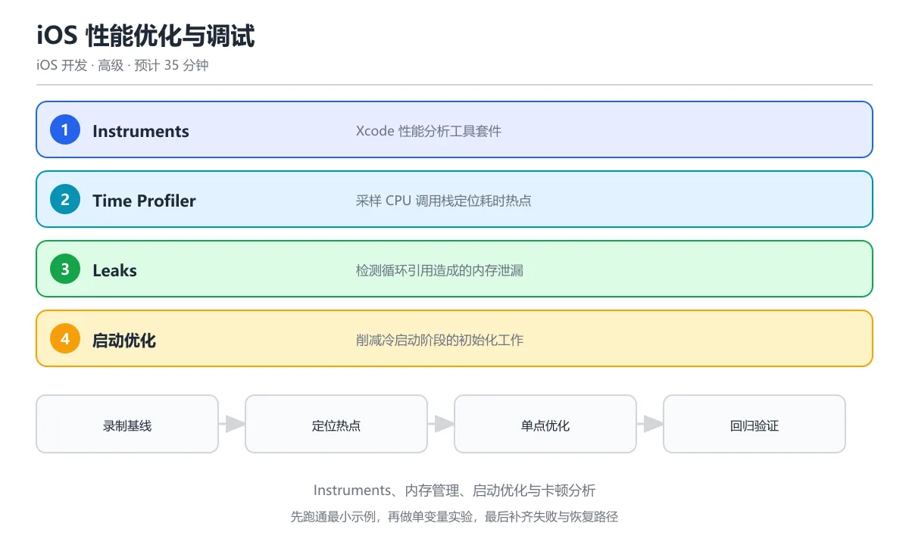

# iOS 性能优化与调试

> 内容更新时间：2026-10-06 · 学习阶段：高级 · 预计用时：35 分钟



## 本节知识框架

**课程定位**：分类「ios_development」· 学习阶段 高级 · 建议用时 35 分钟。

本课主线：掌握 iOS 性能分析工具（Instruments）、内存优化、UI 流畅度调优、启动时间优化以及常见调试技巧。

**复习清单**

- [ ] 能说出 Instruments 中 Time Profiler、Allocations、Leaks 三种工具的用途
- [ ] 能识别并修复常见的内存泄漏场景（闭包循环引用、Delegate 强引用）
- [ ] 能解释为什么离屏渲染会导致列表卡顿以及如何避免
- [ ] 能说出冷启动和热启动的区别及优化策略
- [ ] 能运行本课示例，使用 Instruments 采集一次性能数据
- [ ] 能使用 LLDB 断点进行基本调试

## 核心概念定义

| 术语 | 一句话说明 |
| --- | --- |
| Instruments | Xcode 内置的性能分析工具套件，包含时间分析、内存分析、能耗分析等数十种模板 |
| Time Profiler | Instruments 中的时间分析器，采样记录 CPU 调用栈，找出耗时函数 |
| Allocations | Instruments 中的内存分配追踪器，记录对象的创建和释放 |
| Leaks | Instruments 中的泄漏检测器，自动发现不再被引用但未释放的内存 |
| 离屏渲染（Offscreen Rendering） | GPU 无法直接在一帧内完成绘制，需要额外缓冲区的渲染方式，性能开销大 |
| 冷启动 | App 进程不在内存中，从加载二进制到首帧渲染的完整过程 |
| 热启动 | App 进程仍在内存中（Suspended 状态），恢复到前台的过程 |
| LLDB | Low Level Debugger，Xcode 默认的调试器，支持断点、表达式求值、内存查看 |
| O(n) 复杂度 | 算法执行时间随输入规模线性增长，是衡量性能的基本参照 |
| 主线程卡顿 | UI 操作或耗时任务阻塞主线程，导致界面无法响应用户操作 |

## 原理与运行机制

### 性能优化的核心思路

把性能优化想象成给一辆汽车做保养。你不能只看"跑得快不快"（整体体验），要分三个维度检查：引擎（CPU 计算）、油箱（内存使用）、轮胎（UI 渲染）。每个维度有专门的仪表盘（Instruments 模板）来测量。

性能优化的四步法：

1. **测量**：用 Instruments 采集数据，不要凭感觉
2. **定位**：找到最耗时或最耗内存的代码路径
3. **优化**：针对瓶颈做最小改动
4. **验证**：重新测量，确认改动确实有效

### Instruments 三大常用工具

#### Time Profiler：找 CPU 瓶颈

Time Profiler 像一台高速摄像机，每隔几毫秒拍一张"此刻 CPU 在做什么"的照片。累积足够多的照片后，就能看出哪个函数占用了最多 CPU 时间。

```text
使用步骤：
1. Xcode → Product → Profile（或 Cmd + I）
2. 选择 Time Profiler 模板
3. 点击录制，操作 App 复现卡顿场景
4. 查看 Call Tree，按 Self Weight 排序
5. 找到占比最高的函数，那就是瓶颈
```

常见瓶颈和优化方向：

| 瓶颈类型 | 典型表现 | 优化手段 |
| --- | --- | --- |
| 主线程网络请求 | 界面卡住等待响应 | 改用 async/await 异步请求 |
| 大量 JSON 解析 | 解码函数占比高 | 放到后台线程，或改用流式解析 |
| 频繁布局计算 | layoutSubviews 耗时 | 减少嵌套层级，缓存计算结果 |
| 正则匹配 | NSRegularExpression 占比高 | 预编译正则，或改用更简单的字符串操作 |

#### Allocations：追踪内存分配

Allocations 像一台记账本，记录每一次内存的"收入"（分配）和"支出"（释放）。你可以看到哪些对象占用了最多内存，以及它们是在哪里被创建的。

```swift
// 常见内存问题：图片过大
func loadImage(named name: String) -> UIImage? {
    // 问题：直接加载原图，一张 4000x3000 的图片占用约 48MB 内存
    guard let image = UIImage(named: name) else { return nil }
    return image
}

// 优化：缩放到目标尺寸后再使用
func loadThumbnail(named name: String, targetSize: CGSize) -> UIImage? {
    guard let image = UIImage(named: name) else { return nil }
    let renderer = UIGraphicsImageRenderer(size: targetSize)
    return renderer.image { _ in
        image.draw(in: CGRect(origin: .zero, size: targetSize))
    }
}
```

#### Leaks：检测内存泄漏

Leaks 像一台金属探测器，自动扫描"被遗忘的内存"——那些没有任何变量引用但仍未释放的对象。最常见的泄漏原因是循环引用。

```swift
// 经典循环引用场景
final class ViewController: UIViewController {
    var timer: Timer?

    override func viewDidLoad() {
        super.viewDidLoad()
        // 错误：timer 持有 self（因为 target: self）
        // self 持有 timer
        // 形成循环引用，两者都无法释放
        timer = Timer.scheduledTimer(
            timeInterval: 1.0,
            target: self,
            selector: #selector(tick),
            userInfo: nil,
            repeats: true
        )
    }

    // 正确做法：使用闭包版 Timer，配合 [weak self]
    func startTimerCorrectly() {
        timer = Timer.scheduledTimer(withTimeInterval: 1.0, repeats: true) { [weak self] _ in
            self?.tick()
        }
    }

    @objc func tick() {
        // 定时任务逻辑
    }

    deinit {
        timer?.invalidate() // 必须在 deinit 中取消定时器
    }
}
```

### UI 流畅度优化

iOS 屏幕刷新率是 60fps（ProMotion 设备 120fps），意味着每帧只有 16.6ms（或 8.3ms）的预算。如果某一帧的渲染超过这个时间，用户就会感到卡顿。

UI 卡顿的三大元凶：

1. **主线程阻塞**：在主线程做耗时操作（网络、数据库、大文件 IO）
2. **离屏渲染**：圆角 + 裁剪、阴影、蒙版等效果触发额外渲染通道
3. **过度绘制**：同一像素被多次绘制（层层叠叠的半透明视图）

```swift
// 离屏渲染优化：预渲染圆角图片
struct RoundedImageView: View {
    let imageName: String
    let cornerRadius: CGFloat

    var body: some View {
        Image(imageName)
            .resizable()
            .aspectRatio(contentMode: .fill)
            // 避免方案：用 mask 代替 .cornerRadius + .clipped
            // 因为 .cornerRadius 在某些场景会触发离屏渲染
            .mask(RoundedRectangle(cornerRadius: cornerRadius))
    }
}

// 列表优化：使用 LazyVStack 或 LazyHStack
struct OptimizedListView: View {
    let items: [String]

    var body: some View {
        ScrollView {
            LazyVStack(spacing: 8) {
                ForEach(items, id: \.self) { item in
                    Text(item)
                        .frame(maxWidth: .infinity, alignment: .leading)
                        .padding()
                        .background(Color(.systemBackground))
                }
            }
        }
    }
}
```

### 启动时间优化

启动时间分两个阶段：

1. **pre-main 阶段**：系统加载动态库、执行 +load 方法、初始化静态变量
2. **post-main 阶段**：App 的 `main()` → `AppDelegate` → 首帧渲染

```swift
// 测量启动时间：在 main.swift 中记录起点
// 创建一个 main.swift 替代 @main
import UIKit

let appStartTime = CFAbsoluteTimeGetCurrent()

// 在首帧渲染完成后计算差值
// AppDelegate.application(_:didFinishLaunchingWithOptions:) 中：
class AppDelegate: UIResponder, UIApplicationDelegate {
    func application(_ application: UIApplication,
                     didFinishLaunchingWithOptions launchOptions: [UIApplication.LaunchOptionsKey: Any]?) -> Bool {
        DispatchQueue.main.async {
            let duration = CFAbsoluteTimeGetCurrent() - appStartTime
            print("启动耗时: \(String(format: "%.2f", duration))s")
        }
        return true
    }
}
```

启动优化策略：

| 策略 | 说明 |
| --- | --- |
| 减少动态库数量 | 合并自有 Framework，系统动态库已预加载 |
| 延迟初始化 | 非首屏必需的 SDK（如统计、推送）放到首帧渲染后再初始化 |
| 减少 +load 方法 | 改用 +initialize 或懒加载 |
| 二进制重排 | 把启动时用到的函数排列在一起，减少 Page Fault |

### LLDB 调试技巧

LLDB 是 Xcode 的调试器，就像医生的听诊器——帮你"听到"代码运行时的内部状态。

```text
常用 LLDB 命令：

breakpoint set -name viewDidLoad     # 在 viewDidLoad 设断点
po self                              # 打印 self 的当前值
expression let $x = 42               # 创建一个临时变量
thread backtrace                     # 查看当前调用栈
image lookup -type Lesson            # 查找类型定义
watchpoint set variable self.name    # 当变量变化时暂停
continue (c)                         # 继续执行
step (s) / next (n)                  # 单步进入 / 单步跳过
```

```swift
// 在代码中使用 debugPrint 和 assert
func processLessons(_ lessons: [Lesson]) {
    debugPrint("收到 \(lessons.count) 条课程数据") // 只在 Debug 模式输出

    assert(!lessons.isEmpty, "课程列表不应为空") // 只在 Debug 模式检查

    // fatalError 在所有模式都会崩溃，用于标记不应该到达的代码
    guard let firstLesson = lessons.first else {
        fatalError("课程列表为空，这是不应该发生的情况")
    }
    processLesson(firstLesson)
}
```

## 典型应用场景

### 常见落地场景

- **列表卡顿排查**：用 Time Profiler 找到 `cellForRowAt` 中的耗时操作
- **内存泄漏修复**：用 Leaks 工具定位循环引用，添加 `[weak self]`
- **启动时间优化**：用 App Launch 模板分析 pre-main 和 post-main 各阶段耗时
- **包体积优化**：用 App Thinning Size Report 查看各架构的包大小
- **能耗优化**：用 Energy Log 分析定位、网络、CPU 的能耗占比
- **线上崩溃分析**：结合 Crashlytics 或 Xcode Organizer 分析崩溃堆栈

### 选型边界

- 界面卡顿 → 先用 Time Profiler 定位，再检查是否离屏渲染
- 内存持续增长 → 先用 Allocations 追踪，再用 Leaks 检测泄漏
- 启动慢 → 用 App Launch 模板，区分 pre-main 和 post-main
- 偶现崩溃 → 加日志 + 线上崩溃收集（Crashlytics / Sentry）

## 代码/协议/SQL 示例

### 完整示例：性能监控工具

```swift
import Foundation
import os

// 使用 os_signpost 标记性能关键路径
extension OSLog {
    static let performance = OSLog(subsystem: "com.example.app", category: "Performance")
}

@MainActor
final class PerformanceMonitor {
    static let shared = PerformanceMonitor()

    // 测量代码块执行时间
    func measure<T>(_ label: String, block: () throws -> T) rethrows -> T {
        let start = CFAbsoluteTimeGetCurrent()
        defer {
            let elapsed = CFAbsoluteTimeGetCurrent() - start
            let elapsedMs = String(format: "%.2f", elapsed * 1000)
            os_signpost(.event, log: .performance, name: "\(label)",
                        "耗时: %{public}@ms", elapsedMs)
            if elapsed > 0.016 { // 超过一帧时间
                os_signpost(.event, log: .performance, name: "⚠️ \(label)",
                            "超过 16ms 预算: %{public}@ms", elapsedMs)
            }
        }
        return try block()
    }

    // 监控主线程阻塞
    func startMainThreadMonitor() {
        DispatchQueue.global(qos: .userInitiated).async {
            while !Task.isCancelled {
                let answered = DispatchSemaphore(value: 0)
                DispatchQueue.main.async {
                    answered.signal()
                }
                let result = answered.wait(timeout: .now() + 0.5)
                if result == .timedOut {
                    os_signpost(.event, log: .performance, name: "⚠️ 主线程阻塞",
                                "主线程超过 500ms 未响应")
                }
                Thread.sleep(forTimeInterval: 2)
            }
        }
    }

    // 内存警告监听
    func registerMemoryWarning() {
        NotificationCenter.default.addObserver(
            forName: UIApplication.didReceiveMemoryWarningNotification,
            object: nil,
            queue: .main
        ) { _ in
            os_signpost(.event, log: .performance, name: "⚠️ 内存警告",
                        "收到系统内存警告，检查是否有大量缓存未释放")
        }
    }
}
```

### 图片缓存优化

```swift
import UIKit

actor ImageCache {
    static let shared = ImageCache()
    private var cache = NSCache<NSString, UIImage>()

    init() {
        cache.countLimit = 100        // 最多缓存 100 张图片
        cache.totalCostLimit = 50 * 1024 * 1024 // 最多 50MB
    }

    func image(forKey key: String) -> UIImage? {
        cache.object(forKey: key as NSString)
    }

    func setImage(_ image: UIImage, forKey key: String) {
        let cost = Int(image.size.width * image.size.height * 4) // RGBA 每像素 4 字节
        cache.setObject(image, forKey: key as NSString, cost: cost)
    }

    func clear() {
        cache.removeAllObjects()
    }
}
```

## 时间/空间复杂度或性能分析

### 常见操作复杂度

| 操作 | 时间复杂度 | 说明 |
| --- | --- | --- |
| UIImage(named:) | O(1) 首次加载后缓存 | 系统自动缓存解码后的图片 |
| JSONDecoder.decode | O(n) | n 为 JSON 数据大小 |
| UITableView.reloadData | O(n) | n 为可见 cell 数量 |
| Core Data fetch | O(log n) ~ O(n) | 取决于是否有索引和查询条件 |
| 字符串拼接（+） | O(n+m) | 每次创建新字符串，大量拼接用 NSMutableString |

### 内存预算参考

| 设备类型 | 总内存 | App 可用上限（约） | 超过后果 |
| --- | --- | --- | --- |
| iPhone SE | 2GB | ~700MB | Jetsam 杀进程 |
| iPhone 15 | 6GB | ~3GB | Jetsam 杀进程 |
| iPad Pro | 8-16GB | ~4-8GB | Jetsam 杀进程 |

### 测量方法

先固定测试设备和数据规模跑一遍记录基线，再改变数据量复测。用 Instruments 的 Automation 模板可以编写自动化性能测试脚本，集成到 CI 中持续监控。

## 常见误区与易错点

| 错误 | 现象 | 修法 |
| --- | --- | --- |
| 凭感觉优化 | 改了代码但性能没提升 | 先用 Instruments 测量，找到真正的瓶颈 |
| 在主线程做 IO | 界面卡顿 | 网络请求、文件读写放到 async 函数或后台队列 |
| 过度使用 shadow | 列表滚动掉帧 | 用预渲染阴影图片，或设置 `shadowPath` |
| 不释放 Timer | 内存泄漏 | 在 deinit 或视图消失时 invalidate |
| 用 print 做性能测试 | 数据不准确 | print 本身有 IO 开销，用 Instruments 或 CFAbsoluteTimeGetCurrent |
| 忽略 Release 模式测试 | Debug 下结论不可靠 | 性能测试必须用 Release 构建（Optimization Level: -O） |
| 一次性加载所有图片 | 内存峰值过高 | 用分页加载或懒加载，只加载可见区域 |
| 在 cellForRow 中创建子视图 | 滚动卡顿 | 复用 cell，子视图在 init 中创建一次 |

## 与其他知识点的关系

### 先修课程

本课的先修内容是《Swift 与 iOS 开发》、《iOS 网络编程与数据持久化》和《iOS 推送通知与后台任务》。你需要了解 Swift 的并发模型、网络请求封装以及后台任务机制，才能理解性能瓶颈的来源和优化手段。

### 相关概念对比

- **Instruments vs Xcode Debug Navigator**：Instruments 提供深度分析和多种模板；Debug Navigator 提供实时的 CPU、内存、网络概览
- **Time Profiler vs System Trace**：Time Profiler 关注 CPU 函数调用；System Trace 关注线程调度和系统调用
- **NSCache vs Dictionary**：NSCache 在内存紧张时自动清理；Dictionary 不会
- **debugPrint vs print**：debugPrint 只在 Debug 构建输出；print 在所有构建都输出

### 后续衔接

学完本课后，《iOS 测试与 CI/CD》会教你把性能测试集成到自动化流程中；《iOS 架构设计模式》会讨论如何在架构层面避免性能问题。

## 自测题与参考答案

### 自测 1

不看正文，说出 Instruments 中 Time Profiler 的工作原理。

**参考答案**：Time Profiler 通过采样（sampling）的方式工作——每隔几毫秒记录一次当前 CPU 正在执行的函数调用栈。累积大量采样后，统计每个函数出现的频率，频率最高的就是 CPU 耗时最多的函数。这种方式不需要修改代码，对程序运行影响极小。

### 自测 2

什么是离屏渲染？为什么它会影响性能？

**参考答案**：离屏渲染是 GPU 无法在默认帧缓冲区直接完成绘制时，需要创建额外的离屏缓冲区来处理的效果（如圆角+裁剪、阴影、蒙版）。这意味着 GPU 需要多次遍历同一像素，增加渲染开销。优化方法是使用 `shadowPath` 预定义阴影路径，或用 `mask` 代替 `cornerRadius + clipped`。

### 自测 3

如何区分冷启动和热启动？

**参考答案**：冷启动是 App 进程不在内存中，需要完整加载二进制文件、执行初始化代码、渲染首帧界面；热启动是 App 进程仍在内存中（Suspended 状态），只需恢复到前台并刷新界面。冷启动耗时远大于热启动，优化重点也不同。

### 自测 4

运行本课的 PerformanceMonitor 示例，把 measure 的阈值从 16ms 改成 1ms，观察日志变化。

**参考答案**：阈值降低后，更多的操作会被标记为"超过预算"。1ms 是一个非常严格的标准，大多数正常操作都会触发警告。这说明阈值设置应该根据实际场景调整——列表滚动场景用 16ms，动画场景可能需要 8ms。

### 自测 5

写一个场景：你的 App 在滚动列表时明显卡顿，你会如何排查？

**参考答案**：首先用 Instruments 的 Time Profiler 录制滚动操作，查看主线程的调用栈，找出耗时最长的函数。常见原因包括：cellForRowAt 中做了图片解码（改为预解码）、shadow 没有设置 shadowPath（加上路径）、图片尺寸过大（缩放到目标尺寸再显示）。修复后用 Core Animation 模板验证帧率是否恢复到 60fps。

## 考点精讲

### 考点 1

Instruments 中 Time Profiler 的主要作用是什么？

A. 检测内存泄漏

B. 分析 CPU 时间消耗，找出性能瓶颈函数

C. 测量网络延迟

D. 检查 UI 布局

**正确答案：B**

**详细解释**：Time Profiler 采样记录 CPU 调用栈，帮助找出耗时最多的函数和代码路径。 使用时先录一段真实操作，再按耗时排序调用栈，重点关注主线程上占比高的函数而不是采样到的所有方法。 采样时勾选 Separate by Thread，能更直观看到主线程被哪些函数占用，避免把后台线程的开销误算到 UI 上。 本题正确项是「分析 CPU 时间消耗，找出性能瓶颈函数」。

---

### 考点 2

iOS 中循环引用最常见的场景是什么？

A. 两个结构体互相引用

B. 闭包捕获 self 且未使用 weak/unowned

C. 数组存储值类型

D. 使用 let 常量

**正确答案：B**

**详细解释**：闭包默认强引用捕获的变量，如果 self 也持有闭包，就形成循环引用。应用 [weak self] 打破。 除了闭包，delegate 用 strong 引用、Timer 持有 target 也会造成循环引用，可以用 Instruments 的 Leaks 模板定位。 本题正确项是「闭包捕获 self 且未使用 weak/unowned」。

---

### 考点 3

App 冷启动优化的关键策略是什么？

A. 增加缓存

B. 减少主线程初始化工作，延迟加载非必要组件

C. 使用更多线程

D. 增加内存使用

**正确答案：B**

**详细解释**：冷启动优化核心是减少 dylib 加载和初始化时间，把非必要工作推迟到启动完成后。 冷启动时间还包括动态库加载和 Objective-C 类初始化，减少启动时注册的第三方 SDK 往往比微调代码更有效。 启动阶段尽量把网络请求和数据库初始化延后，首屏只需要渲染最小可用界面，其余内容异步补齐。 本题正确项是「减少主线程初始化工作，延迟加载非必要组件」。

---

### 考点 4

检测内存泄漏应使用 Instruments 的哪个模板？

A. Time Profiler

B. Leaks / Allocations

C. Network

D. Core Animation

**正确答案：B**

**详细解释**：Leaks 模板检测循环引用导致的内存泄漏，Allocations 模板跟踪内存分配和释放。 循环引用不会立刻泄漏，而是让对象引用计数永远不归零，所以要在页面退出后对比内存快照确认对象是否释放。 除了 Leaks，还可以用 Memory Graph 查看对象引用关系，直接找到是谁强持有了本该释放的对象。 本题正确项是「Leaks / Allocations」。

---

### 考点 5

为什么列表卡顿通常与主线程阻塞有关？

A. GPU 渲染在主线程

B. UITableView/UICollectionView 的 cellForRow 在主线程执行，耗时操作会掉帧

C. 网络请求在主线程

D. 这是 iOS 的 bug

**正确答案：B**

**详细解释**：列表滚动时 cell 创建和布局在主线程执行，如果包含图片解码、数据计算等耗时操作，就会掉帧卡顿。 图片解码、日期格式化和大量文本排版最容易拖慢 cell 配置，可以预解码图片并把结果缓存起来复用。 滚动性能可以用 Core Animation 模板观察帧率和离屏渲染，先把掉帧定位到具体视图再优化。 本题正确项是「UITableView/UICollectionView 的 cellForRow 在主线程执行，耗时操作会掉帧」。

## 术语速查

| 术语 | 一句话说明 |
| --- | --- |
| Instruments | Xcode 性能分析工具套件，包含数十种分析模板 |
| Time Profiler | CPU 时间采样分析器，找出最耗时的函数 |
| Allocations | 内存分配追踪器，记录对象的创建和释放 |
| Leaks | 内存泄漏检测器，发现循环引用导致的泄漏 |
| 离屏渲染 | GPU 需要额外缓冲区才能完成的渲染操作，性能开销大 |
| 冷启动 | App 进程不在内存时的完整启动过程 |
| LLDB | Xcode 默认调试器，支持断点、表达式求值 |
| os_signpost | 性能标记 API，可在 Instruments 中高亮显示关键路径 |
| Jetsam | iOS 内存不足时杀进程的机制 |
| pre-main | 启动过程中 main() 函数执行前的阶段 |

## 参考资料与复核

- 复核范围：Instruments 工具行为、iOS 内存管理机制、启动优化策略

| 参考资料 | 本课用途 |
| --- | --- |
| [Instruments Help](https://help.apple.com/instruments/) | Instruments 工具完整使用指南 |
| [Improving Your App's Performance](https://developer.apple.com/documentation/xcode/improving-your-app-s-performance) | Apple 官方性能优化文档 |
| [Reducing Your App's Launch Time](https://developer.apple.com/documentation/xcode/reducing-your-app-s-launch-time) | 启动时间优化官方指南 |
| [WWDC Performance Sessions](https://developer.apple.com/videos/frameworks/ios-performance/) | WWDC 性能优化专题视频 |

- 最后复核：2026-10-04
- 下次复核：2027-10-17

## 内容元数据

- 内容版本：v2.0
- 最后更新：2026-10-06
- 学习阶段：进阶
- 适用环境：通用开发环境
- 内容来源：内置结构化课程与工程实践整理
- 相关主题：mobile ios performance
- 质量版本：P0 测验标准 + P1 覆盖扩展 + P2 体验补全