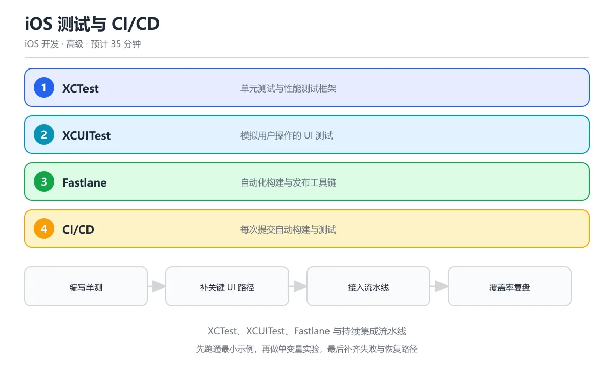

# iOS 测试与 CI/CD

> 内容更新时间：2026-10-06 · 学习阶段：进阶 · 预计用时：40 分钟




## 本节知识框架

```text
iOS 测试与 CI/CD
├── 测试金字塔
│   ├── 单元测试（XCTest）
│   ├── UI 测试（XCUITest）
│   └── 快照测试（Snapshot Testing）
├── 测试基础设施
│   ├── Mock 与 Stub
│   ├── 测试覆盖率
│   └── 异步测试与性能测试
├── CI/CD 流水线
│   ├── Xcode Cloud
│   ├── Fastlane
│   └── GitHub Actions
└── 发布与分发
    ├── TestFlight
    └── App Store Connect
```

本节围绕「如何保证 iOS 应用质量」展开：先理解测试金字塔的分层策略，再掌握 XCTest 和 XCUITest 的实战写法，最后学会用 Fastlane 和 CI 工具把测试、构建、发布串成自动化流水线。

---


**复习清单**

- [ ] 能区分 XCTest 单元测试与 XCUITest UI 测试的适用场景
- [ ] 能写出一个带异步 expectation 的 XCTest 用例
- [ ] 能用 Fastlane 串起测试、打包与上传 TestFlight
- [ ] 能解释测试金字塔与代码覆盖率的关系
- [ ] 能说明 CI 流水线在什么时机触发自动化测试

## 核心概念定义

| 概念 | 类比 | 定义 |
|------|------|------|
| **XCTest** | 像数学考试里的"验算" | Apple 官方测试框架，用于编写单元测试、性能测试和异步测试 |
| **XCUITest** | 像请一个机器人帮你点屏幕 | Apple 官方 UI 测试框架，模拟真实用户在 App 上的点击、滑动、输入操作 |
| **测试覆盖率** | 像检查漏网之鱼的渔网 | 衡量有多少代码被测试执行过，通常用行覆盖率或分支覆盖率表示 |
| **Mock 对象** | 像演戏时的替身演员 | 模拟真实依赖的假对象，让测试可以隔离运行 |
| **Fastlane** | 像一条自动装配线 | 开源的 iOS/Android 自动化工具集，一条命令完成签名、截图、上传等操作 |
| **CI/CD** | 像工厂的质检流水线 | 持续集成（CI）自动跑测试，持续交付/部署（CD）自动打包发布 |
| **TestFlight** | 像餐厅的试菜环节 | Apple 官方的 Beta 测试平台，让内部或外部用户在 App 上架前体验 |
| **快照测试** | 像给 UI 拍照对比 | 把视图渲染成图片，和基准图对比，任何视觉变化都会被检测出来 |

---

## 原理与运行机制

### 3.1 XCTest 运行机制

XCTest 的运行可以类比为"自动批改试卷"：

1. **发现阶段**：Xcode 扫描所有继承自 `XCTestCase` 的类，找到以 `test` 开头的方法
2. **setUp 阶段**：每个测试方法执行前调用 `setUp()`，准备干净的测试环境
3. **执行阶段**：运行测试方法，遇到 `XCTAssert` 断言时检查结果
4. **tearDown 阶段**：每个测试方法执行后调用 `tearDown()`，清理资源
5. **报告阶段**：生成测试报告，标记通过/失败/跳过

```text
测试执行流程：
Xcode 启动 → 发现 TestCase → setUp() → testMethod() → 断言检查 → tearDown() → 报告
```

### 3.2 XCUITest 运行机制

XCUITest 比 XCTest 多了一层"跨进程通信"：

1. **Runner App**：测试代码运行在一个独立的 Runner 进程中
2. **被测 App**：Runner 通过 Accessibility 接口操控真正的 App
3. **事件注入**：点击、滑动等操作通过系统级事件队列注入

```text
┌──────────────┐     Accessibility     ┌──────────────┐
│  Runner App  │ ───────────────────→  │  Your App    │
│  (测试代码)   │     事件注入          │  (被测目标)   │
└──────────────┘                       └──────────────┘
```

### 3.3 CI/CD 流水线原理

CI/CD 的核心思想是"每次提交都自动验证"：

```text
代码推送 → 触发构建 → 编译 → 跑单元测试 → 跑 UI 测试 → 生成覆盖率报告
                                                         ↓
                                              通过 → 打包 → TestFlight/App Store
                                              失败 → 通知开发者
```

---

## 典型应用场景

| 场景 | 使用的工具 | 说明 |
|------|-----------|------|
| 验证单个函数的逻辑 | XCTest | 比如测试价格计算函数是否正确 |
| 验证完整注册流程 | XCUITest | 模拟用户输入邮箱、密码、点击注册按钮 |
| 确保 UI 没被改坏 | 快照测试 | 每次 UI 修改后自动对比截图 |
| 每次提交自动跑测试 | GitHub Actions / Xcode Cloud | 推送代码后自动触发测试流水线 |
| 自动化打包发布 | Fastlane | 一条命令完成签名、构建、上传 TestFlight |
| 回归测试 | XCTest + CI | 确保新功能没有破坏旧功能 |

---

## 代码/协议/SQL 示例

### 5.1 XCTest 单元测试示例

```swift
import XCTest
@testable import MyShopApp

final class PriceCalculatorTests: XCTestCase {
    var calculator: PriceCalculator!
    
    override func setUp() {
        super.setUp()
        calculator = PriceCalculator()
    }
    
    override func tearDown() {
        calculator = nil
        super.tearDown()
    }
    
    // 测试正常情况
    func testCalculateTotal_withValidItems_returnsCorrectSum() {
        // Given（准备）
        let items = [
            Item(name: "苹果", price: 5.0, quantity: 3),
            Item(name: "牛奶", price: 12.0, quantity: 2)
        ]
        
        // When（执行）
        let total = calculator.calculateTotal(items)
        
        // Then（验证）
        XCTAssertEqual(total, 39.0, accuracy: 0.01, "总价应为 39 元")
    }
    
    // 测试空数组边界
    func testCalculateTotal_withEmptyItems_returnsZero() {
        let total = calculator.calculateTotal([])
        XCTAssertEqual(total, 0.0, "空列表总价应为 0")
    }
    
    // 测试折扣逻辑
    func testCalculateTotal_withDiscount_appliesPercentage() {
        let items = [Item(name: "书籍", price: 100.0, quantity: 1)]
        let total = calculator.calculateTotal(items, discount: 0.2)
        XCTAssertEqual(total, 80.0, accuracy: 0.01, "打 8 折后应为 80 元")
    }
    
    // 性能测试：确保计算在合理时间内完成
    func testCalculateTotal_performance() {
        let largeItems = (0..<10000).map { Item(name: "商品\($0)", price: Double($0), quantity: 1) }
        
        measure {
            _ = calculator.calculateTotal(largeItems)
        }
    }
}
```

### 5.2 异步测试示例

```swift
import XCTest
@testable import MyShopApp

final class NetworkServiceTests: XCTestCase {
    
    // 异步测试：使用 async/await（iOS 15+）
    func testFetchProducts_returnsProducts() async throws {
        let service = ProductService()
        
        let products = try await service.fetchProducts()
        
        XCTAssertFalse(products.isEmpty, "商品列表不应为空")
        XCTAssertTrue(products.allSatisfy { !$0.name.isEmpty }, "每个商品都应有名称")
    }
    
    // 异步测试：验证超时处理
    func testFetchProducts_onTimeout_throwsError() async {
        let service = ProductService(timeout: 0.001) // 极短超时
        
        do {
            _ = try await service.fetchProducts()
            XCTFail("应该抛出超时错误")
        } catch {
            XCTAssertTrue(error is URLError, "应抛出网络错误")
        }
    }
    
    // 使用 expectation 测试回调式异步代码
    func testFetchProductsWithCompletion() {
        let expectation = XCTestExpectation(description: "获取商品完成")
        let service = ProductService()
        
        service.fetchProducts { result in
            switch result {
            case .success(let products):
                XCTAssertFalse(products.isEmpty)
            case .failure(let error):
                XCTFail("不应失败: \(error)")
            }
            expectation.fulfill()
        }
        
        wait(for: [expectation], timeout: 10.0)
    }
}
```

### 5.3 Mock 对象示例

```swift
import XCTest
@testable import MyShopApp

// 定义协议（方便替换真实实现）
protocol ProductRepositoryProtocol {
    func fetchProducts() async throws -> [Product]
}

// Mock 实现：返回固定数据，不依赖网络
final class MockProductRepository: ProductRepositoryProtocol {
    var shouldReturnError = false
    var mockProducts: [Product] = [
        Product(id: "1", name: "测试商品", price: 9.9)
    ]
    
    func fetchProducts() async throws -> [Product] {
        if shouldReturnError {
            throw URLError(.badServerResponse)
        }
        return mockProducts
    }
}

// 使用 Mock 进行隔离测试
final class ProductViewModelTests: XCTestCase {
    
    func testLoadProducts_withMockData_updatesState() async {
        // Given
        let mockRepo = MockProductRepository()
        let viewModel = ProductViewModel(repository: mockRepo)
        
        // When
        await viewModel.loadProducts()
        
        // Then
        XCTAssertEqual(viewModel.products.count, 1)
        XCTAssertEqual(viewModel.products.first?.name, "测试商品")
        XCTAssertFalse(viewModel.isLoading)
    }
    
    func testLoadProducts_onError_setsErrorMessage() async {
        let mockRepo = MockProductRepository()
        mockRepo.shouldReturnError = true
        let viewModel = ProductViewModel(repository: mockRepo)
        
        await viewModel.loadProducts()
        
        XCTAssertTrue(viewModel.products.isEmpty)
        XCTAssertNotNil(viewModel.errorMessage)
    }
}
```

### 5.4 XCUITest UI 测试示例

```swift
import XCTest

final class LoginUITests: XCTestCase {
    
    var app: XCUIApplication!
    
    override func setUp() {
        continueAfterFailure = false
        app = XCUIApplication()
        app.launchArguments = ["--uitesting"] // 传入测试标志
        app.launch()
    }
    
    func testLogin_withValidCredentials_showsHomeScreen() {
        // 找到文本输入框并输入
        let emailField = app.textFields["email_input"]
        emailField.tap()
        emailField.typeText("test@example.com")
        
        // 找到密码输入框并输入
        let passwordField = app.secureTextFields["password_input"]
        passwordField.tap()
        passwordField.typeText("password123")
        
        // 点击登录按钮
        app.buttons["login_button"].tap()
        
        // 验证：主页标题出现
        let homeTitle = app.staticTexts["home_title"]
        XCTAssertTrue(homeTitle.waitForExistence(timeout: 5.0), "应跳转到主页")
    }
    
    func testLogin_withEmptyEmail_showsValidationError() {
        app.buttons["login_button"].tap()
        
        let errorLabel = app.staticTexts["error_message"]
        XCTAssertTrue(errorLabel.waitForExistence(timeout: 3.0))
        XCTAssertEqual(errorLabel.label, "请输入邮箱地址")
    }
}
```

### 5.5 Fastlane 配置示例

```bash
# Fastfile 示例（位于 fastlane/Fastfile）

default_platform(:ios)

platform :ios do
  desc "运行所有测试"
  lane :test do
    scan(
      scheme: "MyShopApp",
      devices: ["iPhone 15"],
      code_coverage: true
    )
  end

  desc "构建并上传到 TestFlight"
  lane :beta do
    increment_build_number(xcodeproj: "MyShopApp.xcodeproj")
    build_app(
      scheme: "MyShopApp",
      export_method: "app-store",
      output_directory: "build"
    )
    upload_to_testflight(skip_waiting_for_build_processing: true)
  end

  desc "发布到 App Store"
  lane :release do
    upload_to_app_store(
      skip_metadata: false,
      skip_screenshots: true,
      submit_for_review: true,
      automatic_release: true
    )
  end
end
```

### 5.6 GitHub Actions CI 配置

```text
# .github/workflows/ios-ci.yml

name: iOS CI

on:
  push:
    branches: [main, develop]
  pull_request:
    branches: [main]

jobs:
  build-and-test:
    runs-on: macos-14
    steps:
      - uses: actions/checkout@v4
      
      - name: Select Xcode
        run: sudo xcode-select -s /Applications/Xcode_15.4.app
      
      - name: Build
        run: xcodebuild build
          -scheme MyShopApp
          -destination 'platform=iOS Simulator,name=iPhone 15'
          -configuration Debug
      
      - name: Test
        run: xcodebuild test
          -scheme MyShopApp
          -destination 'platform=iOS Simulator,name=iPhone 15'
          -enableCodeCoverage YES
      
      - name: Upload Coverage
        run: bash <(curl -s https://codecov.io/bash)
```

---

## 时间/空间复杂度或性能分析

| 测试类型 | 执行时间 | 维护成本 | 可靠性 | 反馈速度 |
|---------|---------|---------|--------|---------|
| 单元测试 | 毫秒级 | 低 | 高（>95%） | 极快 |
| 集成测试 | 秒级 | 中 | 中（~85%） | 快 |
| UI 测试 | 分钟级 | 高 | 低（~70%） | 慢 |
| 快照测试 | 秒级 | 中 | 高（>90%） | 快 |

**测试金字塔原则**：底层多写单元测试（快且稳），顶层少写 UI 测试（慢且脆弱）。

```text
        ╱  UI Tests  ╲        ← 少量（10%）
       ╱───────────────╲
      ╱ Integration Tests╲     ← 适量（20%）
     ╱─────────────────────╲
    ╱     Unit Tests        ╲   ← 大量（70%）
   ╱─────────────────────────╲
```

**覆盖率目标**：核心业务逻辑建议 ≥ 80%，UI 层不强制要求覆盖率。

---

## 常见误区与易错点

| 误区 | 后果 | 正确做法 |
|------|------|---------|
| 在测试中依赖真实网络 | 测试不稳定，时过时不过 | 用 Mock/Stub 隔离外部依赖 |
| 测试之间共享状态 | 测试顺序影响结果，难以定位问题 | 每个测试在 setUp 中重置状态 |
| 只测正常路径 | 边界情况和错误处理未验证 | 覆盖空值、极大值、错误响应 |
| 追求 100% 覆盖率 | 写了大量无意义的测试，维护成本高 | 关注关键路径，覆盖率是参考指标而非目标 |
| UI 测试写得太多 | 运行慢、频繁失败、维护成本高 | UI 测试只覆盖核心用户流程 |
| 忘记测试异步代码 | 竞态条件导致偶发崩溃 | 用 `async/await` 或 `XCTestExpectation` |
| 在 UI 线程外更新 UI | 测试通过但实际 App 崩溃 | 用 `@MainActor` 确保主线程执行 |
| CI 不缓存依赖 | 每次构建都重新下载，耗时巨大 | 配置 DerivedData 和 SPM 缓存 |

---

## 与其他知识点的关系

```text
Swift 基础 (mobile_swift)
    ↓ 提供语言基础
iOS 测试与 CI/CD (本课)
    ↓ 测试保障质量
    ├──→ iOS 性能优化 (mobile_ios_performance)：性能测试与基准对比
    └──→ iOS App Store 上架 (mobile_ios_appstore)：自动化发布流程

SwiftUI 完整教程 (mobile_swiftui_complete)
    ↓ 提供 UI 框架知识
    └──→ 快照测试需要 SwiftUI 视图作为输入

Fastlane 依赖关系：
    Fastlane → 需要 Xcode 项目配置
    Fastlane → 需要 Apple ID 证书配置
    CI/CD → 需要 Git 仓库 + 构建服务器
```

**前置知识**：
- `mobile_swift`：需要掌握 Swift 语法、可选类型、协议
- 了解 Xcode 基本操作和 iOS 项目结构

**后续延伸**：
- `mobile_ios_performance`：Instruments 性能分析与优化
- `mobile_ios_appstore`：App Store 审核与发布策略

---

## 自测题与参考答案

**Q1**：XCTest 中 `setUp()` 方法的调用时机是？

<details>
<summary>参考答案</summary>
每个测试方法执行之前都会调用一次 `setUp()`，确保每个测试都在干净的环境中运行。如果有 3 个测试方法，`setUp()` 会被调用 3 次。
</details>

**Q2**：为什么 UI 测试（XCUITest）比单元测试更容易失败？

<details>
<summary>参考答案</summary>
因为 UI 测试依赖真实的界面元素（按钮位置、文本标签、动画时间），任何 UI 调整（改文案、改布局、改动画时长）都可能导致测试找不到元素或超时。此外，UI 测试涉及跨进程通信，系统负载、动画延迟等外部因素也会影响稳定性。
</details>

**Q3**：Fastlane 的 `match` 工具解决什么问题？

<details>
<summary>参考答案</summary>
`match` 解决 iOS 证书和描述文件（Provisioning Profile）的管理问题。它把证书和描述文件存储在 Git 仓库中，团队成员可以一键同步，避免"证书过期"或"换电脑后无法签名"的问题。类比：它就像把钥匙放在所有人都能访问的安全柜里，而不是每个人各自保管。
</details>

**Q4**：什么是测试覆盖率中的"分支覆盖率"？

<details>
<summary>参考答案</summary>
分支覆盖率衡量的是代码中每个分支（if/else、switch case、guard 等）是否都被测试执行过。比如一个函数有 if-else 两个分支，如果测试只走了 if 分支，分支覆盖率就是 50%。它比行覆盖率更严格，因为一行代码可能包含多个分支。
</details>

---

## 考点精讲

### 考点 1

XCTest 框架主要用于什么类型的测试？

A. UI 界面测试

B. 网络请求测试

C. 单元测试和性能测试

D. 数据库测试

**正确答案：C**

**详细解释**：XCTest 是 Apple 官方测试框架，支持单元测试（XCTestCase）和性能测试（measure block）。 写单元测试时把网络和数据库依赖抽成协议，用假实现注入，就能在不启动模拟器的情况下快速验证逻辑。 XCTest 还支持异步测试和期望值，网络或回调场景用 expectation 等待结果，避免测试提前结束。 本题正确项是「单元测试和性能测试」。

---

### 考点 2

XCUITest 和 XCTest 的核心区别是什么？

A. XCUITest 更快

B. XCUITest 模拟用户操作（点击、滑动），XCTest 测试代码逻辑

C. XCTest 只能测 Swift

D. XCUITest 不需要模拟器

**正确答案：B**

**详细解释**：XCUITest 通过 UI 元素交互测试 App 行为，XCTest 直接测试函数和方法的逻辑正确性。 UI 测试运行速度慢且容易受环境波动影响，所以测试金字塔建议多写单元测试，只把关键用户路径放进 XCUITest。 XCUITest 通过 accessibilityIdentifier 定位元素，给控件补上稳定的标识比依赖文案更不容易因改版失效。 本题正确项是「XCUITest 模拟用户操作（点击、滑动），XCTest 测试代码逻辑」。

---

### 考点 3

Fastlane 在 iOS 开发中的主要作用是什么？

A. 编写 Swift 代码

B. 自动化构建、签名、截图和发布流程

C. 设计 App 界面

D. 管理数据库

**正确答案：B**

**详细解释**：Fastlane 是开源的自动化工具链，可以一键完成截图生成、证书管理、TestFlight 上传和 App Store 发布。 Fastlane 的 lane 可以把测试、打包和发布串成一条命令，配合 CI 每次合并请求自动跑一遍。 Fastlane 配合 match 管理证书，配合 gym 打包、pilot 上传 TestFlight，几行配置就能复用整套发布流程。 本题正确项是「自动化构建、签名、截图和发布流程」。

---

### 考点 4

代码覆盖率测试的意义是什么？

A. 覆盖率 100% 就没有 bug

B. 衡量测试代码覆盖了多少源代码路径，帮助发现未测试的代码

C. 提高运行速度

D. 减少 App 体积

**正确答案：B**

**详细解释**：代码覆盖率显示有多少代码被执行到，低覆盖率的区域可能是测试盲区，但不代表高覆盖率就无 bug。 覆盖率要关注分支覆盖而不是只看行覆盖，条件判断只走了一个分支时，行覆盖再高也可能漏掉 bug。 覆盖率要按模块看，核心支付、登录等路径应接近全覆盖，工具类偏低可以接受但要评估风险。 本题正确项是「衡量测试代码覆盖了多少源代码路径，帮助发现未测试的代码」。

---

### 考点 5

CI/CD 流水线中，什么时候触发自动化测试？

A. 只在发布时

B. 每次代码提交/合并请求时自动运行

C. 手动触发

D. 每月一次

**正确答案：B**

**详细解释**：CI/CD 的核心是每次代码变更自动触发构建和测试，尽早发现问题。 流水线还应缓存依赖并并行执行测试，否则完整测试套件会让每次提交的反馈时间变得难以接受。 除了提交触发，还可以配置每日定时跑全量回归，防止依赖升级或环境变化引入的隐性回归没人发现。 本题正确项是「每次代码提交/合并请求时自动运行」。

## 术语速查

| 术语 | 一句话说明 |
| --- | --- |
| XCTest | Apple 官方测试框架 |
| XCUITest | Apple 官方 UI 测试框架 |
| 断言 | 验证某个条件是否为真的检查语句 |
| Mock | 模拟真实依赖的假对象 |
| Stub | 返回预设数据的简化实现 |
| 覆盖率 | 衡量代码被测试执行的比例 |
| Fastlane | iOS/Android 自动化工具集 |
| TestFlight | Apple 官方 Beta 测试分发平台 |
| CI | 持续集成，自动跑测试 |
| CD | 持续交付/部署，自动打包发布 |
| Lane | Fastlane 中的任务单元 |
| DerivedData | Xcode 编译缓存目录 |
| SPM | Swift 包管理器 |
| 快照测试 | 对比 UI 截图变化的测试方式 |
| 测试金字塔 | 单元测试多、UI 测试少的分层策略 |

---

## 参考资料与复核

### 官方文档
- [Apple - XCTest Framework](https://developer.apple.com/documentation/xctest)
- [Apple - Testing in Xcode](https://developer.apple.com/documentation/xcode/testing)
- [Fastlane Documentation](https://docs.fastlane.tools/)
- [Apple - Xcode Cloud](https://developer.apple.com/xcode/cloud/)

### 推荐资源
- 《iOS 测试实战》- 涵盖单元测试、TDD、Mock 等实践
- [Swift Testing (新框架)](https://developer.apple.com/documentation/testing/) - iOS 17+ 的新测试框架
- [Codecov](https://codecov.io/) - 代码覆盖率可视化平台

### 复核要点
- ✅ XCTest 断言方法与实际 API 一致
- ✅ XCUITest 的 `waitForExistence` 方法签名正确
- ✅ Fastlane lane 配置语法符合 Fastfile 规范
- ✅ GitHub Actions 配置使用 macOS runner（iOS 构建必须）
- ✅ 测试金字塔比例（70/20/10）为业界通用建议
- ✅ async/await 测试语法适用于 iOS 15+

---

- 最后复核：2026-10-04
- 下次复核：2027-10-17

## 内容元数据

- 内容版本：v2.0
- 最后更新：2026-10-06
- 学习阶段：进阶
- 适用环境：通用开发环境
- 内容来源：内置结构化课程与工程实践整理
- 相关主题：mobile ios testing
- 质量版本：P0 测验标准 + P1 覆盖扩展 + P2 体验补全