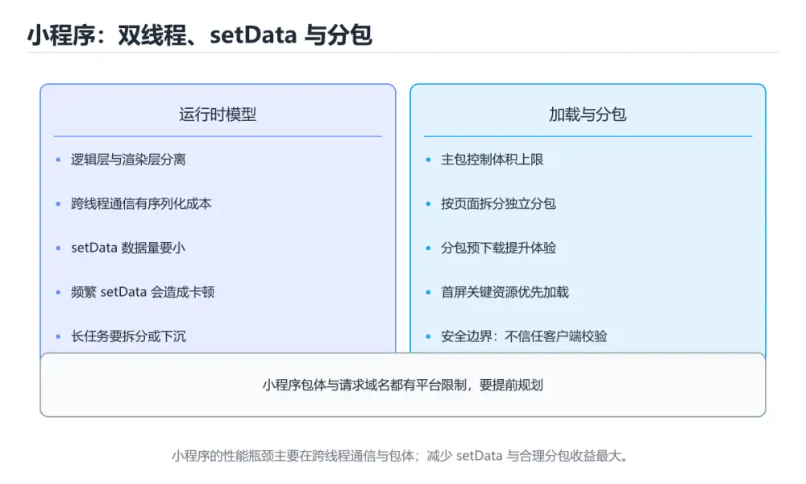
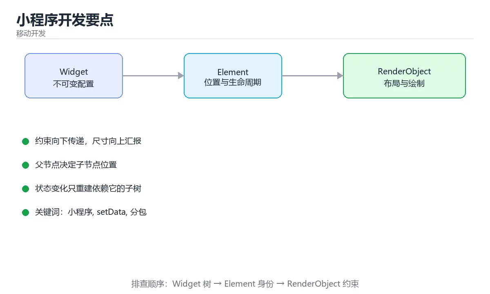

# 小程序开发要点

> 内容更新时间：2026-10-06 · 学习阶段：基础 · 预计用时：25 分钟

你有没有用过微信里的小程序？点外卖、扫码、看订单，这些功能背后都是小程序在运行。这节课我们就来聊聊小程序到底是怎么回事，重点搞懂三件事：双线程模型是怎么工作的、setData 怎么用才不卡、分包加载怎么让首屏更快。





## 本节知识框架

这节课我们会从最基础的概念出发，一步步搞懂小程序的运行方式。先认识核心术语，再看原理，然后动手看代码，最后用自测题和考点检验自己学到了什么。

复习清单——学完之后对照看看自己掌握了没有：

- [ ] 能用自己的话说出小程序、setData、分包、渲染层分别是什么
- [ ] 能写出一个小程序页面的基本结构，并解释 setData 的作用
- [ ] 能说出至少三种常见错误做法和对应的修复方式
- [ ] 能独立完成全部 6 道考点自测题

## 核心概念定义

先快速认识几个关键术语，后面会反复提到它们：

| 术语 | 一句话说明 |
| --- | --- |
| 小程序 | 运行在微信等宿主 App 里的轻量应用，用 WXML + WXSS + JS/TS 编写，没有浏览器 DOM 环境 |
| setData | 小程序把数据从逻辑层同步到视图层的接口，应合并调用、只传变化字段，避免频繁跨层通信 |
| 分包 | 把非首屏页面拆到子包里按需下载，用来控制主包体积以通过平台限制 |
| 渲染层 | 小程序把视图渲染放在独立线程，逻辑层通过 setData 把数据同步过去 |
| 逻辑层 | 运行 JavaScript 的地方（iOS 上是 JSCore，Android 上是 V8），负责处理业务逻辑 |
| rpx | 小程序专用的响应式尺寸单位，会根据屏幕宽度自动适配，750rpx 永远等于屏幕宽度 |

## 原理与运行机制

### 双线程模型

小程序和网页最大的区别在于：小程序没有浏览器环境，它的渲染和逻辑分别跑在两个不同的线程里。

想象一下这样的场景：你开了一家餐厅，前台负责接待客人、展示菜单（渲染层），后厨负责做菜（逻辑层）。前台和后厨之间不能直接对话，必须通过对讲机传递信息——这个对讲机就是 setData。

具体来说：

1. 用户在页面上的操作（点击、滑动）会被渲染层捕获
2. 渲染层把事件发送给逻辑层
3. 逻辑层处理完业务逻辑后，调用 setData 把新数据发回渲染层
4. 渲染层收到数据后更新页面显示

这种设计的好处是：即使 JS 代码跑了一个很耗时的计算，页面也不会卡住，因为它们在不同的线程里。但代价是：每次 setData 都是一次跨线程通信，数据量太大或者调用太频繁，就会造成延迟和卡顿。

### setData 的工作原理

setData 做的事情看起来简单——把数据从逻辑层传到渲染层，但背后有几个关键点：

- 每次调用都会触发一次序列化（把 JS 对象变成可传输的格式）和反序列化
- 数据量越大，传输耗时越长
- 渲染层收到数据后会做 diff 对比，然后更新对应的视图节点

所以用好 setData 的核心原则就是：少传、合并传、只传变化的部分。

### 分包加载机制

微信对小程序的主包大小有限制（目前 2MB），如果所有页面都塞进主包，很快就会超限，而且用户打开小程序时要下载全部内容，首屏就会很慢。

分包的思路很直接：把首屏需要的页面放在主包，其他页面放到不同的子包里。用户打开小程序时只下载主包，访问分包页面时再按需下载对应的子包。

你还可以配置预加载规则：当用户进入某个页面时，在空闲网络下提前下载指定的分包，这样用户真正跳转时就不用等了。

## 典型应用场景

小程序适合哪些场景呢？下面列举几个最常见的：

**电商与点餐**：商品列表、购物车、下单支付。这类场景页面多、交互频繁，需要合理使用分包和 setData 优化。

**工具类应用**：扫码、查询、打卡。这类场景注重首屏速度，主包要尽量精简。

**内容展示**：文章列表、详情页、个人中心。长列表场景要注意用虚拟列表或分页加载，避免一次渲染上千条数据。

**企业内部工具**：审批、报表、巡检。这类场景经常需要调用 wx.request 与后端交互，要注意请求域名配置和登录态管理。

不管哪种场景，有几个通用原则要记住：

- 首屏相关的资源放主包，其余分包
- setData 只传必要字段，大列表用分页
- 敏感信息（密钥、session_key）只放服务端
- 图片等大资源放 CDN，不占包体积

## 代码/协议/SQL 示例

下面是一个典型的小程序列表页，展示了分页加载、防抖触底和错误处理：

```javascript
// pages/list/list.js
Page({
  data: {
    items: [],
    page: 1,
    loading: false,
    hasMore: true
  },

  onLoad() {
    this.loadMore();
  },

  onReachBottom() {
    this.loadMore();
  },

  async loadMore() {
    if (this.data.loading || !this.data.hasMore) return;
    this.setData({ loading: true });
    try {
      const res = await wx.request({
        url: "https://api.example.com/items",
        data: { page: this.data.page, size: 20 }
      });
      const list = res.data.items || [];
      this.setData({
        items: this.data.items.concat(list),
        page: this.data.page + 1,
        hasMore: list.length === 20,
        loading: false
      });
    } catch (error) {
      this.setData({ loading: false });
      wx.showToast({ title: "加载失败", icon: "none" });
    }
  }
});
```

再来看一个页面的结构文件，小程序用 WXML 来描述页面内容（类似 HTML）：

```html
<!-- pages/orders/orders.wxml -->
<view class="page">
  <view wx:if="{{loading}}" class="tip">加载中...</view>
  <view wx:elif="{{error}}" class="tip error">{{error}}</view>
  <view wx:elif="{{orders.length === 0}}" class="tip">暂无订单</view>
  <view wx:else>
    <view
      wx:for="{{orders}}"
      wx:key="id"
      class="card"
      bindtap="onTapOrder"
      data-id="{{item.id}}"
    >
      <text class="title">{{item.title}}</text>
      <text class="amount">¥{{item.amount}}</text>
    </view>
  </view>
</view>
```

页面文件结构长这样：

```text
pages/orders/
  orders.wxml      结构（类似 HTML）
  orders.wxss      样式（类似 CSS）
  orders.js        逻辑（JavaScript）
  orders.json      页面配置
app.json           全局配置（页面注册、分包规则等）
app.js             应用生命周期
```

分包配置写在 app.json 里，大致结构如下：

```text
pages 数组放首屏页面路径
subPackages 数组放各分包的 root 和 pages
preloadRule 对象配置预加载规则，指定在哪个页面空闲时下载哪些分包
```

## 时间/空间复杂度或性能分析

小程序的性能瓶颈主要集中在三个地方：

**setData 通信开销**：每次 setData 都要把数据从逻辑层序列化后传到渲染层。如果你一次传了一个包含几千条记录的数组，光是序列化就要花不少时间，渲染层收到后做 diff 和更新视图也需要时间。经验法则：单次 setData 的数据量控制在几十 KB 以内，列表超过 100 条就要考虑分页或虚拟列表。

**首屏加载耗时**：主包越大，下载和解压的时间越长。微信对主包大小有限制，即使没超限，主包里有太多非首屏资源也会拖慢启动速度。分包是解决这个问题最直接的手段。

**长列表渲染**：用 wx:for 直接渲染上千个节点会导致滚动卡顿。解决方案是使用 recycle-view 组件或者自己实现虚拟列表，只渲染屏幕可见区域内的元素。

测量性能时，可以用微信开发者工具里的 Audits 面板查看首屏耗时和帧率，也可以在代码里用 Date.now() 或 performance 做打点。关键是固定输入条件反复测量，而不是只看一次的结果。

## 常见误区与易错点

初学者在小程序开发中最容易犯这些错误：

| 错误 | 现象 | 修法 |
| --- | --- | --- |
| 频繁调用 setData | 界面明显卡顿，滚动掉帧 | 合并多次 setData 为一次，只传变化的字段 |
| 用 document 或 window 操作 DOM | 运行直接报错 | 小程序没有浏览器 DOM 环境，改用官方 API |
| wx:for 忘记写 wx:key | 列表项状态错乱，输入框内容串位 | 给 wx:for 加上稳定唯一的 wx:key 字段 |
| 把密钥写在前端代码里 | 密钥泄露，被恶意调用 | 敏感操作全部放服务端，前端只做展示 |
| 主包塞了太多页面和资源 | 首屏加载慢，甚至超限无法上传 | 用分包拆分，图片等大资源放 CDN |
| 忽略 rpx 和 px 的区别 | 不同机型上界面尺寸错乱 | 布局尺寸统一用 rpx 做自适应 |
| 不处理请求失败的情况 | 网络异常时页面白屏 | 请求加上 catch，页面要有加载、空态、错误、正常四种状态 |
| 用 data-* 传复杂对象 | 序列化后数据丢失或变形 | 只传 id，需要详情时根据 id 去查数据 |

## 与其他知识点的关系

小程序开发涉及的知识并不是孤立的，它和你已经学过或即将学到的内容都有联系：

**与前端基础的关系**：WXML 类似 HTML，WXSS 类似 CSS，JS 逻辑和前端 JavaScript 基本一致。如果你之前学过 HTML/CSS/JS，上手会很快。但要注意小程序没有 DOM，不能直接操作页面元素。

**与移动端性能优化的关系**：setData 的优化本质上就是跨线程通信的性能优化，分包加载本质上就是按需加载的思想在小程序里的具体应用。这些概念在后续的《移动端性能优化实战》里还会深入展开。

**与网络请求的关系**：小程序的网络请求（wx.request）只能发 HTTPS 请求，而且域名要在小程序后台提前配置白名单。登录流程（wx.login 换 code，服务端换 openid）也比普通网页更复杂，需要前后端配合。

**术语衔接提醒**：本课定义的 `小程序`、`setData`、`分包` 在后续课程中会继续出现。如果后续课程改写了某个术语的含义，记得以当时的定义为准。

## 自测题与参考答案

先自己试着回答，再看参考答案。答案都能在上面正文里找到。

**自测 1**：不看正文，用自己的话说出小程序是什么，它和网页有什么区别？

参考答案：小程序是运行在微信等宿主 App 里的轻量应用，用 WXML + WXSS + JS 编写。和网页最大的区别是小程序没有浏览器 DOM 环境，渲染和逻辑跑在两个不同的线程里，数据通过 setData 单向传递。

**自测 2**：setData 为什么不能频繁调用？应该怎么优化？

参考答案：因为每次 setData 都是一次跨线程通信，需要序列化和传输数据。频繁调用会导致界面卡顿。优化方式是合并多次调用为一次，只传变化的字段，不要传整个大数组。

**自测 3**：什么是分包？为什么要用分包？

参考答案：分包是把非首屏页面拆到子包里按需下载。因为微信对主包大小有限制，而且主包越大首屏加载越慢。分包后用户打开小程序时只下载主包，访问分包页面时再按需加载。

**自测 4**：为什么在小程序里写 document.getElementById 会报错？

参考答案：因为小程序没有浏览器 DOM 环境。小程序的渲染层和逻辑层是分开的两个线程，逻辑层里运行的 JS 无法直接访问 DOM。要操作页面要用小程序提供的 API，比如 setData 更新数据来驱动视图变化。

**自测 5**：rpx 和 px 有什么区别？什么时候该用 rpx？

参考答案：px 是固定像素单位，不同屏幕上实际大小不同。rpx 是小程序的响应式单位，750rpx 永远等于屏幕宽度，会根据屏幕大小自动缩放。做布局时应该用 rpx 来适配不同机型。

## 考点精讲

下面 6 道题覆盖了本课的核心知识点。先自己作答，再核对答案，最后回到正文对应部分复习。

### 考点 1

题目：围绕“小程序开发要点”中的 小程序、setData、分包，下列哪两项是本课强调的实践判断？

A. 验证 setData 时要固定版本并覆盖边界输入，结论才可复现
B. 把 setData 的单次运行结果当成所有版本和规模都成立
C. 学习 小程序 时要同时说明输入、输出和失败路径，不能只看正常流程
D. 只要 小程序 的常规示例通过，就可以跳过边界与异常路径

正确答案：AC

这道题考的是学习方法论。验证任何结论都要固定条件、覆盖边界，不能只看正常情况就下结论。A 和 C 都强调了这一点，B 和 D 则犯了以偏概全的错误。

### 考点 2

题目：首屏加载过慢，最先考虑的手段是？

A. 把所有资源放进主包
B. 主包瘦身并使用分包与预加载
C. 增加页面数量
D. 关闭缓存

正确答案：B

首屏慢的根本原因是主包太大，要下载的内容太多。解决办法就是把非首屏资源拆出去（分包），同时配置预加载规则让用户在空闲时提前下载。A 会让问题更严重，C 和 D 跟首屏速度没有直接关系。

### 考点 3

题目：`小程序开发要点` 的示例代码用于验证 `小程序`，其背景是双线程模型、setData 优化、分包加载与安全边界。代码的真实内容是下面哪一项？

A. 调用了 `setData()`
B. 调用了 `increase2()`
C. 调用了 `print()`
D. 调用了 `Counter()`

正确答案：A

本课的示例代码是一个分页加载的列表页，核心操作就是调用 setData 把新数据同步到视图层。increase2、print、Counter 都不是小程序的 API。

### 考点 4

题目：为什么小程序里不能使用 document 与 window？

A. 因为性能太差
B. 因为需要付费开通
C. 因为没有浏览器 DOM 环境
D. 因为语法不支持

正确答案：C

小程序的逻辑层跑在 JSCore 或 V8 引擎里，不是浏览器环境，自然没有 document 和 window 这些浏览器对象。这是小程序架构设计决定的，不是性能问题也不是语法限制。

### 考点 5

题目：适配不同机型屏幕尺寸，推荐使用哪个单位？

A. pt
B. em 固定值
C. px
D. rpx

正确答案：D

rpx 是小程序专门为屏幕适配设计的单位，750rpx 始终等于屏幕宽度。px 是固定像素，在不同屏幕上大小不一样。pt 主要用于 iOS 原生开发，em 是 CSS 里的相对单位但不适合做小程序的主要布局单位。

### 考点 6

题目：填空：补齐下面这段术语说明中的空缺。课程 `双线程模型、setData 优化、分包加载与安全边界。`，这段说明是：`____`：小程序把数据从逻辑层同步到视图层的接口；应合并调用、只传变化字段，避免频繁跨层通信。空缺处应填哪个术语？

正确答案：setData

这道题考的就是 setData 的定义。记住关键词：数据同步、逻辑层到视图层、合并调用、只传变化字段。

## 术语速查

| 术语 | 一句话说明 |
| --- | --- |
| 小程序 | 运行在宿主 App 里的轻量应用，用 WXML + WXSS + JS/TS 编写，没有浏览器 DOM |
| setData | 把数据从逻辑层同步到视图层的接口，要合并调用、只传变化字段 |
| 分包 | 把非首屏页面拆到子包按需下载，控制主包体积通过平台限制 |
| 渲染层 | 独立线程，负责视图渲染，通过 setData 接收逻辑层的数据 |
| 逻辑层 | 运行 JS 的线程，处理业务逻辑，通过 setData 与渲染层通信 |
| rpx | 响应式尺寸单位，750rpx 等于屏幕宽度，用于适配不同机型 |

## 内容元数据

- 内容版本：v2.0
- 最后更新：2026-10-06
- 学习阶段：基础
- 适用环境：微信小程序基础库 2.x
- 内容来源：内置结构化课程与工程实践整理
- 相关主题：小程序、setData、分包、rpx、微信
- 质量版本：P0 测验标准 + P1 覆盖扩展 + P2 体验补全

## 参考资料与复核

- 最后复核：2026-10-04
- 下次复核：2027-08-10
- 复核范围：版本兼容、API 行为、安全建议与工程实践

| 参考资料 | 本课用途 |
| --- | --- |
| [微信小程序官方文档](https://developers.weixin.qq.com/miniprogram/dev/framework/) | 小程序架构、API、组件与开发规范 |
| [微信小程序性能优化指南](https://developers.weixin.qq.com/miniprogram/dev/framework/performance/) | setData 优化、分包加载与首屏提速 |
| [微信小程序分包加载](https://developers.weixin.qq.com/miniprogram/dev/framework/subpackages.html) | 分包配置、预加载规则与体积控制 |