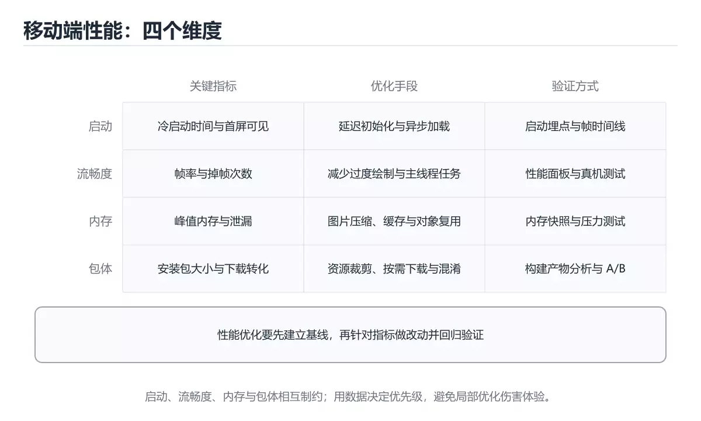

# 移动端性能优化实战

> 内容更新时间：2026-10-06 · 学习阶段：进阶 · 预计用时：60 分钟



## 本节知识框架

这节课我们聊一个每个移动端开发者都绕不开的话题——怎么让 App 跑得又快又稳。简单来说，我们会从四个方向入手：启动速度、滑动流畅度、内存占用和包体积。你不需要提前精通什么高深理论，只要写过 Android 或 Flutter 页面，就能跟上。

学完这节课，你应该能做到：

- 用自己的话说清楚"冷启动"和"卡顿"到底是怎么回事，并且能举出一个反面例子。
- 拿到一段有性能问题的代码，能指出哪里可能卡、为什么卡、怎么改。
- 知道怎么用工具测量性能，而不是凭感觉瞎改。

### 复习清单

- [ ] 能不看正文，说出启动优化的三个关键阶段。
- [ ] 能解释为什么大图直接加载会导致内存暴涨，并说出解决办法。
- [ ] 能列出至少三个导致列表滚动掉帧的常见原因。
- [ ] 能说出"性能基线"是什么意思，以及为什么要纳入 CI。

## 核心概念定义

先把几个高频术语讲明白，后面聊起来才不会鸡同鸭讲。

| 术语 | 通俗解释 | 容易踩的坑 |
| --- | --- | --- |
| 性能优化 | 先定好指标和基线，然后有针对性地减少不必要的计算、IO、内存或网络开销。不是"感觉快了"就算数，要有数据支撑。 | 不看数据凭感觉改，改了半天其实没效果。 |
| 冷启动 | App 进程从零开始创建，直到首屏可以交互的整个过程。初始化太多东西、加载太多资源都会拖慢它。 | 启动时把所有 SDK 都初始化，结果冷启动慢了好几秒。 |
| 卡顿 | 界面在某一段时间内没有响应用户操作，或者滑动时明显掉帧。通常是主线程被耗时任务堵住了。 | 主线程做网络请求或读文件，界面直接卡死。 |
| 包体 | App 安装包的大小。包越大，用户下载意愿越低，应用商店也可能限制推送。 | 塞了一堆没用的高清图和重复资源，包体膨胀。 |

## 原理与运行机制

### 四个维度速查表

| 维度 | 关键指标 | 目标值 | 主要手段 |
| --- | --- | --- | --- |
| 启动 | 冷启动耗时、首帧时间 | 冷启动 < 2 秒 | 延迟初始化、启动图、精简主包 |
| 流畅度 | 卡顿率、掉帧率、帧时间 | 掉帧 < 1%，帧时间 < 16.7ms | 减少主线程工作、异步化 |
| 内存 | 峰值内存、OOM 率 | 无 OOM，峰值稳定 | 图片复用、及时释放、避免泄漏 |
| 包体 | 下载体积、安装体积 | 视商店要求 | 资源压缩、按需下发、ABI 拆分 |

### 启动优化的三段耗时

App 从点击图标到能用，其实分三段：

```text
1. 进程创建 → Application.onCreate：这段时间主要在初始化各种 SDK
2. Activity 创建 → 首帧绘制：这段时间主要看布局复杂度和资源加载
3. 首帧之后 → 可交互：这段时间主要看数据加载和网络请求
```

每一段都有各自的优化策略。比如第一段可以延迟非必要 SDK 的初始化；第二段可以简化布局层级；第三段可以先展示骨架屏，数据到了再填充。

### 卡顿排查速查

| 现象 | 常见原因 | 怎么查 |
| --- | --- | --- |
| 列表滚动掉帧 | 主线程做 IO、布局过深、图片解码 | 帧率面板 + 主线程耗时追踪 |
| 点击无响应 | 主线程有长任务 | 主线程堆栈采样 |
| 页面切换慢 | 同步初始化大量对象 | 页面启动耗时打点 |
| 偶发卡顿 | GC 抖动或锁竞争 | 内存与线程监控 |
| 首帧后卡顿 | 首屏渲染完就立刻做重活 | 把重活移到空闲队列 |

### 监控与度量

| 指标 | 怎么采集 | 有什么用 |
| --- | --- | --- |
| 冷启动耗时 | 进程创建到首帧打点 | 版本回归对比 |
| 卡顿率 | 帧监控按设备分档 | 定位低端机问题 |
| 峰值内存 | 内存采样与分位统计 | 发现异常增长 |
| 崩溃率 | 崩溃上报 | 发布门禁 |

重要提醒：所有指标都要**分设备档位与系统版本**来看。只看平均值会把低端机的真实问题掩盖掉，看 P95 和 P99 才有意义。

## 典型应用场景

### 场景一：列表滚动掉帧

这是最常见的性能问题。用户在刷列表时感觉一卡一卡的，原因往往是主线程在做 IO 操作、布局嵌套太多层、或者图片没有降采样就直接显示。解决办法是用帧率面板定位具体哪一帧耗时过长，再针对性优化。

### 场景二：图片导致内存暴涨

一张 4000x3000 的图片，如果按原图解码成 ARGB_8888 格式，会占用 48MB 内存。但用户看到的缩略图可能只有 200x150。所以一定要按目标尺寸降采样，能省下 99% 以上的内存。

### 场景三：版本迭代后性能劣化

每次发版都加新功能，不知不觉启动就变慢了。解决办法是建立性能基线，纳入 CI 流程，每次构建自动跑一遍性能测试，超标就报警。

### 项目专属规格

- **交付目标**：完成移动端性能优化的可运行产物，留下可复查的证据。
- **必须交付**：源代码、运行说明、测试或验证记录、失败路径说明。
- **验收标准**：按本课项目交付物和考点精讲逐项核对，不能只展示正常路径。
- **排错要求**：至少记录一次失败输入、现象、定位过程和修复结论。

### 项目交付物

- 源代码：包含启动优化和图片降采样的示例工程。
- 运行说明：环境版本、启动命令、回滚方式。
- 验证记录：正常路径和失败路径各至少一条。
- 性能基线数据：冷启动耗时、帧率、内存峰值的测量结果。

### 验证命令与预期输出

| 阶段 | 命令 | 预期输出 |
| --- | --- | --- |
| 静态检查 | `flutter analyze` | 无分析问题 |
| 运行测试 | `flutter test` | 测试全部通过 |
| 构建发布包 | `flutter build apk --release` | 成功生成 APK |

## 代码/协议/SQL 示例

下面这段 Kotlin 代码展示了两个关键优化：启动时只做必需初始化，其余延后；图片按目标尺寸降采样，避免整张原图进内存。

```kotlin
// 启动路径只做必需初始化，其余交给空闲任务
override fun onCreate() {
    super.onCreate()
    initCrashReporter()          // 崩溃上报必须在最前
    initLogger()
    scheduleIdleInit()           // 统计、推送、AB 实验等延后
    logColdStart()               // 冷启动有记录
}

// 图片按目标尺寸降采样，避免整张原图进内存
fun decodeSampled(path: String, reqW: Int, reqH: Int): Bitmap? {
    val bounds = BitmapFactory.Options().apply { inJustDecodeBounds = true }
    BitmapFactory.decodeFile(path, bounds)
    var sample = 1
    while (bounds.outWidth / sample > reqW * 2 && bounds.outHeight / sample > reqH * 2) {
        sample *= 2
    }
    val options = BitmapFactory.Options().apply { inSampleSize = sample }
    return BitmapFactory.decodeFile(path, options)
}
```

用 bash 脚本快速检查 APK 包体大小：

```bash
# 查看 APK 文件大小
ls -lh app/build/outputs/apk/release/app-release.apk

# 分析 APK 内部组成
apkanalyzer apk summary app-release.apk
```

启动耗时的日志输出示例：

```text
[Startup] Application.onCreate start
[Startup] CrashReporter initialized in 12ms
[Startup] Logger initialized in 5ms
[Startup] Idle tasks scheduled
[Startup] Cold start recorded: 1823ms
[Startup] First frame rendered
```

## 时间/空间复杂度或性能分析

### 启动阶段耗时分析

| 阶段 | 常见耗时来源 | 优化手段 |
| --- | --- | --- |
| 进程创建 | 系统开销 | 无法优化，只能减少依赖 |
| 应用初始化 | 三方 SDK 同步初始化 | 改懒加载、并行初始化 |
| 首屏渲染 | 布局层级过深、图片阻塞 | 简化布局、占位图、异步解码 |
| 首页数据 | 串行请求 | 并行请求、本地缓存先展示 |

### 内存与包体优化速查

| 问题 | 手段 |
| --- | --- |
| 内存泄漏 | 生命周期解绑、避免静态持有 Context 或 View |
| 图片内存 | 按需尺寸解码、LRU 内存缓存、复用 Bitmap |
| 频繁 GC | 减少临时对象、避免循环内分配、使用对象池 |
| 包体过大 | 图片转 WebP 或 AVIF、去除未用资源、按 ABI 拆包、动态下发 |
| 资源重复 | 统一资源管理，避免同一图多份 |

### 用比喻理解各项指标

| 指标 | 比喻 | 用户感受 |
| --- | --- | --- |
| 启动时间 | 开门速度 | 等久了就退出 |
| 帧率 | 翻页流畅度 | 掉帧就是卡顿 |
| 内存 | 桌面空间 | 不够就杀后台 |
| 包体积 | 行李箱重量 | 太重就不愿下载 |
| 耗电 | 手机发热 | 费电就被卸载 |

## 常见误区与易错点

| 错误做法 | 会出现什么 | 正确做法 |
| --- | --- | --- |
| 凭感觉优化 | 改了没效果 | 先测量再改 |
| 只看平均值 | 长尾用户仍然卡 | 看 P95 与 P99 |
| 在主线程做 IO | 掉帧、ANR | 移到后台线程 |
| 列表用 notifyDataSetChanged | 整表重建，白屏闪烁 | 用 DiffUtil 局部更新 |
| 大图不降采样 | 内存暴涨甚至 OOM | 按显示尺寸解码 |
| 监听器不注销 | 内存泄漏 | 生命周期配对注销 |
| 只在高端机测 | 低端机卡顿严重 | 用低端设备或限频测试 |
| 启动时初始化所有 SDK | 冷启动显著变慢 | 只保留必需项，其余懒加载 |
| 用模拟器测性能 | 数据与真机差异大 | 真机分档测试 |
| 只优化一次不做回归 | 版本迭代后性能劣化 | 建性能基线并纳入 CI |
| 忽略后台与弱网场景 | 用户真实体验差 | 覆盖切后台、弱网、低电量 |
| 主线程做网络或文件 IO | 界面卡死甚至 ANR | 全部移到后台线程 |
| 图片按原图解码 | 内存暴涨、OOM | 按目标尺寸降采样 |

### 排错实战：五个常见现场

**现场 1：列表滚动掉帧**
症状是主线程做 IO、布局过深、图片解码。用帧率面板加主线程耗时追踪定位具体卡在哪一帧，然后只改一处，重跑验证。

**现场 2：点击无响应**
症状是主线程有长任务阻塞。用主线程堆栈采样抓取当前在做什么，把耗时操作移到后台。

**现场 3：页面切换慢**
症状是同步初始化大量对象。用页面启动耗时打点找到最慢的页面，把初始化改成懒加载。

**现场 4：偶发卡顿**
症状是 GC 抖动或锁竞争。用内存与线程监控抓取现场，减少临时对象分配，避免在循环里加锁。

**现场 5：首帧后卡顿**
症状是首屏渲染完就立刻做重活。把这些任务移到空闲队列，等用户交互稳定后再执行。

## 与其他知识点的关系

| 关系 | 课程 | 说明 |
| --- | --- | --- |
| 先修 | 《小程序开发要点》 | 本课会用到小程序开发中的一些基础概念。 |
| 关联 | 《Flutter Widget 入门》 | 学完本课可以把性能优化思路应用到 Widget 开发中。 |
| 前置 | 《鸿蒙 ArkTS 应用开发》 | 同分类中安排在本课之前，建议先完成。 |

简单说，这节课是"移动开发"分类的第 12 课。前面学的小程序开发是基础，后面学 Flutter Widget 入门时可以把性能优化的思路带过去。

### 容易混淆的概念

- **性能优化 vs 冷启动**：性能优化是一个大方向，指的是在明确指标后减少不必要的开销；冷启动是一个具体场景，指的是 App 从零到首屏可交互的过程。冷启动优化是性能优化的一部分。
- **冷启动 vs 卡顿**：冷启动关注的是"从 0 到 1 要多久"；卡顿关注的是"使用过程中有没有卡住"。两者可能互相影响——启动时做太多事，既拖慢冷启动，也可能导致首帧后卡顿。

## 自测题与参考答案

> 先自己做一遍，再对答案。答案都能在这节课的内容里找到。

### 自测 1：概念复述

不看正文，写出"性能优化"的含义，并说明它和"冷启动"的区别。

**参考答案**：性能优化是先定好指标和基线，然后有针对性地减少不必要的计算、IO、内存或网络开销。冷启动是 App 进程从零开始创建到首屏可交互的过程。冷启动优化是性能优化的一个子方向。

### 自测 2：排错思路

列表滚动掉帧，你会怎么排查？

**参考答案**：先用帧率面板确认掉帧的帧区间，再用主线程耗时追踪看主线程在做什么。如果是 IO 操作，移到后台线程；如果是布局过深，简化布局层级；如果是图片解码，做降采样。改一处，重跑验证。

### 自测 3：代码理解

读一下代码示例中 `decodeSampled` 函数，解释 `inJustDecodeBounds = true` 的作用。

**参考答案**：这行代码让 BitmapFactory 只解析图片的尺寸信息（宽高），不真正把像素数据加载到内存。这样我们就能根据目标尺寸计算合适的 `inSampleSize`，避免把整张大图加载进内存。

### 自测 4：迁移应用

把性能优化的思路用到你自己的项目里，写一个可能遇到的风险点和检验方式。

**参考答案**：比如"忽略弱网场景"——在 WiFi 下测试一切正常，但用户在地铁里用 4G 时就卡死了。检验方式是模拟弱网环境（比如用 Charles 限速），观察页面加载时间和超时处理是否符合预期。

### 自测 5：指标理解

为什么性能指标要看 P95、P99 而不是平均值？

**参考答案**：平均值会把最差的那部分体验掩盖掉。比如 100 个用户里有 5 个冷启动超过 5 秒，但平均下来可能只有 1.5 秒，看起来"达标"了，但那 5 个用户已经很痛苦了。看 P95 和 P99 才能发现这些长尾问题。

## 考点精讲

这节课的题库有 6 道题，下面逐题给出题干、选项和答案。先自己做，再核对。

### 考点 1

围绕“移动端性能优化实战”中的 性能优化、冷启动、卡顿，下列哪两项是本课强调的实践判断？

A. 只要 性能优化 的常规示例通过，就可以跳过边界与异常路径
B. 验证 冷启动 时要固定版本并覆盖边界输入，结论才可复现
C. 把 冷启动 的单次运行结果当成所有版本和规模都成立
D. 学习 性能优化 时要同时说明输入、输出和失败路径，不能只看正常流程

Ans: BD

### 考点 2

下面这段 `kotlin` 代码来自 `移动端性能优化实战`。课程主线是启动、流畅度、内存与包体四个维度的指标与优化手段。代码与 `性能优化` 有关。哪一项是代码里真实出现的内容？

A. 出现字面量 `fmt`
B. 出现字面量 `INVALID_ARGUMENT`
C. 出现字面量 `你好，{name}！`
D. 出现字面量 `冷启动有记录`

Ans: D

### 考点 3

图片导致内存暴涨，最常见的直接原因是？

A. 图片格式不是 PNG
B. 按原图尺寸解码并整张读入内存
C. 图片文件名太长
D. 没有使用异步加载回调

Ans: B

### 考点 4

主线程做文件或网络 IO 的直接后果是？

A. 自动切到子线程执行
B. 电量增加但界面正常
C. 界面卡顿甚至 ANR
D. 只影响后台任务

Ans: C

### 考点 5

为了避免版本迭代后性能劣化，应该怎么做？

A. 用模拟器数据作为基准
B. 只在出现用户投诉后优化，但这会增加每帧的开销
C. 只在发版前手动测一次
D. 建立性能基线并纳入持续集成与发布检查

Ans: D

### 考点 6

填空：补齐下面这段术语说明中的空缺。课程 `启动、流畅度、内存与包体四个维度的指标与优化手段。`，这段说明是：启动、流畅度、内存与`____`四个维度的指标与优化手段。空缺处应填哪个术语？

Ans: 性能基线

## 延伸阅读

想更直观地理解本课概念？推荐参阅以下图解专题：

- [图解内存布局：栈、堆与引用](visual_memory_layout.md)

## 术语速查

| 术语 | 一句话说明 |
| --- | --- |
| `性能优化` | 先定好指标和基线，然后减少不必要的计算、IO、内存或网络开销。 |
| `冷启动` | App 进程从零开始创建到首屏可交互的过程。 |
| `卡顿` | 界面在某段时间内没有响应用户操作，通常是主线程被堵住了。 |
| `包体` | App 安装包的大小，直接影响用户下载意愿。 |
| `性能基线` | 一组固定的性能指标参考值，用来判断新版本是否劣化。 |
| `inJustDecodeBounds` | 只读取图片尺寸信息，不加载像素数据到内存。 |
| `DiffUtil` | Android 提供的列表差异计算工具，避免整表刷新。 |
| `ANR` | Application Not Responding，主线程阻塞超过一定时间系统弹出的警告。 |

## 内容元数据

- 内容版本：v2.0
- 最后更新：2026-10-06
- 学习阶段：进阶
- 适用环境：Android / Flutter 3.x / Dart 3.x
- 内容来源：内置结构化课程与工程实践整理
- 相关主题：性能优化、冷启动、卡顿、内存、包体

## 参考资料与复核

- [本课资料锚点 mobile_performance](https://zh.wikipedia.org/w/index.php?search=mobile_performance)

- 最后复核：2026-10-04
- 下次复核：2027-08-10
- 复核范围：版本兼容、API 行为、安全建议与工程实践

| 参考资料 | 本课用途 |
| --- | --- |
| [Android 性能优化文档](https://developer.android.com/topic/performance) | 启动、内存、流畅度的官方指南 |
| [Flutter 性能最佳实践](https://docs.flutter.dev/perf/best-practices) | 帧率、构建与内存优化 |
| [Android 内存管理指南](https://developer.android.com/topic/performance/memory) | 内存泄漏排查与图片优化 |
| [APK 分析工具文档](https://developer.android.com/studio/build/apk-analyzer) | 包体分析与瘦身 |
