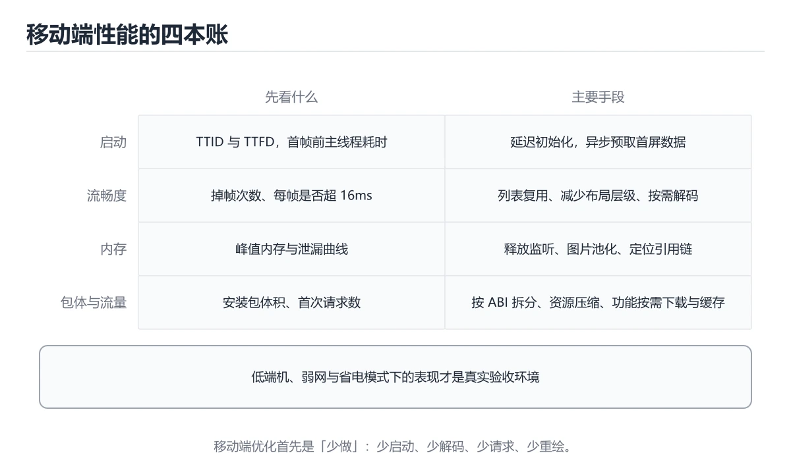

# 移动端性能优化



> 内容更新时间：2026-10-06 · 学习阶段：进阶 · 预计用时：35 分钟

## 本节知识框架

**课程定位**：分类「flutter」· 学习阶段 进阶 · 建议用时 50 分钟。

本课主线：掌握内存管理、启动速度优化、包体积缩减和渲染性能调优。

### 复习清单

- [ ] 能不看正文复述本课核心术语，并指出一个边界或反例。
- [ ] 能运行或推演本课示例，记录输入、输出与失败现象。
- [ ] 能完成一次自测，并把错题对照考点精讲定位原因。

### 课程导言
移动应用的性能直接影响用户体验和业务指标。就像一辆跑车，不仅要有强劲的动力（功能丰富），还要有优秀的燃油经济性（资源高效）、快速的启动响应（秒开体验）和轻盈的车身（小包体积）。本章将深入探讨移动端性能优化的三大核心领域：内存管理与泄漏检测、启动速度优化策略、包体积压缩技巧，以及通用的性能监控和调优方法。

### 学习目标
学完本章后，你将能够：

1. 识别和解决常见的内存泄漏问题
2. 优化应用启动时间，实现秒开体验
3. 压缩应用包体积，提升下载转化率
4. 使用性能分析工具定位瓶颈
5. 实施图片、网络和渲染优化策略
6. 建立持续的性能监控体系

## 核心概念定义

| 术语 | 一句话说明 |
| --- | --- |
| 性能优化 | 掌握内存管理、启动速度优化、包体积缩减和渲染性能调优。相关：正文给出可操作定义与适用边界。 |
| 内存管理 | 掌握内存管理、启动速度优化、包体积缩减和渲染性能调优。相关：正文给出可操作定义与适用边界。 |
| 启动速度 | 掌握内存管理、启动速度优化、包体积缩减和渲染性能调优。相关：正文给出可操作定义与适用边界。 |
| 包体积 | 掌握内存管理、启动速度优化、包体积缩减和渲染性能调优。相关：正文给出可操作定义与适用边界。 |
| 渲染性能 | 掌握内存管理、启动速度优化、包体积缩减和渲染性能调优。相关：正文给出可操作定义与适用边界。 |

## 原理与运行机制

《移动端性能优化》正文各章按「输入是什么 → 中间如何转换 → 输出到哪 → 失败时怎样表现」四问展开；复习时给每个机制补一句自己的复述，再回到对应章节核对。

### 生活类比拆解
#### 内存管理：像整理房间的空间利用

手机内存就像你的房间空间。如果东西乱放（对象引用不释放），房间很快会堆满（内存泄漏），最后连转身都困难（OOM崩溃）。良好的内存管理就像定期整理房间：用完的东西放回原位（释放不再使用的对象），大件物品合理摆放（大对象缓存策略），垃圾及时清理（GC触发时机）。在Android中，你需要手动管理引用关系；在iOS中，ARC帮你处理大部分工作，但仍需注意循环引用。

#### 启动速度：像餐厅的开门迎客

应用启动就像餐厅开门营业。冷启动（Cold Start）是早上第一次开门——需要开灯、烧水、准备食材（加载代码、初始化组件、请求数据），耗时最长。热启动（Hot Start）是客人暂时离开又回来——厨房还在运转，只需重新摆盘（恢复Activity/ViewController），速度快很多。优化启动速度的关键是：提前准备（预加载关键资源）、并行操作（多线程初始化）、延迟加载（非关键功能稍后初始化）。

#### 包体积：像旅行箱的打包艺术

应用包体积就像旅行箱里的行李。带太多衣服（未使用的资源文件）、重复的物品（冗余代码）、 oversized 的东西（未压缩的图片）会让箱子超重（下载慢、安装久）。精明的旅行者会：卷起衣服节省空间（代码混淆压缩）、只带必需品（按需加载模块）、用真空袋压缩（资源压缩）、托运大件物品（动态下发资源）。每减少1MB包体积，都可能显著提升下载转化率。

## 典型应用场景

- 结合「移动端性能优化」的常见落地场景与选型边界，详见正文各章节的对比讨论。
- 迁移到新项目时，先明确输入规模、失败代价与可观测手段，再决定采用深度。

## 代码/协议/SQL 示例

正文首个完整示例如下，先运行确认环境，再按正文步骤改一个输入观察输出变化。

```dart
import 'package:flutter/material.dart';

class MemoryLeakDemo extends StatefulWidget {
  @override
  _MemoryLeakDemoState createState() => _MemoryLeakDemoState();
}

class _MemoryLeakDemoState extends State<MemoryLeakDemo> {
  // ❌ 错误做法：Timer未取消会导致泄漏
  // Timer? _timer;

  // ✅ 正确做法：使用定时任务并在dispose中取消
  @override
  void dispose() {
    // 清理所有资源
    super.dispose();
  }

  @override
  Widget build(BuildContext context) {
    return Scaffold(
      appBar: AppBar(title: Text('内存管理演示')),
      body: Center(child: Text('注意资源的正确释放')),
    );
  }
}
```

### 渐进式代码示例
#### 最小示例：基础内存泄漏检测

**Flutter - 避免闭包捕获导致的泄漏：**

```dart
import 'package:flutter/material.dart';

class MemoryLeakDemo extends StatefulWidget {
  @override
  _MemoryLeakDemoState createState() => _MemoryLeakDemoState();
}

class _MemoryLeakDemoState extends State<MemoryLeakDemo> {
  // ❌ 错误做法：Timer未取消会导致泄漏
  // Timer? _timer;

  // ✅ 正确做法：使用定时任务并在dispose中取消
  @override
  void dispose() {
    // 清理所有资源
    super.dispose();
  }

  @override
  Widget build(BuildContext context) {
    return Scaffold(
      appBar: AppBar(title: Text('内存管理演示')),
      body: Center(child: Text('注意资源的正确释放')),
    );
  }
}
```

#### 完整示例：综合性能优化实践

**Android - 启动速度优化：**

```kotlin
// Application类 - 延迟初始化非关键组件
class MyApplication : Application() {
    
    override fun onCreate() {
        super.onCreate()
        
        // ✅ 关键路径：立即初始化
        initCriticalComponents()
        
        // ✅ 非关键路径：延迟初始化
        Thread {
            initNonCriticalComponents()
        }.start()
        
        // ✅ 空闲时初始化：使用IdleHandler
        Looper.myQueue().addIdleHandler {
            initIdleComponents()
            false // 只执行一次
        }
    }
    
    private fun initCriticalComponents() {
        // 初始化SDK、数据库等关键组件
        initDatabase()
        initNetworkClient()
    }
    
    private fun initNonCriticalComponents() {
        // 初始化统计、推送等非关键组件
        initAnalytics()
        initPushService()
    }
    
    private fun initIdleComponents() {
        // 初始化预加载缓存等
        preloadImageCache()
    }
}

// SplashActivity - 优化闪屏页
class SplashActivity : AppCompatActivity() {
    
    override fun onCreate(savedInstanceState: Bundle?) {
        // ✅ 在super.onCreate之前设置主题，避免白屏
        setTheme(R.style.SplashTheme)
        super.onCreate(savedInstanceState)
        
        // ✅ 异步加载数据
        loadDataAsync()
        
        // ✅ 使用postDelayed确保UI已绘制
        Handler(Looper.getMainLooper()).postDelayed({
            navigateToHome()
        }, 1500)
    }
    
    private fun loadDataAsync() {
        lifecycleScope.launch {
            val config = withContext(Dispatchers.IO) {
                repository.loadConfig()
            }
            // 更新UI
            updateUI(config)
        }
    }
    
    private fun navigateToHome() {
        startActivity(Intent(this, HomeActivity::class.java))
        finish()
        // ✅ 移除过渡动画，提升感知速度
        overridePendingTransition(0, 0)
    }
}

// 主题配置 - res/values/styles.xml
/*
<style name="SplashTheme" parent="Theme.AppCompat.NoActionBar">
    <item name="android:windowBackground">@drawable/splash_background</item>
    <item name="android:statusBarColor">@color/primary_color</item>
</style>
*/
```

**iOS - 启动速度优化：**

```swift
// AppDelegate.swift
import UIKit

@main
class AppDelegate: UIResponder, UIApplicationDelegate {
    
    var window: UIWindow?
    
    func application(_ application: UIApplication, 
                    didFinishLaunchingWithOptions launchOptions: [UIApplication.LaunchOptionsKey: Any]?) -> Bool {
        
        // ✅ 关键路径：最小化初始化
        setupCriticalServices()
        
        // ✅ 非关键路径：异步初始化
        DispatchQueue.global(qos: .background).async { [weak self] in
            self?.setupNonCriticalServices()
        }
        
        // ✅ 使用Launch Screen而非自定义闪屏页
        return true
    }
    
    private func setupCriticalServices() {
        // 初始化CoreData、网络框架等
        CoreDataStack.shared.setup()
        NetworkManager.shared.configure()
    }
    
    private func setupNonCriticalServices() {
        // 初始化统计、日志等
        AnalyticsManager.shared.setup()
        LogManager.shared.setup()
    }
}

// ViewController - 懒加载视图
class HomeViewController: UIViewController {
    
    // ✅ 懒加载重型视图组件
    private lazy var tableView: UITableView = {
        let table = UITableView(frame: .zero, style: .plain)
        table.delegate = self
        table.dataSource = self
        table.register(UITableViewCell.self, forCellReuseIdentifier: "Cell")
        return table
    }()
    
    // ✅ 预加载数据
    private var dataSource: [Item] = []
    
    override func viewDidLoad() {
        super.viewDidLoad()
        setupUI()
        loadInitialData()
    }
    
    private func setupUI() {
        view.addSubview(tableView)
        tableView.translatesAutoresizingMaskIntoConstraints = false
        NSLayoutConstraint.activate([
            tableView.topAnchor.constraint(equalTo: view.safeAreaLayoutGuide.topAnchor),
            tableView.leadingAnchor.constraint(equalTo: view.leadingAnchor),
            tableView.trailingAnchor.constraint(equalTo: view.trailingAnchor),
            tableView.bottomAnchor.constraint(equalTo: view.bottomAnchor),
        ])
    }
    
    private func loadInitialData() {
        // ✅ 异步加载，避免阻塞主线程
        DispatchQueue.global().async { [weak self] in
            let items = DataService.shared.fetchItems()
            DispatchQueue.main.async {
                self?.dataSource = items
                self?.tableView.reloadData()
            }
        }
    }
}
```

**Flutter - 包体积优化：**

```dart
// pubspec.yaml - 依赖优化
/*
dependencies:
  flutter:
    sdk: flutter
  # ✅ 只引入需要的子包，而非整个package
  http: ^0.13.0
  # ❌ 避免引入未使用的重型库
  # some_huge_library: ^1.0.0

dev_dependencies:
  flutter_test:
    sdk: flutter
  # ✅ 使用代码分析工具
  flutter_lints: ^2.0.0
*/

// main.dart - 代码分割和懒加载
import 'package:flutter/material.dart';

void main() {
  runApp(MyApp());
}

class MyApp extends StatelessWidget {
  @override
  Widget build(BuildContext context) {
    return MaterialApp(
      title: '性能优化示例',
      theme: ThemeData(primarySwatch: Colors.blue),
      // ✅ 使用onGenerateRoute实现路由懒加载
      onGenerateRoute: (settings) {
        switch (settings.name) {
          case '/home':
            return MaterialPageRoute(builder: (_) => HomePage());
          case '/profile':
            // ✅ 延迟加载Profile页面
            return MaterialPageRoute(builder: (_) => ProfilePage());
          default:
            return null;
        }
      },
      home: HomePage(),
    );
  }
}

class HomePage extends StatelessWidget {
  @override
  Widget build(BuildContext context) {
    return Scaffold(
      appBar: AppBar(title: Text('首页')),
      body: ListView.builder(
        // ✅ 使用builder模式懒加载列表项
        itemCount: 1000,
        itemBuilder: (context, index) {
          return ListTile(
            title: Text('项目 $index'),
            // ✅ 图片使用cached_network_image并指定尺寸
            leading: Image.network(
              'https://example.com/image_$index.jpg',
              width: 50,
              height: 50,
              fit: BoxFit.cover,
            ),
          );
        },
      ),
    );
  }
}
```

#### 实践示例：性能监控工具类

**跨平台性能监控：**

```javascript
// PerformanceMonitor.js - React Native性能监控
class PerformanceMonitor {
  static metrics = new Map();

  /**
   * 开始计时
   */
  static startTimer(label) {
    this.metrics.set(label, {
      start: Date.now(),
      end: null,
      duration: null,
    });
  }

  /**
   * 结束计时并记录
   */
  static endTimer(label) {
    const metric = this.metrics.get(label);
    if (metric) {
      metric.end = Date.now();
      metric.duration = metric.end - metric.start;
      console.log(`[Performance] ${label}: ${metric.duration}ms`);
      
      // 上报到监控平台
      this.reportMetric(label, metric.duration);
    }
  }

  /**
   * 监控FPS
   */
  static monitorFPS() {
    let frameCount = 0;
    let lastTime = Date.now();
    
    const checkFPS = () => {
      frameCount++;
      const now = Date.now();
      
      if (now - lastTime >= 1000) {
        const fps = frameCount;
        console.log(`[Performance] FPS: ${fps}`);
        
        if (fps < 30) {
          console.warn('[Performance] FPS过低，可能存在性能问题');
        }
        
        frameCount = 0;
        lastTime = now;
      }
      
      requestAnimationFrame(checkFPS);
    };
    
    requestAnimationFrame(checkFPS);
  }

  /**
   * 监控内存使用
   */
  static async monitorMemory() {
    try {
      // React Native
      if (global.performance && global.performance.memory) {
        const memory = global.performance.memory;
        console.log(`[Performance] Memory: ${(memory.usedJSHeapSize / 1024 / 1024).toFixed(2)}MB`);
      }
    } catch (error) {
      console.log('[Performance] Memory monitoring not available');
    }
  }

  /**
   * 上报指标
   */
  static reportMetric(label, value) {
    // 集成到实际监控平台
    // analytics.track('performance_metric', { label, value });
  }
}

export default PerformanceMonitor;
```

**使用示例：**

```javascript
import PerformanceMonitor from './PerformanceMonitor';

const App = () => {
  useEffect(() => {
    // 监控启动时间
    PerformanceMonitor.startTimer('app_startup');
    
    // 初始化完成后
    setTimeout(() => {
      PerformanceMonitor.endTimer('app_startup');
    }, 100);
    
    // 开始FPS监控
    PerformanceMonitor.monitorFPS();
    
    // 定期监控内存
    setInterval(() => {
      PerformanceMonitor.monitorMemory();
    }, 5000);
  }, []);

  return <View>{/* App content */}</View>;
};
```

## 时间/空间复杂度或性能分析

- 在《移动端性能优化》里处理规模 n 时，先估计主循环与嵌套层数，再决定优化方向；小样本上的耗时读数不能外推。
- 性能结论要绑定输入分布：换数据规模、并发度或缓存命中情况后须重新测量。

## 常见误区与易错点

| 错误做法 | 典型现象 | 修复方向 |
| --- | --- | --- |
| 只验证正常输入 | 边界数据触发时才暴露问题 | 为每个结论补一个空值/极值/重复值用例 |
| 背结论不跑实验 | 换个输入就失效 | 按「预测—实测—差异归因」三步复盘 |
| 忽略环境与版本差异 | 本机可用线上报错 | 把版本、配置与依赖写入复现步骤 |

### 常见陷阱与解决方案
| 陷阱 | 表现 | 原因 | 解决方案 |
|------|------|------|----------|
| 图片未压缩和缩放 | 内存占用高、加载慢 | 直接使用原始大图显示在小区域 | 使用图片压缩工具，根据显示尺寸生成多分辨率版本，使用WebP格式 |
| 列表未虚拟化 | 长列表卡顿崩溃 | 一次性渲染所有列表项 | 使用FlatList/LazyColumn/ListView.builder等虚拟列表组件 |
| 频繁setState/rebuild | UI卡顿掉帧 | 状态变化触发不必要的重组 | 使用React.memo、shouldRepaint、derivedStateOf优化重绘范围 |
| 同步网络请求 | ANR或界面冻结 | 在主线程执行耗时IO操作 | 所有网络请求必须在后台线程，使用async/await或协程 |
| 未释放监听器 | 内存泄漏 | Activity/ViewController销毁后监听器仍持有引用 | 在onDestroy/deinit中移除所有监听器和回调 |
| 过度使用阴影和模糊 | GPU负载高、发热 | 实时计算阴影和毛玻璃效果消耗GPU | 减少阴影层级，使用静态截图替代动态模糊，降低shadowRadius |
| Bundle未拆分 | 首屏加载慢 | 所有代码打包在一个文件中 | 使用Code Splitting，按路由或功能拆分Bundle，实现懒加载 |
| 忽略低端机测试 | 高端机流畅低端机卡顿 | 只在高性能设备测试 | 建立低端机测试矩阵，设置性能预算，进行真机压力测试 |
| 日志过多影响性能 | Release版本仍打印大量日志 | 未区分Debug和Release日志级别 | 使用条件编译或日志框架，Release环境禁用详细日志 |
| 未启用ProGuard/R8 | APK体积大、易反编译 | 未开启代码混淆和压缩 | 在build.gradle中启用minifyEnabled和shrinkResources |

## 与其他知识点的关系

本课与分类「flutter」内相邻课程互为补充，建议按清单顺序学完再做综合练习。

## 自测题与参考答案

以下题目与题库同源，作答后再看解析；错误项要能说出错在哪一步。

## 考点精讲

### 考点 1

以下哪种情况最可能导致Android应用出现内存泄漏？

A. 使用了RecyclerView  
B. 在Activity中创建了匿名内部类的Handler且未移除消息 ✅  
C. 使用了ViewModel  
D. 调用了finish()方法  

**正确答案：** B

**解析：** 在Android中，Handler持有对其所在外部类（通常是Activity）的隐式引用。如果Handler中有延迟消息或循环消息，即使Activity已经调用finish()，由于Handler仍持有引用且消息队列中还有未处理的消息，GC无法回收该Activity，导致内存泄漏。正确做法是在onDestroy()中调用handler.removeCallbacksAndMessages(null)清除所有消息。选项A的RecyclerView本身不会泄漏；选项C的ViewModel生命周期与Activity绑定，会自动清理；选项D的finish()是正常销毁流程。

### 考点 2

关于应用启动速度优化，以下策略最有效的是？

A. 在Application的onCreate中初始化所有第三方SDK  
B. 使用自定义闪屏页并延长显示时间  
C. 将非关键初始化移到后台线程或延迟到空闲时执行 ✅  
D. 增加启动页面的动画时长来掩盖加载时间  

**正确答案：** C

**解析：** 启动速度优化的核心原则是"最小化主线程工作"和"并行化处理"。将非关键的初始化（如统计SDK、推送服务）移到后台线程或使用IdleHandler在CPU空闲时执行，可以显著减少启动耗时。选项A会严重拖慢启动；选项B和D只是掩盖问题而非解决问题，甚至会增加用户等待时间。最佳实践是使用系统Launch Screen快速展示品牌标识，同时异步加载数据。

### 考点 3

在Flutter中，如何有效减少应用包体积？

A. 增加图片分辨率以提升显示质量  
B. 启用代码混淆和资源压缩，移除未使用的代码和资源 ✅  
C. 引入更多的第三方库以丰富功能  
D. 将所有资源打包到主Bundle中  

**正确答案：** B

**解析：** Flutter提供了多种包体积优化手段：1) 使用`flutter build apk --split-per-abi`为不同CPU架构生成独立APK；2) 启用ProGuard/R8进行代码混淆和压缩；3) 使用`--shrink`参数移除未使用的代码；4) 压缩图片资源，使用WebP格式；5) 按需加载模块，避免一次性加载所有功能。选项A会增加体积；选项C会引入更多依赖；选项D违背了按需加载原则。通常优化后可减少30%-50%的包体积。

### 考点 4

关于移动端性能监控，以下哪个指标最能反映用户体验？

A. CPU使用率  
B. 网络请求数量  
C. 内存占用  
D. FPS（帧率） ✅  

**正确答案：** D

**解析：** FPS（Frames Per Second，每秒帧数）直接反映了界面的流畅度。人眼对60fps的动画感觉流畅，低于30fps会明显感知卡顿。虽然CPU、内存和网络都是重要指标，但用户最直接感受到的是界面是否流畅滚动、动画是否顺滑。理想的性能监控应该综合多个指标：FPS反映渲染性能，启动时间反映响应速度，内存反映稳定性，网络反映数据加载效率。其中FPS是最直观的用户体验指标。

### 考点 5

在React Native中，为什么FlatList比map渲染数组更适合长列表？

A. FlatList支持虚拟渲染，只渲染可见区域的项 ✅  
B. FlatList的API更简洁  
C. FlatList可以自动排序数据  
D. FlatList内置了网络请求功能  

**正确答案：** A

**解析：** FlatList实现了虚拟渲染（Virtualization）机制，它只会创建和渲染当前可见区域内的列表项，当用户滚动时，会复用已卸载的组件实例而不是创建新的。这对于包含数百上千项的列表至关重要，可以大幅降低内存占用和渲染时间。相比之下，使用`data.map(item => <Item />)`会一次性渲染所有项，导致严重的性能问题和内存压力。FlatList还提供了getItemLayout、initialNumToRender等优化参数，进一步精细控制渲染行为。

## 术语速查

| 术语 | 一句话说明 |
| --- | --- |
| 性能优化 | 以FPS、启动耗时、内存占用为指标定位瓶颈并降低资源开销的系统工作 |
| 内存管理 | 及时释放Timer、监听器等引用，防止泄漏堆积最终触发OOM崩溃 |
| 启动速度 | 冷启动从进程创建到首屏可交互的耗时，靠预加载、并行初始化和延迟加载压缩 |
| 包体积 | APK或IPA安装包大小，用混淆压缩、资源瘦身和按需加载来缩减以提升下载率 |
| 渲染性能 | 衡量每帧能否在16.7毫秒内画完，直接体现为滑动与动画是否流畅 |

## 参考资料与复核

- 官方/权威资料：[Flutter 官方文档](https://docs.flutter.dev/)
- 主题延伸：[Flutter 性能最佳实践](https://flutter.cn/docs/perf/best-practices)
- 最后复核：2026-10-04
- 下次复核：2026-10-15

## 内容元数据

- 内容更新时间：2026-10-06

- 内容版本：v2.0
- 课程标识：mobile_performance_optimization
- 所属分类：flutter
- 学习阶段：进阶
- 建议用时：50 分钟
