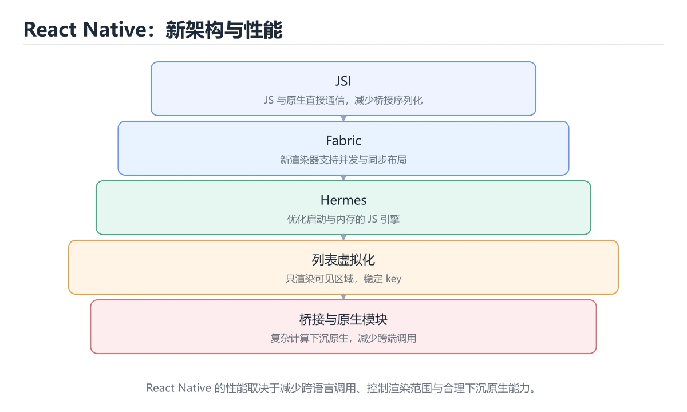

# React Native 跨平台开发

> 内容更新时间：2026-10-06 · 学习阶段：进阶 · 预计用时：25 分钟




## 本节知识框架

想象你要开两家餐厅——一家在北京，一家在上海。菜单完全一样，但食材供应商不同。React Native 就像一位"万能主厨"：用同一套菜谱（JavaScript 代码），在 iOS 和 Android 两个"厨房"里分别做出原生口味的菜品。

本课围绕四个关键词展开：React Native（框架本身）、跨平台（一套代码多端运行）、Hermes（更快的 JS 引擎）、Fabric（新渲染架构）。学完之后，你应该能独立搭建一个 RN 页面，并知道哪里容易踩坑。

**复习清单**

- [ ] 能用自己的话说出 React Native 和 Flutter、WebView 的区别
- [ ] 能写出一个带 FlatList 的最小页面，并解释为什么不用 ScrollView
- [ ] 能说出 Hermes 引擎解决了什么问题
- [ ] 能列出至少三个新手常踩的坑并给出修复方法

## 核心概念定义

| 术语 | 一句话说明 |
| --- | --- |
| React Native | 用 JavaScript/TypeScript 写界面，通过桥接或 JSI 调用原生组件来渲染，不是网页套壳 |
| 跨平台 | 一套业务代码同时跑在 iOS 和 Android 上，减少重复开发 |
| Hermes | Meta 为 RN 定制的 JS 引擎，启动更快、内存更低，就像给手机换了个更轻快的马达 |
| FlatList | RN 内置的虚拟化长列表组件，只渲染屏幕可见区域的行，避免一次性创建上千个视图 |
| 桥接（Bridge） | JS 线程和原生线程之间传递消息的通道，像两部对讲机——传话有延迟，所以要尽量减少通话次数 |
| JSI | 新架构里替代异步桥接的机制，让 JS 直接调用 C++ 层，像面对面说话而不是打电报 |

## 原理与运行机制

### 它到底怎么工作的？

把 RN 想象成一个翻译团队：

1. **你写 JavaScript**——相当于用中文写了一份设计稿。
2. **桥接/JSI 做翻译**——把设计稿翻译成 iOS（Swift/ObjC）或 Android（Java/Kotlin）能听懂的指令。
3. **原生组件渲染**——最终画出来的不是网页元素，而是货真价实的原生按钮、原生列表、原生滚动视图。

这就是为什么 RN 应用摸起来"像原生"——因为它用的就是原生控件，只是控制逻辑跑在 JS 上。

### 新架构四大件

| 组件 | 做什么 | 类比 |
| --- | --- | --- |
| JSI | 让 JS 直接调用 C++，替代异步桥接 | 面对面交谈 |
| Fabric | 新渲染器，支持同步布局 | 设计师可以直接改图，不用等快递 |
| TurboModules | 按需加载原生模块 | 用到什么工具才从工具箱里拿 |
| Hermes | 默认 JS 引擎，启动快、内存省 | 轻装上阵的快递员 |

### 渲染流程简述

```text
用户操作 → JS 线程计算状态变化
         → 通过 JSI/Bridge 发送渲染指令
         → Fabric 在原生线程布局
         → GPU 绘制到屏幕
```

关键点：JS 线程和原生线程是分开的。如果 JS 线程忙着算数据，动画就会卡——就像一边炒菜一边算账，总有一边会慢下来。

## 典型应用场景

React Native 适合这些场景：

- **电商 App**：商品列表、详情页、购物车，UI 密集但逻辑不算特别复杂
- **社交/资讯类**：信息流、评论、点赞，需要快速迭代
- **内部工具**：公司内部的审批、打卡、报表应用，一套代码覆盖员工的两部手机
- **跨端组件**：在已有原生 App 里嵌入 RN 页面，渐进式迁移

不太适合的场景：高频动画（比如音乐可视化）、需要大量蓝牙/NFC 底层交互的应用——这些场景 Flutter 或纯原生可能更合适。

## 代码/协议/SQL 示例

### 一个最简单的列表页面

```javascript
import React from "react";
import { FlatList, Pressable, StyleSheet, Text, View } from "react-native";

export function LessonList({ lessons }) {
  return (
    <FlatList
      data={lessons}
      keyExtractor={(item) => item.id}
      initialNumToRender={8}
      windowSize={5}
      removeClippedSubviews
      ItemSeparatorComponent={() => <View style={styles.gap} />}
      renderItem={({ item }) => (
        <Pressable
          style={({ pressed }) => [styles.card, pressed && styles.cardPressed]}
          onPress={() => console.log(item.title)}
        >
          <Text style={styles.title} numberOfLines={1}>
            {item.title}
          </Text>
          <Text style={styles.meta}>{item.minutes} 分钟</Text>
        </Pressable>
      )}
    />
  );
}

const styles = StyleSheet.create({
  card: { padding: 16, borderRadius: 8, backgroundColor: "#fff" },
  cardPressed: { opacity: 0.7 },
  title: { fontSize: 16, fontWeight: "600" },
  meta: { marginTop: 4, color: "#64748b" },
  gap: { height: 8 },
});
```

为什么用 FlatList 而不是 ScrollView？因为 ScrollView 会一次性把所有子视图都创建出来——如果有 1000 条数据，就创建 1000 个视图，内存直接爆炸。FlatList 只创建屏幕看得到的那几行，滚走了的就回收，就像传送带一样。

### 用 Hooks 管理状态和请求

```javascript
import { useCallback, useEffect, useState } from "react";
import { ActivityIndicator, FlatList, Pressable, Text, View } from "react-native";

export function ItemListScreen() {
  const [items, setItems] = useState([]);
  const [status, setStatus] = useState("loading");

  const load = useCallback(async () => {
    setStatus("loading");
    try {
      const res = await fetch("https://example.com/api/items");
      if (!res.ok) throw new Error("HTTP " + res.status);
      const data = await res.json();
      setItems(data);
      setStatus("ready");
    } catch (e) {
      setStatus("error");
    }
  }, []);

  useEffect(() => {
    void load();
  }, [load]);

  if (status === "loading") return <ActivityIndicator />;
  if (status === "error") {
    return (
      <View>
        <Text>加载失败</Text>
        <Pressable onPress={load}><Text>重试</Text></Pressable>
      </View>
    );
  }
  if (items.length === 0) return <Text>暂无数据</Text>;

  return (
    <FlatList
      data={items}
      keyExtractor={(item) => item.id}
      renderItem={({ item }) => <Text>{item.title}</Text>}
    />
  );
}
```

这段代码展示了一个完整的数据流：加载 → 成功/失败 → 渲染。注意 useEffect 的依赖数组写了 [load]，如果漏掉就会导致用到旧值——这是新手最常踩的坑之一。

### 处理平台差异

```javascript
import { Platform, StyleSheet } from "react-native";

const styles = StyleSheet.create({
  card: {
    padding: 16,
    shadowOpacity: Platform.OS === "ios" ? 0.1 : 0,
    elevation: Platform.OS === "android" ? 2 : 0,
  },
});
```

iOS 用 shadow 做阴影，Android 用 elevation。同一个样式属性在两个平台上写法不同，这就是需要用 Platform.OS 判断的地方。你也可以用分平台文件：Button.ios.js 和 Button.android.js 会被自动选用。

## 时间/空间复杂度或性能分析

| 问题 | 原因 | 解决办法 |
| --- | --- | --- |
| 长列表卡顿 | ScrollView 一次性渲染全部子项 | 用 FlatList 虚拟化 + 稳定的 keyExtractor |
| 频繁重渲染 | 每次渲染都创建新函数或对象 | 用 React.memo、useCallback、useMemo |
| 启动慢 | JS 引擎初始化耗时 | 开启 Hermes，延迟加载非首屏模块 |
| 桥接瓶颈 | JS 和原生之间频繁传大数据 | 合并调用，或用 JSI 走同步路径 |
| 动画掉帧 | 在 JS 线程逐帧改样式 | 用 Animated 或 Reanimated 让动画跑在原生线程 |
| 图片内存暴涨 | 加载原图尺寸远大于显示区域 | 按需缩放、使用缓存库、及时释放 |

性能优化的核心原则：让 JS 线程轻装上阵，重活交给原生线程。就像厨房里的厨师只管炒菜，洗碗和备菜交给帮厨，分工明确才快。

## 常见误区与易错点

| 错误 | 现象 | 修法 |
| --- | --- | --- |
| useEffect 缺依赖 | 用到旧值，数据不更新 | 把依赖写全，或用函数式更新 setState(prev => prev + 1) |
| 用 ScrollView 渲染长列表 | 内存暴涨、滑动卡顿 | 换成 FlatList，配合 keyExtractor |
| 每次渲染新建函数传给子组件 | 子组件无谓重建，列表越滑越慢 | 用 useCallback 包裹回调 |
| 每次渲染新建对象传给子组件 | React.memo 失效，白做了优化 | 用 useMemo 稳定对象引用 |
| 组件卸载后还调 setState | 控制台警告，可能引发异常 | 在 useEffect 清理函数里取消请求 |
| 图片不设宽高 | 图片不显示或布局跳动 | 显式设置 width/height 或 aspectRatio |
| 在 JS 线程做重计算 | 动画和交互卡顿 | 把计算移到原生模块或 Worker |
| 直接修改 state 数组 | 界面不刷新，因为引用没变 | 用展开运算符返回新数组 [...old, newItem] |
| 忽略安全区域 | 内容被刘海或底部横条遮挡 | 用 SafeAreaView 包裹页面 |
| 内联箭头函数当 renderItem | 每次渲染都新建函数和组件实例 | 提到组件外部或用 useCallback |

## 与其他知识点的关系

- **先修**：《Swift 与 iOS 开发》——了解原生开发的基本概念后，才能理解 RN 在"翻译"什么。
- **后续**：《Jetpack Compose 声明式 UI》——Compose 和 RN 都是声明式 UI，思路相通，但底层机制不同。
- **平行对比**：Flutter 用自绘引擎（Skia），RN 用原生组件。Flutter 跨端一致性更好，RN 的 JS 生态更庞大。选择哪个取决于团队技术栈和项目需求。

容易混淆的概念：

- **Hooks vs 原生模块**：Hooks 是 React 里管理状态和副作用的 API（useState、useEffect 等）；原生模块是用平台代码封装能力再暴露给 JS 调用。一个在 JS 层工作，一个跨到原生层。
- **桥接 vs JSI**：桥接是异步消息传递，有延迟；JSI 是同步直接调用，更快。新架构正在从桥接迁移到 JSI。

## 自测题与参考答案

**自测 1**：React Native 渲染出来的到底是什么？

答：真正的原生组件，不是 WebView 里的 HTML 元素。按钮就是 iOS 的原生按钮，列表就是 Android 的原生 RecyclerView 的封装。

**自测 2**：为什么长列表要用 FlatList？

答：因为 FlatList 只渲染屏幕可见区域的行（虚拟化），滚出屏幕的行会被回收。ScrollView 会一次性创建所有子视图，数据量大时内存直接爆掉。

**自测 3**：useEffect 的依赖数组漏写了一个变量会怎样？

答：effect 里会用到的那个变量的旧值，而不是最新值。修复方法是把依赖写全，或者用函数式更新避免依赖外部变量。

**自测 4**：Hermes 解决了什么问题？

答：启动速度和内存占用。Hermes 做了提前编译（AOT），不需要在运行时编译 JS，所以 App 冷启动更快，内存占用也更低。

**自测 5**：怎么处理 iOS 和 Android 的样式差异？

答：三种方式——Platform.OS 判断、Platform.select 选择、分平台文件（xxx.ios.js / xxx.android.js）。

## 考点精讲

考点1: 按“React Native 跨平台开发”中 React Native、跨平台、Hermes 的实践顺序，把四个步骤排成从准备到复盘的合理顺序。
A. 固定版本与证据，把“React Native 跨平台开发”的结论写成可复现记录 B. 先明确 React Native 的输入、输出与约束 C. 写出最小示例并核对 跨平台 的基线结果 D. 只改一个变量，记录边界与失败路径的变化
Ans: ABCD (D→B→C→A → correct order: B→C→D→A)

考点2: 围绕“React Native 跨平台开发”中的 React Native、跨平台、Hermes，下列哪两项是本课强调的实践判断？
A. 验证 跨平台 时要固定版本并覆盖边界输入，结论才可复现 B. 把 跨平台 的单次运行结果当成所有版本和规模都成立 C. 学习 React Native 时要同时说明输入、输出和失败路径，不能只看正常流程 D. 只要 React Native 的常规示例通过，就可以跳过边界与异常路径
Ans: AC

考点3: Hermes 引擎带来的主要收益是？ A. 提升启动速度并降低内存占用 B. 取代原生模块 C. 让 JavaScript 支持多线程 D. 提升图片解码速度 Ans: A

考点4: 关于 RN 中的动画性能，正确做法是？ A. 在 JS 线程逐帧修改样式 B. 用 Animated 或 Reanimated 让动画在原生线程执行 C. 用 setTimeout 模拟动画 D. 把动画放在 renderItem 里执行，但这会增加每帧的开销，同时这会让抖动更明显 Ans: B

考点5: 图片在 RN 布局中不设置宽高会出现什么？ A. 只会影响 iOS B. 自动按比例缩放，没有问题 C. 图片自动使用屏幕宽度 D. 可能不显示或导致布局异常 Ans: D

考点6: 结合 `React Native 跨平台开发` 中围绕 `Hooks` 的代码，哪一项说法与“新架构 JSI/Fabric/Hermes、列表虚拟化与桥接性能优化。”一致？ A. RN 无法调用原生能力 B. RN 只能在 iOS 上运行 C. RN 通过桥接渲染真实原生组件，不是网页 D. RN 不使用 JavaScript Ans: C

## 术语速查

| 术语 | 一句话说明 |
| --- | --- |
| React Native | 用 JS 写界面逻辑，通过桥接调用原生组件渲染的跨平台框架 |
| 跨平台 | 一套代码跑在多个操作系统上，减少重复开发成本 |
| Hermes | Meta 为 RN 优化的 JS 引擎，启动快、内存省 |
| FlatList | 虚拟化长列表，只渲染可见区域，大数据量的必备组件 |
| 桥接 | JS 和原生之间异步传递消息的通道，新架构正被 JSI 替代 |
| JSI | 让 JS 直接调用 C++ 的新机制，同步、更快 |
| Fabric | 新渲染器，支持同步布局和并发渲染 |
| TurboModules | 按需加载原生模块，不再启动时全部初始化 |
| Hooks | React 函数组件里管理状态和副作用的 API（useState、useEffect 等） |
| StyleSheet | RN 的样式对象，类似 CSS 但用 JavaScript 写，单位是 dp |

## 内容元数据

- 内容版本：v2.0
- 最后更新：2026-10-06
- 学习阶段：进阶
- 适用环境：React Native 0.7x+ / Hermes 默认启用
- 内容来源：内置结构化课程与工程实践整理
- 相关主题：React Native、跨平台、Hermes、Fabric、FlatList

## 参考资料与复核

- 最后复核：2026-10-04
- 下次复核：2027-08-10
- 复核范围：版本兼容、API 行为、新架构迁移进度与性能建议

| 参考资料 | 本课用途 |
| --- | --- |
| [React Native 官方文档](https://reactnative.dev/docs/getting-started) | 组件 API、新架构说明、Hermes 配置 |
| [React Native 性能优化指南](https://reactnative.dev/docs/performance) | FlatList 调优、渲染优化、内存管理 |
| [Hermes 引擎介绍](https://reactnative.dev/docs/hermes) | 启动速度、内存占用与 AOT 编译原理 |
