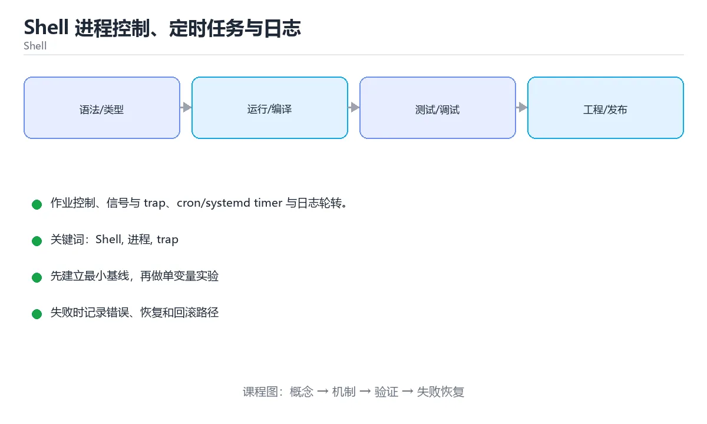

# React Native深度实践与原生模块



> 内容更新时间：2026-10-06 · 学习阶段：进阶 · 预计用时：50 分钟

## 本节知识框架

**课程定位**：分类「cross_platform」· 学习阶段 进阶 · 建议用时 50 分钟。

本课主线：学习RN桥接机制、原生模块开发和性能优化策略。

### 复习清单

- [ ] 能不看正文复述本课核心术语，并指出一个边界或反例。
- [ ] 能运行或推演本课示例，记录输入、输出与失败现象。
- [ ] 能完成一次自测，并把错题对照考点精讲定位原因。


### 课程导言
React Native让你用JavaScript和React构建真正的原生移动应用。就像用通用遥控器控制不同品牌的电视，你写一套代码，就能在iOS和Android上运行。本章将深入探讨React Native的核心架构、桥接机制、性能优化策略、自定义原生模块开发，以及与原生平台的深度集成技巧，帮助你从"会用React Native"进阶到"精通React Native"。


### 学习目标
学完本章后，你将能够：

1. 理解React Native的线程模型和桥接通信机制
2. 熟练使用Hooks进行状态管理和副作用处理
3. 实现高性能的列表渲染和动画效果
4. 编写iOS和Android自定义原生模块
5. 掌握调试工具和性能分析方法
6. 处理平台差异并实现原生功能集成


## 核心概念定义

| 术语 | 一句话说明 |
| --- | --- |
| React Native | 学习RN桥接机制、原生模块开发和性能优化策略。相关：正文给出可操作定义与适用边界。 |
| 原生模块 | 学习RN桥接机制、原生模块开发和性能优化策略。相关：正文给出可操作定义与适用边界。 |
| 桥接 | 学习RN桥接机制、原生模块开发和性能优化策略。相关：正文给出可操作定义与适用边界。 |
| 性能优化 | 学习RN桥接机制、原生模块开发和性能优化策略。相关：正文给出可操作定义与适用边界。 |
| TurboModules | 学习RN桥接机制、原生模块开发和性能优化策略。相关：正文给出可操作定义与适用边界。 |


## 原理与运行机制

《React Native深度实践与原生模块》正文各章按「输入是什么 → 中间如何转换 → 输出到哪 → 失败时怎样表现」四问展开；复习时给每个机制补一句自己的复述，再回到对应章节核对。


### 生活类比拆解
#### 桥接机制：像翻译官连接两个世界

React Native的运行环境分为两个世界：JavaScript世界和原生世界。JS线程运行你的业务逻辑，主线程（UI线程）负责渲染界面，它们之间通过"桥"（Bridge）进行通信。这就像两个说不同语言的人通过翻译官交流：JS说"我要显示一个按钮"，翻译官（Bridge）把这句话翻译成原生语言，iOS或Android听到后创建真实的UIButton或Button。这个翻译过程是异步的，所以大量频繁的通信会导致性能问题。

#### 虚拟DOM：像建筑师的蓝图

React的虚拟DOM就像建筑师的设计蓝图。当你修改UI时，不是直接在房子上动工（操作真实DOM），而是先修改蓝图（虚拟DOM），然后比较新旧蓝图的差异（Diff算法），最后只改动需要变化的部分（Reconciliation）。这样避免了昂贵的真实DOM操作，提高了性能。在React Native中，虚拟DOM对应的是Shadow Tree，最终映射为原生的View树。

#### 原生模块：像给汽车加装定制配件

React Native提供了丰富的内置组件，但有时候你需要访问相机、蓝牙、传感器等原生功能，或者实现特殊的UI效果。这时就需要编写原生模块，就像给汽车加装定制的音响系统或导航设备。你在原生平台（iOS用Objective-C/Swift，Android用Java/Kotlin）实现具体功能，然后通过桥接暴露给JavaScript调用。这样既保留了JS开发的效率，又能充分利用原生平台的能力。


## 典型应用场景

- 结合「React Native深度实践与原生模块」的常见落地场景与选型边界，详见正文各章节的对比讨论。
- 迁移到新项目时，先明确输入规模、失败代价与可观测手段，再决定采用深度。


## 代码/协议/SQL 示例

正文首个完整示例如下，先运行确认环境，再按正文步骤改一个输入观察输出变化。

```javascript
import React from 'react';
import { View, Text, StyleSheet } from 'react-native';

const HelloWorld = () => {
  return (
    <View style={styles.container}>
      <Text style={styles.text}>Hello, React Native!</Text>
    </View>
  );
};

const styles = StyleSheet.create({
  container: {
    flex: 1,
    justifyContent: 'center',
    alignItems: 'center',
    backgroundColor: '#f5f5f5',
  },
  text: {
    fontSize: 24,
    fontWeight: 'bold',
    color: '#333',
  },
});

export default HelloWorld;
```


### 渐进式代码示例
#### 最小示例：基础组件展示

```javascript
import React from 'react';
import { View, Text, StyleSheet } from 'react-native';

const HelloWorld = () => {
  return (
    <View style={styles.container}>
      <Text style={styles.text}>Hello, React Native!</Text>
    </View>
  );
};

const styles = StyleSheet.create({
  container: {
    flex: 1,
    justifyContent: 'center',
    alignItems: 'center',
    backgroundColor: '#f5f5f5',
  },
  text: {
    fontSize: 24,
    fontWeight: 'bold',
    color: '#333',
  },
});

export default HelloWorld;
```

#### 完整示例：社交媒体Feed应用

```javascript
import React, { useState, useEffect, useCallback } from 'react';
import {
  View,
  Text,
  FlatList,
  Image,
  TouchableOpacity,
  StyleSheet,
  ActivityIndicator,
  RefreshControl,
  Share,
  Alert,
} from 'react-native';

// 模拟API服务
const fetchPosts = async (page = 1) => {
  // 模拟网络延迟
  await new Promise(resolve => setTimeout(resolve, 1000));
  
  const mockPosts = Array.from({ length: 10 }, (_, i) => ({
    id: `post_${page}_${i}`,
    author: {
      name: `用户${page * 10 + i}`,
      avatar: `https://picsum.photos/100/100?random=${page * 10 + i}`,
    },
    content: `这是第${page}页的第${i + 1}条动态内容，包含一些文字描述和图片分享...`,
    image: `https://picsum.photos/400/300?random=${page * 10 + i}`,
    likes: Math.floor(Math.random() * 1000),
    comments: Math.floor(Math.random() * 100),
    timestamp: `${Math.floor(Math.random() * 24)}小时前`,
    isLiked: false,
  }));
  
  return mockPosts;
};

// 单个帖子组件
const PostItem = React.memo(({ post, onLike, onShare }) => {
  const [isLiked, setIsLiked] = useState(post.isLiked);
  const [likeCount, setLikeCount] = useState(post.likes);

  const handleLike = useCallback(() => {
    const newLikedState = !isLiked;
    setIsLiked(newLikedState);
    setLikeCount(prev => newLikedState ? prev + 1 : prev - 1);
    onLike(post.id, newLikedState);
  }, [isLiked, onLike, post.id]);

  const handleShare = useCallback(async () => {
    try {
      await Share.share({
        title: post.author.name,
        message: post.content,
        url: post.image,
      });
      onShare(post.id);
    } catch (error) {
      console.log('分享失败:', error);
    }
  }, [post, onShare]);

  return (
    <View style={styles.postContainer}>
      {/* 作者信息 */}
      <View style={styles.header}>
        <Image
          source={{ uri: post.author.avatar }}
          style={styles.avatar}
        />
        <View style={styles.authorInfo}>
          <Text style={styles.authorName}>{post.author.name}</Text>
          <Text style={styles.timestamp}>{post.timestamp}</Text>
        </View>
      </View>

      {/* 内容 */}
      <Text style={styles.content}>{post.content}</Text>

      {/* 图片 */}
      {post.image && (
        <Image
          source={{ uri: post.image }}
          style={styles.postImage}
          resizeMode="cover"
        />
      )}

      {/* 互动按钮 */}
      <View style={styles.actions}>
        <TouchableOpacity
          style={styles.actionButton}
          onPress={handleLike}
          activeOpacity={0.7}
        >
          <Text style={[
            styles.actionIcon,
            isLiked && styles.likedIcon
          ]}>
            {isLiked ? '❤️' : '🤍'}
          </Text>
          <Text style={styles.actionText}>{likeCount}</Text>
        </TouchableOpacity>

        <TouchableOpacity
          style={styles.actionButton}
          activeOpacity={0.7}
        >
          <Text style={styles.actionIcon}>💬</Text>
          <Text style={styles.actionText}>{post.comments}</Text>
        </TouchableOpacity>

        <TouchableOpacity
          style={styles.actionButton}
          onPress={handleShare}
          activeOpacity={0.7}
        >
          <Text style={styles.actionIcon}>🔗</Text>
          <Text style={styles.actionText}>分享</Text>
        </TouchableOpacity>
      </View>
    </View>
  );
});

// 主Feed组件
const FeedScreen = () => {
  const [posts, setPosts] = useState([]);
  const [loading, setLoading] = useState(true);
  const [refreshing, setRefreshing] = useState(false);
  const [page, setPage] = useState(1);
  const [hasMore, setHasMore] = useState(true);

  const loadPosts = useCallback(async (pageNum, isRefresh = false) => {
    if (isRefresh) {
      setRefreshing(true);
    } else {
      setLoading(true);
    }

    try {
      const newPosts = await fetchPosts(pageNum);
      
      if (isRefresh) {
        setPosts(newPosts);
        setPage(1);
      } else {
        setPosts(prev => [...prev, ...newPosts]);
      }
      
      // 模拟最多加载5页
      setHasMore(pageNum < 5);
    } catch (error) {
      Alert.alert('错误', '加载失败，请重试');
    } finally {
      setLoading(false);
      setRefreshing(false);
    }
  }, []);

  useEffect(() => {
    loadPosts(1);
  }, [loadPosts]);

  const handleRefresh = useCallback(() => {
    loadPosts(1, true);
  }, [loadPosts]);

  const handleLoadMore = useCallback(() => {
    if (!loading && hasMore) {
      const nextPage = page + 1;
      setPage(nextPage);
      loadPosts(nextPage);
    }
  }, [loading, hasMore, page, loadPosts]);

  const handleLike = useCallback((postId, isLiked) => {
    console.log(`帖子 ${postId} ${isLiked ? '点赞' : '取消点赞'}`);
    // 这里可以调用API同步到服务器
  }, []);

  const handleShare = useCallback((postId) => {
    console.log(`帖子 ${postId} 已分享`);
  }, []);

  const renderPost = useCallback(({ item }) => (
    <PostItem
      post={item}
      onLike={handleLike}
      onShare={handleShare}
    />
  ), [handleLike, handleShare]);

  const renderFooter = useCallback(() => {
    if (!loading) return null;
    return (
      <View style={styles.footerLoader}>
        <ActivityIndicator size="small" color="#007AFF" />
      </View>
    );
  }, [loading]);

  return (
    <View style={styles.container}>
      <FlatList
        data={posts}
        renderItem={renderPost}
        keyExtractor={item => item.id}
        onRefresh={handleRefresh}
        refreshing={refreshing}
        onEndReached={handleLoadMore}
        onEndReachedThreshold={0.5}
        ListFooterComponent={renderFooter}
        contentContainerStyle={styles.listContent}
      />
    </View>
  );
};

const styles = StyleSheet.create({
  container: {
    flex: 1,
    backgroundColor: '#fff',
  },
  listContent: {
    paddingBottom: 20,
  },
  postContainer: {
    marginBottom: 16,
    backgroundColor: '#fff',
    borderBottomWidth: 1,
    borderBottomColor: '#eee',
  },
  header: {
    flexDirection: 'row',
    alignItems: 'center',
    padding: 12,
  },
  avatar: {
    width: 40,
    height: 40,
    borderRadius: 20,
  },
  authorInfo: {
    marginLeft: 12,
  },
  authorName: {
    fontSize: 16,
    fontWeight: '600',
    color: '#333',
  },
  timestamp: {
    fontSize: 12,
    color: '#999',
    marginTop: 2,
  },
  content: {
    fontSize: 15,
    color: '#333',
    paddingHorizontal: 12,
    lineHeight: 22,
  },
  postImage: {
    width: '100%',
    height: 250,
    marginTop: 12,
  },
  actions: {
    flexDirection: 'row',
    justifyContent: 'space-around',
    paddingVertical: 12,
    borderTopWidth: 1,
    borderTopColor: '#eee',
    marginTop: 12,
  },
  actionButton: {
    flexDirection: 'row',
    alignItems: 'center',
  },
  actionIcon: {
    fontSize: 20,
    marginRight: 4,
  },
  likedIcon: {
    // 点赞后的样式
  },
  actionText: {
    fontSize: 14,
    color: '#666',
  },
  footerLoader: {
    paddingVertical: 20,
    alignItems: 'center',
  },
});

export default FeedScreen;
```

#### 实践示例：自定义原生模块

**JavaScript端 - 电池信息模块：**

```javascript
// BatteryModule.js
import { NativeModules, Platform } from 'react-native';

const { BatteryModule } = NativeModules;

class BatteryService {
  /**
   * 获取电池电量
   * @returns {Promise<number>} 电池百分比 (0-100)
   */
  static async getBatteryLevel() {
    if (!BatteryModule) {
      throw new Error('BatteryModule is not available');
    }
    
    try {
      const level = await BatteryModule.getBatteryLevel();
      return level;
    } catch (error) {
      console.error('获取电池电量失败:', error);
      throw error;
    }
  }

  /**
   * 获取电池状态
   * @returns {Promise<string>} 充电状态: 'charging' | 'discharging' | 'full' | 'unknown'
   */
  static async getBatteryStatus() {
    if (!BatteryModule) {
      throw new Error('BatteryModule is not available');
    }
    
    try {
      const status = await BatteryModule.getBatteryStatus();
      return status;
    } catch (error) {
      console.error('获取电池状态失败:', error);
      throw error;
    }
  }

  /**
   * 获取完整电池信息
   * @returns {Promise<Object>} 包含level和status的对象
   */
  static async getBatteryInfo() {
    const [level, status] = await Promise.all([
      this.getBatteryLevel(),
      this.getBatteryStatus(),
    ]);
    
    return { level, status };
  }
}

export default BatteryService;
```

**使用示例：**

```javascript
import React, { useState, useEffect } from 'react';
import { View, Text, Button, StyleSheet, Alert } from 'react-native';
import BatteryService from './BatteryModule';

const BatteryInfoScreen = () => {
  const [batteryInfo, setBatteryInfo] = useState(null);
  const [loading, setLoading] = useState(false);

  const fetchBatteryInfo = async () => {
    setLoading(true);
    try {
      const info = await BatteryService.getBatteryInfo();
      setBatteryInfo(info);
    } catch (error) {
      Alert.alert('错误', error.message);
    } finally {
      setLoading(false);
    }
  };

  useEffect(() => {
    fetchBatteryInfo();
  }, []);

  return (
    <View style={styles.container}>
      <Text style={styles.title}>电池信息</Text>
      
      {loading ? (
        <Text>加载中...</Text>
      ) : batteryInfo ? (
        <View style={styles.infoContainer}>
          <Text style={styles.infoText}>
            电量: {batteryInfo.level}%
          </Text>
          <Text style={styles.infoText}>
            状态: {batteryInfo.status}
          </Text>
        </View>
      ) : (
        <Text>点击按钮获取电池信息</Text>
      )}
      
      <Button
        title="刷新电池信息"
        onPress={fetchBatteryInfo}
        disabled={loading}
      />
    </View>
  );
};

const styles = StyleSheet.create({
  container: {
    flex: 1,
    justifyContent: 'center',
    alignItems: 'center',
    padding: 20,
  },
  title: {
    fontSize: 24,
    fontWeight: 'bold',
    marginBottom: 20,
  },
  infoContainer: {
    marginBottom: 20,
  },
  infoText: {
    fontSize: 18,
    marginVertical: 8,
  },
});

export default BatteryInfoScreen;
```

**iOS端 - Swift实现：**

```swift
// BatteryModule.swift
import Foundation
import UIKit

@objc(BatteryModule)
class BatteryModule: NSObject {
  
  @objc
  static func requiresMainQueueSetup() -> Bool {
    return true
  }
  
  @objc
  func getBatteryLevel(_ resolve: @escaping RCTPromiseResolveBlock,
                       rejecter reject: @escaping RCTPromiseRejectBlock) {
    UIDevice.current.isBatteryMonitoringEnabled = true
    let level = UIDevice.current.batteryLevel
    
    if level == -1 {
      reject("battery_error", "无法获取电池电量", nil)
    } else {
      // 转换为百分比 (0-100)
      let percentage = Int(level * 100)
      resolve(percentage)
    }
  }
  
  @objc
  func getBatteryStatus(_ resolve: @escaping RCTPromiseResolveBlock,
                        rejecter reject: @escaping RCTPromiseRejectBlock) {
    UIDevice.current.isBatteryMonitoringEnabled = true
    
    let status: String
    switch UIDevice.current.batteryState {
    case .charging:
      status = "charging"
    case .unplugged:
      status = "discharging"
    case .full:
      status = "full"
    @unknown default:
      status = "unknown"
    }
    
    resolve(status)
  }
}
```

**iOS端 - 桥接头文件：**

```objc
// BatteryModule.h
#import <React/RCTBridgeModule.h>

@interface RCT_EXTERN_MODULE(BatteryModule, NSObject)

RCT_EXTERN_METHOD(getBatteryLevel:(RCTPromiseResolveBlock)resolve
                  rejecter:(RCTPromiseRejectBlock)reject)

RCT_EXTERN_METHOD(getBatteryStatus:(RCTPromiseResolveBlock)resolve
                   rejecter:(RCTPromiseRejectBlock)reject)

@end
```

**Android端 - Kotlin实现：**

```kotlin
// BatteryModule.kt
package com.example.myapp

import android.content.Context
import android.content.Intent
import android.content.IntentFilter
import android.os.BatteryManager
import com.facebook.react.bridge.*

class BatteryModule(reactContext: ReactApplicationContext) : ReactContextBaseJavaModule(reactContext) {

    override fun getName(): String {
        return "BatteryModule"
    }

    @ReactMethod
    fun getBatteryLevel(promise: Promise) {
        try {
            val batteryManager = reactApplicationContext.getSystemService(Context.BATTERY_SERVICE) as BatteryManager
            val level = batteryManager.getIntProperty(BatteryManager.BATTERY_PROPERTY_CAPACITY)
            promise.resolve(level)
        } catch (e: Exception) {
            promise.reject("BATTERY_ERROR", "获取电池电量失败", e)
        }
    }

    @ReactMethod
    fun getBatteryStatus(promise: Promise) {
        try {
            val intent = reactApplicationContext.registerReceiver(null, IntentFilter(Intent.ACTION_BATTERY_CHANGED))
            val status = intent?.getIntExtra(BatteryManager.EXTRA_STATUS, -1) ?: -1
            
            val statusString = when (status) {
                BatteryManager.BATTERY_STATUS_CHARGING -> "charging"
                BatteryManager.BATTERY_STATUS_DISCHARGING -> "discharging"
                BatteryManager.BATTERY_STATUS_FULL -> "full"
                else -> "unknown"
            }
            
            promise.resolve(statusString)
        } catch (e: Exception) {
            promise.reject("BATTERY_ERROR", "获取电池状态失败", e)
        }
    }
}
```

**Android端 - 包注册：**

```kotlin
// BatteryPackage.kt
package com.example.myapp

import com.facebook.react.ReactPackage
import com.facebook.react.bridge.NativeModule
import com.facebook.react.bridge.ReactApplicationContext
import com.facebook.react.uimanager.ViewManager

class BatteryPackage : ReactPackage {
    override fun createNativeModules(reactContext: ReactApplicationContext): List<NativeModule> {
        return listOf(BatteryModule(reactContext))
    }

    override fun createViewManagers(reactContext: ReactApplicationContext): List<ViewManager<*, *>> {
        return emptyList()
    }
}
```

**Android端 - MainApplication注册：**

```kotlin
// MainApplication.kt
override fun getPackages(): List<ReactPackage> {
    return PackageList(this).packages + listOf(BatteryPackage())
}
```


## 时间/空间复杂度或性能分析

- 在《React Native深度实践与原生模块》里处理规模 n 时，先估计主循环与嵌套层数，再决定优化方向；小样本上的耗时读数不能外推。
- 性能结论要绑定输入分布：换数据规模、并发度或缓存命中情况后须重新测量。


## 常见误区与易错点

| 错误做法 | 典型现象 | 修复方向 |
| --- | --- | --- |
| 只验证正常输入 | 边界数据触发时才暴露问题 | 为每个结论补一个空值/极值/重复值用例 |
| 背结论不跑实验 | 换个输入就失效 | 按「预测—实测—差异归因」三步复盘 |
| 忽略环境与版本差异 | 本机可用线上报错 | 把版本、配置与依赖写入复现步骤 |


### 常见陷阱与解决方案
| 陷阱 | 表现 | 原因 | 解决方案 |
|------|------|------|----------|
| 频繁跨桥通信 | 性能卡顿掉帧 | 每次JS↔Native通信都有序列化开销 | 批量数据传输，减少bridge调用次数，使用JSI或TurboModules |
| FlatList未优化 | 长列表滚动卡顿 | 未设置getItemLayout或未正确使用key | 提供keyExtractor，使用React.memo包裹Item组件，避免内联函数 |
| Image内存泄漏 | OOM崩溃 | 大量图片未回收或缓存策略不当 | 使用react-native-fast-image，设置合适的resizeMode和cache策略 |
| 忽略平台差异 | iOS正常Android崩溃 | 两平台API和行为不一致 | 使用Platform.OS判断，分别为iOS和Android编写适配代码 |
| setState在卸载组件后调用 | 警告"Can't perform a React state update" | 异步操作完成后组件已卸载 | 使用isMounted标志或在useEffect清理函数中取消请求 |
| 样式单位混淆 | 布局在不同设备上错乱 | 误用px而非dp，或未考虑屏幕密度 | React Native默认单位是dp，无需转换；使用Dimensions或useWindowDimensions处理响应式 |
| 热重载状态丢失 | 调试时数据重置 | 热重载不会保留组件状态 | 重要状态放在Redux/MobX等全局状态管理中，或使用DevSettings保持状态 |
| 原生模块线程问题 | Android崩溃或iOS无响应 | 在主线程执行耗时操作 | iOS使用requiresMainQueueSetup控制线程，Android使用AsyncTask或协程 |
| Bundle体积过大 | 首屏加载慢 | 未启用ProGuard或未拆分Bundle | 启用代码压缩和混淆，使用Hermes引擎，按需加载模块 |
| 依赖版本冲突 | 构建失败或运行时错误 | 不同库依赖的React Native版本不一致 | 使用npx react-native doctor检查，统一依赖版本，清除node_modules重装 |


## 与其他知识点的关系

本课与分类「cross_platform」内相邻课程互为补充，建议按清单顺序学完再做综合练习。


## 自测题与参考答案

以下题目与题库同源，作答后再看解析；错误项要能说出错在哪一步。


## 考点精讲

### 考点 1

React Native中的Bridge机制主要负责什么？

A. 连接WiFi和移动网络  
B. 处理用户的手势输入  
C. 管理应用的数据库连接  
D. 在JavaScript线程和原生线程之间传递消息 ✅  

**正确答案：** D

**解析：** Bridge是React Native架构的核心组件，它负责在JavaScript线程和原生主线程之间进行异步通信。当JS代码需要更新UI或调用原生功能时，会将序列化的消息通过Bridge发送到原生端；原生端执行后将结果再通过Bridge返回给JS。这种设计使得JS和原生代码可以独立运行，但也带来了通信开销。新架构中的JSI（JavaScript Interface）正在逐步替代Bridge，实现更高效的同步调用。

### 考点 2

在React Native中使用FlatList时，为什么推荐使用React.memo包裹Item组件？

A. 为了避免不必要的重新渲染，提升性能 ✅  
B. 为了美化Item的外观  
C. 为了支持离线缓存  
D. 为了加密Item数据  

**正确答案：** A

**解析：** FlatList会渲染大量列表项，如果父组件状态变化导致整个列表重新渲染，每个Item都会重新执行渲染函数。使用React.memo可以让Item组件只在props真正变化时才重新渲染，避免浪费。配合正确的keyExtractor和getItemLayout，可以显著提升长列表的滚动性能。此外，应避免在renderItem中传递内联函数或对象，因为这些每次都会创建新引用，导致memo失效。

### 考点 3

关于React Native的原生模块开发，以下说法正确的是？

A. iOS和Android可以使用完全相同的代码  
B. 原生模块只能在主线程执行  
C. 需要在iOS和Android分别实现原生代码，然后通过Bridge暴露给JS ✅  
D. 原生模块不需要处理错误情况  

**正确答案：** C

**解析：** React Native的原生模块需要分别在iOS（使用Objective-C或Swift）和Android（使用Java或Kotlin）上实现，因为两平台的API完全不同。实现后，通过特定的宏或注解将方法暴露给JavaScript层，JS就可以通过NativeModules调用这些方法。选项A错误，因为原生代码必须分别编写；选项B错误，原生模块可以在后台线程执行耗时操作；选项D错误，必须妥善处理错误并通过Promise reject或回调返回错误信息。

### 考点 4

在React Native中，如何处理iOS和Android的平台差异？

A. 使用Platform.OS判断并为不同平台编写适配代码 ✅  
B. 只开发iOS版本，忽略Android  
C. 让后端处理所有平台差异  
D. 使用相同的代码，期望它能在两平台正常工作  

**正确答案：** A

**解析：** React Native提供了Platform模块来检测当前运行的平台。使用`Platform.OS === 'ios'`或`Platform.OS === 'android'`可以针对不同平台执行不同的逻辑。对于样式差异，可以使用Platform.select()方法：`const styles = Platform.select({ ios: {...}, android: {...} })`。对于复杂的平台特定功能，可以分别创建`.ios.js`和`.android.js`文件，React Native会自动根据平台选择正确的文件。忽视平台差异会导致应用在某一平台上出现bug或崩溃。

### 考点 5

React Native中Image组件的默认单位是什么？

A. 像素(px)  
B. 毫米(mm)  
C. 点(pt)  
D. 密度无关像素(dp) ✅  

**正确答案：** D

**解析：** React Native中的所有尺寸单位默认都是密度无关像素（density-independent pixels，简称dp或dip）。这意味着你设置的宽度100在不同密度的屏幕上会自动缩放，保持物理尺寸大致相同。这与Web开发中的px不同，Web的px是绝对像素。在React Native中，你不需要手动进行dp到px的转换，框架会自动处理。如果需要获取屏幕的实际像素尺寸，可以使用PixelRatio API。


## 术语速查

| 术语 | 一句话说明 |
| --- | --- |
| React Native | 用JavaScript与React编写、最终渲染为平台真实原生控件的移动框架。 |
| 原生模块 | 在Swift或Kotlin中实现相机、蓝牙等能力并暴露给JS调用的扩展。 |
| 桥接 | JS线程与原生主线程之间异步传递序列化消息的通道，频繁调用开销大。 |
| 性能优化 | 减少跨桥通信、做好列表复用与图片缓存，让交互稳定维持高帧率。 |
| TurboModules | 取代旧桥的模块架构，懒加载实例并借JSI直接调用免去序列化。 |


## 参考资料与复核

- [本课资料锚点 mobile_react_native_deep](https://zh.wikipedia.org/w/index.php?search=mobile_react_native_deep)

- 官方/权威资料：[W3C 移动 Web](https://www.w3.org/2001/tag/doc/appr-best-web/)
- 主题延伸：[关于「原生模块」的检索页](https://zh.wikipedia.org/w/index.php?search=%E5%8E%9F%E7%94%9F%E6%A8%A1%E5%9D%97)
- 本课索引词：[锚点 mobile_react_native_deep](https://www.w3.org/2001/tag/doc/appr-best-web/#React%20Native)
- 最后复核：2026-10-04
- 下次复核：2027-01-13


## 内容元数据

- 内容更新时间：2026-10-06

- 内容版本：v2.0
- 课程标识：mobile_react_native_deep
- 所属分类：cross_platform
- 学习阶段：进阶
- 建议用时：50 分钟

