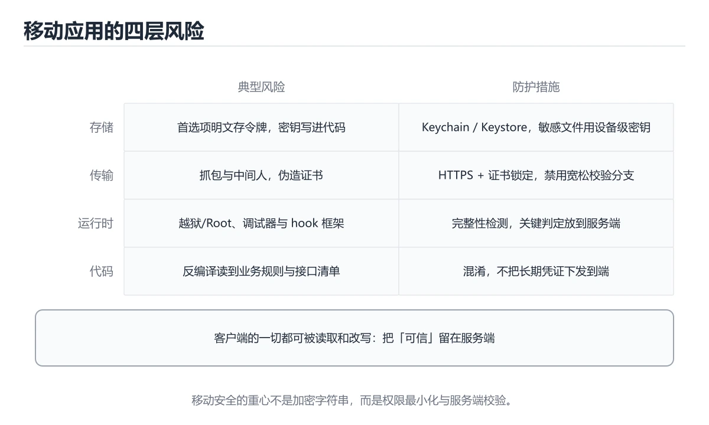

# 移动安全最佳实践



> 内容更新时间：2026-10-06 · 学习阶段：高级 · 预计用时：45 分钟

## 本节知识框架

**课程定位**：分类「cross_platform」· 学习阶段 高级 · 建议用时 25 分钟。

本课主线：数据加密、代码混淆、反调试与安全传输

### 复习清单

- [ ] 能不看正文复述 移动安全，并指出 加密 的一个边界或反例。
- [ ] 能用「移动安全最佳实践」的示例复现结果，并说明加密出错时输出的第一条信息。
- [ ] 能完成一次自测，并把错题对照考点精讲定位原因。

### 课程导言
移动应用面临着严峻的安全挑战：数据泄露、代码逆向、中间人攻击、恶意篡改。就像给房子安装门锁、监控摄像头和防盗警报，移动安全需要多层防护策略。本章将深入探讨数据加密技术、代码混淆与加固、反调试与完整性校验、网络安全传输、权限最小化原则，以及常见的安全漏洞和防御方法，帮助你构建坚固的移动应用安全防线。

### 学习目标
学完本章后，你将能够：

1. 实现敏感数据的加密存储和安全传输
2. 使用代码混淆和保护技术防止逆向工程
3. 检测和防范调试器附加与运行时篡改
4. 实施HTTPS证书锁定和安全的网络通信
5. 遵循权限最小化原则保护用户隐私
6. 识别和修复常见的移动安全漏洞

## 核心概念定义

| 术语 | 一句话说明 |
| --- | --- |
| 移动安全 | 把加密存储、代码混淆、运行时检测与传输层证书校验四层叠在一起，任何单独一层都挡不住有针对性的攻击。 |
| 加密 | 本地数据走AES-256-GCM并把iv、密文、认证标签一起存，RSA只负责换密钥；密钥硬编码进包就等于没加密。 |
| 混淆 | 重命名类与方法、打乱控制流来抬高逆向阅读成本，功能不变；把需要序列化或反射的Model一起混掉，Release就会崩。 |
| 反调试 | 用assert探测调试模式、查su路径和机型品牌识别越狱与模拟器，异常时退出或上报；它只争取响应时间，拦不住专业分析。 |
| 证书固定 | 在badCertificateCallback里拿证书的SHA-256指纹与预设值比对，装上抓包根证书也过不了；改成接受所有证书就前功尽弃。 |

## 原理与运行机制

《移动安全最佳实践》正文各章按「输入是什么 → 中间如何转换 → 输出到哪 → 失败时怎样表现」四问展开；复习时给每个机制补一句自己的复述，再回到对应章节核对。

### 生活类比拆解
#### 数据加密：像保险箱保护贵重物品

明文存储数据就像把现金放在抽屉里——任何人打开抽屉都能拿走。加密则像把现金放进保险箱：即使小偷拿到保险箱（获取了数据库文件），没有密码（密钥）也打不开。对称加密（AES）像一把钥匙既能锁也能开，速度快但密钥分发困难；非对称加密（RSA）像信箱——任何人都能投信（公钥加密），但只有你有钥匙取信（私钥解密）。实际应用中通常结合两者：用RSA交换AES密钥，然后用AES加密大量数据。

#### 代码混淆：像把说明书打成乱码

未混淆的代码就像产品的详细说明书——黑客可以清楚看到每个函数的作用、变量的含义、逻辑的流程。代码混淆则像把说明书的文字替换成无意义的符号：函数名从`getUserPassword()`变成`a()`，字符串从"password"变成"x7k9m"，控制流被打乱重组。虽然程序功能不变，但阅读和理解难度大幅增加。这不能阻止专业黑客，但能提高逆向工程的成本和时间，阻挡大部分自动化攻击工具。

#### 反调试：像商店的防盗标签

调试器就像小偷用来研究商品结构的X光机——可以单步执行代码、查看内存内容、修改运行时的变量值。反调试技术就像商品的防盗标签：当检测到异常行为（调试器附加、模拟器运行、root/jailbreak检测）时，应用会采取保护措施：退出运行、上报警告、或触发假逻辑迷惑攻击者。这不是万能的，但能增加攻击者的难度，为安全团队争取响应时间。

## 典型应用场景

- 结合「移动安全最佳实践」的常见落地场景与选型边界，详见正文各章节的对比讨论。
- 把「移动安全最佳实践」的做法搬到新项目时，先评估 加密 的规模与可观测条件。

## 代码/协议/SQL 示例

下面这段示例是 移动安全 的最小可运行版本；先原样跑通，再改一个输入比较输出。

```dart
import 'package:encrypt/encrypt.dart';
import 'package:pointycastle/asymmetric/api.dart';

class EncryptionService {
  // AES加密示例
  static String encryptAES(String plainText, String key) {
    final keyBytes = Key.fromUtf8(key.padRight(32, '*').substring(0, 32));
    final iv = IV.fromLength(16);
    final encrypter = Encrypter(AES(keyBytes));
    
    final encrypted = encrypter.encrypt(plainText, iv: iv);
    return '${iv.base64}:${encrypted.base64}';
  }
  
  static String decryptAES(String encryptedText, String key) {
    final parts = encryptedText.split(':');
    final iv = IV.fromBase64(parts[0]);
    final encrypted = Encrypted.fromBase64(parts[1]);
    
    final keyBytes = Key.fromUtf8(key.padRight(32, '*').substring(0, 32));
    final encrypter = Encrypter(AES(keyBytes));
    
    return encrypter.decrypt(encrypted, iv: iv);
  }
}
```

### 渐进式代码示例
#### 最小示例：基础数据加密

**Flutter - 使用encrypt包：**

```dart
import 'package:encrypt/encrypt.dart';
import 'package:pointycastle/asymmetric/api.dart';

class EncryptionService {
  // AES加密示例
  static String encryptAES(String plainText, String key) {
    final keyBytes = Key.fromUtf8(key.padRight(32, '*').substring(0, 32));
    final iv = IV.fromLength(16);
    final encrypter = Encrypter(AES(keyBytes));
    
    final encrypted = encrypter.encrypt(plainText, iv: iv);
    return '${iv.base64}:${encrypted.base64}';
  }
  
  static String decryptAES(String encryptedText, String key) {
    final parts = encryptedText.split(':');
    final iv = IV.fromBase64(parts[0]);
    final encrypted = Encrypted.fromBase64(parts[1]);
    
    final keyBytes = Key.fromUtf8(key.padRight(32, '*').substring(0, 32));
    final encrypter = Encrypter(AES(keyBytes));
    
    return encrypter.decrypt(encrypted, iv: iv);
  }
}
```

#### 完整示例：综合安全防护体系

**数据加密服务：**

```dart
// services/security_service.dart
import 'dart:convert';
import 'dart:typed_data';
import 'package:encrypt/encrypt.dart' as enc;
import 'package:flutter_secure_storage/flutter_secure_storage.dart';
import 'package:crypto/crypto.dart';
import 'package:pointycastle/export.dart';

class SecurityService {
  static final FlutterSecureStorage _secureStorage = FlutterSecureStorage(
    aOptions: AndroidOptions(
      encryptedSharedPreferences: true,
    ),
    iOptions: IOSOptions(
      accessibility: KeychainAccessibility.first_unlock_this_device,
    ),
  );

  /// 生成安全的随机密钥
  static String generateKey() {
    final random = enc.SecureRandom();
    final keyBytes = List<int>.generate(32, (_) => random.nextInt(256));
    return base64Encode(keyBytes);
  }

  /// AES-256-GCM加密
  static Future<String> encryptData(String plainText, String key) async {
    try {
      final keyBytes = enc.Key.fromBase64(key);
      final iv = enc.IV.fromSecureRandom(16);
      
      // GCM模式提供认证加密
      final encrypter = enc.Encrypter(
        enc.AES(keyBytes, mode: enc.AESMode.gcm),
      );
      
      final encrypted = encrypter.encrypt(plainText, iv: iv);
      
      // 组合IV + 密文 + 认证标签
      final result = {
        'iv': iv.base64,
        'data': encrypted.base64,
        'tag': encrypted.mac?.base64 ?? '',
      };
      
      return jsonEncode(result);
    } catch (e) {
      throw Exception('加密失败: $e');
    }
  }

  /// AES-256-GCM解密
  static Future<String> decryptData(String encryptedJson, String key) async {
    try {
      final Map<String, dynamic> data = jsonDecode(encryptedJson);
      
      final iv = enc.IV.fromBase64(data['iv']);
      final encrypted = enc.Encrypted.fromBase64(data['data']);
      final mac = enc.Mac.fromBase64(data['tag']);
      
      final keyBytes = enc.Key.fromBase64(key);
      final encrypter = enc.Encrypter(
        enc.AES(keyBytes, mode: enc.AESMode.gcm),
      );
      
      return encrypter.decrypt(encrypted, iv: iv, mac: mac);
    } catch (e) {
      throw Exception('解密失败: $e');
    }
  }

  /// 安全存储敏感数据
  static Future<void> storeSecurely(String key, String value) async {
    await _secureStorage.write(key: key, value: value);
  }

  /// 读取安全存储的数据
  static Future<String?> readSecurely(String key) async {
    return await _secureStorage.read(key: key);
  }

  /// 删除安全存储的数据
  static Future<void> deleteSecurely(String key) async {
    await _secureStorage.delete(key: key);
  }

  /// 计算SHA-256哈希（用于完整性校验）
  static String sha256Hash(String input) {
    final bytes = utf8.encode(input);
    final digest = sha256.convert(bytes);
    return digest.toString();
  }

  /// HMAC-SHA256签名（用于消息认证）
  static String hmacSha256(String message, String secret) {
    final key = enc.Key.fromUtf8(secret);
    final hmac = enc.Hmac(enc.SHA256(), key);
    final digest = hmac.convert(utf8.encode(message));
    return digest.toString();
  }

  /// RSA密钥对生成（用于非对称加密）
  static AsymmetricKeyPair<RSAPublicKey, RSAPrivateKey> generateRSAKeyPair() {
    final keyGen = RSAKeyGenerator();
    final secureRandom = FortunaRandom();
    
    final params = RSAKeyGeneratorParameters(
      BigInt.parse('65537'), // 公钥指数
      2048, // 密钥长度
      64,   // 确定性强度
    );
    
    keyGen.init(ParametersWithRandom(params, secureRandom));
    final pair = keyGen.generateKeyPair();
    
    return AsymmetricKeyPair<RSAPublicKey, RSAPrivateKey>(
      pair.publicKey as RSAPublicKey,
      pair.privateKey as RSAPrivateKey,
    );
  }
}
```

**代码保护和反调试：**

```dart
// services/anti_tamper_service.dart
import 'dart:io';
import 'package:flutter/foundation.dart';
import 'package:package_info_plus/package_info_plus.dart';

class AntiTamperService {
  /// 检测是否在调试模式
  static bool isDebugMode() {
    bool inDebug = false;
    assert(() {
      inDebug = true;
      return true;
    }());
    return inDebug;
  }

  /// 检测是否运行在模拟器
  static Future<bool> isEmulator() async {
    if (Platform.isAndroid) {
      // Android模拟器检测
      final brands = ['generic', 'unknown', 'sdk'];
      final model = await _getDeviceProperty('ro.product.model');
      final brand = await _getDeviceProperty('ro.product.brand');
      
      return brands.any((b) => brand.toLowerCase().contains(b)) ||
             model.toLowerCase().contains('sdk');
    } else if (Platform.isIOS) {
      // iOS模拟器检测
      return !Platform.isMacos && 
             (await _getDeviceInfo()).contains('x86_64') ||
             (await _getDeviceInfo()).contains('i386');
    }
    return false;
  }

  /// 检测Root/Jailbreak
  static Future<bool> isRootedOrJailbroken() async {
    if (Platform.isAndroid) {
      return await _checkAndroidRoot();
    } else if (Platform.isIOS) {
      return await _checkIOSJailbreak();
    }
    return false;
  }

  /// Android Root检测
  static Future<bool> _checkAndroidRoot() async {
    final rootFiles = [
      '/system/app/Superuser.apk',
      '/sbin/su',
      '/system/bin/su',
      '/system/xbin/su',
      '/data/local/xbin/su',
      '/data/local/bin/su',
      '/system/sd/xbin/su',
      '/system/bin/failsafe/su',
      '/data/local/su',
      '/su/bin/su',
    ];
    
    for (final path in rootFiles) {
      if (File(path).existsSync()) {
        return true;
      }
    }
    
    // 检查PATH中是否有su
    final pathEnv = Platform.environment['PATH'] ?? '';
    final paths = pathEnv.split(':');
    for (final p in paths) {
      if (File('$p/su').existsSync()) {
        return true;
      }
    }
    
    return false;
  }

  /// iOS Jailbreak检测
  static Future<bool> _checkIOSJailbreak() async {
    // 检查常见越狱文件
    final jailbreakPaths = [
      '/Applications/Cydia.app',
      '/Library/MobileSubstrate/MobileSubstrate.dylib',
      '/bin/bash',
      '/usr/sbin/sshd',
      '/etc/apt',
    ];
    
    for (final path in jailbreakPaths) {
      if (File(path).existsSync()) {
        return true;
      }
    }
    
    // 检查是否能写入系统目录
    try {
      File('/private/jailbreak-test.txt').writeAsStringSync('test');
      File('/private/jailbreak-test.txt').deleteSync();
      return true;
    } catch (e) {
      // 正常情况应该抛出异常
    }
    
    return false;
  }

  /// 应用完整性校验
  static Future<bool> verifyAppIntegrity() async {
    try {
      final packageInfo = await PackageInfo.fromPlatform();
      
      // 验证包名
      const expectedPackageName = 'com.example.secureapp';
      if (packageInfo.packageName != expectedPackageName) {
        return false;
      }
      
      // 验证签名（简化示例，实际应比对证书指纹）
      // 在生产环境中，应该存储预期的签名哈希并进行比对
      
      return true;
    } catch (e) {
      return false;
    }
  }

  /// 防Hook检测
  static bool detectHooking() {
    // 检测常见Hook框架的特征
    if (Platform.isAndroid) {
      // 检测Xposed/Frida等
      try {
        // 检查是否存在可疑类
        final xposedClass = 'de.robv.android.xposed.XposedBridge';
        // 实际实现需要使用反射或JNI
      } catch (e) {
        // 类不存在是正常的
      }
    }
    
    return false;
  }

  /// 安全检查入口
  static Future<Map<String, bool>> performSecurityCheck() async {
    final results = <String, bool>{};
    
    results['debug_mode'] = isDebugMode();
    results['emulator'] = await isEmulator();
    results['rooted_jailbroken'] = await isRootedOrJailbroken();
    results['app_integrity'] = await verifyAppIntegrity();
    results['hooking_detected'] = detectHooking();
    
    // 如果发现严重安全问题，可以采取行动
    if (results['rooted_jailbroken'] == true || 
        results['hooking_detected'] == true) {
      // 记录日志、上报服务器、或限制功能
      debugPrint('⚠️ 安全风险 detected!');
    }
    
    return results;
  }

  static Future<String> _getDeviceProperty(String property) async {
    // Android特定实现，需要使用platform channel调用原生代码
    return '';
  }

  static Future<String> _getDeviceInfo() async {
    // iOS特定实现
    return '';
  }
}
```

**网络安全配置：**

```dart
// services/network_security_service.dart
import 'dart:io';
import 'dart:convert';
import 'package:http/http.dart' as http;
import 'package:flutter/services.dart';

class NetworkSecurityService {
  /// HTTPS证书锁定（Certificate Pinning）
  static HttpClient createPinnedClient() {
    final client = HttpClient();
    
    client.badCertificateCallback = (X509Certificate cert, String host, int port) {
      // 验证证书指纹
      final expectedFingerprint = 'YOUR_EXPECTED_CERT_FINGERPRINT';
      final actualFingerprint = _getCertFingerprint(cert);
      
      return actualFingerprint == expectedFingerprint;
    };
    
    return client;
  }

  /// 获取证书指纹
  static String _getCertFingerprint(X509Certificate cert) {
    // 计算SHA-256指纹
    final bytes = cert.der;
    final digest = sha256.convert(bytes);
    return digest.toString();
  }

  /// 安全的HTTP请求（带证书锁定）
  static Future<http.Response> secureGet(String url, {Map<String, String>? headers}) async {
    final client = createPinnedClient();
    
    try {
      final request = await client.getUrl(Uri.parse(url));
      
      // 添加安全头
      request.headers.set('User-Agent', 'SecureApp/1.0');
      if (headers != null) {
        headers.forEach((key, value) {
          request.headers.set(key, value);
        });
      }
      
      final response = await request.close();
      
      // 读取响应体
      final body = await response.transform(utf8.decoder).join();
      
      return http.Response(body, response.statusCode, headers: {
        for (final header in response.headers.entries)
          header.key: header.value,
      });
    } finally {
      client.close();
    }
  }

  /// 请求签名（防止篡改）
  static Map<String, String> signRequest(Map<String, dynamic> payload, String secret) {
    final timestamp = DateTime.now().millisecondsSinceEpoch.toString();
    final nonce = _generateNonce();
    
    final dataToSign = '$timestamp:$nonce:${jsonEncode(payload)}';
    final signature = SecurityService.hmacSha256(dataToSign, secret);
    
    return {
      'X-Timestamp': timestamp,
      'X-Nonce': nonce,
      'X-Signature': signature,
    };
  }

  static String _generateNonce() {
    final random = Random.secure();
    final values = List<int>.generate(16, (i) => random.nextInt(256));
    return base64Encode(values);
  }
}
```

**Android端 - ProGuard/R8混淆配置：**

```proguard
# proguard-rules.pro

# 保留必要的类
-keep class com.example.myapp.MainActivity { *; }
-keep class com.example.myapp.MyApplication { *; }

# 保留Model类（用于JSON序列化）
-keep class com.example.myapp.model.** { *; }

# 保留加密相关的类
-keep class com.example.myapp.security.** { *; }

# 移除日志输出（Release版本）
-assumenosideeffects class android.util.Log {
    public static *** d(...);
    public static *** v(...);
    public static *** i(...);
}

# 混淆所有其他类
-obfuscationdictionary obfuscate_dictionary.txt
-classobfuscationdictionary obfuscate_dictionary.txt
-packageobfuscationdictionary obfuscate_dictionary.txt

# 启用优化
-optimizations !code/simplification/arithmetic,!field/*,!class/merging/*
-optimizationpasses 5

# 移除未使用的代码
-shrink
```

**iOS端 - 代码保护配置：**

```swift
// Build Settings中启用
/*
GCC_PREPROCESSOR_DEFINITIONS = DEBUG=0  // Release模式禁用调试宏
STRIP_STYLE = all                        // 剥离调试符号
DEAD_CODE_STRIPPING = YES                // 移除死代码
*/

// Info.plist中禁用备份
/*
<key>UIFileSharingEnabled</key>
<false/>
<key>LSSupportsOpeningDocumentsInPlace</key>
<false/>
*/
```

#### 实践示例：安全审计清单

```dart
// utils/security_audit.dart
class SecurityAuditChecklist {
  static final List<SecurityCheck> checks = [
    SecurityCheck(
      category: '数据存储',
      items: [
        '敏感数据是否加密存储',
        '是否使用安全的存储机制（Keychain/EncryptedSharedPreferences）',
        '日志中是否包含敏感信息',
        '缓存文件是否包含未加密的用户数据',
      ],
    ),
    SecurityCheck(
      category: '网络通信',
      items: [
        '是否强制使用HTTPS',
        '是否实施证书锁定',
        'API密钥是否硬编码在代码中',
        '是否验证服务器响应完整性',
      ],
    ),
    SecurityCheck(
      category: '代码保护',
      items: [
        '是否启用代码混淆',
        '是否移除调试信息和日志',
        '是否检测Root/Jailbreak',
        '是否验证应用完整性',
      ],
    ),
    SecurityCheck(
      category: '身份认证',
      items: [
        '密码是否加盐哈希存储',
        'Token是否有过期时间',
        '是否实施多因素认证',
        '登录失败是否有次数限制',
      ],
    ),
    SecurityCheck(
      category: '权限管理',
      items: [
        '是否遵循最小权限原则',
        '运行时权限请求是否有合理说明',
        '敏感权限是否有备用方案',
        '权限被拒绝时应用是否正常降级',
      ],
    ),
  ];

  static void printAuditReport() {
    print('=== 移动应用安全审计清单 ===\n');
    
    for (final check in checks) {
      print('📋 ${check.category}');
      for (int i = 0; i < check.items.length; i++) {
        print('   ${i + 1}. ${check.items[i]}');
      }
      print('');
    }
    
    print('✅ 完成所有检查项后，应用安全性将显著提升！');
  }
}

class SecurityCheck {
  final String category;
  final List<String> items;

  SecurityCheck({required this.category, required this.items});
}
```

## 时间/空间复杂度或性能分析

- 在《移动安全最佳实践》里处理规模 n 时，先估计主循环与嵌套层数，再决定优化方向；小样本上的耗时读数不能外推。
- 「移动安全最佳实践」里的性能判断只对特定负载成立，换 加密 的规模后要重新测量。

## 常见误区与易错点

| 错误做法 | 典型现象 | 修复方向 |
| --- | --- | --- |
| 只验证正常输入 | 边界数据触发时才暴露问题 | 为每个结论补一个空值/极值/重复值用例 |
| 背结论不跑实验 | 换个输入就失效 | 按「预测—实测—差异归因」三步复盘 |
| 忽略环境与版本差异 | 本机可用线上报错 | 把版本、配置与依赖写入复现步骤 |

### 常见陷阱与解决方案
| 陷阱 | 表现 | 原因 | 解决方案 |
|------|------|------|----------|
| 硬编码API密钥 | 密钥泄露导致滥用 | 密钥直接写在源代码中 | 使用环境变量、配置文件或远程配置服务动态下发密钥 |
| 明文存储敏感数据 | 数据泄露风险 | 使用SharedPreferences/UserDefaults明文存储 | 使用加密存储方案：FlutterSecureStorage、Keychain、EncryptedSharedPreferences |
| 忽略证书验证 | 中间人攻击风险 | 接受所有SSL证书或使用allowAllCertificates | 实施证书锁定（Certificate Pinning），验证服务器证书指纹 |
| 过度混淆导致崩溃 | Release版本功能异常 | 混淆了需要反射或序列化的类 | 正确配置ProGuard规则，保留Model类和必要的方法签名 |
| 日志泄露敏感信息 | 生产环境日志包含密码/token | 未区分Debug和Release日志级别 | 使用条件编译或日志框架，Release环境禁用详细日志 |
| 不处理权限拒绝 | 功能崩溃或用户体验差 | 假设用户总是授予权限 | 优雅处理权限拒绝，提供功能降级方案和清晰的引导说明 |
| 弱密码哈希算法 | 密码容易被破解 | 使用MD5或SHA1哈希密码 | 使用bcrypt、scrypt或Argon2等专门设计的密码哈希算法 |
| 会话Token永不过期 | Token被盗用后长期有效 | 未设置Token过期时间或刷新机制 | 实施短期Access Token + 长期Refresh Token机制，定期轮换 |
| 忽略WebView安全 | XSS攻击和数据泄露 | WebView加载不可信内容且未限制 | 禁用JavaScript（如不需要）、启用SameSite Cookie、验证URL白名单 |
| 未及时更新依赖 | 已知漏洞被利用 | 第三方库存在安全漏洞但未升级 | 定期运行依赖安全扫描（npm audit、flutter pub outdated），及时更新 |

## 与其他知识点的关系

本课与分类「cross_platform」内相邻课程互为补充，建议按清单顺序学完再做综合练习。

## 自测题与参考答案

以下 移动安全 题目与题库同源，作答后再看解析；错误项要能说出错在哪一步。

## 考点精讲

### 考点 1

为什么不应该在代码中硬编码API密钥？

A. 因为会增加代码体积  
B. 因为不同平台的API密钥格式不同  
C. 因为会影响应用性能  
D. 因为反编译后可以轻易提取密钥，导致未授权访问 ✅  

**正确答案：** D

**解析：** 移动包（APK/IPA）极易被反编译，硬编码的 API 密钥、私钥会直接暴露给攻击者，被用来刷接口、产生费用或访问内部数据。正确做法是运行时向服务端换取短期令牌，密钥保存在服务端配置或密钥管理服务中。代码体积、性能与密钥格式都不是硬编码问题的本质。

### 考点 2

关于代码混淆，以下说法正确的是？

A. 混淆可以完全防止逆向工程，符号名被替换成无意义短串  
B. 混淆会改变程序的运行逻辑  
C. 混淆通过重命名标识符、打乱控制流等方式增加阅读难度 ✅  
D. 混淆后的代码无法被恢复  

**正确答案：** C

**解析：** 混淆（R8/ProGuard、映射表）通过重命名类与方法、压缩与打乱代码结构来提高逆向阅读成本，但它是抬高门槛而非绝对防护，攻击者仍可结合日志与网络行为分析。混淆不改变程序运行逻辑，也无法说「完全防止」逆向或「无法恢复」——符号映射表在内部是可还原的。

### 考点 3

HTTPS证书锁定（Certificate Pinning）的主要目的是什么？

A. 加速HTTPS连接速度，靠会话复用省掉完整握手  
B. 自动更新过期的证书  
C. 减少证书验证的计算开销  
D. 防止中间人攻击，确保只信任特定的服务器证书 ✅  

**正确答案：** D

**解析：** 证书锁定让客户端只信任预置的服务器证书或公钥，即使攻击者诱导用户安装了恶意根证书，中间人代理也无法伪造通过校验，从而抵御针对性 MITM。它会增加证书轮换运维成本，但与加速连接、降低计算开销或自动更新证书无关。通常锁定公钥并预留备用键以平滑轮换。

### 考点 4

在移动应用中存储用户密码时，最佳实践是什么？

A. 明文存储以便快速验证  
B. 使用MD5哈希后存储  
C. 使用bcrypt或Argon2加盐哈希后存储 ✅  
D. 使用Base64编码后存储，解码后即可还原明文  

**正确答案：** C

**解析：** 用户密码的正确处理是加盐慢哈希：bcrypt、scrypt 或 Argon2 可调工作因子，抵抗彩虹表与 GPU 暴破；MD5/Base64 太快或根本是编码，拿到哈希库即可批量还原。移动端通常只保存会话令牌，密码本体交由服务端哈希；明文存储更是直接违规。

### 考点 5

关于移动应用的权限管理，"最小权限原则"指的是什么？

A. 申请所有可能用到的权限以防万一  
B. 只在Android上申请权限，iOS不需要  
C. 完全不申请任何权限以保证安全  
D. 只申请当前功能必需的最少权限 ✅  

**正确答案：** D

**解析：** 最小权限原则要求每个权限都能对应到具体功能：只申请当前功能必需的最少权限，在用户触发相关操作时再动态请求，并在系统设置中提供关闭入口。一次申请所有权限会吓退用户且违反应用商店审核政策；完全不申请则功能无法运行；iOS 同样有相机、定位等权限约束，并非只限 Android。

---

### 考点 6

题目：在「移动安全最佳实践」的术语表里，下列术语与解释的配对哪些是正确的？（多选）
A. 「混淆」：重命名符号并打乱控制流，抬高逆向阅读成本而不改变程序功能  
B. 「加密」：用AES保护本地数据、RSA交换密钥，让拿到文件也读不到明文  
C. 「证书固定」：察觉调试器附加、模拟器或越狱环境后立即退出或上报，拖延分析  
D. 「反调试」：客户端只认预设的服务端证书或公钥，装抓包根证书也无法中间人  
正确答案：AB

**解析**：本题正确项是「混淆」：重命名符号并打乱控制流，抬高逆向阅读成本而不改变程序功能，以及「加密」：用AES保护本地数据、RSA交换密钥，让拿到文件也读不到明文，这两组配对与术语表一致。另外两组把术语和解释张冠李戴：「证书固定」被安上了察觉调试器附加、模拟器或越狱环境后立即退出或上报，拖延分析的解释，「反调试」反而拿到了客户端只认预设的服务端证书或公钥，装抓包根证书也无法中间人的定义，所以两组都不能选。复习时回到「移动安全最佳实践」的术语速查表逐条核对，配对题考的是定义里描述的对象和边界，而不是术语的字面长相。

---

## 术语速查

| 术语 | 一句话说明 |
| --- | --- |
| 移动安全 | 针对数据泄露、代码逆向、篡改与中间人攻击的多层端侧防护。 |
| 加密 | 用AES保护本地数据、RSA交换密钥，让拿到文件也读不到明文。 |
| 混淆 | 重命名符号并打乱控制流，抬高逆向阅读成本而不改变程序功能。 |
| 反调试 | 察觉调试器附加、模拟器或越狱环境后立即退出或上报，拖延分析。 |
| 证书固定 | 客户端只认预设的服务端证书或公钥，装抓包根证书也无法中间人。 |

## 参考资料与复核

- 官方/权威资料：[MDN：渐进式 Web 应用（PWA）](https://developer.mozilla.org/en-US/docs/Web/Progressive_web_apps)
- 主题延伸：[OWASP 移动端安全测试指南](https://mas.owasp.org/)
- 最后复核：2026-10-04
- 下次复核：2027-01-28

## 内容元数据

- 内容更新时间：2026-10-06

- 内容版本：v2.0
- 课程标识：mobile_security
- 所属分类：cross_platform
- 学习阶段：高级
- 建议用时：25 分钟
