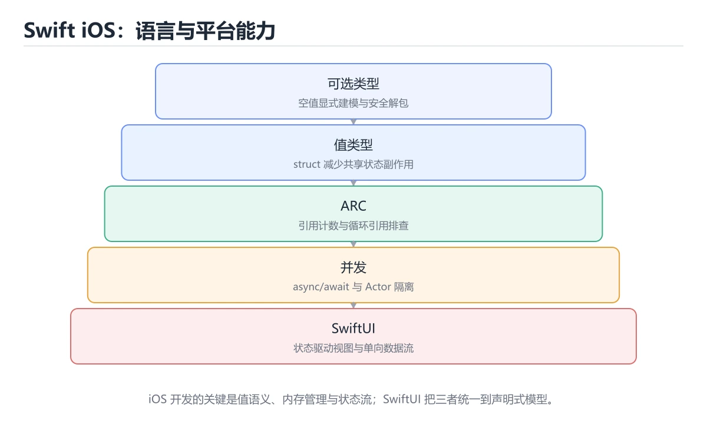

# Swift 与 iOS 开发

> 内容更新时间：2026-10-06 · 学习阶段：基础 · 预计用时：25 分钟



## 本节知识框架

本课围绕 Swift 语言与 iOS 开发，带你搞懂四件事：可选类型、值类型、ARC（自动引用计数）以及 SwiftUI 的状态管理。

**复习清单**

- [ ] 能说出 Swift 是什么、SwiftUI 是什么，以及两者的关系
- [ ] 能写出 if let 和 guard let 的用法，并解释为什么不能用 ! 强制解包
- [ ] 能区分 struct 和 class 在赋值时的行为差异
- [ ] 能说出闭包里为什么需要 [weak self]，以及忘记写会发生什么
- [ ] 能运行本课的 Swift 示例，修改一个输入后观察输出变化

## 核心概念定义

| 术语 | 一句话说明 |
| --- | --- |
| Swift | Apple 推出的编程语言，用来开发 iOS、macOS 等苹果平台的应用 |
| SwiftUI | Apple 的声明式 UI 框架，用数据状态自动驱动界面更新 |
| 可选类型（Optional） | 一个值可能为空（nil），使用前必须安全解包 |
| ARC（自动引用计数） | 编译器自动管理内存，当对象没人引用时自动释放 |
| struct | Swift 的值类型，赋值时会完整复制一份 |
| class | Swift 的引用类型，赋值后多个变量指向同一个对象 |
| async/await | Swift 的异步编程语法，写异步代码像写同步代码一样直观 |

## 原理与运行机制

### Swift 语言的核心设计

Swift 是一门静态类型语言，编译器会在运行前帮你检查大量错误。它最核心的安全设计就是「可选类型」——一个变量要么是确定的类型，要么明确可能没有值（用 `?` 表示）。这样就把空指针崩溃从运行时提前到了编译时。

### 值类型 vs 引用类型

Swift 默认推荐使用 struct（值类型）。当你把一个 struct 变量赋值给另一个变量时，Swift 会复制一份全新的数据，修改副本不会影响原来的值。而 class 是引用类型，赋值后两个变量指向同一个对象，改一个另一个也会变。

```swift
// struct：复制语义
struct Point { var x: Int; var y: Int }
var p1 = Point(x: 1, y: 1)
var p2 = p1       // 复制了一份
p2.x = 99
print(p1.x)       // 1，p1 没有受影响

// class：引用语义
class Counter { var value = 0 }
let c1 = Counter()
let c2 = c1       // 指向同一个对象
c2.value = 5
print(c1.value)   // 5，c1 也被改了
```

### 可选类型的解包方式

Swift 不允许你直接使用可能为 nil 的值。你必须先"打开盒子"确认里面有东西，才能使用。常用的安全解包方式有三种：

```swift
var nickname: String? = nil

// 方式一：if let —— 在作用域内安全使用
if let nickname {
    print("昵称长度 \(nickname.count)")
}

// 方式二：guard let —— 条件不满足就提前退出，后续代码可以直接用解包后的值
func greet(_ nickname: String?) -> String {
    guard let nickname, !nickname.isEmpty else {
        return "你好，朋友"
    }
    return "你好，\(nickname)"
}

// 方式三：空合并运算符 ?? —— 为 nil 时给一个默认值
let shown = nickname ?? "未填写"
let count = nickname?.count ?? 0
```

### ARC 与循环引用

ARC 会自动追踪每个对象被多少变量引用，当引用数归零时就释放内存。但有一个陷阱：如果两个对象互相强引用（比如 A 持有 B，B 又持有 A），它们的引用数永远不会归零，造成内存泄漏。解决办法是用 `[weak self]` 把其中一方变成弱引用。

```swift
final class Loader {
    var onFinish: (() -> Void)?

    func load() {
        // [weak self] 打破强引用环，避免内存泄漏
        fetchData { [weak self] result in
            guard let self else { return }
            self.onFinish?()
        }
    }
}
```

### SwiftUI 状态管理

SwiftUI 的界面是声明式的——你只需要描述"界面应该长什么样"，当数据变化时界面自动更新。管理状态有几种常用方式：

| 包装器 | 用途 |
| --- | --- |
| @State | 视图内部的简单局部状态 |
| @Binding | 把状态传给子视图，让子视图也能修改 |
| @Observable | 可观察的共享模型（推荐方式） |
| @Environment | 从环境中读取系统或应用级共享值 |

## 典型应用场景

### iOS 应用架构

| 模式 | 说明 |
| --- | --- |
| MVVM | ViewModel 持有状态，SwiftUI 下最常用 |
| 单向数据流 | 状态集中管理，配合 @State / @Observable 驱动 UI |

### 什么时候用 Swift

- 开发 iOS、iPadOS、macOS、watchOS、tvOS 应用
- 需要高性能和安全性的后端服务（Server-side Swift）
- 替代 Objective-C 维护苹果平台存量项目

### 什么时候用 SwiftUI

- 新项目首选，代码量少、跨苹果平台复用
- 需要实时预览的界面开发（Xcode Preview）
- 配合 @Observable 做数据驱动的界面

### 新手常踩的坑

- **用 ! 强制解包**：nil 时直接崩溃，应该用 if let 或 guard let
- **闭包捕获 self 成环**：内存泄漏，应该加 [weak self]
- **在后台线程更新 UI**：界面异常或崩溃，应该回到 @MainActor
- **用 class 表达简单数据**：状态共享混乱，应该用 struct 与 enum

## 代码/协议/SQL 示例

### 完整示例：带状态管理的列表页面

```swift
// 值类型数据模型
struct Lesson: Identifiable, Hashable {
    let id: String
    let title: String
    var completed: Bool = false
}

// 共享状态模型
import SwiftUI

@Observable
final class LessonStore {
    var lessons: [Lesson] = []
    var isLoading = false

    func load() async {
        isLoading = true
        defer { isLoading = false }
        // 模拟网络请求
        try? await Task.sleep(nanoseconds: 100_000_000)
        lessons = [Lesson(id: "1", title: "Swift 基础")]
    }
}

// SwiftUI 列表视图
struct LessonListView: View {
    @State private var store = LessonStore()

    var body: some View {
        List(store.lessons) { lesson in
            Text(lesson.title)
        }
        .task { await store.load() }
        .overlay { if store.isLoading { ProgressView() } }
    }
}
```

### 四态列表视图（加载 / 空 / 成功 / 失败）

```swift
enum LoadState<T> {
    case loading
    case empty
    case loaded(T)
    case failed(String)
}

@MainActor
@Observable
final class ItemListModel {
    private(set) var state: LoadState<[String]> = .loading

    func load() async {
        state = .loading
        do {
            let items = ["项目 A", "项目 B"]
            state = items.isEmpty ? .empty : .loaded(items)
        } catch {
            state = .failed("加载失败，请稍后重试")
        }
    }
}

struct ItemListView: View {
    @State private var model = ItemListModel()

    var body: some View {
        Group {
            switch model.state {
            case .loading: ProgressView()
            case .empty: Text("暂无数据")
            case .failed(let message): Text(message)
            case .loaded(let items): List(items, id: \.self) { Text($0) }
            }
        }
        .task { await model.load() }
    }
}
```

### iOS 项目分层结构

```text
App/
  Features/        按功能划分的界面与 ViewModel
  Domain/          模型、协议、用例
  Data/            网络、数据库、第三方 SDK 实现
  Resources/       资源与本地化
```

## 时间/空间复杂度或性能分析

### 内存管理要点

- ARC 自动管理内存，但闭包捕获 self 时要用 `[weak self]` 避免循环引用
- 图片与大数据对象要及时释放，避免内存峰值导致系统杀进程
- 把大对象放进 @State 会导致频繁复制，应该用引用类型或拆分视图

### 异步与并发

- async/await 不阻塞调用线程，适合网络请求和 IO 操作
- 用 `async let` 并发启动多个异步调用，比串行等待快得多
- actor 保证数据隔离，多个任务同时访问同一个 actor 时不会冲突
- Task 的生命周期要跟着视图走，视图销毁时应该取消任务（用 `.task` 修饰符自动处理）

### 性能测量方法

先固定输入跑一遍记录基线，再把数据规模提高一个数量级复测。两次结果的差值才是优化依据，不要只看单次运行就下结论。

## 常见误区与易错点

| 错误 | 现象 | 修法 |
| --- | --- | --- |
| 用 ! 强制解包可选值 | 线上崩溃 | 用 if let 或 guard let 安全解包 |
| 闭包里强引用 self | 内存泄漏 | 加 [weak self] 打破引用环 |
| 在后台线程更新 UI | 界面异常或崩溃 | 用 @MainActor 切回主线程 |
| 用 class 表达纯数据 | 意外共享与修改 | 优先用 struct |
| 忘记取消 Task | 页面销毁后仍在请求 | 用 .task 修饰符或在 deinit 取消 |
| 强制 try! | 遇到错误直接崩溃 | 用 do/catch 或向上 throws |
| 网络请求不设超时 | 界面一直转圈 | 设置 timeoutInterval |
| 用 unowned 但对象可能为 nil | 崩溃 | 不确定时用 weak |

## 与其他知识点的关系

### 先修课程

本课的先修内容是《Kotlin 与 Android 开发》。如果你已经了解 Android 开发中的生命周期、异步回调等概念，学 Swift 时会更容易类比理解。

### 相关概念对比

- **Swift vs SwiftUI**：Swift 是编程语言，SwiftUI 是用 Swift 写的 UI 框架。一个管"怎么写代码"，一个管"怎么画界面"
- **struct vs class**：struct 是值类型（复制），class 是引用类型（共享）。Swift 推荐默认用 struct
- **if let vs guard let**：if let 在代码块内使用解包后的值；guard let 在条件不满足时退出，解包后的值在后续代码都能用
- **@State vs @Observable**：@State 管视图内部的简单状态；@Observable 管跨视图共享的复杂模型

### 后续衔接

学完本课后，《React Native 跨平台开发》会用到类似的跨平台思维和状态管理概念，可以对比学习。

## 自测题与参考答案

### 自测 1

不看正文，写出 Swift 的定义，并说明它和 SwiftUI 的区别。

**参考答案**：Swift 是 Apple 推出的编程语言，用于开发 iOS、macOS 等苹果平台的应用。SwiftUI 是 Apple 的声明式 UI 框架，用数据状态驱动界面更新。Swift 是语言本身，SwiftUI 是基于 Swift 的界面框架。

### 自测 2

本课提到了「用 ! 强制解包」这个错误。请写出它会出现的现象和修复方法。

**参考答案**：现象是线上崩溃——当可选值为 nil 时，强制解包会导致程序直接崩溃。修复方法是用 if let 或 guard let 进行安全解包。

### 自测 3

运行本课的 Swift 示例，把 Lesson 的 id 从 "1" 改成空字符串 ""，观察输出。

**参考答案**：程序仍然正常运行，列表会显示标题"Swift 基础"。id 是空字符串不会导致崩溃，但在实际项目中应该用有效 ID 来避免数据冲突。

### 自测 4

阅读本课的 struct 和 class 示例，说明赋值后修改副本的行为差异。

**参考答案**：struct 赋值时会复制一份，修改副本不影响原值（值类型）。class 赋值后两个变量指向同一个对象，修改一个另一个也会变（引用类型）。

### 自测 5

把本课的方法迁移到自己的项目：写一个你可能会遇到的内存泄漏场景，以及修复方式。

**参考答案**：例如在 ViewController 里发起网络请求，闭包捕获了 self（ViewController），而 ViewController 又持有了这个闭包，形成循环引用。修复方式是在闭包前加 [weak self]。

## 考点精讲

本课题库有 6 道题，下面逐题给出题干、选项和正确答案。先自己作答，再核对答案。

### 考点 1

题目：围绕“Swift 与 iOS 开发”中的 Swift、iOS、SwiftUI，下列哪两项是本课强调的实践判断？
A. 学习 Swift 时要同时说明输入、输出和失败路径，不能只看正常流程
B. 只要 Swift 的常规示例通过，就可以跳过边界与异常路径
C. 验证 iOS 时要固定版本并覆盖边界输入，结论才可复现
D. 把 iOS 的单次运行结果当成所有版本和规模都成立
正确答案：AC

### 考点 2

题目：按“Swift 与 iOS 开发”中 Swift、iOS、SwiftUI 的实践顺序，把四个步骤排成从准备到复盘的合理顺序。
A. 固定版本与证据，把”Swift 与 iOS 开发”的结论写成可复现记录
B. 先明确 Swift 的输入、输出与约束
C. 写出最小示例并核对 iOS 的基线结果
D. 只改一个变量，记录边界与失败路径的变化
正确答案：BCDA

### 考点 3

题目：SwiftUI 中管理共享模型状态的常用方式是？
A. @Observable 等状态包装器
B. 把模型存进 UserDefaults
C. 单例
D. 全局变量
正确答案：A

### 考点 4

题目：Swift 中 struct 与 class 的关键区别是？
A. struct 不能有方法
B. class 不能实现协议
C. struct 只能存基本类型
D. struct 是值类型（复制语义）
正确答案：D

### 考点 5

题目：guard let 与 if let 相比，最明显的特点是？
A. guard 会忽略失败情况
B. guard 只能用于循环内部，但这会带来额外的维护成本，实际效果取决于具体实现
C. guard 的条件不满足时必须在当前作用域退出（return/throw 等）
D. guard 不能解包可选值
正确答案：C

### 考点 6

题目：`Swift 与 iOS 开发` 的示例代码服务于“可选类型、值类型、ARC 与 SwiftUI 状态。”。哪一条判断是正确的？
A. if let 或 guard let
B. as! 转换
C. 强制解包 !
D. 直接使用
正确答案：A

## 术语速查

| 术语 | 一句话说明 |
| --- | --- |
| Swift | Apple 推出的编程语言，用于开发 iOS、macOS 等苹果平台的应用 |
| SwiftUI | Apple 的声明式 UI 框架，用数据状态自动驱动界面更新 |
| 可选类型 | 用 ? 标注值可能为 nil，必须用 if let 或 guard let 安全解包后才能使用 |
| ARC | 编译器自动管理内存，对象没人引用时自动释放，循环引用要用 weak 打破 |
| struct | 值类型，赋值时完整复制，Swift 推荐默认使用 |
| class | 引用类型，赋值后共享同一实例，需要共享身份时才用 |
| @Observable | SwiftUI 中管理共享模型状态的推荐方式，自动追踪属性变化 |
| async/await | Swift 异步编程语法，让异步代码写起来像同步代码 |

## 内容元数据

- 内容版本：v2.0
- 最后更新：2026-10-06
- 学习阶段：基础
- 适用环境：Xcode 15+ / Swift 5.9+ / iOS 17+
- 内容来源：内置结构化课程与工程实践整理
- 相关主题：Swift、iOS、SwiftUI、ARC、TestFlight

## 参考资料与复核

- [本课资料锚点 mobile_swift](https://zh.wikipedia.org/w/index.php?search=mobile_swift)

- 最后复核：2026-10-04
- 下次复核：2027-08-10
- 复核范围：Swift 语言版本兼容、SwiftUI API 行为、内存管理建议与工程实践

| 参考资料 | 本课用途 |
| --- | --- |
| [The Swift Programming Language](https://docs.swift.org/swift-book/) | Swift 语言官方文档，语法、类型系统与可选类型 |
| [SwiftUI Tutorials](https://developer.apple.com/tutorials/swiftui) | Apple 官方 SwiftUI 教程，状态管理与界面构建 |
| [Apple Developer Documentation](https://developer.apple.com/documentation/) | iOS 开发完整文档，涵盖 ARC、并发与 App 生命周期 |
