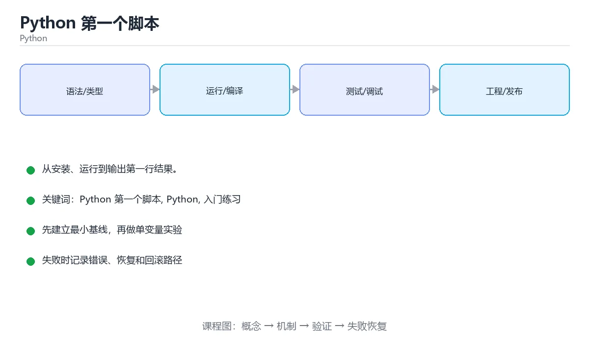

# iOS SwiftUI完整教程



> 内容更新时间：2026-10-06 · 学习阶段：基础 · 预计用时：35 分钟

## Chapter Overview

SwiftUI是苹果推出的革命性UI框架，它用声明式的方式彻底改变了iOS开发。就像从手动挡汽车升级到自动驾驶，你只需要告诉系统"我想要什么界面"，而不是"如何一步步绘制界面"。本章将从零开始带你掌握SwiftUI的核心概念、布局系统、状态管理、动画效果以及与UIKit的互操作，让你能够构建现代化的iOS应用。

## Learning Objectives

学完本章后，你将能够：

1. 理解声明式UI编程范式并与命令式UI进行对比
2. 熟练使用SwiftUI的布局容器和修饰符构建复杂界面
3. 掌握@State、@Binding、@ObservedObject等状态管理机制
4. 创建流畅的动画效果和自定义过渡
5. 实现列表、导航和数据驱动的用户界面
6. 在SwiftUI项目中集成UIKit组件和处理平台特性

## Core Concepts with Life Analogies

### 声明式UI：像点菜而不是做菜

传统的UIKit开发就像你自己做菜——你需要知道每一步怎么做：先切菜、再热油、然后翻炒。而SwiftUI就像去餐厅点菜——你只需要告诉服务员"我要一份宫保鸡丁"，厨房会自动完成所有步骤。在代码中，你不是命令式地创建视图、设置属性、添加到父视图，而是声明"这里应该有一个按钮，它是红色的，点击后会执行某个动作"，系统会自动处理渲染和更新。

### 状态驱动：像温度计显示室温

SwiftUI的核心理念是"UI是状态的函数"。想象一个温度计：水银柱的高度完全由温度决定。当温度变化时，水银柱自动调整高度，你不需要手动去推拉它。在SwiftUI中，@State变量就是温度，视图就是水银柱。当你修改@State的值时，SwiftUI会自动检测变化并重新渲染受影响的视图部分，整个过程完全自动化。

### 修饰符链：像给照片加滤镜

SwiftUI的修饰符（Modifier）就像手机修图APP里的滤镜叠加。你可以先加一个黑白滤镜，再加一个模糊效果，最后调整亮度。每个修饰符都会返回一个新的视图，形成一条处理链。重要的是顺序很关键：先裁剪再旋转，和先旋转再裁剪，结果完全不同。同样，`.padding().background(Color.red)`和`.background(Color.red).padding()`会产生不同的视觉效果。

## Progressive Code Examples

### 最小示例：基础Hello World

```swift
import SwiftUI

struct HelloWorld: View {
    var body: some View {
        Text("Hello, SwiftUI!")
            .font(.largeTitle)
            .foregroundColor(.blue)
            .padding()
    }
}

struct HelloWorld_Previews: PreviewProvider {
    static var previews: some View {
        HelloWorld()
    }
}
```

### 完整示例：待办事项列表应用

```swift
import SwiftUI

// 数据模型
struct TodoItem: Identifiable, Codable {
    let id = UUID()
    var title: String
    var isCompleted: Bool
    var priority: Priority
    
    enum Priority: String, Codable, CaseIterable {
        case low = "低"
        case medium = "中"
        case high = "高"
        
        var color: Color {
            switch self {
            case .low: return .green
            case .medium: return .orange
            case .high: return .red
            }
        }
    }
}

// 数据管理器
class TodoManager: ObservableObject {
    @Published var items: [TodoItem] = []
    
    private let saveKey = "todoItems"
    
    init() {
        loadItems()
    }
    
    func addItem(title: String, priority: TodoItem.Priority) {
        let newItem = TodoItem(title: title, isCompleted: false, priority: priority)
        items.append(newItem)
        saveItems()
    }
    
    func toggleCompletion(for item: TodoItem) {
        if let index = items.firstIndex(where: { $0.id == item.id }) {
            items[index].isCompleted.toggle()
            saveItems()
        }
    }
    
    func deleteItems(at offsets: IndexSet) {
        items.remove(atOffsets: offsets)
        saveItems()
    }
    
    private func saveItems() {
        if let encoded = try? JSONEncoder().encode(items) {
            UserDefaults.standard.set(encoded, forKey: saveKey)
        }
    }
    
    private func loadItems() {
        if let data = UserDefaults.standard.data(forKey: saveKey),
           let decoded = try? JSONDecoder().decode([TodoItem].self, from: data) {
            items = decoded
        }
    }
}

// 单个待办项视图
struct TodoItemView: View {
    let item: TodoItem
    let onToggle: () -> Void
    
    var body: some View {
        HStack {
            Button(action: onToggle) {
                Image(systemName: item.isCompleted ? "checkmark.circle.fill" : "circle")
                    .foregroundColor(item.isCompleted ? .green : .gray)
                    .font(.title2)
            }
            
            VStack(alignment: .leading) {
                Text(item.title)
                    .strikethrough(item.isCompleted)
                    .foregroundColor(item.isCompleted ? .gray : .primary)
                
                Text("优先级: \(item.priority.rawValue)")
                    .font(.caption)
                    .foregroundColor(item.priority.color)
            }
            
            Spacer()
        }
        .padding()
        .background(Color(UIColor.systemBackground))
        .cornerRadius(10)
        .shadow(color: Color.black.opacity(0.1), radius: 3, x: 0, y: 2)
    }
}

// 添加待办项对话框
struct AddTodoSheet: View {
    @Environment(\.presentationMode) var presentationMode
    @ObservedObject var todoManager: TodoManager
    
    @State private var title = ""
    @State private var selectedPriority: TodoItem.Priority = .medium
    
    var body: some View {
        NavigationView {
            Form {
                Section(header: Text("任务信息")) {
                    TextField("输入任务标题", text: $title)
                    
                    Picker("优先级", selection: $selectedPriority) {
                        ForEach(TodoItem.Priority.allCases) { priority in
                            Text(priority.rawValue).tag(priority)
                        }
                    }
                }
            }
            .navigationTitle("新增待办")
            .toolbar {
                ToolbarItem(placement: .cancellationAction) {
                    Button("取消") {
                        presentationMode.wrappedValue.dismiss()
                    }
                }
                
                ToolbarItem(placement: .confirmationAction) {
                    Button("保存") {
                        if !title.isEmpty {
                            todoManager.addItem(title: title, priority: selectedPriority)
                            presentationMode.wrappedValue.dismiss()
                        }
                    }
                    .disabled(title.isEmpty)
                }
            }
        }
    }
}

// 主界面
struct TodoListView: View {
    @StateObject private var todoManager = TodoManager()
    @State private var showingAddSheet = false
    
    var body: some View {
        NavigationView {
            List {
                if todoManager.items.isEmpty {
                    VStack(spacing: 16) {
                        Image(systemName: "list.bullet.clipboard")
                            .font(.system(size: 60))
                            .foregroundColor(.gray)
                        Text("暂无待办事项")
                            .font(.headline)
                            .foregroundColor(.gray)
                        Text("点击右下角按钮添加新任务")
                            .font(.subheadline)
                            .foregroundColor(.secondary)
                    }
                    .frame(maxWidth: .infinity)
                    .padding(.vertical, 60)
                } else {
                    ForEach(todoManager.items) { item in
                        TodoItemView(item: item) {
                            withAnimation {
                                todoManager.toggleCompletion(for: item)
                            }
                        }
                    }
                    .onDelete(perform: todoManager.deleteItems)
                }
            }
            .listStyle(InsetGroupedListStyle())
            .navigationTitle("我的待办")
            .toolbar {
                ToolbarItem(placement: .navigationBarTrailing) {
                    Button(action: { showingAddSheet = true }) {
                        Image(systemName: "plus.circle.fill")
                            .font(.title2)
                    }
                }
            }
            .sheet(isPresented: $showingAddSheet) {
                AddTodoSheet(todoManager: todoManager)
            }
        }
    }
}

struct TodoListView_Previews: PreviewProvider {
    static var previews: some View {
        TodoListView()
    }
}
```

### 实践示例：自定义动画卡片

```swift
import SwiftUI

// 可翻转的信息卡片
struct FlipCard: View {
    @State private var isFlipped = false
    
    let frontContent: String
    let backContent: String
    let frontColor: Color
    let backColor: Color
    
    var body: some View {
        ZStack {
            // 正面
            RoundedRectangle(cornerRadius: 16)
                .fill(frontColor)
                .overlay(
                    Text(frontContent)
                        .font(.title2)
                        .fontWeight(.bold)
                        .foregroundColor(.white)
                        .multilineTextAlignment(.center)
                        .padding()
                )
                .rotation3DEffect(
                    .degrees(isFlipped ? 180 : 0),
                    axis: (x: 0, y: 1, z: 0)
                )
                .opacity(isFlipped ? 0 : 1)
            
            // 背面
            RoundedRectangle(cornerRadius: 16)
                .fill(backColor)
                .overlay(
                    Text(backContent)
                        .font(.title2)
                        .fontWeight(.bold)
                        .foregroundColor(.white)
                        .multilineTextAlignment(.center)
                        .padding()
                )
                .rotation3DEffect(
                    .degrees(isFlipped ? 0 : -180),
                    axis: (x: 0, y: 1, z: 0)
                )
                .opacity(isFlipped ? 1 : 0)
        }
        .frame(width: 250, height: 350)
        .onTapGesture {
            withAnimation(.spring(response: 0.6, dampingFraction: 0.8)) {
                isFlipped.toggle()
            }
        }
        .shadow(color: Color.black.opacity(0.3), radius: 10, x: 0, y: 10)
    }
}

// 带动画效果的进度环
struct AnimatedProgressRing: View {
    @State private var progress: Double = 0
    
    let targetProgress: Double
    let duration: TimeInterval
    
    var body: some View {
        ZStack {
            // 背景环
            Circle()
                .stroke(Color.gray.opacity(0.3), lineWidth: 12)
            
            // 进度环
            Circle()
                .trim(from: 0, to: progress)
                .stroke(
                    LinearGradient(
                        gradient: Gradient(colors: [.blue, .purple]),
                        startPoint: .leading,
                        endPoint: .trailing
                    ),
                    style: StrokeStyle(lineWidth: 12, lineCap: .round)
                )
                .rotationEffect(.degrees(-90))
                .animation(
                    .easeInOut(duration: duration),
                    value: progress
                )
            
            // 中心文字
            VStack {
                Text("\(Int(progress * 100))%")
                    .font(.system(size: 36, weight: .bold))
                Text("完成度")
                    .font(.caption)
                    .foregroundColor(.secondary)
            }
        }
        .frame(width: 200, height: 200)
        .onAppear {
            DispatchQueue.main.asyncAfter(deadline: .now() + 0.5) {
                progress = targetProgress
            }
        }
    }
}

// 组合演示界面
struct AnimationDemoView: View {
    var body: some View {
        ScrollView {
            VStack(spacing: 30) {
                Text("动画效果演示")
                    .font(.largeTitle)
                    .fontWeight(.bold)
                    .padding(.top)
                
                FlipCard(
                    frontContent: "点击翻转\n查看背面",
                    backContent: "这是背面内容\n再次点击翻回",
                    frontColor: .blue,
                    backColor: .purple
                )
                
                AnimatedProgressRing(targetProgress: 0.75, duration: 2.0)
                
                // 弹性按钮
                Button(action: {}) {
                    Text("弹性按钮")
                        .font(.headline)
                        .foregroundColor(.white)
                        .padding()
                        .background(Color.orange)
                        .cornerRadius(12)
                }
                .scaleEffect(1.0)
                .animation(.spring(response: 0.3, dampingFraction: 0.4), value: true)
                
                Spacer(minLength: 40)
            }
            .padding()
        }
    }
}

struct AnimationDemoView_Previews: PreviewProvider {
    static var previews: some View {
        AnimationDemoView()
    }
}
```

## Common Pitfalls Table

| 陷阱 | 表现 | 原因 | 解决方案 |
|------|------|------|----------|
| @State用于引用类型 | 状态更新不触发视图刷新 | @State只适用于值类型（struct） | 引用类型（class）使用@StateObject或@ObservedObject |
| 忘记Identifiable协议 | ForEach编译错误 | SwiftUI需要唯一标识来追踪列表项 | 让数据模型 conform Identifiable或使用id参数 |
| 修饰符顺序错误 | 布局不符合预期 | 修饰符按顺序应用，前后顺序影响结果 | 理解每个修饰符的作用范围，通常padding在background之前 |
| 闭包捕获self导致循环引用 | 内存泄漏 | @ObservedObject对象在闭包中强引用self | 使用[weak self]或在ViewModel中避免闭包 |
| Preview Provider崩溃 | Xcode预览无法显示 | 预览中初始化了需要真实环境的代码 | 在preview中使用模拟数据，避免网络请求或文件IO |
| GeometryReader滥用 | 性能下降和布局混乱 | GeometryReader会消耗整个可用空间 | 仅在必要时使用，并明确指定frame限制尺寸 |
| @Binding双向绑定失效 | 子视图修改不反映到父视图 | 传递的是值而非绑定 | 确保使用$符号传递Binding，如$someState |
| List中嵌套ScrollView | 滚动冲突和性能问题 | 两个可滚动视图嵌套导致手势冲突 | 使用LazyVStack替代ScrollView，或禁用其中一个的滚动 |
| 动画未指定value参数 | iOS 17+警告或动画不生效 | 新版SwiftUI要求明确动画触发值 | 使用.animation(_, value:)语法明确指定依赖的状态 |
| EnvironmentObject未注入 | 运行时崩溃"Missing EnvironmentObject" | 祖先视图未提供.environmentObject() | 在NavigationView或根视图添加.environmentObject(viewModel) |

## Self-Test Questions

### 问题1

在SwiftUI中，以下哪个属性包装器最适合用于管理可变的状态数据？

A. @State  
B. @Environment  
C. @Binding  
D. @EnvironmentObject  

**正确答案：A**

**详细解释：** @State是SwiftUI中用于管理视图内部可变状态的标准方式。它适用于值类型（如struct），当@State变量的值发生变化时，SwiftUI会自动重新渲染使用该状态的视图。@Environment用于读取系统环境值（如颜色方案），@Binding用于在父子视图间共享状态，@EnvironmentObject用于在整个视图层级中共享对象。对于视图自身拥有的可变数据，@State是最合适的选择。

### 问题2

关于SwiftUI的修饰符（Modifier），以下说法错误的是？

A. 修饰符会返回一个新的View实例  
B. 修饰符的应用顺序会影响最终效果  
C. 同一个修饰符可以多次应用于同一视图  
D. 修饰符会直接修改原视图的属性  

**正确答案：D**

**详细解释：** SwiftUI遵循函数式编程理念，修饰符不会修改原视图，而是返回一个新的视图实例。这就是为什么SwiftUI被称为"声明式"而非"命令式"——你不是在修改现有对象，而是在描述新的视图结构。选项A、B、C都是正确的：修饰符确实返回新实例，顺序很重要（例如先padding后background与反过来效果不同），且可以链式调用多个修饰符甚至重复使用同一修饰符。

### 问题3

在SwiftUI List中使用ForEach时，为什么数据模型需要遵循Identifiable协议？

A. 为了让SwiftUI能够唯一标识和追踪每个列表项  
B. 为了能够对数据进行排序  
C. 为了提高数据加载速度  
D. 为了支持数据加密  

**正确答案：A**

**详细解释：** SwiftUI需要一种方式来唯一标识列表中的每个元素，以便在数据变化时高效地更新UI。Identifiable协议要求提供一个唯一的id属性，SwiftUI使用这个id来追踪哪些项被添加、删除或移动，从而只重新渲染发生变化的部分，而不是重建整个列表。这类似于React中的key属性。如果不使用Identifiable，也可以使用ForEach(data, id: \.someProperty)的形式显式指定标识符。

### 问题4

以下哪种情况应该使用@ObservedObject而不是@State？

A. 存储一个简单的布尔值开关状态  
B. 管理一个包含多个属性的复杂对象，且该对象需要在多个视图中共享  
C. 存储用户的文本输入  
D. 控制一个视图的显示/隐藏  

**正确答案：B**

**详细解释：** @State适用于简单的值类型状态，存储在视图内部。而当需要管理复杂的引用类型对象（class），特别是该对象实现了ObservableObject协议并通过@Published属性发布变化时，应该使用@ObservedObject。这种方式适合ViewModel模式，其中ViewModel持有业务逻辑和数据，并在数据变化时通知所有观察它的视图。选项A、C、D都是简单的值类型状态，用@State即可。

### 问题5

SwiftUI中的withAnimation闭包的作用是什么？

A. 强制所有视图立即刷新  
B. 创建一个独立的动画线程  
C. 暂停当前正在播放的动画  
D. 为闭包内改变的状态变化添加动画效果  

**正确答案：D**

**详细解释：** withAnimation是一个全局函数，它接收一个闭包作为参数。闭包内对@State或其他可观察状态的任何修改都会被自动添加动画效果。例如，`withAnimation { isExpanded = true }`会让isExpanded的变化以动画形式呈现，而不是瞬间跳变。你可以指定动画类型和时长，如`withAnimation(.easeInOut(duration: 0.5))`。这是一种简洁的方式来为状态变化添加视觉反馈，提升用户体验。

---

**章节小结：**

通过本章学习，你已经掌握了SwiftUI的核心精髓：声明式UI思维、状态驱动的视图更新、灵活的修饰符系统以及优雅的动画效果。SwiftUI不仅是一种新的UI框架，更是一种全新的编程思维方式。记住，在SwiftUI中，你的任务是描述"界面应该是什么样"，而不是"如何绘制界面"。下一章我们将探索Android阵营的Jetpack Compose，看看Google如何用类似的理念重塑Android开发。

## 本节知识框架

**课程定位**：分类「ios_development」· 学习阶段 基础 · 建议用时 50 分钟。

本课主线：学习SwiftUI声明式UI、状态管理、组合视图和Core Data集成。

### 复习清单

- [ ] 能不看正文复述本课核心术语，并指出一个边界或反例。
- [ ] 能运行或推演本课示例，记录输入、输出与失败现象。
- [ ] 能完成一次自测，并把错题对照考点精讲定位原因。

## 核心概念定义

| 术语 | 一句话说明 |
| --- | --- |
| SwiftUI | 学习SwiftUI声明式UI、状态管理、组合视图和Core Data集成。相关：正文给出可操作定义与适用边界。 |
| iOS | 学习SwiftUI声明式UI、状态管理、组合视图和Core Data集成。相关：正文给出可操作定义与适用边界。 |
| 声明式UI | 学习SwiftUI声明式UI、状态管理、组合视图和Core Data集成。相关：正文给出可操作定义与适用边界。 |
| 状态管理 | 学习SwiftUI声明式UI、状态管理、组合视图和Core Data集成。相关：正文给出可操作定义与适用边界。 |
| Core Data | 学习SwiftUI声明式UI、状态管理、组合视图和Core Data集成。相关：正文给出可操作定义与适用边界。 |

## 原理与运行机制

正文各章按「输入是什么 → 中间如何转换 → 输出到哪 → 失败时怎样表现」四问展开；复习时给每个机制补一句自己的复述，再回到对应章节核对。

## 典型应用场景

- 结合「iOS SwiftUI完整教程」的常见落地场景与选型边界，详见正文各章节的对比讨论。
- 迁移到新项目时，先明确输入规模、失败代价与可观测手段，再决定采用深度。

## 代码/协议/SQL 示例

正文首个示例可作为最小验证起点（原样保留在上方章节）：先跑通，再改一个输入观察输出变化。

```swift
import SwiftUI

struct HelloWorld: View {
    var body: some View {
        Text("Hello, SwiftUI!")
            .font(.largeTitle)
            .foregroundColor(.blue)
            .padding()
    }
}

struct HelloWorld_Previews: PreviewProvider {
    static var previews: some View {
        HelloWorld()
    }
}
```

## 时间/空间复杂度或性能分析

- 用本课方案处理规模 n 时，先估计主循环与嵌套层数，再决定优化方向；小样本上的耗时读数不能外推。
- 性能结论要绑定输入分布：换数据规模、并发度或缓存命中情况后须重新测量。

## 常见误区与易错点

| 错误做法 | 典型现象 | 修复方向 |
| --- | --- | --- |
| 只验证正常输入 | 边界数据触发时才暴露问题 | 为每个结论补一个空值/极值/重复值用例 |
| 背结论不跑实验 | 换个输入就失效 | 按「预测—实测—差异归因」三步复盘 |
| 忽略环境与版本差异 | 本机可用线上报错 | 把版本、配置与依赖写入复现步骤 |

## 与其他知识点的关系

本课与分类「ios_development」内相邻课程互为补充，建议按清单顺序学完再做综合练习。

## 自测题与参考答案

以下题目与题库同源，作答后再看解析；错误项要能说出错在哪一步。

## 考点精讲

### 考点 1

在SwiftUI中，以下哪个属性包装器最适合用于管理可变的状态数据？

A. @State ✅  
B. @Environment  
C. @Binding  
D. @EnvironmentObject  

**正确答案：** A

**解析：** @State是SwiftUI中用于管理视图内部可变状态的标准方式。它适用于值类型（如struct），当@State变量的值发生变化时，SwiftUI会自动重新渲染使用该状态的视图。@Environment用于读取系统环境值（如颜色方案），@Binding用于在父子视图间共享状态，@EnvironmentObject用于在整个视图层级中共享对象。对于视图自身拥有的可变数据，@State是最合适的选择。

### 考点 2

关于SwiftUI的修饰符（Modifier），以下说法错误的是？

A. 修饰符会返回一个新的View实例  
B. 修饰符的应用顺序会影响最终效果  
C. 同一个修饰符可以多次应用于同一视图  
D. 修饰符会直接修改原视图的属性 ✅  

**正确答案：** D

**解析：** SwiftUI遵循函数式编程理念，修饰符不会修改原视图，而是返回一个新的视图实例。这就是为什么SwiftUI被称为"声明式"而非"命令式"——你不是在修改现有对象，而是在描述新的视图结构。选项A、B、C都是正确的：修饰符确实返回新实例，顺序很重要（例如先padding后background与反过来效果不同），且可以链式调用多个修饰符甚至重复使用同一修饰符。

### 考点 3

在SwiftUI List中使用ForEach时，为什么数据模型需要遵循Identifiable协议？

A. 为了让SwiftUI能够唯一标识和追踪每个列表项 ✅  
B. 为了能够对数据进行排序  
C. 为了提高数据加载速度  
D. 为了支持数据加密  

**正确答案：** A

**解析：** SwiftUI需要一种方式来唯一标识列表中的每个元素，以便在数据变化时高效地更新UI。Identifiable协议要求提供一个唯一的id属性，SwiftUI使用这个id来追踪哪些项被添加、删除或移动，从而只重新渲染发生变化的部分，而不是重建整个列表。这类似于React中的key属性。如果不使用Identifiable，也可以使用ForEach(data, id: \.someProperty)的形式显式指定标识符。

### 考点 4

以下哪种情况应该使用@ObservedObject而不是@State？

A. 存储一个简单的布尔值开关状态  
B. 管理一个包含多个属性的复杂对象，且该对象需要在多个视图中共享 ✅  
C. 存储用户的文本输入  
D. 控制一个视图的显示/隐藏  

**正确答案：** B

**解析：** @State适用于简单的值类型状态，存储在视图内部。而当需要管理复杂的引用类型对象（class），特别是该对象实现了ObservableObject协议并通过@Published属性发布变化时，应该使用@ObservedObject。这种方式适合ViewModel模式，其中ViewModel持有业务逻辑和数据，并在数据变化时通知所有观察它的视图。选项A、C、D都是简单的值类型状态，用@State即可。

### 考点 5

SwiftUI中的withAnimation闭包的作用是什么？

A. 强制所有视图立即刷新  
B. 创建一个独立的动画线程  
C. 暂停当前正在播放的动画  
D. 为闭包内改变的状态变化添加动画效果 ✅  

**正确答案：** D

**解析：** withAnimation是一个全局函数，它接收一个闭包作为参数。闭包内对@State或其他可观察状态的任何修改都会被自动添加动画效果。例如，`withAnimation { isExpanded = true }`会让isExpanded的变化以动画形式呈现，而不是瞬间跳变。你可以指定动画类型和时长，如`withAnimation(.easeInOut(duration: 0.5))`。这是一种简洁的方式来为状态变化添加视觉反馈，提升用户体验。

## 术语速查

| 术语 | 一句话说明 |
| --- | --- |
| SwiftUI | 定位线索见正文小节；速查表只保留名称，避免脱离上下文使用。 |
| iOS | 定位线索见正文小节；速查表只保留名称，避免脱离上下文使用。 |
| 声明式UI | 定位线索见正文小节；速查表只保留名称，避免脱离上下文使用。 |
| 状态管理 | 定位线索见正文小节；速查表只保留名称，避免脱离上下文使用。 |
| Core Data | 定位线索见正文小节；速查表只保留名称，避免脱离上下文使用。 |

## 参考资料与复核

- [本课资料锚点 mobile_swiftui_complete](https://zh.wikipedia.org/w/index.php?search=mobile_swiftui_complete)

- 官方/权威资料：[Apple HIG](https://developer.apple.com/design/human-interface-guidelines/)
- 主题延伸：[关于「iOS」的检索页](https://zh.wikipedia.org/w/index.php?search=iOS)
- 本课索引词：[锚点 mobile_swiftui_complete](https://developer.apple.com/design/human-interface-guidelines/#SwiftUI)
- 最后复核：2026-10-04
- 下次复核：2026-12-29

## 内容元数据

- 内容更新时间：2026-10-06

- 内容版本：v2.0
- 课程标识：mobile_swiftui_complete
- 所属分类：ios_development
- 学习阶段：基础
- 建议用时：50 分钟

