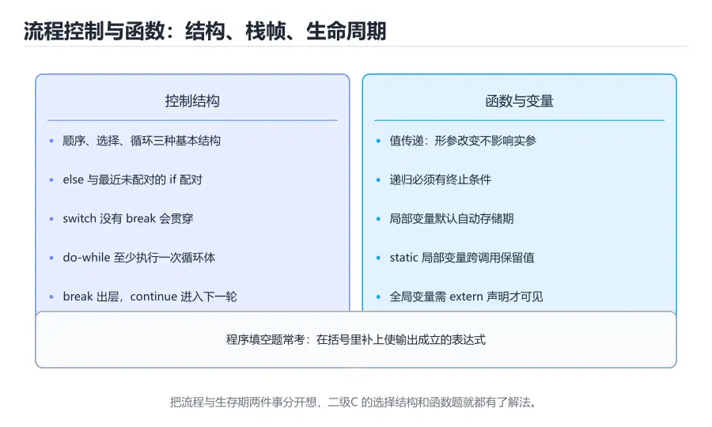

# 二级 C：流程控制结构与函数



> 内容更新时间：2026-10-06 · 学习阶段：基础 · 预计用时：50 分钟

## 本节知识框架

**课程定位**：所属分类 `ncre`（全国计算机等级二级），课程主题 `二级 C：流程控制结构与函数`，学习阶段 基础，建议用时 50 分钟。

上一课解决「一个表达式算出什么」，这一课解决「哪些语句会被执行、执行几次、在谁的栈帧里」。二级 C 的选择题里，流程控制与函数稳定占 5 到 8 题；程序填空题几乎每题都要求你在括号里补一个表达式或一条语句，让输出刚好成立。所以本课的判断标准只有一个：**能不能准确复述程序的实际执行轨迹**。

把程序想成两件事叠在一起。控制流是「走过的路」：条件决定分岔，循环决定重走，break 与 continue 决定是提前离场还是下一轮再来。函数与变量是「随身带的东西」：每次调用函数就新开一个栈帧，装进这个函数自己的形参与局部变量，返回时销毁；想跨调用留住某个值，就得把它换成静态存储期。这两条线各自出题，混在一起想最容易晕：题目问「输出什么」时先走控制流，问「值是多少、为什么没变」时先看生命周期。

**学完本课应当能够**

- 说出 else 与 if 的配对规则，并解释为什么缩进不能替编译器做决定。
- 判断一段 switch 语句的实际输出，说清 break 缺失导致的贯穿到哪里停止。
- 区分 while、do-while、for 三者的判断时机与写法坑，指出 continue 在三种循环里各自的下一步。
- 解释值传递为什么不能改变实参，并写出需要改变实参时的正确做法。
- 说明局部变量、全局变量、静态变量三者的作用域与生命周期差别，并给出一个 static 计数的例子。

### 复习清单

- [ ] 能否解释 `if (a > 0) if (b > 0) x = 1; else x = 2;` 里 else 归谁。
- [ ] 能否说明 `switch` 里漏写 `break` 会执行到哪一行为止。
- [ ] 能否说出 `do { i++; } while (i < 5);` 与 `while` 版本在 `i` 初值为 5 时的差别。
- [ ] 能否写一个求 5 的阶乘的递归函数，并指出它的终止条件在哪一行。
- [ ] 能否解释 `static int count = 0;` 放在函数里和放在函数外的两种含义。

## 核心概念定义

| 术语 | 操作性定义 | 常见边界与风险 |
| --- | --- | --- |
| 语句 | C 程序中最小的执行单位，表达式后面加分号就成为语句；空语句只有一个分号。 | 易错：在 `if` 条件后误加分号，判定就变成一句空话，后面的语句无条件执行。 |
| 复合语句 | 用花括号把若干语句包成一条语句，也叫代码块。 | 循环体与分支体需要执行多行时必须加花括号，只写一行时花括号可省但不能省逻辑。 |
| if-else | 条件为非零即真，执行对应分支；else 可选。 | else 与上方最近一个还没配对的 if 结对，与缩进无关，加花括号可以强行改配对。 |
| switch-case | 按整型或字符型表达式的常量值跳转到对应分支。 | 每个 case 必须有 `break` 才不会贯穿；`default` 位置可以任意，通常放最后。 |
| 贯穿 | case 分支执行完没有 break 时继续向下执行后续分支语句的现象。 | 贯穿不受后面 case 的条件约束，值不匹配的分支一样会被执行。 |
| while | 先判断条件再执行循环体，条件为假时一次都不执行。 | 条件里用 `=` 而不是 `==` 会让循环失控或永不进入。 |
| do-while | 先执行一次循环体再判断条件，循环体至少执行一次。 | 右括号后的分号是语法的一部分，漏写会编译报错。 |
| for | 三个表达式分别是初值、条件、迭代，执行顺序是初值、判断、循环体、迭代、再判断。 | 条件省略即恒为真；`for (;;)` 是合法死循环写法。 |
| break | 结束当前所在层循环或 switch，把控制交给紧随其后的语句。 | 只跳一层，嵌套循环里想全退需要标志变量或函数封装。 |
| continue | 跳过本次循环体剩余部分，进入下一轮。 | 在 do-while 里会跳到条件判断，可能跳过迭代语句造成死循环。 |
| 函数定义 | 由返回类型、函数名、参数表与函数体组成，C 语言的函数不能嵌套定义。 | 定义在别的函数内部是错的；一个源文件可以有多个函数，入口只有 main。 |
| 函数声明 | 在调用前给出原型，告诉编译器返回类型与参数表。 | 缺声明时旧规则会按隐式声明处理，实际工程中应写头文件或原型。 |
| 值传递 | 实参的值复制给形参，函数内部只改副本。 | 想带回结果只能靠返回值或传地址，改形参不会影响实参。 |
| 递归 | 函数直接或间接调用自身，必须有终止条件与递推关系。 | 缺终止条件会栈溢出；递归层数太深比循环更耗栈。 |
| 作用域 | 一个名字在程序哪些位置可见。 | 局部同名变量把全局变量遮住，内层代码块也各自构成作用域。 |
| 存储类别 | 决定变量生命周期：auto 自动、static 静态、extern 外部链接、register 建议放寄存器。 | 作用域与生命周期是两件事：文件作用域可以是静态生命周期，块作用域也可以是静态生命周期。 |

## 原理与运行机制

### 配对与贯穿：控制流的两条隐形规则

先看一个反复出现的写法：

```c
if (score >= 60)
    if (absent == 0)
        printf("pass\n");
else
    printf("fail\n");
```

很多人以为 else 归外层那个 `score >= 60`，实际它归**最近一个还没配对的 if**，也就是 `absent == 0`。后果是：不及格的分支根本不会被执行，因为 else 只在内层判定成立时才存在。修复办法是把外层判断用花括号包住，让内层成为一个复合语句——缩进是给程序员看的，编译器读的是花括号。

switch 的机制更像一次「按值定位然后往下执行」。编译器用常量值找到入口，然后从这个位置一路顺序执行，直到 switch 的右花括号或遇到 break。所以漏写 break 的分支会把后面所有分支的语句一并执行一遍，无论后面的 case 常量与表达式是否相等。贯穿本身也可以被利用：多个 case 共用一段处理语句时，故意省掉中间的 break 比写很多重复代码更紧凑，但二级题目里出现的漏 break 九成是错误。

### 三种循环的执行顺序

`for (初值; 条件; 迭代)` 的实际顺序是：初值只算一次；然后每次先判断条件，为真才执行循环体；循环体结束后执行迭代，再回到条件判断。`while` 少了初值与迭代两段，它们得你自己写在外面和里面；`do-while` 把判断挪到循环体之后，因此循环体至少执行一次。

这三条差异直接对应三类题。初值为 5、条件为 `i < 5` 时，`while` 一次都不执行，`do-while` 会执行一次；`for` 里把迭代写成 `i += 2` 会让循环次数减半；`continue` 在 `for` 里跳到迭代表达式（还会继续递增），在 `while` 与 `do-while` 里直接跳到条件判断（递增语句在循环体后半段的话就被跳过，可能死循环）。

嵌套循环的失分点在于内层变量的复位。外层每一轮都要把内层计数器重置，否则第二圈的起点就错了——把计数器定义在内层循环之前、但在外层循环之内，是自动存储期最典型的用法。

### 函数调用时栈里发生了什么

调用一个函数，系统会为它建立一个新的栈帧，依次放入返回地址、形参的副本、局部自动变量。函数体内的一切读写都发生在这份副本上，这就是**值传递**的全部含义：

```c
void swap(int a, int b) {
    int t = a; a = b; b = t;   /* 只交换了两个副本 */
}

int main(void) {
    int x = 3, y = 8;
    swap(x, y);
    printf("%d %d\n", x, y);   /* 仍然打印 3 8 */
}
```

要让交换生效有两条路：把结果通过返回值带回来（一次只能带回一个），或者传地址进去，让函数通过指针修改原变量（需要写成 `swap(&x, &y)` 并在函数里解引用）。二级 C 的程序填空题常常就考这一点：函数头已经写好 `void swap(int *a, int *b)`，而调用处漏了 `&`，或者反过来。

递归是同一机制的多次触发。`f(4)` 建立栈帧、发现要算 `f(3)`，于是把 `f(4)` 停在半路再建一个栈帧，一直到 `n == 1` 返回 1，随后逐层回卷相加。写递归只要盯两件事：**什么时候不再往下调（终止条件）**，以及**每层少掉多少规模（递推关系）**。缺了第一条会栈溢出，缺了第二条永远碰不到终止条件。

### 局部、全局与静态：作用域与生命周期分开看

一个变量有两个独立属性：在哪儿可见，活多久。

```c
#include <stdio.h>

int total = 0;                 /* 文件作用域，静态生命周期 */

int count_call(void) {
    static int called = 0;     /* 块作用域，静态生命周期 */
    int temp = 0;              /* 块作用域，自动生命周期 */
    called++;
    temp++;
    total++;
    printf("called=%d temp=%d total=%d\n", called, temp, total);
    return called;
}

int main(void) {
    count_call();
    count_call();
    count_call();
    return 0;
}
```

输出三行分别是 `called=1 temp=1 total=1`、`called=2 temp=1 total=2`、`called=3 temp=1 total=3`。`called` 只有第一次执行初始化，之后跨调用保留；`temp` 每次重新建立，永远是 1；`total` 因为是全局变量，也一直在累加。这段程序把「static 局部变量」与「自动局部变量」的差别一次说完，也是二级最常考的生存期题型。

全局变量默认对整个源文件可见，被 `static` 修饰后仍只在本文件内可见，别的文件即使写 `extern` 也取不到；反过来，一个在文件 A 定义的全局变量想在文件 B 使用，必须在 B 里写 `extern` 声明。答题时记住一句话：**extern 说的是「别处已经定义了」，static 说的是「别处不许看见」**。

## 典型应用场景

| 场景 | 典型输入或前提 | 用上的结论 |
| --- | --- | --- |
| 成绩分级 | 分数区间映射到等级字符 | 用 switch 配整型除法做分段，`score / 10` 后每个 case 加 break |
| 菜单循环 | 一直显示菜单直到用户输入 0 | `do { 读入 choice; 处理; } while (choice != 0);` 保证菜单先显示一次 |
| 求最大值 | 一串未知个数的输入 | `while (scanf("%d", &v) == 1)` 靠 scanf 返回值判断是否读到数据 |
| 统计调用次数 | 每次调用都要留下痕迹 | static 局部计数器，避免把变量摊成全局 |
| 递归求和与阶乘 | 数学式已经写成递推形式 | 先写终止条件再写递归调用，注意乘法与加法的区别 |
| 交换两个变量 | 需要在函数里改主调的值 | 传地址并在函数内解引用，值传递做不到 |

### 最小验证场景

拿一段 15 行的程序，先按原样跑一次并抄下输出；然后依次做四处破坏：删掉某个 case 的 break、把 `while` 换成 `do-while`、删掉函数里的 `return`、把 `static` 去掉。每破坏一次都重新编译运行，把输出差异写在旁边。四处破坏正好对应四类考点，做完这一轮，选择题里「输出是什么」的题目就有了可靠的直觉。

## 代码/协议/SQL 示例

**switch 分段并观察贯穿**

```c
#include <stdio.h>

int main(void) {
    int k = 2;
    switch (k) {
    case 1:
        printf("one ");
        break;
    case 2:
        printf("two ");
    case 3:
        printf("three ");
        break;
    default:
        printf("other ");
    }
    printf("\n");
    return 0;
}
```

输出 `two three`。`case 2` 后面没有 break，程序继续向下走进 `case 3`，直到遇见 break 才退出 switch。把 `case 3` 的 break 也删掉，输出会变成 `two three other`，连 default 也被贯穿执行。

**递归与循环等价**

```c
int fact_loop(int n) {
    int r = 1;
    while (n > 1) {
        r *= n;
        n--;
    }
    return r;
}

int fact_rec(int n) {
    if (n <= 1) return 1;        /* 终止条件 */
    return n * fact_rec(n - 1);  /* 递推关系 */
}
```

两者对 `n = 5` 都返回 120。递归写法短，代价是每一层都要一个栈帧；把 `if (n <= 1)` 改成 `if (n == 0)`，`fact_rec(1)` 会一路调到负数直到栈溢出，这正是「缺终止条件」的标准演示。

**continue 的两种落点**

```c
#include <stdio.h>

int main(void) {
    for (int i = 0; i < 5; i++) {
        if (i == 2) continue;
        printf("%d ", i);
    }
    printf("\n");
    int j = 0;
    do {
        if (j == 2) {
            j++;                 /* 少了这一句就会死循环 */
            continue;
        }
        printf("%d ", j);
        j++;
    } while (j < 5);
    printf("\n");
    return 0;
}
```

输出两行 `0 1 3 4`。`for` 里的 continue 仍会执行迭代表达式，`do-while` 里的 continue 直接跳到条件判断，所以循环变量的自增必须在 continue 之前写完。

**用返回值带回结果**

```c
int max_of(int a, int b) { return a > b ? a : b; }

int main(void) {
    int s = 0;
    for (int i = 1; i <= 4; i++) {
        s += max_of(i, 4 - i);
    }
    return 0;   /* 循环结束后 s 为 12 */
}
```

`max_of` 用条件运算符返回较大值，四组比较依次是 `1 与 3`、`2 与 2`、`3 与 1`、`4 与 0`，较大者相加得 12。

把上面那句注释从 12 改成 10，程序不会报任何错，只在结果上骗你一次；真正的坏写法是在 `max_of` 里漏掉 return。非 void 函数没有返回语句时，调用方取到的值不确定，编译阶段顶多给一条警告——这正好对应程序修改题里那种「逻辑看着完整、运行结果全错」的场景。补 return 时还要检查返回类型：把 `int max_of(...)` 写成 `void`，`s += max_of(...)` 就立刻编译不过。

## 时间/空间复杂度或性能分析

流程控制的成本主要落在循环次数上，函数的成本落在栈帧数量上。

| 结构 | 时间上的表现 | 空间上的表现 |
| --- | --- | --- |
| 单层 for，循环体 n 次 | 与 n 成正比 | 无额外增长 |
| 两层嵌套各 n 次 | 与 n 的平方成正比 | 无额外增长 |
| `for (i = 1; i <= n; i *= 2)` | 与 log2 n 成正比 | 无额外增长 |
| 递归求和，深度 n | 与 n 成正比 | 需要 n 层栈帧，占用与 n 成正比 |
| 尾递归式的阶乘 | 与 n 成正比 | 不保证优化，仍按线性栈空间估计 |
| switch 多分支 | 编译器可跳表，分支多时不明显变慢 | 无 |

递归写得再优雅，栈空间都是线性消耗，二级大纲里「递归必须谨慎」说的就是这件事。程序填空题常给一个递归函数要求补一句 return，判分时看的是终止条件与递推式两个空，补错任何一个都会导致输出全错。

时间分配上还有另一笔账：二级 C 的 60 分操作题里，程序填空题通常 15 到 20 分钟，修改题 20 分钟，设计题 40 分钟。设计题十有八九要你自己写一个带循环与判断的函数，因此「函数头已经给出、只写函数体」的练习要单独计时：先写返回值与终止分支，再补循环，最后用三组数据（普通值、边界 0、负数）自查。

## 常见误区与易错点

- **靠缩进判断 else 归谁**。配对只看最近的未配对 if，加花括号才靠得住。
- **忘记 case 后面的 break**。贯穿会执行到 switch 结束，`default` 也逃不掉。
- **把 case 后写成范围或变量**。case 常量必须是整型常量表达式，不能写 `case x < 5:`。
- **在 if 条件后误加分号**。`if (a > 0);` 后面那句就与判定无关了。
- **do-while 右括号后漏分号**。这是编译错误，也是修改题常标的一处。
- **以为 for 的三个表达式都得写**。条件和迭代都可以省略，省略条件即恒为真。
- **把 break 当成退出所有循环**。它只作用于最内层的那一层。
- **在 do-while 里 continue 后忘了递增循环变量**。会直接陷入死循环。
- **以为改形参能带回结果**。值传递只改副本，需要传地址或用返回值。
- **递归没有终止条件，或终止条件永远碰不到**。表现为栈溢出，而不是编译错误。
- **把作用域当成生命周期**。块作用域的变量加 static 后可以活满整个程序运行期。
- **在函数里定义另一个函数**。C 不允许函数嵌套定义，只能嵌套声明或调用。
- **缺函数声明就调用**。返回类型与参数被隐式假定后，程序能编译但结果错。
- **忘记写 return**。非 void 函数没有返回语句，取到的值不确定。

## 与其他知识点的关系

- 本课的表达式判定接着上一课的类型规则：条件为「非零即真」，`if (a = b)` 的真假由赋值表达式的值决定。
- 函数的值传递与栈帧是 `ncre_c_pointer_array_string` 的入口：一旦需要带回多个结果，就必须传地址，指针与数组的所有失分点都从这里开始。
- 递归与调用深度在 `ncre_public_data_structure` 的算法部分会重现，二分查找的递归版本就是它的典型例子。
- 结构体作为参数传递时的拷贝成本属于 `ncre_c_struct_file`，本课讲的存储类别在那里决定链表头指针放在哪里。
- 「函数是一个黑盒、按输入输出规格测试」这一观念来自 `ncre_public_prog_db_net` 的软件工程部分，单元测试的题目背景就是本课的这些函数。

| 关联课程 ID | 关联主题 | 关系说明 |
| --- | --- | --- |
| ncre_c_data_expr | 类型与表达式 | 判定条件的值先由类型规则算出 |
| ncre_c_pointer_array_string | 指针与数组 | 带回多个结果必须传地址 |
| ncre_c_struct_file | 结构体与文件 | 结构体作参数的拷贝代价与静态链表头 |
| ncre_public_data_structure | 算法与递归 | 递归实现的查找与排序复杂度 |

## 自测题与参考答案

### 题目 1

以下关于 if 语句与 else 配对的说法，正确的是？

1. else 与它上面最近的、尚未与 else 配对的 if 配对，与缩进无关
2. else 永远与同一层花括号里的第一个 if 配对，与它后面有没有 break 无关
3. else 与书写位置上离它最靠左、且中间没有其它未配对 if 的那个 if 结对
4. 编译器按代码缩进层级决定 else 归属哪一个 if，缩进一致就配对正确

**参考答案**：A（else 与它上面最近的、尚未与 else 配对的 if 配对，与缩进无关）

本题正确项是「else 与它上面最近的、尚未与 else 配对的 if 配对，与缩进无关」。C 语言语法里 else 的归属只看这条规则，想让外层 if 拥有 else，必须用花括号把内层判断包成一条复合语句。干扰项「编译器按代码缩进层级决定 else 归属哪一个 if，缩进一致就配对正确」把人的排版习惯当成了编译规则，缩进对语法没有任何影响；花括号决定的是作用范围，不是第一个 if。

### 题目 2

在 switch 语句中，如果某个 case 分支后面没有写 break，程序会？

1. 立即结束整个 switch，不再执行任何分支，把控制交给 switch 之后的语句
2. 从该分支继续向下执行后续 case 的语句，直到遇到 break 或 switch 结束
3. 跳到下一个 case 的入口重新判断 switch 表达式的值是否与新的常量相等
4. 产生编译错误，因为语法规定每个 case 分支的最后都必须写一条 break

**参考答案**：B（从该分支继续向下执行后续 case 的语句，直到遇到 break 或 switch 结束）

本题正确项是「从该分支继续向下执行后续 case 的语句，直到遇到 break 或 switch 结束」。switch 用常量值确定入口后就是顺序执行，后面的 case 标签不再重新参与比较，所以 default 也可能被顺带执行。干扰项「跳到下一个 case 的入口重新判断 switch 表达式的值是否与新的常量相等」把贯穿理解成了再次匹配，实际没有任何判断发生；漏写 break 不是语法错误，第四条也不成立。

### 题目 3

下面关于三种循环的说法，正确的是？

1. while 与 do-while 的唯一区别是 do-while 能省略循环体末尾的分号
2. for 语句的三个表达式都必须书写，缺一个就编译不过
3. continue 会结束它所在的那一层循环，并立刻开始外层循环的下一次迭代
4. do-while 会先执行一次循环体再判断条件，因此循环体至少执行一次

**参考答案**：D（do-while 会先执行一次循环体再判断条件，因此循环体至少执行一次）

本题正确项是「do-while 会先执行一次循环体再判断条件，因此循环体至少执行一次」。这是它与 while 在次数上的唯一实质差别，分号反而必须写。for 的三个表达式中条件与迭代都能省略，`for (;;)` 就是合法死循环；continue 只影响当前这一层，不会跳出外层循环。干扰项「continue 会结束它所在的那一层循环，并立刻开始外层循环的下一次迭代」把 continue 与 break 的作用范围并成了一件事。

### 题目 4

阅读下面的 C 代码，函数调用后打印的结果是？

```c
int f(int n)
{
    if (n == 1) return 1;
    return n + f(n - 1);
}

int main(void)
{
    printf("%d", f(4));
    return 0;
}
```

1. 24
2. 4
3. 10
4. 1

**参考答案**：C（10）

本题正确项是「10」。f(4) 返回 4 + f(3)，一路展开到 f(1) 返回 1，合成 4 + 3 + 2 + 1 得 10，递归在这里充当了循环。干扰项「24」是把 return 那句里的加法看成了乘法，那才是阶乘的写法，24 对应 4 * 3 * 2 * 1；2 与 1 都不满足任何一条展开路径。

### 题目 5

填空：在 C 语言里，函数内部定义的局部变量若希望在多次调用之间保留上次的值，应当在定义时加上关键字 ________。

**参考答案**：static

本题正确项是「static」。局部变量默认是自动存储期，函数返回即销毁；加上 static 之后它仍是块作用域、只在定义它的那个函数里可见，但生命周期变成整个程序运行期，初始化只在第一次进入时发生一次。全局变量本来就一直存在，加 static 改变的是可见范围而不是生存期，两种情形不能混写。

### 题目 6

下列关于 C 语言函数与变量作用域的说法中，正确的两项是？

1. C 语言允许在一个函数的函数体内部再定义另一个函数
2. 全局变量默认对整个源文件可见，被 static 修饰后只在本文件内可见
3. 形参与实参同名时，它们占用的是同一块内存
4. 自动存储期的局部变量在函数返回后其值不再保留

**参考答案**：B、D（全局变量默认对整个源文件可见，被 static 修饰后只在本文件内可见；自动存储期的局部变量在函数返回后其值不再保留）

本题要同时选中「全局变量默认对整个源文件可见，被 static 修饰后只在本文件内可见」与「自动存储期的局部变量在函数返回后其值不再保留」。前一条说的是链接属性，后一条说的是生存期，两者都跟可见范围无关。C 语言的函数不能嵌套定义，只能互相调用；形参是实参值的副本，即使同名也各占一块内存，这正是值传递不能带回结果的根因。

## 考点精讲

本课题库共 6 道题，下面逐题复述题干、正确项与判断依据。

### 考点 1：第 1 题

- **题目**：以下关于 if 语句与 else 配对的说法，正确的是？
- **正确项**：A（else 与它上面最近的、尚未与 else 配对的 if 配对，与缩进无关）
- **判断依据**：本题正确项是「else 与它上面最近的、尚未与 else 配对的 if 配对，与缩进无关」。嵌套 if 里 else 归最近未配对者，想让外层拥有 else 要用花括号把内层包成一条复合语句。干扰项「编译器按代码缩进层级决定 else 归属哪一个 if，缩进一致就配对正确」把排版当语法，是最典型的错觉。

### 考点 2：第 2 题

- **题目**：在 switch 语句中，如果某个 case 分支后面没有写 break，程序会？
- **正确项**：B（从该分支继续向下执行后续 case 的语句，直到遇到 break 或 switch 结束）
- **判断依据**：switch 定入口后按顺序执行，case 标签不再参与比较，因此贯穿会一路走到 break 或 switch 结尾。干扰项「跳到下一个 case 的入口重新判断 switch 表达式的值是否与新的常量相等」错在以为会重新匹配，漏写 break 也不属于编译错误。

### 考点 3：第 3 题

- **题目**：下面关于三种循环的说法，正确的是？
- **正确项**：D（do-while 会先执行一次循环体再判断条件，因此循环体至少执行一次）
- **判断依据**：本题正确项是「do-while 会先执行一次循环体再判断条件，因此循环体至少执行一次」。for 的三个表达式可省，continue 只影响本层循环。干扰项「continue 会结束它所在的那一层循环，并立刻开始外层循环的下一次迭代」把 continue 与 break 混为一谈。

### 考点 4：第 4 题

- **题目**：阅读下面的 C 代码，函数调用后打印的结果是？int f(int n) { if (n == 1) return 1; return n + f(n - 1); } int main(void) { printf("%d", f(4)); return 0; }
- **正确项**：C（10）
- **判断依据**：递归展开成 4 + 3 + 2 + 1 得 10，终止条件是 n == 1 时返回 1。干扰项「24」对应的是乘法版本，也就是阶乘；把终止条件删掉则表现为栈溢出而不是编译错误。

### 考点 5：第 5 题

- **题目**：填空：在 C 语言里，函数内部定义的局部变量若希望在多次调用之间保留上次的值，应当在定义时加上关键字 ________。
- **正确项**：static
- **判断依据**：static 改变生存期不改可见范围，加在局部变量上让它跨调用保留值，加在全局变量上则把可见范围收在本文件内。自动存储期与静态存储期只要分得清，这类填空就不会写反。

### 考点 6：第 6 题

- **题目**：下列关于 C 语言函数与变量作用域的说法中，正确的两项是？
- **正确项**：B、D（全局变量默认对整个源文件可见，被 static 修饰后只在本文件内可见；自动存储期的局部变量在函数返回后其值不再保留）
- **判断依据**：本题正确项包含「全局变量默认对整个源文件可见，被 static 修饰后只在本文件内可见」与「自动存储期的局部变量在函数返回后其值不再保留」。干扰项「C 语言允许在一个函数的函数体内部再定义另一个函数」违反函数不能嵌套定义的规则；形参只是实参的副本，同名也不共用内存。

### 高频考点小结

1. 配对与贯穿：else 归最近未配对的 if；case 缺 break 就一路执行到 break 或 switch 结束。
2. 循环差异：do-while 至少执行一次且末尾分号必写；for 三个表达式可省；continue 只作用本层。
3. 函数与传递：值传递只改副本，带回结果靠返回值或传地址；递归要有能碰到的终止条件。
4. 生存期：static 局部变量跨调用保留，static 全局变量限制在本文件，extern 表示定义在别处。

## 术语速查

| 术语 | 一句话说明 |
| --- | --- |
| 复合语句 | 用花括号把若干条语句包成一条语句，它同样可以作为循环体或分支体。 |
| 空语句 | 单独一个分号构成的语句，常在 if 条件后误加分号时出现。 |
| else 配对规则 | else 归属上方最近一个还没配对的 if，与缩进和书写位置无关。 |
| case 贯穿 | switch 中某分支缺少 break 时继续向下执行后续分支语句的现象。 |
| 迭代表达式 | for 第三个表达式，在每次循环体结束后执行，然后才回到条件判断。 |
| break | 结束当前所在层的循环或 switch，把控制权交给紧随其后的语句。 |
| continue | 跳过本次循环体剩余语句，for 里仍会执行迭代表达式。 |
| 栈帧 | 一次函数调用期间存放返回地址、形参副本与局部变量的内存区域。 |
| 值传递 | 把实参的值复制给形参，函数内部修改只影响这份副本。 |
| 形参与实参 | 定义时写的参数是形参，调用时给出的具体值或地址是实参。 |
| 函数原型 | 告诉编译器返回类型与参数表的声明，通常写在调用之前或头文件里。 |
| 递归终止条件 | 让函数不再调用自身的那条判断，缺失会造成栈溢出。 |
| 自动存储期 | 局部变量的默认生命周期，进入块时建立、离开块时销毁。 |
| 静态存储期 | 用 static 声明获得的生命周期，程序运行期间始终存在且只初始化一次。 |
| 文件作用域 | 在所有函数之外定义的名字所拥有的可见范围。 |
| extern 声明 | 引用别处已经定义好的变量的声明方式，不产生新的存储。 |

## 参考资料与复核

- 最后复核：2026-10-04
- 下次复核：2027-08-10
- 复核范围：三种基本结构的语法细节、switch 与 break 的行为、循环三兄弟的执行顺序、函数参数传递与存储类别
- 来源性质：教育部教育考试院 NCRE 二级 C 语言大纲条目与 C 语言公开参考文档；本课核对关键词：else 配对、case 贯穿、do-while 至少一次、值传递、static 生存期。

| 参考资料 | 本课用途 |
| --- | --- |
| [全国计算机等级考试考试大纲](https://ncre.neea.edu.cn/html1/report/2412/185-1.htm) | 二级 C 语言流程控制与函数的考核条目 |
| [全国计算机等级考试专栏首页](https://ncre.neea.edu.cn/) | 考试日期与科目设置 |
| [Microsoft C/C++ 语言参考](https://learn.microsoft.com/en-us/cpp/c-language/c-language-reference) | 语句、函数与声明的语法规则 |
| [C FAQ：声明与定义](https://www.c-faq.com/decls/index.html) | 作用域、存储类别与 extern 的常见疑问 |
| [C FAQ：结构体与指针](https://www.c-faq.com/struct/index.html) | 参数传递与结构体作实参的补充说明 |

## 内容元数据

> 内容更新时间：2026-10-06 · 学习阶段：基础 · 预计用时：50 分钟

- 内容版本：v2.0
- 最后更新：2026-11-11
- 学习阶段：基础
- 适用环境：二级 C 语言程序设计（科目代码 24），中文版 Windows 7 与 Microsoft Visual C++ 2010 学习版
- 内容来源：教育部教育考试院 NCRE 考试大纲与 C 语言公开参考文档整理
- 相关主题：if-else 配对、switch 与 break、三种循环、函数定义与调用、递归、作用域与存储类别
