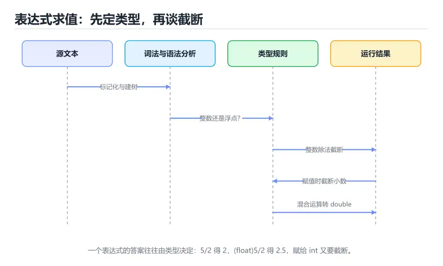

# 二级 C：数据类型、常量变量与表达式求值



> 内容更新时间：2026-10-06 · 学习阶段：基础 · 预计用时：50 分钟

## 本节知识框架

**课程定位**：所属分类 `ncre`（全国计算机等级二级），课程主题 `二级 C：数据类型、常量变量与表达式求值`，学习阶段 基础，建议用时 50 分钟。

二级 C 语言的 40 分选择题里有 30 分落在本科目，而这一半分中至少三分之一只需要你回答同一个问题：**这个表达式先算什么、算出来是什么类型**。程序填空题与程序修改题也一样，被标记的那一行九成是类型或运算符写法出了问题。所以这一课不讲语法手册的目录，只讲一条求值链：源文本先被切成一个个记号，语法分析把它们组成表达式树，类型规则决定每个节点的结果类型，最后一步才是把结果写回变量时可能发生的截断。

把这条链想成一条流水线上的四道工序会更直观：第一道工序只负责识别单词，不认识「哪个先算」；第二道工序按优先级与结合性决定谁先谁后；第三道工序是本题库最大的失分点，它规定两个 int 相除还是 int、两个 char 相加先升成 int；第四道工序规定把 double 塞进 int 盒子的瞬间小数就被剪掉了。二级题目问的「值是多少」，问的正是这四道工序的结果。

**学完本课应当能够**

- 判断任意一个 C 表达式的计算顺序，并说出结果类型，包括 `/`、`%`、`++`、`,`、`?:` 与 `sizeof`。
- 区分整型、实型、字符型常量的书写形式，能认出八进制、十六进制与转义字符。
- 说明隐式转换的方向（整数提升、向 double 提升）和强制转换的作用范围。
- 写出符合命名规则的标识符，并解释关键字为什么不能用作变量名。
- 用 `printf` 与 `scanf` 的格式控制符完成规定格式的输入输出，并说清 `scanf` 为什么要写地址。

### 复习清单

- [ ] 能否在 10 秒内说出 `17 / 5`、`17 % 5`、`17.0 / 5` 三个式子的值。
- [ ] 能否解释 `x = a / b;`（a、b 为 int，x 为 double）为什么得不到小数。
- [ ] 能否把逗号、赋值、算术、单目四类运算符按优先级从低到高排成一列。
- [ ] 能否写出 `%d`、`%f`、`%c`、`%s`、`%e`、`%%` 各自对应哪种数据。
- [ ] 能否指出 `scanf("%d", &a);` 中 `&` 去掉后会发生什么。

## 核心概念定义

| 术语 | 操作性定义 | 常见边界与风险 |
| --- | --- | --- |
| 标识符 | 程序员给变量、函数、类型起的名字，由字母、数字与下划线组成，首字符不能是数字，区分大小写。 | 易错：用 `int`、`if` 这类关键字当名字；把 `count` 与 `Count` 当成同一个变量。 |
| 关键字 | 语言本身保留、有固定语法意义的字，如 `int`、`return`、`while`。 | 二级大纲只要求识别，不允许改写或当标识符使用。 |
| 变量 | 有类型、有名字、有存储位置的一段内存，先定义后使用，可带初值。 | 未初始化的局部变量值不确定，全局与静态变量才自动获得零值。 |
| 整型常量 | 书写时没有小数点的整数，前缀 `0` 表示八进制，前缀 `0x` 表示十六进制。 | 易错：把 `012` 当成十进的十二，它实际是十进的十。 |
| 实型常量 | 带小数点或带指数的数，`5.`、`.5`、`1e3` 都是合法的 double 值。 | 只有小数点或指数形式才会让常量成为浮点，`5` 与 `5.0` 类型不同。 |
| 字符常量 | 单引号括起的一个字符，转义形式用反斜杠开头，如换行、反斜杠本身、单引号。 | 一个字符常量只占一个字节，与书写用了几个符号无关。 |
| 字符串常量 | 双引号括起的字符序列，编译器自动在末尾补一个结束字符。 | 字符串比可见字符多占一个字节，`"A"` 与 `'A'` 完全不是一个量。 |
| 符号常量 | 用 `#define` 或 `const` 定义的名字化常量。 | 预处理替换发生在编译前，不带类型检查；`const` 定义的量有类型。 |
| 算术运算符 | `+ - * / %`，其中 `/` 在两操作数都是整数时截断，`%` 要求两侧都是整数。 | 负数取余结果的符号与被除数一致，`-7 % 2` 得 `-1`。 |
| 自增自减 | `i++` 先交旧值再加一，`++i` 先加一再交新值。 | 把同一个变量既自增又参与同一表达式其他运算会落到未定义行为，二级题不会这样出。 |
| 关系与逻辑运算符 | 比较结果是整型 0 或 1，`&&` 与 `\|\|` 短路：左边能定胜负就不算右边。 | 易错：把 `a == b` 写成 `a = b`，赋值表达式的值通常为非零，判定就成了永真。 |
| 条件运算符 | `表达式1 ? 表达式2 : 表达式3`，唯一的三目运算符，结果取被选中那支的类型。 | 结合方向从右往左，嵌套时先算靠右的部分。 |
| 逗号运算符 | 从左到右依次求每个子表达式的值，整个表达式的值是最后一项。 | 优先级最低，常被误认为「只是分隔符」。 |
| sizeof | 求类型或表达式所占字节数的运算符，结果是无符号整型。 | 不是函数调用，括号可以省，`sizeof int` 非法但 `sizeof(int)` 合法。 |
| 隐式转换 | 赋值时右侧向左侧类型靠，混合运算时整数提升、再向浮点靠。 | 方向只能「向上」自动，向下（浮点转整数）必然丢信息。 |
| 强制类型转换 | 写成 `(类型名)表达式`，只改变这一次求值结果的类型。 | 括号是关键：`(double)a / b` 与 `(double)(a / b)` 结果不同。 |

## 原理与运行机制

### 一个表达式是怎么算出结果的

拿到 `s = s + i / 2;` 这一行，编译器做的事分四步。第一步词法分析把源文本切成 `s`、`=`、`s`、`+`、`i`、`/`、`2`、`;` 这些记号，此时它并不知道谁先算。第二步语法分析按优先级和结合性把这串记号组成一棵树：`/` 的两个孩子 `i` 与 `2` 先合成一个子树，再与左边的 `+`、最后的 `=` 逐层往上套。第三步类型规则给每个节点定类型：`i / 2` 两侧都是 int，节点结果就是 int；`s + (i/2)` 一侧是 double，节点结果被提升为 double。第四步才是求值与写入：`i / 2` 得 2，`1 + 2` 得 3.0，赋值时左侧本来就是 double，不截断，最终 `s` 为 3.0。

二级题最爱问的「答案为什么不是 3.5」，根子在第三步。把 `5` 写成 `5.0`、或者加一个 `(double)`，类型规则立刻改道：`(double)i / 2` 让左边先变 double，右边再跟着提升，结果就是 2.5，`s` 变成 3.5。也就是说，**先定类型，再谈数值**，截断只是类型不匹配时的必然结果。

### 整数除法与取余的符号

两个整数相除，结果只保留整数部分，而且是「向零截断」：`7 / 2` 得 `3`，`-7 / 2` 得 `-3`。取余运算 `%` 只允许整数操作数，`7 % 2` 得 1，`-7 % 2` 得 -1，结果的符号跟被除数一致。这两条合起来有个实用结论：想判断一个整数是不是偶数，写 `n % 2 == 0` 对负数也成立；但想判断能不能被 10 整除，用 `n % 10 == 0` 同样安全，因为 0 没有符号问题。

`17 / 5` 与 `17 % 5` 这对式子几乎每年换个数出现：商 3、余 2，并且 `商 * 除数 + 余数 == 被除数` 恒成立（`3 * 5 + 2` 是 17）。把这个校验当成草稿纸上的检查动作，能挡住大半计算错。

### 混合运算的方向与强制转换的括号

自动转换永远是「小的向大的靠」：`char` 与 `short` 先进入 `int`（整数提升），然后如果另一侧是浮点，按 `float → double` 靠。所以 `c1 + c2`（两个 char）的结果其实是 int，`f + i`（float 与 int）的结果是 float，`d + f` 的结果是 double。反过来不会自动发生：把 double 赋给 int 会直接剪掉小数，`x = a / b;`（a、b 为 int）也绝不会因为左边是 double 就把右边的除法改成浮点除法——赋值发生在右侧算完之后。

强制类型转换的作用范围只有一个表达式，因此括号位置直接改答案：

- `(double)a / b`：先把 a 变 double，除法两侧都成浮点，得小数商。
- `(double)(a / b)`：先算整数除法（可能已经截断），再转成 double，`a=2, b=3` 时结果是 0.0。
- `(int)1.9 + 1` 得 2，因为先截成 1 再加。

### 优先级、结合性与短路

优先级决定树的形状，结合性决定同优先级时从左还是从右接。记一个粗略的梯子就够了：括号与单目运算符最高，其次算术（先乘除后加减），再是关系，再是相等，再是逻辑与、逻辑或，然后是条件运算符，再往下是赋值，最底是逗号。同优先级里，算术与逻辑从左往右结合，赋值、条件、单目从右往左结合。

短路是逻辑运算独有的行为：`a != 0 && b / a > 1` 里，一旦左边为假，右边整个不算，这正是保护「除以零」的常用写法；`a == 0 || b / a > 1` 同理。出题人很喜欢把短路和自增混在一起问，判分时先看左边是否已经决定结果，再决定右边有没有被执行。

逗号表达式 `t = (a++, a + 1)` 的求值顺序是从左到右，最后一个子表达式才是整个表达式的值，这也是它优先级最低的表现。

### 输入输出的格式控制

`printf` 按格式串逐项吐出内容：`%d` 打印十进整数，`%f` 打印小数形式浮点（默认六位小数），`%e` 打印指数形式，`%g` 按较短者自动选择，`%c` 打印一个字符，`%s` 打印字符串，`%%` 输出百分号本身。`%6.2f` 表示总宽至少 6 位、小数保留 2 位；实型数据位数超出精度时会四舍五入，`float` 只有大约六位有效数字，超出后不再准确。

`scanf` 与 `printf` 最大的差别是它要的是地址：`scanf("%d", &a);` 中的 `&` 取变量地址，让函数能把读到的值写回你的变量。数组名本身就是首元素地址，所以 `scanf("%s", s);` 对字符数组不加 `&` 才正确。格式串里出现普通字符（逗号、冒号）时，用户输入必须原样带上，否则匹配失败、变量拿不到值。二级程序填空题常在这两处的其中一处挖空。

## 典型应用场景

| 场景 | 典型输入或前提 | 用上的结论 |
| --- | --- | --- |
| 求平均分的程序填空题 | 五个整数成绩求平均，要求保留两位小数 | 先 `(float)sum / n`，不能写 `sum / n` 再赋给 float |
| 判断闰年的选择结构 | 输入年份，输出是否闰年 | 用 `y % 4 == 0 && (y % 100 != 0 \|\| y % 400 == 0)`，靠短路减少一次取余 |
| 计时换算 | 秒数换算成分钟与剩余秒 | `m = s / 60; left = s % 60;` 一条除法一条取余 |
| 字符与数字互转 | 把输入的数字字符转成数值 | `c - '0'` 利用字符编码连续，结果仍是 int |
| 按格式输出报表 | 要求「宽度 8、两位小数」 | `%8.2f`，宽度是至少占几位，不是恰好 |

### 最小验证场景

先跑一个能编译的最小例子，再一处一处改坏，是最省时间的练法。

第一步，原样运行：`int a = 7, b = 2; double x = a / b;`，打印 `x`，看到 `3.000000`。第二步，只改右侧：`double x = (double)a / b;`，看到 `3.500000`。第三步，只改声明：把 `a` 写成 `7.0`，`double x = a / b;` 同样得到 `3.500000`。三次运行只差一行，但类型规则的三种入口全都出现了。第四步，去掉 `scanf` 里的 `&` 再运行，输入后立即崩溃或取值错乱——这就是考卷上「下面哪个调用正确」这类题的手感来源。

## 代码/协议/SQL 示例

**最小可运行版本：截断与提升同时登场**

```c
#include <stdio.h>

int main(void) {
    int a = 7, b = 2;
    double x = (double)a / b;      /* 3.5，强制转换写在 a 上 */
    int q = a / b;                 /* 3，整数除法向零截断 */
    int r = a % b;                 /* 1 */
    printf("x=%f q=%d r=%d\n", x, q, r);
    printf("check=%d\n", q * b + r == a);
    return 0;
}
```

输出 `x=3.500000 q=3 r=1` 与 `check=1`。把 `(double)` 从 `a` 前面挪到整个 `a / b` 外面，第一行立刻变成 `x=3.000000`，这就是括号位置的代价。

**改坏第一处：赋值截断**

```c
int n = 9;
double ratio = 1 / n;          /* 1 与 n 都是 int，得 0，再变 0.0 */
int back = (int)(ratio * 100); /* 0 */
```

想拿到约 0.111，必须写 `1.0 / n` 或 `(double)1 / n`。二级程序修改题标出来的那一行经常就是这种「看着没错、算完归零」的除法。

**改坏第二处：自增与短路混写**

```c
#include <stdio.h>

int main(void) {
    int i = 0, j = 5;
    if (i != 0 && j / i > 1) { /* 左边为假，右边整个不算，避免除零 */
        printf("go\n");
    }
    while (i < 3) {
        i++;                   /* 后置：先比较再自增 */
    }
    printf("i=%d\n", i);
    return 0;
}
```

输出只有 `i=3`。把 `if` 条件里 `&&` 换成 `||`、或者把 `i != 0` 写成 `i = 0`，程序的判定方向立刻反转——后者是选择题里最爱藏的赋值陷阱。

**格式控制与地址**

```c
#include <stdio.h>

int main(void) {
    int score;
    char name[20];
    scanf("%19s %d", name, &score);   /* 数组名是地址，不加 & */
    printf("%-8s|%03d|\n", name, score);
    return 0;
}
```

输入 `Ann 88`，输出 `Ann     |088|`。`%-8s` 让字符串左对齐占八位，`%03d` 把整数补足三位并在前面填零；这两条格式规则足够应付二级真题里的绝大多数「按格式输出」要求。

## 时间/空间复杂度或性能分析

这一板块的「性能」要分成考场上机与真实运行两笔账来看。

| 关注点 | 代价 | 备考与写法建议 |
| --- | --- | --- |
| 取余 `%` | 与除法同级，比加减慢 | 判奇偶用 `n % 2 == 0` 足够，但循环里能改成位运算时优先 `n & 1` |
| 浮点与整数混合 | 每次混合都要做类型提升 | 循环不变量提到循环外，避免反复转换 |
| `float` 精度 | 大约六位有效数字 | 需要小数点后稳定输出用 `double`，`printf` 用 `%.2f` 控制显示 |
| `sizeof` | 编译期算出，不消耗运行时间 | 数组元素个数写 `sizeof(a) / sizeof(a[0])` 比硬写数字安全 |
| 表达式嵌套深度 | 与优先级判断的时间成正比 | 拿不准就加括号，阅卷看结果不看括号数量 |

真实运行的开销在二级考试里几乎不重要，重要的是**时间花在判断顺序上**。选择题每题只有 2 分、建议 60 到 90 秒，一道优先级判断题如果靠现场模拟，很容易超时；养成「先找括号和单目、再找乘除取余、最后看赋值与逗号」的扫视顺序，比背完整张优先级表划算。

从分值结构倒推投入产出：二级 C 的 30 分科目选择题中，与类型、表达式直接相关的通常占 4 到 6 题；60 分操作题里程序填空与修改题的得分点也常落在这些行。也就是说这一课的内容同时服务选择与操作两类题，性价比高于单纯背语法条目。反过来说，如果一道填空题改了三次仍然输出不对，先停下来核对类型，而不是继续改逻辑。

## 常见误区与易错点

- **看到 `/` 就以为是除法带小数**。整数相除一定截断，想让结果带小数必须至少有一侧是浮点。
- **以为左侧类型能改变右侧算法**。`double x = a / b;` 里的除法仍然是整数除法，赋值不会回头。
- **把 `012` 当成十二**。前导 0 是八进制，`012` 等于十进的 10；`0x12` 才是 18。
- **认为转义字符占两个字节**。反斜杠开头只是书写方式，一个字符常量永远只占一个字节。
- **混用 `'A'` 与 `"A"`**。前者是整型值的字符常量，后者是含两个字节（字符与结束符）的字符串。
- **把 `a = b` 写进条件**。赋值表达式有值且通常非零，判定会恒为真。
- **以为 `sizeof` 是函数**。它是运算符，结果是无符号整型，类型可以不加括号（但 `sizeof int` 这种写法非法）。
- **忽略短路**。`a && b` 中 a 为假时 b 不执行，右边写自增时结果会出人意料。
- **逗号表达式当成「值不确定」**。它按从左到右算完每一个，取最后一项为整个表达式的值。
- **`scanf` 忘写取地址符**。普通变量要给地址，字符数组名本身就是地址。
- **格式符与数据类型不匹配**。用 `%d` 打印 double、用 `%f` 打印 int 都是未定义行为，输出不可预测。
- **以为 `%f` 能控制小数位数**。默认输出六位小数，要控制位数得写 `%.2f`。
- **未初始化的局部变量当成 0**。只有全局变量与静态变量才自动置零。

## 与其他知识点的关系

- 本课的类型规则直接支撑 `ncre_c_control_function`：`if` 与 `while` 的判定只看表达式是否为非零，短路和优先级决定分支实际怎么走。
- 与 `ncre_c_pointer_array_string` 的关系是「地址也是一种值」：`&` 取地址、指针运算的步长都由类型决定，`sizeof` 在数组与指针上的不同结果正来自本课的变量与类型概念。
- 与 `ncre_c_struct_file` 的关系是成员访问后的类型：结构体成员的算术运算遵循本课同样的转换规则，文件读写时的格式化输出也是 `printf` 家族。
- 与 `ncre_public_data_structure` 的关系出现在复杂度上：`i *= 2` 这类循环写法的复杂度分析要求先算清整数运算的结果。
- 与 `ncre_python_data_file` 形成鲜明对照：Python 的 `/` 总得浮点、`//` 才截断，而 C 反过来，整数 `/` 是默认行为，跨语种切换时这里最容易翻车。

| 关联课程 ID | 关联主题 | 关系说明 |
| --- | --- | --- |
| ncre_c_control_function | 流程控制与函数 | 判定条件依赖表达式求值与短路规则 |
| ncre_c_pointer_array_string | 指针、数组与字符串 | 地址与步长同样由类型规则决定 |
| ncre_c_struct_file | 结构体与文件 | 成员运算沿用本课的类型转换 |
| ncre_python_basics | Python 基础语法 | 除法语义相反，适合对照记忆 |

## 自测题与参考答案

### 题目 1

表达式 17 / 5 与 17 % 5 的值分别是？

1. 3 与 2
2. 3.4 与 2
3. 3 与 3
4. 4 与 2

**参考答案**：A（3 与 2）

本题正确项是「3 与 2」。两个操作数都是 int 时，`/` 做的是整数除法，结果直接丢掉小数部分得到 3，`%` 取余数得到 2；要让商带上小数必须先出现浮点操作数，比如把 17 写成 17.0。干扰项「3.4 与 2」把整数除法按计算器上的除法来算，是二级C 程序填空题里最常见的一次失手。

### 题目 2

若有定义 int a = 2, b = 3; double x; 则执行 x = a / b; 之后 x 的值是？

1. 0.5
2. 0
3. 0.666667
4. 1

**参考答案**：B（0）

本题正确项是「0」。先算右侧：a 与 b 都是 int，整数除法 2 除以 3 得 0，随后才是把 int 型的 0 赋给 double，得到值为 0 的浮点数；赋值的类型不会回头改变已经算完的右侧。若想要 0.666667 必须写成 x = (double)a / b;。干扰项「0.666667」正是把赋值时的类型当成先算的条件。

### 题目 3

下列关于字符常量与字符串常量的说法，符合 C 语言规则的是？

1. 字符常量 '\\' 在内存里占两个字节
2. 字符串常量 "A" 与字符常量 'A' 是同一个量
3. 转义字符 '\n' 表示换行，它作为一个字符常量只占一个字节
4. 字符串常量末尾不需要额外的结束标志

**参考答案**：C（转义字符 '\n' 表示换行，它作为一个字符常量只占一个字节）

本题正确项是「转义字符 '\n' 表示换行，它作为一个字符常量只占一个字节」。反斜杠加 n 是用两个书写符号表示一个字符，编译后就是一个普通字符常量，占一个字节；反斜杠本身不会让字符常量变长。干扰项「字符常量 '\\' 在内存里占两个字节」把书写长度和存储长度混了起来，一个字符常量无论怎么写都只占一个字节。

### 题目 4

阅读下面的 C 代码片段，程序运行后变量 s 的值是？

```c
int i = 5;
double s = 1;
s = s + i / 2;
```

1. 3.5
2. 1.0
3. 2
4. 3.0

**参考答案**：D（3.0）

本题正确项是「3.0」。右侧先算 i / 2，两个 int 相除得 2，小数部分被丢掉；再与 double 型的 s 相加，按算术转换把 2 提升为 double 得 3.0，最后赋回 s。若写成 s = s + (double)i / 2; 才会得到 3.5。干扰项「2」只看了 i / 2 这一步，忘了 s 原来的 1 还在算式里。

### 题目 5

把下列运算符按优先级从低到高排列：

1. 算术运算符 +
2. 逗号运算符 ,
3. 单目运算符 !
4. 赋值运算符 =

**参考答案**：逗号运算符 , → 赋值运算符 = → 算术运算符 + → 单目运算符 !

本题顺序是「逗号运算符 ,」 → 「赋值运算符 =」 → 「算术运算符 +」 → 「单目运算符 !」。优先级由低到高排下来，逗号最低，它把一串表达式串起来只保留最后一个的值；赋值倒数第二，这也是为什么 a = b + c 里的加法会先算完再赋给 a；单目运算符紧跟括号，结合方向从右往左。

### 题目 6

下列关于 C 语言变量与类型转换的说法中，正确的两项是？

1. sizeof 是运算符而不是函数调用，它的结果是一个无符号整数
2. 同一作用域里可以用同一个名字既作变量又作关键字
3. 把 double 值赋给 int 变量会保留小数部分
4. 在赋值之前，char 与 short 参与的算术运算会先被提升为 int

**参考答案**：A、D（sizeof 是运算符而不是函数调用，它的结果是一个无符号整数；在赋值之前，char 与 short 参与的算术运算会先被提升为 int）

本题要同时选中「sizeof 是运算符而不是函数调用，它的结果是一个无符号整数」与「在赋值之前，char 与 short 参与的算术运算会先被提升为 int」。sizeof 的类型是 size_t，属于无符号整型，用来量字节数；整数提升让两个 char 相加的结果其实是 int，这也是 printf 用 %d 打印 char 相加结果不会出错的原因。关键字是语言保留的字，不能拿来当标识符；double 赋给 int 会截掉小数而不是保留。

## 考点精讲

本课题库共 6 道题，下面逐题复述题干、正确项与判断依据。

### 考点 1：第 1 题

- **题目**：表达式 17 / 5 与 17 % 5 的值分别是？
- **正确项**：A（3 与 2）
- **判断依据**：本题正确项是「3 与 2」。整数除法向零截断得 3，取余得 2，并且 3 * 5 + 2 正好回到 17，可以用这条恒等式在草稿纸上验算。干扰项「3.4 与 2」把两个 int 之间的除法当成计算器上的小数除法。

### 考点 2：第 2 题

- **题目**：若有定义 int a = 2, b = 3; double x; 则执行 x = a / b; 之后 x 的值是？
- **正确项**：B（0）
- **判断依据**：赋值不会回头改变右侧已经完成的整数除法，`2 / 3` 先得 0，再转成 double 仍是 0。干扰项「0.666667」需要右侧至少有一个浮点操作数才可能出现。

### 考点 3：第 3 题

- **题目**：下列关于字符常量与字符串常量的说法，符合 C 语言规则的是？
- **正确项**：C（转义字符 '\n' 表示换行，它作为一个字符常量只占一个字节）
- **判断依据**：一个字符常量占一个字节，转义写法只是书写层面的长度；字符串常量则要多占一个结束字符。干扰项「字符常量 '\\' 在内存里占两个字节」把书写长度当成存储长度；把 "A" 与 'A' 视为同一个量同样越界。

### 考点 4：第 4 题

- **题目**：阅读下面的 C 代码片段，程序运行后变量 s 的值是？int i = 5; double s = 1; s = s + i / 2;
- **正确项**：D（3.0）
- **判断依据**：本题正确项是「3.0」。先算 i / 2 得 2，再与 s 的 1 相加并提升为 double，结果为 3.0。干扰项「2」漏掉了原来的 1，想拿到 3.5 则必须把强制转换写在 i 上，让除法先变成浮点除法。

### 考点 5：第 5 题

- **题目**：把下列运算符按优先级从低到高排列：
- **正确项**：逗号运算符 , → 赋值运算符 = → 算术运算符 + → 单目运算符 !
- **判断依据**：逗号最低、赋值次低，算术高于关系与相等之外的下层运算，单目运算符仅次于括号。正确序号排列为 2 → 4 → 1 → 3。

### 考点 6：第 6 题

- **题目**：下列关于 C 语言变量与类型转换的说法中，正确的两项是？
- **正确项**：A、D（sizeof 是运算符而不是函数调用，它的结果是一个无符号整数；在赋值之前，char 与 short 参与的算术运算会先被提升为 int）
- **判断依据**：本题正确项包含「sizeof 是运算符而不是函数调用，它的结果是一个无符号整数」与「在赋值之前，char 与 short 参与的算术运算会先被提升为 int」。干扰项「把 double 值赋给 int 变量会保留小数部分」与截断规则相反；关键字是语言保留字，不能被用作变量名。

### 高频考点小结

1. 除法与取余：`/` 看操作数类型，`%` 只接受整数，结果符号跟被除数。
2. 转换方向：自动转换只向上（char 与 short 到 int，float 到 double），向下必须显式写强制转换。
3. 括号位置：`(double)a / b` 与 `(double)(a / b)` 常常一个是小数一个是 0。
4. 输出格式：`%d`、`%f`、`%.2f`、`%c`、`%s`、`%%` 与宽度控制，`scanf` 要给地址。

## 术语速查

| 术语 | 一句话说明 |
| --- | --- |
| 标识符 | 程序员自定义的变量、函数与类型名字，首字符只能是字母或下划线且区分大小写。 |
| 关键字 | 语言保留、具有固定语法意义的字，不能用作标识符。 |
| 八进制常量 | 以数字 0 开头的整型常量，每一位的取值范围是 0 到 7。 |
| 十六进制常量 | 以 0x 或 0X 开头的整型常量，用字母 a 到 f 表示 10 到 15。 |
| 转义字符 | 以反斜杠开头的字符常量写法，用一个字节表示换行、引号等特殊字符。 |
| 字符串结束符 | 字符串常量末尾由编译器自动补上的那个字符，用来标记串的实际长度。 |
| 整数提升 | char 与 short 在参与算术运算前自动转换成 int 的规则。 |
| 强制类型转换 | 写成括号包住类型名的形式，只改变本次求值结果的类型。 |
| 向零截断 | 整数除法与浮点转整数时丢弃小数部分、结果朝 0 靠齐的取整方式。 |
| 短路求值 | 逻辑与在左操作数为假、逻辑或在左操作数为真时跳过右操作数的机制。 |
| 逗号表达式 | 从左到右依次求各子表达式，整个表达式的值取最后一项。 |
| sizeof 运算符 | 求类型或表达式所占字节数的运算符，结果类型为无符号整型。 |
| 格式控制符 | printf 与 scanf 中由百分号引导的字母，规定数据按哪种形式读写。 |
| 未定义行为 | 标准不作规定、编译器可任意处理的写法，例如格式符与实参类型不匹配。 |

## 参考资料与复核

- 最后复核：2026-10-04
- 下次复核：2027-08-10
- 复核范围：数据类型与常量书写形式、运算符优先级与结合性、类型转换规则、格式化输入输出控制符
- 来源性质：教育部教育考试院 NCRE 二级 C 语言大纲条目，配合 C 语言公开参考文档与常见问答整理；本课核对关键词：整数除法截断、取余符号、强制转换括号位置、sizeof 结果类型。

| 参考资料 | 本课用途 |
| --- | --- |
| [全国计算机等级考试考试大纲](https://ncre.neea.edu.cn/html1/report/2412/185-1.htm) | 二级 C 语言考核内容与题型分值 |
| [全国计算机等级考试专栏首页](https://ncre.neea.edu.cn/) | 科目设置与考试日期 |
| [Microsoft C/C++ 语言参考](https://learn.microsoft.com/en-us/cpp/c-language/c-language-reference) | 类型、运算符与表达式求值规则 |
| [C FAQ：表达式与求值](https://www.c-faq.com/expr/index.html) | 自增、类型转换与常见表达式疑问 |
| [C FAQ：声明与定义](https://www.c-faq.com/decls/index.html) | 标识符、作用域与变量定义 |

## 内容元数据

> 内容更新时间：2026-10-06 · 学习阶段：基础 · 预计用时：50 分钟

- 内容版本：v2.0
- 最后更新：2026-11-11
- 学习阶段：基础
- 适用环境：二级 C 语言程序设计（科目代码 24），中文版 Windows 7 与 Microsoft Visual C++ 2010 学习版
- 内容来源：教育部教育考试院 NCRE 考试大纲与 C 语言公开参考文档整理
- 相关主题：数据类型、常量与变量、运算符与表达式、类型转换、格式化输入输出
