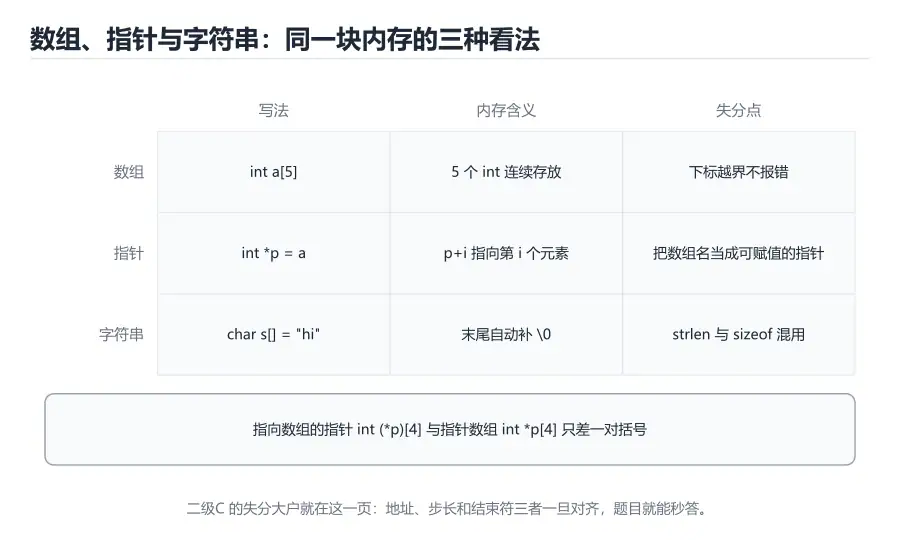

# 二级 C：指针、数组与字符串



> 内容更新时间：2026-10-06 · 学习阶段：进阶 · 预计用时：55 分钟

## 本节知识框架

**课程定位**：所属分类 `ncre`（全国计算机等级二级），课程主题 `二级 C：指针、数组与字符串`，学习阶段 进阶，建议用时 55 分钟。

这是二级 C 语言真正的分水岭。前面两课的内容错了只丢一两分，这一课错了会连着丢：程序填空题要在指针与数组之间补一个表达式，程序修改题最爱改的一处是 `scanf` 少写取地址符，程序设计题十次里有七次要你用指针遍历数组或处理字符串。而这一切其实只依赖三件事：**这块内存从哪儿开始、每走一步跨几个字节、到哪里算结束**。把这三件事想清楚，`a[i]`、`*(p+i)`、`p[i]`、`strlen` 与 `sizeof` 都只是同一张内存图的三种读法。

配图把这一课切成三行三列：数组行讲「连续存放」，指针行讲「地址加步长」，字符串行讲「靠结束符收尾」；每行后面跟着内存含义与失分点。读题时先判断它落在哪一行，再决定用哪种读法，比死记表达式有效得多。

**学完本课应当能够**

- 画出 `int a[5]` 与 `int *p = a;` 的内存关系，并解释 `p + 2` 为什么不是地址加 2。
- 区分指针数组、数组指针与字符指针三种声明形式，说出各自的含义。
- 说明 `strlen` 与 `sizeof` 在字符数组上的差别，以及结束符在什么时候被算进长度。
- 用指针完成数组遍历、字符串长度统计与两端交换，并指出越界访问的后果。
- 写出用 `malloc` 申请、用 `free` 归还的最小正确流程，说明漏掉任何一步会发生什么。

### 复习清单

- [ ] 能否解释数组名为什么不能出现在赋值号左边，而指针变量可以。
- [ ] 能否写出与 `a[i][j]` 等价的指针表达式，并说明 `int (*p)[4]` 与 `int *p[4]` 的差别。
- [ ] 能否说明 `char s[] = "China";` 与 `char *s = "China";` 两种定义在可写性上的不同。
- [ ] 能否背出 `strlen`、`strcpy`、`strcat`、`strcmp` 四个函数各自的参数与返回值含义。
- [ ] 能否指出 `int *p; scanf("%d", p);` 这句错在哪里。

## 核心概念定义

| 术语 | 操作性定义 | 常见边界与风险 |
| --- | --- | --- |
| 一维数组 | 同类型元素连续存放的一块内存，用 `int a[n]` 定义，下标从 0 到 n-1。 | 编译器不检查越界，越界读到的是相邻内存里的随机内容。 |
| 数组名 | 在表达式中转换成指向首元素的常量地址，`sizeof(a)` 得到整块字节数。 | 易错：把数组名当成可赋值的指针，`a = a + 1` 非法。 |
| 指针变量 | 存放地址的变量，`int *p` 表示 p 指向一个 int。 | 未初始化就解引用是野指针，安全做法是定义时置空或赋有效地址。 |
| 解引用 | 用 `*p` 取出 p 所指地址上的值，也可以作为左值写入。 | 前置星号与后置下标的优先级不同，`*p + 1` 是取值加一，`*(p + 1)` 是取下一个元素。 |
| 地址运算 | `p + i` 的实际地址增量是 `i * sizeof(元素类型)`，指针相减得到相差的元素个数。 | 易错：把步长算两遍，写成 `p + i * sizeof(int)` 之类。 |
| 二维数组 | 按行优先连续存放，`a[i][j]` 等价于 `*(*(a + i) + j)`。 | 行指针移动一次跨一整行，跨的行宽必须由声明给出。 |
| 数组指针 | 指向一行的指针，声明形式 `int (*p)[4]`，`p + 1` 跳四个元素。 | 括号不能省，星号与方括号的结合顺序由括号决定。 |
| 指针数组 | 元素全是指针的数组，声明形式 `int *p[4]`，`p[i]` 是一个指针。 | 与数组指针只差一对括号，含义完全不同。 |
| 字符数组 | 用来存放字符串的 char 型数组，内容可逐个修改，末尾要有结束符。 | 定义长度必须比可见字符多一，否则复制时会写越界。 |
| 字符串字面量 | 双引号写出的常量串，存放在只读区，通过 `char *s` 指向它。 | 易错：用指针去改字面量内容，属于未定义行为。 |
| 结束符 | 数值为 0 的字符，标记字符串到此为止，`strlen` 不计它，`sizeof` 要算它。 | 忘记补结束符会让后续函数一直读到内存外面去。 |
| strlen | 从给定地址开始数到第一个结束符之前的字符个数。 | 它不知道数组有多长，只看内容不看容量。 |
| strcpy 与 strcat | 分别完成复制与追加，都返回目标串首地址，都要连结束符一起处理。 | 目标空间不足是典型的越界写，标准做法是先核对长度。 |
| strcmp | 按字符编码逐个比较，返回 0 表示相等，正负表示大小关系。 | 不能写成 `if (s1 == s2)` 判断串内容，那是比地址。 |
| malloc 与 free | 按字节申请堆内存并返回 void 指针，用完必须归还。 | 只申请不释放是内存泄漏，释放后再用是悬空指针。 |
| 二级指针 | 存放指针地址的指针，`int **pp`，用于在函数里改变调用者的指针变量。 | 星号层数要与实参类型匹配，多一层少一层都会报错。 |

## 原理与运行机制

### 同一块内存的三种看法

`int a[5] = {10, 20, 30, 40, 50};` 在内存里是连续 20 个字节（按 int 占 4 字节算）。给它三种看法：

```c
#include <stdio.h>

int main(void) {
    int a[5] = {10, 20, 30, 40, 50};
    int *p = a;                       /* p 拿到首元素地址 */
    printf("%d %d %d\n", a[2], *(p + 2), p[2]);   /* 三种写法同一个值 */
    printf("%p %p\n", (void *)(p + 1), (void *)(p + 2));
    return 0;
}
```

前两行输出都是 30；第三行两个地址相差 4 而不是 1，这就是**步长**：`p + i` 的位移量按 `sizeof(int)` 放大。理解到这一步，`a[i]`、`*(a + i)`、`*(p + i)`、`p[i]` 四种写法就是一次事情的四次书写，题目怎么换写法都吓不到你。

反过来，数组名与指针变量的差别也必须记住：`p` 是一个能改的盒子，`a` 是一个不能改的常量地址。下面这段代码的第二行合法、第三行非法：

```c
int a[5];
int *p = a;      /* 合法：把首元素地址交给 p */
p = p + 1;       /* 合法：p 是可写变量 */
a = a + 1;       /* 非法：数组名不是可修改的左值 */
```

想让遍历窗口后移，就动 `p`，不要动 `a`。二级程序修改题里，被标记的错误行经常就是这个赋值。

### 结束符决定一切字符串行为

`char s[] = "China";` 建立的是 6 个字节：五个字母加一个结束符。结束符是数值 0 的字符，看不见但确实占空间。由此产生两条必须分清的读数：`sizeof(s)` 看**容量**，得 6；`strlen(s)` 看**内容**，从首地址一路数到第一个结束符前停住，得 5。

```c
#include <stdio.h>
#include <string.h>

int main(void) {
    char s[8] = "China";
    printf("%d %d %d\n", (int)sizeof(s), (int)strlen(s), s[5]);
    strcat(s, "!");
    printf("%d %s\n", (int)strlen(s), s);
    return 0;
}
```

第一行输出 `8 5 0`：容量 8 是因为写死了数组长度，内容长度 5，`s[5]` 正是那个结束符（整数 0）。追加一个感叹号后长度变 6，仍然装得下——如果把数组声明成 `char s[6]`，`strcat` 就会把结束符写到数组外面去，程序不一定立刻崩，但结果随时会错。这就是「数组长度至少比可见字符多一」的实际含义。

字符指针的情况不一样：`char *t = "China";` 里 `"China"` 是常量串，`t` 只是指向它的地址。你可以让 `t` 指向别处（改指针本身），但不能写 `t[0] = 'c'`（改常量内容）。把这两句记住，本课关于可写性的题目就能全部判对。

### 两个括号之差：指针数组与数组指针

声明的读法是从名字开始、按括号与结合优先级往外包：

- `int *p[4];` 先与 `[4]` 结合成数组，再说明每个元素是 int 指针 → 指针数组，`p[i]` 是指针。
- `int (*p)[4];` 括号先把 `*p` 绑成指针，再说明它指向含 4 个 int 的对象 → 数组指针，`p + 1` 跨一整行（16 字节）。
- `int **pp;` 是「指向 int 指针的指针」，用来在函数里换掉调用者的指针。

二维数组与行指针的配合是选择题常客：

```c
int a[3][4] = {{1, 2, 3, 4}, {5, 6, 7, 8}, {9, 10, 11, 12}};
int (*p)[4] = a;
printf("%d %d\n", a[1][2], *(*(p + 1) + 2));   /* 两值相同，都是 7 */
```

`p + 1` 走到第二行首，`*(p + 1)` 得到该行首元素的地址（它是一个 int 指针），`+ 2` 走到第三个位置，再解引用取出 7。行与列的顺序由「加法发生在哪一层」决定，这是本课最难也最常考的一条。

### 函数之间的传递：数组退化与地址带回

把数组交给函数时，形参写成 `int a[]` 或 `int *a` 是一回事，传进去的只是首地址，长度信息丢了。所以真实写法必须把长度也传进去：`int sum(int *a, int n)`。函数内部对元素的修改会体现在原数组上，因为改的是同一块内存；而把形参指针本身加加减减，不会影响调用者的数组名或指针。

要在函数里换掉调用者的指针，就得传二级指针：

```c
void alloc_row(int **pp, int n) {
    *pp = (int *)malloc(sizeof(int) * n);   /* 让调用者的指针指向新内存 */
}

int main(void) {
    int *row = NULL;
    alloc_row(&row, 4);
    if (row != NULL) {
        row[0] = 1;
        free(row);
        row = NULL;
    }
    return 0;
}
```

`malloc` 返回的类型是 void 指针，赋给具体指针时写上强制转换是二级教材的通用写法；申请成功与否必须判空，用完必须 `free` 并把指针置空。漏掉 `free` 是内存泄漏，`free` 之后继续用那个指针是悬空访问，两者都会在程序跑久之后出问题。

## 典型应用场景

| 场景 | 典型输入或前提 | 用上的结论 |
| --- | --- | --- |
| 用指针遍历数组求和 | 已知首地址与元素个数 | `for (p = a; p < a + n; p++) s += *p;` |
| 交换两个变量 | 调用者需要真的被改到 | 形参写 `int *a, int *b`，调用处给 `&x, &y` |
| 统计字符串中字母个数 | 以结束符为界循环 | 条件写 `s[i] != '\0'` 或直接 `s[i]` |
| 字符串逆置 | 首尾双下标 | 比较左小于右、交换、双双移动 |
| 二维表按行查找 | 行指针或下标 | `*(*(p + i) + j)` 与 `p[i][j]` 任选一种 |
| 按输入个数动态建数组 | 数量运行时才知道 | `malloc` 申请、判空、使用、`free` 归还 |

### 最小验证场景

先在纸上画一个五个元素的 int 数组，把每个元素的地址写成十六进制的相对偏移（0、4、8、12、16），然后逐条判断下面四句话：`a + 1` 落在哪个偏移、`*(a + 1)` 是什么值、`p = a; p++; *p` 是什么、`sizeof(a)` 与 `sizeof(p)` 分别是多少。判完再上机跑同样的四条打印，把打印的地址差值与纸上比对。

第二步改坏：把 `char s[] = "China";` 换成 `char s[5] = "China";`，再调用 `strlen(s)`，观察结果变成不可控的大数——这就是结束符被挤出数组的样子。这个练习只需要十行代码，却能一次性讲清越界、结束符与 sizeof 三件事。

## 代码/协议/SQL 示例

**双下标逆置字符串**

```c
#include <stdio.h>
#include <string.h>

void reverse(char *s) {
    int i = 0, j = (int)strlen(s) - 1;
    while (i < j) {
        char t = s[i];
        s[i] = s[j];
        s[j] = t;
        i++;
        j--;
    }
}

int main(void) {
    char s[] = "ncre";          /* 必须用数组，才能改写内容 */
    reverse(s);
    printf("%s\n", s);          /* 输出 ercn */
    return 0;
}
```

把 `char s[]` 改成 `char *s = "ncre";`，这段代码就变成改写只读常量串，运行结果不可预期——这是本课最常考的一处「代码看起来没变、语义完全变了」的对照。

**指针写法与下标写法互换**

```c
#include <stdio.h>

int max_of(int *a, int n) {
    int i;
    int *p;
    int best = a[0];
    for (i = 1; i < n; i++) {
        if (a[i] > best) best = a[i];
    }
    for (p = a + 1; p < a + n; p++) {
        if (*p > best) best = *p;
    }
    return best;
}

int main(void) {
    int a[5] = {3, 9, 1, 7, 5};
    printf("%d\n", max_of(a, 5));
    return 0;
}
```

两段循环干的是同一件事，输出 9。程序填空题经常把其中一段的循环条件或取值表达式挖空，填空时先看指针走的是地址还是下标：条件写 `p < a + n`（不含右端点），取值写 `*p`。

**字符串比较与复制的正确姿势**

```c
#include <stdio.h>
#include <string.h>

int main(void) {
    char src[] = "MySQL";
    char dst[10];
    strcpy(dst, src);
    if (strcmp(dst, src) == 0) {
        printf("equal\n");
    }
    printf("%d %d\n", (int)strlen(dst), (int)sizeof(dst));
    return 0;
}
```

输出 `equal` 与 `5 10`。`strcmp` 比的是内容，返回 0 才表示相等；`dst == src` 比的是两个地址，永远不相等。目标数组的长度 10 足够装下五个字符与结束符，这是复制前就该核对的事。

## 时间/空间复杂度或性能分析

| 操作 | 时间 | 空间 | 说明 |
| --- | --- | --- | --- |
| 下标访问 `a[i]` | 常数 | 无额外 | 编译器翻译成一次地址加法与解引用 |
| 指针遍历整个数组 | 与元素个数成正比 | 无额外 | 与下标遍历同阶，写法不同 |
| `strlen` | 与串长成正比 | 无额外 | 每次调用都要从头数，循环条件里反复调用就变成平方级 |
| `strcpy` 与 `strcat` | 与源串长度成正比 | 目标空间 | 追加时不重新分配，必须预留足够容量 |
| `malloc` 与 `free` | 常数到线性 | 堆空间 | 频繁小块申请会碎片化，二级题目只要求配对使用 |
| 二维数组按行扫描 | 与元素总数成正比 | 无额外 | 行优先存放，按行遍历比按列遍历更连续 |

真实项目里 `strlen` 在循环条件中被反复调用是最常见的隐性浪费，写成先存进变量或把条件改成 `*p != '\0'` 都能省掉重复计数。考试环境里这类细节不影响判分，但影响你写程序填空题时的直觉：看到 `for (i = 0; i < strlen(s); i++)` 就应当条件反射地想到「每轮都重数一遍」。

从失分统计的角度看，本课的选择题集中在四类：等价的指针表达式、`strlen` 与 `sizeof` 的数值差、数组名能否赋值、二维数组与行指针的定位。四类都有固定解法，先用两分钟在草稿纸上写出内存布局，再作答，正确率明显高于凭感觉。上机操作题的失分则集中在「忘了给结束符留位置」与「`scanf` 少写 `&`」两处，写完先用一组边界输入（空串、单字符、恰好占满长度）跑一遍。

## 常见误区与易错点

- **认为数组名是可以改的指针**。它是常量地址，只能赋给别的指针，不能被重新赋值。
- **把步长算两遍**。`p + i` 已经按元素大小放大，再乘一次 `sizeof` 就跳过头了。
- **`*p + 1` 与 `*(p + 1)` 混用**。前者是取值加一，后者是取下一个元素。
- **以为 `int *p[4]` 与 `int (*p)[4]` 是一回事**。一对括号的差别是指针数组与数组指针。
- **忽略结束符的字节**。`sizeof` 算它，`strlen` 不算它，数组长度必须留出一格。
- **用 `==` 比较字符串内容**。那是比较地址，判断内容要用 `strcmp` 并看返回是否为 0。
- **对字符串字面量写入**。`char *s = "abc";` 之后改写 `s[0]` 属于未定义行为。
- **`scanf` 给指针时又加了一层 `&`**。数组名与普通变量的规则不同，普通变量要写 `&a`，字符数组名直接写 `s`。
- **越界不报错就认为安全**。C 不做下标检查，越界的后果是读到脏数据或覆盖别的变量。
- **`malloc` 之后不判空、`free` 之后不置空**。空指针解引用直接崩溃，悬空指针则是更难查的错误。
- **把数组传给函数后以为长度还在**。形参里退化成了地址，必须额外传元素个数。
- **`strcat` 目标空间不足**。追加会把结束符一起搬过去，超出容量就踩到相邻内存。

## 与其他知识点的关系

- 上一课的 `ncre_c_control_function` 给出「值传递只能改副本」的结论，本课的地址传递正是它的另一半：形参是指针时，函数能改调用者那块内存。
- `ncre_c_struct_file` 的链表建立在指针之上：`struct Node *next` 与 `malloc` 申请的节点、`free` 的归还顺序，全都是本课机制的组合应用。
- `ncre_c_data_expr` 的类型规则解释了为什么指针加整数会按元素大小放大，`sizeof` 在数组与指针上的不同结果也来自同一套类型系统。
- `ncre_public_data_structure` 里的顺序表与链表正好对应数组与指针两种存储方式，二分查找要求随机访问，也就是要求数组这种顺序存储。
- Python 方向的 `ncre_python_basics` 与本课形成对照：Python 的列表自带长度、没有裸地址，因此不会发生越界写坏相邻内存的问题，但也不能像 C 一样直接操纵地址。

| 关联课程 ID | 关联主题 | 关系说明 |
| --- | --- | --- |
| ncre_c_control_function | 函数与值传递 | 想带回结果必须传地址 |
| ncre_c_struct_file | 结构体与链表 | 节点之间的连接靠指针完成 |
| ncre_c_data_expr | 类型与 sizeof | 步长与数组名退化由类型规则决定 |
| ncre_public_data_structure | 顺序表与链表 | 两种存储结构对应两种内存写法 |

## 自测题与参考答案

### 题目 1

若有定义 int a[10], *p = a; 则与 a[i] 等价的表达式是？

1. *(p + i)
2. *p + i
3. &a + i
4. *(p + i * sizeof(int))

**参考答案**：A（*(p + i)）

本题正确项是「*(p + i)」。p 保存首元素地址，p + i 按每个元素所占字节数跳过 i 个位置，再解引用取到第 i 个元素，这与下标写法 a[i] 完全同义。干扰项「*(p + i * sizeof(int))」把步长算了两遍，指针加法本身已经按元素类型放大过偏移量；把 *p + i 当成取元素则只是把首元素的值加上 i。

### 题目 2

若有定义 char s[] = "China"; 则 strlen(s) 与 sizeof(s) 的值分别是？

1. 5 与 5
2. 5 与 6
3. 6 与 6
4. 6 与 5

**参考答案**：B（5 与 6）

本题正确项是「5 与 6」。数组里存了五个字母加一个结束符共六个字节，sizeof 统计全部六个字节，而 strlen 从首地址数到第一个结束符为止，不把它算进长度。干扰项「6 与 6」把 strlen 当成数组长度，忽略了它在结束符处停住；若写成 char s[8] = "China"; 则 sizeof 是 8 而 strlen 仍是 5。

### 题目 3

若有定义 int a[3][4]; int (*p)[4] = a; 则表达式 *(*(p + 1) + 2) 对应的数组元素是？

1. a[2][1]
2. a[1][3]
3. a[3][2]
4. a[1][2]

**参考答案**：D（a[1][2]）

本题正确项是「a[1][2]」。p 是指向含四个 int 的一行的指针，p + 1 走到第二行，解引用得到该行首地址，再加 2 定位到该行第三个位置，最后解引用取出元素。干扰项「a[2][1]」把两次偏移的下标顺序写反了，行与列的位置由加法发生在哪一层决定；第三个候选的下标已经越出数组范围。

### 题目 4

下面代码片段有一处编译错误，出错的是哪一行？（行号从上往下数）

```c
int a[5];
int *p = a;
p = p + 1;
a = a + 1;
```

1. 第 1 行，数组长度必须写成常量表达式以外的形式
2. 第 2 行，不能把数组名直接赋给同类型的指针变量
3. 第 4 行，数组名代表的首地址不能被重新赋值
4. 第 3 行，指针不允许与整数相加

**参考答案**：C（第 4 行，数组名代表的首地址不能被重新赋值）

本题正确项是「第 4 行，数组名代表的首地址不能被重新赋值」。数组名在表达式里转换成指向首元素的常量地址，它没有可写存储位置，因此不能出现在赋值号左边；想移动窗口就把这个地址赋给指针变量，再对指针做 `p = p + 1`。干扰项「第 2 行，不能把数组名直接赋给同类型的指针变量」不成立，`int *p = a;` 正是合法的初始化写法。

### 题目 5

把用双下标逆置字符串的四个步骤按先后排列：

1. 用临时变量交换左右两端所指的内容
2. 让两个下标分别指向首字符与最后一个可见字符
3. 两个下标各自向中间移动一格后继续判断
4. 判断左下标是否仍然小于右下标

**参考答案**：让两个下标分别指向首字符与最后一个可见字符 → 判断左下标是否仍然小于右下标 → 用临时变量交换左右两端所指的内容 → 两个下标各自向中间移动一格后继续判断

本题顺序是「让两个下标分别指向首字符与最后一个可见字符」 → 「判断左下标是否仍然小于右下标」 → 「用临时变量交换左右两端所指的内容」 → 「两个下标各自向中间移动一格后继续判断」。先定两端位置，再做条件判断，满足才交换，交换完才移动，这四步的顺序与循环语句的四个组成部分一一对应，写成 `while` 或 `for` 都不改变它。

### 题目 6

下列关于指针与字符串的说法中，正确的两项是？

1. 字符数组的内容可以逐个修改，字符指针指向的字符串字面量不应被改写
2. strcpy 返回目标串的首地址，目标数组必须有足够空间容纳源串与结束符
3. 两个同类型指针相减的结果是没有单位的整数，与所指向元素的类型无关
4. malloc 申请的空间在 free 之后仍然可以继续使用，只是内容不确定

**参考答案**：A、B（字符数组的内容可以逐个修改，字符指针指向的字符串字面量不应被改写；strcpy 返回目标串的首地址，目标数组必须有足够空间容纳源串与结束符）

本题要同时选中「字符数组的内容可以逐个修改，字符指针指向的字符串字面量不应被改写」与「strcpy 返回目标串的首地址，目标数组必须有足够空间容纳源串与结束符」。数组自带存储，字面量放在只读区，写它属于未定义行为；复制时按「串长加一」个字节搬，目标空间不足就会踩到相邻内存。同类型指针相减得到的是相差多少个元素，单位由元素类型决定；free 之后再使用那块地址是悬空指针访问，不能当成正常手段。

## 考点精讲

本课题库共 6 道题，下面逐题复述题干、正确项与判断依据。

### 考点 1：第 1 题

- **题目**：若有定义 int a[10], *p = a; 则与 a[i] 等价的表达式是？
- **正确项**：A（*(p + i)）
- **判断依据**：本题正确项是「*(p + i)」。指针加法已经按元素大小放大步长，解引用取到的正是第 i 个元素。干扰项「*(p + i * sizeof(int))」把步长乘了两遍；`*p + i` 只是把首元素的值加 i，与取元素无关。

### 考点 2：第 2 题

- **题目**：若有定义 char s[] = "China"; 则 strlen(s) 与 sizeof(s) 的值分别是？
- **正确项**：B（5 与 6）
- **判断依据**：五个字母加一个结束符共占六字节，sizeof 看容量得 6，strlen 数到结束符前停住得 5。干扰项「6 与 6」错在把长度当成容量；把数组写成 char s[8] 时容量会变成 8，而长度仍是 5。

### 考点 3：第 3 题

- **题目**：若有定义 int a[3][4]; int (*p)[4] = a; 则表达式 *(*(p + 1) + 2) 对应的数组元素是？
- **正确项**：D（a[1][2]）
- **判断依据**：本题正确项是「a[1][2]」。外层加法选行、内层加法选列，`p + 1` 落在第二行、`+ 2` 落在该行第三个位置。干扰项「a[2][1]」把行列顺序写反，是这一类题最常见的错误；越界的下标同样不成立。

### 考点 4：第 4 题

- **题目**：下面代码片段有一处编译错误，出错的是哪一行？（行号从上往下数）int a[5]; int *p = a; p = p + 1; a = a + 1;
- **正确项**：C（第 4 行，数组名代表的首地址不能被重新赋值）
- **判断依据**：数组名是不可修改的左值，只有指针变量才能被重新赋值；`int *p = a;` 这类初始化与 `p = p + 1` 这类指针算术都合法。干扰项「第 2 行，不能把数组名直接赋给同类型的指针变量」把合法的退化写法说成错误。

### 考点 5：第 5 题

- **题目**：把用双下标逆置字符串的四个步骤按先后排列：
- **正确项**：让两个下标分别指向首字符与最后一个可见字符 → 判断左下标是否仍然小于右下标 → 用临时变量交换左右两端所指的内容 → 两个下标各自向中间移动一格后继续判断
- **判断依据**：循环的四个组成部分是初始化、判断、执行、移动，双下标交换严格按这个骨架写就会得到正确结果，先定两端位置再进判断。正确序号排列为 2 → 4 → 1 → 3。

### 考点 6：第 6 题

- **题目**：下列关于指针与字符串的说法中，正确的两项是？
- **正确项**：A、B（字符数组的内容可以逐个修改，字符指针指向的字符串字面量不应被改写；strcpy 返回目标串的首地址，目标数组必须有足够空间容纳源串与结束符）
- **判断依据**：本题正确项包含「字符数组的内容可以逐个修改，字符指针指向的字符串字面量不应被改写」与「strcpy 返回目标串的首地址，目标数组必须有足够空间容纳源串与结束符」。干扰项「两个同类型指针相减的结果是没有单位的整数，与所指向元素的类型无关」否定了元素个数这一单位；free 之后的地址属于悬空指针。

### 高频考点小结

1. 等价写法：`a[i]`、`*(a + i)`、`p[i]`、`*(p + i)` 四者同义，步长只算一次。
2. 只读与可写：数组内容可改，字面量不可改，数组名不可赋值，指针变量可赋值。
3. 结束符：`sizeof` 含它、`strlen` 不含它，数组长度按「串长加一」预留。
4. 定位规则：行指针外层选行、内层选列，`*(*(p + i) + j)` 对应 `a[i][j]`。

## 术语速查

| 术语 | 一句话说明 |
| --- | --- |
| 首元素地址 | 数组在表达式中转换成的那个地址，指向它的第 0 个元素。 |
| 可修改的左值 | 能出现在赋值号左边的对象，数组名不属于这一类。 |
| 步长 | 指针加一时实际增加的字节数，等于所指向类型的大小。 |
| 解引用 | 通过地址取出或写入该地址上的值，用星号运算符表示。 |
| 指针数组 | 元素全是指针的数组，声明形式是星号在方括号外面。 |
| 数组指针 | 指向一整行数组的指针，声明形式是把星号包进括号。 |
| 二级指针 | 存放指针地址的指针，用于在函数里改变调用者的指针变量。 |
| 行优先存放 | 二维数组先把每一行内部连续存放、行与行首尾相接的布局方式。 |
| 结束符 | 数值为 0 的字符，标记字符串到此为止，占一格空间。 |
| 串长 | 从首地址到结束符之前的字符个数，由 strlen 求得。 |
| 悬空指针 | 指向已经归还的内存的地址，解引用属于未定义行为。 |
| 内存泄漏 | 申请的堆内存没有被归还，程序运行期间一直占着不放。 |
| 常量串 | 双引号写出的字符串字面量，存放在只读区，不应被改写。 |

## 参考资料与复核

- 最后复核：2026-10-04
- 下次复核：2027-08-10
- 复核范围：指针与数组的等价关系、数组名可改性、字符串函数的参数与返回值、动态内存的申请与归还
- 来源性质：教育部教育考试院 NCRE 二级 C 语言大纲条目与 C 语言公开参考文档；本课核对关键词：`*(p + i)`、strlen 与 sizeof、数组指针与指针数组、malloc 与 free。

| 参考资料 | 本课用途 |
| --- | --- |
| [全国计算机等级考试考试大纲](https://ncre.neea.edu.cn/html1/report/2412/185-1.htm) | 二级 C 语言数组、指针与字符串的考核条目 |
| [全国计算机等级考试专栏首页](https://ncre.neea.edu.cn/) | 考试日期、科目代码与大纲入口 |
| [C FAQ：指针](https://www.c-faq.com/ptrs/index.html) | 指针算术、数组名退化与指针数组的常见疑问 |
| [C FAQ：内存分配](https://www.c-faq.com/malloc/index.html) | malloc 与 free 的配对使用与典型错误 |
| [Microsoft C/C++ 语言参考](https://learn.microsoft.com/en-us/cpp/c-language/c-language-reference) | 声明的结合规则与类型系统 |

## 内容元数据

> 内容更新时间：2026-10-06 · 学习阶段：进阶 · 预计用时：55 分钟

- 内容版本：v2.0
- 最后更新：2026-11-11
- 学习阶段：进阶
- 适用环境：二级 C 语言程序设计（科目代码 24），中文版 Windows 7 与 Microsoft Visual C++ 2010 学习版
- 内容来源：教育部教育考试院 NCRE 考试大纲与 C 语言公开参考文档整理
- 相关主题：一维与二维数组、指针运算、数组指针与指针数组、字符串与结束符、常用字符串函数、动态内存管理
