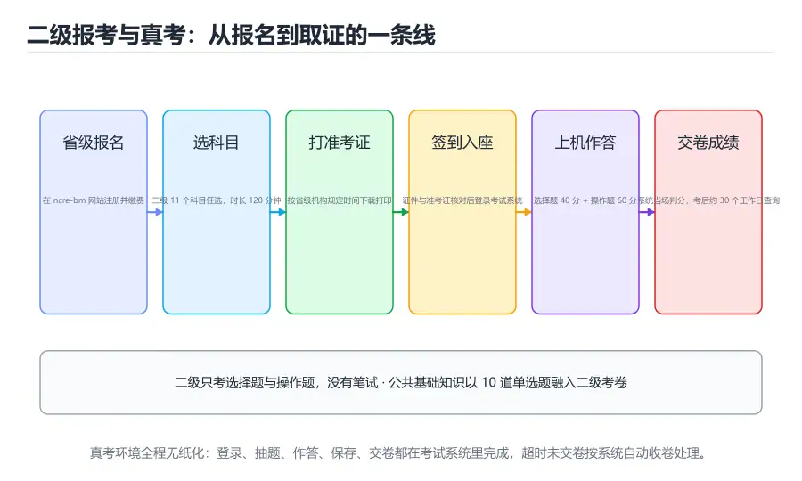

# 二级报考、科目选择与真考环境全景



> 内容更新时间：2026-10-06 · 学习阶段：入门 · 预计用时：30 分钟

## 本节知识框架

**课程定位**：所属分类 `ncre`（全国计算机等级二级），课程主题 `二级报考、科目选择与真考环境全景`，学习阶段 入门，建议用时 30 分钟。

本课主线：先把「谁组织考试、什么时候报、报哪个科目、在什么机器上考、怎么判分」这五件事一次性理清，再落到备考策略——二级不是笔试，是一场 120 分钟的上机操作，报名环节的失误、科目代码的选错、环境版本的不熟悉，都会直接改写你的分数。把它当作后面 9 门课的地基：公共基础两门、C 语言四门、Python 两门、MySQL 一门，各自解决真考里的一个失分区间。

**学完本课应当能够**

- 说清 NCRE 的组织层级（教育部教育考试院、省级承办机构、考点），并指出报名与准考证打印各自在哪个入口完成。
- 用科目代码与考试时长区分二级的 11 个科目，并说明二级与四级在获证条件上的差别。
- 复述一份二级语言类科目的分值结构：单项选择题 40 分（其中公共基础知识 10 分）+ 操作题 60 分。
- 在 120 分钟里给选择题、程序填空、程序修改、程序设计四段各自排出合理用时，并说清交卷前的检查动作。

### 复习清单

- [ ] 能否不看正文写出二级 C 语言、Python、MySQL 三个科目的代码（分别为 24、66、63）与统一时长 120 分钟。
- [ ] 能否说出公共基础知识的考核形式：不单独考试，10 道单项选择题共 10 分，与其他二级科目合并命题。
- [ ] 能否复述考试系统内的六个环节：登录、核对信息、阅读须知、抽题、作答保存、交卷。
- [ ] 能否解释为什么「程序能编译通过」不等于「操作题拿到分」，并给出两条具体的检查动作。
- [ ] 能否说出成绩与电子证书的查询入口，以及 2026 年 3 月那次考试的成绩开通时间量级。

## 核心概念定义

| 术语 | 操作性定义 | 常见边界与风险 |
| --- | --- | --- |
| NCRE | 全国计算机等级考试，由教育部教育考试院主办，面向社会人员考查计算机应用知识与能力。 | 易错：把它当成「只有计算机专业才能考」。它不设学历与专业门槛，任何考生都可选考相应级别与科目。 |
| 省级承办机构 | 各省（自治区、直辖市）教育考试机构，负责本地区的报名时间、考场编排与证书发放。 | 各省报名起止时间差异很大，晚几天就可能报满；报名时间以省级机构公告为准，不由教育部统一指定。 |
| 科目代码 | 标识具体考试科目的两位数字，如二级 C 语言 24、二级 MySQL 63、二级 Python 66。 | 易错：报名时代码选错，缴费后改科目要走退报重报，可能错过本省报名窗口。 |
| 无纸化考试 | 全部二级科目均在计算机上作答，没有纸质答题卡；选择题在考试系统内点选，操作题在真实开发环境里写代码。 | 考试机是考场统一镜像，个人习惯的快捷键、IDE 插件、终端工具都不存在。 |
| 公共基础知识 | 二级所有科目共享的选择性考核内容，涵盖计算机系统、数据结构与算法、程序设计基础、软件工程基础、数据库设计基础。 | 它不单独开考，10 道单选题 10 分，常被忽略却在临界分时决定合格与否。 |
| 操作题 | 二级分值 60 分的上机题，语言类科目由程序填空题、程序修改题、程序设计题构成。 | 易错：只在自己电脑上验证一组输入。评分按预设测试点判定，边界输入同样计分。 |
| 准考证 | 由考生在规定时间内从报名网站下载打印的入场凭证，载明考场、座位号与场次时间。 | 未打印或打印模糊可能导致无法入场；打印入口在报名网站的报名信息页面。 |
| 获证条件 | 通过对应科目考试即可获得该科目合格证书；四级还需先取得相应三级证书。 | 二级没有「必须先过一级」的前置要求，级别之间可以跨选。 |
| 考试环境 | 大纲规定的能力运行环境，如二级 C 语言为中文版 Windows 7 加 Microsoft Visual C++ 2010 学习版，二级 Python 为 Windows 7 加 Python 3.5.3 至 3.9.10 与 IDLE。 | 用 3.12 的写法、第三方 IDE 特有功能备考，上机时会出现「本地能跑、考场报错」。 |

## 原理与运行机制

### 三层组织：谁出题，谁排考场，谁发证书

NCRE 的运作是一条三层链路。教育部教育考试院负责大纲、命题、成绩数据与证书体系；省级承办机构（北京教育考试院、江苏省教育考试院等）负责本地区报名窗口、考场编排、成绩复核与证书发放；考点（多为高校或中职机房）负责现场机位、身份核验与监考。

这条链路决定了三个备考事实：第一，**报名时间不由教育部统一规定**，各省起止日期能差出两周以上，本省窗口关闭就是下一次考试；第二，**考试场次由省级机构编排**，同一省内不同考点可能被安排到考试日的不同半天，准考证上的时间才是你的时间；第三，**证书发放走省级机构渠道**，纸质证书一般由考点代发，电子证书由中国教育考试网统一提供下载。

### 科目与时长：一张表记住 11 个二级科目

| 科目名称 | 科目代码 | 考试时长 | 获证条件 |
| --- | --- | --- | --- |
| C 语言程序设计 | 24 | 120 分钟 | 科目 24 考试合格 |
| Java 语言程序设计 | 28 | 120 分钟 | 科目 28 考试合格 |
| Access 数据库程序设计 | 29 | 120 分钟 | 科目 29 考试合格 |
| C++ 语言程序设计 | 61 | 120 分钟 | 科目 61 考试合格 |
| MySQL 数据库程序设计 | 63 | 120 分钟 | 科目 63 考试合格 |
| Web 程序设计 | 64 | 120 分钟 | 科目 64 考试合格 |
| MS Office 高级应用与设计 | 65 | 120 分钟 | 科目 65 考试合格 |
| Python 语言程序设计 | 66 | 120 分钟 | 科目 66 考试合格 |
| WPS Office 高级应用与设计 | 67 | 120 分钟 | 科目 67 考试合格 |
| openGauss 数据库程序设计 | 68 | 120 分钟 | 科目 68 考试合格 |
| CAD 设计与综合应用 | 69 | 120 分钟 | 科目 69 考试合格 |

一级科目时长是 90 分钟，四级是 90 分钟且要先拿到对应三级证书，二级统一 120 分钟。每次全国统考开考全部 4 个级别的 26 个科目，考试月份为 3 月与 9 月：2026 年 3 月那次考试在第 77 次，安排在 3 月 28 日至 30 日；9 月那次安排在 9 月 19 日至 21 日。

### 分值结构：40 分选择加 60 分操作

二级语言与数据库类科目的卷面结构高度一致：

- **单项选择题 40 分**，其中 10 分来自公共基础知识，另外 30 分考本科目内容。每题 2 分，答错不扣分。
- **操作题 60 分**，但构成随科目变化。二级 C 语言是程序填空题、程序修改题、程序设计题；二级 Python 是基本编程题与综合编程题；二级 MySQL 是基本操作题、简单应用题与综合应用题。

判分全部由考试系统完成。选择题按你点选的答案与标准答案比对；操作题按预设测试点判定，最常见的口径是「在指定路径下找到源程序文件，编译运行后用若干组输入比对输出」。这意味着两件事：一是**代码写对了但没保存**等于零分；二是**只验证了一组样例**是最大隐患，边界数据（空串、0、负数、超出范围的长度）常常是隐藏测试点。

### 上机路径：六个环节别跳步

把真考当成一条有先后依赖的流水线，任何一步没做完，后面的步骤都不会开始：

1. **登录考试系统**：用准考证信息进入，机位由系统绑定。
2. **核对考生信息**：姓名、证件号、报考科目三项必须与准考证一致，不一致当场举手处置，事后无法补救。
3. **阅读考试须知与题型分值**：这一段决定你对时间的分配，尤其要看清操作题要求的保存目录。
4. **抽取本考场试卷**：同一考场不同座位的题序或数据可能不同，抄邻座代码本身就不可比。
5. **作答并保存**：选择题点选后系统即时记录；操作题要在指定目录反复保存，养成「改一次存一次」的肌肉记忆。
6. **确认交卷**：主动交卷后不能再修改；未主动交卷则考试结束由系统统一收卷。

## 典型应用场景

| 场景 | 典型输入或前提 | 期望产物 |
| --- | --- | --- |
| 首次报考 | 在读大学生，没参加过任何级别 | 确定科目代码、记住本省报名起止时间、完成缴费并保存报名号 |
| 二选一犹豫 | 已学完 C 语言课程，也想考 Python | 按题型的确定性选择：程序填空与修改题套路稳定选 C；追求上手快与数据处理选 Python |
| 冲刺阶段模拟 | 距考试两周，只有真实环境的一台旧电脑 | 用 120 分钟完整跑一遍：40 分选择题控制在 25 分钟内，剩余时间给三段操作题并留 10 分钟检查 |

- **选科目的典型误区**：只看「哪个简单」不看「哪个能拿证」。二级的科目代码与证书名称一一绑定，跨专业就业更看重 Office 类或 Python 的，就不要为了刷 C 语言的一口气硬扛指针。
- **报名的典型失误**：错过本省窗口或选错科目代码。缴费前逐项复核姓名、证件号、科目代码三项，是成本最低的风险控制。
- **环境准备典型失误**：平时用新版 Python 与重型 IDE，考场上面对 IDLE 的缩进提示与自动补全节奏完全不适应。备考期至少完整用一次大纲指定的环境。

### 最小验证场景

- 准备：一台 Windows 机器，安装与大纲一致的开发环境（C 语言用 Visual C++ 2010 学习版，Python 用 3.8 系列的 IDLE），准备一个空目录当作「考场指定保存目录」。
- 观察：把一道程序修改题从打开、定位错误行、修改、保存到编译运行全流程走一遍，记录每一步耗时与卡住的位置。
- 判定：能在 20 分钟内独立完成「读懂原程序、改两处、编译通过、三组输入输出正确」才算过关；任何一次「忘了保存」或「找不到文件存在哪里」都要重复练到不假思索。

## 代码/协议/SQL 示例

下面三段代码分别对应二级三个科目的一道典型操作题的作答核心。它们的作用不是让你学语法，而是让你看清「评分要的是什么」。

**二级 C（24）程序修改题：把求平均分的整数除法改掉**

原程序在 `avg = sum / n;` 处把整数除法的结果赋给 `float`，小数部分被截断。修改题通常只允许改动被标记的一行。

```c
#include <stdio.h>

int main(void) {
    int score[5] = {86, 92, 78, 90, 81};
    int n = 5, i, sum = 0;
    float avg;

    for (i = 0; i < n; i++) {
        sum += score[i];
    }
    avg = (float)sum / n;        /* 改这一行：先把和转成浮点再除 */
    printf("avg=%.2f\n", avg);
    return 0;
}
```

改完后输出 `avg=85.40`。若不转换，`sum / n` 先按整数除法得 85，再赋给 `float`，输出 `avg=85.00`——这类「只差 0.4」的错误在真考里判零分。

**二级 Python（66）基本编程题：按大纲指定的输出格式写**

题目常给死输出格式，例如「结果保留两位小数并带单位」。格式串错了同样扣分。

```python
rate = 427
total = 120 * 60
minutes = rate // 60
seconds = rate % 60
print("用时 {} 分 {} 秒，剩余 {} 秒".format(minutes, seconds, total - rate))
```

**二级 MySQL（63）基本操作题：建表语句按空填关键词**

数据库类操作题经常给出一段残缺语句，要求把缺失的关键字补全，评分看最终能否建出结构正确的表。

```sql
CREATE TABLE student (
    sno     CHAR(8)     PRIMARY KEY,
    sname   VARCHAR(20) NOT NULL,
    credit  DECIMAL(4,1) DEFAULT 0,
    entry   DATE
) ENGINE = InnoDB DEFAULT CHARSET = utf8;
```

## 时间/空间复杂度或性能分析

真考的性能预算就是那 120 分钟，把它拆成可执行的分配表比笼统说「时间很紧」有用。

| 环节 | 建议用时 | 目标 | 超支信号与处置 |
| --- | --- | --- | --- |
| 阅读须知与抽题 | 3 分钟 | 确认保存目录与文件名要求 | 目录没看清就作答，最后 5 分钟搬文件 |
| 选择题 20 题 | 25 分钟 | 公共基础 10 题控制在 8 分钟内 | 单题超过 90 秒先标记后跳过 |
| 程序填空题 | 20 分钟 | 只改被标记的空，不重写逻辑 | 反复读不懂函数就找调用处与返回变量 |
| 程序修改题 | 20 分钟 | 用报错行定位，改最小改动量 | 改动超过 3 处通常说明方向错 |
| 程序设计题 | 40 分钟 | 先跑通最小说明再补边界 | 卡住时先写函数签名与返回值 |
| 检查与交卷 | 12 分钟 | 逐题保存确认、跑一遍样例输入 | 剩余 10 分钟仍编译不过则回退到可编译版本 |

环境本身也消耗时间：考试机是统一镜像，编译 Visual C++ 2010 的一个小工程要几秒到十几秒，每次改代码都全量重编就会把 120 分钟切成碎片。合理做法是「改一批、编一次、跑三组输入」。同样地，Python 的 IDLE 交互窗口与脚本窗口行为不同，语法错误只在运行时暴露，脚本里改完必须保存再按运行键，否则跑的是旧文件——这是典型的「时间花在第 N 次调试第 1 版的错」陷阱。

从得分效率看，选择题每题 2 分且答错不倒扣，是纯粹的期望值游戏：完全不会的题也应把四个选项填满，任何一空的期望分都是 0.5 分。而操作题的 60 分按题给出，程序设计题常常「写出主体框架即有分」，最后 12 分钟与其在选择题里再抠一道不确定的，不如给大题补上函数骨架与返回语句。

## 常见误区与易错点

- **以为二级要先过一级。** 二级没有前置级别，考生可自由选择报考哪个级别和科目；只有四级要求先取得对应三级证书。
- **把报名时间当成全国统一。** 报名起止时间由各省级承办机构规定，同一省内不同城市也可能有细微差别，一切以本省公告为准。
- **公共基础不复习。** 10 道题 10 分，内容在四门课的公共范围内反复出现，是「背就有分」的区间，放弃它等于主动把合格线抬高。
- **在本地环境写新语法。** 大纲指定的环境版本较旧，Python 3.10 的结构性匹配、C++ 风格的新库调用在考场镜像里可能直接编译失败。
- **只在指定目录之外保存一次。** 考试系统按路径找文件，保存到桌面或自己的文件夹通常判不到；每次修改后都要确认保存路径与文件名。
- **用一组样例验证通过就交卷。** 评分按多个测试点判定，边界输入（空、零、负、超长）常常是隐藏项。
- **相信「交卷后还能改」。** 主动确认交卷即锁定成绩，未交卷也会由系统在考试结束时统一收卷，没有二次提交的机会。
- **抄邻座的题。** 同考场试卷题序与数据可能不同，且考试系统会记录异常行为。
- **不打印准考证。** 规定时间内必须从报名网站下载并打印，准考证上的考场与场次信息是入场的唯一依据。
- **把成绩当成当场公布。** 机考会在交卷后给出本场成绩提示，正式成绩与电子证书要等考后在中国教育考试网开放查询，量级上是考后一个多月。

## 与其他知识点的关系

- 本课为 `ncre_public_data_structure` 与 `ncre_public_prog_db_net` 提供分值口径：公共基础只以 10 道单选进入二级考卷，因此那两门课的重点是「结论句」而不是推导。
- 本课为 `ncre_c_data_expr`、`ncre_c_control_function`、`ncre_c_pointer_array_string`、`ncre_c_struct_file` 说明题型分布：40 分选择里有 30 分是 C 语言内容，60 分操作题全部落在语法与调试上。
- 本课与 `ncre_python_basics`、`ncre_python_data_file` 的关系是环境约束：Python 科目要求 IDLE 与 3.5.3 至 3.9.10 的版本区间，标准库 turtle、random、time 与第三方库 jieba、PyInstaller、NumPy 都在大纲内。
- 本课与 `ncre_mysql_database` 的关系是「语句即得分」：MySQL 科目的基本操作题就是逐句写对建库、建表、查询与授权。

| 关联课程 ID | 关联主题 | 关系说明 |
| --- | --- | --- |
| ncre_public_data_structure | 数据结构与算法选择题 | 公共基础 10 分里分值最集中的一组结论 |
| ncre_c_pointer_array_string | 数组、指针与字符串 | 二级 C 程序修改题最常见的失分来源 |
| ncre_python_basics | Python 语法与标准库 | 环境版本与 IDLE 操作路径直接决定上机手感 |
| ncre_mysql_database | 建库建表与查询 | 基本操作题按语句给分，错一个关键字就丢该空分值 |

## 自测题与参考答案

### 题目 1

全国计算机等级考试二级各科目统一的机考时长是？

1. 90 分钟，与一级科目保持一致
2. 100 分钟，交卷后不能再修改
3. 120 分钟，满分 100 分
4. 150 分钟，包含一次草稿纸收发

**参考答案**：120 分钟，满分 100 分

本题正确项是「120 分钟，满分 100 分」。大纲把二级各科目统一写成上机考试 120 分钟、满分 100 分，获证条件就是该科目考试合格。90 分钟是一级与四级的时长，真考卷面上不存在 100 分钟或 150 分钟这一档。

### 题目 2

二级公共基础知识在二级科目试卷中的考核方式是？

1. 与其他二级科目合并命题，10 道单项选择题共 10 分
2. 单独组织一场 45 分钟的笔试，满分 20 分
3. 只在二级 C 语言中出现，其他二级科目不考
4. 以上机操作题形式出现，占 30 分

**参考答案**：与其他二级科目合并命题，10 道单项选择题共 10 分

本题正确项是「与其他二级科目合并命题，10 道单项选择题共 10 分」。大纲明确公共基础知识不单独考试，它作为二级科目考核内容的一部分，以 10 道单选题的形式占据 10 分。「只在二级 C 语言中出现」把共享内容误当成单科内容，是典型的科目串味错误。

### 题目 3

考生报名参加全国计算机等级考试应使用的官方入口是？

1. 考点现场排队登记，由监考老师代为录入
2. 学校教务系统统一代报名，无需个人缴费
3. 中国教育考试网的普通话测试报名通道
4. 按省级承办机构规定时间登录 NCRE 报名网站注册并缴费

**参考答案**：按省级承办机构规定时间登录 NCRE 报名网站注册并缴费

本题正确项是「按省级承办机构规定时间登录 NCRE 报名网站注册并缴费」。报名与缴费都在 NCRE 报名网站完成，时间窗口由省级承办机构规定，准考证打印同样在该网站的报名信息页面进行。「无需个人缴费」与现场登记的想象不符，考试不存在由教务系统代报的通用通道。

### 题目 4

阅读下面的 Python 代码，print 输出的数值在二级真考中对应哪一项？

```python
s = 120 * 60
print(s)
```

1. 一级科目的考试时长换算成秒
2. 二级科目 120 分钟考试时长换算成秒
3. 选择题作答建议用时换算成秒
4. 考后成绩开放查询的工作日数换算成秒

**参考答案**：二级科目 120 分钟考试时长换算成秒

本题正确项是「二级科目 120 分钟考试时长换算成秒」。算式 120 * 60 得到 7200，正好是二级统一时长换算成秒的结果。一级时长是 90 分钟，换算应为 5400 秒；本课给选择题的建议用时是 25 分钟，换算为 1500 秒，两者都与 7200 对不上。

### 题目 5

把二级无纸化考试在考试系统内的四个环节按先后排列：

1. 抽取本考场试卷并开始作答
2. 登录考试系统并核对考生信息
3. 确认交卷并等待系统成绩提示
4. 阅读考试须知与题型分值说明

**参考答案**：登录考试系统并核对考生信息 → 阅读考试须知与题型分值说明 → 抽取本考场试卷并开始作答 → 确认交卷并等待系统成绩提示

按本课的上机路径，正确顺序是「登录考试系统并核对考生信息」 → 「阅读考试须知与题型分值说明」 → 「抽取本考场试卷并开始作答」 → 「确认交卷并等待系统成绩提示」。核对信息必须在作答之前，因为信息不一致要当场处置；须知里的保存目录要求又必须在抽题前读到，否则操作题的作答文件可能存错位置。

### 题目 6

填空：二级 C 语言科目的操作题共 60 分，由程序填空题、程序修改题和________三类题目组成。

**参考答案**：程序设计题

三类操作题的名称是大纲要点里的固定表述，程序填空题、程序修改题、程序设计题共同构成 60 分。基本编程题与综合编程题是 Python 科目的表述，不能与 C 语言科目的题型名称混写。

## 考点精讲

本课题库共 6 道题，下面逐题复述题干、正确项与判断依据。

### 考点 1：第 1 题

- **题目**：全国计算机等级考试二级各科目统一的机考时长是？
- **正确项**：120 分钟，满分 100 分
- **判断依据**：二级全部科目统一为 120 分钟、满分 100 分，一级与四级是 90 分钟。干扰项「150 分钟，包含一次草稿纸收发」在本课的任何口径里都找不到出处。

### 考点 2：第 2 题

- **题目**：二级公共基础知识在二级科目试卷中的考核方式是？
- **正确项**：与其他二级科目合并命题，10 道单项选择题共 10 分
- **判断依据**：公共基础知识不单独开考，它以 10 道单项选择题共 10 分的形式并入二级考卷。干扰项「单独组织一场 45 分钟的笔试，满分 20 分」把二级写成还有笔试，与全体科目无纸化的事实矛盾。

### 考点 3：第 3 题

- **题目**：考生报名参加全国计算机等级考试应使用的官方入口是？
- **正确项**：按省级承办机构规定时间登录 NCRE 报名网站注册并缴费
- **判断依据**：报名、缴费、准考证打印都在 NCRE 报名网站，时间由省级承办机构规定。干扰项「学校教务系统统一代报名，无需个人缴费」不成立，考试不存在免缴费的代报通道。

### 考点 4：第 4 题

- **题目**：阅读下面的 Python 代码，print 输出的数值在二级真考中对应哪一项？s = 120 * 60 print(s)
- **正确项**：二级科目 120 分钟考试时长换算成秒
- **判断依据**：7200 秒对应二级统一的 120 分钟。干扰项「一级科目的考试时长换算成秒」对应的是 90 分钟，数值应为 5400 秒。

### 考点 5：第 5 题

- **题目**：把二级无纸化考试在考试系统内的四个环节按先后排列：
- **正确项**：登录考试系统并核对考生信息 → 阅读考试须知与题型分值说明 → 抽取本考场试卷并开始作答 → 确认交卷并等待系统成绩提示
- **判断依据**：登录并核对信息是一切操作的前提，须知中的保存目录要求必须先读，抽题作答在两者之后，交卷收尾。正确序号排列为 2 → 4 → 1 → 3。

### 考点 6：第 6 题

- **题目**：填空：二级 C 语言科目的操作题共 60 分，由程序填空题、程序修改题和________三类题目组成。
- **正确项**：程序设计题
- **判断依据**：二级 C 语言的 60 分操作题由程序填空题、程序修改题、程序设计题构成；基本编程题与综合编程题是 Python 科目的说法，Access 与 MySQL 各有自己的操作题命名，不能互相替换。

### 高频考点小结

1. 时长与分值：120 分钟、满分 100 分、选择题 40 分（含公共基础 10 分）、操作题 60 分。
2. 科目代码：24、28、29、61、63、64、65、66、67、68、69 均属二级，一级是 14 至 18。
3. 组织层级：教育部教育考试院定大纲与成绩，省级承办机构定报名窗口与考场，考点负责现场。
4. 评分口径：选择题点选即时记录，操作题按路径找文件并按测试点判分，保存与文件名是隐性得分点。

## 术语速查

| 术语 | 一句话说明 |
| --- | --- |
| NCRE | 全国计算机等级考试，教育部教育考试院主办，每年 3 月与 9 月两次全国统考。 |
| 科目代码 | 标识具体考试科目的两位数字，二级从 24 到 69 共 11 个科目。 |
| 省级承办机构 | 负责组织本地区报名、考场编排与证书发放的省级教育考试机构。 |
| 无纸化考试 | 全部二级科目在计算机上作答，选择题点选、操作题写代码，没有纸质答题卡。 |
| 公共基础知识 | 二级共享的考核内容，10 道单项选择题共 10 分，涵盖系统、数据结构、程序设计与软件工程、数据库。 |
| 操作题 | 二级 60 分的上机题目，按科目分为程序填空、修改、设计或基本与综合编程题。 |
| 测试点 | 考试系统用来判定操作题得分的一组输入与期望输出，边界数据也包含在内。 |
| 获证条件 | 通过对应科目考试即可取得合格证书，四级需先取得相应三级证书。 |
| 电子证书 | 成绩开放查询后在中国教育考试网下载的数字合格证明，与纸质证书具有同等效力表述。 |

## 参考资料与复核

- 最后复核：2026-10-04
- 下次复核：2027-08-10
- 复核范围：科目代码与时长表、报名与准考证打印入口、题型分值结构、大纲指定环境版本
- 来源性质：教育部教育考试院官方公告与考试大纲原文；本课核对关键词：120 分钟、科目代码、公共基础 10 分、操作题 60 分。

| 参考资料 | 本课用途 |
| --- | --- |
| [全国计算机等级考试专栏首页](https://ncre.neea.edu.cn/) | 级别与科目设置、考试动态入口 |
| [全国计算机等级考试考试大纲](https://ncre.neea.edu.cn/html1/report/2412/185-1.htm) | 各科目大纲文件下载入口 |
| [2026 年 3 月考试报名工作启动公告](https://ncre.neea.edu.cn/html1/report/2512/40-1.htm) | 科目代码表、考试日期与省级报名时间 |
| [NCRE 报名网站](https://ncre-bm.neea.edu.cn/) | 注册、缴费与准考证打印入口 |

## 内容元数据

> 内容更新时间：2026-10-06 · 学习阶段：入门 · 预计用时：30 分钟

- 内容版本：v2.0
- 最后更新：2026-11-10
- 学习阶段：入门
- 适用环境：二级全部科目无纸化上机考试；C 语言为中文版 Windows 7 与 Microsoft Visual C++ 2010 学习版，Python 为 Windows 7 与 Python 3.5.3 至 3.9.10 及 IDLE，MySQL 为 WAMP 5.0 以上与 MySQL 5.5。
- 内容来源：教育部教育考试院 NCRE 官方大纲与当次考试公告整理
- 相关主题：科目代码、报名流程、题型分值、考试系统操作路径、评分规则
