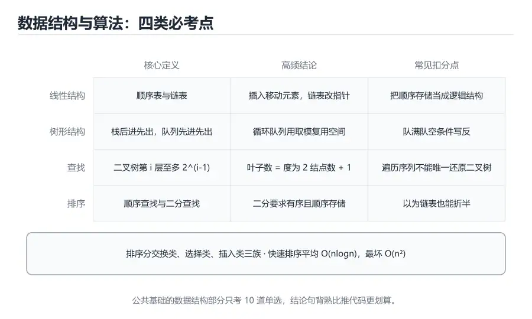

# 公共基础：数据结构与算法选择题套路



> 内容更新时间：2026-10-06 · 学习阶段：基础 · 预计用时：45 分钟

## 本节知识框架

**课程定位**：所属分类 `ncre`（全国计算机等级二级），课程主题 `公共基础：数据结构与算法选择题套路`，学习阶段 基础，建议用时 45 分钟。

本课主线：公共基础知识在二级考卷里是 10 道单项选择题、10 分，不单独开考，也不写代码。它的特点是「结论句决定得分」——会背就得分，靠现场推导反而容易算错。本课把数据结构与算法这一段拆成四组结论：线性结构的插入删除与移动次数、栈与队列的端点限制和循环队列判满、二叉树的结点数与遍历还原、排序与查找的复杂度和稳定性。每组都配一道真题式的判断路径，练到能在 40 秒内选定答案。

**学完本课应当能够**

- 说出顺序表插入与删除时元素移动次数的计算式，并解释链表为什么不需要移动。
- 用「只在端点操作」这一条判据识别栈与队列，并写出循环队列队空与队满的条件。
- 用 `n0 = n2 + 1` 直接算叶子结点数，并判断哪两组遍历序列能唯一还原一棵二叉树。
- 把常用排序算法按交换类、选择类、插入类归类，比较它们的平均复杂度、最坏复杂度与稳定性。
- 说清二分法查找的两个前提，以及顺序查找与二分查找在比较次数上的量级差别。

### 复习清单

- [ ] 能写出长度为 n 的线性表在第 i 个位置插入元素时需要移动的个数 `n - i + 1`，并举一个 i 取边界值的例子。
- [ ] 能用一句话解释为什么「在 n 个单元中牺牲一个」的循环队列要写 `(rear + 1) % m == front` 而不是 `rear == front`。
- [ ] 能给出一个非法的出栈序列并指出它在哪一步要求「栈顶元素不是当前要出的元素」。
- [ ] 能默写一张表：冒泡、简单选择、直接插入、希尔、快速、堆排序的平均复杂度与稳定性。
- [ ] 能完成本课 6 道自测题，把错题按「结论没记住」还是「题干条件看漏」分类。

## 核心概念定义

| 术语 | 操作性定义 | 常见边界与风险 |
| --- | --- | --- |
| 算法 | 对特定问题求解步骤的一种描述，具有有穷性、确定性、可行性，以及零个或多个输入与一个或多个输出。 | 易错：把「能算出结果」当成算法的全部要求。有穷性要求有限步内结束，死循环不是算法。 |
| 时间复杂度 | 描述算法基本操作次数随问题规模 n 增长的变化趋势，用 `T(n) = O(f(n))` 记数量级。 | 忽略常数与低阶项，但不同数量级不能混用；`O(2n)` 与 `O(n)` 同级。 |
| 数据结构 | 相互之间存在一种或多种特定关系的数据元素的集合，分为逻辑结构与存储结构两层。 | 易错：认为逻辑结构决定存储结构。同一逻辑结构可以选顺序或链式两种存储结构。 |
| 顺序存储 | 把逻辑上相邻的元素放在物理上也相邻的位置，支持随机访问，代价是插入删除要移动元素。 | 需要预先估计规模，容量不足要整体搬迁。 |
| 链式存储 | 用结点加指针表示关系，插入删除只改指针，但不支持按下标随机访问。 | 指针额外占空间；二分查找这类依赖随机访问的算法无法直接使用。 |
| 栈 | 限定只在表尾（栈顶）做插入与删除的线性表，后进先出。 | 出栈序列必须满足「后进的先出」，判断合法性时逐步模拟最省事。 |
| 队列 | 限定在表尾插入、表头删除的线性表，先进先出。 | 循环队列要用取模运算回收空间，判满条件与判空条件不能写反。 |
| 二叉树 | 每个结点至多有两棵子树且左右有序，度只可能为 0、1、2。 | 二叉树不是「树的一种特殊情况」，左右子树有次序，交换后是另一棵树。 |
| 遍历序列 | 前序为根左右，中序为左根右，后序为左右根。 | 仅靠前序与后序无法唯一确定二叉树，因为分不清哪个子树为空。 |
| 稳定性 | 关键字相同的元素在排序后保持原来的相对次序。 | 快速排序与堆排序、简单选择排序、希尔排序都不稳定；冒泡、插入、归并稳定。 |

## 原理与运行机制

### 为什么这一段的题「像文字游戏」

公共基础只有 10 道单选题，每题 2 分，题干几乎不要求你写代码，而是考三件事：**前提条件是否被满足**、**结论的量级或数值是多少**、**两种结构的差别在哪一侧**。因此解题路径是「识别考据点 → 回忆结论句 → 检查题干有没有加边界条件」，而不是现场推导。举一个典型例子：题目问「下列说法正确的是」，四个选项分别把顺序存储、链式存储、二分查找、栈的性质混着说，只要每条结论都能一句话复述，这题就只花 20 秒。

### 线性表：移动次数与改指针的差别

顺序存储的线性表长度为 n，在第 i 个位置插入一个元素，需要把第 i 个到第 n 个共 `n - i + 1` 个元素依次后移；删除第 i 个元素需要把第 i+1 个到第 n 个共 `n - i` 个元素前移。平均来看，等概率插入要移动 n/2 个元素，删除也是 n/2。这两个数值是二级最爱考的「算一下」的题，记住边界就够用：在表头插入要移动全部 n 个，在表尾插入移动 0 个。

链式存储把「移动元素」换成「修改指针」。在 p 之后插入 s 结点的三步是固定顺序：先让 `s->next = p->next`，再让 `p->next = s`；如果反过来先改 `p->next`，后面的链就断了，这是程序填空题常埋的坑。删除 q 结点（p 是其前驱）则是 `p->next = q->next` 之后再释放 q。双向链表额外维护 `prior`，插入要动四条指针，删除也是四条。

### 栈与队列：端点限制与循环队列的三个式子

栈是后进先出（LIFO），队列是先进先出（FIFO），两者共同点是「都只在端点上操作」，都属于线性结构。出栈序列合法性的判断，靠模拟最快：给定入栈次序 1、2、3、4，逐个尝试「入栈若干后弹出」的动作，能对齐目标序列就合法。序列 4、3、2、1 合法（全部入栈后依次弹出），序列 1、4、3、2 合法，而 3、1、4、2 非法——3 出栈时栈内是 1、2，栈顶是 2 不是 1，无法先出 1。

循环队列把一维数组首尾相接，用取模运算让 front 与 rear 绕回。设数组容量为 m，牺牲一个存储单元区分空与满时，三个式子是必须默写的：

| 判定 | 条件或计算式 | 记忆钩子 |
| --- | --- | --- |
| 队空 | `front == rear` | 指针重合就是没元素 |
| 队满 | `(rear + 1) % m == front` |  rear 再走一步就撞上 front |
| 元素个数 | `(rear - front + m) % m` | 加 m 再取模避免负数 |

如果题目给出「用 size 变量记录元素个数」的方案，判满条件就变成 `size == m`，此时判空判满不再依赖牺牲单元，要看清题干用的是哪一种。

### 树与二叉树：两条计数结论加一组还原规则

二叉树最常考的两条计数关系：

- 第 i 层上至多有 `2^(i-1)` 个结点（i 从 1 开始），深度为 m 的二叉树至多有 `2^m - 1` 个结点。
- 任何一棵二叉树，叶子结点数 n0 与度为 2 的结点数 n2 满足 `n0 = n2 + 1`。这条与 n1 无关，题目常常多给一个 n1 来分散注意力。

完全二叉树按层编号，编号 i 的结点其左孩子为 `2i`、右孩子为 `2i + 1`、父结点为 `⌊i/2⌋`；因此 `2i > n` 说明它没有左孩子，是叶子。满二叉树是每层都填满的特殊完全二叉树。

遍历与还原：前序根左右、中序左根右、后序左右根。「前序 + 中序」或「后序 + 中序」可以唯一确定一棵二叉树，因为中序能把左右子树切开；「前序 + 后序」不能，因为两者都只告诉你根在哪，遇到只有一个孩子的结点时无法判断它挂在左边还是右边。中序遍历的结果对二叉排序树而言恰好是有序序列，这也是选择题常用的隐含结论。

### 排序与查找：把算法塞进三个格子里

二级大纲把基本排序算法分成交换类、选择类、插入类三族，按族记忆比按名字记忆更稳。

| 算法 | 所属类别 | 平均时间复杂度 | 最坏时间复杂度 | 稳定性 | 附加空间 |
| --- | --- | --- | --- | --- | --- |
| 冒泡排序 | 交换类 | O(n²) | O(n²) | 稳定 | 常数 |
| 快速排序 | 交换类 | O(nlog2 n) | O(n²) | 不稳定 | 递归栈 O(log2 n) |
| 简单选择排序 | 选择类 | O(n²) | O(n²) | 不稳定 | 常数 |
| 堆排序 | 选择类 | O(nlog2 n) | O(nlog2 n) | 不稳定 | 常数 |
| 直接插入排序 | 插入类 | O(n²) | O(n²) | 稳定 | 常数 |
| 希尔排序 | 插入类 | 介于 O(nlog2 n) 与 O(n²) | 与增量序列有关 | 不稳定 | 常数 |

配套的两条数值结论：n 个元素做冒泡排序最多比较 `n(n-1)/2` 次；简单选择排序每轮都要扫完未排序区，比较次数固定为 `n(n-1)/2`，与初始序列是否有序无关——这正是它「数据已经很有序时依旧不快」的原因，也是快速排序在正序输入下退化成 O(n²) 的原因。

查找部分只需记住两条：顺序查找在等概率下平均比较 `(n+1)/2` 次，对链式存储同样可用；二分查找要求「有序」加「能随机访问」两个前提，每次比较后待查区间折半，n 个元素最多比较约 `log2 n + 1` 次，因此链式存储的有序表不能直接二分。

## 典型应用场景

| 场景 | 典型输入或前提 | 期望产物 |
| --- | --- | --- |
| 10 道公共基础单选题限时训练 | 一套二级真题选择题，目标 8 分钟内完成 | 每题都能说出考点归属（线性表、栈队列、树、排序、查找）与结论句 |
| 程序填空题里的小算法 | 给出排序或出栈序列的代码骨架 | 判断这段代码用的是哪一类算法，再按算法性质填空 |
| 面试或课程复习 | 需要口头解释「为什么链表不能二分」 | 用存储结构是否支持随机访问来回答，而不是背结论 |

### 最小验证场景

- 准备：拿入栈顺序 1、2、3、4 与四个候选出栈序列，逐个用「模拟入栈出栈」的方式验证。
- 观察：记录每个非法序列第一次出现矛盾的步——是栈顶元素对不上，还是需要的元素还在栈底。
- 判定：能明确说出「非法的原因是在某一步要求先出栈的元素不是栈顶」才算掌握，只凭直觉排除不算。

## 代码/协议/SQL 示例

下面两段代码不是让你上机写，而是训练「看代码判断量级」和「用代码验证结论」两种动作。

**看循环嵌套判断执行次数（对应本课自测第 4 题）**

```c
int i, j, k = 0;
for (i = 1; i <= n; i *= 2) {
    for (j = 1; j <= i; j++) {
        k = k + 1;
    }
}
```

外层 i 依次取 1、2、4、8 直到不超过 n，共约 `log2 n + 1` 轮；内层分别执行 1、2、4、8 次。总次数是等比数列求和 `1 + 2 + 4 + ... + n = 2n - 1`，量级为 O(n)。看到「外层倍增、内层跟着规模走」的结构，很容易被吓到写成 O(nlog2 n)，关键在于内层次数不是 n 而是当前的 i。

**用 Python 验证出栈序列合法性**

```python
def pop_sequence_legal(push, popped):
    stack, index = [], 0
    for value in push:
        stack.append(value)
        while stack and stack[-1] == popped[index]:
            stack.pop()
            index += 1
            if index == len(popped):
                return True
    return not stack


print(pop_sequence_legal([1, 2, 3, 4], [3, 1, 4, 2]))
print(pop_sequence_legal([1, 2, 3, 4], [4, 3, 2, 1]))
```

第一段返回 `False`，因为 3 出栈后栈内只剩 1、2，栈顶是 2，无法先弹出 1；第二段返回 `True`，对应「全部入栈再依次弹出」。考场里没有解释器，就用纸画栈的三态变化，模拟 20 秒足够判断四个选项。

## 时间/空间复杂度或性能分析

这一组结论的「性能」体现在两处：算法本身的运行代价，以及你在选择题上花的时间。

| 项目 | 结论 | 典型扣分点 |
| --- | --- | --- |
| 顺序表插入 | 平均移动 n/2 个元素 | 把 n - i 与 n - i + 1 写反 |
| 二分查找 | 最多约 log2 n + 1 次比较 | 忽略「必须顺序存储且有序」 |
| 快速排序 | 平均 O(nlog2 n)，最坏 O(n²) | 以为「快排永远最快」 |
| 冒泡排序 | O(n²)，稳定 | 忘了它是稳定排序 |
| 堆排序 | O(nlog2 n)，不稳定，附加空间小 | 与快速排序的稳定性记混 |
| 链式存储 | 插入删除 O(1) 定位仍需 O(n) | 以为链表查找也快 |

从做题速度看，公共基础的 10 题应该压在 8 到 10 分钟。做法是先扫题干找「关键词配对」：看到「循环队列」立刻找 m、front、rear；看到「二叉树」先找度为 2 的结点数；看到「排序」先问自己问的是复杂度还是稳定性。这两问一答，多数题能在 40 秒内锁定，剩下的时间留给本科目自己的 30 道分。

从空间角度看，链式存储的每个结点要多存指针，n 个元素的时间序访问代价反而更低；顺序存储支持随机访问，但插入删除要移动元素且容量固定。题目若问「需要频繁在表头插入删除、不要求按序号访问」，答案落在链式；若问「元素个数基本固定、经常按位置查找」，答案落在顺序。

## 常见误区与易错点

- **把逻辑结构与存储结构当成一回事。** 线性结构可以顺序存储也可以链式存储，非线性结构同样可以用顺序方式存放，题目常在这里偷换概念。
- **循环队列判空判满写反。** `front == rear` 是队空，队满要写成 `(rear + 1) % m == front`，忘了「牺牲一个单元」就会把两者混同。
- **以为二叉树的前序加后序也能还原。** 缺少中序就无法区分左孩子与右孩子，遇到单支结点会得到两棵不同的树。
- **把「快速排序」当成永远最快。** 输入已经基本有序或每次划分极不均匀时，它退化为 O(n²)，此时堆排序或直接插入反而更稳。
- **忽略稳定性这个隐藏条件。** 同样是 O(nlog2 n)，堆排序与快速排序不稳定，归并排序稳定，题目一旦要求「相同关键字次序不变」就只剩稳定那一档。
- **对链表使用二分查找。** 二分的前提是能随机访问，链式存储每次取中点都要从头走，退化成顺序查找。
- **算插入移动次数时少算 1。** 在第 i 个位置插入要移动的是第 i 到第 n 共 `n - i + 1` 个，删除第 i 个才是 `n - i` 个。
- **把 n1 也拉进叶子数计算。** `n0 = n2 + 1` 与度为 1 的结点数无关，题目给的 n1 多是干扰条件。
- **混淆最坏比较次数与平均比较次数。** 顺序查找平均 `(n+1)/2`、最坏 n；二分最坏约 `log2 n + 1`，两者口径不同。
- **只背名字不分类。** 交换类、选择类、插入类三族的性质各自成组，归类后一半的比较题可以直接排除。

## 与其他知识点的关系

- 本课的结论句在 `ncre_public_prog_db_net` 里继续承担公共基础的另外几道题，两门课合起来覆盖 10 分的完整范围。
- 本课的「顺序表与链表」在 `ncre_c_pointer_array_string` 里以真实代码形态出现：数组就是顺序表，单链表就是结构体加指针，二级 C 的程序填空题常在这里出题。
- 本课的排序与查找复杂度在 `ncre_python_data_file` 的统计任务里以「数据量变大时该怎么办」的形式重现。
- 本课与 408 考试的数据结构部分重叠，但二级的深度只到「结论 + 简单模拟」，不需要写完整的算法实现。

| 关联课程 ID | 关联主题 | 关系说明 |
| --- | --- | --- |
| ncre_public_prog_db_net | 程序设计方法与数据库基础 | 公共基础另外几道题的归属范围 |
| ncre_c_pointer_array_string | 数组、指针与字符串 | 顺序表与链表在 C 语言里的真实写法 |
| ncre_c_struct_file | 结构体与文件 | 单链表的建立、插入与删除是大纲明文要求 |
| ncre_exam_overview | 报考与真考环境 | 公共基础 10 分并入二级考卷的分值口径 |

## 自测题与参考答案

### 题目 1

某循环队列占用 m 个存储单元，采用牺牲一个单元区分空与满的方案，其队满条件是？

1. front 与 rear 相等
2. rear 恰好走到 m 减 1 的位置
3. (rear + 1) % m 等于 front
4. front 与 rear 之差等于 m

**参考答案**：(rear + 1) % m 等于 front

本题正确项是「(rear + 1) % m 等于 front」。牺牲一个单元的意义在于让队满时 rear 的下一个位置正好是 front，取模保证了绕回数组头部时条件仍然成立。front 与 rear 相等在这个方案里表示队空，把它当队满是本课最常考的反例。

### 题目 2

关于二分法查找，下列说法符合二级公共基础结论的是？

1. 要求线性表按关键码有序，且能随机访问
2. 对任意链式存储的有序表都可以直接使用
3. 每次比较后待查区间长度不变，只移动下标
4. 查找失败时需要把元素插入表中再继续查

**参考答案**：要求线性表按关键码有序，且能随机访问

本题正确项是「要求线性表按关键码有序，且能随机访问」。二分每一步都按下标取中点，因此「有序」与「随机访问」两个前提缺一不可；链式存储取中点要从头遍历，实际退化成顺序查找。查找失败时的插入动作属于维护策略，与二分查找本身的定义无关。

### 题目 3

某二叉树中度为 2 的结点有 50 个，度为 1 的结点有 20 个，则该二叉树的叶子结点数是？

1. 60 个
2. 69 个
3. 70 个
4. 51 个

**参考答案**：51 个

本题正确项是「51 个」。由 `n0 = n2 + 1` 得叶子数为 51，这个关系只与度为 2 的结点数有关，题目给的 20 个度为 1 的结点只是分散注意力的附加条件。60、69、70 三个数都来自把 n1 拉进计算的错误推导。

### 题目 4

阅读下面的 C 代码片段，语句 k = k + 1 的执行次数按 n 的增长阶是？
for (i = 1; i <= n; i *= 2)
    for (j = 1; j <= i; j++)
        k = k + 1;

1. O(log2 n)
2. O(nlog2 n)
3. O(n)
4. O(n 的平方)

**参考答案**：O(n)

本题正确项是「O(n)」。外层 i 取 1、2、4 直到不超过 n，内层随当前 i 执行，总次数为等比数列之和 2n - 1，量级线性。把外层轮数与内层次数直接相乘会误得 O(nlog2 n)，错在内层并不是每轮都执行 n 次；把外层倍增当成对数级则漏掉了内层累加的工作量。

### 题目 5

下列关于数据结构与算法的说法中，与本课结论一致的两项是？

1. 栈与队列都只在端点处插入和删除元素
2. 链式存储比顺序存储更节省存储空间
3. 二分查找可以直接用于无序的顺序表
4. 算法的时间复杂度描述的是基本操作次数随规模的增长趋势

**参考答案**：栈与队列都只在端点处插入和删除元素；算法的时间复杂度描述的是基本操作次数随规模的增长趋势

本题要同时选中「栈与队列都只在端点处插入和删除元素」与「算法的时间复杂度描述的是基本操作次数随规模的增长趋势」。前一条是栈与队列共同的定义特征，后一条是时间复杂度的口径本身。链式存储要为每个结点额外保存指针，通常比顺序存储更费空间；二分查找要求有序且可随机访问，无序顺序表不满足前提。

### 题目 6

已知某二叉树的前序遍历为 ABDECF，中序遍历为 DBEAFC，则其后序遍历序列是？

1. DEBFCA
2. DBEACF
3. DEBCFA
4. ABDCEF

**参考答案**：DEBFCA

本题正确项是「DEBFCA」。前序第一个字符 A 是根，用中序把结点切成左子树 DBE 与右子树 FC，再对两部分各取前序片段递归即可还原：左子树根 B 带一个左孩子 D 与一个右孩子 E，右子树根 F 带一个右孩子 C。按左右根写出后序就是 DEBFCA。把中序当成后序会直接得到 DBEACF 这类貌似合理的错误。

## 考点精讲

本课题库共 6 道题，逐题复述题干、正确项与判断依据。

### 考点 1：第 1 题

- **题目**：某循环队列占用 m 个存储单元，采用牺牲一个单元区分空与满的方案，其队满条件是？
- **正确项**：(rear + 1) % m 等于 front
- **判断依据**：牺牲一个单元的方案下，队满意味着队尾再前进一步就撞上队头，取模用于处理绕回。干扰项「front 与 rear 相等」描述的是队空条件，恰好是把两个条件写反的那条。

### 考点 2：第 2 题

- **题目**：关于二分法查找，下列说法符合二级公共基础结论的是？
- **正确项**：要求线性表按关键码有序，且能随机访问
- **判断依据**：二分查找的两个前提写在大纲里：表必须有序，且必须能按下标随机访问。干扰项「对任意链式存储的有序表都可以直接使用」违反了第二个前提，链表取中点需要顺序走。

### 考点 3：第 3 题

- **题目**：某二叉树中度为 2 的结点有 50 个，度为 1 的结点有 20 个，则该二叉树的叶子结点数是？
- **正确项**：51 个
- **判断依据**：`n0 = n2 + 1` 与 n1 无关，50 + 1 = 51。干扰项「60 个」是把度为 1 的结点数加进叶子数的典型错误算法。

### 考点 4：第 4 题

- **题目**：阅读下面的 C 代码片段，语句 k = k + 1 的执行次数按 n 的增长阶是？for (i = 1; i <= n; i *= 2) for (j = 1; j <= i; j++) k = k + 1;
- **正确项**：O(n)
- **判断依据**：等比数列求和得 2n - 1 次，量级线性。干扰项「O(nlog2 n)」把外层轮数与内层次数当成相乘关系，而内层次数随 i 增长而不是每轮都取 n。

### 考点 5：第 5 题

- **题目**：下列关于数据结构与算法的说法中，与本课结论一致的两项是？
- **正确项**：栈与队列都只在端点处插入和删除元素；算法的时间复杂度描述的是基本操作次数随规模的增长趋势
- **判断依据**：多选要逐项判定，正确项分别是栈与队列的共同定义特征与时间复杂度的口径。干扰项「链式存储比顺序存储更节省存储空间」与指针额外占空间的事实相反，另一条「二分查找可以直接用于无序的顺序表」同时违反两个前提。

### 考点 6：第 6 题

- **题目**：已知某二叉树的前序遍历为 ABDECF，中序遍历为 DBEAFC，则其后序遍历序列是？
- **正确项**：DEBFCA
- **判断依据**：前序定根、中序分左右，A 为根，左子树含 D、B、E，右子树含 F、C，还原后按左右根写出 DEBFCA。干扰项「DBEACF」是把中序序列直接当成答案的错法。

### 命题规律小结

1. 数值题集中在三处：插入删除移动次数、循环队列的模运算、叶子结点数。
2. 序列题集中在两处：出栈序列合法性、两种遍历还原二叉树。
3. 比较题几乎都落在「复杂度 + 稳定性」这一对角线上，选项里出现 O(nlog2 n) 时，先确认问的是平均还是最坏。
4. 题干里多给的数字（如 n1、m 的具体值）多数是干扰条件，先判断结论式需不需要它。

## 术语速查

| 术语 | 一句话说明 |
| --- | --- |
| 有穷性 | 算法必须在有限步骤内结束，这是算法区别于死循环的基本要求。 |
| 逻辑结构 | 数据元素之间的抽象关系，分为线性结构与非线性结构两大类。 |
| 顺序存储 | 逻辑相邻的元素物理上也相邻，支持按下标随机访问。 |
| 链式存储 | 用结点与指针表达关系，插入删除改指针，但不支持随机访问。 |
| 循环队列 | 用取模运算把数组首尾相接，回收队头空间的队列实现方式。 |
| 出栈序列 | 由入栈顺序与「只在栈顶弹出」规则共同决定的可能输出序列。 |
| 完全二叉树 | 除最后一层外各层填满且最后一层靠左连续排列的二叉树。 |
| 遍历还原 | 用中序配合前序或后序唯一确定二叉树形状的操作路径。 |
| 稳定性 | 关键字相同的元素排序后仍保持原相对次序的性质。 |
| 折半查找 | 每次与区间中点比较并把待查区间减半的查找方法，需两个前提。 |

## 参考资料与复核

- 最后复核：2026-10-04
- 下次复核：2027-08-10
- 复核范围：公共基础知识大纲条目、复杂度结论句、稳定性归类与循环队列条件式
- 来源性质：教育部教育考试院考试大纲原文与权威教材结论整理；本课核对关键词：循环队列、二叉树计数、排序稳定性、二分查找前提。

| 参考资料 | 本课用途 |
| --- | --- |
| [二级公共基础知识考试大纲（2025 年版）](https://ncre.neea.edu.cn/res/Home/2412/7dad16783ce29eb4d7d097e962361321.pdf) | 数据结构与算法段的大纲条目原文 |
| [数据结构与算法可视化演示站](https://visualgo.net/en) | 观察栈、队列、排序各算法的动态过程 |
| [开源算法实现仓库](https://github.com/TheAlgorithms/Python) | 用可读实现核对排序与查找的循环结构 |

## 内容元数据

> 内容更新时间：2026-10-06 · 学习阶段：基础 · 预计用时：45 分钟

- 内容版本：v2.0
- 最后更新：2026-11-10
- 学习阶段：基础
- 适用环境：二级公共基础知识，10 道单项选择题共 10 分；不涉及上机编程。
- 内容来源：教育部教育考试院二级公共基础知识考试大纲与数据结构教材结论整理
- 相关主题：循环队列、二叉树遍历、排序稳定性、二分查找、时间复杂度
