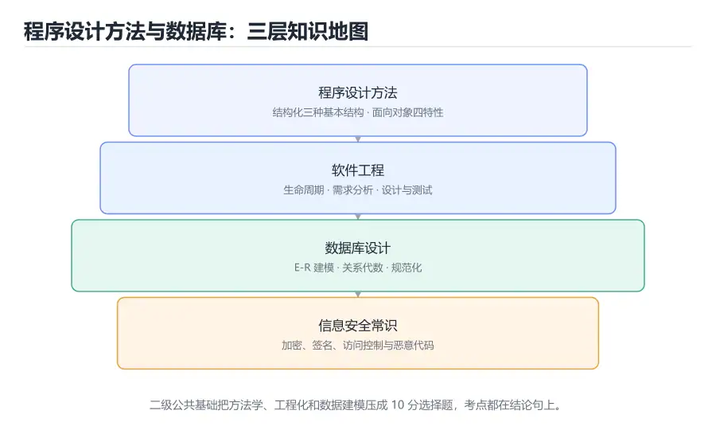

# 公共基础：程序设计方法、软件工程、数据库与网络信息安全



> 内容更新时间：2026-10-06 · 学习阶段：基础 · 预计用时：45 分钟

## 本节知识框架

**课程定位**：所属分类 `ncre`（全国计算机等级二级），课程主题 `公共基础：程序设计方法、软件工程、数据库与网络信息安全`，学习阶段 基础，建议用时 45 分钟。

上一课把数据结构与算法那半分公共基础收拾干净了，这一课收剩下那半分。二级考卷里的公共基础知识一共 10 道单项选择题、10 分，官方大纲并没有规定每一块必须出几道题，只规定了总分与每题 2 分；从考点清单看，剩下的内容正好落在四个圈里：怎么把程序写清楚（程序设计方法）、怎么把项目做下来（软件工程基础）、怎么把数据存明白（数据库设计基础）、怎么让机器与数据可信用（计算机系统与网络信息安全）。

把这四块想成一家软件公司的四个部门会更省事：程序员关心「结构对不对」，项目经理关心「阶段与文档到没到位」，数据库管理员关心「表设计与范式合不合规矩」，安全运维关心「谁能进来、数据会不会被篡改」。二级公共基础的出题人就是从这四个部门各抽几道结论题，凑成 10 道单选，所以复习的正确姿势是记结论、辨边界，而不是推代码。

**学完本课应当能够**

- 说出结构化程序设计的三种基本控制结构与两条面向对象判据，并解释为什么「单入口单出口」能降低流程图出错率。
- 把软件生命周期的六个阶段与各自的交付物一一对应，指出需求分析、概要设计、详细设计三份产出的区别。
- 用一句话区分白盒测试与黑盒测试、测试与调试，并说出内聚与耦合的取舍方向。
- 判断一个关系模式卡在哪个范式，说明 E-R 图向关系模式转换时三种联系分别怎么处理。
- 说清对称与非对称加密各自解决什么问题、数字签名为什么必须用发送方的私钥生成，以及 IP 地址与常见端口的常识结论。

### 复习清单

- [ ] 能否写出三种基本结构的名字，并说明 goto 在结构化程序设计里的地位。
- [ ] 能否把「可行性研究、需求分析、概要设计、详细设计、编码与测试、运行维护」按先后排成一列，并给每个阶段配一份交付物。
- [ ] 能否用一句话解释 1NF、2NF、3NF 分别在防止什么，并给出一个违反 3NF 的例子。
- [ ] 能否说明选择、投影、连接三种关系运算各自减少的是行还是列。
- [ ] 能否区分对称加密与非对称加密的用途，并说出数字签名的密钥方向。

## 核心概念定义

| 术语 | 操作性定义 | 常见边界与风险 |
| --- | --- | --- |
| 结构化程序设计 | 只用顺序、选择、循环三种基本结构自顶向下组织程序，每种结构单入口单出口。 | 易错：把「限制使用 goto」读成「禁止 goto」。它的要求是从简流程、少交叉，不是语法级禁用。 |
| 面向对象 | 以对象为单位组织程序，靠封装隐藏内部细节、靠继承复用已有定义、靠多态让同一调用有不同表现。 | 易错：把「封装」理解成「把代码写成函数」。封装的关键是数据与操作绑定并对外只留接口。 |
| 软件生命周期 | 从问题定义到最终退役的全过程，通常切成可行性研究、需求分析、设计、实现与测试、运行维护等阶段。 | 阶段之间没有硬墙，但每个阶段的交付物是判分点，别把详细设计与概要设计互换。 |
| 需求规格说明书 | 需求分析阶段的正式产出，描述系统必须做什么，是验收与后续设计的依据。 | 易错：把它当成「界面长什么样」的说明，功能与非功能需求都要写。 |
| 数据流图与数据字典 | 数据流图用外部实体、加工、数据存储、数据流四套符号描述信息流动；数据字典定义图上每个名字。 | 两者配套出现，只画不加定义会被追问「这个数据流具体包含哪些项」。 |
| 内聚与耦合 | 内聚衡量一个模块内部各部分联系得紧不紧，耦合衡量模块之间依赖有多重。 | 结论方向是唯一的好设计：高内聚、低耦合。 |
| 黑盒测试与白盒测试 | 黑盒不看内部结构，按输入输出的规格设计用例；白盒按程序内部控制路径设计用例。 | 覆盖强度排序常考：语句覆盖弱于判定覆盖，再弱于条件组合与路径覆盖。 |
| 关系模型三要素 | 数据结构、数据操作、完整性约束，分别回答「数据怎么组织、能做什么运算、什么数据合法」。 | 易错：把 E-R 模型当成关系模型，它属于概念模型层。 |
| 范式 | 对关系模式的约束等级，1NF 要求属性原子性，2NF 要求非主属性完全依赖候选键，3NF 再消除传递依赖。 | 规范化程度不是越高越划算，过度拆分换来的连接开销要用反范式补。 |
| 对称加密与非对称加密 | 对称加解密共用一把密钥，速度快；非对称用公钥与私钥成对，解决密钥分发与身份问题。 | 真实系统几乎都是混合用法：非对称递送会话密钥，对称加密数据本体。 |
| 数字签名 | 发送方用自己的私钥对报文摘要加密形成签名，接收方用发送方公钥验证。 | 密钥方向写反是这道题唯一的扣分点。 |
| 防火墙 | 部署在不同网络边界、按访问控制策略决定放行或阻断的设备或软件。 | 它管的是边界流量，不代替主机上的杀毒软件。 |

## 原理与运行机制

### 三种结构怎么把程序「框」住

把程序想成一条水管。顺序结构是让水按从左到右的顺序依次流过每个接头；选择结构是一个三通阀，水只能走其中一支；循环结构是一段带回流阀的管路，满足条件就再绕回去一次。这三种结构有个共同点：**只有一个入口、一个出口**。正因为出入口唯一，任意一段代码都可以被整体替换或整体去掉，而不会牵动别处的流程线——这就是结构化程序设计能压住 bug 的机制。

与之相对的是无节制的跳转。跳转语句本身合法，它的问题在于让「执行到哪」变得要看别处写了什么，控制流从一棵树退化成一张网。大纲里的表述是限制使用 goto，而不是禁止：某些多层循环退出、错误清理分支确实需要它，但那属于「先证明有必要，再写」的情形。

面向对象的四个词各管一件事。抽象是把同类事物的共性提出来；封装是把数据和对数据的操作捆在一起、只留下对外接口，好处是内部改动不会扩散；继承是复用已有定义并在新类里扩展，代价是父类改动会影响所有子类；多态是同一句调用在不同对象上有不同表现，机制上通常靠虚函数或接口实现。四个词在题里经常互换出现，判分时先看有没有关键词「隐藏内部细节」「复用已有定义」「同一调用不同表现」。

### 生命周期与文档：每个阶段留一份纸

软件生命周期把「做一个软件」切成有交付物的流水线，每一段结束都留下一份能被别人检查的纸。可行性研究回答「值不值得做」，产出可行性分析报告，从技术能不能实现、经济划不划算、操作能不能落地三个角度看；需求分析回答「必须做什么」，产出需求规格说明书，配套数据流图和数据字典；概要设计回答「系统由哪些模块组成、怎么连」，产出软件结构图与模块清单；详细设计回答「每个模块内部怎么实现」，产出算法描述与数据结构说明；实现与测试阶段先编码再做单元测试与集成测试；最后是运行维护，它占软件总成本的大头，包含改正性、适应性、完善性和预防性四类维护。

测试环节有两个高频结论。第一个是目的：测试是为了发现程序与需求不一致的地方，不是为了证明程序没有错，因此「测试通过」只代表这批用例下没暴露问题。第二个是方法：黑盒只按规格设计输入输出，白盒按内部控制路径设计用例，白盒里的覆盖强度可以排序，语句覆盖最弱，判定覆盖强一点，条件覆盖、判定/条件覆盖、条件组合覆盖逐级更严，路径覆盖在有多分支组合时最严格也最难做到全。调试与测试要分开：测试是系统性地暴露错误并记录，调试是定位并修正某个已知错误的推理过程。

### 数据库设计：从概念模型到关系模式

数据库设计分四步走。概念设计用 E-R 模型描述业务：矩形是实体，椭圆是属性，菱形是联系，联系旁边标 1:1、1:m 或 m:n。逻辑设计把 E-R 图换成关系模式，规则可以直接背：一个实体型转成一张表；1:1 联系可以并入任意一端，也可以在两端各放对方的主键；1:m 联系把「一」端的主键放进「多」端做外键；m:n 联系必须单独成一张表，表里放两端主键作为联合主键。物理设计则决定存储结构、索引与访问路径。

关系模型的操作是集合运算，选择题只考三个动作的方向：选择（selection）按条件筛**行**，投影（projection）按字段名取**列**并自动去掉重复元组，连接（join）把两张表按条件拼宽。问「减少的是行还是列」时，先把这三个动作的方向想清楚，别把投影当成筛选。

规范化是一条约束逐级收紧的链。1NF 要求每个属性不可再分，一张表里把「联系电话」写成「13800000000,13900000000」就违反了它；2NF 在 1NF 之上要求每个非主属性完全依赖于候选键，如果候选键是联合键而某个属性只依赖其中一半，就存在部分依赖；3NF 再要求消除非主属性对候选键的传递依赖，典型坏味道是「学号 → 系号 → 系主任」，改一个系的名字要在成千上万行学生记录里同步。范式的价值全在减少冗余与更新异常，代价是查询要跨表连接；实践中常见「先规范化到 3NF，再对少数高频报表反范式加冗余列」的组合。

三级模式与两级映像是另一个结论区：外模式是用户看到的样子（视图级），模式是全局逻辑结构（基本表），内模式是物理存储组织；外模式/模式映像保证逻辑独立性，模式/内模式映像保证物理独立性——改表结构影响的是前者，改存储方式影响的是后者。

### 网络与信息安全：边界、地址与密钥方向

计算机网络部分只考常识结论。按覆盖范围从窄到宽是个人网 PAN、局域网 LAN、城域网 MAN、广域网 WAN；TCP/IP 参考模型通常按应用层、传输层、网络层、网络接口层四层理解，传输层里 TCP 提供可靠有序的连接，UDP 不保证顺序也不重传；IP 地址是 32 位点分十进制，A、B、C 类的主机容量差别体现在前缀长度上，RFC1918 划出的私有地址段是 10 开头的整段、172.16 到 172.31 之间的连续区段，以及 192.168 打头的那批 C 类网段。域名解析靠 DNS，从主机名到 IP 的过程是自顶向下反复问根、顶级、权威服务器，端口号是同一台机器上区分应用的编号：Web 用 80、HTTPS 用 443、FTP 用 21、SMTP 用 25、POP3 用 110、DNS 用 53。带宽的单位是比特每秒，注意「兆带宽」在传输时是按比特而不是字节算，下载速度要除以八。

信息安全这块的机制可以用三句话锁死。机密性靠加密：对称加密两端共用一把密钥，快但分发难；非对称加密有公钥私钥一对，用公钥加密只有对应私钥能解，慢但解决了「怎么把钥匙交出去」。完整性与不可否认性靠数字签名：发送方算出报文摘要后用自己的私钥加密，形成签名，接收方用发送方的公钥验证——只有发送方持有私钥，所以验过就等于确认了来源。可用性靠访问控制、备份与边界防护：防火墙部署在网络边界按策略放行或阻断流量，它管不住已经通过邮件附件进入主机的恶意代码。恶意代码三个名字要分清：病毒要附着在宿主程序上、靠人传播；蠕虫自己扫描自己传播、消耗网络带宽；特洛伊木马外表是正常程序、实际偷偷开放后门。

## 典型应用场景

| 场景 | 典型输入或前提 | 本课用上的结论 |
| --- | --- | --- |
| 课程设计要求写文档 | 三人小组做一个选课系统 | 需求分析出规格说明与数据流图，概要设计划模块，详细设计写算法，评审时看高内聚低耦合 |
| 表设计评审 | 学生表里同时存系名与系主任 | 存在传递依赖，拆成学生表与系表，用外键联系 |
| 报表查询 | 要按系统计人数并只看人数超过 50 的系 | 先 GROUP BY 分组，再用 HAVING 过滤分组结果 |
| 系统上线前验收 | 客户按功能清单逐条点验 | 黑盒测试，测试用例来自需求规格说明书而不是代码 |
| 校内通知系统对外发布 | 需要在公网上证明通知未被篡改 | 用发布方私钥生成签名，验证方用公钥核对摘要 |

再补三个真实做法。**测不出来就换覆盖强度**：一段有 3 个判定、每个判定含 2 个条件的代码，只做语句覆盖可能一条用例都不浪费地跑完所有语句却漏掉整个条件组合，这时该上条件组合覆盖或路径覆盖。**范式不是终点**：读多写少的报表库常故意在结果表里冗余存一份系名，把连接开销换成一致性维护成本，前提是把「谁负责更新冗余」写清楚。**边界先于功能**：登录失败锁定策略、口令复杂度、最小权限账号，这些都属于信息安全基础里反复出现的访问控制话题，二级题会把它和加密方式混在同一份卷子里考方向而不是参数。

### 最小验证场景

- 准备：一张写着「学号、姓名、系号、系名、系主任」的假想表，一段有嵌套 if 的 C 代码。
- 观察：先在纸上标出候选键，再看非主属性是否只依赖键的一部分或经过了别的属性；对代码列出所有判定与条件组合，数一数需要几条用例才能覆盖到最里层的分支。
- 判定：能说出「这张表违反第几范式、拆成哪两张表」以及「这段代码语句覆盖为什么不够」两项，才算把本课的两条主线各自过了一遍。

## 代码/协议/SQL 示例

下面四段例子分别对应本课四个板块，都是能直接改一改就用的小片断。

**结构化与面向对象：同一段逻辑的两种写法**

C 语言版本只体现三种基本结构的组合；C++ 版本把数据和操作绑在一起，多态靠虚函数体现。

```c
#include <stdio.h>

int fee_of(int kind, int hours) {
    int fee = 0;
    if (kind == 1) {                 /* 选择结构 */
        fee = hours * 5;
    } else if (kind == 2) {
        fee = hours * 8;
    }
    for (int i = 0; i < hours; i++) { /* 循环结构 */
        if (i == 3) {
            fee -= 5;                /* 满四小时减五元，唯一的跳转风险点 */
        }
    }
    return fee;
}

int main(void) {
    printf("%d\n", fee_of(2, 5));
    return 0;
}
```

```cpp
class Visitor {
public:
    virtual int fee(int hours) const { return hours * 5; }
    virtual ~Visitor() = default;
};

class Student : public Visitor {                 /* 继承复用 */
public:
    int fee(int hours) const override { return hours * 3; }  /* 多态 */
};
```

**关系运算：选择、投影、连接各自减少什么**

```sql
SELECT DISTINCT dept
FROM student
WHERE major = 'CS';
```

`WHERE major = 'CS'` 是选择，砍掉不满足条件的行；`DISTINCT dept` 是投影，只留一列并去掉重复元组。两张表拼宽要靠连接：

```sql
SELECT s.sname, d.dean
FROM student AS s
JOIN department AS d ON s.dept = d.dept
GROUP BY s.dept, d.dean, s.sname
HAVING COUNT(*) > 50;
```

这里 `GROUP BY` 先把结果按系分组，`HAVING` 再对分组后的组做过滤；如果把过滤条件写进 `WHERE`，过滤的是分组前的行，两者时机完全不同。

**用脚本核对签名方向**

Python 只做示意：摘要由原文算出，签名用发送方私钥，验证用发送方公钥。

```python
from hashlib import sha256

notice = "选课系统本周五 22:00 关闭"
digest = sha256(notice.encode("utf-8")).hexdigest()

sign_with = "sender_private_key"
verify_with = "sender_public_key"
print(digest[:12], sign_with, "->", verify_with)
```

**端口与地址的小抄命令**

Windows 下查看本机连接与端口占用，考试机上也能跑。

```bash
netstat -ano | findstr ":443"
```

看到 `LISTENING` 的行表示本机有程序在该端口等待连接，`ESTABLISHED` 表示已经和远端建立会话；这一条能帮你在概念题之外建立「端口是应用编号」的手感。

## 时间/空间复杂度或性能分析

公共基础这四块的「性能」不在算法层，而在流程与结构的成本上。

| 对象 | 主要成本 | 省成本的常规做法 |
| --- | --- | --- |
| 需求变更 | 越晚发现越贵，改一行说明可能要重做设计与用例 | 需求评审加可执行原型，把误解提前暴露 |
| 模块耦合 | 一处改动扩散到多个模块，回归测试量成倍增加 | 高内聚低耦合，公共逻辑收敛到少数稳定模块 |
| 规范化表 | 查询跨表连接，排序分组消耗内存 | 只读报表适度反范式，冗余列加更新责任约定 |
| 索引 | 读快写慢，占存储 | 只为高频过滤列建索引，避免在最常被改写的列上堆索引 |
| 非对称加密 | 大数运算慢，能耗高 | 只用它递送会话密钥，数据本体交给对称加密 |

从备考角度看，这四块的题目几乎不需要计算时间复杂度，需要的是把「成本落在哪一层」说清楚。真正会出现复杂度结论的是上一课的数据结构与算法部分，本课里唯一沾边的是路径覆盖：分支越多，路径数按乘积增长，四个二分支的判定串起来理论路径就是 16 条，这也是为什么大型函数拆小比堆用例更有效。

另外记住两条与考场上机有关的结论：软件生命周期类题目爱考「哪一步产出哪份文档」，而不会让你写文档；数据库类题目爱考「哪个语句产生哪个结果」，因此在二级 MySQL 科目里，把 `WHERE` 与 `HAVING`、`DROP` 与 `DELETE`、视图与基本表这三组差别做成本能，比背定义划算得多。

## 常见误区与易错点

- **把三种基本结构写成「输入、处理、输出」**。那是数据流的三段，不是控制结构；控制结构只有顺序、选择、循环。
- **认为面向对象等于「用了很多函数」**。封装的关键是数据与操作绑定并隐藏实现细节，只写函数不等于封装。
- **需求分析与可行性研究互换**。可行性研究决定做不做，需求分析决定做什么，两者的交付物完全不同。
- **把概要设计与详细设计混成一个阶段**。概要设计给模块划分与调用关系，详细设计给每个模块内部的算法与数据结构。
- **以为测试通过就等于没有错误**。测试只能证明这批用例下没发现问题，不能穷举所有输入。
- **混淆测试与调试**。测试是系统性地发现并记录错误，调试是定位并修正错误。
- **以为多建索引总是更好**。索引加速读取，代价写在插入更新与空间上。
- **把 E-R 图当成关系模型**。E-R 属于概念模型，关系模型是逻辑层的表结构。
- **认为投影就是筛选**。投影取列，选择筛行，方向不能反。
- **非对称加密当成「更快的加密」**。它慢，价值在密钥分发与身份；真正跑数据的是对称加密。
- **签名的密钥方向写反**。签名用发送方私钥生成、用发送方公钥验证；加密才是用接收方公钥加密、接收方私钥解密。
- **把防火墙当万能**。它只做边界访问控制，管不住已经进来的恶意代码与内部越权。
- **分不清病毒、蠕虫与木马**。前者要附着宿主并靠人传播，后者自己扫描传播，木马伪装成正常程序开后门。
- **带宽与下载速度直接画等号**。带宽按比特计，字节要除以八，实际还要扣协议开销。

## 与其他知识点的关系

- 与 `ncre_public_data_structure` 的关系是互补：那一门管公共基础里偏计算的一半，本课管偏概念的一半，两门合计才是完整的 10 分。
- 与 `ncre_c_data_expr`、`ncre_c_control_function` 的关系是「理论落到语法」：三种基本结构在 C 里就是 `if`、`for`、`while`、`do-while` 的组合，结构化设计要求在语言层表现为少用 `goto`、控制层次不超过三层。
- 与 `ncre_c_struct_file` 的关系是数据抽象：结构体是 C 语言里最接近「封装」的机制，链表与文件读写是它在内存与磁盘上的两种延伸。
- 与 `ncre_mysql_database` 的关系最直接：E-R 转换、范式、关系运算、`GROUP BY` 与 `HAVING` 的差别都在 MySQL 科目的操作题里逐句给分。
- 与 `ncre_python_data_file` 的关系在数据质量：分词与统计结果写回文件时，字段是否原子、是否冗余，正是规范化结论的日常版本。
- 网络与信息安全部分与 `network`、`security` 分类相通，但二级只考结论层级，不考协议字段与算法细节。

| 关联课程 ID | 关联主题 | 关系说明 |
| --- | --- | --- |
| ncre_public_data_structure | 数据结构与算法 | 共同构成公共基础 10 分，那半偏计算，这半偏概念 |
| ncre_c_control_function | 流程控制与函数 | 三种基本结构在 C 语法里的具体形态 |
| ncre_c_struct_file | 结构体与文件 | 封装与数据抽象在语言层的落点 |
| ncre_mysql_database | MySQL 数据库 | 范式与关系运算在真实语句上的给分点 |
| ncre_python_data_file | 数据处理与文件 | 冗余与原子性在文本数据处理里的重现 |

## 自测题与参考答案

### 题目 1

结构化程序设计强调的三种基本控制结构是？

1. 顺序、选择、循环，且每个结构只有一个入口一个出口
2. 顺序、跳转、递归，允许在任意位置使用 goto 改变流程
3. 输入、处理、输出，三者按数据流方向串联成一个模块
4. 宏定义、函数调用、返回值，程序由若干独立函数串行组成

**参考答案**：A（顺序、选择、循环，且每个结构只有一个入口一个出口）

本题正确项是「顺序、选择、循环，且每个结构只有一个入口一个出口」。结构化程序设计的全部机制就在于用这三种结构反复嵌套来搭程序，每种结构单入口单出口，任意一段代码都能被整体替换而不牵动别处的流程线。干扰项「顺序、跳转、递归，允许在任意位置使用 goto 改变流程」把「限制使用 goto」放大成了随便跳转，正好与结构化方法的要求相反；输入处理输出描述的是数据流方向，不是控制结构。

### 题目 2

软件生命周期中，需求分析阶段结束时应当交付的文档是？

1. 可行性研究的结论与项目预算表
2. 需求规格说明书，配合数据流图与数据字典
3. 模块说明书与单元测试用例集
4. 程序源代码清单与用户操作手册

**参考答案**：B（需求规格说明书，配合数据流图与数据字典）

本题正确项是「需求规格说明书，配合数据流图与数据字典」。需求分析回答系统必须做什么，产出以需求规格说明书为主体，数据流图描述加工与数据流，数据字典定义图上每个名字的组成。干扰项「可行性研究的结论与项目预算表」属于更早的可行性研究阶段，它回答值不值得做；模块说明书来自设计阶段，源代码清单与用户手册来自实现与维护阶段。

### 题目 3

关系模式中要求每个属性都不可再分，这一约束属于？

1. 第二范式 2NF 的要求
2. 第三范式 3NF 的要求
3. 第四范式以上的要求
4. 第一范式 1NF 的要求

**参考答案**：D（第一范式 1NF 的要求）

本题正确项是「第一范式 1NF 的要求」。1NF 只关心属性的原子性，一个字段不能再被拆成两个字段，它是关系模式最低也最必须的门槛；2NF 在此之上要求非主属性完全依赖候选键，3NF 进一步要求消除传递依赖，两者处理的都是依赖关系而不是可分性。干扰项「第三范式 3NF 的要求」把依赖约束误当成结构约束，是这一考点最常见的错法。

### 题目 4

阅读下面的 SQL 语句，这段语句要表达的查询是？

```sql
SELECT dept, COUNT(*) FROM student GROUP BY dept HAVING COUNT(*) > 50;
```

1. 统计每个学生所在系的人数，并要求先按姓名排序
2. 选出人数超过 50 的那个系的全部学生明细
3. 统计各系人数，只保留人数超过 50 的系
4. 按 dept 分组并显示所有系的人数，不做任何过滤

**参考答案**：C（统计各系人数，只保留人数超过 50 的系）

本题正确项是「统计各系人数，只保留人数超过 50 的系」。`GROUP BY dept` 把学生按系分成若干组，`COUNT(*)` 在每组内部计数，`HAVING` 再对分组结果做过滤，不满足条件的组不会出现在输出里。干扰项「按 dept 分组并显示所有系的人数，不做任何过滤」丢掉了 HAVING 的作用，把分组与筛选两件事合并成了一件；语句里没有 ORDER BY，输出也不是学生明细，所以第一条与第二条同样不成立。

### 题目 5

把软件生命周期的四个阶段按先后排列：

1. 详细设计：给出每个模块内部的算法与数据结构
2. 需求分析：确定系统必须做什么并写出规格说明
3. 运行维护：改正性、适应性、完善性与预防性维护
4. 可行性研究：从技术、经济、操作三方面判断值不值得做

**参考答案**：可行性研究 → 需求分析 → 详细设计 → 运行维护

按本课的阶段划分，本题顺序是「可行性研究：从技术、经济、操作三方面判断值不值得做」 → 「需求分析：确定系统必须做什么并写出规格说明」 → 「详细设计：给出每个模块内部的算法与数据结构」 → 「运行维护：改正性、适应性、完善性与预防性维护」。这里省略了概要设计与编码测试两个中间阶段，但四者的相对次序不变：先决定做不做，再定义做什么，然后设计怎么做，最后才是长期维护。

### 题目 6

下列关于网络与信息安全的说法中，与本课结论一致的两项是？

1. 防火墙部署在不同网络边界，按访问控制策略放行或阻断流量
2. 只要口令足够复杂，就能阻止木马程序窃取本机数据
3. 非对称加密的运算速度通常快于对称加密，因此适合加密大文件
4. 数字签名由发送方用自己的私钥生成，接收方用发送方的公钥验证

**参考答案**：A、D（防火墙部署在不同网络边界，按访问控制策略放行或阻断流量；数字签名由发送方用自己的私钥生成，接收方用发送方的公钥验证）

本题要同时选中「防火墙部署在不同网络边界，按访问控制策略放行或阻断流量」与「数字签名由发送方用自己的私钥生成，接收方用发送方的公钥验证」。前者说的是边界访问控制，后者说的是机密性之外的完整性与不可否认性，密钥方向不能反。口令强度只影响猜测登录的成本，管不住已经运行在主机上的恶意程序；非对称算法因为大数运算而明显慢于对称算法，大文件本体交给对称加密处理。

## 考点精讲

本课题库共 6 道题，下面逐题复述题干、正确项与判断依据。

### 考点 1：第 1 题

- **题目**：结构化程序设计强调的三种基本控制结构是？
- **正确项**：A（顺序、选择、循环，且每个结构只有一个入口一个出口）
- **判断依据**：本题正确项是「顺序、选择、循环，且每个结构只有一个入口一个出口」。三种基本结构单入口单出口，才能整体替换任意一段代码；干扰项「顺序、跳转、递归，允许在任意位置使用 goto 改变流程」把限制使用 goto 写成了任意跳转，方向相反。

### 考点 2：第 2 题

- **题目**：软件生命周期中，需求分析阶段结束时应当交付的文档是？
- **正确项**：B（需求规格说明书，配合数据流图与数据字典）
- **判断依据**：需求分析阶段的产出是需求规格说明书，辅以数据流图与数据字典。干扰项「可行性研究的结论与项目预算表」是可行性研究阶段的交付物，回答的是值不值得做而不是做什么。

### 考点 3：第 3 题

- **题目**：关系模式中要求每个属性都不可再分，这一约束属于？
- **正确项**：D（第一范式 1NF 的要求）
- **判断依据**：属性原子性是 1NF 的全部内容，2NF 管部分依赖、3NF 管传递依赖。干扰项「第三范式 3NF 的要求」把依赖约束当成结构约束，属于层次搞反。

### 考点 4：第 4 题

- **题目**：阅读下面的 SQL 语句，这段语句要表达的查询是？SELECT dept, COUNT(*) FROM student GROUP BY dept HAVING COUNT(*) > 50;
- **正确项**：C（统计各系人数，只保留人数超过 50 的系）
- **判断依据**：GROUP BY 分组、COUNT 组内计数、HAVING 过滤分组结果，三个动作合起来正好是统计各系人数并且只保留超过 50 人的系。干扰项「按 dept 分组并显示所有系的人数，不做任何过滤」丢掉了过滤条件；语句里没有 ORDER BY，也不输出明细行。

### 考点 5：第 5 题

- **题目**：把软件生命周期的四个阶段按先后排列：
- **正确项**：可行性研究 → 需求分析 → 详细设计 → 运行维护
- **判断依据**：先判断值不值得做，再定义必须做什么，再落到模块内部算法，最后进入长期维护，中间省略的概要设计与编码测试不改变相对次序。正确序号排列为 4 → 2 → 1 → 3。

### 考点 6：第 6 题

- **题目**：下列关于网络与信息安全的说法中，与本课结论一致的两项是？
- **正确项**：A、D（防火墙部署在不同网络边界，按访问控制策略放行或阻断流量；数字签名由发送方用自己的私钥生成，接收方用发送方的公钥验证）
- **判断依据**：本题正确项包含「防火墙部署在不同网络边界，按访问控制策略放行或阻断流量」与「数字签名由发送方用自己的私钥生成，接收方用发送方的公钥验证」两条结论。干扰项「非对称加密的运算速度通常快于对称加密，因此适合加密大文件」把速度关系说反；口令复杂度管不住已经运行的恶意程序。

### 高频考点小结

1. 控制结构只有顺序、选择、循环；面向对象抓封装、继承、多态三个可辨识的关键词。
2. 阶段与交付物配对：可行性研究对报告，需求分析对规格说明加数据流图与数据字典，概要设计对模块结构，详细设计对算法，测试对用例，维护对四类维护活动。
3. 范式看两件事：属性能不能再分（1NF），依赖是不是完全且无传递（2NF、3NF）；E-R 转关系模式看联系类型是 1:1、1:m 还是 m:n。
4. 安全抓方向：对称管速度、非对称管分发与身份、签名用发送方私钥、防火墙只管边界。

## 术语速查

| 术语 | 一句话说明 |
| --- | --- |
| 结构化程序设计 | 只靠顺序、选择、循环三种单入口单出口结构搭建程序，并限制使用 goto 的方法。 |
| 封装 | 把数据与对其的操作绑定在一个单位里、对外只留接口，内部实现可以随意更换。 |
| 多态 | 同一句调用作用在不同对象上表现出不同行为，常靠虚函数或接口实现。 |
| 需求规格说明书 | 需求分析阶段的正式产出，逐条写明系统必须做什么与不能做什么。 |
| 数据字典 | 对数据流图上每个名字给出组成、类型与取值的定义表。 |
| 内聚 | 衡量一个模块内部各部分之间联系紧密程度的指标，设计上追求高内聚。 |
| 耦合 | 衡量模块之间相互依赖程度的指标，设计上追求低耦合。 |
| 黑盒测试 | 不参考内部结构，只按需求规格设计输入并核对输出的测试方法。 |
| 白盒测试 | 按程序内部控制路径设计用例的测试方法，覆盖强度从语句到路径逐级增强。 |
| 第一范式 1NF | 关系模式中每个属性都不可再分的最基本约束。 |
| 传递依赖 | 非主属性通过另一个非主属性间接依赖候选键，是 3NF 要消除的对象。 |
| 选择与投影 | 选择按条件筛行，投影按字段取列并去重，两者减少的方向不同。 |
| 对称密钥密码体制 | 加解密共用同一把密钥的体制，速度快，难点在密钥分发。 |
| 数字签名 | 用发送方私钥对报文摘要加密形成的凭证，接收方用发送方公钥验证。 |
| 特洛伊木马 | 伪装成正常程序、暗中在主机上开放控制通道的恶意代码。 |

## 参考资料与复核

- 最后复核：2026-10-04
- 下次复核：2027-08-10
- 复核范围：公共基础考点清单与分值口径、生命周期阶段命名、范式定义、关系运算方向、加密与签名机制、常见端口与私有地址段
- 来源性质：教育部教育考试院 NCRE 考试大纲与官方说明；语言与协议侧结论参考公开标准文档；本课核对关键词：10 道单选题 10 分、三种基本结构、需求规格说明书、1NF、HAVING。

| 参考资料 | 本课用途 |
| --- | --- |
| [全国计算机等级考试专栏首页](https://ncre.neea.edu.cn/) | 级别与科目设置、公共基础考核口径 |
| [全国计算机等级考试考试大纲](https://ncre.neea.edu.cn/html1/report/2412/185-1.htm) | 公共基础知识考核内容与题型分值 |
| [教育部教育考试院首页](https://www.neea.edu.cn/) | 考试组织与成绩发布主体 |
| [RFC 791：Internet 协议](https://www.rfc-editor.org/rfc/rfc791) | IP 地址与网络层封装的原始定义 |
| [MySQL 5.5 官方文档 SELECT 语法](https://dev.mysql.com/doc/refman/5.5/en/select.html) | GROUP BY 与 HAVING 的执行时机 |

## 内容元数据

> 内容更新时间：2026-10-06 · 学习阶段：基础 · 预计用时：45 分钟

- 内容版本：v2.0
- 最后更新：2026-11-11
- 学习阶段：基础
- 适用环境：二级全部科目的公共基础知识部分（10 道单项选择题共 10 分），与二级 C 语言、Python、MySQL 科目合并命题
- 内容来源：教育部教育考试院 NCRE 考试大纲与公开标准文档整理
- 相关主题：结构化程序设计、面向对象、软件生命周期、需求分析、软件测试、E-R 模型、关系范式、网络与信息安全
