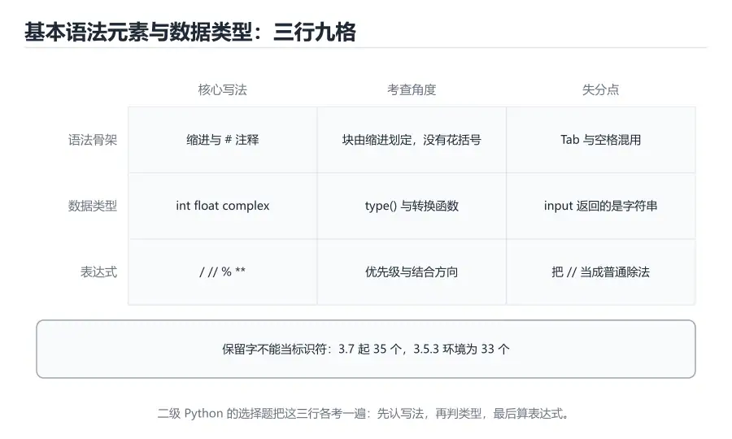

# Python 语言程序设计：基本语法元素与数据类型



> 内容更新时间：2026-10-06 · 学习阶段：进阶 · 预计用时：45 分钟

## 本节知识框架

**课程定位**：所属分类 `ncre`（全国计算机等级二级），课程主题 `Python 语言程序设计：基本语法元素与数据类型`，学习阶段 进阶，建议用时 45 分钟。

这是二级 Python 科目的第一课，也是整份考卷的地基。二级 Python（科目代码 66）满分 100 分、上机 120 分钟，其中选择题 40 分（含公共基础知识 10 分）、操作题 60 分由基本编程题与综合编程题构成。选择题里大约一半的答案落点就在「这段代码跑出来是什么」，而判断它靠的正是本课的四件事：**谁合法（标识符与保留字）、什么类型（对象的类型与转换）、怎么算（运算符与优先级）、怎么进出（input 与 print）**。操作题给一段挖空的程序，前两个空往往是变量名、类型转换函数和 `range` 的边界，同样绕不开这一页。

配图把本课排成三行九格：语法骨架行讲「缩进就是语法」，数据类型行讲「变量是名字到对象的绑定」，表达式行讲「先算优先级高的」。每一行都给出核心写法、考查角度与失分点，读题时先判断它落在哪一行，再动笔，比凭感觉猜输出可靠得多。

**学完本课应当能够**

- 写出一组合法的标识符，并说清为什么 `class`、`None`、`for` 不能当变量名。
- 解释 `x = 5` 与 `x = "5"` 之后 `x` 指向的对象有什么差别，用 `type()` 验证。
- 手工算出含 `/`、`//`、`%`、`**` 的混合表达式结果，并说明 `and`、`or` 的短路行为。
- 区分 `input()` 返回的字符串与 `eval()` 求值后的对象，正确完成一次数值输入。
- 说明浮点数为什么表示不了 `0.1 + 0.2 == 0.3`，以及考卷里比较小数的稳妥写法。

### 复习清单

- [ ] 能否说出 Python 语句结尾为什么不写分号、块边界为什么不能靠花括号。
- [ ] 能否解释 `print(a, b)` 与 `print(a + b)` 在单引号字符串上的不同结果。
- [ ] 能否写出把 `input()` 读到的两个整数求和的两行代码，并指出少写 `int()` 会怎样。
- [ ] 能否判断 `2 + 3 * 4 ** 2` 的值，并说明 `**` 与 `*` 的先后顺序。
- [ ] 能否说明 `round(2.5)` 为什么得 2 而不是 3，以及 `int()` 与 `round()` 的截断方向差别。

## 核心概念定义

| 术语 | 操作性定义 | 常见边界与风险 |
| --- | --- | --- |
| 格式框架 | 用缩进表示层次，用冒号引出下一层块，行尾不需要分号。 | 易错：Tab 与空格混用，解释器直接报 `TabError` 或缩进不一致。 |
| 注释 | 单行用 `#` 到行尾结束，多行说明常用三引号字符串占位。 | 注释不参与执行，写错注释不会报错，但会误导读题。 |
| 标识符 | 由字母、数字、下划线组成且不以数字开头的名字，区分大小写。 | 易错：`3rd` 非法、`a-b` 被读成减法、中文虽然合法但考试代码不建议写。 |
| 保留字 | 语言自己占用的关键字，如 `if`、`for`、`def`、`import`、`True`、`None`。 | Python 3.7 起共 35 个，大纲指定的 3.5.3 环境是 33 个，差异来自 `async` 与 `await`。 |
| 赋值语句 | `=` 把右侧对象的引用绑到左侧名字上，可以同时绑多个：`a, b = 1, 2`。 | 右侧先整体求值再绑定，`a, b = b, a` 因此能一步交换两个值。 |
| 动态类型 | 类型属于对象而不属于变量，同一个名字可以在程序里换绑不同类型。 | 易错：以为 `x = 5` 声明了整型，实际只是绑定了一个 int 对象。 |
| 整数 int | 没有范围上限的整数，位数随数值增长自动扩展。 | 参与运算时不截断，代价是大数运算比机器整数慢。 |
| 浮点数 float | 按 IEEE 754 双精度存储的小数，约 15 到 17 位有效数字。 | 易错：`0.1 + 0.2` 不等于 `0.3`，比较小数要用差值或 `round()`。 |
| 复数 complex | 写成 `3 + 4j` 的形式，虚部后缀是 `j` 而不是 `i`。 | 复数不能比大小，也不能用 `//` 与 `%`。 |
| 布尔型 bool | 只有 `True` 与 `False` 两个字面值，首字母大写。 | 它是 int 的子类，`True + True` 得 2，但卷面上仍应写成布尔语义。 |
| 类型转换 | `int()`、`float()`、`str()`、`bool()`、`complex()` 在类型之间搬运值。 | `int("3.5")` 报错，必须先 `float()` 再 `int()`；空字符串同样不能直接转数值。 |
| 算术运算符 | `+ - * / // % **` 七个，`/` 永远得浮点，`//` 向下取整。 | 易错：`-7 // 2` 是 -4 而不是 -3，因为方向是向下取整。 |
| 关系运算符 | `< > == != >= <=`，可以连写成 `0 < x <= 10`。 | 赋值 `=` 与判等 `==` 写混是操作题的高频扣分点。 |
| 逻辑运算符 | `and or not`，用文字而不是 `&&`、`||`、`!`。 | 短路求值：左侧已能定结论时右侧根本不执行。 |
| 赋值运算符 | `= += -= *= /= //= **= %=`。 | 易错：`a += 1` 之外的写法如 `a =+ 1` 会把 a 变成 1。 |
| 成员与身份 | `in`、`not in` 判断是否属于序列；`is`、`is not` 判断是否同一个对象。 | `==` 比内容，`is` 比身份，两个等值列表通常 `is` 为假。 |
| 优先级 | 括号最高，其次 `**`、单目、`* / // %`、`+ -`、比较与成员、`not`、`and`、`or`。 | 同优先级按结合方向计算，`**` 是右结合：`2 ** 3 ** 2` 得 512。 |
| input 函数 | 从键盘读入一整行，返回值永远是字符串。 | 直接参与乘法会把字符串重复，操作题第一步常是 `int(input())`。 |
| eval 函数 | 把字符串当成表达式求值，`eval("3 + 4")` 得 7。 | 卷面上它属于基本函数，真实代码里不要用它处理外来输入。 |
| print 函数 | 输出多个对象，默认用空格分隔、末尾换行，可用 `sep` 与 `end` 改写。 | `print("a","b")` 得 `a b`，`print("a"+"b")` 得 `ab`。 |
| type 函数 | 返回对象的类型，打印形式是 `<class 'int'>`。 | 判断类型首选 `isinstance()`，它能认出父子类关系。 |

## 原理与运行机制

### 缩进就是语法，冒号引出块

C 语言用花括号划定代码块，Python 用缩进。解释器在读源码时把「同一层次的语句必须同一缩进」当成硬规则，块边界由缩进决定，而不是由某个符号决定。因此下面这段代码的含义完全由四格缩进表达：

```python
# 判断一个整数是奇数还是偶数
n = 7
if n % 2 == 0:
    print("even")
else:
    print("odd")        # 这一行属于 else 块，缩进必须与上一行一致
```

输出 `odd`。三件事要记住：冒号后面必须换行并缩进；同一块的缩进量必须相同；官方风格统一用 4 个空格。真考系统里最常见的错误不是逻辑错，而是把某一行少打了一个空格，程序连跑都跑不起来。

`#` 之后的内容到行尾全部作废，不参与执行；一行太长时可以用反斜杠续行，或者在括号内直接换行，括号内的换行不需要续行符。

### 变量是名字到对象的绑定

`x = 5` 的真实含义是：创建一个整数对象 5，再让名字 `x` 指向它。类型跟着对象走，名字本身没有类型，所以同一个名字可以在后面被换成字符串：

```python
x = 5
print(type(x))
x = "5"
print(type(x), x + x)
x = 5.0
print(type(x), int(x), float("2.5"))
```

输出三行：`<class 'int'>`、`<class 'str'> 55`、`<class 'float'> 5 2.5`。第二行是字符串相加，语义是拼接而不是求和，这正是 `input()` 之后忘记 `int()` 时会出现的现象。第三行的 `int(5.0)` 是向零截断，`int(-2.7)` 得 -2，而 `round()` 是四舍六入五成双，两者方向不同。

链式打包赋值 `a, b = 1, 2` 右侧先聚成一个元组再逐个解包，因此 `a, b = b, a` 能一步交换两个值，不需要临时变量。

### 表达式求值：先定优先级，再谈类型

```python
a, b = 7, 2
print(a / b, a // b, a % b, a ** b)
print(2 + 3 * 4 ** 2)
print((2 + 3) * 4 ** 2)
```

输出 `3.5 3 1 49`、`50`、`80`。`/` 的结果一律是浮点数，哪怕两个操作数都能整除；`//` 先做真实除法再向下取整，所以负数会往小的方向走；`**` 的优先级高于 `*`，也高于一元负号之外的多数运算符。判断输出时先在纸上按优先级把表达式拆成树，再自底向上算，比心算快也不容易漏类型。

逻辑运算走短路：

```python
x = 0
print(x != 0 and 10 / x > 1)
print(x == 0 or 10 / x > 1)
print(not 3 > 2)
```

输出 `False`、`True`、`False`。第一行左侧已为假，右侧的除零根本没执行，这是「用 and 挡住越界或除零」的标准写法。`not` 的优先级低于比较，`not 3 > 2` 读作 `not (3 > 2)`。

### 数值进出：input、eval 与 print 的三件套

```python
s = input("请输入两个整数：")   # 键入 3 5 后回车
parts = s.split()
print(parts, len(parts))
print(int(parts[0]) + int(parts[1]))
```

第一行是提示串，读回来的是字符串 `"3 5"`；`split()` 按空白切成 `['3', '5']`；`int()` 转成数值后相加得 8。少了 `int()`，`"3" + "5"` 的结果就是 `"35"`。`eval()` 能一步把 `"3 + 5"` 这类表达式算出来，卷面会考它的返回值类型，但它不做任何安全校验，操作题里读入数值仍然首推 `int()` 与 `float()`。

`print` 的关键参数只有两个要背：`sep` 控制多个对象之间的分隔符（默认一个空格），`end` 控制行尾（默认换行）。综合编程题要求「输出格式与样例完全一致」，多数丢分就丢在没有把 `end=""` 补上。

## 典型应用场景

| 场景 | 典型输入或前提 | 用上的结论 |
| --- | --- | --- |
| 读入一个整数并计算 | 键盘输入一串数字字符 | `n = int(input())` 一步完成读入与转换 |
| 一行读入多个数 | 输入以空格分隔 | `a, b = map(int, input().split())` |
| 判断成绩区间 | 分数落在某个范围内 | 链式比较 `60 <= score < 90` |
| 保留两位小数输出 | 金额或平均值 | `round(value, 2)` 或格式化输出 |
| 循环计数 | 需要 0 到 n-1 | `range(n)`，配合 `step` 控制步长 |
| 判断奇偶与取位 | 整数按位拆解 | `n % 2`、`n % 10`、`n // 10` 三件套 |
| 交换两个变量 | 不允许临时变量 | `a, b = b, a` 靠打包解包完成 |

### 最小验证场景

先在纸上算出四行输出，再上机对答案：`print(7 / 2, 7 // 2, -7 // 2, 7 % -2)`、`print(2 + 3 * 4 ** 2)`、`print(0.1 + 0.2 == 0.3)`、`print(round(2.5), round(3.5), int(-2.7))`。前三行分别落在 `3.5 3 -4 -1`、`50`、`False`，第四行是 `2 4 -2`。哪一行算错，就回到上面「先定优先级，再谈类型」那段重读一遍对应的规则。

第二步改坏：把 `n = int(input())` 改成 `n = input()`，再执行 `print(n * 2)`，输入 5 会得到 `55` 而不是 10。这个十秒的改动能一次性讲清「input 返回字符串」与「字符串乘整数是重复」两件事，比背十遍结论牢。

## 代码/协议/SQL 示例

**数值输入与格式一致的输出**

```python
# 输入半径，输出圆的面积，保留 2 位小数
PI = 3.14159
r = float(input("请输入半径："))     # 键入 2
area = PI * r ** 2
print("面积=", area, sep="", end="|")
print(round(area, 2))
```

第一行 `print` 用 `sep=""` 去掉默认空格、用 `end="|"` 把行尾换成竖线，于是两句输出连成 `面积=12.566760000000001|12.57`。操作题按得分点给分，数值算对了但分隔符多打一个空格，同样拿不到格式分。

**身份运算与等值运算的对照**

```python
p = [1, 2]
q = [1, 2]
m = p
print(p == q, p is q)
print(p == m, p is m)
print(256 == 256, 256 is 256)
```

输出 `True False`、`True True`、`True True`。`==` 看内容是否相等，`is` 看是不是同一个对象；`m = p` 只是多给了一个名字，没有复制列表，所以两者 `is` 为真。第三行的小整数为真来自解释器对 `-5` 到 `256` 的缓存复用，不能据此推广成「所有相等整数 `is` 都为真」，判断业务代码里的相等一律用 `==`。

**用短路避免除零与越界**

```python
total = 0
count = 0
if count != 0 and total / count > 3:
    print("达标")
else:
    print("还没有数据")
data = [1, 2, 3]
i = 2
if i < len(data) and data[i] == 3:
    print("命中最后一个元素")
```

输出 `还没有数据` 与 `命中最后一个元素`。`and` 左侧为假时右侧完全不求值，因此可以把「前提检查」写在左侧、把「依赖前提的计算」写在右侧。反过来说，把 `or` 写成 `and`、或把两侧顺序颠倒，就会出现「平时不报错，边界数据一跑就崩」的隐患，这正是程序改错题最爱留的一处坑。

## 时间/空间复杂度或性能分析

| 操作 | 时间 | 空间 | 说明 |
| --- | --- | --- | --- |
| 数值四则运算 | 常数 | 无额外 | 普通规模下按一次运算计 |
| 大整数乘法与幂 | 随位数增长 | 随位数增长 | int 无上限，代价是自动扩展精度 |
| 字符串 `+` 拼接 | 每次生成新串 | 新串占额外空间 | 循环里反复 `+=` 会退化成平方级 |
| `join` 批量拼接 | 一次成型 | 结果串 | 比循环 `+=` 少建许多中间对象 |
| `type()` 与 `isinstance()` | 常数 | 无额外 | 后者能识别继承关系，判断更稳 |
| `input()` 一行读入 | 与串长成正比 | 一个字符串 | 大量数据要循环读或一次读全部 |
| `eval()` 求值 | 高于直接运算 | 表达式对象 | 卷面会考，真实代码里换成显式转换 |

字符串拼接这一条在操作题里最实用：把 1000 个数字逐个 `s += str(x)` 写出来，每轮都在建新串；改成把片段先放进列表、最后一次 `''.join(列表)`，工作量只与总长度成正比。二级题目规模小，两种写法都能过，但填空时给出的提示往往是 `join`。

从失分统计看，本课的选择题集中在四类：`//` 与 `%` 在负数上的方向、`/` 结果为浮点、`input()` 返回类型、运算符优先级与短路。四类都有固定解法：先在草稿上写出表达式的计算树，标出每一步的结果类型，再往下看选项。操作题的失分则集中在缩进不一致、`=` 与 `==` 写混、输出分隔符与样例不一致三处，写完先用边界输入（0、负数、空行）各跑一遍。

## 常见误区与易错点

- **以为赋值声明了类型**。Python 没有类型声明语句，类型属于对象，名字可以随时改绑。
- **把 `input()` 的结果当成数字**。它返回字符串，`n * 2` 是重复两次而不是乘二。
- **认为 `/` 在整数间得整数**。Python 3 里 `/` 永远返回浮点数，取整要写 `//`。
- **把 `//` 当成「舍去小数」**。它是向下取整，`-7 // 2` 得 -4。
- **混用 Tab 与空格**。缩进必须同一层同一宽度，否则报 `TabError`。
- **用保留字当变量名**。`class`、`for`、`None`、`True` 都是语言自用名字，赋值会报语法错误。
- **用 `==` 与 `=` 不分**。条件里写 `if x = 1` 属于语法错误，Python 不允许在表达式里赋值。
- **以为 `round(2.5)` 得 3**。Python 3 用「四舍六入五成双」，`round(2.5)` 是 2、`round(3.5)` 是 4。
- **拿 `0.1 + 0.2 == 0.3` 判等**。浮点表示有误差，比较小数应判差值绝对值或用 `round()`。
- **用 `is` 判断两个数是否相等**。小整数缓存会让结果看似正确，换个大数就翻车。
- **以为 `not` 优先级高于比较**。`not 3 > 2` 读作 `not (3 > 2)`，比较先算。
- **以为 `print("a","b")` 与 `print("a" + "b")` 一样**。前者中间多一个空格。
- **把 `eval()` 当万能转换器**。它按表达式求值，遇到 `"abc"` 会找变量 abc 而报 `NameError`。
- **忘记复数不能比大小**。`(1+2j) > 0` 直接抛 `TypeError`。

## 与其他知识点的关系

- 下一课 `ncre_python_combo_type` 把本课的字符串与列表展开成完整的组合数据类型，本课只负责说明「类型属于对象」这一前提。
- 再下一课 `ncre_python_function_file` 用到本课的缩进与块概念：`def` 之后的整段函数体靠缩进界定，异常处理的多层块同样如此。
- `ncre_c_data_expr` 给出 C 语言的类型提升规则，与本课形成直接对照：C 里 `7 / 2` 得 3，Python 里得 3.5；C 的 `/` 随操作数类型变化，Python 的 `//` 才承担整除。
- `ncre_c_control_function` 的 `if`、`for`、`while` 结构在 Python 里语义相同、写法不同，去掉了括号与花括号，改用冒号与缩进。
- `ncre_public_data_structure` 讲的顺序存储与链式存储，在 Python 里由列表与链表式结构分别对应；本课的动态类型正是「列表能装混合类型」的原因。
- `ncre_exam_overview` 规定的考试环境（Windows 加 Python 3.5.3 至 3.9.10 与 IDLE）决定了本课的版本差异：保留字个数、`round` 的舍入方向都跟版本有关。

| 关联课程 ID | 关联主题 | 关系说明 |
| --- | --- | --- |
| ncre_python_combo_type | 组合数据类型 | 本课的 str 与 list 在那里展开成完整方法表 |
| ncre_python_function_file | 函数、异常与文件 | 块由缩进界定的规则在 def 与 try 上复用 |
| ncre_c_data_expr | C 的类型与表达式 | 整除、截断与类型提升的两种语言做法 |
| ncre_exam_overview | 考试环境与题型分值 | 版本区间决定保留字数量与部分行为 |

## 自测题与参考答案

### 题目 1

下列选项中，能够作为 Python 变量名（标识符）使用的是？

1. student_name
2. 3rd_score
3. class
4. a-b

**参考答案**：A（student_name）

本题正确项是「student_name」。标识符由字母、数字和下划线组成，且不能以数字开头，同时要区分大小写、不能占用保留字，`student_name` 三条都满足。干扰项「3rd_score」以下划线之外的数字开头，解释器会把它当成数值起始；干扰项「class」是定义类的保留字，拿来赋值会报语法错误；干扰项「a-b」里的减号会被解析成减法，读作 a 减 b。

### 题目 2

在交互环境里执行 s = input()，然后从键盘键入 12 并回车，此时 type(s) 的结果是？

1. int
2. float
3. str
4. bool

**参考答案**：C（str）

本题正确项是「str」。`input()` 的任务是把键盘上的一行原样收进来，返回类型永远是字符串，屏幕上看着像数字的 `12` 实际是 `"12"`。要参与算术必须再套一层 `int()` 或 `float()`。干扰项「int」是把屏幕显示误当成对象类型；干扰项「bool」只有在显式写 `bool(s)` 时才会出现，空串转布尔为假、非空串为真。

### 题目 3

表达式 7 / 2、7 // 2、7 % 2 的值依次写成一组，与真值相符的是？

1. 3 1 3.5
2. 3.5 1 3
3. 3.5 3 1
4. 3 3.5 1

**参考答案**：C（3.5 3 1）

本题正确项是「3.5 3 1」。`/` 在 Python 3 里做真实除法，两个整数相除也返回浮点数，得 3.5；`//` 先算 3.5 再向下取整得 3；`%` 取 7 除以 2 的余数得 1。干扰项「3 1 3.5」把真除与整除的结果互换了位置，是沿用 C 语言整数除法印象的典型错法；干扰项「3.5 1 3」把商与余数颠倒；干扰项「3 3.5 1」把浮点结果放到了整除的位置上。

### 题目 4

阅读下面的 Python 代码，它的输出结果是？

```python
a = 10
b = 3
print(a ** 2 // b, a % b, round(a / b))
```

1. 34 1 3
2. 33 1 3
3. 33 1 3.33
4. 33 0 3

**参考答案**：B（33 1 3）

本题正确项是「33 1 3」。`a ** 2` 得 100，100 与 3 之间用 `//` 做整除得 33；`a % b` 取 10 除以 3 的余数得 1；`round(a / b)` 先把 10/3 算成 3.3333 再四舍五入得 3，`round` 不带第二个参数时返回整数而不是浮点数。干扰项「33 1 3.33」把 `round` 的作用漏掉了，`round` 只有一个参数时结果必须是 int。

### 题目 5

把「读入一个整数并输出它的平方」的四个步骤按执行先后排列：

1. 把读入的字符串用 int() 转换成整数
2. 用 input() 从键盘读入一行内容
3. 输出平方后的结果
4. 计算该整数的平方并存入变量

**参考答案**：用 input() 从键盘读入一行内容 → 把读入的字符串用 int() 转换成整数 → 计算该整数的平方并存入变量 → 输出平方后的结果

本题顺序是「用 input() 从键盘读入一行内容」 → 「把读入的字符串用 int() 转换成整数」 → 「计算该整数的平方并存入变量」 → 「输出平方后的结果」。读入、转换、计算、输出是所有一元计算程序共同的骨架：`input()` 只能拿到字符串，转换必须紧跟其后，否则平方那一步会变成字符串重复。

### 题目 6

下列关于 Python 变量与类型的说法中，正确的两项是？

1. 赋值语句同时完成名字的创建与对象引用的绑定，不需要先声明类型
2. 同一个变量可以在程序不同位置被重新绑定为不同类型的对象
3. Python 的整数运算结果永远精确，因此可以无限制替代 Decimal 做金额计算
4. type() 与 isinstance() 的作用完全相同，任何时候都可以互相替换

**参考答案**：A、B（赋值语句同时完成名字的创建与对象引用的绑定，不需要先声明类型；同一个变量可以在程序不同位置被重新绑定为不同类型的对象）

本题要同时选中「赋值语句同时完成名字的创建与对象引用的绑定，不需要先声明类型」与「同一个变量可以在程序不同位置被重新绑定为不同类型的对象」，这两句合起来就是动态类型的完整表述。干扰项「Python 的整数运算结果永远精确，因此可以无限制替代 Decimal 做金额计算」把整数的情形搬到了小数上，float 有精度上限；干扰项「type() 与 isinstance() 的作用完全相同，任何时候都可以互相替换」忽略了 `isinstance()` 会承认继承关系。

## 考点精讲

本课题库共 6 道题，下面逐题复述题干、正确项与判断依据。

### 考点 1：第 1 题

- **题目**：下列选项中，能够作为 Python 变量名（标识符）使用的是？
- **正确项**：A（student_name）
- **判断依据**：本题正确项是「student_name」。标识符允许字母、数字与下划线，但首字符不能是数字，也不能是保留字。干扰项「3rd_score」以数字开头，干扰项「class」是保留字，干扰项「a-b」中间的减号会让解释器把它读成一次减法运算。

### 考点 2：第 2 题

- **题目**：在交互环境里执行 s = input()，然后从键盘键入 12 并回车，此时 type(s) 的结果是？
- **正确项**：C（str）
- **判断依据**：`input()` 的返回值一律是字符串，键入的 12 存进来是 `"12"`，要做算术必须显式 `int()` 或 `float()`。干扰项「int」把屏幕上的字形当成了对象类型；干扰项「bool」只有在写了 `bool(s)` 之后才会出现。

### 考点 3：第 3 题

- **题目**：表达式 7 / 2、7 // 2、7 % 2 的值依次写成一组，与真值相符的是？
- **正确项**：C（3.5 3 1）
- **判断依据**：真值依次是 3.5、3、1。`/` 得到浮点 3.5，`//` 向下取整得 3，`%` 取余数 1。干扰项「3 1 3.5」把真除当成了整除、把余数写成了浮点；干扰项「3.5 1 3」把整除与取余的结果互换了位置；干扰项「3 3.5 1」把浮点结果放到了整除的位置上。

### 考点 4：第 4 题

- **题目**：阅读下面的 Python 代码，它的输出结果是？a = 10 b = 3 print(a ** 2 // b, a % b, round(a / b))
- **正确项**：B（33 1 3）
- **判断依据**：本题正确项是「33 1 3」。计算顺序是 10 的平方得 100，100 整除 3 得 33，10 对 3 取余得 1，10 除以 3 得 3.3333 再取整为 3。干扰项「34 1 3」把整除当成了四舍五入；干扰项「33 1 3.33」漏掉了单参数 `round()` 会返回整数这一点。

### 考点 5：第 5 题

- **题目**：把「读入一个整数并输出它的平方」的四个步骤按执行先后排列：
- **正确项**：用 input() 从键盘读入一行内容 → 把读入的字符串用 int() 转换成整数 → 计算该整数的平方并存入变量 → 输出平方后的结果
- **判断依据**：读入、转换、计算、输出是这个程序骨架的四块固定拼图，转换必须紧跟在读入之后，输出永远在最后。正确序号排列为 2 → 1 → 4 → 3。

### 考点 6：第 6 题

- **题目**：下列关于 Python 变量与类型的说法中，正确的两项是？
- **正确项**：A、B（赋值语句同时完成名字的创建与对象引用的绑定，不需要先声明类型；同一个变量可以在程序不同位置被重新绑定为不同类型的对象）
- **判断依据**：本题正确项包含「赋值语句同时完成名字的创建与对象引用的绑定，不需要先声明类型」与「同一个变量可以在程序不同位置被重新绑定为不同类型的对象」，两句合起来正是动态类型的定义。干扰项「Python 的整数运算结果永远精确，因此可以无限制替代 Decimal 做金额计算」把 int 的无限精度套到了 float 上；干扰项「type() 与 isinstance() 的作用完全相同，任何时候都可以互相替换」否定了 `isinstance()` 对继承关系的识别。

### 高频考点小结

1. 合法性判断：标识符看「开头不是数字、不是保留字、没有运算符」，四项里必有一个踩其中一条。
2. 类型三问：`input()` 给字符串、`/` 给浮点、`//` 与 `%` 给整数（操作数都是整数时）。
3. 优先级链条：括号、`**`、单目、`* / // %`、`+ -`、比较、`not`、`and`、`or`，同层看结合方向。
4. 短路用法：把前提检查写在 `and` 左侧，把依赖前提的计算写在右侧。

## 术语速查

| 术语 | 一句话说明 |
| --- | --- |
| 缩进 | 行首空白，用来划定语句所属的代码块，同一层必须一致。 |
| 保留字 | 语言自己占用的名字，赋值或作标识符会报语法错误。 |
| 动态类型 | 类型跟着对象走，同一个名字可以被改绑成别的类型。 |
| 名字绑定 | 赋值语句的实际语义，让一个名字指向右侧的对象。 |
| 整除 | `//` 运算符，先做真实除法再向下取整，负数会继续变小。 |
| 取余 | `%` 运算符，结果的符号与除数一致，常用于取位与判奇偶。 |
| 幂运算 | `**` 运算符，右结合，优先级高于同行的乘法。 |
| 短路求值 | `and` 左侧为假或 `or` 左侧为真时，右侧表达式不求值。 |
| 链式比较 | `0 < x <= 10` 这样的连写，等价于两个比较用 and 相连。 |
| 身份运算 | `is` 判断两个名字是否指向同一个对象，不看内容。 |
| 成员运算 | `in` 判断某个值是否出现在序列或集合里。 |
| 类型转换 | 用 `int()`、`float()`、`str()` 等函数把值搬到另一种类型。 |
| 浮点误差 | 二进制表示不了 0.1，导致 `0.1 + 0.2` 与 0.3 不相等。 |
| 银行家舍入 | `round()` 遇到正好一半时向偶数靠拢，所以 2.5 变 2。 |
| 提示串 | `input()` 的参数，原样打印在屏幕上等待用户输入。 |

## 参考资料与复核

- 最后复核：2026-10-04
- 下次复核：2027-08-10
- 复核范围：标识符与保留字规则、数值类型的运算行为、运算符优先级与短路、输入输出函数的返回类型
- 来源性质：教育部教育考试院 NCRE 二级 Python 语言程序设计（科目代码 66）大纲条目与 Python 官方中文文档；本课核对关键词：`input()` 返回字符串、`//` 与 `%`、`round()` 舍入方向、`is` 与 `==`。

| 参考资料 | 本课用途 |
| --- | --- |
| [Python 官方教程：深入理解 Python](https://docs.python.org/zh-cn/3/tutorial/introduction.html) | 缩进、赋值、列表与字符串的基础写法与示例 |
| [Python 官方文档：内置函数](https://docs.python.org/zh-cn/3/library/functions.html) | `input()`、`print()`、`eval()`、`round()`、`isinstance()` 的参数与返回值 |
| [Python 官方文档：标准类型](https://docs.python.org/zh-cn/3/library/stdtypes.html) | 数值类型、布尔运算与运算符优先级的权威表 |
| [Python 官方教程：语法快速上手](https://docs.python.org/zh-cn/3/reference/simple_stmts.html) | 赋值、`print` 与 `import` 等简单语句的规范描述 |
| [全国计算机等级考试考试大纲](https://ncre.neea.edu.cn/html1/report/2412/185-1.htm) | 二级 Python 科目基本语法元素与数据类型的考核条目 |
| [2026 年 3 月考试报名工作启动公告](https://ncre.neea.edu.cn/html1/report/2512/40-1.htm) | 科目代码 66、考试日期与省级报名安排 |

## 内容元数据

> 内容更新时间：2026-10-06 · 学习阶段：进阶 · 预计用时：45 分钟

- 内容版本：v2.0
- 最后更新：2026-11-11
- 学习阶段：进阶
- 适用环境：二级 Python 语言程序设计（科目代码 66），Windows 加 Python 3.5.3 至 3.9.10 与 IDLE
- 内容来源：教育部教育考试院 NCRE 考试大纲与 Python 官方中文文档整理
- 相关主题：格式框架与缩进、标识符与保留字、赋值与动态类型、数字与布尔类型、运算符与优先级、input 与 print、类型转换
