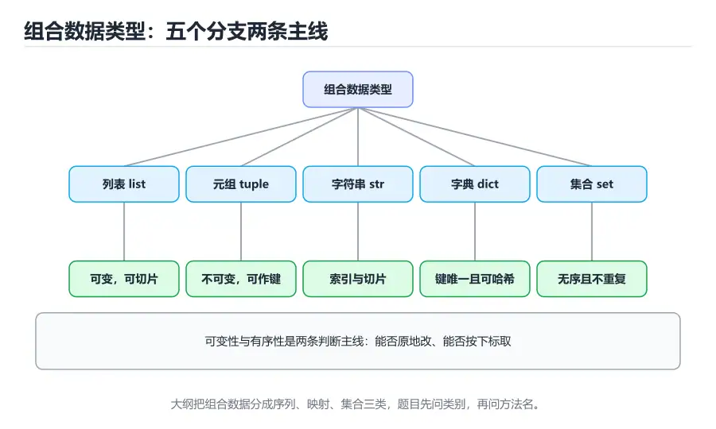

# Python 组合数据类型：列表、元组、字符串、字典与集合



> 内容更新时间：2026-10-06 · 学习阶段：进阶 · 预计用时：50 分钟

## 本节知识框架

**课程定位**：所属分类 `ncre`（全国计算机等级二级），课程主题 `Python 组合数据类型：列表、元组、字符串、字典与集合`，学习阶段 进阶，建议用时 50 分钟。

这是二级 Python 科目的第二课，也是选择题失分最集中的一页。二级 Python 满分 100 分、上机 120 分钟，选择题 40 分里有相当一部分落在「这两三行代码跑出来是什么」，操作题的中间容器也几乎必是列表或字典。出题形式非常固定：给两三行赋值，再给一行 `print`，问输出。这类题不考记忆量，考的是能不能在纸上把下标、切片方向和容器嵌套关系算准。

配图把五类类型画成一棵三层的分类树：第一层按「是否按键取值」分成序列、映射与集合三大类；第二层在序列下面分出可变的列表与不可变的元组，并把字符串列为不可变序列；第三层标出每一类最常用的两个操作与失分点。读树的方法很简单：**可变性决定能不能原地改，有序性决定能不能用下标，可哈希性决定能不能当字典的键**，后面所有结论都由这三条派生。

**学完本节应当能够**

- 按三大类说出列表、元组、字符串、字典、集合的区别，并判断某个类型能否作为字典的键。
- 手工算出 `a[m:n:k]` 在 `k` 为负数时的取法，说清方向为什么反过来。
- 区分 `sort()` 与 `sorted()`、`append()` 与 `extend()` 的返回值与长度变化。
- 用 `get()` 与 `setdefault()` 安全取字典值，并解释 `d['缺失键']` 会抛什么异常。
- 用 `|`、`&`、`-`、`^` 完成集合运算，并说明 `in` 在列表与集合上的耗时差距。

### 复习清单

- [ ] 能否说出 `t = (1)` 与 `t = (1,)` 的类型差别，并解释只写一个元素时为什么必须带逗号。
- [ ] 能否算出 `a = [1, 2, 3, 4, 5]` 时 `a[::-2]` 的结果，并说明起点与终点是怎么定的。
- [ ] 能否解释 `s.replace('a', 'b')` 之后 `s` 本身为什么没有变化，并写出真正生效的写法。
- [ ] 能否判断 `d.get('缺失键')` 与 `d['缺失键']` 的行为差异，以及 `pop()` 缺省值的写法。
- [ ] 能否用一句话说明浅拷贝与深拷贝的差别，并指出 `copy.copy()` 与 `copy.deepcopy()` 各复制到哪一层。

## 核心概念定义

| 术语 | 操作性定义 | 常见边界与风险 |
| --- | --- | --- |
| 序列 | 元素有固定顺序、能用整数下标取值的容器，含列表、元组、字符串。 | 下标从 0 开始，负下标从末尾倒数，`a[-1]` 是最后一个元素。 |
| 映射 | 按键取值的容器，只有字典属于这一类，键无序且不重复。 | 想用 `d[0]` 取「第一个」元素是错的，字典里没有第一个。 |
| 集合 | 不重复、无序、可变，只能装可哈希对象的容器。 | 空集合只能写 `set()`，写 `{}` 得到的是空字典。 |
| 可变性 | 对象创建后能否原地修改内容。列表、字典、集合可变；元组、字符串、数字不可变。 | 易错：可变不等于能当键，恰恰相反，可变对象一律不可哈希。 |
| 切片 | `a[m:n:k]` 取从 `m` 到 `n` 之间每隔 `k` 个的元素，结果是新对象，不含下标 `n`。 | `k` 为负时方向反过来，`a[::-2]` 得 `[5, 3, 1]`。 |
| 列表推导式 | `[表达式 for x in 可迭代对象 if 条件]`，一次求值就生成一个新列表。 | 推导式里的变量会覆盖同名外层变量，写之前先换个名字更稳。 |
| append | 把右侧对象作为**一个**元素接到末尾，`a.append([4, 5])` 只让长度加一。 | 易错：想合并两个列表却用了 `append`，结果得到一个嵌套列表。 |
| extend | 把右侧可迭代对象的元素逐个接进来，长度增加量等于对方的元素个数。 | `extend` 与 `a += b` 等价，都是原地修改并返回 `None`。 |
| sort / sorted | 前者是列表方法，原地排序且返回 `None`；后者是内置函数，返回新列表且不改原件。 | 易错：把 `print(a.sort())` 当排序结果打印，输出是 `None`。 |
| 元组 | 用圆括号写出的不可变序列，单个元素必须写成 `(1,)`。 | 元组装的可变对象内容仍可改，`t[1].append(4)` 就成功了。 |
| 字符串方法 | `split()` 按分隔符切成列表，`join()` 把可迭代对象拼成串，`strip()` 去两端空白，`replace()` 换子串，`find()` 找下标，`format()` 按占位符填充。 | `find()` 找不到返回 -1，`index()` 找不到抛 `ValueError`；`split()` 遇到连续空白会跳过空串。 |
| 字典方法 | `get()` 安全取值，`keys()`、`values()`、`items()` 返回视图，`pop()` 按键删除并返回值，`setdefault()` 缺键时先写入默认值再返回。 | 视图是动态的，改字典后视图跟着变，不能当快照保存。 |
| 可哈希 | 对象能算出稳定的哈希值，数字、字符串、布尔值、只含不可变元素的元组都可以。 | 键必须可哈希；列表、字典、集合当键会抛 `TypeError`。 |
| 集合运算 | `a | b` 并集，`a & b` 交集，`a - b` 差集，`a ^ b` 对称差。 | 参与运算的两个对象都得是集合，列表要先进 `set(列表)`。 |
| 浅拷贝 | `list(a)`、`a[:]`、`copy.copy(a)` 只复制外层结构，内层对象仍共用。 | 改内层列表会同时反映到原件，`==` 比较却仍然为真。 |
| 深拷贝 | `copy.deepcopy(a)` 逐层递归复制，得到完全独立的对象。 | 代价是多花时间与内存，纯数字元素的列表没必要用它。 |

## 原理与运行机制

### 三大类的取值方式决定了一切写法差异

序列靠下标，映射靠键，集合既不按下标也不能用键，只能问「在不在」。这条划分决定了三件事：**能不能排序、能不能重复、能不能传给需要顺序的函数**。列表与字符串可以 `sort`、可以切片、可以拼接；字典只能按键判断存在性；集合能做交并差但拿不到「第几个」。判断一个类型该往哪一类放只需两步：先问 `x[0]` 是否成立，成立就是序列；不成立再看它是不是 `{键: 值}` 形式，是则映射，否则就是只关心存在性的集合。

### 切片的方向由步长符号决定

```python
a = [1, 2, 3, 4, 5]
print(a[1:4], a[:3], a[3:])
print(a[::-1], a[::-2], a[4:1:-1])
```

输出 `[2, 3, 4] [1, 2, 3] [4, 5]` 与 `[5, 4, 3, 2, 1] [5, 3, 1] [5, 4, 3]`。`m` 与 `n` 越界不报错，切片自动截断到合法范围，这是它比下标访问更安全的地方；`k` 为负时缺省起点变成最后一个下标、缺省终点变成「越过 0」，于是 `a[::-2]` 得 `[5, 3, 1]`，取的是下标 4、2、0。从右往左只想取到某个位置时把两端写成 `a[4:1:-1]`，右端仍然取不到。

### 列表方法的原地性：谁返回 None，谁返回新对象

```python
nums = [3, 1, 4, 1, 5]
nums.sort()
print(nums, nums.sort(reverse=True) is None, sorted(nums))
x = [1, 2]
x.append([3, 4])
y = [1, 2]
y.extend([3, 4])
print(x, len(x), y, len(y))
print(len(nums), nums.pop(), len(nums))
```

`sort()` 原地排完返回 `None`，`sorted()` 交回一个新列表；`append` 把右侧对象当成一个元素接上去，`x` 变成 `[1, 2, [3, 4]]` 长度 3，`extend` 把对方的元素逐个接进来，`y` 变成 `[1, 2, 3, 4]` 长度 4；`pop()` 不写下标时弹出末尾元素并让原件短一格。判断「原地」还是「建新」的口诀是：**属于对象本身的方法（`sort`、`append`、`extend`、`insert`、`pop`、`remove`）都原地修改，内置函数（`sorted`、`reversed`、`list`、`set`）都返回新对象**。综合题要求「把两个表合成一个表」时用错方法，会得到长度不对的嵌套列表，后面的下标循环立刻错位。

### 元组的不可变到底限制了什么

```python
t = (1, [2, 3])
t[1].append(4)
print(t)
print(type((1)), type((1,)))
```

输出 `(1, [2, 3, 4])`、`<class 'int'> <class 'tuple'>`。元组锁住的是「下标到对象」的绑定关系：既不能增删元素，也不能把某个下标换成另一个对象，`t[0] = 0` 与 `t[1] = [4, 5]` 都会抛 `TypeError`，`del t[1]` 同样不允许。但它管不到被引用对象内部，`t[1].append(4)` 就成功了。单元素元组必须写逗号，因为圆括号还兼任表达式分组符号，`(1)` 求值后就是整数 1。

### 字符串不可变：方法交回新串，原件不动

```python
s = '  Hello,Python,World  '
print(s.strip().split(','), s.find('Python'), s.find('java'))
print('{},{}分'.format(90, 88), '-'.join(['2026', '10', '06']))
print(s.replace('o', '0'))
```

输出 `['Hello', 'Python', 'World'] 9 -1`、`90,88分 2026-10-06` 以及替换后的新串；`s` 本身一个字没变，要生效必须写 `s = s.replace('o', '0')`。`find` 找不到时回 -1 而不抛异常，`index` 才抛 `ValueError`；`join` 的调用者是分隔符而不是列表，写成 `'文本'.join(列表)`；`split()` 不带参数按任意空白切分并自动丢掉空串，带参数时连续分隔符会产生空字符串元素，`'a,b,,c'.split(',')` 得四项而 `'a b  c'.split()` 得三项，这一对差别经常拿来出题。

### 字典：键必须可哈希，取值有安全通道

```python
scores = {'语文': 88, '数学': 92}
print(scores.get('英语'), scores.get('英语', 0))
print(scores.setdefault('科学', 60), scores)
scores['科学'] = scores.get('科学', 0) + 5
print(scores.pop('语文'), '语文' in scores)
print(list(scores.keys()), list(scores.items()))
```

`get('英语')` 返回 `None`，写成 `get('英语', 0)` 返回 `0`；而 `scores['英语']` 会抛 `KeyError`。`setdefault` 在缺键时先把默认值写进字典再返回，因此打印出的字典已经多了 `'科学': 60` 这一项。`pop` 删除并返回被删的值，删除之后 `'语文' in scores` 变成 `False`。

累加计数的标准写法就是把 `get` 的第二参数用起来：`for w in words: count[w] = count.get(w, 0) + 1`，对 `['red', 'blue', 'red', 'green', 'red']` 跑完得到 `{'red': 3, 'blue': 1, 'green': 1}`，再用 `max(count.items(), key=lambda kv: kv[1])` 取出 `('red', 3)`。字典的插入顺序从 3.7 起被正式保证，打印时按第一次写入的先后排列，核对样例输出时要用到这一点。

键的可哈希性有一条容易忽略的规则：**元组只有在所有元素都可哈希时才可哈希**。因此 `dict.fromkeys([(1, 2), (1, [3])])` 会在第二个键上失败，程序遇到形如 `counts[item] = counts.get(item, 0) + 1` 的循环时，报错发生在循环体内而不是字典创建处，定位时要先看清 `item` 的实际类型，而不是怀疑字典写坏了。

### 集合：去重、运算与 in 的速度

```python
a = {1, 2, 3, 3}
b = set([3, 4])
print(a, len(a))
print(a | b, a & b)
print(a - b, a ^ b)
print(3 in a, type(set()))
```

输出 `{1, 2, 3} 3`、`{1, 2, 3, 4} {3}`、`{1, 2} {1, 2, 4}`、`True <class 'set'>`。花括号写空得到字典，空集合必须 `set()`。`in` 的耗时差别是二级常考点：列表和字符串靠逐个比较，规模翻倍耗时也翻倍；集合和字典靠哈希直接落到桶里，平均与规模无关。所以下面这段手算演示里，把 `data` 换成集合就能一次哈希到位。

```python
data = [3, 1, 4, 1, 5]
print(data[1:4], data[::-1][0], len(set(data)))
pool = set(data)
print(1 in pool, 9 in pool)
```

第一行输出 `[1, 4, 1] 5 4`：切片 `1:4` 取下标 1、2、3 的元素共三个，`data[::-1]` 先得到 `[5, 4, 1, 4, 1]` 再取首元素得 5，`set(data)` 去重后剩 `{1, 3, 4, 5}` 四个。后一行给出 `True False`，同样一次判断在列表上要比较若干次，在集合上只算一次哈希。

### 浅拷贝与深拷贝：复制到了哪一层

```python
import copy
origin = [[1, 2], [3, 4]]
shallow = copy.copy(origin)
deep = copy.deepcopy(origin)
shallow[0].append(9)
print(origin, shallow)
print(origin == shallow, origin == deep, origin is deep)
```

输出 `[[1, 2, 9], [3, 4]] [[1, 2, 9], [3, 4]]`，说明浅拷贝只复制外层结构，内层列表仍与原对象共用同一个对象，改内层必然连带原件；`deep` 逐层递归建新对象，内容与原件相同但身份不同，因此 `origin == deep` 为真而 `origin is deep` 为假。`list(a)` 与 `a[:]` 只对外层起作用，属于同一类浅拷贝。

## 典型应用场景

| 场景 | 选用的类型 | 理由与写法 |
| --- | --- | --- |
| 按顺序保存并频繁追加 | 列表 | `append` 接末尾，`insert` 指定位置，`pop` 按位置取走 |
| 一组不该被改写的坐标或返回值 | 元组 | 不可变，能当字典的键，解包赋值写法简洁 |
| 一行输入拆成若干字段 | 字符串加列表 | `input().split()` 得到字符串列表，再逐个转数值 |
| 批量拼接输出 | 字符串 `join` | 片段先进列表，最后 `''.join(列表)`，避免循环 `+=` |
| 学号到成绩的对应 | 字典 | 按键取值平均常数时间，`get` 兜住缺失键 |
| 统计出现次数 | 字典 | 用 `count[w] = count.get(w, 0) + 1` 累加 |
| 判断是否重复、求共同元素 | 集合 | `&` 直接给交集，`in` 判存在最快 |
| 去掉列表里的重复值 | 集合转列表 | `list(set(原列表))`，但顺序不再保证 |
| 保留结构的备份 | 深拷贝 | 内层还有可变对象时只有 `deepcopy` 能真正隔离 |

## 代码/协议/SQL 示例

**输入一行数字并做统计**

```python
line = input("请输入若干整数：")      # 键入 5 3 5 1 9
nums = [int(x) for x in line.split()]
print(nums, len(nums))
print(sorted(nums)[-1], sorted(nums)[0])
print(len(set(nums)))
```

`split()` 按空白切出四个字符串，推导式一次把它们转成整数列表，最后一行去重后得到三个不同的数。这个骨架在基本编程题里反复出现：读入、切分、逐个转换、统计。

**把句子重排成新的格式**

```python
sentence = "python language exam"
parts = sentence.split()
title = ' '.join(p.capitalize() for p in parts)
print(title)
print(parts[0][-1], parts[-1][0])
print('{0} 有 {1} 个单词'.format(title, len(parts)))
```

输出 `Python Language Exam`、`n e`、`Python Language Exam 有 3 个单词`。用 `split()` 把整句按空白切成单词列表，`' '.join(生成器)` 把首字母大写后的单词重新粘起来，`capitalize()` 只作用在副本上，`sentence` 本身仍然没变。

**通讯录字典的完整一遍**

```python
book = {'张三': 138, '李四': 139}
book['王五'] = book.get('王五', 0) + 1
print(book)
print('赵六' in book, book.get('赵六', -1))
for name, number in book.items():
    print(name, number, sep=':')
book.pop('李四', None)
print(sorted(book), len(book))
```

`for name, number in book.items()` 是遍历字典的标准写法，一次拿到键和值；`pop` 带第二个参数 `None` 时遇到缺失键不抛异常；`sorted(字典)` 排的是键组成的列表。字典在遍历过程中不允许增删键，需要删就先把键收集到列表里再逐个 `pop`。

**集合运算解决「都选了哪门课」**

求两门课的选课交集写 `python_class & c_class`，只选了前者写 `python_class - c_class`，只选一边写 `python_class ^ c_class`，至少选一边写 `python_class | c_class`；四个运算符都要求两侧都是集合，列表得先 `set(列表)` 转换。集合的字面量输出顺序不保证，判断结果时按内容而不是按显示顺序比，`len()` 套上去就能得到「至少选一门」的总人数。

## 时间/空间复杂度或性能分析

| 操作 | 列表 | 字符串 | 字典 | 集合 |
| --- | --- | --- | --- | --- |
| 按下标或按键取值 | 常数 | 常数 | 平均常数 | 不适用 |
| `x in 容器` | 线性 | 线性 | 平均常数 | 平均常数 |
| 末尾追加 | 均摊常数 | 建新串 | 平均常数 | 平均常数 |
| 中间插入或删除 | 线性 | 建新串 | 线性（需先定位键） | 线性 |
| 求长度 | 常数 | 常数 | 常数 | 常数 |
| 遍历全部元素 | 线性，额外无 | 线性 | 线性 | 线性 |
| 排序 | `sorted` 线性对数，额外一份 | 只能先转列表 | 排键需要先转列表 | 不支持排序 |

三处最影响实际耗时：**`in` 用在列表上是逐个比对、用在集合上只算一次哈希**，所以「判断大量元素是否出现过」几乎都该先把列表转成集合；**字符串每次修改都产生新对象**，循环里 `s += 片段` 会退化成平方级；**深拷贝多花时间与内存**，只有一层数字的列表没必要用 `deepcopy`。`sort()` 原地排序不再开新表，`sorted()` 先复制一份再排，空间上多出一个列表的长度；二级题目的规模两种写法都能过，但填空给的提示往往是原地的那个。

## 常见误区与易错点

- 以为 `sort()` 会返回排好序的列表。它原地排序并返回 `None`，要拿结果只能写 `sorted(a)` 或先 `a.sort()` 再用 `a`。
- 想合并两个列表却写了 `append`，得到一个嵌套列表，长度只加了一。
- 把单元素元组写成 `(1)`，`type` 一查是 `int`，必须补上逗号。
- 以为元组里的内容一律不能改。不可变只约束下标绑定，`t[1].append(4)` 改的是内层列表，完全合法。
- 期待 `replace`、`strip`、`title` 原地改字符串。字符串不可变，方法交回新串，要生效得写回变量。
- 用 `index()` 找可能不存在的子串。它找不到会抛 `ValueError`，要判断存在性用 `find()` 或 `in`。
- 以为 `s.split(' ')` 与 `s.split()` 一样。带参数时空白连续会产生空串元素，不带参数时自动跳过。
- 把可变对象当字典的键，运行到取值那一行才抛 `TypeError`，报错位置在循环体内：像第 4 行，列表不是可哈希对象，不能当作字典的键这类错，要先看被当键的对象究竟是什么类型，而不是怀疑字典写坏了。
- 把 `{}` 当成空集合。它是空字典，空集合只能写 `set()`，而且集合无序，`s[0]` 直接报 `TypeError`。
- 以为 `list(set(a))` 能保持原顺序。去重后顺序不再由原表决定，需要保序就得用字典或循环自己过滤。
- 在 `for 键 in 字典` 的过程中增删键，会抛「字典在迭代期间改变大小」一类错误。

## 与其他知识点的关系

- 前置的 `ncre_python_basics` 说明「类型跟着对象走」，本节把可变与不可变这条线落实到五个具体容器上；推导式里的 `for` 与 `if` 也直接沿用那一节的语句规则。
- 后续的 `ncre_python_function_file` 会把本节的字典与列表当作函数的参数与返回值：可变对象传进函数后被改动、外面立刻看得见，根源就在本节的可变性规则。
- `ncre_c_pointer_array_string` 用内存图解释了 C 语言里数组与指针的等价关系，Python 的列表把这套细节藏在对象引用后面：列表存的是一个个引用，`[[1, 2], [3, 4]]` 是外层装两个引用，而不是连续的八格整数。
- `ncre_public_data_structure` 讲的顺序存储与链式存储对应列表，散列存储对应字典与集合，`in` 的复杂度差别正是这两类存储在选择题里的考法；C 语言的结构体在 Python 里最常见的替身就是字典。

| 关联课程 ID | 关联主题 | 关系说明 |
| --- | --- | --- |
| ncre_python_basics | 基本语法与数据类型 | 类型属于对象、表达式求值与缩进规则的前置 |
| ncre_python_function_file | 函数、异常与文件 | 可变对象传参与返回、`KeyError` 的捕获在本节之后 |
| ncre_public_data_structure | 数据结构与算法 | 顺序存储与散列表的复杂度结论直接对应 `in` 的差距 |

## 自测题与参考答案

### 题目 1

已知 a = [1, 2, 3, 4, 5]，则表达式 a[::-2] 的值是？

1. [5, 3, 1]
2. [1, 3, 5]
3. [5, 4, 3, 2, 1]
4. [5, 3]

**参考答案**：A（[5, 3, 1]）

本题正确项是「[5, 3, 1]」。步长为负数时切片方向反过来，缺省的起点是最后一个下标、终点是越过 0，于是依次取下标 4、2、0 三个位置上的元素，得 [5, 3, 1]。干扰项「[1, 3, 5]」把方向当成了从左往右，那是步长写正数 2 的结果；干扰项「[5, 4, 3, 2, 1]」是步长写成 -1 时的整体倒序；干扰项「[5, 3]」把缺省起点的下标少挪了一格，漏掉了末尾元素。

### 题目 2

已知 t = (1, [2, 3])，下列对 t 的操作中，能够正常执行且不报错的是？

1. t[0] = 0
2. t[1] = [4, 5]
3. t[1].append(4)
4. del t[1]

**参考答案**：C（t[1].append(4)）

本题正确项是「t[1].append(4)」。元组锁住的是下标到对象的绑定关系，它不允许增删元素、也不允许把某个下标换成另一个对象，却管不到被引用对象内部的内容，所以向内层列表追加元素合法，执行后 t 变成 (1, [2, 3, 4])。干扰项「t[0] = 0」与干扰项「t[1] = [4, 5]」都属于对元组下标赋值，会抛 TypeError；干扰项「del t[1]」试图删除元组的一个元素，同样不被允许。

### 题目 3

阅读下面的 Python 代码，data 是 [3, 1, 4, 1, 5]，它的输出结果是？

```python
data = [3, 1, 4, 1, 5]
print(data[1:4], data[::-1][0], len(set(data)))
```

1. [3, 1, 4] 3 5
2. [1, 4, 1] 3 4
3. [1, 4] 5 5
4. [1, 4, 1] 5 4

**参考答案**：D（[1, 4, 1] 5 4）

本题正确项是「[1, 4, 1] 5 4」。切片 1:4 取下标 1、2、3 上的三个元素，得 [1, 4, 1]；data[::-1] 先把整个表倒过来，取出的首元素是原表最后那个 5；set(data) 去掉重复的 1 之后剩 {1, 3, 4, 5} 四个元素。干扰项「[3, 1, 4] 3 5」把切片的起点当成了长度，又拿原表长度去充数集合大小；干扰项「[1, 4, 1] 3 4」把倒序后的首元素误写成原表首个 3；干扰项「[1, 4] 5 5」漏掉了终点元素并混淆了两处长度。

### 题目 4

下面代码有一处运行时报错，出错的是哪一行？（行号从上往下数）

```python
pairs = [(1, 2), [3, 4]]
counts = {}
for item in pairs:
    counts[item] = counts.get(item, 0) + 1
```

1. 第 4 行，列表不是可哈希对象，不能当作字典的键
2. 第 1 行，列表里不能同时放元组和列表两种元素
3. 第 3 行，for 循环不能直接遍历一个装了两类对象的列表
4. 第 4 行，get 方法要求键必须已经存在于字典中

**参考答案**：A（第 4 行，列表不是可哈希对象，不能当作字典的键）

本题正确项是「第 4 行，列表不是可哈希对象，不能当作字典的键」。列表是可变对象，可变对象一律算不出稳定的哈希值，因此 `counts[item]` 在 `item` 取到 [3, 4] 那一刻抛 TypeError，报错位置在循环体内而不是创建字典处。干扰项「第 1 行，列表里不能同时放元组和列表两种元素」不成立，动态类型允许列表装混合元素；干扰项「第 4 行，get 方法要求键必须已经存在于字典中」把 get 的默认返回值机制理解反了，缺键正是它返回 0 的那一步。

### 题目 5

把「统计一句话里每个单词出现的次数并输出最高频的词」的四个步骤按先后排列：

1. 输出词和次数，格式用 format 或 f 串写好
2. 用 split() 把整句按空白切成单词列表
3. 创建空字典，对每个单词执行 d[w] = d.get(w, 0) + 1
4. 在字典里找出值最大的那一项，可用 max 与 items 配合

**参考答案**：用 split() 把整句按空白切成单词列表 → 创建空字典，对每个单词执行 d[w] = d.get(w, 0) + 1 → 在字典里找出值最大的那一项，可用 max 与 items 配合 → 输出词和次数，格式用 format 或 f 串写好

本题顺序是「用 split() 把整句按空白切成单词列表」 → 「创建空字典，对每个单词执行 d[w] = d.get(w, 0) + 1」 → 「在字典里找出值最大的那一项，可用 max 与 items 配合」 → 「输出词和次数，格式用 format 或 f 串写好」。先切分才能逐个处理单词，字典必须先存在再累加，累加全部完成后才谈得上比较大小，输出永远是最后一步。中间三步分别对应容器转换、容器累加、容器查询，换了单词、换了统计对象，这个骨架也不变。

### 题目 6

下列关于组合数据类型与拷贝的说法中，正确的两项是？

1. 浅拷贝只复制外层结构，内层列表仍与原对象共用同一个对象
2. 深拷贝后的列表与原件内容相同，因此用 == 比较的结果为假
3. 集合用 in 判断元素是否存在，其平均耗时与集合大小成正比
4. 列表推导式在每次求值时都会重新创建一个新的列表对象

**参考答案**：A、D（浅拷贝只复制外层结构，内层列表仍与原对象共用同一个对象；列表推导式在每次求值时都会重新创建一个新的列表对象）

本题要同时选中「浅拷贝只复制外层结构，内层列表仍与原对象共用同一个对象」与「列表推导式在每次求值时都会重新创建一个新的列表对象」，前者解释了改内层为什么会连带原件，后者说明推导式每次跑出一个全新的表。干扰项「深拷贝后的列表与原件内容相同，因此用 == 比较的结果为假」把内容与身份混成了一件事，`==` 比内容所以为真，`is` 比身份才为假；干扰项「集合用 in 判断元素是否存在，其平均耗时与集合大小成正比」说的是列表的比对方式，集合靠哈希定位，平均与大小无关。

## 考点精讲

本节题库共 6 道题，下面逐题复述题干、正确项与判断依据。

### 考点 1：第 1 题

- **题目**：已知 a = [1, 2, 3, 4, 5]，则表达式 a[::-2] 的值是？
- **答案**：A
- **正确项**：[5, 3, 1]
- **判断依据**：本题正确项是「[5, 3, 1]」。步长为负就表示方向从右往左，起点缺省到最后一个下标 4，随后每次减 2，得到下标 4、2、0 上的三个元素。干扰项「[1, 3, 5]」是步长为正 2 的结果；干扰项「[5, 4, 3, 2, 1]」对应的步长是 -1；干扰项「[5, 3]」把缺省起点写成了 3 而不是 4。

### 考点 2：第 2 题

- **题目**：已知 t = (1, [2, 3])，下列对 t 的操作中，能够正常执行且不报错的是？
- **答案**：C
- **正确项**：t[1].append(4)
- **判断依据**：元组的不可变只限制下标绑定，`t[1].append(4)` 修改的是它引用到的那个列表，属于合法操作，执行后整个元组显示为 (1, [2, 3, 4])。干扰项「t[0] = 0」与干扰项「t[1] = [4, 5]」都是对元组下标赋值；干扰项「del t[1]」试图删除元素，元组既不能增长也不能缩短。

### 考点 3：第 3 题

- **题目**：阅读下面的 Python 代码，data 是 [3, 1, 4, 1, 5]，它的输出结果是？print(data[1:4], data[::-1][0], len(set(data)))
- **答案**：D
- **正确项**：[1, 4, 1] 5 4
- **判断依据**：三段结果要分开算。切片 `data[1:4]` 取到三个元素 [1, 4, 1]；`data[::-1][0]` 是倒序表的首元素，等于原表末尾的 5；`set(data)` 去重后剩四个元素，所以第三个数是 4。干扰项「[3, 1, 4] 3 5」把切片当成从 0 开始的三个元素；干扰项「[1, 4] 5 5」丢掉了下标 3 的那个 1，又把集合大小写成了原表长度。

### 考点 4：第 4 题

- **题目**：下面代码有一处运行时报错，出错的是哪一行？（行号从上往下数）pairs = [(1, 2), [3, 4]] counts = {} for item in pairs: counts[item] = counts.get(item, 0) + 1
- **答案**：A
- **正确项**：第 4 行，列表不是可哈希对象，不能当作字典的键
- **判断依据**：字典要求键可哈希，而列表可变、算不出稳定哈希值，于是第四行在 `item` 为 [3, 4] 时抛 TypeError，元组 (1, 2) 那一步是能过去的。干扰项「第 1 行，列表里不能同时放元组和列表两种元素」把动态类型的混合容器当成了禁忌；干扰项「第 3 行，for 循环不能直接遍历一个装了两类对象的列表」不成立；干扰项「第 4 行，get 方法要求键必须已经存在于字典中」恰好说反了 get 的用途。

### 考点 5：第 5 题

- **题目**：把「统计一句话里每个单词出现的次数并输出最高频的词」的四个步骤按先后排列：
- **答案**：B → C → D → A
- **正确项**：用 split() 把整句按空白切成单词列表 → 创建空字典，对每个单词执行 d[w] = d.get(w, 0) + 1 → 在字典里找出值最大的那一项，可用 max 与 items 配合 → 输出词和次数，格式用 format 或 f 串写好
- **判断依据**：切分、累加、比较、输出四步不能互换：没有单词列表就无从累加，累加没完成就找不到最大值，输出只能放在最后。正确序号排列为 2 → 3 → 4 → 1。

### 考点 6：第 6 题

- **题目**：下列关于组合数据类型与拷贝的说法中，正确的两项是？
- **答案**：A、D
- **正确项**：浅拷贝只复制外层结构，内层列表仍与原对象共用同一个对象；列表推导式在每次求值时都会重新创建一个新的列表对象
- **判断依据**：本题正确项包含「浅拷贝只复制外层结构，内层列表仍与原对象共用同一个对象」与「列表推导式在每次求值时都会重新创建一个新的列表对象」。干扰项「深拷贝后的列表与原件内容相同，因此用 == 比较的结果为假」把内容相等与身份相同混为一谈，深拷贝后 `==` 为真、`is` 为假；干扰项「集合用 in 判断元素是否存在，其平均耗时与集合大小成正比」把列表的逐个比对套用到了集合的哈希定位上。

### 高频考点小结

1. 判类型先看三件事：可不可变、有有序无、能不能哈希。三条决定了你能不能 `a[0] = x`、能不能排序、能不能当字典的键。
2. 判输出先算切片：写 `a[m:n:k]` 时先定方向，再列下标，最后逐个抄元素，负步长一定要检查起点是不是末尾。
3. 判方法先看返回值：`sort`、`append`、`extend`、`pop`、`remove` 动原件，`sorted`、`join`、`replace`、`split`、`list`、`set` 给新对象。
4. 判安全取值：字典用 `get(键, 默认值)` 或 `pop(键, 默认值)`，字符串用 `find()` 而不是 `index()`，写错的分支往往正是异常处理题要考的那一处。

## 术语速查

| 术语 | 一句话说明 |
| --- | --- |
| 序列 | 元素有固定顺序、能用整数下标取值的容器，列表、元组、字符串都属此类。 |
| 映射 | 靠键取值的容器，字典是唯一一种，键不重复且按键哈希存放。 |
| 集合 | 不重复又无序的容器，只能装可哈希对象，支持四种集合运算。 |
| 可变与不可变 | 列表、字典、集合可原地改；元组、字符串、数字一改就产生新对象。 |
| 切片 | `a[m:n:k]` 取一段元素并返回新对象，右端下标永远取不到，`k` 为负则反向。 |
| 列表推导式 | 一行写出「表达式加循环加过滤」，每次求值都生成一个新的列表。 |
| 原地方法 | 修改对象本身并返回 `None` 的方法，`sort`、`append`、`extend` 属于此类。 |
| 视图 | `keys()`、`values()`、`items()` 返回的动态对象，跟着字典一起变。 |
| 可哈希 | 能算出稳定哈希值，不可变类型通常可哈希，可变类型一律不可哈希。 |
| 解包 | 把可迭代对象的元素依次赋给多个变量，`a, b = b, a` 靠它交换。 |
| 并交差补 | 集合的 `|`、`&`、`-`、`^` 四种运算，分别给全并、共有、独有、单边。 |
| 成员判断 | `in` 在列表和字符串上逐个比对，在集合和字典上只算一次哈希。 |
| 浅拷贝 | 只复制外层结构，内层对象继续共用，`copy.copy()` 与 `a[:]` 属此类。 |
| 深拷贝 | 逐层递归复制出完全独立的新对象，`copy.deepcopy()` 才做得到。 |
| 空容器陷阱 | `{}` 是空字典、`set()` 才是空集合，元组必须写 `(1,)` 才成立。 |

## 参考资料与复核

- 最后复核：2026-10-04
- 下次复核：2027-08-10
- 复核范围：序列、映射、集合三大类的可变性与有序性，切片与步长为负时的取法，列表与字符串常用方法的返回值约定，字典键的可哈希要求，集合四种运算，`in` 的复杂度差异，浅拷贝与深拷贝的层数差别
- 来源性质：教育部教育考试院 NCRE 二级 Python 语言程序设计（科目代码 66）大纲条目与 Python 官方中文文档；本节核对关键词：`a[::-2]` 得 `[5, 3, 1]`、`t[1].append(4)`、`sort()` 返回 `None`、`copy.deepcopy()` 与 `list(set(data))`。

| 参考资料 | 本节用途 |
| --- | --- |
| [Python 官方教程：更深入地学习数据结构与函数](https://docs.python.org/zh-cn/3/tutorial/introduction.html) | 列表、元组、字典、集合的写法与切片示例 |
| [Python 官方教程：内置数据结构](https://docs.python.org/zh-cn/3/tutorial/datastructures.html) | 列表方法与 `in` 成员判断的用法表 |
| [Python 官方文档：标准类型](https://docs.python.org/zh-cn/3/library/stdtypes.html) | 序列、映射、集合类型的方法签名与返回值约定 |
| [Python 官方文档：内置函数](https://docs.python.org/zh-cn/3/library/functions.html) | `sorted()`、`len()`、`max()`、`set()`、`list()`、`format()` 的参数说明 |
| [Python 官方文档：拷贝支持](https://docs.python.org/zh-cn/3/library/copy.html) | `copy.copy()` 与 `copy.deepcopy()` 的层数差别 |
| [全国计算机等级考试 NCRE 首页](https://ncre.neea.edu.cn/) | 二级 Python 科目代码与大纲入口 |

## 内容元数据

> 内容更新时间：2026-10-06 · 学习阶段：进阶 · 预计用时：50 分钟

- 内容版本：v2.0
- 分类归属：`ncre`（全国计算机等级二级），本课为 Python 方向的第 2/3 门
- 最后更新：2026-11-11
- 学习阶段：进阶
- 适用环境：二级 Python 语言程序设计（科目代码 66），Windows 加 Python 3.5.3 至 3.9.10 与 IDLE
- 内容来源：教育部教育考试院 NCRE 考试大纲与 Python 官方中文文档整理
- 相关主题：序列与映射与集合三大类、切片与步长、列表方法与返回值、元组不可变与单元素写法、字符串常用方法、字典安全取值与可哈希键、集合运算与去重、成员判断的复杂度、浅拷贝与深拷贝
