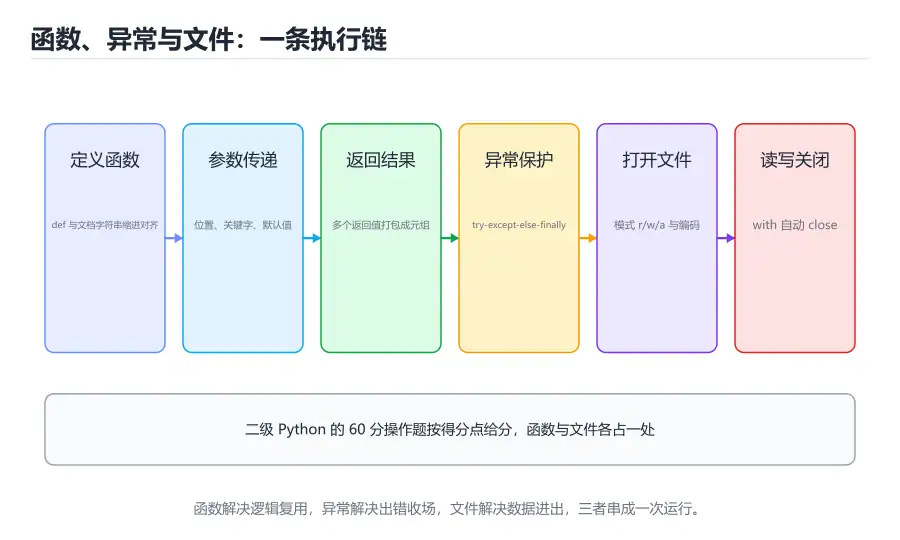

# Python 函数、异常与文件读写



> 内容更新时间：2026-10-06 · 学习阶段：高级 · 预计用时：50 分钟

## 本节知识框架

**课程定位**：所属分类 `ncre`（全国计算机等级二级），课程主题 `Python 函数、异常与文件读写`，学习阶段 高级，建议用时 50 分钟。

这是二级 Python 科目的收官一课，也是操作题得分密度最高的一页。二级 Python 上机 120 分钟、满分 100 分，其中基本操作题与简单应用题常常要求「定义一个函数处理字符串」「读一个文件把结果写到另一个文件」，综合应用题则把三者串成一条链：函数负责逻辑复用，异常负责出错收场，文件负责数据进出。选择题爱考的点非常集中：默认参数的求值时机、可变默认值的陷阱、返回值个数与类型、`*args` 与 `**kwargs` 的写法、作用域与 `global`、`try-except-else-finally` 哪块执行、文件打开模式 `r`/`w`/`a` 的区别、`with` 到底替你做了什么。

配图把本课画成一条六个环节的执行链：定义函数 → 参数传递 → 返回结果 → 异常保护 → 打开文件 → 读写关闭。读这条链的方式是「先看数据从哪来，再看它被谁包住」：参数从调用处进来，返回值往调用处出去，异常把中间失败的路径接住，文件把边界两侧的数据接上。

**学完本节应当能够**

- 写出带位置参数、关键字参数、默认值与可变长度参数的函数定义与调用，并说清四种实参的匹配次序。
- 解释「默认值在定义时求值一次」为什么会带来列表被反复追加的现象，并给出正确写法。
- 判断一段代码里 `global`、`nonlocal` 与局部变量的可见性，指出赋值语句何时创建局部变量。
- 用 `try-except-else-finally` 组织出错收场，说清 `else` 与 `finally` 各自的触发条件。
- 用 `with open(...)` 完成文本读写，区分 `r`、`w`、`a`、`rb` 模式与 `encoding` 参数的作用。

### 复习清单

- [ ] 能否说出 `def f(a, b=2, *args, **kwargs)` 里四种参数的匹配顺序，并写出 `f(1, 3, 4, x=5)` 各自收到什么。
- [ ] 能否解释 `def f(item, box=[])` 连续调用两次后 `box` 里有两个元素的原因，并写出两种修正方法。
- [ ] 能否判断 `return 1, 2` 的返回值类型，以及 `x, y = f()` 与 `x = f()` 两种接收方式的差别。
- [ ] 能否说出 `try` 块中 `return`、`except` 与 `finally` 的执行次序，并解释 `finally` 里为什么不建议写 `return`。
- [ ] 能否写出读取与写入文本文件的最小代码，并说明 `w` 与 `a` 在文件已存在时的不同表现。

## 核心概念定义

| 术语 | 操作性定义（白话版） | 常见边界与风险 |
| --- | --- | --- |
| 函数定义 | 用 `def 名称(参数):` 开头，函数体靠缩进界定，名称在被执行到那一行时才绑定。 | 易错：定义不等于调用，只写 `def` 不写调用时函数体一行也不会执行。 |
| 文档字符串 | 函数体第一条语句位置的字符串，用 `help(函数名)` 或 `__doc__` 查看。 | 易错：写在函数体外的那段字符串不是文档字符串。 |
| 位置参数 | 按书写次序一一对应的参数，调用时顺序错了结果就错了。 | 易错：位置参数必须排在默认参数之前，否则定义时就报语法错。 |
| 关键字参数 | 调用时用 `名字=值` 传参，可以打乱书写次序。 | 易错：名字必须与形参名完全一致，拼错会得到「 unexpected keyword argument」。 |
| 默认参数 | 定义时给形参写 `=值`，调用时可省略；默认值在 `def` 执行那一刻求值一次。 | 易错：把列表、字典等可变对象当默认值会被多次调用共享。 |
| 可变长度参数 | `*args` 收集多余的位置参数成元组，`**kwargs` 收集多余的关键字参数成字典。 | 易错：定义次序是位置、`*args`、默认值、`**kwargs`，调用时 `**` 展开字典。 |
| 返回值 | 用 `return 值` 交回结果；不带值或函数走完没 `return` 时得到 `None`。 | 易错：`return a, b` 其实返回一个元组，是解包语法让接收端看起来像两个值。 |
| 作用域 | 变量按局部、嵌套、全局、内置四层查找（LEGB），赋值默认创建当前层的局部变量。 | 易错：函数里读同名全局变量可以，一旦出现赋值就变成局部变量，读它会报未赋值。 |
| global 与 nonlocal | `global` 声明改用模块级变量，`nonlocal` 声明改用外层函数的变量。 | 易错：只修改列表元素不需要 `global`，重新绑定名字才需要。 |
| 匿名函数 | `lambda 形参: 表达式`，只能写一个表达式，返回值即表达式结果。 | 易错：`lambda` 里不能放 `print` 之外的语句，也不能写 `return`。 |
| 异常 | 运行期错误以异常对象的形式抛出，内置基类是 `BaseException`，日常捕获的是 `Exception` 一支。 | 易错：`except:` 裸写会把 `KeyboardInterrupt` 一并吞掉，至少要写 `except Exception`。 |
| try 语句 | `try` 放可能出错的代码，`except` 按类型接住，`else` 在没出错时执行，`finally` 无论如何都在离开前执行。 | 易错：`else` 不是「出错时执行」，它恰恰是「没出错才执行」。 |
| raise 与 assert | `raise 异常类型(信息)` 主动抛出，`assert 条件, 信息` 条件为假时抛 `AssertionError`。 | 易错：`raise` 后面要跟异常类或异常对象，写字符串会报错；`-O` 运行时 `assert` 被跳过。 |
| 自定义异常 | 从 `Exception` 派生一个类即可，常用来让调用方按业务分支捕获。 | 易错：派生自 `BaseException` 会让 `except Exception` 抓不到它。 |
| 文件对象 | `open(路径, 模式, encoding=...)` 返回的对象，提供 `read`、`readline`、`readlines`、`write`、`seek`、`close`。 | 易错：文本模式与二进制模式不能混用，二进制模式不能给 `encoding`。 |
| 打开模式 | `r` 只读（缺省）、`w` 清空写、`a` 末尾追加、`rb`/`wb` 二进制、`r+` 读写。 | 易错：`w` 会在打开那一刻就清空原文件，哪怕后面一个字都没写。 |
| with 语句 | 上下文管理器，块结束时自动调用 `close`，异常时同样释放资源。 | 易错：`with` 只保证关闭，不保证把内存缓冲区里的内容全部落盘顺序。 |
| CSV 与 JSON | `csv` 模块按行列读写逗号分隔文本，`json` 模块在字典列表与字符串之间转换。 | 易错：`csv.writer` 要求文件以 `newline=''` 打开，`json.dumps` 与 `json.dump` 一个返回字符串一个写文件对象。 |

## 原理与运行机制

**一、参数匹配是一条「先位置、再关键字、再收集」的流水线。** 定义时形参的书写次序固定为：普通位置参数、带默认值的参数、`*args`、仅关键字参数、`**kwargs`。调用时先把实参按位置从左到右填满前面的形参，多余的进 `*args` 元组；带名字的实参直接按名字匹配，没匹配上的进 `**kwargs` 字典。由此能解释两类常见错题：`def f(a, b=2)` 调用 `f(1, 3)` 得 `a=1, b=3`（位置覆盖默认值），而 `f(b=3, a=1)` 结果相同（关键字不讲究次序）。反过来，`def f(a=1, b)` 会在定义那一行就抛 `SyntaxError`，因为默认参数后面不能再出现无默认值的位置参数。

默认值只求值一次，是可变默认参数陷阱的全部原因。`def f(item, box=[])` 里的 `[]` 在 `def` 执行时创建好，之后每次不带第二个实参的调用都拿到同一个列表对象，于是连续调用两次 `f(1)`、`f(2)` 后 `box` 里是 `[1, 2]`。正确写法是把默认值写成 `None`，在函数体里判断后新建列表：`box = [] if box is None else box`。同样的道理适用于字典、集合与自定义对象。

**二、返回值永远是单个对象，多个返回值靠解包语法糖。** `return 1, 2` 返回的是元组 `(1, 2)`；接收端写 `x, y = f()` 时 Python 自动解包，写 `x = f()` 时 `x` 就是那个元组。没有 `return` 语句或 `return` 不带值时函数返回 `None`，这解释了一个高频错法：把 `print` 当成返回，写 `result = f()` 却拿不到值，因为函数体里只是打印、没有 `return`。另一个边界是 `return` 之后的代码永远不执行，调试时把打印语句留在 `return` 后面就会「看不到输出」。

**三、作用域决定读写哪一份变量。** 查找顺序是 LEGB：先当前函数局部，再外层嵌套函数，再模块全局，最后内置。规则里最容易失分的是「赋值即创建局部变量」：只要函数体里出现 `count = count + 1` 这样的赋值，`count` 在整个函数体内都被视为局部变量，于是等号右侧的读取会先于赋值发生而抛 `UnboundLocalError`。要改全局就写 `global count`，要改外层函数变量就写 `nonlocal count`；如果只是 `items.append(x)` 修改对象内容而不重新绑定名字，则不需要任何声明。形参本身就是局部变量，所以「修改传入列表的内容会影响调用方，但给形参重新赋值不会影响」。

**四、异常是一条备用出口，`else` 与 `finally` 各有各的触发条件。** 正常路径走完 `try` 块后进入 `else`；`try` 里任何一行抛出异常，就跳出到匹配的 `except` 分支（自上而下匹配，第一个类型相符的分支生效，多个 `except` 要把子类写在父类之前），之后跳过 `else`。无论走哪条路，`finally` 都在真正离开之前执行，它适合放关闭文件、释放连接这类收尾动作。要警惕两件事：一是 `finally` 里若出现 `return`，它会覆盖前面 `try` 或 `except` 的返回值与正在传播的异常，代码行为立刻变得难以预期；二是 `except` 用 `as e` 拿到异常对象后，`str(e)` 给出的是错误信息、`type(e).__name__` 给出的是类名，两者都别写成 `print(e)` 之后就当什么都没发生——把异常吞掉而不记录，是排障时最耗时间的做法。`raise ValueError("范围错误")` 用于主动拒绝非法输入，`assert age >= 0, "年龄不能为负"` 用于开发期自检，正式运行时用 `python -O` 会跳过全部 `assert`，所以业务校验要交给 `if` 加 `raise`。

**五、文件读写是边界操作，模式与编码两件事先定。** `open` 返回文件对象，模式字母决定「能不能读、能不能写、原内容留不留」：`r` 只读且文件必须存在，否则抛 `FileNotFoundError`；`w` 可写且**在打开那一刻就清空**，文件不存在则新建；`a` 追加，写入点固定在末尾，不清空；`r+` 读写但不清空，需要 `seek` 控制位置；加 `b` 变成二进制模式，读出来是 `bytes`，此时不能再给 `encoding`。文本模式建议始终显式写 `encoding='utf-8'`，否则会用操作系统的默认编码，同一份文件在 Windows 与 Linux 上读出的结果可能不同，中文场景直接表现为 `UnicodeDecodeError`。读取方法三种：`read()` 一次拿整串字符串，`readline()` 拿一行，`readlines()` 拿到每行组成的列表且行末换行符仍在，常用 `rstrip()` 去掉。写入方法两种：`write(s)` 原样写且不自动加换行，`writelines(列表)` 同样不加换行——名字里的「lines」容易让人误以为会自动分行。`with open(...) as f:` 是推荐写法，块结束（包括异常退出）时自动 `close`，不用操心句柄泄漏。批量结构化数据交给 `csv` 与 `json`：`csv.reader` 按行给出列表、`csv.writer` 接受列表成行，写文件时要用 `newline=''` 打开以免多插空行；`json.dumps` 把字典列表转成字符串、`json.loads` 反过来，`json.dump(obj, f)` 与 `json.load(f)` 直接对接文件对象，注意 Python 的 `None`/`True` 对应 JSON 的 `null`/`true`，且字典的键必须是字符串。

## 典型应用场景

| 场景 | 典型输入或前提 | 期望产物 |
| --- | --- | --- |
| 成绩统计 | 一行一条记录的文本文件 | 函数 + `with` 读取，异常兜住坏行，输出计数 |
| 批量改名 | 目录下的若干文件路径 | 遍历列表、逐个 `open`/`write`，出错记录后继续 |
| 数据格式转换 | CSV 文件 | `csv.reader` 读入、转成字典列表、`json.dump` 写出 |
| 输入合法性校验 | 键盘输入的年龄、分数 | `try` 包 `int()`，`except ValueError` 提示重输 |
| 分段计时封装 | 同一段逻辑要算多次 | 把逻辑写成函数，用参数控制次数与偏移 |
| 日志追加 | 程序每次运行都要留痕 | 以 `a` 模式打开，写一行带时间戳的文本 |
| 兼容旧数据 | 文件可能是 GBK 编码 | 显式指定 `encoding` 或捕获解码异常后重试 |

## 代码/协议/SQL 示例

下面的函数覆盖了四种参数形态与可变默认值的正确写法，可直接在 IDLE 里运行。

```python
def make_report(title, rows, sep='-', *tags, **options):
    """把若干行成绩拼成一段文本报告，返回字符串。"""
    lines = [title, sep * len(title)]
    total = 0
    for row in rows:
        lines.append(f"{row[0]}: {row[1]}")
        total += row[1]
    if options.get('show_avg', False) and rows:
        lines.append(f"avg = {total / len(rows):.1f}")
    if tags:
        lines.append('tags: ' + ','.join(tags))
    return '\n'.join(lines)


def append_history(item, box=None):
    if box is None:          # 默认值写成 None，函数内再新建，避免跨调用共享
        box = []
    box.append(item)
    return box


first = append_history(1)
second = append_history(2)
print(first, second, append_history(3, first))
```

运行结果是 `[1, 3] [2] [1, 3]`：`first` 与 `second` 各自新建列表，互不影响；第三次调用把 `first` 传进去，才出现 3 被追加的效果。把 `box=None` 换回 `box=[]`，输出立刻变成 `[1, 2, 3] [1, 2, 3] [1, 2, 3]`，这就是可变默认值的现场证据。

下面的例子把异常与文件读写串成一段能跑的代码：读一个成绩文件，坏行跳过，统计及格人数并写结果。

```python
def count_pass(path, threshold=60):
    passed, skipped = 0, 0
    try:
        with open(path, 'r', encoding='utf-8') as f:
            for line in f:
                name, _, score = line.partition(',')
                try:
                    value = int(score)
                except ValueError:
                    skipped += 1
                    continue
                if value >= threshold:
                    passed += 1
    except FileNotFoundError:
        print('文件不存在：' + path)
    else:
        with open('result.txt', 'w', encoding='utf-8') as out:
            out.write(f'passed={passed} skipped={skipped}\n')
    finally:
        print('读取结束')
    return passed


count_pass('scores.txt')
```

`with` 保证两个文件都被关闭，即使 `for` 循环中途抛出没有捕获的异常也一样；`else` 块只在 `try` 完整走完时执行，所以文件不存在时不会写出一个 `passed=0` 的误导结果；`finally` 无论成败都打印一行收尾信息。

## 时间/空间复杂度或性能分析

函数调用不是免费的：每次调用都要创建栈帧、绑定形参、维护局部名字空间，还要在结束时做垃圾回收判断。因此在二级 Python 常写的「对一百万行数据做同一件事」这种循环里，把逻辑提成函数是可读性优先的做法，但若在**最内层**逐元素调用一个只做一次乘法的 `lambda`，实测会比直接写列表推导式慢一个量级。取舍方式是：外层流程提函数，内层批量运算用推导式或切片一次做完。

文件读写的代价主要在三个地方。其一是读取粒度：`read()` 一次性把全文装进内存，占用与文件体积同阶，处理小文件最快；逐行 `for line in f` 的内存占用只与一行同阶，适合大文件；`readlines()` 介于两者之间，但会额外生成一个行数长度的列表。其二是写入次数：每调用一次 `write()` 都要穿过一层缓冲，把一万行分一万次写通常比先 `'\n'.join(lines)` 再一次写更慢，也更容易在异常时留下半截文件。其三是编码转换：文本模式每行都要做解码，处理 `bytes` 时若用二进制模式自己 `split(b'\n')` 反而更快，代价是要自己处理编码细节。

| 操作 | 复杂度量级 | 易错点 |
| --- | --- | --- |
| `x in list_data` | O(n)，逐个比较 | 与集合的 O(1) 混淆，导致循环里反复判断超时 |
| `f.read()` 全文读入 | 时间 O(n)，空间 O(n) | 大文件直接占满内存，应改为逐行迭代 |
| 逐行 `for line in f` | 时间 O(n)，空间 O(单行) | 忘记 `rstrip()`，拼接时多出一个换行 |
| 循环内 `f.write()` | 时间 O(n)，调用开销叠加 | 每次都触发缓冲写入，宜先聚合再一次写 |
| `list.sort()` 原地排序 | O(n log n)，无返回值 | 把返回值赋给变量得到 `None` |
| `sorted(iterable)` | O(n log n)，返回新列表 | 与 `sort()` 的适用对象记混 |
| 函数递归调用 | 时间按递推式，空间随深度线性增长 | 递归层数过深抛 `RecursionError`，默认上限约 1000 层 |

## 常见误区与易错点

| 容易答错的做法 | 考场上的实际现象 | 原因与正确写法 |
| --- | --- | --- |
| 用空列表当默认参数 | 多次调用结果越积越多 | 默认值定义时求值一次，改用 `None` 再在函数内新建 |
| 默认参数写在位置参数前面 | 定义即报语法错 | 无默认值形参必须排在前面 |
| 以为 `return 1, 2` 返回两个值 | 接收端只拿到一个元组 | 返回单对象，解包由接收端语法完成 |
| 函数内给全局变量赋值不加声明 | 抛 `UnboundLocalError` | 出现赋值即视为局部变量，需 `global` 声明 |
| 把 `print` 的结果当返回值 | 变量拿到 `None` | 打印不改变返回，需要显式 `return` |
| `except:` 裸写吞掉一切 | 程序静默出错难以定位 | 至少写 `except Exception as e` 并记录信息 |
| 认为 `else` 在出错时执行 | 分支走反、逻辑错乱 | `else` 只在 `try` 完整无异常时执行 |
| 用 `w` 模式只想追加内容 | 原文件一打开就被清空 | 追加用 `a`，读写不清空用 `r+` |
| 以为 `writelines` 会自动加换行 | 输出挤成一行 | 它只是逐个写入元素，换行要自己写进字符串 |
| 文本模式不写 `encoding` | 换机器就 `UnicodeDecodeError` | 显式指定 `encoding='utf-8'` |
| 二进制模式同时给 `encoding` | 打开即报 `ValueError` | 二进制不做解码，编码问题自己处理 |
| `csv.writer` 打开文件不带 `newline=''` | Windows 上出现空行 | 按文档要求以 `newline=''` 打开文本文件 |
| 依赖 `assert` 做业务校验 | 用 `-O` 运行时校验消失 | 业务分支用 `if` 加 `raise`，`assert` 只作自检 |

## 与其他知识点的关系

- **前置**：`ncre_python_basics` 的保留字、缩进规则与运算符优先级是 `def` 与 `try` 语法的基础，`if __name__ == '__main__'` 的写法依赖那里的程序骨架；`ncre_python_combo_type` 讲的列表、元组、字典与字符串方法正是参数与返回值里流转的对象，可变默认参数陷阱也只有在理解「名字绑定对象」之后才解释得通。
- **并列**：`ncre_c_control_function` 的 C 语言函数与存储类别（局部、静态、全局）可与本课的作用域与 `global` 对照记忆，两边都考「值传递还是地址传递」；`ncre_c_struct_file` 的 `fopen`/`fprintf` 与本课 `open`/`write` 是同一类边界操作的两种写法，模式字母的对应关系可以直接迁移。
- **后续**：`ncre_public_data_structure` 的顺序存储与链式存储在本课里以列表形式出现，操作题常要求写函数在列表上做插入、删除与查找；`ncre_exam_overview` 规定的考试环境为 Windows 加 Python 3.5.3 至 3.9.10 与 IDLE，`f-string` 需要 3.6 以上、海象运算符 `:=` 需要 3.8 以上，涉及这些语法的写法要按考场版本核对。

## 自测题与参考答案

作答时先盖上答案区，每题限时 4 分钟；做完把错题对应的小节翻一遍，把变量绑定关系画在草稿上。

### 题目 1（单选题）

下列关于 Python 函数默认参数的说法，正确的是？

- A. 默认值在每次调用时重新求值，所以用可变列表做默认值不会跨调用累积
- B. 无默认值的位置参数可以写在带默认值的参数之后，调用时按位置匹配即可
- C. `*args` 与 `**kwargs` 可以共存，且定义时 `**kwargs` 必须排在 `*args` 之前
- D. 默认值在定义函数那一刻只求值一次，可变列表会被多次调用共享同一个对象

**参考答案**：D

**解析**：本题正确项是「默认值在定义函数那一刻只求值一次，可变列表会被多次调用共享同一个对象」。`def f(item, box=[])` 里的空列表随 `def` 语句执行而创建一次，之后所有省略第二个实参的调用拿到的都是同一个对象，追加会一直累积；把默认值改成 `None` 并在函数体里新建列表才是标准写法。干扰项「默认值在每次调用时重新求值，所以用可变列表做默认值不会跨调用累积」把求值时机说错，正好与真现象相反；干扰项「无默认值的位置参数可以写在带默认值的参数之后，调用时按位置匹配即可」会被直接判为语法错，无默认值的形参必须排在前面；干扰项「`*args` 与 `**kwargs` 可以共存，且定义时 `**kwargs` 必须排在 `*args` 之前」把两者次序写反，`**kwargs` 永远是最后一档。

### 题目 2（单选题）

关于 try-except-else-finally 四块的执行时机，下列说法正确的是？

- A. 只要写了 `finally`，`except` 分支就永远轮不到，收尾代码全部交给 `finally`
- B. `else` 块在 `try` 抛出异常时执行，用来接住没有匹配到 `except` 的错误
- C. `try` 块完整走完没有异常时才执行 `else`，无论有没有异常 `finally` 都会在离开前执行
- D. `finally` 里写 `return` 只影响自己的返回值，不会改变 `try` 中已经算好的结果

**参考答案**：C

**解析**：本题正确项是「`try` 块完整走完没有异常时才执行 `else`，无论有没有异常 `finally` 都会在离开前执行」。四块分工是：`try` 放可能出错的代码，`except` 自上而下按类型接住异常，`else` 是「没事才做」的分支（适合放成功后才写的结果文件），`finally` 是无条件收尾。干扰项「只要写了 `finally`，`except` 分支就永远轮不到，收尾代码全部交给 `finally`」把两块职责混为一谈，捕获仍由 `except` 完成；干扰项「`else` 块在 `try` 抛出异常时执行，用来接住没有匹配到 `except` 的错误」方向正好相反，未匹配的异常会继续向上抛；干扰项「`finally` 里写 `return` 只影响自己的返回值，不会改变 `try` 中已经算好的结果」低估了它的破坏性，`finally` 里的 `return` 会覆盖前面的返回值并吞掉正在传播的异常。

### 题目 3（单选题）

用 open('data.txt', 'a', encoding='utf-8') 打开一个已存在的文件，下列说法正确的是？

- A. 写入位置固定在文件末尾，原有内容保留，文件不存在时会自动新建
- B. 写入位置在文件开头，超出原长度的部分被覆盖，效果与模式 `w` 相同
- C. 该模式只允许读不允许写，调用 `write` 会抛出 `FileExistsError`
- D. 每次写入前都必须调用 `seek(0)`，否则缓冲区内容不会落盘

**参考答案**：A

**解析**：本题正确项是「写入位置固定在文件末尾，原有内容保留，文件不存在时会自动新建」。`a` 是 append 模式，打开不清空、写入点固定在末尾，这是日志类需求的默认选择；`w` 会在打开那一刻就清空原内容，`r` 则要求文件必须存在否则抛 `FileNotFoundError`。干扰项「写入位置在文件开头，超出原长度的部分被覆盖，效果与模式 `w` 相同」说的是 `r+` 从 0 位置写入的现象，与 `a` 无关；干扰项「该模式只允许读不允许写，调用 `write` 会抛出 `FileExistsError`」把只读模式安在了 `a` 上，且 `FileExistsError` 通常来自 `x` 模式；干扰项「每次写入前都必须调用 `seek(0)`，否则缓冲区内容不会落盘」把定位与刷盘两件事混在一起，落盘由 `flush`、关闭或缓冲区满触发。

### 题目 4（代码阅读题）

阅读下面的 Python 代码，输出结果是什么？

```python
def total(*nums, offset=0):
    return sum(nums) + offset

data = [1, 2, 3]
print(total(*data), total(4, offset=10))
```

- A. 6 14
- B. 7 14
- C. 6 4
- D. 14 14

**参考答案**：A

**解析**：本题正确项是「6 14」。`*nums` 把位置实参收集成元组，`total(*data)` 把列表展开成 1、2、3 三个实参，元组求和得 6，`offset` 用默认值 0；第二次调用给出位置参数 4 与关键字参数 `offset=10`，`nums` 是 `(4,)`，结果为 14。干扰项「7 14」把 `sum(nums)` 多加了一个元素个数；干扰项「6 4」忽略了关键字参数传入的偏移量；干扰项「14 14」误以为两次调用共享了同一个 `offset`，而默认参数只在定义时求值一次、每次调用可被实参覆盖。

### 题目 5（多选题）

关于文件读写与异常处理，下列说法正确的是？

- A. `with` 语句在块结束时自动调用 `close`，即使块内抛出异常也能释放文件句柄
- B. `read()` 与 `readlines()` 的返回值是同一类型，都是每行组成的列表
- C. 以 `r` 模式打开不存在的文件会抛 `FileNotFoundError`，可先用 `os.path.exists` 判断或直接用异常兜住
- D. 二进制模式 `rb` 可以同时指定 `encoding='utf-8'`，读出来仍是字符串
- E. `except ValueError as e` 之后，`str(e)` 得到错误信息，`type(e).__name__` 得到异常类名

**参考答案**：A、C、E

**解析**：多选题要同时选中「`with` 语句在块结束时自动调用 `close`，即使块内抛出异常也能释放文件句柄」、「以 `r` 模式打开不存在的文件会抛 `FileNotFoundError`，可先用 `os.path.exists` 判断或直接用异常兜住」与「`except ValueError as e` 之后，`str(e)` 得到错误信息，`type(e).__name__` 得到异常类名」三条。`with` 的价值在于把资源释放交给语言机制，比手写 `close` 更能覆盖异常路径；文件不存在属于「可预期的正常失败」，先判断再打开与直接捕获异常两种写法都成立，后者更贴近 Python 的风格；`as e` 拿到的是异常对象而不是字符串，因此两个函数各司其职。干扰项「`read()` 与 `readlines()` 的返回值是同一类型，都是每行组成的列表」把两者类型说错，前者返回整串字符串；干扰项「二进制模式 `rb` 可以同时指定 `encoding='utf-8'`，读出来仍是字符串」违反模式约定，二进制模式下给出 `encoding` 会在 `open` 那一刻就报 `ValueError`。

### 题目 6（排序题）

把「读取逗号分隔的成绩文件并统计第二列之和」的四个动作按执行先后排列：

- A. 用 `float()` 把取出的字符串转成数值并累加到计数器变量
- B. 用 `open` 以只读文本模式打开文件，并显式给出 `encoding='utf-8'`
- C. 把文件对象交给 `csv.reader`，按行迭代并取出每行的第二个字段
- D. 结束读取后打印统计结果，必要时用 `write` 写入结果文件

**参考答案**：B → C → A → D

**解析**：本题顺序是「用 `open` 以只读文本模式打开文件，并显式给出 `encoding='utf-8'`」→「把文件对象交给 `csv.reader`，按行迭代并取出每行的第二个字段」→「用 `float()` 把取出的字符串转成数值并累加到计数器变量」→「结束读取后打印统计结果，必要时用 `write` 写入结果文件」。这条链的形状与本课配图的六个环节一致：先建立边界，再把集合结果逐行送进逻辑，转换必须紧跟在取值之后，否则加法会变成字符串拼接；最后一步的输出放在 `with` 块之外或 `else` 分支里，可以避免文件不存在时写出一个误导性的 0。

## 考点精讲

本课题库共 6 道题，下面逐题复述题干原文、答案字母（A 是第 1 个选项）与判断依据，字段内容与题库完全一致。

### 考点 1（单选题 · 默认参数求值时机）

- **题目**：下列关于 Python 函数默认参数的说法，正确的是？
- **答案**：D
- **正确项**：默认值在定义函数那一刻只求值一次，可变列表会被多次调用共享同一个对象
- **判断依据**：本题正确项是「默认值在定义函数那一刻只求值一次，可变列表会被多次调用共享同一个对象」。`def f(item, box=[])` 里的空列表随 `def` 语句执行而创建一次，之后所有省略第二个实参的调用拿到的都是同一个对象，追加会一直累积；把默认值改成 `None` 并在函数体里新建列表才是标准写法。干扰项「默认值在每次调用时重新求值，所以用可变列表做默认值不会跨调用累积」把求值时机说错，正好与真现象相反；干扰项「无默认值的位置参数可以写在带默认值的参数之后，调用时按位置匹配即可」会被直接判为语法错，无默认值的形参必须排在前面；干扰项「`*args` 与 `**kwargs` 可以共存，且定义时 `**kwargs` 必须排在 `*args` 之前」把两者次序写反，`**kwargs` 永远是最后一档。

### 考点 2（单选题 · 异常四块分工）

- **题目**：关于 try-except-else-finally 四块的执行时机，下列说法正确的是？
- **答案**：C
- **正确项**：`try` 块完整走完没有异常时才执行 `else`，无论有没有异常 `finally` 都会在离开前执行
- **判断依据**：本题正确项是「`try` 块完整走完没有异常时才执行 `else`，无论有没有异常 `finally` 都会在离开前执行」。四块分工是：`try` 放可能出错的代码，`except` 自上而下按类型接住异常，`else` 是「没事才做」的分支（适合放成功后才写的结果文件），`finally` 是无条件收尾。干扰项「只要写了 `finally`，`except` 分支就永远轮不到，收尾代码全部交给 `finally`」把两块职责混为一谈，捕获仍由 `except` 完成；干扰项「`else` 块在 `try` 抛出异常时执行，用来接住没有匹配到 `except` 的错误」方向正好相反，未匹配的异常会继续向上抛；干扰项「`finally` 里写 `return` 只影响自己的返回值，不会改变 `try` 中已经算好的结果」低估了它的破坏性，`finally` 里的 `return` 会覆盖前面的返回值并吞掉正在传播的异常。

### 考点 3（单选题 · 文件打开模式）

- **题目**：用 open('data.txt', 'a', encoding='utf-8') 打开一个已存在的文件，下列说法正确的是？
- **答案**：A
- **正确项**：写入位置固定在文件末尾，原有内容保留，文件不存在时会自动新建
- **判断依据**：本题正确项是「写入位置固定在文件末尾，原有内容保留，文件不存在时会自动新建」。`a` 是 append 模式，打开不清空、写入点固定在末尾，这是日志类需求的默认选择；`w` 会在打开那一刻就清空原内容，`r` 则要求文件必须存在否则抛 `FileNotFoundError`。干扰项「写入位置在文件开头，超出原长度的部分被覆盖，效果与模式 `w` 相同」说的是 `r+` 从 0 位置写入的现象，与 `a` 无关；干扰项「该模式只允许读不允许写，调用 `write` 会抛出 `FileExistsError`」把只读模式安在了 `a` 上，且 `FileExistsError` 通常来自 `x` 模式；干扰项「每次写入前都必须调用 `seek(0)`，否则缓冲区内容不会落盘」把定位与刷盘两件事混在一起，落盘由 `flush`、关闭或缓冲区满触发。

### 考点 4（代码阅读题 · 可变长度参数）

- **题目**：阅读下面的 Python 代码，输出结果是什么？
- **答案**：A
- **正确项**：6 14
- **判断依据**：本题正确项是「6 14」。`*nums` 把位置实参收集成元组，`total(*data)` 把列表展开成 1、2、3 三个实参，元组求和得 6，`offset` 用默认值 0；第二次调用给出位置参数 4 与关键字参数 `offset=10`，`nums` 是 `(4,)`，结果为 14。干扰项「7 14」把 `sum(nums)` 多加了一个元素个数；干扰项「6 4」忽略了关键字参数传入的偏移量；干扰项「14 14」误以为两次调用共享了同一个 `offset`，而默认参数只在定义时求值一次、每次调用可被实参覆盖。

### 考点 5（多选题 · 文件与异常实践）

- **题目**：关于文件读写与异常处理，下列说法正确的是？
- **答案**：A、C、E
- **正确项**：`with` 语句在块结束时自动调用 `close`，即使块内抛出异常也能释放文件句柄；以 `r` 模式打开不存在的文件会抛 `FileNotFoundError`，可先用 `os.path.exists` 判断或直接用异常兜住；`except ValueError as e` 之后，`str(e)` 得到错误信息，`type(e).__name__` 得到异常类名
- **判断依据**：多选题要同时选中「`with` 语句在块结束时自动调用 `close`，即使块内抛出异常也能释放文件句柄」、「以 `r` 模式打开不存在的文件会抛 `FileNotFoundError`，可先用 `os.path.exists` 判断或直接用异常兜住」与「`except ValueError as e` 之后，`str(e)` 得到错误信息，`type(e).__name__` 得到异常类名」三条。`with` 的价值在于把资源释放交给语言机制，比手写 `close` 更能覆盖异常路径；文件不存在属于「可预期的正常失败」，先判断再打开与直接捕获异常两种写法都成立，后者更贴近 Python 的风格；`as e` 拿到的是异常对象而不是字符串，因此两个函数各司其职。干扰项「`read()` 与 `readlines()` 的返回值是同一类型，都是每行组成的列表」把两者类型说错，前者返回整串字符串；干扰项「二进制模式 `rb` 可以同时指定 `encoding='utf-8'`，读出来仍是字符串」违反模式约定，二进制模式下给出 `encoding` 会在 `open` 那一刻就报 `ValueError`。

### 考点 6（排序题 · 读文件统计的动线）

- **题目**：把「读取逗号分隔的成绩文件并统计第二列之和」的四个动作按执行先后排列：
- **答案**：B → C → A → D
- **正确项**：`open` 只读文本模式并指定编码 → 交给 `csv.reader` 按行迭代取第二列 → `float()` 转数值并累加 → 打印结果或写入结果文件
- **判断依据**：本题顺序是「用 `open` 以只读文本模式打开文件，并显式给出 `encoding='utf-8'`」→「把文件对象交给 `csv.reader`，按行迭代并取出每行的第二个字段」→「用 `float()` 把取出的字符串转成数值并累加到计数器变量」→「结束读取后打印统计结果，必要时用 `write` 写入结果文件」。这条链的形状与本课配图的六个环节一致：先建立边界，再把集合结果逐行送进逻辑，转换必须紧跟在取值之后，否则加法会变成字符串拼接；最后一步的输出放在 `with` 块之外或 `else` 分支里，可以避免文件不存在时写出一个误导性的 0。

## 术语速查

| 术语 | 一句话说明 |
| --- | --- |
| 栈帧 | 每次函数调用创建的记录，保存局部名字空间、参数与返回地址，函数返回时销毁。 |
| LEGB | 名字查找的四层顺序：局部、嵌套外层、模块全局、内置，找不到抛 `NameError`。 |
| 可变默认参数 | 用列表、字典等可变对象做默认值，会被多次调用共享，是最常见的隐性错误来源。 |
| 解包 | `a, b = f()` 或 `f(*seq)`、`g(**dic)` 三处用到的语法，把容器展开成单个元素。 |
| 异常传播 | 未被当前函数捕获的异常沿调用栈上抛，一路上都没有 `except` 接手就终止程序。 |
| 上下文管理器 | 实现 `__enter__` 与 `__exit__` 的对象，`with` 靠它在块结束时执行收尾动作。 |
| 缓冲刷盘 | 写入先进内存缓冲区，由 `flush`、关闭或缓冲满触发落盘，故中途崩溃可能丢尾部数据。 |
| 换行符处理 | 文本模式读写会做行尾转换，`csv` 与 `writelines` 相关问题上表现最明显。 |
| 仅关键字参数 | 写在 `*args` 之后的形参，调用时必须用名字给出，用来强制写出参数含义。 |

## 参考资料与复核

- 最后复核：2026-10-04
- 下次复核：2027-08-10
- 复核范围：四种参数形态的定义与调用次序、可变默认参数的求值时机、返回值的单对象语义、LEGB 与 `global`/`nonlocal` 的边界、`try-except-else-finally` 的触发条件、`open` 各模式的行为与编码参数、`with` 的资源释放语义、`csv` 与 `json` 模块的函数分工。
- 来源性质：官方教程与库文档的中文页，配合本仓自算的示例输出；本课核对关键词：默认参数、`*args`、`UnboundLocalError`、`finally`、`FileNotFoundError`、`newline=''`。

| 参考资料 | 本课用途 |
| --- | --- |
| [Python 官方教程（中文）：数据结构与语句](https://docs.python.org/zh-cn/3/tutorial/) | 函数定义、`for` 逐行读文件与推导式的规范示例 |
| [Python 标准库（中文）：内置函数](https://docs.python.org/zh-cn/3/library/functions.html) | `open` 模式与参数、`sum`、`sorted` 的行为定义 |
| [Python 标准库（中文）：csv 读写](https://docs.python.org/zh-cn/3/library/csv.html) | `csv.reader`/`csv.writer` 与 `newline=''` 的写法依据 |
| [Python 标准库（中文）：json 编码与解码](https://docs.python.org/zh-cn/3/library/json.html) | `dump`/`dumps`/`load`/`loads` 四函数的分工与类型映射 |
| [中国教育考试网：全国计算机等级二级 Python 大纲说明](https://ncre.neea.edu.cn/html1/report/2412/185-1.htm) | 考纲科目设置、题型分值与考查范围 |

## 内容元数据

> 内容更新时间：2026-10-06 · 学习阶段：高级 · 预计用时：50 分钟

- 内容版本：v2.0
- 分类归属：`ncre`（全国计算机等级二级），本课为第 10 门（order 9）
- 适用考试：全国计算机等级考试二级 Python 语言程序设计
- 题量与题型：6 题（单选 3 题、代码阅读 1 题、多选 1 题、排序 1 题），全部自主命题
- 质量口径：与 `tool/content_pipeline/validate_pack.js` 的结构与题库门禁对齐
- 相关课程：`ncre_python_basics`、`ncre_python_combo_type`、`ncre_c_struct_file`、`ncre_exam_overview`
- 说明：函数、异常与文件语法属长期稳定内容；考试环境为 Python 3.5.3 至 3.9.10，涉及 `f-string`、海象运算符等版本相关语法需按当期考场版本核对
