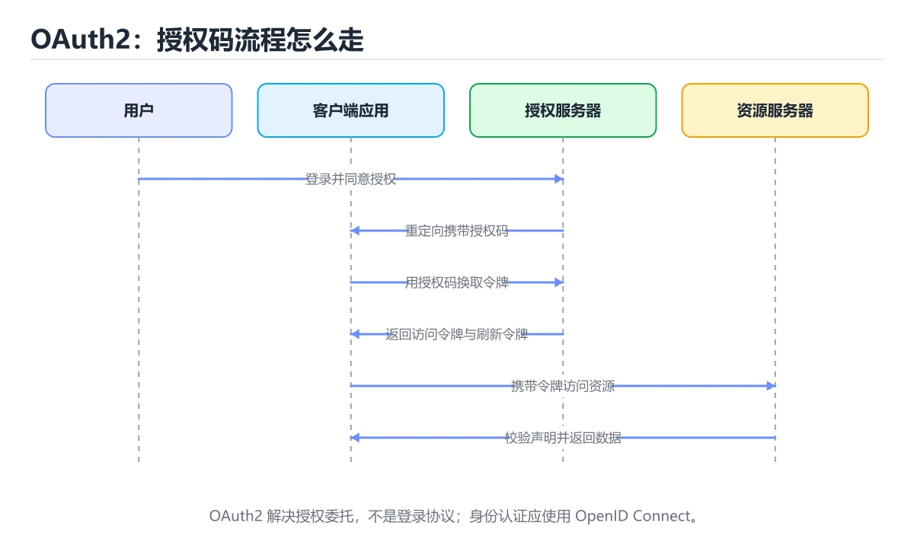
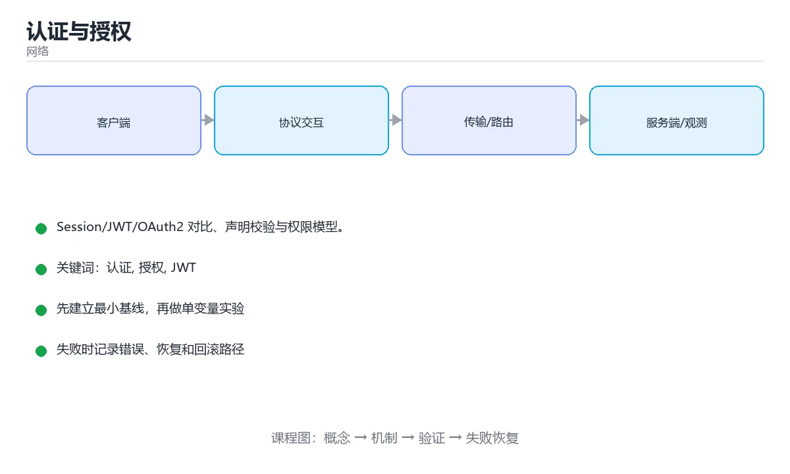

# 认证与授权





> 内容更新时间：2026-10-06 · 学习阶段：进阶 · 预计用时：35 分钟

## 本节知识框架

**课程定位**：所属分类 `network`（网络），课程主题 `认证与授权`，学习阶段 进阶，建议用时 45 分钟。

本课主线：Session/JWT/OAuth2 对比、声明校验与权限模型。

**学完本课应当能够**
- 说清 `认证` 与 `授权` 的含义与区别，并各举一个正例和一个反例。
- 用本课示例验证 `JWT` 的行为，记录输入、输出与失败条件。
- 遇到「不校验 JWT 的 exp 与 aud」这类问题时，能说出触发条件与修复顺序。

### 复习清单

- [ ] 能不看正文复述本课核心术语，并指出一个边界或反例。
- [ ] 能运行或推演本课示例，记录输入、输出与失败现象。
- [ ] 能完成一次自测，并把错题对照错误表定位原因。

## 核心概念定义

| 术语 | 操作性定义 | 常见边界与风险 |
| --- | --- | --- |
| 认证 | 验证用户或服务的身份是否真实。 | 只在「验证用户或服务的身份是否真实」这一前提下成立，换输入或换环境要重新验证。 |
| 授权 | 在认证之后判断主体能访问哪些资源、执行哪些操作。 | 易错：令牌出现在 URL；正确做法是用授权码 + PKCE。 |
| JWT | 落地要点：每次请求都在服务端鉴权（不能只靠前端隐藏按钮）；资源级校验必须带 owner 条件（防水平越权）；权限变更后要有生效机制（Session 方案可即时失效，JWT 需配合版本号）。 | 易错：过期或被错用的令牌有效；正确做法是校验签名、exp、iss、aud 全部声明。 |
| OAuth2 | 授权框架：第三方应用用授权码换访问令牌，在用户不交出密码的前提下访问受保护资源。 | 权限与密钥策略变化会让结论失效，按最小权限并用真实凭据流程复验。 |
| RBAC | 基于角色的访问控制，把权限授予角色，再给用户分配角色。 | 权限与密钥策略变化会让结论失效，按最小权限并用真实凭据流程复验。 |
| PKCE | 授权码流程的扩展：客户端生成并校验 code_verifier，防止授权码被截获后换令牌 | 易错：令牌出现在 URL；正确做法是用授权码 + PKCE。 |
| RBAC | 用户 → 角色 → 权限 | 权限与密钥策略变化会让结论失效，按最小权限并用真实凭据流程复验。 |
| ABAC | 按属性（部门、时间、资源标签）动态判定 | 只在「按属性（部门、时间、资源标签）动态判定」这一前提下成立，换输入或换环境要重新验证。 |
| ReBAC | 按关系图判定（如"文档的协作者"） | 只在「按关系图判定（如"文档的协作者"）」这一前提下成立，换输入或换环境要重新验证。 |
| RBAC | 用户到角色到权限 | 权限与密钥策略变化会让结论失效，按最小权限并用真实凭据流程复验。 |
| ABAC | 基于属性（部门、时间、地点） | 只在「基于属性（部门、时间、地点）」这一前提下成立，换输入或换环境要重新验证。 |
| ReBAC | 基于关系（Google Zanzibar） | 只在「基于关系（Google Zanzibar）」这一前提下成立，换输入或换环境要重新验证。 |
| ACL | 每资源一张访问列表 | 只在「每资源一张访问列表」这一前提下成立，换输入或换环境要重新验证。 |

## 原理与运行机制

### 机制总览

**教材衔接：会话方案对比**

| 方案 | 存储 | 优点 | 缺点 |
| --- | --- | --- | --- |
| Session + Cookie | 服务端存会话 | 可即时失效、实现简单 | 多实例需共享存储（Redis） |
| JWT | 客户端存令牌 | 无状态、易水平扩展 | 无法即时撤销、令牌膨胀 |
| OAuth2 / OIDC | 授权服务器 | 标准协议、支持第三方登录 | 流程复杂，需正确校验 |

实践建议：**同为自有系统，Session + Redis 更简单可靠**；需要跨服务无状态或对外提供 API 时用 JWT，并把有效期设短（如 15 分钟）配刷新令牌。

**教材衔接：JWT 的正确用法**

三段式：header.payload.signature。要点：① 必须校验签名与算法（拒绝 `alg: none`）；② 校验 exp/nbf/iss/aud 四个声明；③ 载荷只放非敏感信息（任何人都能解码）；④ 用密钥轮换（kid）支持平滑换钥；⑤ 泄露后无法撤销，因此要配合短期有效 + 黑名单/版本号机制。

**教材衔接：OAuth2 四种授权模式**

| 模式 | 适用 | 注意 |
| --- | --- | --- |
| 授权码 + PKCE | 前端与移动端（推荐） | 必须用 PKCE，禁止隐式模式 |
| 客户端凭证 | 服务间调用 | 只代表应用身份，无用户上下文 |
| 密码模式 | 遗留系统 | 已被标准弃用，新项目不要用 |
| 设备码 | 电视等无输入设备 | 用户在另一设备确认 |

**教材衔接：认证与授权速查**

| 概念 | 含义 |
| --- | --- |
| 认证（AuthN） | 你是谁 |
| 授权（AuthZ） | 你能做什么 |
| 401 Unauthorized | 未认证或凭证失效 |
| 403 Forbidden | 已认证但无权限 |
| 会话 Cookie | 服务端保存状态，浏览器自动携带 |
| Token | 客户端持有凭证，服务端校验签名 |
| JWT | 自包含声明，注意无法主动失效 |

**教材衔接：深入补充：认证与授权 的取舍与边界**

## 典型应用场景

- **不校验 JWT 的 exp 与 aud**：典型现象是过期或被错用的令牌有效；正确做法是校验签名、exp、iss、aud 全部声明。
- **用 JWT 存敏感数据**：典型现象是信息泄漏；正确做法是JWT 只含必要标识，敏感数据放服务端。
- **只校验登录不校验归属**：典型现象是水平越权；正确做法是每次访问校验资源归属。
- **access_token 有效期过长**：典型现象是泄漏影响面大；正确做法是短过期 + refresh_token 轮换。

### 最小验证场景

- 准备：保留 `python` 示例的原始输入，先记录 `认证与授权` 的基线输出和完整运行命令。
- 观察：先核对 调用了 `b64url()`，再改变一个与 `认证` 相关的条件。
- 判定：新结果与 `认证与授权` 的基线不同不等于错误；只有当差异破坏了 `认证` 的定义或错误表中的约束，才判定为失败。

### 选择与边界

- 使用 `认证` 时，先满足它的定义：验证用户或服务的身份是否真实。
- 使用 `授权` 时，先满足它的定义：在认证之后判断主体能访问哪些资源、执行哪些操作；易错：令牌出现在 URL；正确做法是用授权码 + PKCE。
- 使用 `JWT` 时，先满足它的定义：落地要点：每次请求都在服务端鉴权（不能只靠前端隐藏按钮）；资源级校验必须带 owner 条件（防水平越权）；权限变更后要有生效机制（Session 方案可即时失效，JWT 需配合版本号）；易错：过期或被错用的令牌有效；正确做法是校验签名、exp、iss、aud 全部声明。
- 使用 `OAuth2` 时，先满足它的定义：授权框架：第三方应用用授权码换访问令牌，在用户不交出密码的前提下访问受保护资源；权限与密钥策略变化会让结论失效，按最小权限并用真实凭据流程复验。
- 使用 `RBAC` 时，先满足它的定义：基于角色的访问控制，把权限授予角色，再给用户分配角色；权限与密钥策略变化会让结论失效，按最小权限并用真实凭据流程复验。

## 代码/协议/SQL 示例

### 最小可验证示例

```python
import base64
import hashlib
import hmac
import json
import secrets
import time

def b64url(data: bytes) -> str:
    return base64.urlsafe_b64encode(data).rstrip(b"=").decode()

def create_jwt(payload: dict, secret: bytes) -> str:
    """极简 JWT 生成（HS256）：生产请用成熟库。"""
    header = {"alg": "HS256", "typ": "JWT"}
    body = {**payload, "exp": int(time.time()) + 900, "iat": int(time.time())}
    segments = [
        b64url(json.dumps(header, separators=(",", ":")).encode()),
        b64url(json.dumps(body, separators=(",", ":")).encode()),
    ]
    signing_input = ".".join(segments).encode()
    signature = hmac.new(secret, signing_input, hashlib.sha256).digest()
    return ".".join(segments + [b64url(signature)])

def verify_jwt(token: str, secret: bytes, issuer: str) -> dict:
    """校验签名、有效期与签发者，任一不符即拒绝。"""
    try:
        header_b64, payload_b64, signature_b64 = token.split(".")
    except ValueError as exc:
        raise ValueError("令牌格式错误") from exc

    signing_input = f"{header_b64}.{payload_b64}".encode()
    expected = b64url(hmac.new(secret, signing_input, hashlib.sha256).digest())
    if not hmac.compare_digest(expected, signature_b64):
        raise ValueError("签名校验失败")

    payload = json.loads(base64.urlsafe_b64decode(payload_b64 + "=="))
    if payload.get("exp", 0) < time.time():
        raise ValueError("令牌已过期")
    if payload.get("iss") != issuer:
        raise ValueError("签发者不匹配")
    if "aud" not in payload:
        raise ValueError("缺少受众声明")
    return payload

def new_pkce_pair() -> tuple[str, str]:
    """PKCE：客户端生成 code_verifier 与对应的 challenge。"""
    verifier = secrets.token_urlsafe(64)
    challenge = b64url(hashlib.sha256(verifier.encode()).digest())
    return verifier, challenge

secret_key = b"demo-secret"
token = create_jwt({"sub": "user-1", "iss": "https://auth.example.com", "aud": "api"}, secret_key)
print(verify_jwt(token, secret_key, "https://auth.example.com")["sub"])
print(new_pkce_pair()[1][:16])
```

**教材衔接：OAuth 2.0 授权模式速查**

| 模式 | 适用 | 说明 |
| --- | --- | --- |
| 授权码 + PKCE | 移动端、SPA、Web | 推荐默认选择 |
| 客户端凭证 | 服务间调用 | 无用户上下文 |
| 设备码 | 电视、CLI | 在另一设备完成授权 |
| 隐式模式 | 已废弃 | 令牌暴露在 URL |
| 密码模式 | 已废弃 | 直接传用户名口令 |

令牌使用速查：

| 令牌 | 生命周期 | 存放位置 |
| --- | --- | --- |
| access_token | 短（分钟级） | 内存，避免长期存储 |
| refresh_token | 长（天到月） | 安全存储，可吊销 |
| id_token | 短 | 前端解析用户信息（校验签名） |

**运行方式**：运行 `认证与授权` 的示例时，保存为 `.py` 文件后用 `python 文件名.py` 运行；第三方依赖先在虚拟环境里安装。

## 时间/空间复杂度或性能分析

**性能关注点（认证与授权）**：往返延迟与带宽是主要成本：记录 RTT、吞吐与重传率，区分局域网与真实链路。

**本课特有开销（认证与授权 · 认证）**：重试与超时会成倍放大尾延迟，记录 P99 而不是平均值。

**测量方法**：以 `认证与授权` 的 `认证` 场景为对象，固定输入跑一遍记录基线，再把规模或并发度提高一个数量级复测；两次结果的差值与波动范围才是结论依据。

## 常见误区与易错点

| 容易写错的做法 | 实际现象 | 原因与正确做法 |
| --- | --- | --- |
| 不校验 JWT 的 exp 与 aud | 过期或被错用的令牌有效 | 校验签名、exp、iss、aud 全部声明 |
| 用 JWT 存敏感数据 | 信息泄漏 | JWT 只含必要标识，敏感数据放服务端 |
| 只校验登录不校验归属 | 水平越权 | 每次访问校验资源归属 |
| access_token 有效期过长 | 泄漏影响面大 | 短过期 + refresh_token 轮换 |
| refresh_token 不可吊销 | 被盗后长期可用 | 支持吊销与轮换，检测重放 |
| 令牌放 localStorage | XSS 可窃取 | 优先 HttpOnly Cookie 或内存 |
| 到处用隐式模式 | 令牌出现在 URL | 用授权码 + PKCE |
| 密码明文或弱哈希 | 拖库即失守 | Argon2id + 随机盐 |
| 登录后不重置会话 ID | 会话固定攻击 | 登录成功后重新生成会话 |
| 权限判断散落各处 | 容易漏判 | 集中式鉴权中间件 + 数据层过滤 |

### 现场 1：不校验 JWT 的 exp 与 aud

**症状**：过期或被错用的令牌有效。

**根因与修复**：校验签名、exp、iss、aud 全部声明。

**自检**：在本课示例里复现「不校验 JWT 的 exp 与 aud」，改成校验签名、exp、iss、aud 全部声明后重跑；如果症状消失且失败路径按预期变化，说明定位正确。

### 现场 2：用 JWT 存敏感数据

**症状**：信息泄漏。

**根因与修复**：JWT 只含必要标识，敏感数据放服务端。

**自检**：在本课示例里复现「用 JWT 存敏感数据」，改成JWT 只含必要标识，敏感数据放服务端后重跑；如果症状消失且失败路径按预期变化，说明定位正确。

### 现场 3：只校验登录不校验归属

**症状**：水平越权。

**根因与修复**：每次访问校验资源归属。

**自检**：在本课示例里复现「只校验登录不校验归属」，改成每次访问校验资源归属后重跑；如果症状消失且失败路径按预期变化，说明定位正确。

### 现场 4：access_token 有效期过长

**症状**：泄漏影响面大。

**根因与修复**：短过期 + refresh_token 轮换。

**自检**：在本课示例里复现「access_token 有效期过长」，改成短过期 + refresh_token 轮换后重跑；如果症状消失且失败路径按预期变化，说明定位正确。

### 现场 5：refresh_token 不可吊销

**症状**：被盗后长期可用。

**根因与修复**：支持吊销与轮换，检测重放。

**自检**：在本课示例里复现「refresh_token 不可吊销」，改成支持吊销与轮换，检测重放后重跑；如果症状消失且失败路径按预期变化，说明定位正确。

### 现场 6：令牌放 localStorage

**症状**：XSS 可窃取。

**根因与修复**：优先 HttpOnly Cookie 或内存。

**自检**：在本课示例里复现「令牌放 localStorage」，改成优先 HttpOnly Cookie 或内存后重跑；如果症状消失且失败路径按预期变化，说明定位正确。

### 现场 7：到处用隐式模式

**症状**：令牌出现在 URL。

**根因与修复**：用授权码 + PKCE。

**自检**：在本课示例里复现「到处用隐式模式」，改成用授权码 + PKCE后重跑；如果症状消失且失败路径按预期变化，说明定位正确。

### 现场 8：密码明文或弱哈希

**症状**：拖库即失守。

**根因与修复**：Argon2id + 随机盐。

**自检**：在本课示例里复现「密码明文或弱哈希」，改成Argon2id + 随机盐后重跑；如果症状消失且失败路径按预期变化，说明定位正确。

### 现场 9：登录后不重置会话 ID

**症状**：会话固定攻击。

**根因与修复**：登录成功后重新生成会话。

**自检**：在本课示例里复现「登录后不重置会话 ID」，改成登录成功后重新生成会话后重跑；如果症状消失且失败路径按预期变化，说明定位正确。

## 与其他知识点的关系

**教材衔接：代码对照与验证**

这一节把授权码流程拆成可观察的每一步，并给出令牌校验的最小实现。

### 对照一：授权码 + PKCE 流程

```text
浏览器                应用后端              授权服务器
  |-- 1. 生成 code_verifier 与 code_challenge -->|
  |-- 2. 跳转授权端点（带 challenge） ---------->|
  |<-- 3. 返回授权码 ----------------------------|
  |-- 4. 用授权码 + verifier 换令牌 ------------>|
  |<-- 5. 返回 access_token / refresh_token -----|
```

PKCE 让公开客户端不必内置密钥：即使授权码被截获，没有 `code_verifier` 也换不到令牌。

### 对照二：JWT 载荷校验

```python
import base64
import hashlib
import hmac
import json

def b64url(data: bytes) -> str:
    return base64.urlsafe_b64encode(data).rstrip(b"=").decode()

header = b64url(json.dumps({"alg": "HS256", "typ": "JWT"}).encode())
payload = b64url(json.dumps({"sub": "u1", "exp": 1893456000}).encode())
signing_input = f"{header}.{payload}".encode()
signature = b64url(hmac.new(b"secret", signing_input, hashlib.sha256).digest())
token = f"{header}.{payload}.{signature}"
print(token.split(".")[2] == signature)
```

校验时必须先验证签名，再检查 `exp`、`aud`、`iss`；顺序颠倒会让攻击者用未签名的载荷探测系统。

### 对照三：常见错误对照

| 错误做法 | 后果 | 修正 |
| --- | --- | --- |
| 把令牌放在 URL 参数 | 进入日志与浏览器历史 | 用 Authorization 头或 HttpOnly Cookie |
| 只在前端校验过期 | 过期令牌仍可访问接口 | 服务端每次校验签名与 exp |
| refresh_token 永不过期 | 泄露后长期可用 | 轮换并绑定设备或会话 |

### 验证清单

- 授权码只能使用一次，重放会被拒绝。
- 令牌校验同时检查签名、有效期、受众与签发者。
- 退出登录会失效服务端会话，而不只是清除本地存储。

- **先修**：`实战：抓包分析一次真实请求`。本课默认这些内容已经掌握。
- **相关或后续**：`渗透测试基础`、`认证、会话与令牌安全`。本课术语会在这些课程里继续使用。
- **术语归属**：`认证`、`授权`、`JWT` 的定义以本课「核心概念定义」为准，换到其他课程时先确认定义是否被改写。

## 自测题与参考答案

> 先独立作答，再对照参考答案；答案都能在本课正文、术语表或错误表里找到依据。

### 自测 1（概念复述）

不看正文，写出 `认证` 的操作性定义，并说明它与 `授权` 的区别。

**参考答案**：验证用户或服务的身份是否真实。

`授权` 的定位是：在认证之后判断主体能访问哪些资源、执行哪些操作；两者的差别要从适用对象与失败模式上说明。

### 自测 2（排错）

本课错误表记录了「不校验 JWT 的 exp 与 aud」这类做法。请写出它会出现的现象、根因，以及修复顺序。

**参考答案**：现象是过期或被错用的令牌有效；正确做法是校验签名、exp、iss、aud 全部声明。修复时先复现现象并保留证据，再改动一处假设重跑，确认现象消失。

### 自测 3（动手验证）

运行本课的 `python` 示例，把其中的 `"="` 换成一个边界值后重新运行，记录输出与错误信息。

**参考答案**：正常输入下 `python` 示例应当复现正文给出的结果；把 `"="` 换成边界值后，如果结果改变或报错，先核对它是否满足 `认证与授权` 中`认证` 的适用范围，再检查错误表里是否有同类现象。

### 自测 4（代码阅读）

阅读本课开头的 `python` 示例，说明它体现了`认证` 的哪一条性质，并指出改动哪个输入会让这条性质不再成立。

**参考答案**：`认证` 的定义是 验证用户或服务的身份是否真实，示例正是在实现这条定义。改动与 `认证` 有关的一个输入后，如果结果不再符合 `认证与授权` 的正文描述，就说明该性质只在当前前提成立。

### 自测 5（迁移）

把 `认证与授权` 的方法迁移到自己的项目：围绕 `认证` 写出一个与错误表同类的风险点，并说明触发条件和检验方式。

**参考答案**：例如「权限判断散落各处」，它会导致容易漏判；检验方式是按集中式鉴权中间件 + 数据层过滤改一处再复现，确认现象消失且没有引入新的失败分支。

### 自测 6（对比）

用一个表格对比 `认证` 与 `授权`：各写一行适用场景、一行失败表现。

**参考答案**：`认证` 的定义是验证用户或服务的身份是否真实；`授权` 的定义是在认证之后判断主体能访问哪些资源、执行哪些操作。两者的失败表现分别对应本课错误表里与本术语相关的行。

### 自测 7（排错顺序）

面对「不校验 JWT 的 exp 与 aud」引发的问题，请把“复现 过期或被错用的令牌有效 → 保留证据 → 校验签名、exp、iss、aud 全部声明 → 回归验证”四步写成可执行的检查清单。

**参考答案**：第一步按过期或被错用的令牌有效复现；第二步记录输入、版本与完整报错；第三步按校验签名、exp、iss、aud 全部声明只改一处；第四步重跑并确认失败路径也按预期变化。

### 自测 8（边界判断）

针对 `PKCE`，分别写出“可以使用”的条件和“结论不再成立”的条件。

**参考答案**：易错：令牌出现在 URL；正确做法是用授权码 + PKCE。 同时要把 `PKCE` 的定义 授权码流程的扩展：客户端生成并校验 code_verifier，防止授权码被截获后换令牌 与实际输入逐项对照。

### 自测 9（机制重建）

不看正文，按输入、转换、输出、验证四段重建 `认证` → `授权` → `JWT` → `OAuth2` 的作用链。

**参考答案**：起点是 `认证` 的定义 验证用户或服务的身份是否真实；中间每一步都保留可观察状态；终点由 `PKCE` 检查，失败时回到错误表定位第一个偏离定义的步骤。

### 自测 10（综合排错）

在 `认证与授权` 中，现象是 容易漏判。请围绕 权限判断散落各处 写出最小复现、关键证据、修复动作和回归验证，并说明为什么不能只凭一次运行下结论。

**参考答案**：先复现 权限判断散落各处，记录输入与完整错误；再按 集中式鉴权中间件 + 数据层过滤 只改一处。回归时同时跑正常路径和边界路径，只有两次结果都可解释，才把修复视为完成。

### 自测 11（一分钟复述）

用每分钟约 200 字的速度复述 `认证与授权`：先给主问题，再按顺序说出 `认证`、`授权`、`JWT`、`OAuth2`，最后给一个失败案例。

**自评标准**：主问题必须对应 Session/JWT/OAuth2 对比、声明校验与权限模型；每个术语都要能接上一句定义或边界；失败案例必须写成可观察现象，不能用“可能有风险”代替证据。

## 延伸阅读

想更直观地理解本课概念？推荐参阅以下图解专题：

- [图解 OAuth 2.0 授权码流程与 PKCE](visual_oauth_flow.md)

## 术语速查

| 术语 | 一句话说明 |
| --- | --- |
| `认证` | 验证用户或服务的身份是否真实。 |
| `授权` | 在认证之后判断主体能访问哪些资源、执行哪些操作。 |
| `JWT` | 落地要点：每次请求都在服务端鉴权（不能只靠前端隐藏按钮）；资源级校验必须带 owner 条件（防水平越权）；权限变更后要有生效机制（Session 方案可即时失效，JWT 需配合版本号）。 |
| `OAuth2` | 授权框架：第三方应用用授权码换访问令牌，在用户不交出密码的前提下访问受保护资源。 |
| `RBAC` | 基于角色的访问控制，把权限授予角色，再给用户分配角色。 |
| `PKCE` | 授权码流程的扩展：客户端生成并校验 code_verifier，防止授权码被截获后换令牌。 |

**术语关系**：`认证`（验证用户或服务的身份是否真实） → `授权`（在认证之后判断主体能访问哪些资源、执行哪些操作） → `JWT`（落地要点：每次请求都在服务端鉴权（不能只靠前端隐藏按钮）） → `OAuth2`（授权框架：第三方应用用授权码换访问令牌）。

## 考点精讲

`认证与授权` 的题库有 6 道题，下面逐题给出题干、正确项与判断依据：先自己作答，再核对正确项，最后回到正文对应小节复核。

### 考点 1：第 1 题

- **题目**：HTTP 401 与 403 的区别是？
- **正确项**：401 是未通过认证
- **判断依据**：本题正确项是「401 是未通过认证」。术语 认证（认证与授权）：验证用户或服务的身份是否真实，本题取「401 是未通过认证」这条。易错点是不校验 JWT 的 exp 与 aud，会造成过期或被错用的令牌有效，改法是校验签名、exp、iss、aud 全部声明。

### 考点 2：第 2 题

- **题目**：阅读这段令牌签发与校验代码，下面哪项判断是正确的？
- **正确项**：令牌设了 900 秒过期，服务端仍必须校验签名并检查 exp，不能只解码 payload
- **判断依据**：本题正确项是「令牌设了 900 秒过期，服务端仍必须校验签名并检查 exp，不能只解码 payload」。术语 认证（认证与授权）：验证用户或服务的身份是否真实，本题取「令牌设了 900 秒过期，服务端仍必须校验签名并检查 exp，不能只解码 payload」这条。易错点是用 JWT 存敏感数据，会造成信息泄漏，改法是JWT 只含必要标识，敏感数据放服务端。

### 考点 3：第 3 题

- **题目**：围绕“认证与授权”中的 认证、授权、JWT，下列哪两项是本课强调的实践判断？
- **正确项**：验证 授权 时要固定版本并覆盖边界输入，结论才可复现；学习 认证 时要同时说明输入、输出和失败路径，不能只看正常流程
- **判断依据**：按《认证与授权》的正文口径，本题要同时选中「验证 授权 时要固定版本并覆盖边界输入，结论才可复现」、「学习 认证 时要同时说明输入、输出和失败路径，不能只看正常流程」，漏掉任一项都算没答全。术语 认证（认证与授权）：验证用户或服务的身份是否真实。易错点是只校验登录不校验归属，会造成水平越权，改法是每次访问校验资源归属。

### 考点 4：第 4 题

- **题目**：OAuth 2.0 授权码模式推荐配合 PKCE 的原因是？
- **正确项**：用一次性校验值防止授权码被拦截后换到令牌
- **判断依据**：本题正确项是「用一次性校验值防止授权码被拦截后换到令牌」。术语 授权（认证与授权）：在认证之后判断主体能访问哪些资源、执行哪些操作，本题取「用一次性校验值防止授权码被拦截后换到令牌」这条。易错点是access_token 有效期过长，会造成泄漏影响面大，改法是短过期 + refresh_token 轮换。

### 考点 5：第 5 题

- **题目**：access_token 与 refresh_token 的分工是？
- **正确项**：access_token 短期用于访问资源
- **判断依据**：本题正确项是「access_token 短期用于访问资源」。术语 认证（认证与授权）：验证用户或服务的身份是否真实，本题取「access_token 短期用于访问资源」这条。易错点是refresh_token 不可吊销，会造成被盗后长期可用，改法是支持吊销与轮换，检测重放。

### 考点 6：第 6 题

- **题目**：填空：补齐下面这段术语说明中的空缺。课程 `Session/JWT/OAuth2 对比、声明校验与权限模型。`，这段说明是：落地要点：每次请求都在服务端鉴权（不能只靠前端隐藏按钮）；资源级校验必须带 owner 条件（防水平越权）；权限变更后要有生效机制（Session 方案可即时失效，`____` 需配合版本号）。空缺处应填哪个术语？
- **正确项**：JWT
- **判断依据**：《认证与授权》这题的填空口径是「JWT」或「jwt」，正文写法与其中任一项一致即可。术语「JWT」在本课里的界定是落地要点：每次请求都在服务端鉴权（不能只靠前端隐藏按钮），资源级校验必须带 owner 条件（防水平越权），权限变更后要有生效机制（Session 方案可即时失效，JWT 需配合版本号），题干问的就是这一条。常见错法是不校验 JWT 的 exp 与 aud，其后果是过期或被错用的令牌有效。正确做法是校验签名、exp、iss、aud 全部声明。

### 考点 7：`认证`

- **要点**：验证用户或服务的身份是否真实。

### 考点 8：`授权`

- **要点**：在认证之后判断主体能访问哪些资源、执行哪些操作。
- **授权 的边界**：易错：令牌出现在 URL；正确做法是用授权码 + PKCE。

### 考点 9：`JWT`

- **要点**：落地要点：每次请求都在服务端鉴权（不能只靠前端隐藏按钮）；资源级校验必须带 owner 条件（防水平越权）；权限变更后要有生效机制（Session 方案可即时失效，JWT 需配合版本号）。
- **JWT 的边界**：易错：过期或被错用的令牌有效；正确做法是校验签名、exp、iss、aud 全部声明。

### 考点 10：`OAuth2`

- **要点**：授权框架：第三方应用用授权码换访问令牌，在用户不交出密码的前提下访问受保护资源。
- **OAuth2 的边界**：权限与密钥策略变化会让结论失效，按最小权限并用真实凭据流程复验。

### 考点 11：`RBAC`

- **要点**：基于角色的访问控制，把权限授予角色，再给用户分配角色。
- **RBAC 的边界**：权限与密钥策略变化会让结论失效，按最小权限并用真实凭据流程复验。

### 考点 12：`PKCE`

- **要点**：授权码流程的扩展：客户端生成并校验 code_verifier，防止授权码被截获后换令牌
- **PKCE 的边界**：易错：令牌出现在 URL；正确做法是用授权码 + PKCE。

### 考点 13：排错——不校验 JWT 的 exp 与 aud

- **现象**：过期或被错用的令牌有效。
- **处理**：校验签名、exp、iss、aud 全部声明。

### 考点 14：排错——用 JWT 存敏感数据

- **现象**：信息泄漏。
- **处理**：JWT 只含必要标识，敏感数据放服务端。

### 考点 15：综合辨析——`认证` 与 `PKCE`

- **辨析点**：`认证` 的定义是 验证用户或服务的身份是否真实；`PKCE` 的定义是 授权码流程的扩展：客户端生成并校验 code_verifier，防止授权码被截获后换令牌。
- **答题要求**：面对 `认证与授权` 的题目，先判断描述的是 `认证` 还是 `PKCE`，再归到对应定义，最后写出一个会让该定义失效的边界输入。

### 考点 16：排错评分点

- **现象分**：能写出 过期或被错用的令牌有效，而不是只写“程序有错”。
- **证据分**：保留触发 不校验 JWT 的 exp 与 aud 的输入、版本和错误原文。
- **修复分**：按 校验签名、exp、iss、aud 全部声明 只改一处，并同时回归正常路径与边界路径。

## 内容元数据

- 内容版本：v2.0
- 最后更新：2026-10-06
- 学习阶段：进阶
- 适用环境：TCP/IP、HTTP/2、HTTP/3 与现代网络栈；本课聚焦其中的 认证。
- 内容来源：内置结构化课程与工程实践整理
- 相关主题：认证、授权、JWT、OAuth2、RBAC
- 质量版本：P0 测验标准 + P1 覆盖扩展 + P2 体验补全

## 参考资料与复核

- 最后复核：2026-10-04
- 下次复核：2027-06-24
- 复核范围：版本兼容、API 行为、安全建议与工程实践
- 来源性质：官方文档、标准或权威教材；本课核对关键词：认证、授权、JWT、OAuth2、RBAC。

| 参考资料 | 本课用途 |
| --- | --- |
| [MDN HTTP](https://developer.mozilla.org/docs/Web/HTTP) | 浏览器视角的 HTTP |
| [RFC 9000 QUIC](https://www.rfc-editor.org/rfc/rfc9000) | QUIC 传输与连接迁移 |
| [RFC 9293 TCP](https://www.rfc-editor.org/rfc/rfc9293) | TCP 连接、重传与拥塞 |

| [本课术语索引：认证与授权](#核心概念定义) | 按本课输入、术语边界和错误表现逐项核对 |
> 「认证与授权」的链接用于离线阅读后的延伸核对；App 不会自动联网。