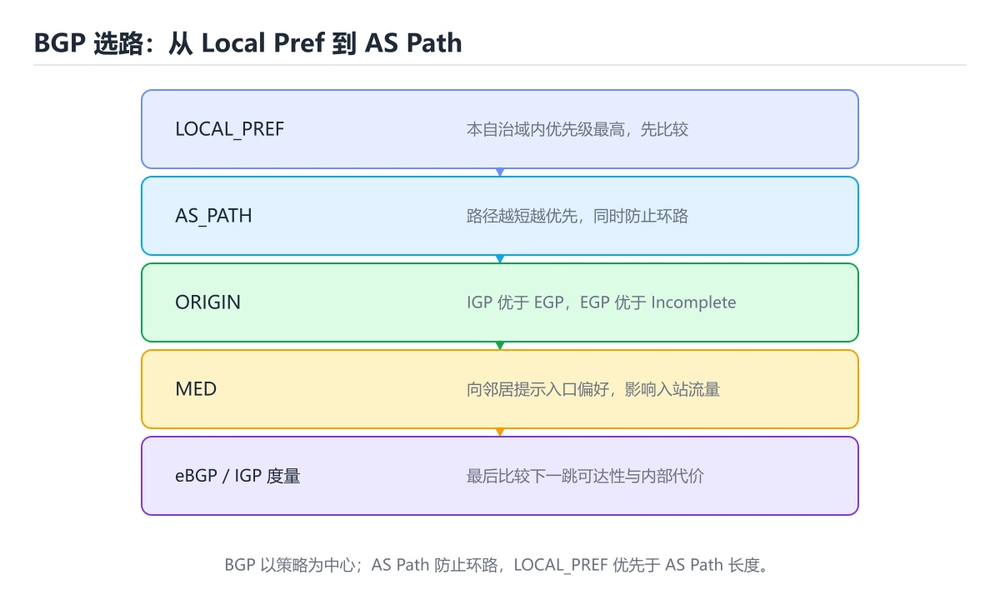
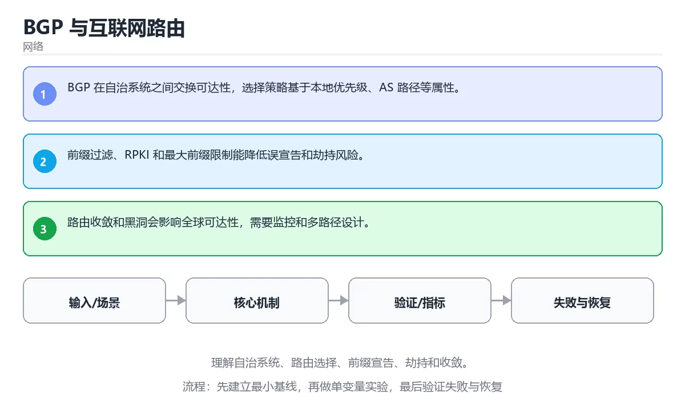

# BGP 与互联网路由

> 内容更新时间：2026-10-06 · 学习阶段：高级 · 预计用时：25 分钟





## 本节知识框架

**课程定位**：所属分类 `network`（网络），课程主题 `BGP 与互联网路由`，学习阶段 高级，建议用时 40 分钟。

本课主线：理解自治系统、路由选择、前缀宣告、劫持和收敛。

**学完本课应当能够**
- 说清 `BGP` 与 `自治系统` 的含义与区别，并各举一个正例和一个反例。
- 用本课示例验证 `路由劫持` 的行为，记录输入、输出与失败条件。
- 遇到「把边界网关协议当内部路由协议用」这类问题时，能说出触发条件与修复顺序。

### 复习清单

- [ ] 能不看正文复述本课核心术语，并指出一个边界或反例。
- [ ] 能运行或推演本课示例，记录输入、输出与失败现象。
- [ ] 能完成一次自测，并把错题对照错误表定位原因。

## 核心概念定义

| 术语 | 操作性定义 | 常见边界与风险 |
| --- | --- | --- |
| BGP | 在自治系统之间交换路由可达信息的外部网关协议。 | 它传播的是路径向量而不是完整拓扑：选路依次比较权重、本地优先级等属性，跳数最少的路径常常不被选中。 |
| 自治系统 | 由同一组织管理、对外使用统一路由策略的 IP 网络集合。 | 易错：选路行为与预期不符；正确做法是自治系统内部用内部网关协议，之间用边界网关协议。 |
| 路由劫持 | 按“BGP 与互联网路由”中 BGP、自治系统、路由劫持 的实践顺序，把四个步骤排成从准备到复盘的合理顺序。 | 某个 AS 一旦宣告不属于自己的地址段就能牵走流量，光靠默认信任拦不住，要用前缀过滤与 RPKI 校验。 |
| 收敛 | 结合BGP、自治系统、路由劫持、收敛，写出一个真实项目中的使用场景。 | 易错：变更后短时间内丢包；正确做法是变更前评估收敛窗口，并准备好回滚配置。 |

## 原理与运行机制

### 机制总览

**教材衔接：核心知识**

### 1. BGP 在自治系统之间交换可达性，选择策略基于本地优先级、AS 路径等属性。

- 关键做法：先让 BGP 的最小示例可复现，再加入并发或规模条件。
- 验证标准：BGP 的结果可复现、错误可解释、失败能恢复。

### 2. 前缀过滤、RPKI 和最大前缀限制能降低误宣告和劫持风险。

把这条结论放回「BGP 与互联网路由」的完整流程里展开：

- 正文依据：能用自己的话解释：BGP 在自治系统之间交换可达性，选择策略基于本地优先级、AS 路径等属性。
- 落地检查：把「2. 前缀过滤、RPKI 和最大前缀限制能降低误宣告和劫持风险。」改写成一条可执行的核对项，逐条验证输入、超时与失败路径。

### 3. 路由收敛和黑洞会影响全球可达性，需要监控和多路径设计。

把这条结论放回「BGP 与互联网路由」的完整流程里展开：

- 正文依据：能用自己的话解释：路由收敛和黑洞会影响全球可达性，需要监控和多路径设计。
- 落地检查：把「3. 路由收敛和黑洞会影响全球可达性，需要监控和多路径设计。」改写成一条可执行的核对项，逐条验证输入、超时与失败路径。

**教材衔接：关键流程**

**教材衔接：实践路径**

**教材衔接：深入理解：BGP 与互联网路由**

### 自治系统与路径向量

互联网由数万个自治系统（AS）组成，BGP 负责在 AS 之间交换可达性。它不传播完整的
网络拓扑，而是传播「到某个前缀需要经过哪些 AS」的路径向量。AS_PATH 既用于选路，
也用于防环：收到包含自己 AS 号的路由直接丢弃。iBGP 在同一 AS 内同步路由，
eBGP 在 AS 之间传递，二者在下一跳与规则上并不相同。

### 选路靠属性而不是最短路径

BGP 依次比较权重、本地优先级、本地起源、AS_PATH 长度、起源类型、MED 等属性，
最后才用路由器 ID 打破平局。因此「跳数最少」并不总是被选中：策略、商业关系和
流量工程都会影响结果。调试时要先确认是哪一条属性造成了差异，而不是只看路径长度。

### 汇聚、劫持与防护

路由汇聚能缩小表项，但配置不当会造成黑洞或子前缀冲突。前缀劫持则是某个 AS
错误地宣告了不属于自己的地址段。RPKI 通过签名证明「这个 AS 有权宣告这个前缀」，
配合路由过滤可以显著降低风险。运维上还要监控前缀数量突变与路径异常。

「BGP 与互联网路由」的「自治系统与路径向量」一节补全如下：

- 定位：这一节说明自治系统与路径向量在「BGP 与互联网路由」知识体系里的位置。
- 要点：互联网由数万个自治系统（AS）组成，BGP 负责在 AS 之间交换可达性。它不传播完整的
- 自检：能否用一个最小例子解释自治系统与路径向量？

「BGP 与互联网路由」的「选路靠属性而不是最短路径」一节补全如下：

- 定位：这一节说明选路靠属性而不是最短路径在「BGP 与互联网路由」知识体系里的位置。
- 要点：也用于防环：收到包含自己 AS 号的路由直接丢弃。iBGP 在同一 AS 内同步路由，
- 自检：能否用一个最小例子解释选路靠属性而不是最短路径？

「BGP 与互联网路由」的「汇聚、劫持与防护」一节补全如下：

- 定位：这一节说明汇聚、劫持与防护在「BGP 与互联网路由」知识体系里的位置。
- 要点：eBGP 在 AS 之间传递，二者在下一跳与规则上并不相同。
- 自检：能否用一个最小例子解释汇聚、劫持与防护？

**教材衔接：深入补充：BGP 与互联网路由 的取舍与边界**

### 四、自测清单

- 能否用一句话说出BGP 与互联网路由解决的核心问题与不适用场景？
- 能否画出 BGP 的数据流或状态变化，并标出失败路径？
- 把 gethostbyname 的输入推到边界，说明本课哪一条结论会先失效。
- 能否写出一条可复现的验证命令，让别人独立得到相同结论？

**教材衔接：验证步骤**

## 典型应用场景

**教材衔接：深度拓展与实战**

这一节把 BGP 的结论、gethostbyname 的示例与反例整理成可执行的复习步骤。

### 边界条件与常见反例

「BGP 与互联网路由」的边界不只包括最大最小值，还要覆盖空、重复和失败：

### 工程检查表

- [ ] 能否用自己的话说明BGP 与互联网路由解决什么问题，以及它不负责什么？
- [ ] 能否说明 BGP 的正常输出，以及失败时留下的错误信息？
- [ ] 能否解释本课关键词在真实项目中的边界与取舍？
- [ ] 能否把 BGP 的方法迁移到相近问题，并说明需要改哪一步？

### 最小验证场景

- 准备：保留 `text` 示例的原始输入，先记录 `BGP 与互联网路由` 的基线输出和完整运行命令。
- 观察：先核对 调用了 `print()`，再改变一个与 `BGP` 相关的条件。
- 判定：新结果与 `BGP 与互联网路由` 的基线不同不等于错误；只有当差异破坏了 `BGP` 的定义或错误表中的约束，才判定为失败。

### 选择与边界

- 使用 `BGP` 时，先满足它的定义：在自治系统之间交换路由可达信息的外部网关协议；网络延迟、超时与版本协商会改变行为，只在真实链路或多版本客户端上验证才算数。
- 使用 `自治系统` 时，先满足它的定义：由同一组织管理、对外使用统一路由策略的 IP 网络集合；易错：选路行为与预期不符；正确做法是自治系统内部用内部网关协议，之间用边界网关协议。
- 使用 `路由劫持` 时，先满足它的定义：按“BGP 与互联网路由”中 BGP、自治系统、路由劫持 的实践顺序，把四个步骤排成从准备到复盘的合理顺序。
- 使用 `收敛` 时，先满足它的定义：结合BGP、自治系统、路由劫持、收敛，写出一个真实项目中的使用场景；易错：变更后短时间内丢包；正确做法是变更前评估收敛窗口，并准备好回滚配置。

## 代码/协议/SQL 示例

### 最小可验证示例

**教材衔接：最小可运行示例**

先用下面的示例确认 BGP 的基线，再只改一个与 自治系统 相关的值：

```python
import socket

print(socket.gethostbyname("localhost"))
```

**教材衔接：预期输出**

```text
127.0.0.1
```

## 时间/空间复杂度或性能分析

**性能关注点（BGP 与互联网路由）**：往返延迟与带宽是主要成本：记录 RTT、吞吐与重传率，区分局域网与真实链路。

**本课特有开销（BGP 与互联网路由 · BGP）**：重试与超时会成倍放大尾延迟，记录 P99 而不是平均值。

**测量方法**：以 `BGP 与互联网路由` 的 `BGP` 场景为对象，固定输入跑一遍记录基线，再把规模或并发度提高一个数量级复测；两次结果的差值与波动范围才是结论依据。

## 常见误区与易错点

| 容易写错的做法 | 实际现象 | 原因与正确做法 |
| --- | --- | --- |
| 把边界网关协议当内部路由协议用 | 选路行为与预期不符。 | 自治系统内部用内部网关协议，之间用边界网关协议。 |
| 只调本地优先级不看路径属性 | 流量绕远甚至出现黑洞。 | 结合自治系统路径、下一跳与社区属性一起排查。 |
| 忽略路由收敛时间 | 变更后短时间内丢包。 | 变更前评估收敛窗口，并准备好回滚配置。 |

### 现场 1：把边界网关协议当内部路由协议用

**症状**：选路行为与预期不符。

**根因与修复**：自治系统内部用内部网关协议，之间用边界网关协议。

**自检**：在本课示例里复现「把边界网关协议当内部路由协议用」，改成自治系统内部用内部网关协议，之间用边界网关协议后重跑；如果症状消失且失败路径按预期变化，说明定位正确。

### 现场 2：只调本地优先级不看路径属性

**症状**：流量绕远甚至出现黑洞。

**根因与修复**：结合自治系统路径、下一跳与社区属性一起排查。

**自检**：在本课示例里复现「只调本地优先级不看路径属性」，改成结合自治系统路径、下一跳与社区属性一起排查后重跑；如果症状消失且失败路径按预期变化，说明定位正确。

### 现场 3：忽略路由收敛时间

**症状**：变更后短时间内丢包。

**根因与修复**：变更前评估收敛窗口，并准备好回滚配置。

**自检**：在本课示例里复现「忽略路由收敛时间」，改成变更前评估收敛窗口，并准备好回滚配置后重跑；如果症状消失且失败路径按预期变化，说明定位正确。

## 与其他知识点的关系

**教材衔接：复习与迁移**

## 自测题与参考答案

> 先独立作答，再对照参考答案；答案都能在本课正文、术语表或错误表里找到依据。

### 自测 1（概念复述）

不看正文，写出 `BGP` 的操作性定义，并说明它与 `自治系统` 的区别。

**参考答案**：在自治系统之间交换路由可达信息的外部网关协议。

`自治系统` 的定位是：由同一组织管理、对外使用统一路由策略的 IP 网络集合；两者的差别要从适用对象与失败模式上说明。

### 自测 2（排错）

本课错误表记录了「把边界网关协议当内部路由协议用」这类做法。请写出它会出现的现象、根因，以及修复顺序。

**参考答案**：现象是选路行为与预期不符；正确做法是自治系统内部用内部网关协议，之间用边界网关协议。修复时先复现现象并保留证据，再改动一处假设重跑，确认现象消失。

### 自测 3（动手验证）

运行本课的 `text` 示例，改动其中一个输入后重新运行，记录输出与错误信息。

**参考答案**：正常输入下 `text` 示例应当复现正文给出的结果；改动输入后，如果结果改变或报错，先核对它是否满足 `BGP 与互联网路由` 中`BGP` 的适用范围，再检查错误表里是否有同类现象。

### 自测 4（代码阅读）

阅读本课开头的 `text` 示例，说明它体现了`BGP` 的哪一条性质，并指出改动哪个输入会让这条性质不再成立。

**参考答案**：`BGP` 的定义是 在自治系统之间交换路由可达信息的外部网关协议，示例正是在实现这条定义。改动与 `BGP` 有关的一个输入后，如果结果不再符合 `BGP 与互联网路由` 的正文描述，就说明该性质只在当前前提成立。

### 自测 5（迁移）

把 `BGP 与互联网路由` 的方法迁移到自己的项目：围绕 `BGP` 写出一个与错误表同类的风险点，并说明触发条件和检验方式。

**参考答案**：例如「忽略路由收敛时间」，它会导致变更后短时间内丢包；检验方式是按变更前评估收敛窗口，并准备好回滚配置改一处再复现，确认现象消失且没有引入新的失败分支。

### 自测 6（对比）

用一个表格对比 `BGP` 与 `自治系统`：各写一行适用场景、一行失败表现。

**参考答案**：`BGP` 的定义是在自治系统之间交换路由可达信息的外部网关协议；`自治系统` 的定义是由同一组织管理、对外使用统一路由策略的 IP 网络集合。两者的失败表现分别对应本课错误表里与本术语相关的行。

### 自测 7（排错顺序）

面对「把边界网关协议当内部路由协议用」引发的问题，请把“复现 选路行为与预期不符 → 保留证据 → 自治系统内部用内部网关协议，之间用边界网关协议 → 回归验证”四步写成可执行的检查清单。

**参考答案**：第一步按选路行为与预期不符复现；第二步记录输入、版本与完整报错；第三步按自治系统内部用内部网关协议，之间用边界网关协议只改一处；第四步重跑并确认失败路径也按预期变化。

### 自测 8（边界判断）

针对 `收敛`，分别写出“可以使用”的条件和“结论不再成立”的条件。

**参考答案**：易错：变更后短时间内丢包；正确做法是变更前评估收敛窗口，并准备好回滚配置。 同时要把 `收敛` 的定义 结合BGP、自治系统、路由劫持、收敛，写出一个真实项目中的使用场景 与实际输入逐项对照。

### 自测 9（机制重建）

不看正文，按输入、转换、输出、验证四段重建 `BGP` → `自治系统` → `路由劫持` → `收敛` 的作用链。

**参考答案**：起点是 `BGP` 的定义 在自治系统之间交换路由可达信息的外部网关协议；中间每一步都保留可观察状态；终点由 `收敛` 检查，失败时回到错误表定位第一个偏离定义的步骤。

### 自测 10（综合排错）

在 `BGP 与互联网路由` 中，现象是 变更后短时间内丢包。请围绕 忽略路由收敛时间 写出最小复现、关键证据、修复动作和回归验证，并说明为什么不能只凭一次运行下结论。

**参考答案**：先复现 忽略路由收敛时间，记录输入与完整错误；再按 变更前评估收敛窗口，并准备好回滚配置 只改一处。回归时同时跑正常路径和边界路径，只有两次结果都可解释，才把修复视为完成。

### 自测 11（一分钟复述）

用每分钟约 200 字的速度复述 `BGP 与互联网路由`：先给主问题，再按顺序说出 `BGP`、`自治系统`、`路由劫持`、`收敛`，最后给一个失败案例。

**自评标准**：主问题必须对应 理解自治系统、路由选择、前缀宣告、劫持和收敛；每个术语都要能接上一句定义或边界；失败案例必须写成可观察现象，不能用“可能有风险”代替证据。

## 延伸阅读

想更直观地理解本课概念？推荐参阅以下图解专题：

- [图解一次网页请求的完整链路](visual_http_timeline.md)

## 术语速查

| 术语 | 一句话说明 |
| --- | --- |
| `BGP` | 在自治系统之间交换路由可达信息的外部网关协议。 |
| `自治系统` | 由同一组织管理、对外使用统一路由策略的 IP 网络集合。 |
| `路由劫持` | 按“BGP 与互联网路由”中 BGP、自治系统、路由劫持 的实践顺序，把四个步骤排成从准备到复盘的合理顺序。 |
| `收敛` | 结合BGP、自治系统、路由劫持、收敛，写出一个真实项目中的使用场景。 |

**术语关系**：`BGP`（在自治系统之间交换路由可达信息的外部网关协议） → `自治系统`（由同一组织管理、对外使用统一路由策略的 IP 网络集合） → `路由劫持`（按“BGP 与互联网路由”中 BGP、自治系统、路由劫持 的实践顺序） → `收敛`（结合BGP、自治系统、路由劫持、收敛）。

## 考点精讲

`BGP 与互联网路由` 的题库有 5 道题，下面逐题给出题干、正确项与判断依据：先自己作答，再核对正确项，最后回到正文对应小节复核。

### 考点 1：第 1 题

- **题目**：在 `BGP 与互联网路由` 里，与 `BGP` 有关的说法中，哪一项最符合理解自治系统、路由选择、前缀宣告、劫持和收敛？
- **正确项**：BGP 在自治系统之间交换可达性，选择策略基于本地优先级、AS 路径等属性。
- **判断依据**：本题正确项是「BGP 在自治系统之间交换可达性，选择策略基于本地优先级、AS 路径等属性」。术语 BGP（BGP 与互联网路由）：在自治系统之间交换路由可达信息的外部网关协议，本题取「BGP 在自治系统之间交换可达性，选择策略基于本地优先级、AS 路径等属性」这条。易错点是把边界网关协议当内部路由协议用，会造成选路行为与预期不符，改法是自治系统内部用内部网关协议，之间用边界网关协议。

### 考点 2：第 2 题

- **题目**：在 `BGP 与互联网路由` 里，与 `BGP` 有关的说法中，哪一项最符合理解自治系统、路由选择、前缀宣告、劫持和收敛？（BGP 与互联网路由·网络 第 2 题）
- **正确项**：前缀过滤、RPKI 和最大前缀限制能降低误宣告和劫持风险。
- **判断依据**：本题正确项是「前缀过滤、RPKI 和最大前缀限制能降低误宣告和劫持风险」。术语 BGP（BGP 与互联网路由）：在自治系统之间交换路由可达信息的外部网关协议，本题取「前缀过滤、RPKI 和最大前缀限制能降低误宣告和劫持风险」这条。易错点是只调本地优先级不看路径属性，会造成流量绕远甚至出现黑洞，改法是结合自治系统路径、下一跳与社区属性一起排查。

### 考点 3：第 3 题

- **题目**：按“BGP 与互联网路由”中 BGP、自治系统、路由劫持 的实践顺序，把四个步骤排成从准备到复盘的合理顺序。
- **正确项**：先明确 BGP 的输入、输出与约束 → 写出最小示例并核对 自治系统 的基线结果 → 只改一个变量，记录边界与失败路径的变化 → 固定版本与证据，把“BGP 与互联网路由”的结论写成可复现记录
- **判断依据**：按《BGP 与互联网路由》正文的先后，本题顺序是「先明确 BGP 的输入、输出与约束」 → 「写出最小示例并核对 自治系统 的基线结果」 → 「只改一个变量，记录边界与失败路径的变化」 → 「固定版本与证据，把“BGP 与互联网路由”的结论写成可复现记录」。术语 BGP（BGP 与互联网路由）：在自治系统之间交换路由可达信息的外部网关协议。易错点是把边界网关协议当内部路由协议用会造成选路行为与预期不符，改法是自治系统内部用内部网关协议，之间用边界网关协议。

### 考点 4：第 4 题

- **题目**：阅读 `BGP 与互联网路由` 的 `BGP` 示例。它服务于理解自治系统、路由选择、前缀宣告、劫持和收敛。代码中实际包含下列哪一项？
- **正确项**：调用了 `gethostbyname()`
- **判断依据**：本题正确项是「调用了 `gethostbyname()`」（BGP 与互联网路由）。术语 BGP（BGP 与互联网路由）：在自治系统之间交换路由可达信息的外部网关协议，本题取「调用了 `gethostbyname()`」这条。易错点是把边界网关协议当内部路由协议用，会造成选路行为与预期不符，改法是自治系统内部用内部网关协议，之间用边界网关协议。本题干扰项「调用了 `Err()`」不成立：展示代码里找不到 `Err()`。

### 考点 5：第 5 题

- **题目**：课程 `理解自治系统、路由选择、前缀宣告、劫持和收敛。`。在 `BGP 与互联网路由` 里，`BGP`、`自治系统` 与下面哪些选项属于同一层概念？（多选）
- **正确项**：BGP；自治系统
- **判断依据**：按《BGP 与互联网路由》的正文口径，本题要同时选中「BGP」、「自治系统」，漏掉任一项都算没答全。术语 BGP（BGP 与互联网路由）：在自治系统之间交换路由可达信息的外部网关协议。易错点是把边界网关协议当内部路由协议用会造成选路行为与预期不符，改法是自治系统内部用内部网关协议，之间用边界网关协议。本课《BGP 与互联网路由》要解决的是理解自治系统、路由选择、前缀宣告、劫持和收敛。

### 考点 6：`BGP`

- **要点**：在自治系统之间交换路由可达信息的外部网关协议。
- **BGP 的边界**：网络延迟、超时与版本协商会改变行为，只在真实链路或多版本客户端上验证才算数。

### 考点 7：`自治系统`

- **要点**：由同一组织管理、对外使用统一路由策略的 IP 网络集合。
- **自治系统 的边界**：易错：选路行为与预期不符；正确做法是自治系统内部用内部网关协议，之间用边界网关协议。

### 考点 8：`路由劫持`

- **要点**：按“BGP 与互联网路由”中 BGP、自治系统、路由劫持 的实践顺序，把四个步骤排成从准备到复盘的合理顺序。

### 考点 9：`收敛`

- **要点**：结合BGP、自治系统、路由劫持、收敛，写出一个真实项目中的使用场景。
- **收敛 的边界**：易错：变更后短时间内丢包；正确做法是变更前评估收敛窗口，并准备好回滚配置。

### 考点 10：排错——把边界网关协议当内部路由协议用

- **现象**：选路行为与预期不符。
- **处理**：自治系统内部用内部网关协议，之间用边界网关协议。

### 考点 11：排错——只调本地优先级不看路径属性

- **现象**：流量绕远甚至出现黑洞。
- **处理**：结合自治系统路径、下一跳与社区属性一起排查。

### 考点 12：综合辨析——`BGP` 与 `收敛`

- **辨析点**：`BGP` 的定义是 在自治系统之间交换路由可达信息的外部网关协议；`收敛` 的定义是 结合BGP、自治系统、路由劫持、收敛，写出一个真实项目中的使用场景。
- **答题要求**：面对 `BGP 与互联网路由` 的题目，先判断描述的是 `BGP` 还是 `收敛`，再归到对应定义，最后写出一个会让该定义失效的边界输入。

### 考点 13：排错评分点

- **现象分**：能写出 选路行为与预期不符，而不是只写“程序有错”。
- **证据分**：保留触发 把边界网关协议当内部路由协议用 的输入、版本和错误原文。
- **修复分**：按 自治系统内部用内部网关协议，之间用边界网关协议 只改一处，并同时回归正常路径与边界路径。

## 内容元数据

- 内容版本：v2.0
- 最后更新：2026-10-06
- 学习阶段：高级
- 适用环境：TCP/IP 协议族；本课的落点是 自治系统。本课聚焦 BGP。
- 内容来源：内置结构化课程与工程实践整理
- 相关主题：BGP、自治系统、路由劫持、收敛
- 质量版本：P0 测验标准 + P1 覆盖扩展 + P2 体验补全

## 参考资料与复核

- 最后复核：2026-10-04
- 下次复核：2027-06-24
- 复核范围：版本兼容、API 行为、安全建议与工程实践
- 来源性质：官方文档、标准或权威教材；本课核对关键词：BGP、自治系统、路由劫持、收敛。

| 参考资料 | 本课用途 |
| --- | --- |
| [MDN HTTP](https://developer.mozilla.org/docs/Web/HTTP) | 浏览器视角的 HTTP |
| [RFC 9113 HTTP/2](https://www.rfc-editor.org/rfc/rfc9113) | HTTP/2 多路复用与流 |
| [RFC 9293 TCP](https://www.rfc-editor.org/rfc/rfc9293) | TCP 连接、重传与拥塞 |

| [本课术语索引：BGP 与互联网路由](#核心概念定义) | 按本课输入、术语边界和错误表现逐项核对 |
> 「BGP 与互联网路由」的链接用于离线阅读后的延伸核对；App 不会自动联网。