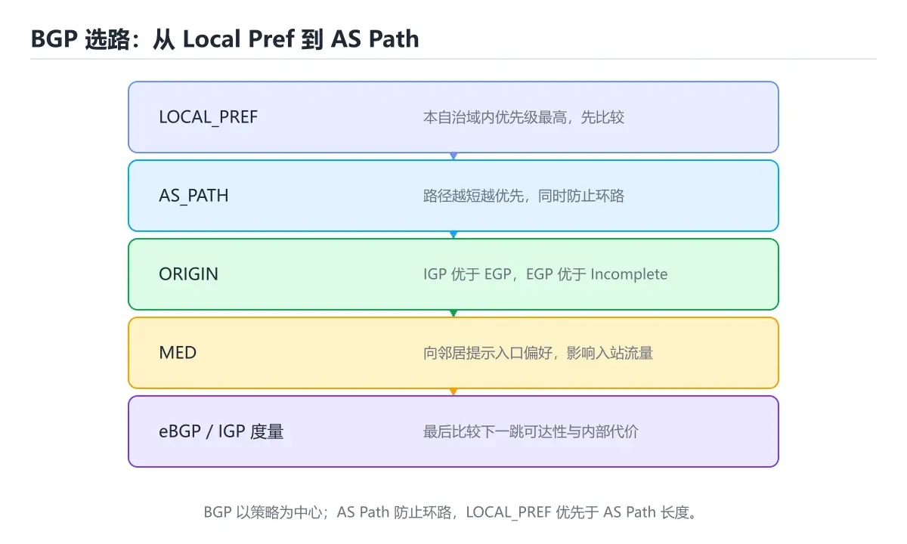
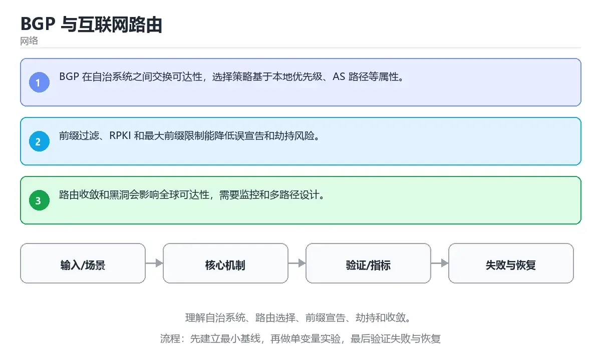

# BGP 与互联网路由

> 内容更新时间：2026-10-06 · 学习阶段：高级 · 预计用时：40 分钟





## 本节知识框架

**课程定位**：所属分类 `network`（网络），课程主题 `BGP 与互联网路由`，学习阶段 高级，建议用时 40 分钟。

本课主线：理解自治系统、路由选择、前缀宣告、劫持和收敛。

**学完本课应当能够**
- 说清 `BGP` 与 `自治系统` 的含义与区别，并各举一个正例和一个反例。
- 用本课示例验证最长前缀匹配与选路属性，记录输入、输出与失败条件。
- 遇到「把边界网关协议当内部路由协议用」这类问题时，能说出触发条件与修复顺序。

### 复习清单

- [ ] 能用自己的话说明 BGP 传播的是路径向量而不是完整拓扑，并给出一个只看跳数会选错的例子。
- [ ] 能按顺序说出本地优先级、AS_PATH 长度、起源类型与 MED 的先后关系。
- [ ] 能解释一个更具体的 /25 前缀为什么会压过合法的 /24。
- [ ] 能运行本课示例，记录正常输出和改动一个属性后的输出差异。
- [ ] 能完成一次自测，并把错题对照错误表定位原因。

## 核心概念定义

| 术语 | 操作性定义 | 常见边界与风险 |
| --- | --- | --- |
| BGP | 运行在 TCP 179 端口、在自治系统之间交换前缀可达信息的外部网关协议，用路径向量与属性描述路由。 | 它默认只相信邻居的宣告，配置错误或恶意前缀会被继续传播；BGP 不负责域内选路，也不会自动验证前缀归属。 |
| 自治系统 | 由一个管理实体运营、对外使用统一路由策略的一组路由器与 IP 前缀，用 AS 号标识。 | iBGP 要求同一 AS 内所有边界路由器看到一致的路由，缺少全互联或路由反射器时，控制平面有路由而数据平面不转发。 |
| 路由劫持 | 未经授权宣告不属于自己的前缀，或宣告更具体的子前缀，使最长前缀匹配把流量引向劫持者。 | 一个 /25 可以压过合法的 /24；RPKI 只验证起源 AS 是否有权宣告，不验证整条 AS_PATH 是否真实。 |
| 收敛 | 拓扑或策略变化后，所有相关路由器重新计算并稳定到一致可用路由的过程。 | 收敛窗口内新旧路由可能并存，表现为丢包、绕远或短暂成环；窗口长度要按故障检测、MRAI 与跳数一起估算。 |

## 原理与运行机制

BGP 的工作可以拆成四个问题：谁和谁建立会话，路由长什么样，多条路由怎么选，变化后多久稳定。把这四个问题分开看，排障时就不会一上来就盯着 `show ip bgp` 的输出猜。

### 自治系统、eBGP 与 iBGP

自治系统（Autonomous System，AS）是一个对外使用统一路由策略的管理域。互联网由数万个 AS 互联而成，AS 号有 16 位与 32 位两种写法，私用范围是 64512–65534 与 4200000000–4294967294，和私有 IP 一样不能出现在公网路由里。

BGP 会话分两类：

- **eBGP**：不同 AS 之间的会话。邻居通常直连，默认 TTL 为 1，路由传进来时下一跳会改成自己，AS_PATH 在发出前追加本 AS 号。
- **iBGP**：同一 AS 内部的会话。下一跳默认保持不变，从 iBGP 邻居学到的路由不会再传给另一个 iBGP 邻居，避免 AS 内出现环路。

iBGP 的“不转发给 iBGP 邻居”规则带来一个直接后果：同一 AS 内所有需要出口流量的边界路由器，要么两两建立全互联会话，要么用路由反射器（Route Reflector，RR）把路由反射给客户端。全互联的会话数是 `n × (n − 1) / 2`，10 台边界路由器就需要 45 条会话，50 台需要 1225 条，所以大型网络基本都会用 RR 或联盟（confederation）。

### 路径向量与 AS_PATH

BGP 不传播完整拓扑，而是传播“到某个前缀要经过哪些 AS”的路径向量。每条路由至少带这些信息：

| 字段 | 含义 | 在选路中的作用 |
| --- | --- | --- |
| 前缀 | 可达的 IP 网段，例如 `203.0.113.0/24` | 决定这条路由服务哪些目的地址 |
| AS_PATH | 路由经过的 AS 序列 | 防环与比较路径长短 |
| NEXT_HOP | 下一跳 IP | 数据平面实际转发到的地址 |
| ORIGIN | 路由来源类型，IGP、EGP 或 INCOMPLETE | 路径长度相同时比较来源可信度 |
| LOCAL_PREF | 本 AS 内部的偏好值，默认 100 | 本 AS 出向流量的第一决策点 |
| MED | 多出口鉴别器，向邻居建议入口 | 影响相邻 AS 选择哪个入口 |
| COMMUNITY | 路由标签，用于策略匹配 | 打标后批量过滤或调整属性 |

AS_PATH 有两个作用。第一是选路，路径越短通常越优先。第二是防环，路由器收到一条 AS_PATH 中包含自己 AS 号的路由时会直接丢弃。这个检查只看 AS 号，不看前缀，所以伪造 AS_PATH 可以绕过防环，也会污染其他网络的选路。

### 选路是属性字典序，不是最短路径

BGP 对同一个前缀的多条候选路由逐项比较，先出现差异的那一项决定结果，后面的属性不再看。常见实现顺序如下：

1. 最高 Weight，Cisco 私有属性，只在本路由器生效。
2. 最高 LOCAL_PREF，在本 AS 内传播。
3. 本地起源的路由，例如 `network` 或聚合产生的路由。
4. 最短 AS_PATH。
5. 最低 ORIGIN，IGP 优于 EGP，EGP 优于 INCOMPLETE。
6. 最低 MED，通常只比较来自同一个邻居 AS 的路由。
7. eBGP 路由优先于 iBGP 路由。
8. 到 NEXT_HOP 的最低 IGP 度量。
9. 最老的 eBGP 路由。
10. 最低 Router ID。
11. 最低邻居地址。

这张表解释了一个常见困惑：为什么跳数更多的路径反而被选中。下面用三条候选路由做一次推演：

| 候选 | LOCAL_PREF | AS_PATH | ORIGIN | MED | 结果 |
| --- | --- | --- | --- | --- | --- |
| A | 100 | 64500 → 64510 | IGP | 50 | 先被 B 击败 |
| B | 200 | 64500 → 64520 → 64530 | IGP | 10 | 胜出 |
| C | 100 | 64500 → 64540 | EGP | 5 | LOCAL_PREF 低于 B |

B 的 AS_PATH 最长，却因为 LOCAL_PREF 是 200 而胜出。把 B 的 LOCAL_PREF 改成 100 后，A 与 B 回到同一起点，此时 A 的 AS_PATH 更短，A 胜出。再把 A 的 AS_PATH 改成与 B 等长，才会轮到 ORIGIN 或 MED 决定。排障时先找出“第一个不同的属性”，比反复看路径长度有效得多。

还要注意 LOCAL_PREF 的作用范围：它只影响本 AS 的出向流量，也就是“我去别人那里走哪条路”。如果想让别人来自己这里走哪个入口，要用 AS_PATH prepend、MED 或社区属性，改自己的 LOCAL_PREF 对入向流量没有作用。

### 前缀宣告、聚合与过滤

路由器把自己拥有的前缀通过 `network` 命令或重分发放进 BGP，再传给邻居。常见控制手段有四类：

- **前缀过滤**：用 prefix-list 或 route-map 只允许自己拥有和客户拥有的前缀，拒绝默认路由、保留地址和过长的子前缀。
- **最大前缀限制**：给每个邻居设置 `maximum-prefix`，超过阈值就告警或断开会话，防止邻居误配置把整张表灌进来。
- **聚合**：把多个子前缀合并成一条汇总路由，减少表项。聚合配置不当会丢掉明细路由，或者把不属于自己的地址一起宣告出去。
- **默认拒绝**：按 RFC 8212 的思路，eBGP 邻居没有显式导入导出策略时不接受也不发送路由，避免“先通了再说”的临时配置留在生产环境。

过滤和聚合解决的是“该不该传”，选路属性解决的是“传了之后走哪条”。两者不能互相替代：只做过滤不做聚合，表仍然很大；只做聚合不做过滤，错误前缀照样会被传播。

### 劫持、路由泄露与 RPKI

前缀劫持是某个 AS 宣告了不属于自己的地址段。它有两种常见形态：

- **精确劫持**：宣告与他人完全相同的 /24。流量最终走谁，取决于各网络的 BGP 选路结果，可能一半走合法路径、一半走劫持路径。
- **子前缀劫持**：宣告一个更具体的 /25。由于转发使用最长前缀匹配，/25 会稳定压过合法的 /24，即使劫持者的 AS_PATH 更长。

路由泄露则是把从对等或上游学到的路由错误地传给另一个对等或上游，常见于“把客户路由误当成自己的路由”或“把上游路由又传回上游”。泄露不一定恶意，但会把大量流量引到不该走的链路，严重时造成大范围拥塞。

RPKI（Resource Public Key Infrastructure）用签名的 ROA（Route Origin Authorization）证明“这个 AS 有权宣告这个前缀”。路由器把 ROA 汇总成 VRP（Validated ROA Payload），对收到的路由做起源验证：

| 验证结果 | 含义 | 常见处理 |
| --- | --- | --- |
| Valid | 前缀与起源 AS 都能在 VRP 中找到 | 正常参与选路 |
| Invalid | 有 ROA 覆盖该前缀，但起源 AS 不匹配或前缀过长 | 丢弃或降低优先级 |
| NotFound | 没有 ROA 覆盖该前缀 | 按本地策略处理，通常仍接受 |

RPKI 的边界要说清楚：它验证的是“起源 AS 有没有资格宣告这个前缀”，不验证 AS_PATH 里的中间 AS 是否真实经过。一个拥有合法 ROA 的 AS 仍然可以伪造路径；要验证整条路径需要 BGPsec 一类机制，而 BGPsec 的部署范围远小于 RPKI。因此生产环境通常是 RPKI 起源验证、前缀过滤、最大前缀限制与外部监测一起用，而不是只开其中一项。

### 收敛计时器与故障路径

BGP 的收敛时间由几段时间叠加：

- **故障检测**：keepalive 常见 30 秒、hold timer 常见 90 秒，会话断开最坏要等到 hold timer 超时。启用 BFD 可以把检测压到毫秒级。
- **更新传播**：一条撤销或更新要逐跳传遍网络。MRAI（Minimum Route Advertisement Interval）把同一目的地的连续更新合并，eBGP 常见默认值是 30 秒，不同厂商和版本的默认值并不相同，有些实现默认 0。
- **重新选路与下发**：路由器重新比较候选路由，更新 RIB 与 FIB，再继续向邻居传播。

把这三段放在一起估算：一条前缀经过 5 跳，假设每跳 MRAI 最多 30 秒，检测等待 90 秒，那么最坏情况大约要 `90 + 5 × 30 = 240` 秒才能稳定。实际网络因为并行传播、批次合并和实现差异，通常不会真的跑满这个上界，但“变更后几十秒到几分钟不稳定”是正常现象，不是异常。

```text
故障发生
  ├─ 90 s 内：hold timer 未超时，邻居仍认为会话可用
  ├─ 90 s：会话断开，撤销开始传播
  ├─ 每跳最多 30 s：MRAI 合并更新
  └─ 5 跳后：约 240 s 达到新的稳定状态
```

这也解释了为什么维护窗口要留足时间，以及为什么关键业务不能只依赖一条 BGP 路径。BFD、优雅重启（Graceful Restart）、双向转发检测与多路径设计，都是在这个时间轴上做文章。

## 典型应用场景

BGP 不是“配好邻居就完事”的协议，真正的工程工作集中在策略、过滤与变更管理上。下面五类场景覆盖了最常见的生产问题。

| 场景 | 目标 | 关键动作 | 失败信号 |
| --- | --- | --- | --- |
| 双运营商出口 | 主备或按业务分流 | 用 LOCAL_PREF 控制出向，用 AS_PATH prepend 影响入向 | 出向切换了但入向没变，或两条链路来回震荡 |
| 数据中心双上联 | 单上联故障不断业务 | BFD 缩短检测，Graceful Restart 保留转发，双向过滤 | 会话断开后恢复很慢，或恢复瞬间出现黑洞 |
| IXP 对等互联 | 降低 transit 成本 | 只宣告自己的前缀，设置 maximum-prefix 与 IRR 过滤 | 对等方误宣告大量前缀，本地表项突增 |
| 前缀劫持应急 | 尽快恢复可达性 | RPKI ROA、起源验证、looking glass 取证、联系对端 NOC | 部分区域访问异常，traceroute 末跳落在陌生 AS |
| 例行变更 | 可回滚、可观测 | 维护窗口、变更前基线、MRAI 与收敛评估、回滚脚本 | 变更后 P99 延迟升高，丢包持续超过预期窗口 |

### 排错顺序

遇到“某个网段访问异常”时，按下面顺序排查，避免在错误的层面上打转：

1. **会话层**：邻居是否 Established，uptime 是否刚重置，最近有没有 hold timer 超时。
2. **接收层**：是否收到目标前缀，前缀长度是否正确，下一跳是否可达。
3. **选路层**：有多条候选时，哪一条胜出，第一个不同的属性是什么。
4. **转发表**：胜出的路由是否进入 FIB，下一跳接口与 ARP 是否正常。
5. **匹配层**：是否存在更具体的 /25 或 /26 抢走流量，是否被默认路由覆盖。
6. **策略层**：前缀过滤、community、maximum-prefix 是否在最近变更中被改动。

### 最小验证场景

- 准备：记录变更前的 `show bgp summary` 前缀数、目标前缀的 `show ip bgp <prefix>` 输出，以及一条到目标地址的 `mtr` 基线。
- 观察：变更后先看会话是否仍 Established，再看目标前缀的 AS_PATH 与下一跳是否变化，最后看 `mtr` 的丢包出现在第几跳。
- 判定：前缀仍然存在但下一跳改变，属于选路变化；前缀消失或变成更具体的前缀，属于宣告或过滤问题；会话断开且 hold timer 超时，属于检测与收敛问题。

### 选择与边界

- 使用 `BGP` 时，它适合在自治系统之间交换可达性，不适合替代 OSPF、IS-IS 这类域内协议；域内下一跳可达要先由 IGP 保证。
- 使用 `LOCAL_PREF` 时，它只在本 AS 内传播，适合控制出向流量；控制入向流量要用 AS_PATH prepend、MED 或与邻居约定的 community。
- 使用 `RPKI` 时，它只验证起源，不验证路径；对 NotFound 路由仍要结合前缀过滤与监测，不能因为“没 ROA”就一律放行。
- 使用 `路由收敛` 时，要把故障检测、MRAI 和传播跳数一起估算；只测一次切换时间，不能代表所有前缀与所有故障类型。

## 代码/协议/SQL 示例

### 最小可验证示例

下面的示例用 Python 模拟两个关键动作：先按 BGP 属性选出一条最优路由，再按最长前缀匹配决定数据包实际走哪条前缀。`gethostbyname` 只用来确认本机解析器可用，和 BGP 选路是两件独立的事。

```python
import ipaddress
import socket

print("resolver:", socket.gethostbyname("localhost"))

routes = [
    {"prefix": "203.0.113.0/24", "as_path": [64500, 64510], "local_pref": 100, "origin": "igp"},
    {"prefix": "203.0.113.0/24", "as_path": [64500, 64520, 64530], "local_pref": 200, "origin": "igp"},
    {"prefix": "203.0.113.128/25", "as_path": [64500, 64540], "local_pref": 100, "origin": "egp"},
]


def rank(route):
    return (
        -route["local_pref"],
        len(route["as_path"]),
        route["origin"] != "igp",
        route["as_path"],
    )


best = sorted(routes, key=rank)[0]
network = ipaddress.ip_network(best["prefix"])
probe = ipaddress.ip_address("203.0.113.200")
print("selected:", best["prefix"], best["as_path"])
print("matches:", probe in network)

candidates = [r for r in routes if probe in ipaddress.ip_network(r["prefix"])]
longest = max(
    candidates,
    key=lambda r: ipaddress.ip_network(r["prefix"]).prefixlen,
)
print("longest:", longest["prefix"])
```

**预期输出**

```text
resolver: 127.0.0.1
selected: 203.0.113.0/24 [64500, 64520, 64530]
matches: True
longest: 203.0.113.128/25
```

输出里有两个值得注意的点。第一，被选中的路由 AS_PATH 有 3 跳，比另一条 2 跳的路径更长，因为它的 LOCAL_PREF 是 200。第二，最终匹配到的前缀是 `/25` 而不是被选中的 `/24`，因为数据平面按最长前缀匹配转发，BGP 选出的“最优 /24”不会覆盖更具体的 `/25`。这正是子前缀劫持能生效的原因。

只改一个值：把第二条路由的 `local_pref` 从 200 改成 50，重新运行。`selected` 会变成 `203.0.113.0/24 [64500, 64510]`，`matches` 仍为 `True`，`longest` 仍为 `203.0.113.128/25`。这说明 LOCAL_PREF 改变了同一前缀的选路结果，但没有改变最长前缀匹配的规则。

## 时间/空间复杂度或性能分析

BGP 的成本主要在路由表规模、选路计算、更新传播和会话检测四条线上。

| 资源 | 量级 | 说明 |
| --- | --- | --- |
| 全球 IPv4 前缀 | 约 100 万条 | 不同观测点与时间会波动，默认路由不替代明细表 |
| 全球 IPv6 前缀 | 约 20 万条 | 仍在增长，长前缀比例更高 |
| 单条路由内存 | 约 100–300 字节 | 包含前缀、AS_PATH、属性与索引，路径越长占用越大 |
| 单邻居 Adj-RIB-In | 可达数十万到上百万条 | 多邻居会成倍增加内存，路由反射器尤其明显 |
| 选路计算 | 每个前缀 O(k) | k 是候选邻居数，全表初始化约为 O(P × k) |
| FIB 查找 | O(log P) 或硬件 O(1) | 软件 trie 与 TCAM 实现的差异很大 |
| 会话检测 | 90 秒 hold timer | BFD 可降到毫秒级，但需要两端支持 |
| 更新合并 | MRAI 常见 30 秒 | 厂商与版本默认值不同，不能当成固定常数 |

内存估算可以用一个粗公式：`内存 ≈ 前缀数 × 单条路由开销 × 邻居数`。100 万条 IPv4 路由、每条 200 字节、10 个邻居，仅 Adj-RIB-In 就约 2 GB，还没算 RIB、FIB 与策略结构。所以“邻居越多越好”在 BGP 里不成立，RR、路由聚合与按需下放都很重要。

收敛时间可以用另一条粗公式估算：`收敛 ≈ 故障检测 + 传播跳数 × 每跳合并间隔`。5 跳、每跳 30 秒、检测 90 秒，最坏约 240 秒；如果启用 BFD 把检测压到 1 秒，同样 5 跳会降到约 151 秒，差距主要来自检测而不是传播。这个公式只用于容量规划和维护窗口，不能替代真实测量。

**测量方法**：在变更前后分别记录 `show bgp summary` 的前缀数、目标前缀的 AS_PATH、`mtr` 的丢包位置和业务 P99 延迟。用 BMP 或 Route Views 这类数据源记录带时间戳的更新，才能区分“检测慢”“传播慢”和“选路结果不符合预期”。只看一次 `ping` 的结果，无法判断收敛是否完成。

## 常见误区与易错点

| 容易写错的做法 | 实际现象 | 原因与正确做法 |
| --- | --- | --- |
| 把边界网关协议当内部路由协议用 | 选路行为与预期不符，路由存在但数据不转发。 | 自治系统内部用 IGP 提供下一跳可达，之间用 BGP；iBGP 用全互联或路由反射器。 |
| 只调本地优先级不看路径属性 | 出向流量变了，入向流量没变，或流量绕远甚至出现黑洞。 | LOCAL_PREF 只管本 AS 出向；入向用 AS_PATH prepend、MED 与 community，并同时核对下一跳。 |
| 忽略路由收敛时间 | 变更后短时间内丢包，业务指标出现尖刺。 | 按 hold timer、MRAI 与跳数估算窗口，准备回滚配置并在窗口内持续观测。 |
| 以为 RPKI 能防所有劫持 | 起源合法的伪造路径仍被接受，流量还是被引走。 | RPKI 只验证起源；配合 BGPsec、前缀过滤、RPKI 起源验证与外部监测。 |
| iBGP 未配置 next-hop-self | BGP 表里有路由，但下一跳不可达，转发失败。 | 边界路由器对 iBGP 邻居设置 next-hop-self，或让下一跳地址由 IGP 可达。 |
| 未设置最大前缀限制 | 邻居误宣告大量前缀，内存与 CPU 被耗尽。 | 配置 maximum-prefix 阈值与告警，默认拒绝未明确允许的前缀。 |

### 现场 1：把边界网关协议当内部路由协议用

**症状**：iBGP 邻居是 Established，目标前缀也在 BGP 表里，但业务仍然不通，`traceroute` 在第一跳后就没有响应。

**根因与修复**：iBGP 只负责传播路由，不负责让下一跳可达。先确认下一跳地址是否被 IGP 覆盖，再检查边界路由器是否对 iBGP 邻居设置了 `next-hop-self`，最后确认 RR 的客户端是否收到了反射路由。修复顺序是：先补 IGP 可达性，再修下一跳，再查反射策略。

**自检**：在修复前后分别执行 `show ip bgp <prefix>` 与 `show ip route <next-hop>`。如果 BGP 表有路由而单播路由表没有下一跳，就说明问题在下一跳而不是前缀宣告。

### 现场 2：只调本地优先级不看路径属性

**症状**：运维把本地优先级调高后，本 AS 去往目标网段的流量确实换了出口，但外部用户访问本 AS 服务的路径没有变化，甚至开始绕远。

**根因与修复**：LOCAL_PREF 只在本 AS 内传播，外部邻居看不到。要影响入向流量，需要在对外宣告时做 AS_PATH prepend，或用 MED 向邻居建议入口，也可以与邻居约定 community。修复时先确认目标方向是出向还是入向，再选择对应属性。

**自检**：在外部 looking glass 上查询同一前缀，比较修改前后的 AS_PATH。如果外部看到的路径没变，说明改动只影响了本地出向。

### 现场 3：忽略路由收敛时间

**症状**：变更完成后业务出现 1–3 分钟丢包，之后自行恢复，监控上表现为一个尖刺。

**根因与修复**：会话检测、MRAI 合并与逐跳传播叠加，收敛窗口内新旧路由并存。修复不是“再等一会”，而是变更前评估窗口、变更中保留回滚路径、变更后按前缀逐条确认稳定。关键业务应使用 BFD、Graceful Restart 或多路径设计缩短不可用时间。

**自检**：记录变更开始时间、会话断开时间、目标前缀重新出现时间和业务恢复时间。四段时间对不上时，分别检查检测、传播和选路，而不是笼统地说“BGP 慢”。

### 现场 4：RPKI 验证通过但路径被伪造

**症状**：前缀的 RPKI 状态是 Valid，但流量仍然经过一个不该出现的 AS，延迟和路径都不对。

**根因与修复**：RPKI 只验证起源 AS 是否有权宣告该前缀，不验证 AS_PATH 的中间节点。攻击者可以借用合法起源伪造路径。修复要结合 BGPsec、邻居前缀过滤、路径异常监测与对端确认，不能只依赖 ROA 状态。

**自检**：在多个 looking glass 上查询同一前缀，比较 AS_PATH 的差异。如果不同观测点看到的路径不一致，优先怀疑路径伪造或路由泄露，而不是本地策略。

### 现场 5：iBGP 下一跳不可达

**症状**：路由反射器把路由反射给了客户端，客户端 BGP 表里有前缀，但 FIB 里没有对应的下一跳。

**根因与修复**：iBGP 默认不改变下一跳，客户端拿到的 NEXT_HOP 可能是反射器不认识的地址。修复方式是让边界路由器对 iBGP 邻居设置 `next-hop-self`，或者确保下一跳地址在 IGP 中可达。只改 BGP 策略而不修 IGP，问题会反复出现。

**自检**：在客户端执行 `show ip bgp <prefix>` 看 NEXT_HOP，再执行 `show ip route <next-hop>` 看是否有精确匹配。两者缺一，就说明下一跳链路没有打通。

## 与其他知识点的关系

BGP 站在 IP 转发与域内路由之上，又直接决定跨网络的可用性与安全性。下面几门课是本课的直接前置或延伸。

| 课程 | 关系 | 本课用到的部分 |
| --- | --- | --- |
| 《TCP/IP 协议栈》 | 提供 IP 转发、路由表与下一跳的基础 | 最长前缀匹配、NEXT_HOP、转发表 |
| 《IP、子网与传输层深入》 | 解释 CIDR 与子网划分如何决定前缀粒度 | /24 与 /25 的匹配差异、聚合边界 |
| 《网络攻击与防护》 | 把劫持与路由泄露放进攻击面分析 | 前缀过滤、RPKI、异常监测 |
| 《网络性能调优》 | 收敛窗口与故障检测直接影响可用性 | hold timer、BFD、P99 延迟 |
| 《DNS 域名解析》 | 域名解析结果最终落到某个前缀 | 解析异常与路由异常的区分 |

学习顺序上，先掌握 IP 转发与最长前缀匹配，再理解 IGP 如何提供下一跳可达性，最后进入 BGP 的路径向量、属性选路与安全机制。反过来，如果只会背 BGP 属性表却不懂最长前缀匹配，就很难解释子前缀劫持为什么能生效。

## 自测题与参考答案

> 先独立作答，再对照参考答案；答案都能在本课正文、术语表或错误表里找到依据。

### 自测 1（概念复述）

不看正文，写出 `BGP` 的操作性定义，并说明它与 `自治系统` 的区别。

**参考答案**：BGP 是运行在 TCP 179 端口、在自治系统之间交换前缀可达信息的外部网关协议，用路径向量与属性描述路由。自治系统是由一个管理实体运营、对外使用统一路由策略的一组路由器与 IP 前缀。BGP 是协议与会话，自治系统是管理域与路由策略的边界。

### 自测 2（排错）

本课错误表记录了「把边界网关协议当内部路由协议用」这类做法。请写出它会出现的现象、根因，以及修复顺序。

**参考答案**：现象是选路行为与预期不符，路由存在但数据不转发。根因是 iBGP 只传播路由，不保证下一跳可达。修复顺序是先用 IGP 打通下一跳，再检查 `next-hop-self`，再确认路由反射器与全互联配置，最后回归业务路径。

### 自测 3（动手验证）

运行本课的 `text` 示例，把第二条路由的 `local_pref` 从 200 改成 50，记录两次输出的差异。

**参考答案**：原输出中 `selected` 是 `203.0.113.0/24 [64500, 64520, 64530]`，修改后变成 `203.0.113.0/24 [64500, 64510]`。`matches` 仍为 `True`，`longest` 仍为 `203.0.113.128/25`。这说明 LOCAL_PREF 改变了同一前缀的选路结果，但没有改变最长前缀匹配。

### 自测 4（代码阅读）

阅读本课的示例，说明它体现了 `BGP` 的哪一条性质，并指出改动哪个输入会让这条性质不再成立。

**参考答案**：示例体现了“BGP 逐项比较属性、先出现差异的属性决定结果”，被选中的路由 AS_PATH 更长但 LOCAL_PREF 更高。如果把所有候选的 LOCAL_PREF 改成相同值，LOCAL_PREF 就不再决定结果，比较会进入 AS_PATH 长度这一项。

### 自测 5（迁移）

把 `BGP 与互联网路由` 的方法迁移到自己的项目：围绕 `BGP` 写出一个与错误表同类的风险点，并说明触发条件和检验方式。

**参考答案**：例如「iBGP 未配置 next-hop-self」。触发条件是边界路由器把外部路由反射给 iBGP 客户端，而客户端无法通过 IGP 到达原始下一跳。检验方式是在客户端同时检查 `show ip bgp` 的 NEXT_HOP 与 `show ip route` 的精确匹配，确认两者都存在。

### 自测 6（对比）

用一个表格对比 `BGP` 与 `自治系统`：各写一行适用场景、一行失败表现。

**参考答案**：BGP 适用于跨自治系统交换前缀，失败表现是会话断开、前缀消失或选路不符合策略。自治系统是管理域与统一策略的边界，失败表现是域内路由不一致、iBGP 全互联缺失或下一跳不可达。两者一个是协议机制，一个是管理范围。

### 自测 7（排错顺序）

面对「前缀劫持」引发的问题，请把“确认异常 → 取证 → 缓解 → 回归”四步写成可执行的检查清单。

**参考答案**：第一步用多个 looking glass 确认异常前缀与异常 AS_PATH，记录时间与观测点；第二步保存 `show ip bgp`、BMP 或路由监测数据作为证据；第三步发布 ROA、启用起源验证或在前缀过滤中拒绝异常宣告，并联系对端 NOC；第四步在多个观测点确认流量回到合法路径，并持续观察前缀数量与延迟。

### 自测 8（边界判断）

针对 `路由劫持`，分别写出“防护可以生效”的条件和“防护不再足够”的条件。

**参考答案**：当劫持者宣告的前缀有 ROA、且起源 AS 与 ROA 不匹配时，启用 RPKI 起源验证的网络可以把它标记为 Invalid 并拒绝，防护生效。当劫持者使用合法起源 AS 伪造 AS_PATH，或观测网络没有部署 RPKI 起源验证时，RPKI 不再足够，需要 BGPsec、路径监测与邻居过滤共同补位。

### 自测 9（机制重建）

不看正文，按输入、转换、输出、验证四段重建 `BGP` → `自治系统` → `路由劫持` → `收敛` 的作用链。

**参考答案**：输入是各 AS 宣告的前缀与属性；转换是 BGP 会话传播路径向量，路由器按属性字典序选出最优路由；输出是转发表中的下一跳；验证是检查最长前缀匹配与 AS_PATH 是否符合预期。路由劫持在这个链条里篡改宣告或前缀长度，收敛则决定变化后多久恢复一致。

### 自测 10（综合排错）

在 `BGP 与互联网路由` 中，现象是 变更后短时间内丢包。请围绕 忽略路由收敛时间 写出最小复现、关键证据、修复动作和回归验证，并说明为什么不能只凭一次运行下结论。

**参考答案**：最小复现是在维护窗口内撤销一条前缀再恢复，记录业务丢包时间段。关键证据是会话断开时间、前缀重新出现时间与 `mtr` 丢包位置。修复动作是评估 hold timer、MRAI 与跳数，准备回滚并缩短检测时间。回归验证要同时覆盖正常路径与故障路径；一次运行可能刚好错过收敛窗口，只有多次、多前缀的观测才能说明问题是否解决。

### 自测 11（一分钟复述）

用每分钟约 200 字的速度复述 `BGP 与互联网路由`：先给主问题，再按顺序说出 `BGP`、`自治系统`、`路由劫持`、`收敛`，最后给一个失败案例。

**自评标准**：主问题必须对应 理解自治系统、路由选择、前缀宣告、劫持和收敛；每个术语都要能接上一句定义或边界；失败案例必须写成可观察现象，不能用“可能有风险”代替证据。

## 延伸阅读

想更直观地理解本课概念？推荐参阅以下图解专题：

- [图解一次网页请求的完整链路](visual_http_timeline.md)

## 术语速查

| 术语 | 一句话说明 |
| --- | --- |
| `BGP` | 在自治系统之间交换前缀可达信息的外部网关协议，运行在 TCP 179 端口。 |
| `自治系统` | 由同一管理实体运营、对外使用统一路由策略的一组路由器与 IP 前缀。 |
| `AS_PATH` | BGP 路径向量属性，记录路由经过的 AS 序列，用于选路和防环。 |
| `eBGP` | 不同自治系统之间的 BGP 会话，负责跨 AS 传递前缀。 |
| `iBGP` | 同一自治系统内部的 BGP 会话，要求全互联或路由反射器保持路由一致。 |
| `路由劫持` | 未经授权宣告他人前缀或更具体子前缀，把流量引向错误位置。 |
| `路由泄露` | 把从对等或上游学到的路由错误地传给另一个对等或上游，扩大传播范围。 |
| `RPKI` | 用签名 ROA 证明某 AS 有权宣告某前缀的资源公钥基础设施。 |
| `路由收敛` | 拓扑或策略变化后，相关路由器重新稳定到一致可用路由的过程。 |
| `MRAI` | 同一目的地连续更新的最小间隔，用来抑制 BGP 更新风暴。 |

**术语关系**：`BGP`（在自治系统之间交换前缀可达信息） → `自治系统`（统一路由策略的管理域） → `路由劫持`（未授权宣告前缀） → `路由收敛`（变化后重新稳定）。

## 考点精讲

`BGP 与互联网路由` 的题库有 5 道题，下面逐题给出题干、正确项与判断依据：先自己作答，再核对正确项，最后回到正文对应小节复核。

### 考点 1：第 1 题

- **题目**：在 `BGP 与互联网路由` 里，与 `BGP` 有关的说法中，哪一项最符合理解自治系统、路由选择、前缀宣告、劫持和收敛？
- **正确项**：BGP 在自治系统之间交换可达性，选择策略基于本地优先级、AS 路径等属性。
- **判断依据**：本题正确项是「BGP 在自治系统之间交换可达性，选择策略基于本地优先级、AS 路径等属性」。术语 BGP（BGP 与互联网路由）：在自治系统之间交换路由可达信息的外部网关协议，本题取「BGP 在自治系统之间交换可达性，选择策略基于本地优先级、AS 路径等属性」这条。易错点是把边界网关协议当内部路由协议用，会造成选路行为与预期不符，改法是自治系统内部用内部网关协议，之间用边界网关协议。

### 考点 2：第 2 题

- **题目**：在 `BGP 与互联网路由` 里，与 `BGP` 有关的说法中，哪一项最符合理解自治系统、路由选择、前缀宣告、劫持和收敛？（BGP 与互联网路由·网络 第 2 题）
- **正确项**：前缀过滤、RPKI 和最大前缀限制能降低误宣告和劫持风险。
- **判断依据**：本题正确项是「前缀过滤、RPKI 和最大前缀限制能降低误宣告和劫持风险」。术语 BGP（BGP 与互联网路由）：在自治系统之间交换路由可达信息的外部网关协议，本题取「前缀过滤、RPKI 和最大前缀限制能降低误宣告和劫持风险」这条。易错点是只调本地优先级不看路径属性，会造成流量绕远甚至出现黑洞，改法是结合自治系统路径、下一跳与社区属性一起排查。

### 考点 3：第 3 题

- **题目**：按“BGP 与互联网路由”中 BGP、自治系统、路由劫持 的实践顺序，把四个步骤排成从准备到复盘的合理顺序。
- **正确项**：先明确 BGP 的输入、输出与约束 → 写出最小示例并核对 自治系统 的基线结果 → 只改一个变量，记录边界与失败路径的变化 → 固定版本与证据，把“BGP 与互联网路由”的结论写成可复现记录
- **判断依据**：按《BGP 与互联网路由》正文的先后，本题顺序是「先明确 BGP 的输入、输出与约束」 → 「写出最小示例并核对 自治系统 的基线结果」 → 「只改一个变量，记录边界与失败路径的变化」 → 「固定版本与证据，把“BGP 与互联网路由”的结论写成可复现记录」。术语 BGP（BGP 与互联网路由）：在自治系统之间交换路由可达信息的外部网关协议。易错点是把边界网关协议当内部路由协议用会造成选路行为与预期不符，改法是自治系统内部用内部网关协议，之间用边界网关协议。

### 考点 4：第 4 题

- **题目**：阅读 `BGP 与互联网路由` 的 `BGP` 示例。它服务于理解自治系统、路由选择、前缀宣告、劫持和收敛。代码中实际包含下列哪一项？
- **正确项**：调用了 `gethostbyname()`
- **判断依据**：本题正确项是「调用了 `gethostbyname()`」（BGP 与互联网路由）。术语 BGP（BGP 与互联网路由）：在自治系统之间交换路由可达信息的外部网关协议，本题取「调用了 `gethostbyname()`」这条。易错点是把边界网关协议当内部路由协议用，会造成选路行为与预期不符，改法是自治系统内部用内部网关协议，之间用边界网关协议。本题干扰项「调用了 `Err()`」不成立：展示代码里找不到 `Err()`。

### 考点 5：第 5 题

- **题目**：课程 `理解自治系统、路由选择、前缀宣告、劫持和收敛。`。在 `BGP 与互联网路由` 里，`BGP`、`自治系统` 与下面哪些选项属于同一层概念？（多选）
- **正确项**：BGP；自治系统
- **判断依据**：按《BGP 与互联网路由》的正文口径，本题要同时选中「BGP」、「自治系统」，漏掉任一项都算没答全。术语 BGP（BGP 与互联网路由）：在自治系统之间交换路由可达信息的外部网关协议。易错点是把边界网关协议当内部路由协议用会造成选路行为与预期不符，改法是自治系统内部用内部网关协议，之间用边界网关协议。本课《BGP 与互联网路由》要解决的是理解自治系统、路由选择、前缀宣告、劫持和收敛。

## 内容元数据

- 内容版本：v2.0
- 最后更新：2026-10-06
- 学习阶段：高级
- 适用环境：TCP/IP 协议族与支持 BGP-4 的路由器；本课聚焦自治系统之间的路由。
- 内容来源：内置结构化课程与工程实践整理
- 相关主题：BGP、自治系统、AS_PATH、路由劫持、RPKI、路由收敛
- 质量版本：P0 测验标准 + P1 覆盖扩展 + P2 体验补全

## 参考资料与复核

- 最后复核：2026-10-04
- 下次复核：2027-06-24
- 复核范围：版本兼容、协议行为、安全建议与工程实践
- 来源性质：官方文档、标准或权威教材；本课核对关键词：BGP、自治系统、路由劫持、收敛。

| 参考资料 | 本课用途 |
| --- | --- |
| [RFC 4271 BGP-4](https://www.rfc-editor.org/rfc/rfc4271) | BGP 消息、状态机与路径属性 |
| [RFC 6480 RPKI 架构](https://www.rfc-editor.org/rfc/rfc6480) | ROA 与起源验证的资源体系 |
| [RFC 8205 BGPsec](https://www.rfc-editor.org/rfc/rfc8205) | AS_PATH 的路径验证 |
| [RFC 7454 BGP 运维安全](https://www.rfc-editor.org/rfc/rfc7454) | 前缀过滤、最大前缀与运维实践 |

| [本课术语索引：BGP 与互联网路由](#核心概念定义) | 按本课输入、术语边界和错误表现逐项核对 |
> 「BGP 与互联网路由」的链接用于离线阅读后的延伸核对；App 不会自动联网。
