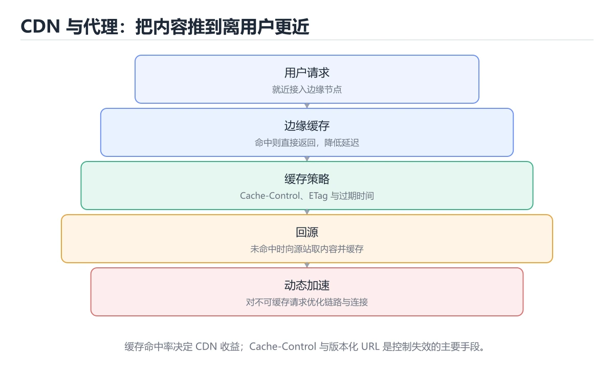
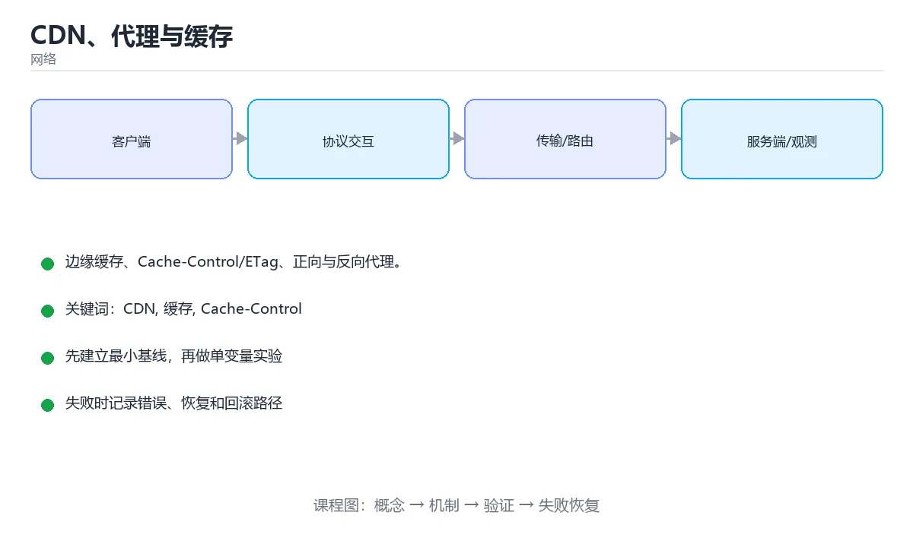

# CDN、代理与缓存





> 内容更新时间：2026-10-06 · 学习阶段：进阶 · 预计用时：30 分钟

## 本节知识框架

**课程定位**：所属分类 `network`（网络），课程主题 `CDN、代理与缓存`，学习阶段 进阶，建议用时 45 分钟。

本课主线：边缘缓存、Cache-Control/ETag、正向与反向代理。

**学完本课应当能够**
- 说清 `X-Forwarded-For` 与 `CDN` 的含义与区别，并各举一个正例和一个反例。
- 用本课示例验证 `缓存` 的行为，记录输入、输出与失败条件。
- 遇到「静态资源不带指纹却设长缓存」这类问题时，能说出触发条件与修复顺序。

### 复习清单

- [ ] 能不看正文复述本课核心术语，并指出一个边界或反例。
- [ ] 能运行或推演本课示例，记录输入、输出与失败现象。
- [ ] 能完成一次自测，并把错题对照错误表定位原因。

## 核心概念定义

| 术语 | 操作性定义 | 常见边界与风险 |
| --- | --- | --- |
| X-Forwarded-For | 反向代理转发时要带 X-Forwarded-For / X-Real-IP，否则后端只能看到代理的 IP。 | 只在「反向代理转发时要带 X-Forwarded-For / X-Real-IP，否则后端只能看到代理的 IP」这一前提下成立，换输入或换环境要重新验证。 |
| CDN | 把静态或可缓存内容分发到边缘节点，降低源站压力和用户延迟。 | 结论随输入规模变化，小规模成立不代表大规模成立，需要重新测量。 |
| 缓存 | 把计算或读取结果暂存到更快存储，后续请求直接复用。 | 易错：发版后用户仍加载旧文件；正确做法是文件名带哈希加长缓存。 |
| Cache-Control | Cache-Control: public, max-age=31536000, immutable。 | 只在「Cache-Control: public, max-age=31536000, immutable」这一前提下成立，换输入或换环境要重新验证。 |
| 正向代理 | 客户端 | 只在「客户端」这一前提下成立，换输入或换环境要重新验证。 |
| 反向代理 | 服务端 | 只在「服务端」这一前提下成立，换输入或换环境要重新验证。 |
| 透明代理 | 客户端（不可见） | 只在「客户端（不可见）」这一前提下成立，换输入或换环境要重新验证。 |
| API 网关 | 服务端 | 只在「服务端」这一前提下成立，换输入或换环境要重新验证。 |

## 原理与运行机制

### 机制总览

**失败路径（来自本课错误表）**
- 静态资源不带指纹却设长缓存 → 发版后用户仍加载旧文件 → 文件名带哈希加长缓存。
- 接口响应设 max-age → 用户看到过期数据 → 接口用 no-store 或短缓存加校验。
- 忘记 Vary → 压缩与非压缩内容串用 → 按 Accept-Encoding 等维度区分。

## 典型应用场景

- **静态资源不带指纹却设长缓存**：典型现象是发版后用户仍加载旧文件；正确做法是文件名带哈希加长缓存。
- **接口响应设 max-age**：典型现象是用户看到过期数据；正确做法是接口用 no-store 或短缓存加校验。
- **忘记 Vary**：典型现象是压缩与非压缩内容串用；正确做法是按 Accept-Encoding 等维度区分。

### 最小验证场景

- 准备：保留 `nginx` 示例的原始输入，先记录 `CDN、代理与缓存` 的基线输出和完整运行命令。
- 观察：先核对 出现字面量 `no-store`，再改变一个与 `X-Forwarded-For` 相关的条件。
- 判定：新结果与 `CDN、代理与缓存` 的基线不同不等于错误；只有当差异破坏了 `X-Forwarded-For` 的定义或错误表中的约束，才判定为失败。

### 选择与边界

- 使用 `X-Forwarded-For` 时，先满足它的定义：反向代理转发时要带 `X-Forwarded-For` / `X-Real-IP`，否则后端只能看到代理的 IP；只在「反向代理转发时要带 `X-Forwarded-For` / `X-Real-IP`，否则后端只能看到代理的 IP」这一前提下成立，换输入或换环境要重新验证。
- 使用 `CDN` 时，先满足它的定义：把静态或可缓存内容分发到边缘节点，降低源站压力和用户延迟；结论随输入规模变化，小规模成立不代表大规模成立，需要重新测量。
- 使用 `缓存` 时，先满足它的定义：把计算或读取结果暂存到更快存储，后续请求直接复用；易错：发版后用户仍加载旧文件；正确做法是文件名带哈希加长缓存。
- 使用 `Cache-Control` 时，先满足它的定义：Cache-Control: public, max-age=31536000, immutable；只在「Cache-Control: public, max-age=31536000, immutable」这一前提下成立，换输入或换环境要重新验证。

## 代码/协议/SQL 示例

### 最小可验证示例

```text
用户 -> 就近边缘节点（命中缓存直接返回）
           └─ 未命中 -> 回源到源站 -> 缓存并返回
```

**教材衔接：为什么需要 CDN**

用户离源站越远，延迟越高。CDN 把静态资源缓存到**离用户最近的边缘节点**，同时分担源站流量。

```text
用户 -> 就近边缘节点（命中缓存直接返回）
           └─ 未命中 -> 回源到源站 -> 缓存并返回
```

**教材衔接：正向代理与反向代理**

| 类型 | 代理谁 | 典型用途 |
| --- | --- | --- |
| 正向代理 | 代表客户端 | 科学上网、企业出口、抓包 |
| 反向代理 | 代表服务器 | 负载均衡、TLS 卸载、限流、缓存 |

```nginx
# Nginx 反向代理 + 负载均衡
upstream backend {
    server 10.0.0.1:8080;
    server 10.0.0.2:8080;
}
server {
    listen 443 ssl;
    server_name example.com;
    location /api/ {
        proxy_pass http://backend;
        proxy_set_header X-Real-IP $remote_addr;
    }
}
```

反向代理转发时要带 `X-Forwarded-For` / `X-Real-IP`，否则后端只能看到代理的 IP。

## 时间/空间复杂度或性能分析

**性能关注点（CDN、代理与缓存）**：往返延迟与带宽是主要成本：记录 RTT、吞吐与重传率，区分局域网与真实链路。

**本课特有开销（CDN、代理与缓存 · CDN）**：缓存命中率比缓存实现本身更关键，先记录命中率与失效策略再谈优化。

**测量方法**：以 `CDN、代理与缓存` 的 `CDN` 场景为对象，固定输入跑一遍记录基线，再把规模或并发度提高一个数量级复测；两次结果的差值与波动范围才是结论依据。

## 常见误区与易错点

| 容易写错的做法 | 实际现象 | 原因与正确做法 |
| --- | --- | --- |
| 静态资源不带指纹却设长缓存 | 发版后用户仍加载旧文件。 | 文件名带哈希加长缓存。 |
| 接口响应设 max-age | 用户看到过期数据。 | 接口用 no-store 或短缓存加校验。 |
| 忘记 Vary | 压缩与非压缩内容串用。 | 按 Accept-Encoding 等维度区分。 |

### 现场 1：静态资源不带指纹却设长缓存

**症状**：发版后用户仍加载旧文件。

**根因与修复**：文件名带哈希加长缓存。

**自检**：在本课示例里复现「静态资源不带指纹却设长缓存」，改成文件名带哈希加长缓存后重跑；如果症状消失且失败路径按预期变化，说明定位正确。

### 现场 2：接口响应设 max-age

**症状**：用户看到过期数据。

**根因与修复**：接口用 no-store 或短缓存加校验。

**自检**：在本课示例里复现「接口响应设 max-age」，改成接口用 no-store 或短缓存加校验后重跑；如果症状消失且失败路径按预期变化，说明定位正确。

### 现场 3：忘记 Vary

**症状**：压缩与非压缩内容串用。

**根因与修复**：按 Accept-Encoding 等维度区分。

**自检**：在本课示例里复现「忘记 Vary」，改成按 Accept-Encoding 等维度区分后重跑；如果症状消失且失败路径按预期变化，说明定位正确。

## 与其他知识点的关系

**教材衔接：复习与迁移**

## 自测题与参考答案

> 先独立作答，再对照参考答案；答案都能在本课正文、术语表或错误表里找到依据。

### 自测 1（概念复述）

不看正文，写出 `X-Forwarded-For` 的操作性定义，并说明它与 `CDN` 的区别。

**参考答案**：反向代理转发时要带 `X-Forwarded-For` / `X-Real-IP`，否则后端只能看到代理的 IP。

`CDN` 的定位是：把静态或可缓存内容分发到边缘节点，降低源站压力和用户延迟；两者的差别要从适用对象与失败模式上说明。

### 自测 2（排错）

本课错误表记录了「静态资源不带指纹却设长缓存」这类做法。请写出它会出现的现象、根因，以及修复顺序。

**参考答案**：现象是发版后用户仍加载旧文件；正确做法是文件名带哈希加长缓存。修复时先复现现象并保留证据，再改动一处假设重跑，确认现象消失。

### 自测 3（动手验证）

运行本课的 `nginx` 示例，把其中的 `"no-store"` 换成一个边界值后重新运行，记录输出与错误信息。

**参考答案**：正常输入下 `nginx` 示例应当复现正文给出的结果；把 `"no-store"` 换成边界值后，如果结果改变或报错，先核对它是否满足 `CDN、代理与缓存` 中`X-Forwarded-For` 的适用范围，再检查错误表里是否有同类现象。

### 自测 4（代码阅读）

阅读本课开头的 `nginx` 示例，说明它体现了`X-Forwarded-For` 的哪一条性质，并指出改动哪个输入会让这条性质不再成立。

**参考答案**：`X-Forwarded-For` 的定义是 反向代理转发时要带 `X-Forwarded-For` / `X-Real-IP`，否则后端只能看到代理的 IP，示例正是在实现这条定义。改动与 `X-Forwarded-For` 有关的一个输入后，如果结果不再符合 `CDN、代理与缓存` 的正文描述，就说明该性质只在当前前提成立。

### 自测 5（迁移）

把 `CDN、代理与缓存` 的方法迁移到自己的项目：围绕 `X-Forwarded-For` 写出一个与错误表同类的风险点，并说明触发条件和检验方式。

**参考答案**：例如「忘记 Vary」，它会导致压缩与非压缩内容串用；检验方式是按按 Accept-Encoding 等维度区分改一处再复现，确认现象消失且没有引入新的失败分支。

### 自测 6（对比）

用一个表格对比 `X-Forwarded-For` 与 `CDN`：各写一行适用场景、一行失败表现。

**参考答案**：`X-Forwarded-For` 的定义是反向代理转发时要带 `X-Forwarded-For` / `X-Real-IP`，否则后端只能看到代理的 IP；`CDN` 的定义是把静态或可缓存内容分发到边缘节点，降低源站压力和用户延迟。两者的失败表现分别对应本课错误表里与本术语相关的行。

### 自测 7（排错顺序）

面对「静态资源不带指纹却设长缓存」引发的问题，请把“复现 发版后用户仍加载旧文件 → 保留证据 → 文件名带哈希加长缓存 → 回归验证”四步写成可执行的检查清单。

**参考答案**：第一步按发版后用户仍加载旧文件复现；第二步记录输入、版本与完整报错；第三步按文件名带哈希加长缓存只改一处；第四步重跑并确认失败路径也按预期变化。

### 自测 8（边界判断）

针对 `Cache-Control`，分别写出“可以使用”的条件和“结论不再成立”的条件。

**参考答案**：只在「Cache-Control: public, max-age=31536000, immutable」这一前提下成立，换输入或换环境要重新验证。 同时要把 `Cache-Control` 的定义 Cache-Control: public, max-age=31536000, immutable 与实际输入逐项对照。

### 自测 9（机制重建）

不看正文，按输入、转换、输出、验证四段重建 `X-Forwarded-For` → `CDN` → `缓存` → `Cache-Control` 的作用链。

**参考答案**：起点是 `X-Forwarded-For` 的定义 反向代理转发时要带 `X-Forwarded-For` / `X-Real-IP`，否则后端只能看到代理的 IP；中间每一步都保留可观察状态；终点由 `Cache-Control` 检查，失败时回到错误表定位第一个偏离定义的步骤。

### 自测 10（综合排错）

在 `CDN、代理与缓存` 中，现象是 压缩与非压缩内容串用。请围绕 忘记 Vary 写出最小复现、关键证据、修复动作和回归验证，并说明为什么不能只凭一次运行下结论。

**参考答案**：先复现 忘记 Vary，记录输入与完整错误；再按 按 Accept-Encoding 等维度区分 只改一处。回归时同时跑正常路径和边界路径，只有两次结果都可解释，才把修复视为完成。

### 自测 11（一分钟复述）

用每分钟约 200 字的速度复述 `CDN、代理与缓存`：先给主问题，再按顺序说出 `X-Forwarded-For`、`CDN`、`缓存`、`Cache-Control`，最后给一个失败案例。

**自评标准**：主问题必须对应 边缘缓存、Cache-Control/ETag、正向与反向代理；每个术语都要能接上一句定义或边界；失败案例必须写成可观察现象，不能用“可能有风险”代替证据。

## 延伸阅读

想更直观地理解本课概念？推荐参阅以下图解专题：

- [图解 CDN 缓存与回源](visual_cdn_cache.md)

## 术语速查

| 术语 | 一句话说明 |
| --- | --- |
| `X-Forwarded-For` | 反向代理转发时要带 `X-Forwarded-For` / `X-Real-IP`，否则后端只能看到代理的 IP。 |
| `CDN` | 把静态或可缓存内容分发到边缘节点，降低源站压力和用户延迟。 |
| `缓存` | 把计算或读取结果暂存到更快存储，后续请求直接复用。 |
| `Cache-Control` | Cache-Control: public, max-age=31536000, immutable。 |

**术语关系**：`X-Forwarded-For`（反向代理转发时要带 `X-Forwarded-For` / `X-Real-IP`） → `CDN`（把静态或可缓存内容分发到边缘节点） → `缓存`（把计算或读取结果暂存到更快存储） → `Cache-Control`（Cache-Control: public, max-age=31536000, immutable）。

## 考点精讲

`CDN、代理与缓存` 的题库有 6 道题，下面逐题给出题干、正确项与判断依据：先自己作答，再核对正确项，最后回到正文对应小节复核。

### 考点 1：第 1 题

- **题目**：Cache-Control: max-age 属于哪种缓存？
- **正确项**：强缓存
- **判断依据**：术语 缓存（CDN、代理与缓存）：把计算或读取结果暂存到更快存储，后续请求直接复用，本题取强缓存这条。易错点是静态资源不带指纹却设长缓存会造成发版后用户仍加载旧文件，改法是文件名带哈希加长缓存，判断时先确认输入和适用范围，对照 `CDN`、`缓存`、`Cache-Control`、`ETag` 复现一次，最后把错误表现与正确做法逐项对照，干扰项服务端缓存正踩在这条上。

### 考点 2：第 2 题

- **题目**：这段 `nginx` 代码对应 `CDN、代理与缓存` 的 `X-Forwarded-For`。课程要解决的是边缘缓存、Cache-Control/ETag、正向与反向代理。关于代码内容，哪一项说法准确？
- **正确项**：出现字面量 `no-store`
- **判断依据**：本题正确项是出现字面量 `no-store`。术语 X-Forwarded-For（CDN、代理与缓存）：反向代理转发时要带 `X-Forwarded-For` / `X-Real-IP`，否则后端只能看到代理的 IP，本题取出现字面量 `no-store`这条。易错点是静态资源不带指纹却设长缓存会造成发版后用户仍加载旧文件，改法是文件名带哈希加长缓存，干扰项出现字面量 `i2c write addr failed`正踩在这条上。

### 考点 3：第 3 题

- **题目**：围绕“CDN、代理与缓存”中的 CDN、缓存、Cache-Control，下列哪两项是本课强调的实践判断？
- **正确项**：验证 缓存 时要固定版本并覆盖边界输入，结论才可复现；学习 CDN 时要同时说明输入、输出和失败路径，不能只看正常流程
- **判断依据**：本题正确项是验证 缓存 时要固定版本并覆盖边界输入，结论才可复现。术语 CDN（CDN、代理与缓存）：把静态或可缓存内容分发到边缘节点，降低源站压力和用户延迟，本题取验证 缓存 时要固定版本并覆盖边界输入，结论才可复现这条。易错点是静态资源不带指纹却设长缓存会造成发版后用户仍加载旧文件，改法是文件名带哈希加长缓存，干扰项把 缓存 的单次运行结果当成所有版本和规模都成立正踩在这条上。

### 考点 4：第 4 题

- **题目**：正向代理与反向代理的区别是？
- **正确项**：正向代理代表客户端访问外部
- **判断依据**：本题正确项是正向代理代表客户端访问外部。术语 X-Forwarded-For（CDN、代理与缓存）：反向代理转发时要带 `X-Forwarded-For` / `X-Real-IP`，否则后端只能看到代理的 IP，本题取正向代理代表客户端访问外部这条。易错点是静态资源不带指纹却设长缓存会造成发版后用户仍加载旧文件，改法是文件名带哈希加长缓存，干扰项正向代理只能用于 HTTPS正踩在这条上。

### 考点 5：第 5 题

- **题目**：CDN 中的「回源」指的是？
- **正确项**：边缘节点缓存未命中或内容过期时
- **判断依据**：本题正确项是边缘节点缓存未命中或内容过期时。术语 CDN（CDN、代理与缓存）：把静态或可缓存内容分发到边缘节点，降低源站压力和用户延迟，本题取边缘节点缓存未命中或内容过期时这条。易错点是静态资源不带指纹却设长缓存会造成发版后用户仍加载旧文件，改法是文件名带哈希加长缓存，干扰项清空源站缓存正踩在这条上。

### 考点 6：第 6 题

- **题目**：填空：补齐下面这段术语说明中的空缺。课程 `边缘缓存、Cache-Control/ETag、正向与反向代理。`，这段说明是：`____`：把计算或读取结果暂存到更快存储，后续请求直接复用。空缺处应填哪个术语？
- **正确项**：缓存
- **判断依据**：涉及术语 缓存：把计算或读取结果暂存到更快存储，后续请求直接复用。易错点：静态资源不带指纹却设长缓存会造成发版后用户仍加载旧文件。正确做法：文件名带哈希加长缓存。判断时先确认输入和适用范围，对照 `CDN`、`缓存`、`Cache-Control`、`ETag` 复现一次，最后把错误表现与正确做法逐项对照。

### 考点 7：`X-Forwarded-For`

- **要点**：反向代理转发时要带 `X-Forwarded-For` / `X-Real-IP`，否则后端只能看到代理的 IP。
- **X-Forwarded-For 的边界**：只在「反向代理转发时要带 `X-Forwarded-For` / `X-Real-IP`，否则后端只能看到代理的 IP」这一前提下成立，换输入或换环境要重新验证。

### 考点 8：`CDN`

- **要点**：把静态或可缓存内容分发到边缘节点，降低源站压力和用户延迟。
- **CDN 的边界**：结论随输入规模变化，小规模成立不代表大规模成立，需要重新测量。

### 考点 9：`缓存`

- **要点**：把计算或读取结果暂存到更快存储，后续请求直接复用。
- **缓存 的边界**：易错：发版后用户仍加载旧文件；正确做法是文件名带哈希加长缓存。

### 考点 10：`Cache-Control`

- **要点**：Cache-Control: public, max-age=31536000, immutable。
- **Cache-Control 的边界**：只在「Cache-Control: public, max-age=31536000, immutable」这一前提下成立，换输入或换环境要重新验证。

### 考点 11：排错——静态资源不带指纹却设长缓存

- **现象**：发版后用户仍加载旧文件。
- **处理**：文件名带哈希加长缓存。

### 考点 12：排错——接口响应设 max-age

- **现象**：用户看到过期数据。
- **处理**：接口用 no-store 或短缓存加校验。

### 考点 13：综合辨析——`X-Forwarded-For` 与 `Cache-Control`

- **辨析点**：`X-Forwarded-For` 的定义是 反向代理转发时要带 `X-Forwarded-For` / `X-Real-IP`，否则后端只能看到代理的 IP；`Cache-Control` 的定义是 Cache-Control: public, max-age=31536000, immutable。
- **答题要求**：面对 `CDN、代理与缓存` 的题目，先判断描述的是 `X-Forwarded-For` 还是 `Cache-Control`，再归到对应定义，最后写出一个会让该定义失效的边界输入。

### 考点 14：排错评分点

- **现象分**：能写出 发版后用户仍加载旧文件，而不是只写“程序有错”。
- **证据分**：保留触发 静态资源不带指纹却设长缓存 的输入、版本和错误原文。
- **修复分**：按 文件名带哈希加长缓存 只改一处，并同时回归正常路径与边界路径。

## 内容元数据

- 内容版本：v2.0
- 最后更新：2026-10-06
- 学习阶段：进阶
- 适用环境：TCP/IP、HTTP/2、HTTP/3 与现代网络栈；本课聚焦其中的 CDN。
- 内容来源：内置结构化课程与工程实践整理
- 相关主题：CDN、缓存、Cache-Control、ETag、反向代理、Nginx
- 质量版本：P0 测验标准 + P1 覆盖扩展 + P2 体验补全

## 参考资料与复核

- 最后复核：2026-10-04
- 下次复核：2027-06-24
- 复核范围：版本兼容、API 行为、安全建议与工程实践
- 来源性质：官方文档、标准或权威教材；本课核对关键词：CDN、缓存、Cache-Control、ETag、反向代理、Nginx。

| 参考资料 | 本课用途 |
| --- | --- |
| [MDN HTTP](https://developer.mozilla.org/docs/Web/HTTP) | 浏览器视角的 HTTP |
| [RFC 9110 HTTP 语义](https://www.rfc-editor.org/rfc/rfc9110) | HTTP 方法、状态与缓存 |
| [RFC 9000 QUIC](https://www.rfc-editor.org/rfc/rfc9000) | QUIC 传输与连接迁移 |

| [本课术语索引：CDN、代理与缓存](#核心概念定义) | 按本课输入、术语边界和错误表现逐项核对 |
> 「CDN、代理与缓存」的链接用于离线阅读后的延伸核对；App 不会自动联网。