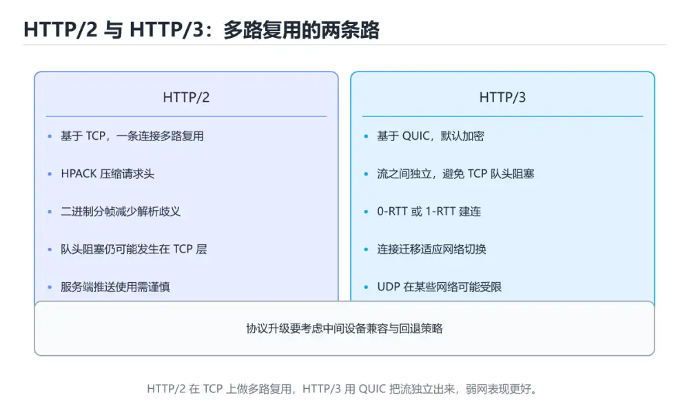
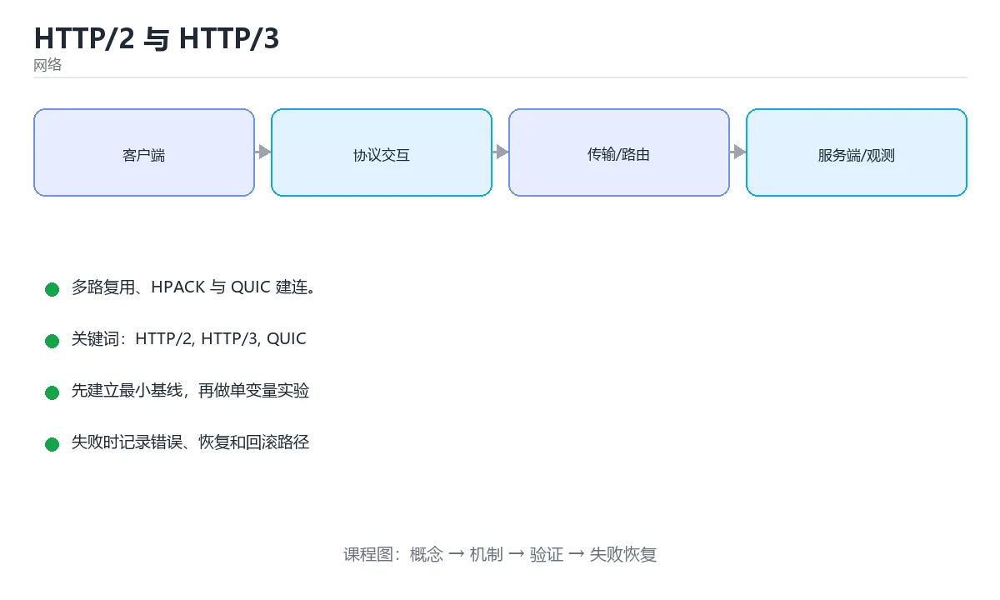

# HTTP/2 与 HTTP/3





> 内容更新时间：2026-10-06 · 学习阶段：高级 · 预计用时：30 分钟

## 本节知识框架

**课程定位**：所属分类 `network`（网络），课程主题 `HTTP/2 与 HTTP/3`，学习阶段 高级，建议用时 40 分钟。

本课主线：多路复用、HPACK 与 QUIC 建连。

**学完本课应当能够**
- 说清 `多路复用` 与 `队头阻塞` 的含义与区别，并各举一个正例和一个反例。
- 用本课示例验证 `QUIC` 的行为，记录输入、输出与失败条件。
- 遇到「认为 HTTP/2 没有队头阻塞」这类问题时，能说出触发条件与修复顺序。

### 复习清单

- [ ] 能用自己的话说明「HTTP/2 与 HTTP/3」里的 HTTP/2，再举一个它不成立的场景。
- [ ] 能运行「HTTP/2 与 HTTP/3」的示例，记录输入、输出与第一次失败的现象。
- [ ] 能完成一次自测，并把错题对照错误表定位原因。

## 核心概念定义

| 术语 | 操作性定义 | 常见边界与风险 |
| --- | --- | --- |
| 多路复用 | 一条连接上并发交错传输多个请求，省掉重复建连与连接排队。 | 只在请求真正并发时才有收益：单请求或串行压测看不出区别，大文件下载场景协议版本影响也有限。 |
| 队头阻塞 | 前面的响应或丢包卡住后续数据；HTTP/2 在 TCP 层仍有这个问题，HTTP/3 用 QUIC 消除。 | 易错：丢包时全部流受影响；正确做法是TCP 层队头阻塞仍存在，需 HTTP/3。 |
| QUIC | 基于 UDP 的传输协议，把加密、流控与多路复用做进协议本身，支持独立流与快速建连。 | 依赖 UDP：企业网络封 UDP 或七层网关不支持时一直走不了，局域网几乎不丢包也测不出它的优势。 |
| 0-RTT | 复用会话票据让首个请求随握手一起发出，代价是存在被重放的风险。 | 易错：非幂等请求也随票据提前发出，会话票据被重放时同一操作会执行两次；只对幂等请求启用。 |
| 流（Stream） | 逻辑上的独立请求响应通道 | 流是连接内部的逻辑通道，粒度小到可以单独取消，也容易被漏看；排查时要记录流取消与重传率，只看整条连接成功会掩盖问题。 |
| 帧（Frame） | HTTP/2 的最小传输单位 | 请求与响应被拆成多个帧交错发送，单个帧不完整就无从解读，也没有按帧重传这回事，补包仍由底层 TCP 负责。 |
| 多路复用 | 多个流在同一连接上交错传输 | 它解决的是应用层排队，底层一个 TCP 丢包仍会让同连接上所有流一起等重传；再搞域名分片会把收益抵消掉。 |
| HPACK / QPACK | 头部压缩算法，QPACK 解决 QUIC 乱序问题 | 靠静态表与动态表消掉重复头部，但 Cookie 与冗余头不精简，压完体积照样大；HTTP/2 与 HTTP/3 各自用不同算法。 |
| 服务器推送 | HTTP/2 特性，实践中收益有限，已逐步弃用 | 推的资源若客户端已缓存或最终没用上，就是纯浪费带宽；与其依赖推送，不如改用 `preload` 与 103 Early Hints。 |
| 优先级 | HTTP/2 的优先级树；HTTP/3 用紧急度 + 增量 | 优先级树实现复杂，标了也未必换来预期的发送顺序；HTTP/3 已把它简化成紧急度加增量，且不能靠它代替资源瘦身。 |
| ALPN | TLS 握手时协商应用协议（h2、h3） | 协商不上时会静默退回旧协议且无人知，要用示例里的 `grep -E` 核对 ALPN 结果并监控协商版本分布。 |
| 0-RTT | 会话复用下提前发送数据，需防重放 | 只有握过手、拿到会话票据的重连才能省掉这一往返，首次访问仍是 1-RTT；按 0 往返估算提速会高估收益。 |

## 原理与运行机制

### 机制总览

**教材衔接：HTTP/1.1 的瓶颈**

1. **队头阻塞**：同一连接上请求必须按序返回，前面慢会拖住后面。
2. **连接数限制**：浏览器对同域名并发连接有限制，只能靠多开连接绕过。
3. **头部重复**：每次请求都重复发送大量头部（Cookie、User-Agent）。

**教材衔接：HTTP/2 的改进**

| 特性 | 作用 |
| --- | --- |
| 二进制分帧 | 把请求与响应拆成帧，替代文本协议 |
| 多路复用 | 一条连接上并行多个流，解决应用层队头阻塞 |
| 头部压缩 HPACK | 用静态表与动态表压缩重复头部 |
| 服务器推送 | 主动推送资源（实践中效果有限，已逐步弃用） |
| 流优先级 | 标记资源优先级（实现复杂，HTTP/3 已简化） |

注意：HTTP/2 仍建立在 TCP 之上，**TCP 层的队头阻塞依然存在**——丢一个包会阻塞整条连接的所有流。

**教材衔接：HTTP/3 与 QUIC**

HTTP/3 改用基于 UDP 的 QUIC 协议：

1. **彻底解决队头阻塞**：各流独立重传，互不影响。
2. **0-RTT / 1-RTT 建连**：把 TLS 1.3 握手与传输握手合并，恢复连接几乎零延迟。
3. **连接迁移**：用连接 ID 而不是 IP+端口标识连接，切换 Wi-Fi/蜂窝网络不掉线。
4. **强制加密**：QUIC 默认加密，包括大部分传输元数据。

代价：UDP 在部分企业网络被限制，服务端实现与运维复杂度更高。

**教材衔接：实践建议**

| 场景 | 建议 |
| --- | --- |
| 普通网站 | 开启 HTTP/2，配合 TLS 与 Brotli 压缩 |
| 移动端 / 弱网 | 优先启用 HTTP/3（CDN 一般可一键开启） |
| 大量小请求 | 多路复用收益明显，减少域名分片 |
| 大文件下载 | 关注带宽与断点续传，协议版本影响较小 |

优化顺序建议：先做缓存与压缩、减少请求数与体积，再考虑协议升级；协议只是放大器，不能弥补糟糕的资源策略。

**教材衔接：队头阻塞对比演示**

假设一条连接上同时请求 A、B、C 三个资源，且传输中丢失了一个数据包：

| 版本 | 表现 |
| --- | --- |
| HTTP/1.1 | 请求串行，A 未返回前 B、C 排队等待（应用层队头阻塞） |
| HTTP/2 | 三条流并行发送，但共用一条 TCP 连接——丢包导致**所有流**一起等待重传（TCP 层队头阻塞） |
| HTTP/3 | 每条流独立重传，只有受影响的那条流等待，其余照常到达 |

这就是为什么弱网（丢包率高）环境下 HTTP/3 的收益最明显，而局域网（几乎不丢包）下三者差异不大。

**教材衔接：版本迁移与兼容实践**

1. 服务端同时支持 h2 与 h3（h3 通过 Alt-Svc 头通告），客户端自动择优。
2. 保留 HTTP/1.1 作为兜底，部分企业网络会封 UDP。
3. HTTP/2 下不要再做域名分片（会削弱多路复用收益），可去掉雪碧图与内联小图。
4. 观察指标：协议版本分布、握手耗时、首字节时间、重传率，用真实数据判断收益。

**教材衔接：深入补充：HTTP/2 与 HTTP/3 的取舍与边界**

### 一、把概念放回真实约束

学习HTTP/2 与 HTTP/3时，最容易只记住结论而忽略前提。先写出三个约束：数据规模、时间预算、可接受的失败方式；再判断 HTTP/2 与 HTTP/3 在这些约束下是否仍然成立。只要约束改变，原来的最优解就可能变成错误解。

## 典型应用场景

- **认为 HTTP/2 没有队头阻塞**：典型现象是丢包时全部流受影响；正确做法是TCP 层队头阻塞仍存在，需 HTTP/3。
- **继续做域名分片**：典型现象是连接数增加、收益为负；正确做法是HTTP/2 下收敛域名。
- **无脑使用 0-RTT**：典型现象是重放攻击风险；正确做法是只对幂等请求启用。
- **防火墙未放行 UDP**：典型现象是HTTP/3 一直不可用；正确做法是放行 UDP 并验证 Alt-Svc。

### 最小验证场景

- 准备：保留 `bash` 示例的原始输入，先记录 `HTTP/2 与 HTTP/3` 的基线输出和完整运行命令。
- 观察：先核对 出现字面量 `ALPN|HTTP/`，再改变一个与 `多路复用` 相关的条件。
- 判定：新结果与 `HTTP/2 与 HTTP/3` 的基线不同不等于错误；只有当差异破坏了 `多路复用` 的定义或错误表中的约束，才判定为失败。

### 选择与边界

- 使用 `多路复用` 时，一条连接上并发交错传输多个请求，省掉重复建连与连接排队；共享状态与调度顺序会改变结论，单线程或串行测试通过不等于并发下成立。
- 使用 `队头阻塞` 时，前面的响应或丢包卡住后续数据；HTTP/2 在 TCP 层仍有这个问题，HTTP/3 用 QUIC 消除；易错：丢包时全部流受影响；正确做法是TCP 层队头阻塞仍存在，需 HTTP/3。
- 使用 `QUIC` 时，基于 UDP 的传输协议，把加密、流控与多路复用做进协议本身，支持独立流与快速建连；网络延迟、超时与版本协商会改变行为，只在真实链路或多版本客户端上验证才算数。
- 使用 `0-RTT` 时，复用会话票据让首个请求随握手一起发出，代价是存在被重放的风险；易错：重放攻击风险；正确做法是只对幂等请求启用。

## 代码/协议/SQL 示例

### 最小可验证示例

```bash
# 检查服务端支持的协议版本
curl -I --http2 https://example.com
curl -I --http3 https://example.com          # 需要 curl 支持 HTTP/3
openssl s_client -connect example.com:443 -alpn h2 -brief

# 查看协商结果与连接复用情况
curl -v -o /dev/null -s https://example.com 2>&1 | grep -E 'ALPN|HTTP/'
```

**教材衔接：原文最小示例**

**运行方式**：运行 `HTTP/2 与 HTTP/3` 的示例时，用 `bash 文件名.sh` 运行；先 `bash -n` 做语法检查更稳妥。

## 时间/空间复杂度或性能分析

| 要点 | 说明 |
| --- | --- |
| 域名收敛 | HTTP/2 下单连接多路复用，域名分片反而有害 |
| 资源合并 | 不再为减少请求数而过度合并，避免缓存粒度变粗 |
| 服务端推送替代方案 | 用 `preload` / `103 Early Hints` |
| 头部体积 | 压缩后仍需精简 Cookie 与自定义头 |
| 拥塞控制 | QUIC 可插拔，常见 CUBIC 与 BBR |
| 中间设备 | HTTP/3 依赖 UDP，需确认防火墙与负载均衡支持 |
| 降级策略 | 客户端先用 HTTP/2，Alt-Svc 探测成功后再走 h3 |
| 观测 | 记录协商版本、握手耗时、流取消与重传率 |

**测量方法**：以 `HTTP/2 与 HTTP/3` 的 `HTTP/2` 场景为对象，固定输入跑一遍记录基线，再把规模或并发度提高一个数量级复测；两次结果的差值与波动范围才是结论依据。

## 常见误区与易错点

| 容易写错的做法 | 实际现象 | 原因与正确做法 |
| --- | --- | --- |
| 认为 HTTP/2 没有队头阻塞 | 丢包时全部流受影响 | TCP 层队头阻塞仍存在，需 HTTP/3 |
| 继续做域名分片 | 连接数增加、收益为负 | HTTP/2 下收敛域名 |
| 无脑使用 0-RTT | 重放攻击风险 | 只对幂等请求启用 |
| 防火墙未放行 UDP | HTTP/3 一直不可用 | 放行 UDP 并验证 Alt-Svc |
| 服务端推送滥用 | 带宽浪费 | 改用 preload 与 Early Hints |
| 忽略协商失败 | 用户走旧协议且无人知 | 监控协商版本分布 |
| 认为 HTTP/3 一定更快 | 高丢包与移动网络才明显 | 按场景实测对比 |
| 头部不做精简 | 压缩成本仍高 | 减少 Cookie 与冗余头 |
| 未更新负载均衡配置 | 连接异常或降级 | 确认七层网关支持并开启 h3 |
| 缺少回退与超时 | h3 探测失败后长时间不可用 | 设短探测超时并回退 h2 |

### 现场 1：认为 HTTP/2 没有队头阻塞

**症状**：丢包时全部流受影响。

**根因与修复**：TCP 层队头阻塞仍存在，需 HTTP/3。

**自检**：在本课示例里复现「认为 HTTP/2 没有队头阻塞」，改成TCP 层队头阻塞仍存在，需 HTTP/3后重跑；如果症状消失且失败路径按预期变化，说明定位正确。

### 现场 2：继续做域名分片

**症状**：连接数增加、收益为负。

**根因与修复**：HTTP/2 下收敛域名。

**自检**：在本课示例里复现「继续做域名分片」，改成HTTP/2 下收敛域名后重跑；如果症状消失且失败路径按预期变化，说明定位正确。

### 现场 3：无脑使用 0-RTT

**症状**：重放攻击风险。

**根因与修复**：只对幂等请求启用。

**自检**：在本课示例里复现「无脑使用 0-RTT」，改成只对幂等请求启用后重跑；如果症状消失且失败路径按预期变化，说明定位正确。

### 现场 4：防火墙未放行 UDP

**症状**：HTTP/3 一直不可用。

**根因与修复**：放行 UDP 并验证 Alt-Svc。

**自检**：在本课示例里复现「防火墙未放行 UDP」，改成放行 UDP 并验证 Alt-Svc后重跑；如果症状消失且失败路径按预期变化，说明定位正确。

### 现场 5：服务端推送滥用

**症状**：带宽浪费。

**根因与修复**：改用 preload 与 Early Hints。

**自检**：在本课示例里复现「服务端推送滥用」，改成改用 preload 与 Early Hints后重跑；如果症状消失且失败路径按预期变化，说明定位正确。

### 现场 6：忽略协商失败

**症状**：用户走旧协议且无人知。

**根因与修复**：监控协商版本分布。

**自检**：在本课示例里复现「忽略协商失败」，改成监控协商版本分布后重跑；如果症状消失且失败路径按预期变化，说明定位正确。

### 现场 7：认为 HTTP/3 一定更快

**症状**：高丢包与移动网络才明显。

**根因与修复**：按场景实测对比。

**自检**：在本课示例里复现「认为 HTTP/3 一定更快」，改成按场景实测对比后重跑；如果症状消失且失败路径按预期变化，说明定位正确。

### 现场 8：头部不做精简

**症状**：压缩成本仍高。

**根因与修复**：减少 Cookie 与冗余头。

**自检**：在本课示例里复现「头部不做精简」，改成减少 Cookie 与冗余头后重跑；如果症状消失且失败路径按预期变化，说明定位正确。

### 现场 9：未更新负载均衡配置

**症状**：连接异常或降级。

**根因与修复**：确认七层网关支持并开启 h3。

**自检**：在本课示例里复现「未更新负载均衡配置」，改成确认七层网关支持并开启 h3后重跑；如果症状消失且失败路径按预期变化，说明定位正确。

## 与其他知识点的关系

**教材衔接：版本对照速查**

| 维度 | HTTP/1.1 | HTTP/2 | HTTP/3 |
| --- | --- | --- | --- |
| 传输层 | TCP | TCP | QUIC（基于 UDP） |
| 并发方式 | 多连接或流水线 | 单连接多路复用 | 单连接多路复用（独立流） |
| 队头阻塞 | 有（连接级） | TCP 层仍有 | 基本消除（流级独立） |
| 头部压缩 | 无 | HPACK | QPACK |
| 建连 | TCP + TLS | TCP + TLS（ALPN 协商） | TLS 集成在 QUIC 内 |
| 握手往返 | 3 次以上 | 2 到 3 次 | 1 次（会话复用可 0 次） |
| 连接迁移 | 不支持 | 不支持 | 支持（连接 ID） |

**教材衔接：复习与迁移**

## 自测题与参考答案

> 先独立作答，再对照参考答案；答案都能在本课正文、术语表或错误表里找到依据。

### 自测 1（概念复述）

不看正文，写出 `多路复用` 的操作性定义，并说明它与 `队头阻塞` 的区别。

**参考答案**：一条连接上并发交错传输多个请求，省掉重复建连与连接排队。

`队头阻塞` 的定位是：前面的响应或丢包卡住后续数据；HTTP/2 在 TCP 层仍有这个问题，HTTP/3 用 QUIC 消除；两者的差别要从适用对象与失败模式上说明。

### 自测 2（排错）

本课错误表记录了「认为 HTTP/2 没有队头阻塞」这类做法。请写出它会出现的现象、根因，以及修复顺序。

**参考答案**：现象是丢包时全部流受影响；正确做法是TCP 层队头阻塞仍存在，需 HTTP/3。修复时先复现现象并保留证据，再改动一处假设重跑，确认现象消失。

### 自测 3（动手验证）

运行本课的 `bash` 示例，把其中的 `'ALPN|HTTP/'` 换成一个边界值后重新运行，记录输出与错误信息。

**参考答案**：正常输入下 `bash` 示例应当复现正文给出的结果；把 `'ALPN|HTTP/'` 换成边界值后，如果结果改变或报错，先核对它是否满足 `HTTP/2 与 HTTP/3` 中`多路复用` 的适用范围，再检查错误表里是否有同类现象。

### 自测 4（代码阅读）

阅读本课开头的 `bash` 示例，说明它体现了`多路复用` 的哪一条性质，并指出改动哪个输入会让这条性质不再成立。

**参考答案**：`多路复用` 的定义是 一条连接上并发交错传输多个请求，省掉重复建连与连接排队，示例正是在实现这条定义。改动与 `多路复用` 有关的一个输入后，如果结果不再符合 `HTTP/2 与 HTTP/3` 的正文描述，就说明该性质只在当前前提成立。

### 自测 5（迁移）

把 `HTTP/2 与 HTTP/3` 的方法迁移到自己的项目：围绕 `多路复用` 写出一个与错误表同类的风险点，并说明触发条件和检验方式。

**参考答案**：例如「缺少回退与超时」，它会导致h3 探测失败后长时间不可用；检验方式是按设短探测超时并回退 h2改一处再复现，确认现象消失且没有引入新的失败分支。

### 自测 6（对比）

用一个表格对比 `多路复用` 与 `队头阻塞`：各写一行适用场景、一行失败表现。

**参考答案**：`多路复用` 的定义是一条连接上并发交错传输多个请求，省掉重复建连与连接排队；`队头阻塞` 的定义是前面的响应或丢包卡住后续数据；HTTP/2 在 TCP 层仍有这个问题，HTTP/3 用 QUIC 消除。两者的失败表现分别对应本课错误表里与本术语相关的行。

### 自测 7（排错顺序）

面对「认为 HTTP/2 没有队头阻塞」引发的问题，请把“复现 丢包时全部流受影响 → 保留证据 → TCP 层队头阻塞仍存在，需 HTTP/3 → 回归验证”四步写成可执行的检查清单。

**参考答案**：第一步按丢包时全部流受影响复现；第二步记录输入、版本与完整报错；第三步按TCP 层队头阻塞仍存在，需 HTTP/3只改一处；第四步重跑并确认失败路径也按预期变化。

### 自测 8（边界判断）

针对 `0-RTT`，分别写出“可以使用”的条件和“结论不再成立”的条件。

**参考答案**：易错：重放攻击风险；正确做法是只对幂等请求启用。 同时要把 `0-RTT` 的定义 复用会话票据让首个请求随握手一起发出，代价是存在被重放的风险 与实际输入逐项对照。

### 自测 9（机制重建）

不看正文，按输入、转换、输出、验证四段重建 `多路复用` → `队头阻塞` → `QUIC` → `0-RTT` 的作用链。

**参考答案**：起点是 `多路复用` 的定义 一条连接上并发交错传输多个请求，省掉重复建连与连接排队；中间每一步都保留可观察状态；终点由 `0-RTT` 检查，失败时回到错误表定位第一个偏离定义的步骤。

### 自测 10（综合排错）

在 `HTTP/2 与 HTTP/3` 中，现象是 h3 探测失败后长时间不可用。请围绕 缺少回退与超时 写出最小复现、关键证据、修复动作和回归验证，并说明为什么不能只凭一次运行下结论。

**参考答案**：先复现 缺少回退与超时，记录输入与完整错误；再按 设短探测超时并回退 h2 只改一处。回归时同时跑正常路径和边界路径，只有两次结果都可解释，才把修复视为完成。

### 自测 11（一分钟复述）

用每分钟约 200 字的速度复述 `HTTP/2 与 HTTP/3`：先给主问题，再按顺序说出 `多路复用`、`队头阻塞`、`QUIC`、`0-RTT`，最后给一个失败案例。

**自评标准**：主问题必须对应 多路复用、HPACK 与 QUIC 建连；每个术语都要能接上一句定义或边界；失败案例必须写成可观察现象，不能用“可能有风险”代替证据。

## 术语速查

| 术语 | 一句话说明 |
| --- | --- |
| `多路复用` | 一条连接上并发交错传输多个请求，省掉重复建连与连接排队。 |
| `队头阻塞` | 前面的响应或丢包卡住后续数据；HTTP/2 在 TCP 层仍有这个问题，HTTP/3 用 QUIC 消除。 |
| `QUIC` | 基于 UDP 的传输协议，把加密、流控与多路复用做进协议本身，支持独立流与快速建连。 |
| `0-RTT` | 复用会话票据让首个请求随握手一起发出，代价是存在被重放的风险。 |

**术语关系**：`多路复用`（一条连接上并发交错传输多个请求） → `队头阻塞`（前面的响应或丢包卡住后续数据） → `QUIC`（基于 UDP 的传输协议） → `0-RTT`（复用会话票据让首个请求随握手一起发出）。

## 考点精讲

`HTTP/2 与 HTTP/3` 的题库有 6 道题，下面逐题给出题干、正确项与判断依据：先自己作答，再核对正确项，最后回到正文对应小节复核。

### 考点 1：第 1 题

- **题目**：阅读 `HTTP/2 与 HTTP/3` 的 `多路复用` 示例。它服务于多路复用、HPACK 与 QUIC 建连。代码中实际包含下列哪一项？
- **正确项**：出现字面量 `:443`
- **判断依据**：本题正确项是「出现字面量 `:443`」。术语 多路复用（HTTP/2 与 HTTP/3）：一条连接上并发交错传输多个请求，省掉重复建连与连接排队，本题取「出现字面量 `:443`」这条。易错点是认为 HTTP/2 没有队头阻塞，会造成丢包时全部流受影响，改法是TCP 层队头阻塞仍存在，需 HTTP/3。本题干扰项「出现字面量 `], prompt[`」不成立：展示代码里找不到 `], prompt[`。

### 考点 2：第 2 题

- **题目**：HTTP/2 仍然存在什么限制？
- **正确项**：TCP 层队头阻塞
- **判断依据**：本题正确项是「TCP 层队头阻塞」。术语 队头阻塞（HTTP/2 与 HTTP/3）：前面的响应或丢包卡住后续数据，HTTP/2 在 TCP 层仍有这个问题，HTTP/3 用 QUIC 消除，本题取「TCP 层队头阻塞」这条。易错点是继续做域名分片，会造成连接数增加、收益为负，改法是HTTP/2 下收敛域名。

### 考点 3：第 3 题

- **题目**：围绕“HTTP/2 与 HTTP/3”中的 HTTP/2、HTTP/3、QUIC，下列哪两项是本课强调的实践判断？
- **正确项**：学习 HTTP/2 时要同时说明输入、输出和失败路径，不能只看正常流程；验证 HTTP/3 时要固定版本并覆盖边界输入，结论才可复现
- **判断依据**：按《HTTP/2 与 HTTP/3》的正文口径，本题要同时选中「学习 HTTP/2 时要同时说明输入、输出和失败路径，不能只看正常流程」、「验证 HTTP/3 时要固定版本并覆盖边界输入，结论才可复现」，漏掉任一项都算没答全。术语 QUIC（HTTP/2 与 HTTP/3）：基于 UDP 的传输协议，把加密、流控与多路复用做进协议本身，支持独立流与快速建连。易错点是无脑使用 0-RTT，会造成重放攻击风险，改法是只对幂等请求启用。

### 考点 4：第 4 题

- **题目**：HTTP/2 的多路复用指什么？
- **正确项**：在同一条 TCP 连接上并发多个流
- **判断依据**：本题正确项是「在同一条 TCP 连接上并发多个流」。术语 多路复用（HTTP/2 与 HTTP/3）：一条连接上并发交错传输多个请求，省掉重复建连与连接排队，本题取「在同一条 TCP 连接上并发多个流」这条。易错点是防火墙未放行 UDP，会造成HTTP/3 一直不可用，改法是放行 UDP 并验证 Alt-Svc。

### 考点 5：第 5 题

- **题目**：QUIC（HTTP/3）相比 TCP + TLS 的建连差异是？
- **正确项**：基于 UDP 并把 TLS 集成进握手
- **判断依据**：本题正确项是「基于 UDP 并把 TLS 集成进握手」。术语 QUIC（HTTP/2 与 HTTP/3）：基于 UDP 的传输协议，把加密、流控与多路复用做进协议本身，支持独立流与快速建连，本题取「基于 UDP 并把 TLS 集成进握手」这条。易错点是服务端推送滥用，会造成带宽浪费，改法是改用 preload 与 Early Hints。

### 考点 6：第 6 题

- **题目**：填空：补齐下面这段术语说明中的空缺。课程 `多路复用、HPACK 与 QUIC 建连。`，这段说明是：`____`：一条连接上并发交错传输多个请求，省掉重复建连与连接排队。空缺处应填哪个术语？
- **正确项**：多路复用
- **判断依据**：涉及术语 多路复用：一条连接上并发交错传输多个请求，省掉重复建连与连接排队。易错点：认为 HTTP/2 没有队头阻塞会造成丢包时全部流受影响。正确做法：TCP 层队头阻塞仍存在，需 HTTP/3。判断时先确认输入和适用范围，对照 `HTTP/2`、`HTTP/3`、`QUIC`、`多路复用` 复现一次，最后把错误表现与正确做法逐项对照。

### 考点 7：`多路复用`

- **要点**：一条连接上并发交错传输多个请求，省掉重复建连与连接排队。
- **多路复用 的边界**：共享状态与调度顺序会改变结论，单线程或串行测试通过不等于并发下成立。

### 考点 8：`队头阻塞`

- **要点**：前面的响应或丢包卡住后续数据；HTTP/2 在 TCP 层仍有这个问题，HTTP/3 用 QUIC 消除。
- **队头阻塞 的边界**：易错：丢包时全部流受影响；正确做法是TCP 层队头阻塞仍存在，需 HTTP/3。

### 考点 9：`QUIC`

- **要点**：基于 UDP 的传输协议，把加密、流控与多路复用做进协议本身，支持独立流与快速建连。
- **QUIC 的边界**：网络延迟、超时与版本协商会改变行为，只在真实链路或多版本客户端上验证才算数。

### 考点 10：`0-RTT`

- **要点**：复用会话票据让首个请求随握手一起发出，代价是存在被重放的风险。
- **0-RTT 的边界**：易错：重放攻击风险；正确做法是只对幂等请求启用。

### 考点 11：排错——认为 HTTP/2 没有队头阻塞

- **现象**：丢包时全部流受影响。
- **处理**：TCP 层队头阻塞仍存在，需 HTTP/3。

### 考点 12：排错——继续做域名分片

- **现象**：连接数增加、收益为负。
- **处理**：HTTP/2 下收敛域名。

### 考点 13：综合辨析——`多路复用` 与 `0-RTT`

- **辨析点**：`多路复用` 的定义是 一条连接上并发交错传输多个请求，省掉重复建连与连接排队；`0-RTT` 的定义是 复用会话票据让首个请求随握手一起发出，代价是存在被重放的风险。
- **答题要求**：面对 `HTTP/2 与 HTTP/3` 的题目，先判断描述的是 `多路复用` 还是 `0-RTT`，再归到对应定义，最后写出一个会让该定义失效的边界输入。

### 考点 14：排错评分点

- **现象分**：能写出 丢包时全部流受影响，而不是只写“程序有错”。
- **证据分**：保留触发 认为 HTTP/2 没有队头阻塞 的输入、版本和错误原文。
- **修复分**：按 TCP 层队头阻塞仍存在，需 HTTP/3 只改一处，并同时回归正常路径与边界路径。

## 内容元数据

- 内容版本：v2.0
- 最后更新：2026-10-06
- 学习阶段：高级
- 适用环境：TCP/IP、HTTP/2、HTTP/3 与现代网络栈；本课聚焦其中的 HTTP/2。
- 内容来源：内置结构化课程与工程实践整理
- 相关主题：HTTP/2、HTTP/3、QUIC、多路复用、头部压缩
- 质量版本：P0 测验标准 + P1 覆盖扩展 + P2 体验补全

## 参考资料与复核

- 最后复核：2026-10-04
- 下次复核：2027-06-24
- 复核范围：版本兼容、API 行为、安全建议与工程实践
- 来源性质：官方文档、标准或权威教材；本课核对关键词：HTTP/2、HTTP/3、QUIC、多路复用、头部压缩。

| 参考资料 | 本课用途 |
| --- | --- |
| [RFC 9113 HTTP/2](https://www.rfc-editor.org/rfc/rfc9113) | HTTP/2 多路复用与流 |
| [Cloudflare Learning](https://www.cloudflare.com/learning/) | 网络概念与安全解释 |
| [RFC 9112 HTTP/1.1](https://www.rfc-editor.org/rfc/rfc9112) | HTTP/1.1 报文与连接 |

| [本课术语索引：HTTP/2 与 HTTP/3](#核心概念定义) | 按本课输入、术语边界和错误表现逐项核对 |
> 「HTTP/2 与 HTTP/3」的链接用于离线阅读后的延伸核对；App 不会自动联网。