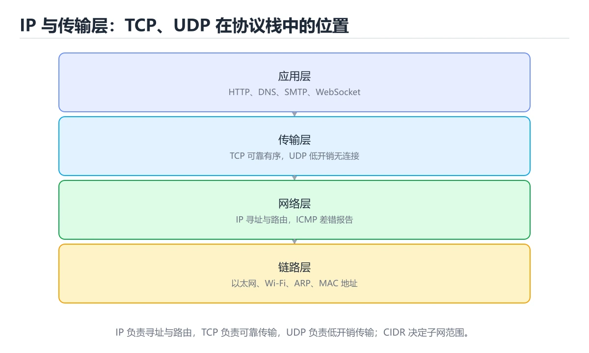
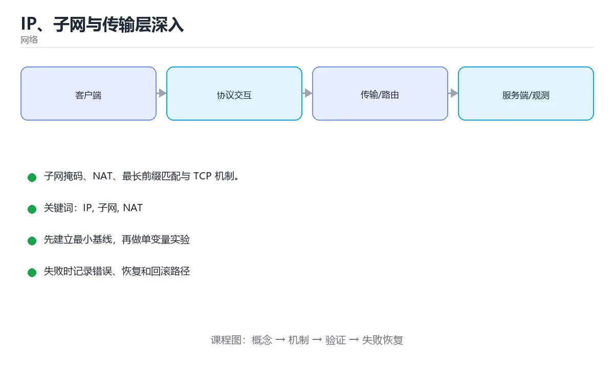

# IP、子网与传输层深入

> 内容更新时间：2026-10-06 · 学习阶段：高级 · 预计用时：35 分钟





## 本节知识框架

**课程定位**：所属分类 `network`（网络），课程主题 `IP、子网与传输层深入`，学习阶段 高级，建议用时 45 分钟。

本课主线：子网掩码、NAT、最长前缀匹配与 TCP 机制。

**学完本课应当能够**
- 说清 `IP` 与 `NAT` 的含义与区别，并各举一个正例和一个反例。
- 用本课示例验证 `拥塞控制` 的行为，记录输入、输出与失败条件。
- 遇到「把广播地址当可用主机」这类问题时，能说出触发条件与修复顺序。

### 复习清单

- [ ] 能不看正文复述本课核心术语，并指出一个边界或反例。
- [ ] 能运行或推演本课示例，记录输入、输出与失败现象。
- [ ] 能完成一次自测，并把错题对照错误表定位原因。

## 核心概念定义

| 术语 | 操作性定义 | 常见边界与风险 |
| --- | --- | --- |
| IP | IP 负责寻址与转发：给每台主机一个地址，让路由器把数据包一跳一跳送到目的地。它不保证可靠、不保证顺序，这些交给传输层。 | 只在「IP 负责寻址与转发：给每台主机一个地址，让路由器把数据包一跳一跳送到目的地」这一前提下成立，换输入或换环境要重新验证。 |
| NAT | 在私网地址与公网地址之间转换，使多台主机共享出口。 | 易错：连接失败；正确做法是需要端口映射或反向通道。 |
| 拥塞控制 | TCP 根据网络反馈调整发送速率，避免丢包和排队崩溃。 | 易错：优化方向错误；正确做法是流量控制面向接收方，拥塞控制面向网络。 |
| MTU | 链路层单次能承载的最大数据长度，超过就要分片，分片丢失会拖垮整包重传。 | 易错：大包超时、小包正常；正确做法是检查路径 MTU，必要时调整 MSS。 |
| TCP | 面向连接的可靠传输协议：握手建连、序号与重传保序，滑动窗口与拥塞控制决定吞吐 | 易错：应用层补偿开销被忽略；正确做法是需要可靠性时选 TCP 或 QUIC。 |

## 原理与运行机制

### 机制总览

**教材衔接：IP 层要解决的问题**

IP 负责**寻址与转发**：给每台主机一个地址，让路由器把数据包一跳一跳送到目的地。它不保证可靠、不保证顺序，这些交给传输层。

**教材衔接：IPv4 地址与子网**

地址 32 位，通常写成点分十进制。子网掩码决定网络位与主机位：`192.168.1.10/24` 表示前 24 位是网络号，可用主机 254 个。

| 概念 | 说明 |
| --- | --- |
| 私有地址段 | 10.0.0.0/8、172.16.0.0/12、192.168.0.0/16 |
| NAT | 局域网多台设备共用一个公网出口地址 |
| CIDR | 用前缀长度灵活划分子网 |
| 广播/组播 | 一对全、一对多发送 |
| MTU | 单帧最大传输单元，超长需分片（通常 1500 字节） |

IPv6 用 128 位地址解决枯竭问题，取消 NAT、简化报头，并原生支持自动配置。

**教材衔接：路由与转发**

路由器查路由表做**最长前缀匹配**：目的地址匹配到多条路由时，选前缀最长（最具体）的那条。默认路由 0.0.0.0/0 是最后兜底。traceroute 利用逐步增大的 TTL 探测路径上的每一跳。

**教材衔接：传输层：TCP 的核心机制**

1. **序号与确认**：保证数据不丢、不重、按序。
2. **滑动窗口**：接收方通告可接收窗口，实现流量控制。
3. **拥塞控制**：慢启动、拥塞避免、快重传、快恢复；现代算法有 CUBIC、BBR。
4. **超时重传与 RTO 自适应**：根据 RTT 动态计算重传超时。
5. **连接管理**：三次握手建立、四次挥手释放，TIME_WAIT 保证旧包不干扰新连接。

UDP 只做端口复用与校验和，无连接、无重传、开销小，适合实时音视频、DNS 与游戏；可靠性需要应用层自行补齐（QUIC 就是典型）。

**教材衔接：排障工具**

| 工具 | 用途 |
| --- | --- |
| ping | 测连通与 RTT |
| traceroute / tracert | 看路径与哪一跳异常 |
| tcpdump / Wireshark | 抓包看握手、重传、RST |
| ss -s / netstat | 看连接状态分布与端口占用 |
| mtr | 连续探测并统计每跳丢包率 |
| ip route / ip addr | 查看路由表与网卡地址 |

**教材衔接：IP 与子网速查**

| 前缀 | 子网掩码 | 可用主机数 | 常见用途 |
| --- | --- | --- | --- |
| /31 | 255.255.255.254 | 2（点对点） | 链路互联 |
| /30 | 255.255.255.252 | 2 | 点对点链路 |
| /29 | 255.255.255.248 | 6 | 小网段 |
| /24 | 255.255.255.0 | 254 | 常规子网 |
| /16 | 255.255.0.0 | 65534 | 大型内网 |
| /8 | 255.0.0.0 | 约 1677 万 | 超大型 |

| 私有地址段 | 范围 |
| --- | --- |
| 10.0.0.0/8 | 10.0.0.0 到 10.255.255.255 |
| 172.16.0.0/12 | 172.16.0.0 到 172.31.255.255 |
| 192.168.0.0/16 | 192.168.0.0 到 192.168.255.255 |
| 127.0.0.0/8 | 本机回环 |
| 169.254.0.0/16 | 链路本地（DHCP 失败时出现） |

**教材衔接：深入补充：IP、子网与传输层深入 的取舍与边界**

## 典型应用场景

- **把广播地址当可用主机**：典型现象是地址冲突；正确做法是网络号与广播地址不可分配给主机。
- **认为 /24 有 256 个可用地址**：典型现象是少算了两个；正确做法是可用 254 个。
- **忽略 169.254 地址**：典型现象是网络不可用却查不出原因；正确做法是说明 DHCP 失败，检查获取流程。
- **用 `ping` 判断端口是否开放**：典型现象是结论不准确；正确做法是用 `nc -zv` 或 `ss` 验证。

### 最小验证场景

- 准备：保留 `bash` 示例的原始输入，先记录 `IP、子网与传输层深入` 的基线输出和完整运行命令。
- 观察：先核对 调用了 `subnet_info()`，再改变一个与 `IP` 相关的条件。
- 判定：新结果与 `IP、子网与传输层深入` 的基线不同不等于错误；只有当差异破坏了 `IP` 的定义或错误表中的约束，才判定为失败。

### 选择与边界

- 使用 `IP` 时，先满足它的定义：IP 负责寻址与转发：给每台主机一个地址，让路由器把数据包一跳一跳送到目的地。它不保证可靠、不保证顺序，这些交给传输层；只在「IP 负责寻址与转发：给每台主机一个地址，让路由器把数据包一跳一跳送到目的地」这一前提下成立，换输入或换环境要重新验证。
- 使用 `NAT` 时，先满足它的定义：在私网地址与公网地址之间转换，使多台主机共享出口；易错：连接失败；正确做法是需要端口映射或反向通道。
- 使用 `拥塞控制` 时，先满足它的定义：TCP 根据网络反馈调整发送速率，避免丢包和排队崩溃；易错：优化方向错误；正确做法是流量控制面向接收方，拥塞控制面向网络。
- 使用 `MTU` 时，先满足它的定义：链路层单次能承载的最大数据长度，超过就要分片，分片丢失会拖垮整包重传；易错：大包超时、小包正常；正确做法是检查路径 MTU，必要时调整 MSS。
- 使用 `TCP` 时，先满足它的定义：面向连接的可靠传输协议：握手建连、序号与重传保序，滑动窗口与拥塞控制决定吞吐；易错：应用层补偿开销被忽略；正确做法是需要可靠性时选 TCP 或 QUIC。

## 代码/协议/SQL 示例

### 最小可验证示例

```bash
# 查看路由与接口
ip route show
ip -br addr
traceroute -n 8.8.8.8        # 逐跳观察路径
mtr -n 8.8.8.8               # 持续观察每跳丢包与延迟

# 查看连接与监听
ss -tan state established | head
ss -s                        # 汇总各类 socket 数量

# 排查 MTU 与分片（禁止分片 + 指定大小）
ping -M do -s 1472 8.8.8.8   # 1472 + 28 = 1500，成功说明路径 MTU 至少 1500
```

**教材衔接：传输层速查**

| 维度 | TCP | UDP |
| --- | --- | --- |
| 连接 | 面向连接 | 无连接 |
| 可靠性 | 确认与重传 | 不保证 |
| 顺序 | 保证有序 | 不保证 |
| 流量与拥塞控制 | 有 | 无（应用层自实现） |
| 头部开销 | 20 字节起 | 8 字节 |
| 适用 | 文件、HTTP、数据库 | DNS、音视频、游戏、QUIC |

```python
import ipaddress

def subnet_info(cidr: str) -> dict:
    """子网信息速算：网络号、广播地址、可用主机范围与数量。"""
    net = ipaddress.ip_network(cidr, strict=False)
    hosts = list(net.hosts()) if net.num_addresses > 2 else []
    return {
        "network": str(net.network_address),
        "netmask": str(net.netmask),
        "broadcast": str(net.broadcast_address),
        "first_host": str(hosts[0]) if hosts else None,
        "last_host": str(hosts[-1]) if hosts else None,
        "usable_hosts": len(hosts),
    }

def same_subnet(ip_a: str, ip_b: str, cidr: str) -> bool:
    """判断两个地址是否在同一子网（不依赖能否 ping 通）。"""
    net = ipaddress.ip_network(cidr, strict=False)
    return ipaddress.ip_address(ip_a) in net and ipaddress.ip_address(ip_b) in net

print(subnet_info("192.168.10.0/24"))
print(same_subnet("192.168.10.5", "192.168.10.200", "192.168.10.0/24"))
```

**教材衔接：深挖「IP」的边界与代价**

### 二、把 traceroute 推到边界

下面是本课第一段代码（bash），先原样运行一次作为基线：

| 变式 | 怎么改 | 先写下什么 | 观察点 |
| --- | --- | --- | --- |
| 边界输入 | 把 traceroute 的输入换成空值或最大值 | 预测输出 | 是否报错、是否静默返回 |
| 只改一处 | 把 established 的一个参数改成另一档 | 预测差异来源 | 输出变化能否用本课结论解释 |
| 去掉一步 | 注释掉 traceroute 之后的一行 | 预测哪一步先失败 | 错误位置是否与预期一致 |

### 四、测验复盘

| 题号 | 正确答案 | 最容易选错的干扰项 | 复盘动作 |
| --- | --- | --- | --- |
| 1 | 学习 IP 时要同时说明输入、输出和失败路径，不能只看正常流程 | 把 子网 的单次运行结果当成所有版本和规模都成立 | 把干扰项改写成一句反例，再说明它违反本课哪条前提 |
| 2 | 滑动窗口 | 拥塞窗口 | 把干扰项改写成一句反例，再说明它违反本课哪条前提 |
| 3 | 确保旧连接的报文不干扰新连接 | 加密握手（仅部分场景成立） | 把干扰项改写成一句反例，再说明它违反本课哪条前提 |
| 4 | 这段代码包含循环结构，同一段逻辑会被重复执行。 | 这段代码会读取外部输入，结果依赖传入的数据。 | 把干扰项改写成一句反例，再说明它违反本课哪条前提 |
| 5 | 流量控制防止压垮接收方（接收窗口） | 两者完全相同 | 把干扰项改写成一句反例，再说明它违反本课哪条前提 |
| 6 | 0 | （无干扰项） | 把干扰项改写成一句反例，再说明它违反本课哪条前提 |

### 五、离开本课前的自检

**运行方式**：运行 `IP、子网与传输层深入` 的示例时，用 `bash 文件名.sh` 运行；先 `bash -n` 做语法检查更稳妥。

## 时间/空间复杂度或性能分析

**性能关注点（IP、子网与传输层深入）**：往返延迟与带宽是主要成本：记录 RTT、吞吐与重传率，区分局域网与真实链路。

**本课特有开销（IP、子网与传输层深入 · IP）**：重试与超时会成倍放大尾延迟，记录 P99 而不是平均值。

**测量方法**：以 `IP、子网与传输层深入` 的 `IP` 场景为对象，固定输入跑一遍记录基线，再把规模或并发度提高一个数量级复测；两次结果的差值与波动范围才是结论依据。

## 常见误区与易错点

| 容易写错的做法 | 实际现象 | 原因与正确做法 |
| --- | --- | --- |
| 把广播地址当可用主机 | 地址冲突 | 网络号与广播地址不可分配给主机 |
| 认为 /24 有 256 个可用地址 | 少算了两个 | 可用 254 个 |
| 忽略 169.254 地址 | 网络不可用却查不出原因 | 说明 DHCP 失败，检查获取流程 |
| 用 `ping` 判断端口是否开放 | 结论不准确 | 用 `nc -zv` 或 `ss` 验证 |
| 忽视 MTU 与分片 | 大包超时、小包正常 | 检查路径 MTU，必要时调整 MSS |
| 认为 UDP 一定更快 | 应用层补偿开销被忽略 | 需要可靠性时选 TCP 或 QUIC |
| 混淆流量控制与拥塞控制 | 优化方向错误 | 流量控制面向接收方，拥塞控制面向网络 |
| 只用 `netstat` 不用 `ss` | 大连接数下很慢 | 用 `ss`（内核 netlink 实现） |
| 忽略 TIME_WAIT 与端口耗尽 | 客户端无法新建连接 | 使用连接池，必要时调整内核参数 |
| 认为 NAT 后能直接被外部访问 | 连接失败 | 需要端口映射或反向通道 |

### 现场 1：把广播地址当可用主机

**症状**：地址冲突。

**根因与修复**：网络号与广播地址不可分配给主机。

**自检**：在本课示例里复现「把广播地址当可用主机」，改成网络号与广播地址不可分配给主机后重跑；如果症状消失且失败路径按预期变化，说明定位正确。

### 现场 2：认为 /24 有 256 个可用地址

**症状**：少算了两个。

**根因与修复**：可用 254 个。

**自检**：在本课示例里复现「认为 /24 有 256 个可用地址」，改成可用 254 个后重跑；如果症状消失且失败路径按预期变化，说明定位正确。

### 现场 3：忽略 169.254 地址

**症状**：网络不可用却查不出原因。

**根因与修复**：说明 DHCP 失败，检查获取流程。

**自检**：在本课示例里复现「忽略 169.254 地址」，改成说明 DHCP 失败，检查获取流程后重跑；如果症状消失且失败路径按预期变化，说明定位正确。

### 现场 4：用 `ping` 判断端口是否开放

**症状**：结论不准确。

**根因与修复**：用 `nc -zv` 或 `ss` 验证。

**自检**：在本课示例里复现「用 `ping` 判断端口是否开放」，改成用 `nc -zv` 或 `ss` 验证后重跑；如果症状消失且失败路径按预期变化，说明定位正确。

### 现场 5：忽视 MTU 与分片

**症状**：大包超时、小包正常。

**根因与修复**：检查路径 MTU，必要时调整 MSS。

**自检**：在本课示例里复现「忽视 MTU 与分片」，改成检查路径 MTU，必要时调整 MSS后重跑；如果症状消失且失败路径按预期变化，说明定位正确。

### 现场 6：认为 UDP 一定更快

**症状**：应用层补偿开销被忽略。

**根因与修复**：需要可靠性时选 TCP 或 QUIC。

**自检**：在本课示例里复现「认为 UDP 一定更快」，改成需要可靠性时选 TCP 或 QUIC后重跑；如果症状消失且失败路径按预期变化，说明定位正确。

### 现场 7：混淆流量控制与拥塞控制

**症状**：优化方向错误。

**根因与修复**：流量控制面向接收方，拥塞控制面向网络。

**自检**：在本课示例里复现「混淆流量控制与拥塞控制」，改成流量控制面向接收方，拥塞控制面向网络后重跑；如果症状消失且失败路径按预期变化，说明定位正确。

### 现场 8：只用 `netstat` 不用 `ss`

**症状**：大连接数下很慢。

**根因与修复**：用 `ss`（内核 netlink 实现）。

**自检**：在本课示例里复现「只用 `netstat` 不用 `ss`」，改成用 `ss`（内核 netlink 实现）后重跑；如果症状消失且失败路径按预期变化，说明定位正确。

### 现场 9：忽略 TIME_WAIT 与端口耗尽

**症状**：客户端无法新建连接。

**根因与修复**：使用连接池，必要时调整内核参数。

**自检**：在本课示例里复现「忽略 TIME_WAIT 与端口耗尽」，改成使用连接池，必要时调整内核参数后重跑；如果症状消失且失败路径按预期变化，说明定位正确。

## 与其他知识点的关系

- **先修**：`HTTP/2 与 HTTP/3`。本课默认这些内容已经掌握。
- **相关或后续**：`链路层：以太网、ARP 与交换机`、`图解 TCP 握手、挥手与拥塞控制`。本课术语会在这些课程里继续使用。
- **术语归属**：`IP`、`NAT`、`拥塞控制` 的定义以本课「核心概念定义」为准，换到其他课程时先确认定义是否被改写。
- 同一分类的《TCP/IP 协议栈》也涉及 `TCP`；两课衔接时先确认这个术语的定义是否一致。
- 同一分类的《链路层：以太网、ARP 与交换机》也涉及 `MTU`；两课衔接时先确认这个术语的定义是否一致。

## 自测题与参考答案

> 先独立作答，再对照参考答案；答案都能在本课正文、术语表或错误表里找到依据。

### 自测 1（概念复述）

不看正文，写出 `IP` 的操作性定义，并说明它与 `NAT` 的区别。

**参考答案**：IP 负责寻址与转发：给每台主机一个地址，让路由器把数据包一跳一跳送到目的地。它不保证可靠、不保证顺序，这些交给传输层。

`NAT` 的定位是：在私网地址与公网地址之间转换，使多台主机共享出口；两者的差别要从适用对象与失败模式上说明。

### 自测 2（排错）

本课错误表记录了「把广播地址当可用主机」这类做法。请写出它会出现的现象、根因，以及修复顺序。

**参考答案**：现象是地址冲突；正确做法是网络号与广播地址不可分配给主机。修复时先复现现象并保留证据，再改动一处假设重跑，确认现象消失。

### 自测 3（动手验证）

运行本课的 `bash` 示例，把其中的 `8` 换成一个边界值后重新运行，记录输出与错误信息。

**参考答案**：正常输入下 `bash` 示例应当复现正文给出的结果；把 `8` 换成边界值后，如果结果改变或报错，先核对它是否满足 `IP、子网与传输层深入` 中`IP` 的适用范围，再检查错误表里是否有同类现象。

### 自测 4（代码阅读）

阅读本课开头的 `bash` 示例，说明它体现了`IP` 的哪一条性质，并指出改动哪个输入会让这条性质不再成立。

**参考答案**：`IP` 的定义是 IP 负责寻址与转发：给每台主机一个地址，让路由器把数据包一跳一跳送到目的地，它不保证可靠、不保证顺序，这些交给传输层，示例正是在实现这条定义。改动与 `IP` 有关的一个输入后，如果结果不再符合 `IP、子网与传输层深入` 的正文描述，就说明该性质只在当前前提成立。

### 自测 5（迁移）

把 `IP、子网与传输层深入` 的方法迁移到自己的项目：围绕 `IP` 写出一个与错误表同类的风险点，并说明触发条件和检验方式。

**参考答案**：例如「认为 NAT 后能直接被外部访问」，它会导致连接失败；检验方式是按需要端口映射或反向通道改一处再复现，确认现象消失且没有引入新的失败分支。

### 自测 6（对比）

用一个表格对比 `IP` 与 `NAT`：各写一行适用场景、一行失败表现。

**参考答案**：`IP` 的定义是IP 负责寻址与转发：给每台主机一个地址，让路由器把数据包一跳一跳送到目的地。它不保证可靠、不保证顺序，这些交给传输层；`NAT` 的定义是在私网地址与公网地址之间转换，使多台主机共享出口。两者的失败表现分别对应本课错误表里与本术语相关的行。

### 自测 7（排错顺序）

面对「把广播地址当可用主机」引发的问题，请把“复现 地址冲突 → 保留证据 → 网络号与广播地址不可分配给主机 → 回归验证”四步写成可执行的检查清单。

**参考答案**：第一步按地址冲突复现；第二步记录输入、版本与完整报错；第三步按网络号与广播地址不可分配给主机只改一处；第四步重跑并确认失败路径也按预期变化。

### 自测 8（边界判断）

针对 `TCP`，分别写出“可以使用”的条件和“结论不再成立”的条件。

**参考答案**：易错：应用层补偿开销被忽略；正确做法是需要可靠性时选 TCP 或 QUIC。 同时要把 `TCP` 的定义 面向连接的可靠传输协议：握手建连、序号与重传保序，滑动窗口与拥塞控制决定吞吐 与实际输入逐项对照。

### 自测 9（机制重建）

不看正文，按输入、转换、输出、验证四段重建 `IP` → `NAT` → `拥塞控制` → `MTU` 的作用链。

**参考答案**：起点是 `IP` 的定义 IP 负责寻址与转发：给每台主机一个地址，让路由器把数据包一跳一跳送到目的地。它不保证可靠、不保证顺序，这些交给传输层；中间每一步都保留可观察状态；终点由 `TCP` 检查，失败时回到错误表定位第一个偏离定义的步骤。

### 自测 10（综合排错）

在 `IP、子网与传输层深入` 中，现象是 连接失败。请围绕 认为 NAT 后能直接被外部访问 写出最小复现、关键证据、修复动作和回归验证，并说明为什么不能只凭一次运行下结论。

**参考答案**：先复现 认为 NAT 后能直接被外部访问，记录输入与完整错误；再按 需要端口映射或反向通道 只改一处。回归时同时跑正常路径和边界路径，只有两次结果都可解释，才把修复视为完成。

### 自测 11（一分钟复述）

用每分钟约 200 字的速度复述 `IP、子网与传输层深入`：先给主问题，再按顺序说出 `IP`、`NAT`、`拥塞控制`、`MTU`，最后给一个失败案例。

**自评标准**：主问题必须对应 子网掩码、NAT、最长前缀匹配与 TCP 机制；每个术语都要能接上一句定义或边界；失败案例必须写成可观察现象，不能用“可能有风险”代替证据。

## 术语速查

| 术语 | 一句话说明 |
| --- | --- |
| `IP` | IP 负责寻址与转发：给每台主机一个地址，让路由器把数据包一跳一跳送到目的地。它不保证可靠、不保证顺序，这些交给传输层。 |
| `NAT` | 在私网地址与公网地址之间转换，使多台主机共享出口。 |
| `拥塞控制` | TCP 根据网络反馈调整发送速率，避免丢包和排队崩溃。 |
| `MTU` | 链路层单次能承载的最大数据长度，超过就要分片，分片丢失会拖垮整包重传。 |
| `TCP` | 面向连接的可靠传输协议：握手建连、序号与重传保序，滑动窗口与拥塞控制决定吞吐。 |

**术语关系**：`IP`（IP 负责寻址与转发：给每台主机一个地址） → `NAT`（在私网地址与公网地址之间转换） → `拥塞控制`（TCP 根据网络反馈调整发送速率） → `MTU`（链路层单次能承载的最大数据长度）。

## 考点精讲

`IP、子网与传输层深入` 的题库有 6 道题，下面逐题给出题干、正确项与判断依据：先自己作答，再核对正确项，最后回到正文对应小节复核。

### 考点 1：第 1 题

- **题目**：围绕“IP、子网与传输层深入”中的 IP、子网、NAT，下列哪两项是本课强调的实践判断？
- **正确项**：学习 IP 时要同时说明输入、输出和失败路径，不能只看正常流程；验证 子网 时要固定版本并覆盖边界输入，结论才可复现
- **判断依据**：本题正确项是学习 IP 时要同时说明输入、输出和失败路径，不能只看正常流程。术语 IP（IP、子网与传输层深入）：IP 负责寻址与转发：给每台主机一个地址，让路由器把数据包一跳一跳送到目的地，它不保证可靠、不保证顺序，这些交给传输层，本题取学习 IP 时要同时说明输入、输出和失败路径，不能只看正常流程这条。易错点是把广播地址当可用主机，会造成地址冲突，改法是网络号与广播地址不可分配给主机。

### 考点 2：第 2 题

- **题目**：TCP 的流量控制依靠什么机制？
- **正确项**：滑动窗口
- **判断依据**：术语 TCP（IP、子网与传输层深入）：面向连接的可靠传输协议：握手建连、序号与重传保序，滑动窗口与拥塞控制决定吞吐，本题取滑动窗口这条。易错点是认为 /24 有 256 个可用地址，会造成少算了两个，改法是可用 254 个。易错点是忽略 169.254 地址，会造成网络不可用却查不出原因，改法是说明 DHCP 失败，检查获取流程。本课IP、子网与传输层深入要解决的是子网掩码、NAT、最长前缀匹配与 TCP 机制，本题按滑动窗口这条判断。

### 考点 3：第 3 题

- **题目**：TIME_WAIT 状态的主要作用是？
- **正确项**：确保旧连接的报文不干扰新连接
- **判断依据**：本题正确项是确保旧连接的报文不干扰新连接。术语 IP（IP、子网与传输层深入）：IP 负责寻址与转发：给每台主机一个地址，让路由器把数据包一跳一跳送到目的地，它不保证可靠、不保证顺序，这些交给传输层，本题取确保旧连接的报文不干扰新连接这条。易错点是忽略 169.254 地址，会造成网络不可用却查不出原因，改法是说明 DHCP 失败，检查获取流程。

### 考点 4：第 4 题

- **题目**：`IP、子网与传输层深入` 的示例代码用于验证 `IP`，其背景是子网掩码、NAT、最长前缀匹配与 TCP 机制。代码的真实内容是下面哪一项？
- **正确项**：调用了 `subnet_info()`
- **判断依据**：本题正确项是调用了 `subnet_info()`。术语 IP（IP、子网与传输层深入）：IP 负责寻址与转发：给每台主机一个地址，让路由器把数据包一跳一跳送到目的地，它不保证可靠、不保证顺序，这些交给传输层，本题取调用了 `subnet_info()`这条。易错点是用 `ping` 判断端口是否开放，会造成结论不准确，改法是用 `nc -zv` 或 `ss` 验证。本题干扰项「调用了 `pop()`」不成立：展示代码里找不到 `pop()`。

### 考点 5：第 5 题

- **题目**：TCP 流量控制与拥塞控制的区别是？
- **正确项**：流量控制防止压垮接收方（接收窗口）
- **判断依据**：本题正确项是流量控制防止压垮接收方（接收窗口）。术语 拥塞控制（IP、子网与传输层深入）：TCP 根据网络反馈调整发送速率，避免丢包和排队崩溃，本题取流量控制防止压垮接收方（接收窗口）这条。易错点是忽视 MTU 与分片，会造成大包超时、小包正常，改法是检查路径 MTU，必要时调整 MSS。

### 考点 6：第 6 题

- **题目**：填空：补齐下面这段术语说明中的空缺。课程 `子网掩码、NAT、最长前缀匹配与 TCP 机制。`，这段说明是：`____` 负责寻址与转发：给每台主机一个地址，让路由器把数据包一跳一跳送到目的地。它不保证可靠、不保证顺序，这些交给传输层。空缺处应填哪个术语？
- **正确项**：IP
- **判断依据**：《IP、子网与传输层深入》这题的填空口径是「IP」或「ip」，正文写法与其中任一项一致即可。术语「IP」在本课里的界定是IP 负责寻址与转发：给每台主机一个地址，让路由器把数据包一跳一跳送到目的地，它不保证可靠、不保证顺序，这些交给传输层，题干「填空：补齐下面这段术语说明中的空缺，课程 `子网掩码、NAT、最长前」问的就是这一条。常见错法是把广播地址当可用主机，其后果是地址冲突。正确做法是网络号与广播地址不可分配给主机。

### 考点 7：`IP`

- **要点**：IP 负责寻址与转发：给每台主机一个地址，让路由器把数据包一跳一跳送到目的地。它不保证可靠、不保证顺序，这些交给传输层。
- **IP 的边界**：只在「IP 负责寻址与转发：给每台主机一个地址，让路由器把数据包一跳一跳送到目的地」这一前提下成立，换输入或换环境要重新验证。

### 考点 8：`NAT`

- **要点**：在私网地址与公网地址之间转换，使多台主机共享出口。
- **NAT 的边界**：易错：连接失败；正确做法是需要端口映射或反向通道。

### 考点 9：`拥塞控制`

- **要点**：TCP 根据网络反馈调整发送速率，避免丢包和排队崩溃。
- **拥塞控制 的边界**：易错：优化方向错误；正确做法是流量控制面向接收方，拥塞控制面向网络。

### 考点 10：`MTU`

- **要点**：链路层单次能承载的最大数据长度，超过就要分片，分片丢失会拖垮整包重传。
- **MTU 的边界**：易错：大包超时、小包正常；正确做法是检查路径 MTU，必要时调整 MSS。

### 考点 11：`TCP`

- **要点**：面向连接的可靠传输协议：握手建连、序号与重传保序，滑动窗口与拥塞控制决定吞吐
- **TCP 的边界**：易错：应用层补偿开销被忽略；正确做法是需要可靠性时选 TCP 或 QUIC。

### 考点 12：排错——把广播地址当可用主机

- **现象**：地址冲突。
- **处理**：网络号与广播地址不可分配给主机。

### 考点 13：排错——认为 /24 有 256 个可用地址

- **现象**：少算了两个。
- **处理**：可用 254 个。

### 考点 14：综合辨析——`IP` 与 `TCP`

- **辨析点**：`IP` 的定义是 IP 负责寻址与转发：给每台主机一个地址，让路由器把数据包一跳一跳送到目的地。它不保证可靠、不保证顺序，这些交给传输层；`TCP` 的定义是 面向连接的可靠传输协议：握手建连、序号与重传保序，滑动窗口与拥塞控制决定吞吐。
- **答题要求**：面对 `IP、子网与传输层深入` 的题目，先判断描述的是 `IP` 还是 `TCP`，再归到对应定义，最后写出一个会让该定义失效的边界输入。

### 考点 15：排错评分点

- **现象分**：能写出 地址冲突，而不是只写“程序有错”。
- **证据分**：保留触发 把广播地址当可用主机 的输入、版本和错误原文。
- **修复分**：按 网络号与广播地址不可分配给主机 只改一处，并同时回归正常路径与边界路径。

## 内容元数据

- 内容版本：v2.0
- 最后更新：2026-10-06
- 学习阶段：高级
- 适用环境：主流网络栈；本课讨论 broadcast_address 在其中的位置。
- 内容来源：内置结构化课程与工程实践整理
- 相关主题：IP、子网、NAT、TCP、拥塞控制、MTU
- 质量版本：P0 测验标准 + P1 覆盖扩展 + P2 体验补全

## 参考资料与复核

- 最后复核：2026-10-04
- 下次复核：2027-06-24
- 复核范围：版本兼容、API 行为、安全建议与工程实践
- 来源性质：官方文档、标准或权威教材；本课核对关键词：IP、子网、NAT、TCP、拥塞控制、MTU。

| 参考资料 | 本课用途 |
| --- | --- |
| [RFC 9293 TCP](https://www.rfc-editor.org/rfc/rfc9293) | TCP 连接、重传与拥塞 |
| [RFC 9000 QUIC](https://www.rfc-editor.org/rfc/rfc9000) | QUIC 传输与连接迁移 |
| [RFC 9113 HTTP/2](https://www.rfc-editor.org/rfc/rfc9113) | HTTP/2 多路复用与流 |

| [本课术语索引：IP、子网与传输层深入](#核心概念定义) | 按本课输入、术语边界和错误表现逐项核对 |
> 「IP、子网与传输层深入」的链接用于离线阅读后的延伸核对；App 不会自动联网。

<!-- p1-deep-dive:start -->