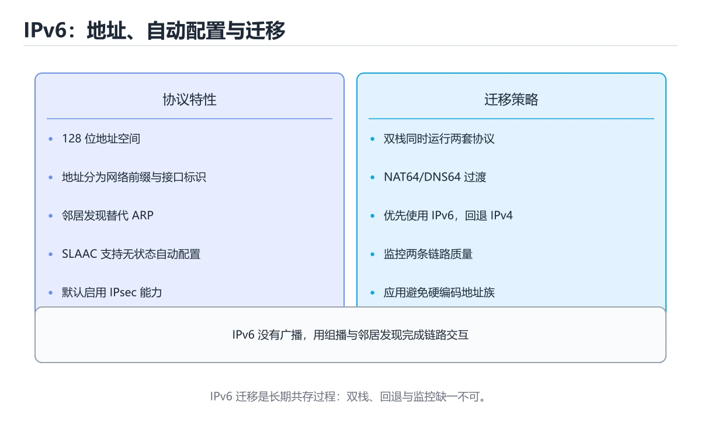
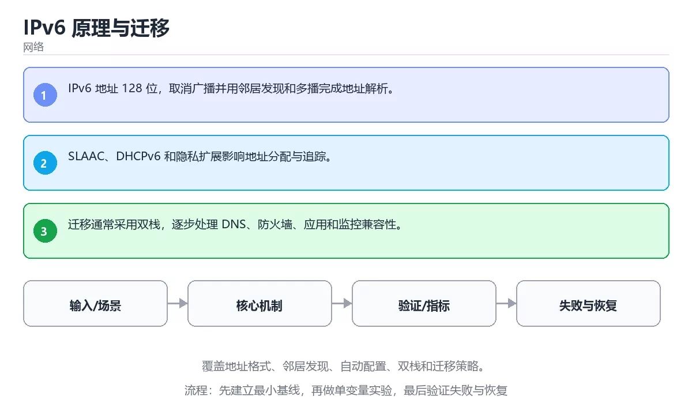

# IPv6 原理与迁移

> 内容更新时间：2026-10-06 · 学习阶段：高级 · 预计用时：30 分钟





## 本节知识框架

**课程定位**：所属分类 `network`（网络），课程主题 `IPv6 原理与迁移`，学习阶段 高级，建议用时 40 分钟。

本课主线：覆盖地址格式、邻居发现、自动配置、双栈和迁移策略。

**学完本课应当能够**
- 说清 `IPv6` 与 `NDP` 的含义与区别，并各举一个正例和一个反例。
- 用本课示例验证 `双栈` 的行为，记录输入、输出与失败条件。
- 遇到「以为只是地址变长」这类问题时，能说出触发条件与修复顺序。

### 复习清单

- [ ] 能用自己的话说明「IPv6 原理与迁移」里的 IPv6，再举一个它不成立的场景。
- [ ] 能跑通 IPv6 的最小示例，记录一组正常输出和一组失败输出。
- [ ] 能完成一次自测，并把错题对照错误表定位原因。

## 核心概念定义

| 术语 | 操作性定义 | 常见边界与风险 |
| --- | --- | --- |
| IPv6 | 128 位地址的新一代 IP 协议，扩大地址空间并改进邻居发现。 | 易错：以为只是地址变长，忽略它取消广播、改用邻居发现与无状态自动配置；`::` 也只允许压缩一次连续全零组。 |
| NDP | IPv6 邻居发现协议，负责地址解析、路由器发现和可达性检测。 | 主机靠它取代广播解析链路层地址，路由器通告还决定 SLAAC 能否自动配置；照 IPv4 的 ARP 思路排障会漏掉这一步。 |
| 双栈 | 过渡与共存：现实中 IPv6 与 IPv4 会长期共存，常见策略有三种：双栈（同一台机器同时拥有两种地址）。 | 易错：部分用户无法访问；正确做法是两条协议栈同时配置并分别监控可达性。 |
| 迁移 | 结合IPv6、NDP、双栈、迁移，写出一个真实项目中的使用场景。 | 迁移要逐步核对 DNS、防火墙、应用与监控兼容性；A 与 AAAA 记录或地址选择策略没配套，就会解析到 IPv6 却连不通。 |
| NAT | 把内网地址转换成公网地址，让多台设备共享一个出口 IP | IPv6 不再依赖 NAT 隐藏内网，但无 NAT 不等于无安全边界：防火墙仍要显式放行，也别假设对端一定在 NAT 后。 |
| DNS | 把域名解析成 IP 的层次化系统，排查时要区分递归解析器、权威服务器与本地缓存 | 双栈下 A 与 AAAA 要同时配置并分别监控可达性，只补记录不清本地缓存，用户拿到的仍是旧答案，表现为部分人打不开。 |

## 原理与运行机制

### 机制总览

**教材衔接：核心知识**

### 1. IPv6 地址 128 位，取消广播并用邻居发现和多播完成地址解析。

- 关键做法：基线只保留 NDP 必需的部分，其余条件一次加一个。
- 验证标准：IPv6 的结果可复现、错误可解释、失败能恢复。

### 2. SLAAC、DHCPv6 和隐私扩展影响地址分配与追踪。

把这条结论放回「IPv6 原理与迁移」的完整流程里展开：

- 正文依据：能用自己的话解释：IPv6 地址 128 位，取消广播并用邻居发现和多播完成地址解析。
- 落地检查：把「2. SLAAC、DHCPv6 和隐私扩展影响地址分配与追踪。」改写成一条可执行的核对项，逐条验证输入、超时与失败路径。

### 3. 迁移通常采用双栈，逐步处理 DNS、防火墙、应用和监控兼容性。

把这条结论放回「IPv6 原理与迁移」的完整流程里展开：

- 正文依据：能用自己的话解释：迁移通常采用双栈，逐步处理 DNS、防火墙、应用和监控兼容性。
- 落地检查：把「3. 迁移通常采用双栈，逐步处理 DNS、防火墙、应用和监控兼容性。」改写成一条可执行的核对项，逐条验证输入、超时与失败路径。

**教材衔接：关键流程**

**教材衔接：实践路径**

**教材衔接：深入理解：IPv6 原理与迁移**

### 地址写法与分配

IPv6 用 128 位地址，写成 8 组十六进制，每组 4 位；连续的全零组可以用 `::` 压缩一次。
地址前缀通常写成 `2001:db8::/32`。与 IPv4 不同，IPv6 没有广播地址，主机通过
邻居发现（NDP）解析链路层地址，也可以在收到路由器通告后自动配置（SLAAC）。

### 过渡与共存

现实中 IPv6 与 IPv4 会长期共存，常见策略有三种：双栈（同一台机器同时拥有两种地址）、
隧道（把 IPv6 包封装进 IPv4 传输）、翻译（NAT64/DNS64 让只有 IPv6 的主机访问 IPv4 服务）。
部署时要同时考虑 DNS 的 A/AAAA 记录、防火墙规则和应用的地址选择策略，否则会出现
「解析到 IPv6 却连不通」的问题。

### 没有 NAT 意味着什么

IPv6 地址空间足够大，设计目标是端到端可达，不再依赖 NAT 隐藏内网。但「无 NAT」不等于
「无安全边界」：边界防火墙仍然要显式放行流量，隐私地址用于避免跟踪，运营商也可能
分配动态前缀。写网络程序时不要假设对端一定在 NAT 后，也不要假设地址永远不变。

「IPv6 原理与迁移」的「地址写法与分配」一节补全如下：

- 定位：这一节说明地址写法与分配在「IPv6 原理与迁移」知识体系里的位置。
- 要点：IPv6 用 128 位地址，写成 8 组十六进制，每组 4 位；连续的全零组可以用 :: 压缩一次。
- 自检：能否用一个最小例子解释地址写法与分配？

「IPv6 原理与迁移」的「过渡与共存」一节补全如下：

- 定位：这一节说明过渡与共存在「IPv6 原理与迁移」知识体系里的位置。
- 要点：地址前缀通常写成 2001:db8::/32。与 IPv4 不同，IPv6 没有广播地址，主机通过
- 自检：能否用一个最小例子解释过渡与共存？

「IPv6 原理与迁移」的「没有 NAT 意味着什么」一节补全如下：

- 定位：这一节说明没有 NAT 意味着什么在「IPv6 原理与迁移」知识体系里的位置。
- 要点：邻居发现（NDP）解析链路层地址，也可以在收到路由器通告后自动配置（SLAAC）。
- 自检：能否用一个最小例子解释没有 NAT 意味着什么？

**教材衔接：深入补充：IPv6 原理与迁移 的取舍与边界**

### 四、自测清单

**教材衔接：验证步骤**

## 典型应用场景

**教材衔接：深度拓展与实战**

这一节把「IPv6 原理与迁移」正文里的定义、代码和失败模式串成一条可操作的复习路线。

### 边界条件与常见反例

「IPv6 原理与迁移」的边界不只包括最大最小值，还要覆盖空、重复和失败：

### 工程检查表

- [ ] 能否用自己的话说明IPv6 原理与迁移解决什么问题，以及它不负责什么？
- [ ] 能否用「IPv6 原理与迁移」的最小示例复现一次失败并解释原因？
- [ ] 能否解释本课关键词在真实项目中的边界与取舍？
- [ ] 能否说明 NDP 在新场景下需要补充什么前提？

### 最小验证场景

- 准备：保留 `text` 示例的原始输入，先记录 `IPv6 原理与迁移` 的基线输出和完整运行命令。
- 观察：先核对 调用了 `print()`，再改变一个与 `IPv6` 相关的条件。
- 判定：新结果与 `IPv6 原理与迁移` 的基线不同不等于错误；只有当差异破坏了 `IPv6` 的定义或错误表中的约束，才判定为失败。

### 选择与边界

- 使用 `IPv6` 时，128 位地址的新一代 IP 协议，扩大地址空间并改进邻居发现；网络延迟、超时与版本协商会改变行为，只在真实链路或多版本客户端上验证才算数。
- 使用 `NDP` 时，IPv6 邻居发现协议，负责地址解析、路由器发现和可达性检测；网络延迟、超时与版本协商会改变行为，只在真实链路或多版本客户端上验证才算数。
- 使用 `双栈` 时，过渡与共存：现实中 IPv6 与 IPv4 会长期共存，常见策略有三种：双栈（同一台机器同时拥有两种地址）；易错：部分用户无法访问；正确做法是两条协议栈同时配置并分别监控可达性。
- 使用 `迁移` 时，结合IPv6、NDP、双栈、迁移，写出一个真实项目中的使用场景；越界、悬垂引用与释放顺序会破坏结论，必须在边界输入下复验。
- 使用 `NAT` 时，把内网地址转换成公网地址，让多台设备共享一个出口 IP；共享状态与调度顺序会改变结论，单线程或串行测试通过不等于并发下成立。

## 代码/协议/SQL 示例

### 最小可验证示例

**教材衔接：最小可运行示例**

下面的示例覆盖「IPv6 原理与迁移」中 IPv6 的核心路径。先原样运行，再按注释改一处：

```python
import socket

print(socket.gethostbyname("localhost"))
```

**教材衔接：预期输出**

```text
127.0.0.1
```

## 时间/空间复杂度或性能分析

**性能关注点（IPv6 原理与迁移）**：往返延迟与带宽是主要成本：记录 RTT、吞吐与重传率，区分局域网与真实链路。

**本课特有开销（IPv6 原理与迁移 · IPv6）**：缓存命中率比缓存实现本身更关键，先记录命中率与失效策略再谈优化。

**测量方法**：以 `IPv6 原理与迁移` 的 `IPv6` 场景为对象，固定输入跑一遍记录基线，再把规模或并发度提高一个数量级复测；两次结果的差值与波动范围才是结论依据。

## 常见误区与易错点

| 容易写错的做法 | 实际现象 | 原因与正确做法 |
| --- | --- | --- |
| 以为只是地址变长 | 忽略邻居发现与自动配置机制。 | 重新学习地址类型、邻居发现与无状态配置。 |
| 双栈只配置一半 | 部分用户无法访问。 | 两条协议栈同时配置并分别监控可达性。 |
| 忽略路径最大传输单元差异 | 大包被丢弃且难以定位。 | 确认路径最大传输单元，并避免依赖中间设备分片。 |

### 现场 1：以为只是地址变长

**症状**：忽略邻居发现与自动配置机制。

**根因与修复**：重新学习地址类型、邻居发现与无状态配置。

**自检**：在本课示例里复现「以为只是地址变长」，改成重新学习地址类型、邻居发现与无状态配置后重跑；如果症状消失且失败路径按预期变化，说明定位正确。

### 现场 2：双栈只配置一半

**症状**：部分用户无法访问。

**根因与修复**：两条协议栈同时配置并分别监控可达性。

**自检**：在本课示例里复现「双栈只配置一半」，改成两条协议栈同时配置并分别监控可达性后重跑；如果症状消失且失败路径按预期变化，说明定位正确。

### 现场 3：忽略路径最大传输单元差异

**症状**：大包被丢弃且难以定位。

**根因与修复**：确认路径最大传输单元，并避免依赖中间设备分片。

**自检**：在本课示例里复现「忽略路径最大传输单元差异」，改成确认路径最大传输单元，并避免依赖中间设备分片后重跑；如果症状消失且失败路径按预期变化，说明定位正确。

## 与其他知识点的关系

| 关系 | 课程 | 为什么 |
| --- | --- | --- |
| 先修 | 《渗透测试基础》 | 本课会直接使用它的概念或操作前提。 |
| 关联 | 《NAT、隧道与 VPN》 | 用于横向比较或把本课结论迁移到相邻主题。 |
| 前置顺序 | 《Socket 编程实战》 | 同分类中安排在本课之前，建议先完成其自测。 |
| 后续顺序 | 《NAT、隧道与 VPN》 | 同分类中安排在本课之后，会继续使用本课术语。 |

把「IPv6 原理与迁移」放回知识体系时，不只要记住“前面学过什么”，还要说明两个主题在输入、机制、资源边界和失败模式上的差异。这样才能把单课知识迁移到项目、排障和后续课程。

**教材衔接：复习与迁移**

## 自测题与参考答案

> 先独立作答，再对照参考答案；答案都能在本课正文、术语表或错误表里找到依据。

### 自测 1（概念复述）

不看正文，写出 `IPv6` 的操作性定义，并说明它与 `NDP` 的区别。

**参考答案**：128 位地址的新一代 IP 协议，扩大地址空间并改进邻居发现。

`NDP` 的定位是：IPv6 邻居发现协议，负责地址解析、路由器发现和可达性检测；两者的差别要从适用对象与失败模式上说明。

### 自测 2（排错）

本课错误表记录了「以为只是地址变长」这类做法。请写出它会出现的现象、根因，以及修复顺序。

**参考答案**：现象是忽略邻居发现与自动配置机制；正确做法是重新学习地址类型、邻居发现与无状态配置。修复时先复现现象并保留证据，再改动一处假设重跑，确认现象消失。

### 自测 3（动手验证）

运行本课的 `text` 示例，改动一个与 IPv6 有关的输入后重跑，记录输出与错误信息。

**参考答案**：正常输入下 `text` 示例应当复现正文给出的结果；改动输入后，如果结果改变或报错，先核对它是否满足 `IPv6 原理与迁移` 中`IPv6` 的适用范围，再检查错误表里是否有同类现象。

### 自测 4（代码阅读）

阅读本课开头的 `text` 示例，说明它体现了`IPv6` 的哪一条性质，并指出改动哪个输入会让这条性质不再成立。

**参考答案**：`IPv6` 的定义是 128 位地址的新一代 IP 协议，扩大地址空间并改进邻居发现，示例正是在实现这条定义。改动与 `IPv6` 有关的一个输入后，如果结果不再符合 `IPv6 原理与迁移` 的正文描述，就说明该性质只在当前前提成立。

### 自测 5（迁移）

把 `IPv6 原理与迁移` 的方法迁移到自己的项目：围绕 `IPv6` 写出一个与错误表同类的风险点，并说明触发条件和检验方式。

**参考答案**：例如「忽略路径最大传输单元差异」，它会导致大包被丢弃且难以定位；检验方式是按确认路径最大传输单元，并避免依赖中间设备分片改一处再复现，确认现象消失且没有引入新的失败分支。

### 自测 6（对比）

用一个表格对比 `IPv6` 与 `NDP`：各写一行适用场景、一行失败表现。

**参考答案**：`IPv6` 的定义是128 位地址的新一代 IP 协议，扩大地址空间并改进邻居发现；`NDP` 的定义是IPv6 邻居发现协议，负责地址解析、路由器发现和可达性检测。两者的失败表现分别对应本课错误表里与本术语相关的行。

### 自测 7（排错顺序）

面对「以为只是地址变长」引发的问题，请把“复现 忽略邻居发现与自动配置机制 → 保留证据 → 重新学习地址类型、邻居发现与无状态配置 → 回归验证”四步写成可执行的检查清单。

**参考答案**：第一步按忽略邻居发现与自动配置机制复现；第二步记录输入、版本与完整报错；第三步按重新学习地址类型、邻居发现与无状态配置只改一处；第四步重跑并确认失败路径也按预期变化。

### 自测 8（边界判断）

针对 `DNS`，分别写出“可以使用”的条件和“结论不再成立”的条件。

**参考答案**：缓存与状态残留会让结果过期，先明确失效策略再判断正确性。 同时要把 `DNS` 的定义 把域名解析成 IP 的层次化系统，排查时要区分递归解析器、权威服务器与本地缓存 与实际输入逐项对照。

### 自测 9（机制重建）

不看正文，按输入、转换、输出、验证四段重建 `IPv6` → `NDP` → `双栈` → `迁移` 的作用链。

**参考答案**：起点是 `IPv6` 的定义 128 位地址的新一代 IP 协议，扩大地址空间并改进邻居发现；中间每一步都保留可观察状态；终点由 `DNS` 检查，失败时回到错误表定位第一个偏离定义的步骤。

### 自测 10（综合排错）

在 `IPv6 原理与迁移` 中，现象是 大包被丢弃且难以定位。请围绕 忽略路径最大传输单元差异 写出最小复现、关键证据、修复动作和回归验证，并说明为什么不能只凭一次运行下结论。

**参考答案**：先复现 忽略路径最大传输单元差异，记录输入与完整错误；再按 确认路径最大传输单元，并避免依赖中间设备分片 只改一处。回归时同时跑正常路径和边界路径，只有两次结果都可解释，才把修复视为完成。

### 自测 11（一分钟复述）

用每分钟约 200 字的速度复述 `IPv6 原理与迁移`：先给主问题，再按顺序说出 `IPv6`、`NDP`、`双栈`、`迁移`，最后给一个失败案例。

**自评标准**：主问题必须对应 覆盖地址格式、邻居发现、自动配置、双栈和迁移策略；每个术语都要能接上一句定义或边界；失败案例必须写成可观察现象，不能用“可能有风险”代替证据。

## 延伸阅读

想更直观地理解本课概念？推荐参阅以下图解专题：

- [图解 TCP 握手、挥手与拥塞控制](visual_tcp_handshake.md)

## 术语速查

| 术语 | 一句话说明 |
| --- | --- |
| `IPv6` | 128 位地址的新一代 IP 协议，扩大地址空间并改进邻居发现。 |
| `NDP` | IPv6 邻居发现协议，负责地址解析、路由器发现和可达性检测。 |
| `双栈` | 过渡与共存：现实中 IPv6 与 IPv4 会长期共存，常见策略有三种：双栈（同一台机器同时拥有两种地址）。 |
| `迁移` | 结合IPv6、NDP、双栈、迁移，写出一个真实项目中的使用场景。 |
| `NAT` | 把内网地址转换成公网地址，让多台设备共享一个出口 IP。 |
| `DNS` | 把域名解析成 IP 的层次化系统，排查时要区分递归解析器、权威服务器与本地缓存。 |

**术语关系**：`IPv6`（128 位地址的新一代 IP 协议） → `NDP`（IPv6 邻居发现协议） → `双栈`（过渡与共存：现实中 IPv6 与 IPv4 会长期共存） → `迁移`（结合IPv6、NDP、双栈、迁移）。

## 考点精讲

`IPv6 原理与迁移` 的题库有 6 道题，下面逐题给出题干、正确项与判断依据：先自己作答，再核对正确项，最后回到正文对应小节复核。

### 考点 1：第 1 题

- **题目**：在 `IPv6 原理与迁移` 里，与 `IPv6` 有关的说法中，哪一项最符合覆盖地址格式、邻居发现、自动配置、双栈和迁移策略？
- **正确项**：IPv6 地址 128 位，取消广播并用邻居发现和多播完成地址解析。
- **判断依据**：本题正确项是「IPv6 地址 128 位，取消广播并用邻居发现和多播完成地址解析」。术语 IPv6（IPv6 原理与迁移）：128 位地址的新一代 IP 协议，扩大地址空间并改进邻居发现，本题取「IPv6 地址 128 位，取消广播并用邻居发现和多播完成地址解析」这条。易错点是以为只是地址变长，会造成忽略邻居发现与自动配置机制，改法是重新学习地址类型、邻居发现与无状态配置。

### 考点 2：第 2 题

- **题目**：在 `IPv6 原理与迁移` 里，与 `IPv6` 有关的说法中，哪一项最符合覆盖地址格式、邻居发现、自动配置、双栈和迁移策略？（IPv6 原理与迁移·网络 第 2 题）
- **正确项**：SLAAC、DHCPv6 和隐私扩展影响地址分配与追踪。
- **判断依据**：本题正确项是「SLAAC、DHCPv6 和隐私扩展影响地址分配与追踪」。术语 IPv6（IPv6 原理与迁移）：128 位地址的新一代 IP 协议，扩大地址空间并改进邻居发现，本题取「SLAAC、DHCPv6 和隐私扩展影响地址分配与追踪」这条。易错点是双栈只配置一半，会造成部分用户无法访问，改法是两条协议栈同时配置并分别监控可达性。

### 考点 3：第 3 题

- **题目**：下面这段 `python` 代码来自 `IPv6 原理与迁移`。课程主线是覆盖地址格式、邻居发现、自动配置、双栈和迁移策略。代码与 `IPv6` 有关。哪一项是代码里真实出现的内容？
- **正确项**：调用了 `gethostbyname()`
- **判断依据**：本题正确项是「调用了 `gethostbyname()`」（IPv6 原理与迁移）。术语 IPv6（IPv6 原理与迁移）：128 位地址的新一代 IP 协议，扩大地址空间并改进邻居发现，本题取「调用了 `gethostbyname()`」这条。易错点是忽略路径最大传输单元差异，会造成大包被丢弃且难以定位，改法是确认路径最大传输单元，并避免依赖中间设备分片。本题干扰项「调用了 `startsWith()`」不成立：展示代码里找不到 `startsWith()`。

### 考点 4：第 4 题

- **题目**：`IPv6 原理与迁移` 的主线是：覆盖地址格式、邻居发现、自动配置、双栈和迁移策略。下面哪一项与这条主线一致？
- **正确项**：覆盖地址格式、邻居发现、自动配置、双栈和迁移策略。
- **判断依据**：本题正确项是「覆盖地址格式、邻居发现、自动配置、双栈和迁移策略」。术语 IPv6（IPv6 原理与迁移）：128 位地址的新一代 IP 协议，扩大地址空间并改进邻居发现，本题取「覆盖地址格式、邻居发现、自动配置、双栈和迁移策略」这条。易错点是以为只是地址变长，会造成忽略邻居发现与自动配置机制，改法是重新学习地址类型、邻居发现与无状态配置。

### 考点 5：第 5 题

- **题目**：课程 `覆盖地址格式、邻居发现、自动配置、双栈和迁移策略。`。在 `IPv6 原理与迁移` 里，`IPv6`、`NDP` 与下面哪些选项属于同一层概念？（多选）
- **正确项**：IPv6；NDP
- **判断依据**：按《IPv6 原理与迁移》的正文口径，本题要同时选中「IPv6」、「NDP」，漏掉任一项都算没答全。术语 IPv6（IPv6 原理与迁移）：128 位地址的新一代 IP 协议，扩大地址空间并改进邻居发现。易错点是双栈只配置一半，会造成部分用户无法访问，改法是两条协议栈同时配置并分别监控可达性。

### 考点 6：第 6 题

- **题目**：下面几项都与 `IPv6` 有关，请按 `IPv6 原理与迁移` 的正文顺序排列；该课主线是覆盖地址格式、邻居发现、自动配置、双栈和迁移策略。
- **正确项**：IPv6 → 迁移 → 双栈 → NDP
- **判断依据**：按《IPv6 原理与迁移》正文首次出现的先后，本题顺序是「IPv6」 → 「迁移」 → 「双栈」 → 「NDP」。术语「IPv6」在本课里的界定是128 位地址的新一代 IP 协议，扩大地址空间并改进邻居发现，题干「下面几项都与 `IPv6` 有关，请按 `IPv6 原理与迁移` 的正文顺序排列；该课主线是覆盖地址格式、邻居发现、自动配置、双栈和迁移策略。」问的就是这一条。常见错法是以为只是地址变长，其后果是忽略邻居发现与自动配置机制。正确做法是重新学习地址类型、邻居发现与无状态配置。

### 考点 7：`IPv6`

- **要点**：128 位地址的新一代 IP 协议，扩大地址空间并改进邻居发现。
- **IPv6 的边界**：网络延迟、超时与版本协商会改变行为，只在真实链路或多版本客户端上验证才算数。

### 考点 8：`NDP`

- **要点**：IPv6 邻居发现协议，负责地址解析、路由器发现和可达性检测。
- **NDP 的边界**：网络延迟、超时与版本协商会改变行为，只在真实链路或多版本客户端上验证才算数。

### 考点 9：`双栈`

- **要点**：过渡与共存：现实中 IPv6 与 IPv4 会长期共存，常见策略有三种：双栈（同一台机器同时拥有两种地址）。
- **双栈 的边界**：易错：部分用户无法访问；正确做法是两条协议栈同时配置并分别监控可达性。

### 考点 10：`迁移`

- **要点**：结合IPv6、NDP、双栈、迁移，写出一个真实项目中的使用场景。
- **迁移 的边界**：越界、悬垂引用与释放顺序会破坏结论，必须在边界输入下复验。

### 考点 11：`NAT`

- **要点**：把内网地址转换成公网地址，让多台设备共享一个出口 IP
- **NAT 的边界**：共享状态与调度顺序会改变结论，单线程或串行测试通过不等于并发下成立。

### 考点 12：`DNS`

- **要点**：把域名解析成 IP 的层次化系统，排查时要区分递归解析器、权威服务器与本地缓存
- **DNS 的边界**：缓存与状态残留会让结果过期，先明确失效策略再判断正确性。

### 考点 13：排错——以为只是地址变长

- **现象**：忽略邻居发现与自动配置机制。
- **处理**：重新学习地址类型、邻居发现与无状态配置。

### 考点 14：排错——双栈只配置一半

- **现象**：部分用户无法访问。
- **处理**：两条协议栈同时配置并分别监控可达性。

### 考点 15：综合辨析——`IPv6` 与 `DNS`

- **辨析点**：`IPv6` 的定义是 128 位地址的新一代 IP 协议，扩大地址空间并改进邻居发现；`DNS` 的定义是 把域名解析成 IP 的层次化系统，排查时要区分递归解析器、权威服务器与本地缓存。
- **答题要求**：面对 `IPv6 原理与迁移` 的题目，先判断描述的是 `IPv6` 还是 `DNS`，再归到对应定义，最后写出一个会让该定义失效的边界输入。

### 考点 16：排错评分点

- **现象分**：能写出 忽略邻居发现与自动配置机制，而不是只写“程序有错”。
- **证据分**：保留触发 以为只是地址变长 的输入、版本和错误原文。
- **修复分**：按 重新学习地址类型、邻居发现与无状态配置 只改一处，并同时回归正常路径与边界路径。

## 内容元数据

- 内容版本：v2.0
- 最后更新：2026-10-06
- 学习阶段：高级
- 适用环境：TCP/IP、HTTP/2、HTTP/3 与现代网络栈；本课聚焦其中的 IPv6。
- 内容来源：内置结构化课程与工程实践整理
- 相关主题：IPv6、NDP、双栈、迁移
- 质量版本：P0 测验标准 + P1 覆盖扩展 + P2 体验补全

## 参考资料与复核

- 最后复核：2026-10-04
- 下次复核：2027-06-24
- 复核范围：版本兼容、API 行为、安全建议与工程实践
- 来源性质：官方文档、标准或权威教材；本课核对关键词：IPv6、NDP、双栈、迁移。

| 参考资料 | 本课用途 |
| --- | --- |
| [MDN HTTP](https://developer.mozilla.org/docs/Web/HTTP) | 浏览器视角的 HTTP |
| [RFC 9110 HTTP 语义](https://www.rfc-editor.org/rfc/rfc9110) | HTTP 方法、状态与缓存 |
| [RFC 9113 HTTP/2](https://www.rfc-editor.org/rfc/rfc9113) | HTTP/2 多路复用与流 |

| [本课术语索引：IPv6 原理与迁移](#核心概念定义) | 按本课输入、术语边界和错误表现逐项核对 |
> 「IPv6 原理与迁移」的链接用于离线阅读后的延伸核对；App 不会自动联网。