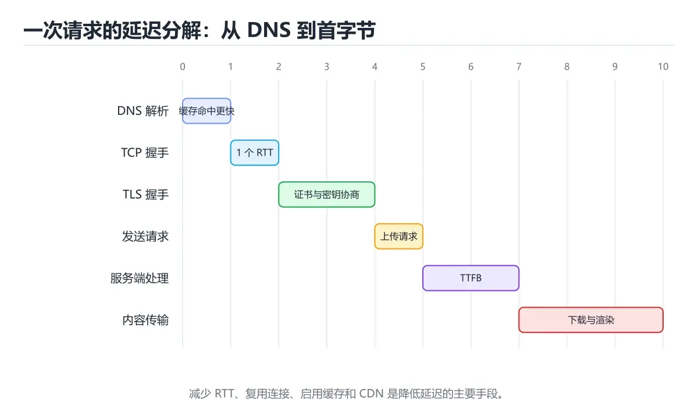
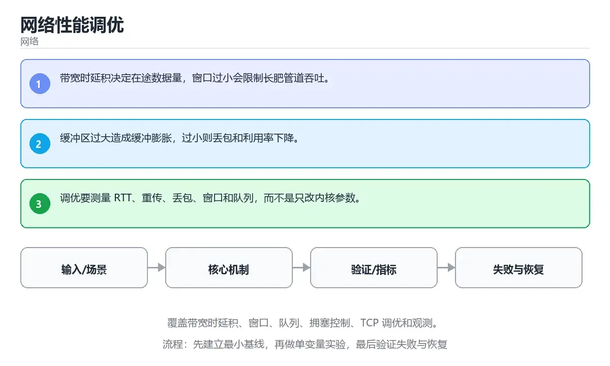

# 网络性能调优

> 内容更新时间：2026-10-06 · 学习阶段：高级 · 预计用时：30 分钟





## 本节知识框架

**课程定位**：所属分类 `network`（网络），课程主题 `网络性能调优`，学习阶段 高级，建议用时 30 分钟。

本课主线：覆盖带宽时延积、窗口、队列、拥塞控制、TCP 调优和观测。

**学完本课应当能够**
- 说清 `带宽时延积` 与 `拥塞控制` 的含义与区别，并各举一个正例和一个反例。
- 用本课示例验证 `TCP` 的行为，记录输入、输出与失败条件。
- 遇到「只测带宽不看延迟与抖动」这类问题时，能说出触发条件与修复顺序。

### 复习清单

- [ ] 能复述 带宽时延积 的职责，并给出一个输入越界时的反例。
- [ ] 能推演 带宽时延积 的示例：先写预期输出，再运行并记录差异与失败现象。
- [ ] 能完成一次自测，并把错题对照错误表定位原因。

## 核心概念定义

| 术语 | 操作性定义 | 常见边界与风险 |
| --- | --- | --- |
| 带宽时延积 | 链路带宽与往返时延的乘积，表示网络中在途数据量。 | 乘积随路径与负载变化；只在空闲网络测一次就当窗口依据不可信，要固定路径、时间窗与数据量，在接近真实负载下复测。 |
| 拥塞控制 | TCP 根据网络反馈调整发送速率，避免丢包和排队崩溃。 | 换成 CUBIC 或 BBR 对丢包的反应就不同；小缓冲降延迟但伤吞吐，大缓冲提吞吐却造成缓冲膨胀，必须按场景选。 |
| TCP | 面向连接的可靠传输协议：握手建连、序号与重传保序，滑动窗口与拥塞控制决定吞吐。 | 易错：局域小链路里窗口够用就照搬参数；长肥管道上窗口小于带宽时延积时吞吐上不去，要在该规模重新评估。 |
| 调优 | 结合带宽时延积、拥塞控制、TCP、调优，写出一个真实项目中的使用场景。 | 易错：只改内核参数不做分层测量；先定位慢在 DNS、连接、传输还是应用处理，再动 RTT、重传、丢包与窗口的参数。 |
| 带宽 | 带宽决定单位时间能传多少数据，延迟决定第一个字节多久到达 | 易错：高带宽但交互卡顿的问题被漏掉；正确做法是同时记录带宽、往返时延、抖动与丢包。 |
| 窗口 | TCP 允许发送方在途的数据量上限，取接收窗口与拥塞窗口的较小值。 | 易错：只调大内核缓冲却忽略窗口缩放协商；跨洲链路上窗口小于带宽时延积，吞吐会被锁死。 |
| 缓冲膨胀 | 队列过长导致排队延迟显著上升的现象。 | 易错：把带宽跑满当成健康；交互流量对排队延迟敏感，要结合 AQM 与队列长度治理。 |

## 原理与运行机制

### 先分层：一次请求慢在哪里

打开网页或调用 API，总耗时可以拆成几段：

| 阶段 | 典型耗时 | 主要影响因素 | 观察手段 |
| --- | --- | --- | --- |
| DNS 解析 | 0~100 ms | 缓存命中、递归服务器距离 | `dig`、`%{time_namelookup}` |
| TCP 握手 | 1 个 RTT | 物理距离、丢包重传 | `%{time_connect}` |
| TLS 握手 | 1~2 个 RTT | 协议版本、证书链、会话复用 | `%{time_appconnect}` |
| 首字节 TTFB | 取决于服务端 | 排队、数据库、下游调用 | `%{time_starttransfer}` |
| 内容传输 | 大小 ÷ 有效吞吐 | 带宽、窗口、丢包 | `%{time_total}` |

只有把总耗时拆开，才能判断该优化 DNS、连接、服务端还是传输。把"接口慢"直接归因于带宽，是网络排障最常见的起点错误。

### 带宽、延迟与带宽时延积

带宽是单位时间能发送的比特数，延迟是数据走完路径需要的时间。二者衡量不同维度：一条 1 Gbps 的卫星链路带宽很高，但 RTT 可能有 600 ms，交互依然迟钝。

带宽时延积（Bandwidth-Delay Product，BDP）把两者乘起来：

BDP（字节）= 带宽（bit/s）× RTT（s）÷ 8

它表示"链路中最多能同时在途多少数据"，也就是管道本身能装下的水量。1 Gbps × 100 ms 的链路 BDP 是 12.5 MB。如果发送窗口只有 64 KB，发送方每 100 ms 只能发出一窗口，吞吐上限约为 64 KB ÷ 0.1 s ≈ 5.2 Mbps，带宽的绝大部分都闲着。

### 三个窗口：rwnd、cwnd 与实际可发数据

TCP 的发送量受两个窗口约束：

- **接收窗口 rwnd**：接收方通过 ACK 通告"我还能收多少"，受接收缓冲区大小限制。
- **拥塞窗口 cwnd**：发送方根据拥塞控制算法维护的估计值，网络拥塞时缩小。
- **实际可发送 = min(rwnd, cwnd)**，再减去已发送但未确认的数据。

窗口缩放（window scaling）选项让 rwnd 可以超过 64 KB；如果协商失败，长肥管道会被 64 KB 上限卡死。`ss -ti` 能看到 `cwnd`、`rwnd`、`rtt`、`retrans` 等字段，是排查单连接吞吐的第一手数据。

### 丢包、队列与缓冲膨胀

路由器接口的队列满时会丢包。传统尾部丢弃（tail drop）会让多条流同时减窗，吞吐呈锯齿状。队列排得越长，端到端延迟越高，这就是**缓冲膨胀**（bufferbloat）：带宽没跑满，但每个包都要在队列里等几百毫秒。

- 队列太小：突发流量直接丢包，链路利用率下降。
- 队列太大：延迟被排队拉长，实时音视频、游戏和交互请求先受害。
- **AQM**（如 CoDel、FQ-CoDel）按"包在队列里待了多久"决定丢弃或标记，把排队延迟压在几十毫秒内。

所以"加带宽"不一定能解决卡顿：如果瓶颈是队列延迟，更大的缓冲区反而让情况更糟。

### 拥塞控制：loss-based 与 model-based

拥塞控制决定发送方如何探测可用带宽：

- **Reno/CUBIC**（Linux 默认 CUBIC）：把丢包当作拥塞信号，丢包就减小 cwnd。在随机丢包的无线链路上容易误判，吞吐上不去。
- **BBR**：测量瓶颈带宽和最小 RTT，按模型维持发送速率，不把丢包直接当拥塞。在高丢包长距离链路上通常表现更好，但会与 loss-based 流争抢带宽。

换算法不是"越快越好"：BBR 可能让同链路上的 CUBIC 流饿死，必须在自己的业务路径上压测，并观察重传率与延迟分布。

### 重传、RTO 与虚假重传

- 超时重传（RTO）在迟迟收不到 ACK 时触发，并带指数退避，最坏情况下一次丢包会让连接停顿数百毫秒到数秒。
- 快速重传靠 3 个重复 ACK 提前发现丢包，不必等 RTO。
- **虚假重传**（spurious retransmission）是包其实到了、只是 ACK 慢，重传纯属浪费。抓包看到重传率高但应用正常，要区分真丢包与乱序、延迟造成的假象。

### 读数：工具与指标

| 工具 | 看什么 | 典型用法 |
| --- | --- | --- |
| `curl -w` | DNS、连接、TLS、TTFB、总耗时 | `curl -w '%{time_namelookup} %{time_connect} %{time_starttransfer} %{time_total}\n' -o /dev/null -s URL` |
| `mtr` | 逐跳延迟与丢包 | `mtr -rwc 100 host` |
| `ss -ti` | cwnd、rtt、重传、发送队列 | `ss -tin state established` |
| `iperf3` | 纯吞吐基线 | `iperf3 -c host -t 30 -P 4` |
| `tcpdump` | 重传、乱序、窗口 | `tcpdump -i eth0 -w cap.pcap 'tcp port 443'` |

测量必须固定路径、时间窗与数据量；一次测速只能说明那个瞬间。

## 典型应用场景

### 五种常见现场

| 现场 | 典型现象 | 先查指标 | 处理方向 |
| --- | --- | --- | --- |
| 跨国 API 下载慢 | 首字节正常，传输阶段慢 | BDP、rwnd、cwnd | 扩大接收缓冲、确认窗口缩放、就近接入 |
| 视频会议卡顿 | 带宽充足但延迟忽高忽低 | 排队延迟、抖动 | 缩短队列或启用 AQM |
| 移动网络上传慢 | 丢包 1%~3% 时吞吐骤降 | 重传率、cwnd 变化 | 评估 BBR，别把丢包全当归因 |
| 容器内吞吐上不去 | 多连接总和远低于网卡能力 | 软中断、CPU limit | 多队列/RSS、调整 CPU 配额 |
| 首屏加载慢 | DNS 与 TLS 占比高 | 分阶段计时 | 预连接、会话复用、CDN |

### 排障顺序

1. **量化现象**：记录 URL、客户端位置、时间窗与成功率，先确认是普遍慢还是个别用户慢。
2. **分阶段计时**：用 `curl -w` 或浏览器瀑布图拆出 DNS、连接、TLS、TTFB、传输。
3. **只改一层**：慢在传输就先看 `ss -ti` 的 rwnd、cwnd、retrans；慢在 TTFB 就转去查服务端。
4. **对照实验**：换网络、换客户端版本重复测量，排除本机与缓存因素。
5. **回归**：在同一时间窗、同一路径复测，记录 P50/P95 与重传率，而不是只看峰值带宽。

### 最小验证场景

- 准备：选一个目标 URL，记录 `curl -w` 的五个时间字段与所在网络。
- 观察：把 `--http1.1` 换成 `--http2`，或打开、关闭连接复用，比较连接与 TLS 耗时。
- 判定：某一段耗时占比超过 30% 时优先优化那一段；只改一处后复测，差异要能重复出现。
- 失败信号：总耗时变化但分段没变，说明瓶颈可能在客户端或测量方式本身。

### 选择与边界

- `带宽时延积` 只在路径稳定时有意义：跨运营商、跨洲路径的 RTT 会波动，要按时间窗取分位数。
- `拥塞控制` 的收益依赖对端与中间设备：BBR 对丢包不敏感，但可能与 CUBIC 流不公平竞争。
- `TCP` 调优参数在三处生效：容器、宿主机、客户端，实际吞吐取最小限制，只改一端可能完全无效。
- 用无线、VPN、代理测量时，链路本身会引入额外延迟与丢包，结论不能直接外推到生产路径。

## 代码/协议/SQL 示例

### 用 Python 算一遍 BDP 与窗口上限

示例先用 `gethostbyname` 验证本机解析，再用同一组链路参数计算 BDP 与窗口受限吞吐：

```python
import socket

ip = socket.gethostbyname("localhost")
print("resolved:", ip)

bandwidth_mbps = 1000
rtt_ms = 100
window_kb = 64

bdp_bytes = bandwidth_mbps * 1_000_000 / 8 * (rtt_ms / 1000)
window_limited_mbps = window_kb * 1024 * 8 / (rtt_ms / 1000) / 1_000_000

print(f"BDP: {bdp_bytes / 1024 / 1024:.1f} MB")
print(f"window-limited: {window_limited_mbps:.1f} Mbps")
print(f"bdp_covers_window={window_kb * 1024 <= bdp_bytes}")
```

```text
resolved: 127.0.0.1
BDP: 11.9 MB
window-limited: 5.2 Mbps
bdp_covers_window=False
```

把 `window_kb` 改成 8192（8 MB）再运行，窗口受限吞吐约 655.4 Mbps，仍达不到 1 Gbps，因为 8 MB 还是小于 11.9 MB 的 BDP。只有窗口不小于 BDP，单连接才可能跑满带宽。

### 用 curl 做分阶段计时

`curl -w` 可以直接给出各阶段耗时，适合在真实请求上验证上面的分层：

```bash
curl -s -o /dev/null -w \
  'dns=%{time_namelookup}s connect=%{time_connect}s tls=%{time_appconnect}s ttfb=%{time_starttransfer}s total=%{time_total}s\n' \
  https://example.com/
```

```text
dns=0.004s connect=0.021s tls=0.067s ttfb=0.089s total=0.112s
```

读法：`connect - dns` 是 TCP 握手耗时，`tls - connect` 是 TLS 握手耗时，`ttfb - tls` 是服务端处理与首包时间，`total - ttfb` 是内容传输时间。四项相加接近总耗时，哪一项异常就把排查方向定到那一层。

## 时间/空间复杂度或性能分析

### 三个可以直接算的公式

1. **吞吐上限** ≈ min(rwnd, cwnd) ÷ RTT。窗口 64 KB、RTT 100 ms → 5.2 Mbps；窗口 1 MB、RTT 100 ms → 83.9 Mbps；窗口 12 MB、RTT 100 ms → 约 1006 Mbps，才够 1 Gbps。
2. **BDP** = 带宽 × RTT ÷ 8。1 Gbps × 100 ms → 12.5 MB；10 Gbps × 20 ms → 25 MB。窗口至少要达到 BDP，否则带宽跑不满。
3. **排队延迟** ≈ 队列字节数 ÷ 出口速率。10 Mbps 链路上积压 1 MB，排队约 0.8 秒；同样 1 MB 在 1 Gbps 链路上只排约 8 ms。

### 缓冲膨胀与重传的代价

- **缓冲膨胀**：一条 10 Mbps 家庭链路，路由器队列 2 MB，满载时每个包多等约 1.6 秒，视频会议会先崩。把队列压到 50 ms × 10 Mbps ≈ 62.5 KB，并启用 AQM，延迟会明显下降。
- **重传**：1% 丢包配合 RTO 300 ms，若每丢一个包都触发一次 RTO，1 万个包中约 100 次停顿，累计等待可能超过 30 秒。快速重传能减少一部分，但窗口太小时重复 ACK 不足，仍会退化为 RTO。
- **TLS 握手**：TLS 1.3 把完整握手压到 1 RTT，TLS 1.2 通常要 2 RTT；跨洲 RTT 200 ms 时，一次冷连接就差出 200 ms。
- **DNS**：缓存未命中时一次解析可能 20~100 ms，移动网络下更久；首屏优化里预解析和连接复用往往比换带宽更划算。

### 测量方法

1. 固定路径、时间窗和目标 URL，记录基线：吞吐、RTT 分位数、重传率、TTFB。
2. 只改一个变量（窗口、拥塞算法、队列长度或 CDN），复测同一组指标。
3. 同时记录 P50 与 P95：平均值会掩盖尾部延迟，而用户感知的是尾延迟。
4. 把客户端与服务端指标对齐到同一时间轴，避免把服务端排队误判成网络丢包。

## 常见误区与易错点

| 容易写错的做法 | 实际现象 | 原因与正确做法 |
| --- | --- | --- |
| 只测带宽不看延迟与抖动 | 高带宽但交互卡顿的问题被漏掉。 | 同时记录带宽、往返时延、抖动与丢包。 |
| 只在空闲网络测试 | 拥塞场景下的表现没有验证。 | 在接近真实负载的条件下测量。 |
| 把重传当成唯一指标 | 忽略应用层排队与处理耗时。 | 结合抓包与应用侧指标一起定位。 |
| 把窗口调得远超 BDP | 丢包时大量重传，延迟上升。 | 窗口略大于 BDP 即可，其余交给拥塞控制调节。 |
| 用 ping 代表应用延迟 | 忽略了 TLS 握手与服务端排队。 | 用 `curl -w` 分阶段计时或接入 APM。 |
| 只在 loopback 上压测 | 真实链路的重传与排队没被覆盖。 | 在代表性路径和丢包率下复测。 |
| 只看平均延迟不看分位数 | 尾延迟问题被平均值掩盖。 | 记录 P95/P99 与抖动，和业务 SLA 对齐。 |

### 现场 1：只测带宽不看延迟与抖动

**症状**：高带宽但交互卡顿的问题被漏掉。

**根因与修复**：同时记录带宽、往返时延、抖动与丢包。

**自检**：在本课示例里复现「只测带宽不看延迟与抖动」，改成同时记录带宽、往返时延、抖动与丢包后重跑；如果症状消失且失败路径按预期变化，说明定位正确。

### 现场 2：只在空闲网络测试

**症状**：拥塞场景下的表现没有验证。

**根因与修复**：在接近真实负载的条件下测量。

**自检**：在本课示例里复现「只在空闲网络测试」，改成在接近真实负载的条件下测量后重跑；如果症状消失且失败路径按预期变化，说明定位正确。

### 现场 3：把重传当成唯一指标

**症状**：忽略应用层排队与处理耗时。

**根因与修复**：结合抓包与应用侧指标一起定位。

**自检**：在本课示例里复现「把重传当成唯一指标」，改成结合抓包与应用侧指标一起定位后重跑；如果症状消失且失败路径按预期变化，说明定位正确。

## 与其他知识点的关系

| 关系 | 课程 | 为什么 |
| --- | --- | --- |
| 先修 | 《BGP 与互联网路由》 | 本课会直接使用它的概念或操作前提。 |
| 关联 | 《网络分层入门》 | 用于横向比较或把本课结论迁移到相邻主题。 |
| 关联 | 《图解 TCP 握手、挥手与拥塞控制》 | 用于横向比较或把本课结论迁移到相邻主题。 |
| 前置顺序 | 《BGP 与互联网路由》 | 同分类中安排在本课之前，建议先完成其自测。 |

**教材衔接：复习与迁移**

## 自测题与参考答案

> 先独立作答，再对照参考答案；答案都能在本课正文、术语表或错误表里找到依据。

### 自测 1（概念复述）

不看正文，写出 `带宽时延积` 的操作性定义，并说明它与 `拥塞控制` 的区别。

**参考答案**：链路带宽与往返时延的乘积，表示网络中在途数据量。

`拥塞控制` 的定位是：TCP 根据网络反馈调整发送速率，避免丢包和排队崩溃；两者的差别要从适用对象与失败模式上说明。

### 自测 2（排错）

本课错误表记录了「只测带宽不看延迟与抖动」这类做法。请写出它会出现的现象、根因，以及修复顺序。

**参考答案**：现象是高带宽但交互卡顿的问题被漏掉；正确做法是同时记录带宽、往返时延、抖动与丢包。修复时先复现现象并保留证据，再改动一处假设重跑，确认现象消失。

### 自测 3（动手验证）

运行本课的 `text` 示例，把 拥塞控制 相关的一个值换成边界值，记录输出差异与错误信息。

**参考答案**：正常输入下 `text` 示例应当复现正文给出的结果；改动输入后，如果结果改变或报错，先核对它是否满足 `网络性能调优` 中`带宽时延积` 的适用范围，再检查错误表里是否有同类现象。

### 自测 4（代码阅读）

阅读本课开头的 `text` 示例，说明它体现了`带宽时延积` 的哪一条性质，并指出改动哪个输入会让这条性质不再成立。

**参考答案**：`带宽时延积` 的定义是 链路带宽与往返时延的乘积，表示网络中在途数据量，示例正是在实现这条定义。改动与 `带宽时延积` 有关的一个输入后，如果结果不再符合 `网络性能调优` 的正文描述，就说明该性质只在当前前提成立。

### 自测 5（迁移）

把 `网络性能调优` 的方法迁移到自己的项目：围绕 `带宽时延积` 写出一个与错误表同类的风险点，并说明触发条件和检验方式。

**参考答案**：例如「把重传当成唯一指标」，它会导致忽略应用层排队与处理耗时；检验方式是按结合抓包与应用侧指标一起定位改一处再复现，确认现象消失且没有引入新的失败分支。

### 自测 6（对比）

用一个表格对比 `带宽时延积` 与 `拥塞控制`：各写一行适用场景、一行失败表现。

**参考答案**：`带宽时延积` 的定义是链路带宽与往返时延的乘积，表示网络中在途数据量；`拥塞控制` 的定义是TCP 根据网络反馈调整发送速率，避免丢包和排队崩溃。两者的失败表现分别对应本课错误表里与本术语相关的行。

### 自测 7（排错顺序）

面对「只测带宽不看延迟与抖动」引发的问题，请把“复现 高带宽但交互卡顿的问题被漏掉 → 保留证据 → 同时记录带宽、往返时延、抖动与丢包 → 回归验证”四步写成可执行的检查清单。

**参考答案**：第一步按高带宽但交互卡顿的问题被漏掉复现；第二步记录输入、版本与完整报错；第三步按同时记录带宽、往返时延、抖动与丢包只改一处；第四步重跑并确认失败路径也按预期变化。

### 自测 8（边界判断）

针对 `带宽`，分别写出“可以使用”的条件和“结论不再成立”的条件。

**参考答案**：易错：高带宽但交互卡顿的问题被漏掉；正确做法是同时记录带宽、往返时延、抖动与丢包。 同时要把 `带宽` 的定义 带宽决定单位时间能传多少数据，延迟决定第一个字节多久到达 与实际输入逐项对照。

### 自测 9（机制重建）

不看正文，按输入、转换、输出、验证四段重建 `带宽时延积` → `拥塞控制` → `TCP` → `调优` 的作用链。

**参考答案**：起点是 `带宽时延积` 的定义 链路带宽与往返时延的乘积，表示网络中在途数据量；中间每一步都保留可观察状态；终点由 `带宽` 检查，失败时回到错误表定位第一个偏离定义的步骤。

### 自测 10（综合排错）

在 `网络性能调优` 中，现象是 忽略应用层排队与处理耗时。请围绕 把重传当成唯一指标 写出最小复现、关键证据、修复动作和回归验证，并说明为什么不能只凭一次运行下结论。

**参考答案**：先复现 把重传当成唯一指标，记录输入与完整错误；再按 结合抓包与应用侧指标一起定位 只改一处。回归时同时跑正常路径和边界路径，只有两次结果都可解释，才把修复视为完成。

### 自测 11（一分钟复述）

用每分钟约 200 字的速度复述 `网络性能调优`：先给主问题，再按顺序说出 `带宽时延积`、`拥塞控制`、`TCP`、`调优`，最后给一个失败案例。

**自评标准**：主问题必须对应 覆盖带宽时延积、窗口、队列、拥塞控制、TCP 调优和观测；每个术语都要能接上一句定义或边界；失败案例必须写成可观察现象，不能用“可能有风险”代替证据。

## 延伸阅读

想更直观地理解本课概念？推荐参阅以下图解专题：

- [图解一次网页请求的完整链路](visual_http_timeline.md)
- [图解 CDN 缓存与回源](visual_cdn_cache.md)

## 术语速查

| 术语 | 一句话说明 |
| --- | --- |
| `带宽时延积` | 链路带宽与往返时延的乘积，表示网络中在途数据量。 |
| `拥塞控制` | TCP 根据网络反馈调整发送速率，避免丢包和排队崩溃。 |
| `TCP` | 面向连接的可靠传输协议：握手建连、序号与重传保序，滑动窗口与拥塞控制决定吞吐。 |
| `调优` | 结合带宽时延积、拥塞控制、TCP、调优，写出一个真实项目中的使用场景。 |
| `带宽` | 带宽决定单位时间能传多少数据，延迟决定第一个字节多久到达。 |
| `RTT` | 一个数据包往返一次所需的时间，是窗口与超时计算的基准。 |
| `接收窗口` | 接收方通告的可用缓冲空间，限制发送方在途数据量。 |
| `拥塞窗口` | 发送方按拥塞控制算法维护的发送上限，遇到拥塞时收缩。 |
| `缓冲膨胀` | 队列过长导致排队延迟显著上升的现象。 |
| `AQM` | 主动队列管理，按排队时延提前丢弃或标记，控制缓冲膨胀。 |
| `TTFB` | 从发出请求到收到第一个响应字节的时间，包含服务端处理。 |
| `重传` | 丢失或疑似丢失的报文再次发送，过多重传说明链路或窗口异常。 |

**术语关系**：`带宽时延积`（链路带宽与往返时延的乘积） → `拥塞控制`（TCP 根据网络反馈调整发送速率） → `TCP`（面向连接的可靠传输协议：握手建连、序号与重传保序） → `调优`（结合带宽时延积、拥塞控制、TCP、调优）。

## 考点精讲

`网络性能调优` 的题库有 5 道题，下面逐题给出题干、正确项与判断依据：先自己作答，再核对正确项，最后回到正文对应小节复核。

### 考点 1：第 1 题

- **题目**：阅读 `网络性能调优` 的 `带宽时延积` 示例。它服务于覆盖带宽时延积、窗口、队列、拥塞控制、TCP 调优和观测。代码中实际包含下列哪一项？
- **正确项**：调用了 `gethostbyname()`
- **判断依据**：本题正确项是「调用了 `gethostbyname()`」（网络性能调优）。术语 带宽时延积（网络性能调优）：链路带宽与往返时延的乘积，表示网络中在途数据量，本题取「调用了 `gethostbyname()`」这条。易错点是只测带宽不看延迟与抖动，会造成高带宽但交互卡顿的问题被漏掉，改法是同时记录带宽、往返时延、抖动与丢包。本题干扰项「调用了 `len()`」不成立：展示代码里找不到 `len()`。

### 考点 2：第 2 题

- **题目**：在 `网络性能调优` 里，与 `带宽时延积` 有关的说法中，哪一项最符合覆盖带宽时延积、窗口、队列、拥塞控制、TCP 调优和观测？
- **正确项**：缓冲区过大造成缓冲膨胀，过小则丢包和利用率下降。
- **判断依据**：本题正确项是「缓冲区过大造成缓冲膨胀，过小则丢包和利用率下降」。术语 带宽时延积（网络性能调优）：链路带宽与往返时延的乘积，表示网络中在途数据量，本题取「缓冲区过大造成缓冲膨胀，过小则丢包和利用率下降」这条。易错点是只在空闲网络测试，会造成拥塞场景下的表现没有验证，改法是在接近真实负载的条件下测量。

### 考点 3：第 3 题

- **题目**：在 `网络性能调优` 里，与 `带宽时延积` 有关的说法中，哪一项最符合覆盖带宽时延积、窗口、队列、拥塞控制、TCP 调优和观测？（网络性能调优·网络 第 3 题）
- **正确项**：调优要测量 RTT、重传、丢包、窗口和队列，而不是只改内核参数。
- **判断依据**：本题正确项是「调优要测量 RTT、重传、丢包、窗口和队列，而不是只改内核参数」。术语 带宽时延积（网络性能调优）：链路带宽与往返时延的乘积，表示网络中在途数据量，本题取「调优要测量 RTT、重传、丢包、窗口和队列，而不是只改内核参数」这条。易错点是把重传当成唯一指标，会造成忽略应用层排队与处理耗时，改法是结合抓包与应用侧指标一起定位。

### 考点 4：第 4 题

- **题目**：按“网络性能调优”中 带宽时延积、拥塞控制、TCP 的实践顺序，把四个步骤排成从准备到复盘的合理顺序。
- **正确项**：先明确 带宽时延积 的输入、输出与约束 → 写出最小示例并核对 拥塞控制 的基线结果 → 只改一个变量，记录边界与失败路径的变化 → 固定版本与证据，把“网络性能调优”的结论写成可复现记录
- **判断依据**：按《网络性能调优》正文的先后，本题顺序是「先明确 带宽时延积 的输入、输出与约束」 → 「写出最小示例并核对 拥塞控制 的基线结果」 → 「只改一个变量，记录边界与失败路径的变化」 → 「固定版本与证据，把“网络性能调优”的结论写成可复现记录」。术语 带宽时延积（网络性能调优）：链路带宽与往返时延的乘积，表示网络中在途数据量。易错点是只测带宽不看延迟与抖动会造成高带宽但交互卡顿的问题被漏掉，改法是同时记录带宽、往返时延、抖动与丢包。

### 考点 5：第 5 题

- **题目**：课程 `覆盖带宽时延积、窗口、队列、拥塞控制、TCP 调优和观测。`。在 `网络性能调优` 里，`带宽时延积`、`拥塞控制` 与下面哪些选项属于同一层概念？（多选）
- **正确项**：带宽时延积；拥塞控制
- **判断依据**：按《网络性能调优》的正文口径，本题要同时选中「带宽时延积」、「拥塞控制」，漏掉任一项都算没答全。术语 带宽时延积（网络性能调优）：链路带宽与往返时延的乘积，表示网络中在途数据量。易错点是只在空闲网络测试，会造成拥塞场景下的表现没有验证，改法是在接近真实负载的条件下测量。

## 内容元数据

- 内容版本：v2.0
- 最后更新：2026-10-06
- 学习阶段：高级
- 适用环境：主流网络栈；本课讨论 gethostbyname 在其中的位置。
- 内容来源：内置结构化课程与工程实践整理
- 相关主题：带宽时延积、拥塞控制、TCP、调优
- 质量版本：P0 测验标准 + P1 覆盖扩展 + P2 体验补全

## 参考资料与复核

- 最后复核：2026-10-04
- 下次复核：2027-06-24
- 复核范围：版本兼容、API 行为、安全建议与工程实践
- 来源性质：官方文档、标准或权威教材；本课核对关键词：带宽时延积、拥塞控制、TCP、调优。

| 参考资料 | 本课用途 |
| --- | --- |
| [RFC 9293 TCP](https://www.rfc-editor.org/rfc/rfc9293) | TCP 连接、重传与拥塞 |
| [RFC 1035 DNS](https://www.rfc-editor.org/rfc/rfc1035) | DNS 报文与解析 |
| [RFC 8446 TLS 1.3](https://www.rfc-editor.org/rfc/rfc8446) | TLS 握手与加密 |

| [本课术语索引：网络性能调优](#核心概念定义) | 按本课输入、术语边界和错误表现逐项核对 |
> 「网络性能调优」的链接用于离线阅读后的延伸核对；App 不会自动联网。