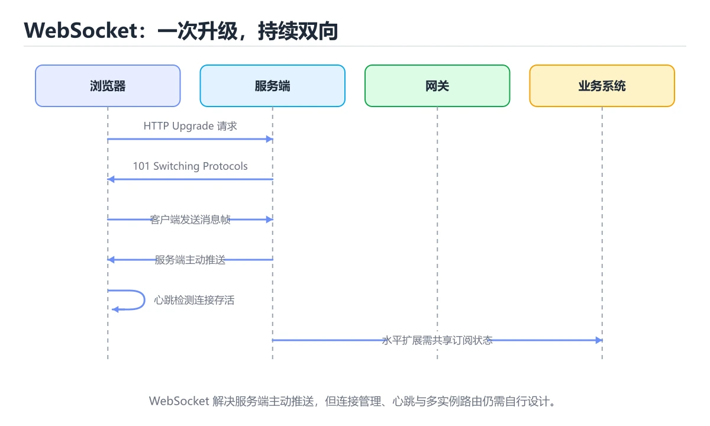
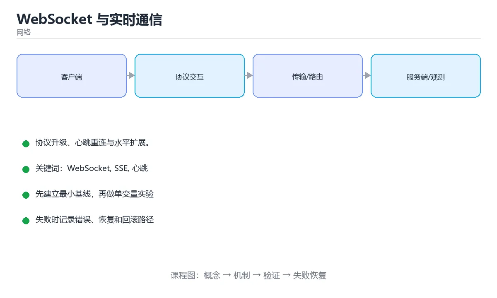

# WebSocket 与实时通信





> 内容更新时间：2026-10-06 · 学习阶段：进阶 · 预计用时：45 分钟

## 本节知识框架

**课程定位**：所属分类 `network`（网络），课程主题 `WebSocket 与实时通信`，学习阶段 进阶，建议用时 45 分钟。

本课主线：协议升级、心跳重连与水平扩展。

**学完本课应当能够**
- 说清 `WebSocket` 与 `实时通信` 的含义与区别，并各举一个正例和一个反例。
- 用本课示例验证 `心跳` 的行为，记录输入、输出与失败条件。
- 遇到「容易踩的做法」这类问题时，能说出触发条件与修复顺序。

### 复习清单

- [ ] 能不看正文复述本课核心术语，并指出一个边界或反例。
- [ ] 能运行或推演本课示例，记录输入、输出与失败现象。
- [ ] 能完成一次自测，并把错题对照错误表定位原因。

## 核心概念定义

| 术语 | 操作性定义 | 常见边界与风险 |
| --- | --- | --- |
| WebSocket | WebSocket 通过一次 HTTP 握手升级协议，之后在同一条 TCP 连接上双向通信。 | 易错：代理阻断时完全不可用；正确做法是提供轮询或 SSE 降级。 |
| 实时通信 | 客户端与服务器保持长连接并及时交换消息，常见协议包括 WebSocket 与 WebRTC。 | 网络延迟、超时与版本协商会改变行为，只在真实链路或多版本客户端上验证才算数。 |
| 心跳 | 定期收发探活帧，用来及时发现半开连接并触发重连。 | 易错：半开连接长期占用；正确做法是定期 ping/pong 并设置超时断开。 |
| 重连退避 | 断线后按指数增长的间隔重试并加随机抖动，避免同时重连打垮服务端。 | 只在「断线后按指数增长的间隔重试并加随机抖动，避免同时重连打垮服务端」这一前提下成立，换输入或换环境要重新验证。 |

## 原理与运行机制

### 机制总览

**教材衔接：与 HTTP、SSE 的对比**

| 方式 | 方向 | 延迟 | 适用 |
| --- | --- | --- | --- |
| HTTP 轮询 | 客户端拉 | 高 | 低频状态检查 |
| 长轮询 | 半推送 | 中 | 兼容性要求极高的场景 |
| SSE | 服务器单向推 | 低 | 通知、日志流、AI 流式输出 |
| WebSocket | 双向 | 最低 | 聊天、协作、游戏、行情 |

**教材衔接：WebSocket 生命周期速查**

| 阶段 | 说明 |
| --- | --- |
| 握手 | 一次带 `Upgrade: websocket` 的 HTTP 请求 |
| 建立 | 服务端返回 101 Switching Protocols |
| 数据帧 | 文本帧、二进制帧、控制帧（ping、pong、close） |
| 保活 | 客户端或服务端定期发送 ping，收到 pong 确认存活 |
| 关闭 | 一方发 close 帧，另一方回应后关闭 TCP |

```javascript
// 带心跳、指数退避重连与消息队列的客户端封装
class ReconnectingSocket {
  constructor(url, { maxDelay = 30000, pingInterval = 25000 } = {}) {
    this.url = url;
    this.maxDelay = maxDelay;
    this.pingInterval = pingInterval;
    this.attempt = 0;
    this.queue = [];
    this.connect();
  }

  connect() {
    this.ws = new WebSocket(this.url);

    this.ws.onopen = () => {
      this.attempt = 0;
      this.flushQueue();
      this.startHeartbeat();
    };

    this.ws.onmessage = (event) => {
      if (event.data === "pong") return;      // 心跳响应，不交给业务
      this.onMessage?.(event.data);
    };

    this.ws.onclose = () => {
      this.stopHeartbeat();
      this.scheduleReconnect();
    };

    this.ws.onerror = () => this.ws.close();
  }

  startHeartbeat() {
    this.stopHeartbeat();
    this.timer = setInterval(() => this.send("ping"), this.pingInterval);
  }

  stopHeartbeat() {
    if (this.timer) clearInterval(this.timer);
  }

  scheduleReconnect() {
    const delay = Math.min(this.maxDelay, 1000 * 2 ** this.attempt++);
    const jitter = Math.random() * 0.3 * delay;   // 抖动避免同时重连
    setTimeout(() => this.connect(), delay + jitter);
  }

  send(payload) {
    if (this.ws?.readyState === WebSocket.OPEN) {
      this.ws.send(typeof payload === "string" ? payload : JSON.stringify(payload));
    } else {
      this.queue.push(payload);                   // 断线期间先入队
    }
  }

  flushQueue() {
    const pending = this.queue.splice(0);
    pending.forEach((item) => this.send(item));
  }
}
```

**教材衔接：深入补充：WebSocket 与实时通信 的取舍与边界**

### 四、自测清单

- 能否用一句话说出WebSocket 与实时通信解决的核心问题与不适用场景？
- 能否画出 WebSocket 的数据流或状态变化，并标出失败路径？
- 把 dGhlIHNhbXBsZSBub25jZQ 的输入推到边界，说明本课哪一条结论会先失效。
- 能否写出一条可复现的验证命令，让别人独立得到相同结论？

## 典型应用场景

- **容易踩的做法**：典型现象是实际现象；正确做法是原因与正确做法。
- **不做心跳**：典型现象是半开连接长期占用；正确做法是定期 ping/pong 并设置超时断开。
- **重连不做退避**：典型现象是服务端被重连风暴打垮；正确做法是指数退避 + 随机抖动。
- **只靠 WebSocket 无兜底**：典型现象是代理阻断时完全不可用；正确做法是提供轮询或 SSE 降级。

### 最小验证场景

- 准备：保留 `javascript` 示例的原始输入，先记录 `WebSocket 与实时通信` 的基线输出和完整运行命令。
- 观察：先核对 调用了 `constructor()`，再改变一个与 `WebSocket` 相关的条件。
- 判定：新结果与 `WebSocket 与实时通信` 的基线不同不等于错误；只有当差异破坏了 `WebSocket` 的定义或错误表中的约束，才判定为失败。

### 选择与边界

- 使用 `WebSocket` 时，先满足它的定义：WebSocket 通过一次 HTTP 握手升级协议，之后在同一条 TCP 连接上双向通信；易错：代理阻断时完全不可用；正确做法是提供轮询或 SSE 降级。
- 使用 `实时通信` 时，先满足它的定义：客户端与服务器保持长连接并及时交换消息，常见协议包括 WebSocket 与 WebRTC；网络延迟、超时与版本协商会改变行为，只在真实链路或多版本客户端上验证才算数。
- 使用 `心跳` 时，先满足它的定义：定期收发探活帧，用来及时发现半开连接并触发重连；易错：半开连接长期占用；正确做法是定期 ping/pong 并设置超时断开。
- 使用 `重连退避` 时，先满足它的定义：断线后按指数增长的间隔重试并加随机抖动，避免同时重连打垮服务端；只在「断线后按指数增长的间隔重试并加随机抖动，避免同时重连打垮服务端」这一前提下成立，换输入或换环境要重新验证。

## 代码/协议/SQL 示例

### 最小可验证示例

```text
客户端 GET /chat HTTP/1.1
       Upgrade: websocket
       Connection: Upgrade
       Sec-WebSocket-Key: dGhlIHNhbXBsZSBub25jZQ==

服务器 HTTP/1.1 101 Switching Protocols
       Upgrade: websocket
       Connection: Upgrade
       Sec-WebSocket-Accept: ...
```

**教材衔接：为什么需要 WebSocket**

HTTP 是请求-响应模式，服务器无法主动推送。轮询（不停发请求）浪费资源，长轮询（挂起请求）实现复杂。WebSocket 通过一次 HTTP 握手升级协议，之后在**同一条 TCP 连接**上双向通信。

**教材衔接：前端使用**

```javascript
const ws = new WebSocket('wss://example.com/chat');
ws.onopen = () => ws.send(JSON.stringify({ type: 'join', room: '42' }));
ws.onmessage = event => {
  const message = JSON.parse(event.data);
  console.log('收到', message);
};
ws.onerror = error => console.error('连接异常', error);
ws.onclose = event => {
  console.warn('连接关闭', event.code, event.reason);
  setTimeout(connect, Math.min(30000, 1000 * 2 ** retries++));   // 指数退避重连
};
```

前端必须实现：**心跳、重连、消息去重与顺序处理**。断线后要能补齐漏掉的消息（用序号或游标）。

**教材衔接：服务端要点**

```python
# FastAPI 示例
from fastapi import FastAPI, WebSocket, WebSocketDisconnect

app = FastAPI()
rooms: dict[str, set[WebSocket]] = {}

@app.websocket("/chat/{room}")
async def chat(websocket: WebSocket, room: str):
    await websocket.accept()
    rooms.setdefault(room, set()).add(websocket)
    try:
        while True:
            text = await websocket.receive_text()      # 心跳也在这里处理
            for client in rooms[room]:
                if client is not websocket:
                    await client.send_text(text)       # 广播
    except WebSocketDisconnect:
        rooms[room].discard(websocket)
```

生产环境还要考虑：

1. **水平扩展**：多实例之间用 Redis Pub/Sub、NATS 或 Kafka 转发消息。
2. **连接数**：单机连接数受文件描述符与内存限制，需要容量规划与压测。
3. **背压**：慢客户端会拖垮服务，应限制发送队列并在超限时断开。
4. **鉴权**：握手阶段校验 Token，避免连接后长时间占用资源。
5. **心跳与超时**：定期 ping/pong，清理半开连接。

**教材衔接：协议选型速查**

| 方案 | 方向 | 底层 | 适用 |
| --- | --- | --- | --- |
| 轮询 | 客户端拉 | HTTP | 更新频率低、实现最简 |
| 长轮询 | 客户端拉（挂起） | HTTP | 兼容性要求高 |
| SSE | 服务器推 | HTTP | 单向推送（通知、进度） |
| WebSocket | 双向 | HTTP 升级后 TCP | 聊天、协作、游戏 |
| WebRTC | 双向（音视频与数据） | UDP | 实时音视频、P2P |
| gRPC 流 | 双向 | HTTP/2 | 服务间流式通信 |

**教材衔接：多实例部署速查**

| 问题 | 方案 |
| --- | --- |
| 连接落在不同实例 | 用 Redis 发布订阅或消息队列广播 |
| 会话状态 | 存入共享存储（Redis），不放在单机内存 |
| 负载均衡 | 需要会话粘性时用一致性哈希或 `ip_hash` |
| 连接数上限 | 按内存与文件描述符调优，控制单机连接数 |
| 消息顺序 | 同一会话串行处理，避免并发写同一连接 |
| 广播风暴 | 分级主题订阅，避免全量广播 |
| 断线补偿 | 客户端带 `last_event_id` 拉取缺失消息 |

**运行方式**：运行 `WebSocket 与实时通信` 的示例时，保存为 `.js` 后用 `node 文件名.js` 运行；涉及浏览器 API 的示例要放到页面里执行。

## 时间/空间复杂度或性能分析

**性能关注点（WebSocket 与实时通信）**：往返延迟与带宽是主要成本：记录 RTT、吞吐与重传率，区分局域网与真实链路。

**本课特有开销（WebSocket 与实时通信 · WebSocket）**：缓存命中率比缓存实现本身更关键，先记录命中率与失效策略再谈优化。

**测量方法**：以 `WebSocket 与实时通信` 的 `WebSocket` 场景为对象，固定输入跑一遍记录基线，再把规模或并发度提高一个数量级复测；两次结果的差值与波动范围才是结论依据。

## 常见误区与易错点

| 容易写错的做法 | 实际现象 | 原因与正确做法 |
| --- | --- | --- |
| 容易踩的做法 | 实际现象 | 原因与正确做法 |
| 不做心跳 | 半开连接长期占用 | 定期 ping/pong 并设置超时断开 |
| 重连不做退避 | 服务端被重连风暴打垮 | 指数退避 + 随机抖动 |
| 只靠 WebSocket 无兜底 | 代理阻断时完全不可用 | 提供轮询或 SSE 降级 |
| 把状态放单机内存 | 扩容后消息丢失 | 状态外置到共享存储 |
| 不做鉴权 | 任何人可连 | 握手时校验令牌并绑定用户 |
| 不限制消息大小 | 大消息打爆内存 | 限制帧大小与频率 |
| 忽略代理超时 | 连接被中间设备断开 | 心跳间隔小于空闲超时 |
| 不处理 `onclose` 清理 | 定时器与监听泄漏 | 关闭时释放资源 |
| 假设消息一定有序到达 | 逻辑错乱 | 用序号与时间戳校验，必要时重排 |
| 无消息持久化 | 断线期间消息丢失 | 离线消息落库并支持拉取 |

### 现场 1：容易踩的做法

**症状**：实际现象。

**根因与修复**：原因与正确做法。

**自检**：在本课示例里复现「容易踩的做法」，改成原因与正确做法后重跑；如果症状消失且失败路径按预期变化，说明定位正确。

### 现场 2：不做心跳

**症状**：半开连接长期占用。

**根因与修复**：定期 ping/pong 并设置超时断开。

**自检**：在本课示例里复现「不做心跳」，改成定期 ping/pong 并设置超时断开后重跑；如果症状消失且失败路径按预期变化，说明定位正确。

### 现场 3：重连不做退避

**症状**：服务端被重连风暴打垮。

**根因与修复**：指数退避 + 随机抖动。

**自检**：在本课示例里复现「重连不做退避」，改成指数退避 + 随机抖动后重跑；如果症状消失且失败路径按预期变化，说明定位正确。

### 现场 4：只靠 WebSocket 无兜底

**症状**：代理阻断时完全不可用。

**根因与修复**：提供轮询或 SSE 降级。

**自检**：在本课示例里复现「只靠 WebSocket 无兜底」，改成提供轮询或 SSE 降级后重跑；如果症状消失且失败路径按预期变化，说明定位正确。

### 现场 5：把状态放单机内存

**症状**：扩容后消息丢失。

**根因与修复**：状态外置到共享存储。

**自检**：在本课示例里复现「把状态放单机内存」，改成状态外置到共享存储后重跑；如果症状消失且失败路径按预期变化，说明定位正确。

### 现场 6：不做鉴权

**症状**：任何人可连。

**根因与修复**：握手时校验令牌并绑定用户。

**自检**：在本课示例里复现「不做鉴权」，改成握手时校验令牌并绑定用户后重跑；如果症状消失且失败路径按预期变化，说明定位正确。

### 现场 7：不限制消息大小

**症状**：大消息打爆内存。

**根因与修复**：限制帧大小与频率。

**自检**：在本课示例里复现「不限制消息大小」，改成限制帧大小与频率后重跑；如果症状消失且失败路径按预期变化，说明定位正确。

### 现场 8：忽略代理超时

**症状**：连接被中间设备断开。

**根因与修复**：心跳间隔小于空闲超时。

**自检**：在本课示例里复现「忽略代理超时」，改成心跳间隔小于空闲超时后重跑；如果症状消失且失败路径按预期变化，说明定位正确。

### 现场 9：不处理 `onclose` 清理

**症状**：定时器与监听泄漏。

**根因与修复**：关闭时释放资源。

**自检**：在本课示例里复现「不处理 `onclose` 清理」，改成关闭时释放资源后重跑；如果症状消失且失败路径按预期变化，说明定位正确。

## 与其他知识点的关系

- **先修**：`CDN、代理与缓存`。本课默认这些内容已经掌握。
- **相关或后续**：`HTTP/2 与 HTTP/3`、`实战：JavaScript 实时聊天室`。本课术语会在这些课程里继续使用。
- **术语归属**：`WebSocket`、`实时通信`、`心跳` 的定义以本课「核心概念定义」为准，换到其他课程时先确认定义是否被改写。

## 自测题与参考答案

> 先独立作答，再对照参考答案；答案都能在本课正文、术语表或错误表里找到依据。

### 自测 1（概念复述）

不看正文，写出 `WebSocket` 的操作性定义，并说明它与 `实时通信` 的区别。

**参考答案**：WebSocket 通过一次 HTTP 握手升级协议，之后在同一条 TCP 连接上双向通信。

`实时通信` 的定位是：客户端与服务器保持长连接并及时交换消息，常见协议包括 WebSocket 与 WebRTC；两者的差别要从适用对象与失败模式上说明。

### 自测 2（排错）

本课错误表记录了「容易踩的做法」这类做法。请写出它会出现的现象、根因，以及修复顺序。

**参考答案**：现象是实际现象；正确做法是原因与正确做法。修复时先复现现象并保留证据，再改动一处假设重跑，确认现象消失。

### 自测 3（动手验证）

运行本课的 `javascript` 示例，把其中的 `"pong"` 换成一个边界值后重新运行，记录输出与错误信息。

**参考答案**：正常输入下 `javascript` 示例应当复现正文给出的结果；把 `"pong"` 换成边界值后，如果结果改变或报错，先核对它是否满足 `WebSocket 与实时通信` 中`WebSocket` 的适用范围，再检查错误表里是否有同类现象。

### 自测 4（代码阅读）

阅读本课开头的 `javascript` 示例，说明它体现了`WebSocket` 的哪一条性质，并指出改动哪个输入会让这条性质不再成立。

**参考答案**：`WebSocket` 的定义是 WebSocket 通过一次 HTTP 握手升级协议，之后在同一条 TCP 连接上双向通信，示例正是在实现这条定义。改动与 `WebSocket` 有关的一个输入后，如果结果不再符合 `WebSocket 与实时通信` 的正文描述，就说明该性质只在当前前提成立。

### 自测 5（迁移）

把 `WebSocket 与实时通信` 的方法迁移到自己的项目：围绕 `WebSocket` 写出一个与错误表同类的风险点，并说明触发条件和检验方式。

**参考答案**：例如「无消息持久化」，它会导致断线期间消息丢失；检验方式是按离线消息落库并支持拉取改一处再复现，确认现象消失且没有引入新的失败分支。

### 自测 6（对比）

用一个表格对比 `WebSocket` 与 `实时通信`：各写一行适用场景、一行失败表现。

**参考答案**：`WebSocket` 的定义是WebSocket 通过一次 HTTP 握手升级协议，之后在同一条 TCP 连接上双向通信；`实时通信` 的定义是客户端与服务器保持长连接并及时交换消息，常见协议包括 WebSocket 与 WebRTC。两者的失败表现分别对应本课错误表里与本术语相关的行。

### 自测 7（排错顺序）

面对「容易踩的做法」引发的问题，请把“复现 实际现象 → 保留证据 → 原因与正确做法 → 回归验证”四步写成可执行的检查清单。

**参考答案**：第一步按实际现象复现；第二步记录输入、版本与完整报错；第三步按原因与正确做法只改一处；第四步重跑并确认失败路径也按预期变化。

### 自测 8（边界判断）

针对 `重连退避`，分别写出“可以使用”的条件和“结论不再成立”的条件。

**参考答案**：只在「断线后按指数增长的间隔重试并加随机抖动，避免同时重连打垮服务端」这一前提下成立，换输入或换环境要重新验证。 同时要把 `重连退避` 的定义 断线后按指数增长的间隔重试并加随机抖动，避免同时重连打垮服务端 与实际输入逐项对照。

### 自测 9（机制重建）

不看正文，按输入、转换、输出、验证四段重建 `WebSocket` → `实时通信` → `心跳` → `重连退避` 的作用链。

**参考答案**：起点是 `WebSocket` 的定义 WebSocket 通过一次 HTTP 握手升级协议，之后在同一条 TCP 连接上双向通信；中间每一步都保留可观察状态；终点由 `重连退避` 检查，失败时回到错误表定位第一个偏离定义的步骤。

### 自测 10（综合排错）

在 `WebSocket 与实时通信` 中，现象是 断线期间消息丢失。请围绕 无消息持久化 写出最小复现、关键证据、修复动作和回归验证，并说明为什么不能只凭一次运行下结论。

**参考答案**：先复现 无消息持久化，记录输入与完整错误；再按 离线消息落库并支持拉取 只改一处。回归时同时跑正常路径和边界路径，只有两次结果都可解释，才把修复视为完成。

### 自测 11（一分钟复述）

用每分钟约 200 字的速度复述 `WebSocket 与实时通信`：先给主问题，再按顺序说出 `WebSocket`、`实时通信`、`心跳`、`重连退避`，最后给一个失败案例。

**自评标准**：主问题必须对应 协议升级、心跳重连与水平扩展；每个术语都要能接上一句定义或边界；失败案例必须写成可观察现象，不能用“可能有风险”代替证据。

## 延伸阅读

想更直观地理解本课概念？推荐参阅以下图解专题：

- [图解一次网页请求的完整链路](visual_http_timeline.md)

## 术语速查

| 术语 | 一句话说明 |
| --- | --- |
| `WebSocket` | WebSocket 通过一次 HTTP 握手升级协议，之后在同一条 TCP 连接上双向通信。 |
| `实时通信` | 客户端与服务器保持长连接并及时交换消息，常见协议包括 WebSocket 与 WebRTC。 |
| `心跳` | 定期收发探活帧，用来及时发现半开连接并触发重连。 |
| `重连退避` | 断线后按指数增长的间隔重试并加随机抖动，避免同时重连打垮服务端。 |

**术语关系**：`WebSocket`（WebSocket 通过一次 HTTP 握手升级协议） → `实时通信`（客户端与服务器保持长连接并及时交换消息） → `心跳`（定期收发探活帧） → `重连退避`（断线后按指数增长的间隔重试并加随机抖动）。

## 考点精讲

`WebSocket 与实时通信` 的题库有 6 道题，下面逐题给出题干、正确项与判断依据：先自己作答，再核对正确项，最后回到正文对应小节复核。

### 考点 1：第 1 题

- **题目**：WebSocket 与 HTTP 的关键区别是？
- **正确项**：一次握手后在同一条连接上双向通信
- **判断依据**：这道题落在术语 `WebSocket` 上：WebSocket 通过一次 HTTP 握手升级协议，之后在同一条 TCP 连接上双向通信。复习时把 `WebSocket` 的定义、适用边界和一个反例一起说清楚，再回到「核心概念定义」核对原文。

### 考点 2：第 2 题

- **题目**：WebSocket 断线后必须实现？
- **正确项**：心跳、指数退避重连与消息序号补齐
- **判断依据**：这道题落在术语 `WebSocket` 上：WebSocket 通过一次 HTTP 握手升级协议，之后在同一条 TCP 连接上双向通信。复习时把 `WebSocket` 的定义、适用边界和一个反例一起说清楚，再回到「核心概念定义」核对原文。

### 考点 3：第 3 题

- **题目**：围绕“WebSocket 与实时通信”中的 WebSocket、SSE、心跳，下列哪两项是本课强调的实践判断？
- **正确项**：验证 SSE 时要固定版本并覆盖边界输入，结论才可复现；学习 WebSocket 时要同时说明输入、输出和失败路径，不能只看正常流程
- **判断依据**：这道题落在术语 `WebSocket` 上：WebSocket 通过一次 HTTP 握手升级协议，之后在同一条 TCP 连接上双向通信。复习时把 `WebSocket` 的定义、适用边界和一个反例一起说清楚，再回到「核心概念定义」核对原文。

### 考点 4：第 4 题

- **题目**：阅读 `WebSocket 与实时通信` 的 `WebSocket` 示例。它服务于协议升级、心跳重连与水平扩展。代码中实际包含下列哪一项？
- **正确项**：调用了 `random()`
- **判断依据**：这道题落在术语 `WebSocket` 上：WebSocket 通过一次 HTTP 握手升级协议，之后在同一条 TCP 连接上双向通信。复习时把 `WebSocket` 的定义、适用边界和一个反例一起说清楚，再回到「核心概念定义」核对原文。

### 考点 5：第 5 题

- **题目**：SSE（Server-Sent Events）与 WebSocket 的主要区别是？
- **正确项**：SSE 是服务器到客户端的单向文本流（基于 HTTP），WebSocket 是全双工
- **判断依据**：这道题落在术语 `WebSocket` 上：WebSocket 通过一次 HTTP 握手升级协议，之后在同一条 TCP 连接上双向通信。复习时把 `WebSocket` 的定义、适用边界和一个反例一起说清楚，再回到「核心概念定义」核对原文。

### 考点 6：第 6 题

- **题目**：填空：补齐下面这段术语说明中的空缺。课程 `协议升级、心跳重连与水平扩展。`，这段说明是：`____` 通过一次 HTTP 握手升级协议，之后在同一条 TCP 连接上双向通信。空缺处应填哪个术语？
- **正确项**：WebSocket
- **判断依据**：这道题落在术语 `WebSocket` 上：WebSocket 通过一次 HTTP 握手升级协议，之后在同一条 TCP 连接上双向通信。复习时把 `WebSocket` 的定义、适用边界和一个反例一起说清楚，再回到「核心概念定义」核对原文。

### 考点 7：`WebSocket`

- **要点**：WebSocket 通过一次 HTTP 握手升级协议，之后在同一条 TCP 连接上双向通信。
- **WebSocket 的边界**：易错：代理阻断时完全不可用；正确做法是提供轮询或 SSE 降级。

### 考点 8：`实时通信`

- **要点**：客户端与服务器保持长连接并及时交换消息，常见协议包括 WebSocket 与 WebRTC。
- **实时通信 的边界**：网络延迟、超时与版本协商会改变行为，只在真实链路或多版本客户端上验证才算数。

### 考点 9：`心跳`

- **要点**：定期收发探活帧，用来及时发现半开连接并触发重连。
- **心跳 的边界**：易错：半开连接长期占用；正确做法是定期 ping/pong 并设置超时断开。

### 考点 10：`重连退避`

- **要点**：断线后按指数增长的间隔重试并加随机抖动，避免同时重连打垮服务端。
- **重连退避 的边界**：只在「断线后按指数增长的间隔重试并加随机抖动，避免同时重连打垮服务端」这一前提下成立，换输入或换环境要重新验证。

### 考点 11：排错——容易踩的做法

- **现象**：实际现象。
- **处理**：原因与正确做法。

### 考点 12：排错——不做心跳

- **现象**：半开连接长期占用。
- **处理**：定期 ping/pong 并设置超时断开。

### 考点 13：综合辨析——`WebSocket` 与 `重连退避`

- **辨析点**：`WebSocket` 的定义是 WebSocket 通过一次 HTTP 握手升级协议，之后在同一条 TCP 连接上双向通信；`重连退避` 的定义是 断线后按指数增长的间隔重试并加随机抖动，避免同时重连打垮服务端。
- **答题要求**：面对 `WebSocket 与实时通信` 的题目，先判断描述的是 `WebSocket` 还是 `重连退避`，再归到对应定义，最后写出一个会让该定义失效的边界输入。

### 考点 14：排错评分点

- **现象分**：能写出 实际现象，而不是只写“程序有错”。
- **证据分**：保留触发 容易踩的做法 的输入、版本和错误原文。
- **修复分**：按 原因与正确做法 只改一处，并同时回归正常路径与边界路径。

## 内容元数据

- 内容版本：v2.0
- 最后更新：2026-10-06
- 学习阶段：进阶
- 适用环境：主流网络栈；本课讨论 dGhlIHNhbXBsZSBub25jZQ 在其中的位置。
- 内容来源：内置结构化课程与工程实践整理
- 相关主题：WebSocket、SSE、心跳、重连、实时通信
- 质量版本：P0 测验标准 + P1 覆盖扩展 + P2 体验补全

## 参考资料与复核

- [本课资料锚点 websocket](https://zh.wikipedia.org/w/index.php?search=websocket)

- 最后复核：2026-10-04
- 下次复核：2027-06-24
- 复核范围：版本兼容、API 行为、安全建议与工程实践
- 来源性质：官方文档、标准或权威教材；本课核对关键词：WebSocket、SSE、心跳、重连、实时通信。

| 参考资料 | 本课用途 |
| --- | --- |
| [IANA 协议注册表](https://www.iana.org/protocols) | 端口、协议号与参数 |
| [MDN HTTP](https://developer.mozilla.org/docs/Web/HTTP) | 浏览器视角的 HTTP |
| [RFC 9113 HTTP/2](https://www.rfc-editor.org/rfc/rfc9113) | HTTP/2 多路复用与流 |

| [本课术语索引：WebSocket 与实时通信](#核心概念定义) | 按本课输入、术语边界和错误表现逐项核对 |
> 「WebSocket 与实时通信」的链接用于离线阅读后的延伸核对；App 不会自动联网。