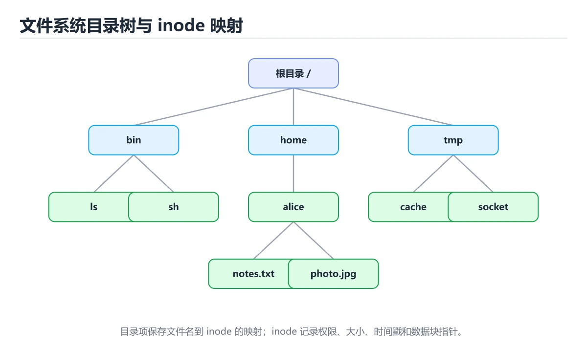
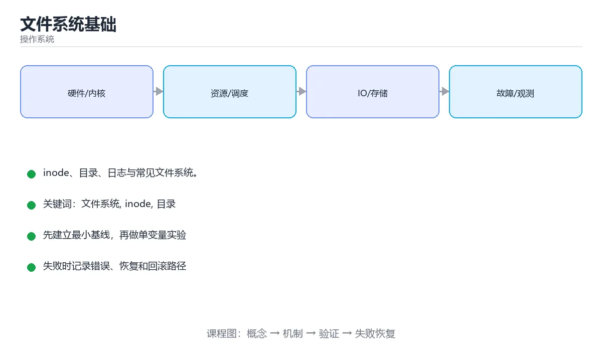

# 文件系统基础





> 内容更新时间：2026-10-06 · 学习阶段：进阶 · 预计用时：35 分钟

## 本节知识框架

**课程定位**：所属分类 `os`（操作系统），课程主题 `文件系统基础`，学习阶段 进阶，建议用时 40 分钟。

本课主线：inode、目录、日志与常见文件系统。

**学完本课应当能够**
- 说清 `文件系统` 与 `inode` 的含义与区别，并各举一个正例和一个反例。
- 用本课示例验证 `目录` 的行为，记录输入、输出与失败条件。
- 遇到「只看 `df` 空间不看 `df -i`」这类问题时，能说出触发条件与修复顺序。

### 复习清单

- [ ] 能用自己的话说明「文件系统基础」里的 文件系统，再举一个它不成立的场景。
- [ ] 能运行「文件系统基础」的示例，记录输入、输出与第一次失败的现象。
- [ ] 能完成一次自测，并把错题对照错误表定位原因。

## 核心概念定义

| 术语 | 操作性定义 | 常见边界与风险 |
| --- | --- | --- |
| 文件系统 | 文件系统把块设备抽象成文件与目录，负责：空间分配、目录管理、权限控制、崩溃恢复与缓存。 | 易错：报错；正确做法是跨文件系统用软链接。 |
| inode | inode：保存文件的元数据（大小、权限、时间戳、数据块位置），不含文件名。 | 易错：报「空间不足」但明明有空间；正确做法是inode 耗尽，需清理小文件。 |
| 目录 | 文件系统中组织和索引文件的特殊节点。 | 易错：长时间阻塞；正确做法是用分批删除或工具加速。 |
| 日志 | 文件系统 = inode + 目录 + 数据块 + 日志。 | 易错：磁盘被日志写满；正确做法是配 `logrotate` 或应用级切割。 |
| ext4 | Linux 常用的日志文件系统，提供大文件、目录索引和崩溃恢复支持。 | 易错：什么场景都用 ext4；海量目录才用得着目录索引，大文件与高并发本课更推荐 XFS，恢复能力还依赖日志没被写满。 |
| NTFS | Windows 常用的日志文件系统，支持权限、加密、压缩和大卷。 | 易错：以为权限与加密跟着文件走；拷到本课列为「能力有限」的 FAT32/exFAT 移动盘后，这些能力就不存在了。 |

## 原理与运行机制

### 机制总览

**教材衔接：文件系统做什么**

文件系统把块设备抽象成文件与目录，负责：空间分配、目录管理、权限控制、崩溃恢复与缓存。

**教材衔接：常见文件系统**

| 系统 | 特点 |
| --- | --- |
| ext4 | Linux 主流，稳定成熟，支持日志 |
| XFS | 大文件与高并发表现好 |
| Btrfs / ZFS | 支持快照、校验和、压缩 |
| NTFS | Windows 主流，支持权限与日志 |
| APFS | macOS，支持写时复制与快照 |
| FAT32 / exFAT | U 盘通用，能力有限 |

**教材衔接：元数据与结构速查**

| 概念 | 说明 |
| --- | --- |
| inode | 存放元数据与数据块指针，不含文件名 |
| 目录项 | 文件名到 inode 的映射 |
| 数据块 | 实际数据存储单位，常见 4KB |
| 超级块 | 文件系统整体信息 |
| 日志（journal） | 记录元数据变更，崩溃后快速恢复 |
| 挂载点 | 文件系统在目录树中的位置 |
| 硬链接 | 多个名字指向同一 inode |
| 软链接 | 独立文件，内容为目标路径 |

```bash
# 空间与使用情况
df -hT                     # 各挂载点类型与用量
du -sh /var/log/*          # 目录占用排序前几位
df -i                      # inode 使用率（可能 inode 用满而空间未满）

# 文件与目录结构
stat /etc/hosts            # 查看 inode、权限、时间戳
ls -li /etc/hosts          # 查看 inode 编号
find /var -xdev -type f -size +1G   # 找大文件（不跨文件系统）

# 日志与恢复
journalctl -k | grep -i 'ext4\|xfs\|i/o error'
dumpe2fs -h /dev/sda1 | head -20    # ext 系列超级块信息

# 权限与所有权
chmod 640 secret.txt
chown app:app /data
getfacl /data              # 查看 ACL
```

```python
import os
from pathlib import Path
from collections import defaultdict

def disk_usage_report(root: str, top_n: int = 5) -> dict:
    """按目录汇总大小，找出占用最大的若干项。"""
    totals = defaultdict(int)
    for dirpath, _dirnames, filenames in os.walk(root):
        for name in filenames:
            path = Path(dirpath) / name
            try:
                size = path.stat().st_size
            except OSError:
                continue
            parts = path.relative_to(root).parts
            key = parts[0] if len(parts) > 1 else "(files)"
            totals[key] += size
    ordered = sorted(totals.items(), key=lambda item: -item[1])[:top_n]
    return {
        "root": root,
        "top": [(k, round(v / 1024 / 1024, 2)) for k, v in ordered],
        "total_mb": round(sum(totals.values()) / 1024 / 1024, 2),
    }

def can_hardlink(src: str, dst: str) -> bool:
    """硬链接要求同一文件系统。"""
    return os.stat(src).st_dev == os.stat(Path(dst).parent).st_dev

print(disk_usage_report(".").get("top"))
```

## 典型应用场景

- **只看 `df` 空间不看 `df -i`**：典型现象是报「空间不足」但明明有空间；正确做法是inode 耗尽，需清理小文件。
- **删了文件空间没释放**：典型现象是`df` 没变化；正确做法是文件仍被进程持有，需重启或清空句柄。
- **认为硬链接能跨文件系统**：典型现象是报错；正确做法是跨文件系统用软链接。
- **删除源文件后软链接仍可用**：典型现象是悬空链接；正确做法是软链接保存路径，源删除即失效。

### 最小验证场景

- 准备：保留 `bash` 示例的原始输入，先记录 `文件系统基础` 的基线输出和完整运行命令。
- 观察：先核对 出现字面量 `ext4\|xfs\|i/o error`，再改变一个与 `文件系统` 相关的条件。
- 判定：新结果与 `文件系统基础` 的基线不同不等于错误；只有当差异破坏了 `文件系统` 的定义或错误表中的约束，才判定为失败。

### 选择与边界

- 使用 `文件系统` 时，文件系统把块设备抽象成文件与目录，负责：空间分配、目录管理、权限控制、崩溃恢复与缓存；易错：报错；正确做法是跨文件系统用软链接。
- 使用 `inode` 时，inode：保存文件的元数据（大小、权限、时间戳、数据块位置），不含文件名；易错：报「空间不足」但明明有空间；正确做法是inode 耗尽，需清理小文件。
- 使用 `目录` 时，文件系统中组织和索引文件的特殊节点；易错：长时间阻塞；正确做法是用分批删除或工具加速。
- 使用 `日志` 时，文件系统 = inode + 目录 + 数据块 + 日志；易错：磁盘被日志写满；正确做法是配 `logrotate` 或应用级切割。
- 使用 `ext4` 时，Linux 常用的日志文件系统，提供大文件、目录索引和崩溃恢复支持；索引命中与数据分布决定实际开销，判断前先看执行计划而不是只看结果是否正确。

## 代码/协议/SQL 示例

**教材衔接：inode 与元数据**

- **inode**：保存文件的元数据（大小、权限、时间戳、数据块位置），不含文件名。
- **目录项**：文件名到 inode 的映射。
- **数据块**：真正存放文件内容的磁盘块。

```text
目录项 "report.txt" -> inode #12345 -> [块 100, 块 101, 块 210]
```

硬链接是多个文件名指向同一 inode；符号链接是保存目标路径的独立文件。

**教材衔接：日志与一致性**

断电时正在写的数据可能只写了一半。日志（journaling）先把元数据操作写入日志区，再真正落盘，崩溃后可重放或回滚，避免文件系统结构损坏。

```text
1. 写日志（intent）
2. 提交日志
3. 写入实际位置（checkpoint）
```

**教材衔接：常用命令**

```bash
df -h                       # 磁盘使用情况
du -sh *                    # 各目录占用
ls -li                      # 查看 inode 号
stat file.txt               # 查看元数据
mount | column -t           # 查看挂载
tune2fs -l /dev/sda1        # ext4 参数
```

**运行方式**：运行 `文件系统基础` 的示例时，用 `bash 文件名.sh` 运行；先 `bash -n` 做语法检查更稳妥。

## 时间/空间复杂度或性能分析

**性能关注点（文件系统基础）**：系统调用与上下文切换是主要成本：记录 CPU 占用、切换次数与内存映射规模。

**本课特有开销（文件系统基础 · 文件系统）**：索引能减少扫描行数，但会增加写入与存储开销，需要同时记录读、写两侧代价。

**测量方法**：以 `文件系统基础` 的 `文件系统` 场景为对象，固定输入跑一遍记录基线，再把规模或并发度提高一个数量级复测；两次结果的差值与波动范围才是结论依据。

## 常见误区与易错点

| 容易写错的做法 | 实际现象 | 原因与正确做法 |
| --- | --- | --- |
| 只看 `df` 空间不看 `df -i` | 报「空间不足」但明明有空间 | inode 耗尽，需清理小文件 |
| 删了文件空间没释放 | `df` 没变化 | 文件仍被进程持有，需重启或清空句柄 |
| 认为硬链接能跨文件系统 | 报错 | 跨文件系统用软链接 |
| 删除源文件后软链接仍可用 | 悬空链接 | 软链接保存路径，源删除即失效 |
| 忽略日志轮转 | 磁盘被日志写满 | 配 `logrotate` 或应用级切割 |
| 不做挂载选项调优 | 性能不达标 | 按场景选 `noatime`、`discard` 等 |
| 把 tmpfs 当持久存储 | 重启后数据丢失 | 需要持久化就用真实磁盘 |
| 直接删大目录 | 长时间阻塞 | 用分批删除或工具加速 |
| 忽略 fsync 语义 | 掉电丢数据 | 关键写入显式 `fsync` 并处理错误 |
| 权限用 777 图省事 | 安全风险 | 最小权限 + ACL |
| 只看 df 空间不看 df -i | 报「空间不足」但明明有空间。 | inode 耗尽，需清理小文件。 |

### 现场 1：只看 `df` 空间不看 `df -i`

**症状**：报「空间不足」但明明有空间。

**根因与修复**：inode 耗尽，需清理小文件。

**自检**：在本课示例里复现「只看 `df` 空间不看 `df -i`」，改成inode 耗尽，需清理小文件后重跑；如果症状消失且失败路径按预期变化，说明定位正确。

### 现场 2：删了文件空间没释放

**症状**：`df` 没变化。

**根因与修复**：文件仍被进程持有，需重启或清空句柄。

**自检**：在本课示例里复现「删了文件空间没释放」，改成文件仍被进程持有，需重启或清空句柄后重跑；如果症状消失且失败路径按预期变化，说明定位正确。

### 现场 3：认为硬链接能跨文件系统

**症状**：报错。

**根因与修复**：跨文件系统用软链接。

**自检**：在本课示例里复现「认为硬链接能跨文件系统」，改成跨文件系统用软链接后重跑；如果症状消失且失败路径按预期变化，说明定位正确。

### 现场 4：删除源文件后软链接仍可用

**症状**：悬空链接。

**根因与修复**：软链接保存路径，源删除即失效。

**自检**：在本课示例里复现「删除源文件后软链接仍可用」，改成软链接保存路径，源删除即失效后重跑；如果症状消失且失败路径按预期变化，说明定位正确。

### 现场 5：忽略日志轮转

**症状**：磁盘被日志写满。

**根因与修复**：配 `logrotate` 或应用级切割。

**自检**：在本课示例里复现「忽略日志轮转」，改成配 `logrotate` 或应用级切割后重跑；如果症状消失且失败路径按预期变化，说明定位正确。

### 现场 6：不做挂载选项调优

**症状**：性能不达标。

**根因与修复**：按场景选 `noatime`、`discard` 等。

**自检**：在本课示例里复现「不做挂载选项调优」，改成按场景选 `noatime`、`discard` 等后重跑；如果症状消失且失败路径按预期变化，说明定位正确。

### 现场 7：把 tmpfs 当持久存储

**症状**：重启后数据丢失。

**根因与修复**：需要持久化就用真实磁盘。

**自检**：在本课示例里复现「把 tmpfs 当持久存储」，改成需要持久化就用真实磁盘后重跑；如果症状消失且失败路径按预期变化，说明定位正确。

### 现场 8：直接删大目录

**症状**：长时间阻塞。

**根因与修复**：用分批删除或工具加速。

**自检**：在本课示例里复现「直接删大目录」，改成用分批删除或工具加速后重跑；如果症状消失且失败路径按预期变化，说明定位正确。

### 现场 9：忽略 fsync 语义

**症状**：掉电丢数据。

**根因与修复**：关键写入显式 `fsync` 并处理错误。

**自检**：在本课示例里复现「忽略 fsync 语义」，改成关键写入显式 `fsync` 并处理错误后重跑；如果症状消失且失败路径按预期变化，说明定位正确。

## 与其他知识点的关系

**教材衔接：文件系统对照**

| 文件系统 | 平台 | 特点 |
| --- | --- | --- |
| ext4 | Linux | 日志、成熟稳定、支持大文件 |
| XFS | Linux | 大文件与高并发写入好 |
| Btrfs / ZFS | Linux | 快照、校验、卷管理 |
| NTFS | Windows | 日志、权限、压缩 |
| APFS | macOS | 写时复制、快照、加密 |
| FAT32 | 跨平台 | 兼容好、单文件 4GB 上限 |
| tmpfs | Linux | 内存文件系统，重启即失 |

**教材衔接：复习与迁移**

## 自测题与参考答案

> 先独立作答，再对照参考答案；答案都能在本课正文、术语表或错误表里找到依据。

### 自测 1（概念复述）

不看正文，写出 `文件系统` 的操作性定义，并说明它与 `inode` 的区别。

**参考答案**：文件系统把块设备抽象成文件与目录，负责：空间分配、目录管理、权限控制、崩溃恢复与缓存。

`inode` 的定位是：inode：保存文件的元数据（大小、权限、时间戳、数据块位置），不含文件名；两者的差别要从适用对象与失败模式上说明。

### 自测 2（排错）

本课错误表记录了「只看 `df` 空间不看 `df -i`」这类做法。请写出它会出现的现象、根因，以及修复顺序。

**参考答案**：现象是报「空间不足」但明明有空间；正确做法是inode 耗尽，需清理小文件。修复时先复现现象并保留证据，再改动一处假设重跑，确认现象消失。

### 自测 3（动手验证）

运行本课的 `bash` 示例，把其中的 `'ext4\|xfs\|i/o error'` 换成一个边界值后重新运行，记录输出与错误信息。

**参考答案**：正常输入下 `bash` 示例应当复现正文给出的结果；把 `'ext4\|xfs\|i/o error'` 换成边界值后，如果结果改变或报错，先核对它是否满足 `文件系统基础` 中`文件系统` 的适用范围，再检查错误表里是否有同类现象。

### 自测 4（代码阅读）

阅读本课开头的 `bash` 示例，说明它体现了`文件系统` 的哪一条性质，并指出改动哪个输入会让这条性质不再成立。

**参考答案**：`文件系统` 的定义是 文件系统把块设备抽象成文件与目录，负责：空间分配、目录管理、权限控制、崩溃恢复与缓存，示例正是在实现这条定义。改动与 `文件系统` 有关的一个输入后，如果结果不再符合 `文件系统基础` 的正文描述，就说明该性质只在当前前提成立。

### 自测 5（迁移）

把 `文件系统基础` 的方法迁移到自己的项目：围绕 `文件系统` 写出一个与错误表同类的风险点，并说明触发条件和检验方式。

**参考答案**：例如「只看 df 空间不看 df -i」，它会导致报「空间不足」但明明有空间；检验方式是按inode 耗尽，需清理小文件改一处再复现，确认现象消失且没有引入新的失败分支。

### 自测 6（对比）

用一个表格对比 `文件系统` 与 `inode`：各写一行适用场景、一行失败表现。

**参考答案**：`文件系统` 的定义是文件系统把块设备抽象成文件与目录，负责：空间分配、目录管理、权限控制、崩溃恢复与缓存；`inode` 的定义是inode：保存文件的元数据（大小、权限、时间戳、数据块位置），不含文件名。两者的失败表现分别对应本课错误表里与本术语相关的行。

### 自测 7（排错顺序）

面对「只看 `df` 空间不看 `df -i`」引发的问题，请把“复现 报「空间不足」但明明有空间 → 保留证据 → inode 耗尽，需清理小文件 → 回归验证”四步写成可执行的检查清单。

**参考答案**：第一步按报「空间不足」但明明有空间复现；第二步记录输入、版本与完整报错；第三步按inode 耗尽，需清理小文件只改一处；第四步重跑并确认失败路径也按预期变化。

### 自测 8（边界判断）

针对 `NTFS`，分别写出“可以使用”的条件和“结论不再成立”的条件。

**参考答案**：权限与密钥策略变化会让结论失效，按最小权限并用真实凭据流程复验。 同时要把 `NTFS` 的定义 Windows 常用的日志文件系统，支持权限、加密、压缩和大卷 与实际输入逐项对照。

### 自测 9（机制重建）

不看正文，按输入、转换、输出、验证四段重建 `文件系统` → `inode` → `目录` → `日志` 的作用链。

**参考答案**：起点是 `文件系统` 的定义 文件系统把块设备抽象成文件与目录，负责：空间分配、目录管理、权限控制、崩溃恢复与缓存；中间每一步都保留可观察状态；终点由 `NTFS` 检查，失败时回到错误表定位第一个偏离定义的步骤。

### 自测 10（综合排错）

在 `文件系统基础` 中，现象是 报「空间不足」但明明有空间。请围绕 只看 df 空间不看 df -i 写出最小复现、关键证据、修复动作和回归验证，并说明为什么不能只凭一次运行下结论。

**参考答案**：先复现 只看 df 空间不看 df -i，记录输入与完整错误；再按 inode 耗尽，需清理小文件 只改一处。回归时同时跑正常路径和边界路径，只有两次结果都可解释，才把修复视为完成。

### 自测 11（一分钟复述）

用每分钟约 200 字的速度复述 `文件系统基础`：先给主问题，再按顺序说出 `文件系统`、`inode`、`目录`、`日志`，最后给一个失败案例。

**自评标准**：主问题必须对应 inode、目录、日志与常见文件系统；每个术语都要能接上一句定义或边界；失败案例必须写成可观察现象，不能用“可能有风险”代替证据。

## 术语速查

| 术语 | 一句话说明 |
| --- | --- |
| `文件系统` | 文件系统把块设备抽象成文件与目录，负责：空间分配、目录管理、权限控制、崩溃恢复与缓存。 |
| `inode` | inode：保存文件的元数据（大小、权限、时间戳、数据块位置），不含文件名。 |
| `目录` | 文件系统中组织和索引文件的特殊节点。 |
| `日志` | 文件系统 = inode + 目录 + 数据块 + 日志。 |
| `ext4` | Linux 常用的日志文件系统，提供大文件、目录索引和崩溃恢复支持。 |
| `NTFS` | Windows 常用的日志文件系统，支持权限、加密、压缩和大卷。 |

**术语关系**：`文件系统`（文件系统把块设备抽象成文件与目录） → `inode`（inode：保存文件的元数据（大小、权限、时间戳、数据块位置）） → `目录`（文件系统中组织和索引文件的特殊节点） → `日志`（文件系统 = inode + 目录 + 数据块 + 日志）。

## 考点精讲

`文件系统基础` 的题库有 6 道题，下面逐题给出题干、正确项与判断依据：先自己作答，再核对正确项，最后回到正文对应小节复核。

### 考点 1：第 1 题

- **题目**：阅读 `文件系统基础` 的 `文件系统` 示例。它服务于inode、目录、日志与常见文件系统。代码中实际包含下列哪一项？
- **正确项**：出现字面量 `root`
- **判断依据**：本题正确项是「出现字面量 `root`」。术语 文件系统（文件系统基础）：文件系统把块设备抽象成文件与目录，负责：空间分配、目录管理、权限控制、崩溃恢复与缓存，本题取「出现字面量 `root`」这条。易错点是只看 `df` 空间不看 `df -i`，会造成报「空间不足」但明明有空间，改法是inode 耗尽，需清理小文件。本题干扰项「出现字面量 `不支持的 RAID 级别`」不成立：展示代码里找不到 `不支持的 RAID 级别`。

### 考点 2：第 2 题

- **题目**：日志文件系统的主要作用是？
- **正确项**：崩溃后快速恢复一致性
- **判断依据**：本题正确项是「崩溃后快速恢复一致性」。术语 文件系统（文件系统基础）：文件系统把块设备抽象成文件与目录，负责：空间分配、目录管理、权限控制、崩溃恢复与缓存，本题取「崩溃后快速恢复一致性」这条。易错点是删了文件空间没释放，会造成`df` 没变化，改法是文件仍被进程持有，需重启或清空句柄。

### 考点 3：第 3 题

- **题目**：围绕“文件系统基础”中的 文件系统、inode、目录，下列哪两项是本课强调的实践判断？
- **正确项**：学习 文件系统 时要同时说明输入、输出和失败路径，不能只看正常流程；验证 inode 时要固定版本并覆盖边界输入，结论才可复现
- **判断依据**：按《文件系统基础》的正文口径，本题要同时选中「学习 文件系统 时要同时说明输入、输出和失败路径，不能只看正常流程」、「验证 inode 时要固定版本并覆盖边界输入，结论才可复现」，漏掉任一项都算没答全。术语 文件系统（文件系统基础）：文件系统把块设备抽象成文件与目录，负责：空间分配、目录管理、权限控制、崩溃恢复与缓存。易错点是认为硬链接能跨文件系统，会造成报错，改法是跨文件系统用软链接。

### 考点 4：第 4 题

- **题目**：硬链接与软链接的区别是？
- **正确项**：硬链接指向同一 inode 且不能跨文件系统
- **判断依据**：本题正确项是「硬链接指向同一 inode 且不能跨文件系统」。术语 文件系统（文件系统基础）：文件系统把块设备抽象成文件与目录，负责：空间分配、目录管理、权限控制、崩溃恢复与缓存，本题取「硬链接指向同一 inode 且不能跨文件系统」这条。易错点是删除源文件后软链接仍可用，会造成悬空链接，改法是软链接保存路径，源删除即失效。

### 考点 5：第 5 题

- **题目**：fsync 调用的作用是？
- **正确项**：把文件数据与元数据强制刷到持久存储设备
- **判断依据**：本题正确项是「把文件数据与元数据强制刷到持久存储设备」。术语 文件系统（文件系统基础）：文件系统把块设备抽象成文件与目录，负责：空间分配、目录管理、权限控制、崩溃恢复与缓存，本题取「把文件数据与元数据强制刷到持久存储设备」这条。易错点是忽略日志轮转，会造成磁盘被日志写满，改法是配 `logrotate` 或应用级切割。

### 考点 6：第 6 题

- **题目**：填空：补齐下面这段术语说明中的空缺。课程 `inode、目录、日志与常见文件系统。`，这段说明是：文件系统 = inode + 目录 + 数据块 + `____`。空缺处应填哪个术语？
- **正确项**：日志
- **判断依据**：涉及术语 文件系统：文件系统把块设备抽象成文件与目录，负责：空间分配、目录管理、权限控制、崩溃恢复与缓存。易错点：只看 `df` 空间不看 `df -i`会造成报「空间不足」但明明有空间。正确做法：inode 耗尽，需清理小文件。判断时先确认输入和适用范围，对照 `文件系统`、`inode`、`目录`、`日志` 复现一次，最后把错误表现与正确做法逐项对照。

### 考点 7：`文件系统`

- **要点**：文件系统把块设备抽象成文件与目录，负责：空间分配、目录管理、权限控制、崩溃恢复与缓存。
- **文件系统 的边界**：易错：报错；正确做法是跨文件系统用软链接。

### 考点 8：`inode`

- **要点**：inode：保存文件的元数据（大小、权限、时间戳、数据块位置），不含文件名。
- **inode 的边界**：易错：报「空间不足」但明明有空间；正确做法是inode 耗尽，需清理小文件。

### 考点 9：`目录`

- **要点**：文件系统中组织和索引文件的特殊节点。
- **目录 的边界**：易错：长时间阻塞；正确做法是用分批删除或工具加速。

### 考点 10：`日志`

- **要点**：文件系统 = inode + 目录 + 数据块 + 日志。
- **日志 的边界**：易错：磁盘被日志写满；正确做法是配 `logrotate` 或应用级切割。

### 考点 11：`ext4`

- **要点**：Linux 常用的日志文件系统，提供大文件、目录索引和崩溃恢复支持。
- **ext4 的边界**：索引命中与数据分布决定实际开销，判断前先看执行计划而不是只看结果是否正确。

### 考点 12：`NTFS`

- **要点**：Windows 常用的日志文件系统，支持权限、加密、压缩和大卷。
- **NTFS 的边界**：权限与密钥策略变化会让结论失效，按最小权限并用真实凭据流程复验。

### 考点 13：排错——只看 `df` 空间不看 `df -i`

- **现象**：报「空间不足」但明明有空间。
- **处理**：inode 耗尽，需清理小文件。

### 考点 14：排错——删了文件空间没释放

- **现象**：`df` 没变化。
- **处理**：文件仍被进程持有，需重启或清空句柄。

### 考点 15：综合辨析——`文件系统` 与 `NTFS`

- **辨析点**：`文件系统` 的定义是 文件系统把块设备抽象成文件与目录，负责：空间分配、目录管理、权限控制、崩溃恢复与缓存；`NTFS` 的定义是 Windows 常用的日志文件系统，支持权限、加密、压缩和大卷。
- **答题要求**：面对 `文件系统基础` 的题目，先判断描述的是 `文件系统` 还是 `NTFS`，再归到对应定义，最后写出一个会让该定义失效的边界输入。

### 考点 16：排错评分点

- **现象分**：能写出 报「空间不足」但明明有空间，而不是只写“程序有错”。
- **证据分**：保留触发 只看 `df` 空间不看 `df -i` 的输入、版本和错误原文。
- **修复分**：按 inode 耗尽，需清理小文件 只改一处，并同时回归正常路径与边界路径。

## 内容元数据

- 内容版本：v2.0
- 最后更新：2026-10-06
- 学习阶段：进阶
- 适用环境：Linux 6.x / POSIX；本课聚焦 文件系统。
- 内容来源：内置结构化课程与工程实践整理
- 相关主题：文件系统、inode、目录、日志、ext4、NTFS
- 质量版本：P0 测验标准 + P1 覆盖扩展 + P2 体验补全

## 参考资料与复核

- 最后复核：2026-10-04
- 下次复核：2027-07-24
- 复核范围：版本兼容、API 行为、安全建议与工程实践
- 来源性质：官方文档、标准或权威教材；本课核对关键词：文件系统、inode、目录、日志、ext4、NTFS。

| 参考资料 | 本课用途 |
| --- | --- |
| [Linux man-pages](https://man7.org/linux/man-pages/) | 系统调用与用户态接口 |
| [OSTEP](https://pages.cs.wisc.edu/~remzi/OSTEP/) | 操作系统导论教材 |
| [Linux 内核文档](https://docs.kernel.org/) | 调度、内存、文件系统与 I/O |

| [本课术语索引：文件系统基础](#核心概念定义) | 按本课输入、术语边界和错误表现逐项核对 |
> 「文件系统基础」的链接用于离线阅读后的延伸核对；App 不会自动联网。