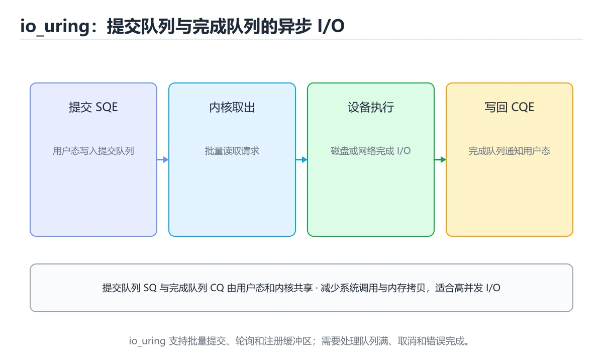
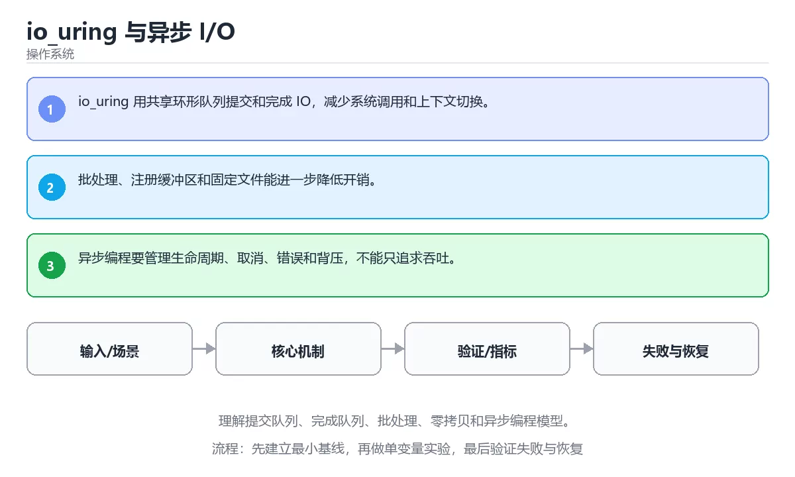

# io_uring 与异步 I/O

> 内容更新时间：2026-10-06 · 学习阶段：高级 · 预计用时：25 分钟





## 本节知识框架

**课程定位**：所属分类 `os`（操作系统），课程主题 `io_uring 与异步 I/O`，学习阶段 高级，建议用时 40 分钟。

本课主线：理解提交队列、完成队列、批处理、零拷贝和异步编程模型。

**学完本课应当能够**
- 说清 `io_uring` 与 `异步 IO` 的含义与区别，并各举一个正例和一个反例。
- 用本课示例验证 `队列` 的行为，记录输入、输出与失败条件。
- 遇到「把异步接口当同步用」这类问题时，能说出触发条件与修复顺序。

### 复习清单

- [ ] 能不看正文复述本课核心术语，并指出一个边界或反例。
- [ ] 能运行或推演本课示例，记录输入、输出与失败现象。
- [ ] 能完成一次自测，并把错题对照错误表定位原因。

## 核心概念定义

| 术语 | 操作性定义 | 常见边界与风险 |
| --- | --- | --- |
| io_uring | Linux 的异步 I/O 接口，通过共享环形队列减少系统调用与拷贝。 | 共享状态与调度顺序会改变结论，单线程或串行测试通过不等于并发下成立。 |
| 异步 IO | 发起 I/O 后不阻塞当前执行流，完成事件到达后再继续处理。 | 只在「发起 I/O 后不阻塞当前执行流，完成事件到达后再继续处理」这一前提下成立，换输入或换环境要重新验证。 |
| 队列 | 按“iouring 与异步 I/O”中 iouring、异步 IO、队列 的实践顺序，把四个步骤排成从准备到复盘的合理顺序。 | 只在「按“iouring 与异步 I/O”中 iouring、异步 IO、队列 的实践顺序，把四个步骤排成从准备到复盘的合理顺序」这一前提下成立，换输入或换环境要重新验证。 |
| 零拷贝 | 让数据在内核与用户空间或设备之间尽量避免重复复制，以降低 CPU 和内存带宽开销。 | 越界、悬垂引用与释放顺序会破坏结论，必须在边界输入下复验。 |
| 上下文切换 | CPU 核心数有限，操作系统通过时间片轮转让多个线程「同时」运行。切换时需要保存和恢复寄存器、程序计数器等状态 | 共享状态与调度顺序会改变结论，单线程或串行测试通过不等于并发下成立。 |

## 原理与运行机制

### 机制总览

**教材衔接：核心知识**

### 1. io_uring 用共享环形队列提交和完成 IO，减少系统调用和上下文切换。

- 关键做法：先让 io_uring 的最小示例可复现，再加入并发或规模条件。
- 验证标准：io_uring 的结果可复现、错误可解释、失败能恢复。

### 2. 批处理、注册缓冲区和固定文件能进一步降低开销。

把这条结论放回「io_uring 与异步 I/O」的完整流程里展开：

- 正文依据：能用自己的话解释：iouring 用共享环形队列提交和完成 IO，减少系统调用和上下文切换。
- 落地检查：把「2. 批处理、注册缓冲区和固定文件能进一步降低开销。」改写成一条可执行的核对项，逐条验证输入、超时与失败路径。

### 3. 异步编程要管理生命周期、取消、错误和背压，不能只追求吞吐。

把这条结论放回「io_uring 与异步 I/O」的完整流程里展开：

- 正文依据：本课关键词：iouring、异步 IO、队列、零拷贝。
- 落地检查：把「3. 异步编程要管理生命周期、取消、错误和背压，不能只追求吞吐。」改写成一条可执行的核对项，逐条验证输入、超时与失败路径。

**教材衔接：关键流程**

**教材衔接：实践路径**

**教材衔接：深入理解：io_uring 与异步 I/O**

### 共享环形队列的模型

io_uring 在内核与用户态之间建立两个共享内存环：提交队列（SQ）放请求，完成队列（CQ）
放结果。应用把请求写进 SQ 并更新尾指针，内核处理后把结果写进 CQ，双方通过内存屏障
同步。因为内存共享，批量提交时可以在一次系统调用里塞入很多请求，甚至配合 SQPOLL
由内核线程轮询，做到接近零系统调用。

### 注册与批量优化

频繁使用的缓冲区、文件描述符和事件描述可以提前注册，避免每次请求都复制或解析；
配合固定缓冲还能支持 O_DIRECT 与零拷贝路径。链式请求（link）可以把多个操作串成
依赖序列，超时与取消也能作为请求提交。设计高吞吐网络或存储服务时，这些能力比
「异步」这个词本身更重要。

### 适用场景与坑

io_uring 适合高并发、小块、批量的 I/O；对低频、单次大文件读写，收益可能不如
普通异步接口。还要注意内核版本、容器 seccomp 策略、SQPOLL 的 CPU 占用，
以及错误处理复杂度：完成事件可能带部分结果，必须按 request 逐个核对。
先用压力测试证明瓶颈在系统调用，再引入 io_uring，才是稳妥的顺序。

「io_uring 与异步 I/O」的「共享环形队列的模型」一节补全如下：

- 定位：这一节说明共享环形队列的模型在「io_uring 与异步 I/O」知识体系里的位置。
- 要点：配合固定缓冲还能支持 ODIRECT 与零拷贝路径。链式请求（link）可以把多个操作串成
- 自检：能否用一个最小例子解释共享环形队列的模型？

「io_uring 与异步 I/O」的「适用场景与坑」一节补全如下：

- 定位：这一节说明适用场景与坑在「io_uring 与异步 I/O」知识体系里的位置。
- 检查点：固定版本与输入重跑《io_uring 与异步 I/O》，记录两次差异并定位不稳定条件。
- 自检：能否用一个最小例子解释适用场景与坑？

**教材衔接：验证步骤**

## 典型应用场景

**教材衔接：深度拓展与实战**

这一节把 io_uring 的结论、getpid 的示例与反例整理成可执行的复习步骤。

### 工程检查表

- [ ] 能否用自己的话说明io_uring 与异步 I/O解决什么问题，以及它不负责什么？
- [ ] 能否说明 io_uring 的正常输出，以及失败时留下的错误信息？
- [ ] 能否解释本课关键词在真实项目中的边界与取舍？
- [ ] 能否把 io_uring 的方法迁移到相近问题，并说明需要改哪一步？

### 最小验证场景

- 准备：保留 `text` 示例的原始输入，先记录 `io_uring 与异步 I/O` 的基线输出和完整运行命令。
- 观察：先核对 调用了 `print()`，再改变一个与 `io_uring` 相关的条件。
- 判定：新结果与 `io_uring 与异步 I/O` 的基线不同不等于错误；只有当差异破坏了 `io_uring` 的定义或错误表中的约束，才判定为失败。

### 选择与边界

- 使用 `io_uring` 时，先满足它的定义：Linux 的异步 I/O 接口，通过共享环形队列减少系统调用与拷贝；共享状态与调度顺序会改变结论，单线程或串行测试通过不等于并发下成立。
- 使用 `异步 IO` 时，先满足它的定义：发起 I/O 后不阻塞当前执行流，完成事件到达后再继续处理；只在「发起 I/O 后不阻塞当前执行流，完成事件到达后再继续处理」这一前提下成立，换输入或换环境要重新验证。
- 使用 `队列` 时，先满足它的定义：按“iouring 与异步 I/O”中 iouring、异步 IO、队列 的实践顺序，把四个步骤排成从准备到复盘的合理顺序；只在「按“iouring 与异步 I/O”中 iouring、异步 IO、队列 的实践顺序，把四个步骤排成从准备到复盘的合理顺序」这一前提下成立，换输入或换环境要重新验证。
- 使用 `零拷贝` 时，先满足它的定义：让数据在内核与用户空间或设备之间尽量避免重复复制，以降低 CPU 和内存带宽开销；越界、悬垂引用与释放顺序会破坏结论，必须在边界输入下复验。
- 使用 `上下文切换` 时，先满足它的定义：CPU 核心数有限，操作系统通过时间片轮转让多个线程「同时」运行。切换时需要保存和恢复寄存器、程序计数器等状态；共享状态与调度顺序会改变结论，单线程或串行测试通过不等于并发下成立。

## 代码/协议/SQL 示例

**教材衔接：最小可运行示例**

先用下面的示例确认 io_uring 的基线，再只改一个与 异步 IO 相关的值：

```python
import os

print("pid>0:", os.getpid() > 0)
```

**教材衔接：预期输出**

```text
pid>0: True
```

## 时间/空间复杂度或性能分析

**性能关注点（io_uring 与异步 I/O）**：系统调用与上下文切换是主要成本：记录 CPU 占用、切换次数与内存映射规模。

**本课特有开销（io_uring 与异步 I/O · io_uring）**：小文件看元数据开销，大文件看吞吐，两者要分别测量。

**测量方法**：以 `io_uring 与异步 I/O` 的 `io_uring` 场景为对象，固定输入跑一遍记录基线，再把规模或并发度提高一个数量级复测；两次结果的差值与波动范围才是结论依据。

## 常见误区与易错点

| 容易写错的做法 | 实际现象 | 原因与正确做法 |
| --- | --- | --- |
| 把异步接口当同步用 | 提交后立刻等待，没有并发收益。 | 批量提交并统一收割完成事件。 |
| 假设完成顺序与提交一致 | 结果错配到别的请求。 | 用用户数据字段匹配请求与完成结果。 |
| 不做超时与取消 | 异常时资源长期悬挂。 | 为操作设置超时并处理取消路径。 |

### 现场 1：把异步接口当同步用

**症状**：提交后立刻等待，没有并发收益。

**根因与修复**：批量提交并统一收割完成事件。

**自检**：在本课示例里复现「把异步接口当同步用」，改成批量提交并统一收割完成事件后重跑；如果症状消失且失败路径按预期变化，说明定位正确。

### 现场 2：假设完成顺序与提交一致

**症状**：结果错配到别的请求。

**根因与修复**：用用户数据字段匹配请求与完成结果。

**自检**：在本课示例里复现「假设完成顺序与提交一致」，改成用用户数据字段匹配请求与完成结果后重跑；如果症状消失且失败路径按预期变化，说明定位正确。

### 现场 3：不做超时与取消

**症状**：异常时资源长期悬挂。

**根因与修复**：为操作设置超时并处理取消路径。

**自检**：在本课示例里复现「不做超时与取消」，改成为操作设置超时并处理取消路径后重跑；如果症状消失且失败路径按预期变化，说明定位正确。

## 与其他知识点的关系

**教材衔接：复习与迁移**

## 自测题与参考答案

> 先独立作答，再对照参考答案；答案都能在本课正文、术语表或错误表里找到依据。

### 自测 1（概念复述）

不看正文，写出 `io_uring` 的操作性定义，并说明它与 `异步 IO` 的区别。

**参考答案**：Linux 的异步 I/O 接口，通过共享环形队列减少系统调用与拷贝。

`异步 IO` 的定位是：发起 I/O 后不阻塞当前执行流，完成事件到达后再继续处理；两者的差别要从适用对象与失败模式上说明。

### 自测 2（排错）

本课错误表记录了「把异步接口当同步用」这类做法。请写出它会出现的现象、根因，以及修复顺序。

**参考答案**：现象是提交后立刻等待，没有并发收益；正确做法是批量提交并统一收割完成事件。修复时先复现现象并保留证据，再改动一处假设重跑，确认现象消失。

### 自测 3（动手验证）

运行本课的 `text` 示例，改动其中一个输入后重新运行，记录输出与错误信息。

**参考答案**：正常输入下 `text` 示例应当复现正文给出的结果；改动输入后，如果结果改变或报错，先核对它是否满足 `io_uring 与异步 I/O` 中`io_uring` 的适用范围，再检查错误表里是否有同类现象。

### 自测 4（代码阅读）

阅读本课开头的 `text` 示例，说明它体现了`io_uring` 的哪一条性质，并指出改动哪个输入会让这条性质不再成立。

**参考答案**：`io_uring` 的定义是 Linux 的异步 I/O 接口，通过共享环形队列减少系统调用与拷贝，示例正是在实现这条定义。改动与 `io_uring` 有关的一个输入后，如果结果不再符合 `io_uring 与异步 I/O` 的正文描述，就说明该性质只在当前前提成立。

### 自测 5（迁移）

把 `io_uring 与异步 I/O` 的方法迁移到自己的项目：围绕 `io_uring` 写出一个与错误表同类的风险点，并说明触发条件和检验方式。

**参考答案**：例如「不做超时与取消」，它会导致异常时资源长期悬挂；检验方式是按为操作设置超时并处理取消路径改一处再复现，确认现象消失且没有引入新的失败分支。

### 自测 6（对比）

用一个表格对比 `io_uring` 与 `异步 IO`：各写一行适用场景、一行失败表现。

**参考答案**：`io_uring` 的定义是Linux 的异步 I/O 接口，通过共享环形队列减少系统调用与拷贝；`异步 IO` 的定义是发起 I/O 后不阻塞当前执行流，完成事件到达后再继续处理。两者的失败表现分别对应本课错误表里与本术语相关的行。

### 自测 7（排错顺序）

面对「把异步接口当同步用」引发的问题，请把“复现 提交后立刻等待，没有并发收益 → 保留证据 → 批量提交并统一收割完成事件 → 回归验证”四步写成可执行的检查清单。

**参考答案**：第一步按提交后立刻等待，没有并发收益复现；第二步记录输入、版本与完整报错；第三步按批量提交并统一收割完成事件只改一处；第四步重跑并确认失败路径也按预期变化。

### 自测 8（边界判断）

针对 `上下文切换`，分别写出“可以使用”的条件和“结论不再成立”的条件。

**参考答案**：共享状态与调度顺序会改变结论，单线程或串行测试通过不等于并发下成立。 同时要把 `上下文切换` 的定义 CPU 核心数有限，操作系统通过时间片轮转让多个线程「同时」运行。切换时需要保存和恢复寄存器、程序计数器等状态 与实际输入逐项对照。

### 自测 9（机制重建）

不看正文，按输入、转换、输出、验证四段重建 `io_uring` → `异步 IO` → `队列` → `零拷贝` 的作用链。

**参考答案**：起点是 `io_uring` 的定义 Linux 的异步 I/O 接口，通过共享环形队列减少系统调用与拷贝；中间每一步都保留可观察状态；终点由 `上下文切换` 检查，失败时回到错误表定位第一个偏离定义的步骤。

### 自测 10（综合排错）

在 `io_uring 与异步 I/O` 中，现象是 异常时资源长期悬挂。请围绕 不做超时与取消 写出最小复现、关键证据、修复动作和回归验证，并说明为什么不能只凭一次运行下结论。

**参考答案**：先复现 不做超时与取消，记录输入与完整错误；再按 为操作设置超时并处理取消路径 只改一处。回归时同时跑正常路径和边界路径，只有两次结果都可解释，才把修复视为完成。

### 自测 11（一分钟复述）

用每分钟约 200 字的速度复述 `io_uring 与异步 I/O`：先给主问题，再按顺序说出 `io_uring`、`异步 IO`、`队列`、`零拷贝`，最后给一个失败案例。

**自评标准**：主问题必须对应 理解提交队列、完成队列、批处理、零拷贝和异步编程模型；每个术语都要能接上一句定义或边界；失败案例必须写成可观察现象，不能用“可能有风险”代替证据。

## 延伸阅读

想更直观地理解本课概念？推荐参阅以下图解专题：

- [图解并发调度：线程、协程与 Goroutine](visual_concurrency_schedule.md)

## 术语速查

| 术语 | 一句话说明 |
| --- | --- |
| `io_uring` | Linux 的异步 I/O 接口，通过共享环形队列减少系统调用与拷贝。 |
| `异步 IO` | 发起 I/O 后不阻塞当前执行流，完成事件到达后再继续处理。 |
| `队列` | 按“iouring 与异步 I/O”中 iouring、异步 IO、队列 的实践顺序，把四个步骤排成从准备到复盘的合理顺序。 |
| `零拷贝` | 让数据在内核与用户空间或设备之间尽量避免重复复制，以降低 CPU 和内存带宽开销。 |
| `上下文切换` | CPU 核心数有限，操作系统通过时间片轮转让多个线程「同时」运行。切换时需要保存和恢复寄存器、程序计数器等状态。 |

**术语关系**：`io_uring`（Linux 的异步 I/O 接口） → `异步 IO`（发起 I/O 后不阻塞当前执行流） → `队列`（按“iouring 与异步 I/O”中 iouring、异步 IO、队列 的实践顺序） → `零拷贝`（让数据在内核与用户空间或设备之间尽量避免重复复制）。

## 考点精讲

`io_uring 与异步 I/O` 的题库有 5 道题，下面逐题给出题干、正确项与判断依据：先自己作答，再核对正确项，最后回到正文对应小节复核。

### 考点 1：第 1 题

- **题目**：在 `io_uring 与异步 I/O` 里，与 `io_uring` 有关的说法中，哪一项最符合理解提交队列、完成队列、批处理、零拷贝和异步编程模型。？
- **正确项**：io_uring 用共享环形队列提交和完成 IO，减少系统调用和上下文切换。
- **判断依据**：本题正确项是io_uring 用共享环形队列提交和完成 IO，减少系统调用和上下文切换。术语 io_uring（io_uring 与异步 I/O）：Linux 的异步 I/O 接口，通过共享环形队列减少系统调用与拷贝，本题取io_uring 用共享环形队列提交和完成 IO，减少系统调用和上下文切换这条。易错点是把异步接口当同步用会造成提交后立刻等待，没有并发收益，改法是批量提交并统一收割完成事件，干扰项宏内核把核心服务放在内核态，性能高但故障隔离弱正踩在这条上。

### 考点 2：第 2 题

- **题目**：按“io_uring 与异步 I/O”中 io_uring、异步 IO、队列 的实践顺序，把四个步骤排成从准备到复盘的合理顺序。
- **正确项**：先明确 io_uring 的输入、输出与约束 → 写出最小示例并核对 异步 IO 的基线结果 → 只改一个变量，记录边界与失败路径的变化 → 固定版本与证据，把“io_uring 与异步 I/O”的结论写成可复现记录
- **判断依据**：本题正确项是只改一个变量，记录边界与失败路径的变化（io_uring 与异步 I/O）。术语 io_uring（io_uring 与异步 I/O）：Linux 的异步 I/O 接口，通过共享环形队列减少系统调用与拷贝，本题取只改一个变量，记录边界与失败路径的变化这条。易错点是把异步接口当同步用会造成提交后立刻等待，没有并发收益，改法是批量提交并统一收割完成事件，干扰项固定版本与证据，把“io_uring 与异步 I/O”的结论写成可复现记录正踩在这条上。

### 考点 3：第 3 题

- **题目**：下面这段 `python` 代码来自 `io_uring 与异步 I/O`。课程主线是理解提交队列、完成队列、批处理、零拷贝和异步编程模型。代码与 `io_uring` 有关。哪一项是代码里真实出现的内容？
- **正确项**：调用了 `getpid()`
- **判断依据**：本题正确项是调用了 `getpid()`（io_uring 与异步 I/O）。术语 io_uring（io_uring 与异步 I/O）：Linux 的异步 I/O 接口，通过共享环形队列减少系统调用与拷贝，本题取调用了 `getpid()`这条。易错点是把异步接口当同步用会造成提交后立刻等待，没有并发收益，改法是批量提交并统一收割完成事件，干扰项调用了 `append()`正踩在这条上。

### 考点 4：第 4 题

- **题目**：`io_uring 与异步 I/O` 的主线是：理解提交队列、完成队列、批处理、零拷贝和异步编程模型。下面哪一项与这条主线一致？
- **正确项**：理解提交队列、完成队列、批处理、零拷贝和异步编程模型。
- **判断依据**：本题正确项是理解提交队列、完成队列、批处理、零拷贝和异步编程模型。术语 io_uring（io_uring 与异步 I/O）：Linux 的异步 I/O 接口，通过共享环形队列减少系统调用与拷贝，本题取理解提交队列、完成队列、批处理、零拷贝和异步编程模型这条。易错点是把异步接口当同步用会造成提交后立刻等待，没有并发收益，改法是批量提交并统一收割完成事件，干扰项比较宏内核、微内核、混合内核和用户态驱动正踩在这条上。

### 考点 5：第 5 题

- **题目**：课程 `理解提交队列、完成队列、批处理、零拷贝和异步编程模型。`。在 `io_uring 与异步 I/O` 里，`io_uring`、`异步 IO` 与下面哪些选项属于同一层概念？（多选）
- **正确项**：io_uring；异步 IO
- **判断依据**：本题正确项是io_uring。术语 io_uring（io_uring 与异步 I/O）：Linux 的异步 I/O 接口，通过共享环形队列减少系统调用与拷贝，本题取io_uring这条。易错点是把异步接口当同步用会造成提交后立刻等待，没有并发收益，改法是批量提交并统一收割完成事件，干扰项异步 IO正踩在这条上。

### 考点 6：`io_uring`

- **要点**：Linux 的异步 I/O 接口，通过共享环形队列减少系统调用与拷贝。
- **io_uring 的边界**：共享状态与调度顺序会改变结论，单线程或串行测试通过不等于并发下成立。

### 考点 7：`异步 IO`

- **要点**：发起 I/O 后不阻塞当前执行流，完成事件到达后再继续处理。
- **异步 IO 的边界**：只在「发起 I/O 后不阻塞当前执行流，完成事件到达后再继续处理」这一前提下成立，换输入或换环境要重新验证。

### 考点 8：`队列`

- **要点**：按“iouring 与异步 I/O”中 iouring、异步 IO、队列 的实践顺序，把四个步骤排成从准备到复盘的合理顺序。
- **队列 的边界**：只在「按“iouring 与异步 I/O”中 iouring、异步 IO、队列 的实践顺序，把四个步骤排成从准备到复盘的合理顺序」这一前提下成立，换输入或换环境要重新验证。

### 考点 9：`零拷贝`

- **要点**：让数据在内核与用户空间或设备之间尽量避免重复复制，以降低 CPU 和内存带宽开销。
- **零拷贝 的边界**：越界、悬垂引用与释放顺序会破坏结论，必须在边界输入下复验。

### 考点 10：`上下文切换`

- **要点**：CPU 核心数有限，操作系统通过时间片轮转让多个线程「同时」运行。切换时需要保存和恢复寄存器、程序计数器等状态
- **上下文切换 的边界**：共享状态与调度顺序会改变结论，单线程或串行测试通过不等于并发下成立。

### 考点 11：排错——把异步接口当同步用

- **现象**：提交后立刻等待，没有并发收益。
- **处理**：批量提交并统一收割完成事件。

### 考点 12：排错——假设完成顺序与提交一致

- **现象**：结果错配到别的请求。
- **处理**：用用户数据字段匹配请求与完成结果。

### 考点 13：综合辨析——`io_uring` 与 `上下文切换`

- **辨析点**：`io_uring` 的定义是 Linux 的异步 I/O 接口，通过共享环形队列减少系统调用与拷贝；`上下文切换` 的定义是 CPU 核心数有限，操作系统通过时间片轮转让多个线程「同时」运行。切换时需要保存和恢复寄存器、程序计数器等状态。
- **答题要求**：面对 `io_uring 与异步 I/O` 的题目，先判断描述的是 `io_uring` 还是 `上下文切换`，再归到对应定义，最后写出一个会让该定义失效的边界输入。

### 考点 14：排错评分点

- **现象分**：能写出 提交后立刻等待，没有并发收益，而不是只写“程序有错”。
- **证据分**：保留触发 把异步接口当同步用 的输入、版本和错误原文。
- **修复分**：按 批量提交并统一收割完成事件 只改一处，并同时回归正常路径与边界路径。

## 内容元数据

- 内容版本：v2.0
- 最后更新：2026-10-06
- 学习阶段：高级
- 适用环境：Linux 6.x / POSIX；本课聚焦 io_uring。
- 内容来源：内置结构化课程与工程实践整理
- 相关主题：io_uring、异步 IO、队列、零拷贝
- 质量版本：P0 测验标准 + P1 覆盖扩展 + P2 体验补全

## 参考资料与复核

- 最后复核：2026-10-04
- 下次复核：2027-07-24
- 复核范围：版本兼容、API 行为、安全建议与工程实践
- 来源性质：官方文档、标准或权威教材；本课核对关键词：io_uring、异步 IO、队列、零拷贝。

| 参考资料 | 本课用途 |
| --- | --- |
| [Linux 内核文档](https://docs.kernel.org/) | 调度、内存、文件系统与 I/O |
| [POSIX 标准](https://pubs.opengroup.org/onlinepubs/9799919799/) | 可移植操作系统接口 |
| [QEMU 文档](https://www.qemu.org/docs/master/) | 虚拟化与系统模拟 |

| [本课术语索引：io_uring 与异步 I/O](#核心概念定义) | 按本课输入、术语边界和错误表现逐项核对 |
> 「io_uring 与异步 I/O」的链接用于离线阅读后的延伸核对；App 不会自动联网。