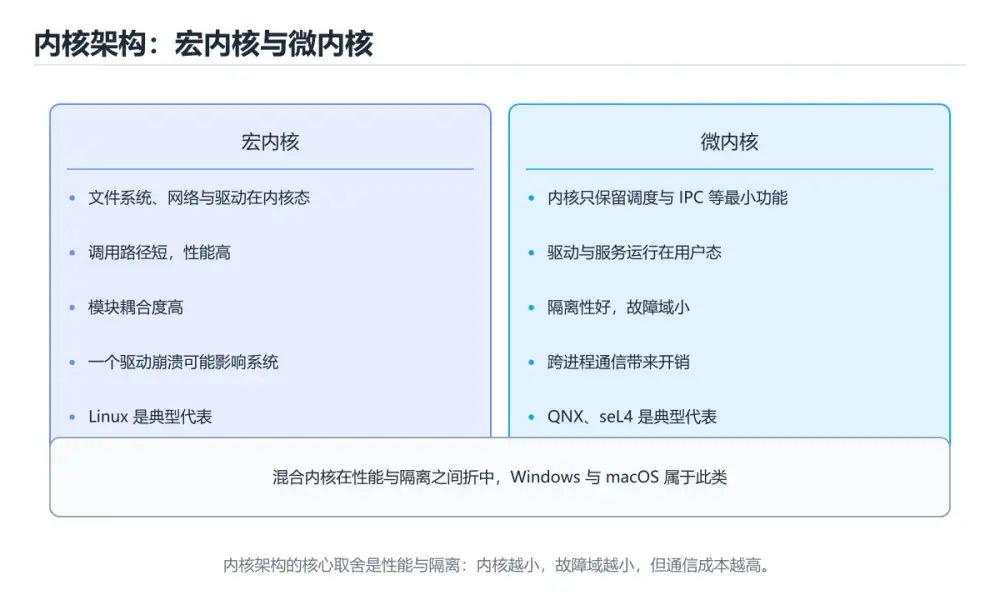
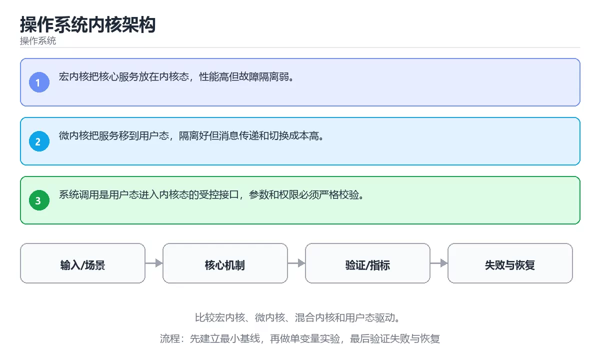

# 操作系统内核架构

> 内容更新时间：2026-10-06 · 学习阶段：高级 · 预计用时：25 分钟





## 本节知识框架

**课程定位**：所属分类 `os`（操作系统），课程主题 `操作系统内核架构`，学习阶段 高级，建议用时 45 分钟。

本课主线：比较宏内核、微内核、混合内核和用户态驱动。

**学完本课应当能够**
- 说清 `内核` 与 `微内核` 的含义与区别，并各举一个正例和一个反例。
- 用本课示例验证 `系统调用` 的行为，记录输入、输出与失败条件。
- 遇到「混淆用户态与内核态职责」这类问题时，能说出触发条件与修复顺序。

### 复习清单

- [ ] 能不看正文复述本课核心术语，并指出一个边界或反例。
- [ ] 能运行或推演本课示例，记录输入、输出与失败现象。
- [ ] 能完成一次自测，并把错题对照错误表定位原因。

## 核心概念定义

| 术语 | 操作性定义 | 常见边界与风险 |
| --- | --- | --- |
| 内核 | 操作系统内核是常驻内存、直接管理 CPU、内存和设备的特权核心；本课讨论的宏内核把它做得很大。 | 易错：混淆用户态与内核态职责，把驱动逻辑写进应用层；直接管理设备是特权核心干的活，应用只能走系统调用入口。 |
| 微内核 | 只把最核心功能放进内核，驱动与文件系统作为用户态服务运行，换来更好的隔离与可靠性。 | 把文件系统与驱动挪到用户态换来隔离，代价是跨态消息传递与切换开销大；性能敏感的链路别只看隔离不看成本。 |
| 系统调用 | 系统调用是用户态进入内核态的受控接口，参数和权限必须严格校验。 | 易错：逐字节读写这种高频小调用；每次切换虽只有几百纳秒，叠加缓存与 TLB 污染后就成了瓶颈，应改批量、缓冲或异步接口。 |
| 上下文切换 | 保存当前执行现场并恢复另一个线程或进程的现场，频繁切换会吃掉可观的性能。 | 易错：频繁切换拖慢整体响应；正确做法是减少系统调用与阻塞式切换。 |
| 宏内核 | 宏内核把进程调度、内存管理、文件系统、驱动都放在内核态，调用链短、性能好，但任一模块出错都可能拖垮整个系统。 | 易错：只看到调用链短、性能好的优点；驱动与文件系统同处内核态，任一模块出错都可能拖垮整个系统，故障隔离弱。 |

## 原理与运行机制

### 机制总览

**教材衔接：核心知识**

### 1. 宏内核把核心服务放在内核态，性能高但故障隔离弱。

- 关键做法：先用 getpid 建立 内核 的基线，再逐步加入边界与失败条件。
- 验证标准：内核 的结果可复现、错误可解释、失败能恢复。

### 2. 微内核把服务移到用户态，隔离好但消息传递和切换成本高。

把这条结论放回「操作系统内核架构」的完整流程里展开：

- 正文依据：能用自己的话解释：宏内核把核心服务放在内核态，性能高但故障隔离弱。
- 落地检查：把「2. 微内核把服务移到用户态，隔离好但消息传递和切换成本高。」改写成一条可执行的核对项，逐条验证输入、超时与失败路径。

### 3. 系统调用是用户态进入内核态的受控接口，参数和权限必须严格校验。

把这条结论放回「操作系统内核架构」的完整流程里展开：

- 正文依据：能用自己的话解释：微内核把服务移到用户态，隔离好但消息传递和切换成本高。
- 落地检查：把「3. 系统调用是用户态进入内核态的受控接口，参数和权限必须严格校验。」改写成一条可执行的核对项，逐条验证输入、超时与失败路径。

**教材衔接：关键流程**

**教材衔接：实践路径**

**教材衔接：深入理解：操作系统内核架构**

### 宏内核、微内核与混合内核

宏内核把进程调度、内存管理、文件系统、驱动都放在内核态，调用链短、性能好，但任一
驱动出错都可能拖垮系统。微内核只把调度、内存与进程间通信放在内核，文件系统与驱动
运行在用户态，隔离性强但跨态通信开销大。Windows 与 macOS 采用折中方案，把部分
服务放进内核态，把图形、网络等放到用户态服务。

### 用户态与内核态的切换成本

应用发起系统调用时，CPU 从用户态切到内核态，保存寄存器、切换栈与地址空间，执行完
再切回。切换本身只要几百纳秒，但缓存与 TLB 污染可能让代价更大。高频小系统调用
（例如逐字节读写）会成为瓶颈，正确的做法是批量、缓冲或使用异步接口。

### 可扩展内核的现代做法

Linux 通过内核模块按需加载驱动，用命名空间与 cgroup 做隔离与资源限制，用 eBPF
在内核里安全地运行可验证的小程序，让可观测性与网络处理不必修改内核源码。理解
「哪些能力必须在内核、哪些可以放到用户态」，就能在性能、隔离与可维护性之间做选择。

「操作系统内核架构」的「宏内核、微内核与混合内核」一节补全如下：

- 定位：这一节说明宏内核、微内核与混合内核在「操作系统内核架构」知识体系里的位置。
- 本课围绕 内核、宏内核、微内核、系统调用 展开，复习时重点核对它们的输入、输出和失败路径。
- 自检：能否用一个最小例子解释宏内核、微内核与混合内核？

「操作系统内核架构」的「用户态与内核态的切换成本」一节补全如下：

- 定位：这一节说明用户态与内核态的切换成本在「操作系统内核架构」知识体系里的位置。
- 要点：宏内核把进程调度、内存管理、文件系统、驱动都放在内核态，调用链短、性能好，但任一
- 自检：能否用一个最小例子解释用户态与内核态的切换成本？

「操作系统内核架构」的「可扩展内核的现代做法」一节补全如下：

- 定位：这一节说明可扩展内核的现代做法在「操作系统内核架构」知识体系里的位置。
- 要点：驱动出错都可能拖垮系统。微内核只把调度、内存与进程间通信放在内核，文件系统与驱动
- 自检：能否用一个最小例子解释可扩展内核的现代做法？

**教材衔接：验证步骤**

## 典型应用场景

**教材衔接：深度拓展与实战**

这一节把 内核 的定义、getpid 的代码与常见失败串成一条复习路线。

### 边界条件与常见反例

「操作系统内核架构」的边界不只包括最大最小值，还要覆盖空、重复和失败：

### 工程检查表

- [ ] 能否用自己的话说明操作系统内核架构解决什么问题，以及它不负责什么？
- [ ] 能否说明 内核 的正常输出，以及失败时留下的错误信息？
- [ ] 能否解释本课关键词在真实项目中的边界与取舍？
- [ ] 换一个输入后，getpid 的判断依据是否仍然成立？

### 最小验证场景

- 准备：保留 `text` 示例的原始输入，先记录 `操作系统内核架构` 的基线输出和完整运行命令。
- 观察：先核对 调用了 `print()`，再改变一个与 `内核` 相关的条件。
- 判定：新结果与 `操作系统内核架构` 的基线不同不等于错误；只有当差异破坏了 `内核` 的定义或错误表中的约束，才判定为失败。

### 选择与边界

- 使用 `内核` 时，先满足它的定义：操作系统内核是常驻内存、直接管理 CPU、内存和设备的特权核心；本课讨论的宏内核把它做得很大；易错：把驱动逻辑写进应用层；正确做法是明确边界与系统调用入口。
- 使用 `微内核` 时，先满足它的定义：只把最核心功能放进内核，驱动与文件系统作为用户态服务运行，换来更好的隔离与可靠性；隔离级别与并发事务会影响可见性，换级别或换存储引擎后要重新验证。
- 使用 `系统调用` 时，先满足它的定义：系统调用是用户态进入内核态的受控接口，参数和权限必须严格校验；易错：把驱动逻辑写进应用层；正确做法是明确边界与系统调用入口。
- 使用 `上下文切换` 时，先满足它的定义：保存当前执行现场并恢复另一个线程或进程的现场，频繁切换会吃掉可观的性能；易错：频繁切换拖慢整体响应；正确做法是减少系统调用与阻塞式切换。
- 使用 `宏内核` 时，先满足它的定义：宏内核把进程调度、内存管理、文件系统、驱动都放在内核态，调用链短、性能好，但任一模块出错都可能拖垮整个系统；共享状态与调度顺序会改变结论，单线程或串行测试通过不等于并发下成立。

## 代码/协议/SQL 示例

**教材衔接：最小可运行示例**

下面示例用于验证 内核 的最小输入、处理和输出。先原样运行，再只修改一个值：

```python
import os

print("pid>0:", os.getpid() > 0)
```

**教材衔接：预期输出**

```text
pid>0: True
```

## 时间/空间复杂度或性能分析

**性能关注点（操作系统内核架构）**：系统调用与上下文切换是主要成本：记录 CPU 占用、切换次数与内存映射规模。

**本课特有开销（操作系统内核架构 · 内核）**：小文件看元数据开销，大文件看吞吐，两者要分别测量。

**测量方法**：以 `操作系统内核架构` 的 `内核` 场景为对象，固定输入跑一遍记录基线，再把规模或并发度提高一个数量级复测；两次结果的差值与波动范围才是结论依据。

## 常见误区与易错点

| 容易写错的做法 | 实际现象 | 原因与正确做法 |
| --- | --- | --- |
| 混淆用户态与内核态职责 | 把驱动逻辑写进应用层。 | 明确边界与系统调用入口。 |
| 忽略上下文切换成本 | 频繁切换拖慢整体响应。 | 减少系统调用与阻塞式切换。 |
| 以为调度完全可控 | 应用延迟抖动无法解释。 | 用观测工具查看调度与中断的影响。 |

### 现场 1：混淆用户态与内核态职责

**症状**：把驱动逻辑写进应用层。

**根因与修复**：明确边界与系统调用入口。

**自检**：在本课示例里复现「混淆用户态与内核态职责」，改成明确边界与系统调用入口后重跑；如果症状消失且失败路径按预期变化，说明定位正确。

### 现场 2：忽略上下文切换成本

**症状**：频繁切换拖慢整体响应。

**根因与修复**：减少系统调用与阻塞式切换。

**自检**：在本课示例里复现「忽略上下文切换成本」，改成减少系统调用与阻塞式切换后重跑；如果症状消失且失败路径按预期变化，说明定位正确。

### 现场 3：以为调度完全可控

**症状**：应用延迟抖动无法解释。

**根因与修复**：用观测工具查看调度与中断的影响。

**自检**：在本课示例里复现「以为调度完全可控」，改成用观测工具查看调度与中断的影响后重跑；如果症状消失且失败路径按预期变化，说明定位正确。

## 与其他知识点的关系

**教材衔接：复习与迁移**

## 自测题与参考答案

> 先独立作答，再对照参考答案；答案都能在本课正文、术语表或错误表里找到依据。

### 自测 1（概念复述）

不看正文，写出 `内核` 的操作性定义，并说明它与 `微内核` 的区别。

**参考答案**：操作系统内核是常驻内存、直接管理 CPU、内存和设备的特权核心；本课讨论的宏内核把它做得很大。

`微内核` 的定位是：只把最核心功能放进内核，驱动与文件系统作为用户态服务运行，换来更好的隔离与可靠性；两者的差别要从适用对象与失败模式上说明。

### 自测 2（排错）

本课错误表记录了「混淆用户态与内核态职责」这类做法。请写出它会出现的现象、根因，以及修复顺序。

**参考答案**：现象是把驱动逻辑写进应用层；正确做法是明确边界与系统调用入口。修复时先复现现象并保留证据，再改动一处假设重跑，确认现象消失。

### 自测 3（动手验证）

运行本课的 `text` 示例，改动其中一个输入后重新运行，记录输出与错误信息。

**参考答案**：正常输入下 `text` 示例应当复现正文给出的结果；改动输入后，如果结果改变或报错，先核对它是否满足 `操作系统内核架构` 中`内核` 的适用范围，再检查错误表里是否有同类现象。

### 自测 4（代码阅读）

阅读本课开头的 `text` 示例，说明它体现了`内核` 的哪一条性质，并指出改动哪个输入会让这条性质不再成立。

**参考答案**：`内核` 的定义是 操作系统内核是常驻内存、直接管理 CPU、内存和设备的特权核心，本课讨论的宏内核把它做得很大，示例正是在实现这条定义。改动与 `内核` 有关的一个输入后，如果结果不再符合 `操作系统内核架构` 的正文描述，就说明该性质只在当前前提成立。

### 自测 5（迁移）

把 `操作系统内核架构` 的方法迁移到自己的项目：围绕 `内核` 写出一个与错误表同类的风险点，并说明触发条件和检验方式。

**参考答案**：例如「以为调度完全可控」，它会导致应用延迟抖动无法解释；检验方式是按用观测工具查看调度与中断的影响改一处再复现，确认现象消失且没有引入新的失败分支。

### 自测 6（对比）

用一个表格对比 `内核` 与 `微内核`：各写一行适用场景、一行失败表现。

**参考答案**：`内核` 的定义是操作系统内核是常驻内存、直接管理 CPU、内存和设备的特权核心；本课讨论的宏内核把它做得很大；`微内核` 的定义是只把最核心功能放进内核，驱动与文件系统作为用户态服务运行，换来更好的隔离与可靠性。两者的失败表现分别对应本课错误表里与本术语相关的行。

### 自测 7（排错顺序）

面对「混淆用户态与内核态职责」引发的问题，请把“复现 把驱动逻辑写进应用层 → 保留证据 → 明确边界与系统调用入口 → 回归验证”四步写成可执行的检查清单。

**参考答案**：第一步按把驱动逻辑写进应用层复现；第二步记录输入、版本与完整报错；第三步按明确边界与系统调用入口只改一处；第四步重跑并确认失败路径也按预期变化。

### 自测 8（边界判断）

针对 `宏内核`，分别写出“可以使用”的条件和“结论不再成立”的条件。

**参考答案**：共享状态与调度顺序会改变结论，单线程或串行测试通过不等于并发下成立。 同时要把 `宏内核` 的定义 宏内核把进程调度、内存管理、文件系统、驱动都放在内核态，调用链短、性能好，但任一模块出错都可能拖垮整个系统 与实际输入逐项对照。

### 自测 9（机制重建）

不看正文，按输入、转换、输出、验证四段重建 `内核` → `微内核` → `系统调用` → `上下文切换` 的作用链。

**参考答案**：起点是 `内核` 的定义 操作系统内核是常驻内存、直接管理 CPU、内存和设备的特权核心；本课讨论的宏内核把它做得很大；中间每一步都保留可观察状态；终点由 `宏内核` 检查，失败时回到错误表定位第一个偏离定义的步骤。

### 自测 10（综合排错）

在 `操作系统内核架构` 中，现象是 应用延迟抖动无法解释。请围绕 以为调度完全可控 写出最小复现、关键证据、修复动作和回归验证，并说明为什么不能只凭一次运行下结论。

**参考答案**：先复现 以为调度完全可控，记录输入与完整错误；再按 用观测工具查看调度与中断的影响 只改一处。回归时同时跑正常路径和边界路径，只有两次结果都可解释，才把修复视为完成。

### 自测 11（一分钟复述）

用每分钟约 200 字的速度复述 `操作系统内核架构`：先给主问题，再按顺序说出 `内核`、`微内核`、`系统调用`、`上下文切换`，最后给一个失败案例。

**自评标准**：主问题必须对应 比较宏内核、微内核、混合内核和用户态驱动；每个术语都要能接上一句定义或边界；失败案例必须写成可观察现象，不能用“可能有风险”代替证据。

## 延伸阅读

想更直观地理解本课概念？推荐参阅以下图解专题：

- [图解内存布局：栈、堆与引用](visual_memory_layout.md)

## 术语速查

| 术语 | 一句话说明 |
| --- | --- |
| `内核` | 操作系统内核是常驻内存、直接管理 CPU、内存和设备的特权核心；本课讨论的宏内核把它做得很大。 |
| `微内核` | 只把最核心功能放进内核，驱动与文件系统作为用户态服务运行，换来更好的隔离与可靠性。 |
| `系统调用` | 系统调用是用户态进入内核态的受控接口，参数和权限必须严格校验。 |
| `上下文切换` | 保存当前执行现场并恢复另一个线程或进程的现场，频繁切换会吃掉可观的性能。 |
| `宏内核` | 宏内核把进程调度、内存管理、文件系统、驱动都放在内核态，调用链短、性能好，但任一模块出错都可能拖垮整个系统。 |

**术语关系**：`内核`（操作系统内核是常驻内存、直接管理 CPU、内存和设备的特权核心） → `微内核`（只把最核心功能放进内核） → `系统调用`（系统调用是用户态进入内核态的受控接口） → `上下文切换`（保存当前执行现场并恢复另一个线程或进程的现场）。

## 考点精讲

`操作系统内核架构` 的题库有 6 道题，下面逐题给出题干、正确项与判断依据：先自己作答，再核对正确项，最后回到正文对应小节复核。

### 考点 1：第 1 题

- **题目**：在 `操作系统内核架构` 里，与 `内核` 有关的说法中，哪一项最符合比较宏内核、微内核、混合内核和用户态驱动？
- **正确项**：宏内核把核心服务放在内核态，性能高但故障隔离弱。
- **判断依据**：本题正确项是「宏内核把核心服务放在内核态，性能高但故障隔离弱」。术语 内核（操作系统内核架构）：操作系统内核是常驻内存、直接管理 CPU、内存和设备的特权核心，本课讨论的宏内核把它做得很大，本题取「宏内核把核心服务放在内核态，性能高但故障隔离弱」这条。易错点是混淆用户态与内核态职责，会造成把驱动逻辑写进应用层，改法是明确边界与系统调用入口。

### 考点 2：第 2 题

- **题目**：在 `操作系统内核架构` 里，与 `内核` 有关的说法中，哪一项最符合比较宏内核、微内核、混合内核和用户态驱动？（操作系统内核架构·操作系统 第 2 题）
- **正确项**：微内核把服务移到用户态，隔离好但消息传递和切换成本高。
- **判断依据**：本题正确项是「微内核把服务移到用户态，隔离好但消息传递和切换成本高」。术语 内核（操作系统内核架构）：操作系统内核是常驻内存、直接管理 CPU、内存和设备的特权核心，本课讨论的宏内核把它做得很大，本题取「微内核把服务移到用户态，隔离好但消息传递和切换成本高」这条。易错点是忽略上下文切换成本，会造成频繁切换拖慢整体响应，改法是减少系统调用与阻塞式切换。

### 考点 3：第 3 题

- **题目**：代码语言为 `python`，选自 `操作系统内核架构` 的 `内核` 部分。课程问题为比较宏内核、微内核、混合内核和用户态驱动。哪一项描述与代码一致？
- **正确项**：出现字面量 `pid>0:`
- **判断依据**：本题正确项是「出现字面量 `pid>0:`」。术语 内核（操作系统内核架构）：操作系统内核是常驻内存、直接管理 CPU、内存和设备的特权核心，本课讨论的宏内核把它做得很大，本题取「出现字面量 `pid>0:`」这条。易错点是以为调度完全可控，会造成应用延迟抖动无法解释，改法是用观测工具查看调度与中断的影响。本题干扰项「出现字面量 `address.city`」不成立：展示代码里找不到 `address.city`。

### 考点 4：第 4 题

- **题目**：`操作系统内核架构` 的主线是：比较宏内核、微内核、混合内核和用户态驱动。下面哪一项与这条主线一致？
- **正确项**：比较宏内核、微内核、混合内核和用户态驱动。
- **判断依据**：本题正确项是「比较宏内核、微内核、混合内核和用户态驱动」。术语 内核（操作系统内核架构）：操作系统内核是常驻内存、直接管理 CPU、内存和设备的特权核心，本课讨论的宏内核把它做得很大，本题取「比较宏内核、微内核、混合内核和用户态驱动」这条。易错点是混淆用户态与内核态职责，会造成把驱动逻辑写进应用层，改法是明确边界与系统调用入口。

### 考点 5：第 5 题

- **题目**：课程 `比较宏内核、微内核、混合内核和用户态驱动。`。在 `操作系统内核架构` 里，`内核`、`微内核` 与下面哪些选项属于同一层概念？（多选）
- **正确项**：内核；系统调用
- **判断依据**：按《操作系统内核架构》的正文口径，本题要同时选中「内核」、「系统调用」，漏掉任一项都算没答全。术语 内核（操作系统内核架构）：操作系统内核是常驻内存、直接管理 CPU、内存和设备的特权核心，本课讨论的宏内核把它做得很大。易错点是忽略上下文切换成本，会造成频繁切换拖慢整体响应，改法是减少系统调用与阻塞式切换。

### 考点 6：第 6 题

- **题目**：下面几项都与 `内核` 有关，请按 `操作系统内核架构` 的正文顺序排列；该课主线是比较宏内核、微内核、混合内核和用户态驱动。
- **正确项**：核心知识 → 关键流程 → 实践路径 → 常见误区
- **判断依据**：按《操作系统内核架构》正文的先后，本题顺序是「核心知识」 → 「关键流程」 → 「实践路径」 → 「常见误区」。术语「内核」在本课里的界定是操作系统内核是常驻内存、直接管理 CPU、内存和设备的特权核心，本课讨论的宏内核把它做得很大，题干「下面几项都与 `内核` 有关，请按 `操作系统内核架构` 的正文顺序排列；该课主线是比较宏内核、微内核、混合内核和用户态驱动。」问的就是这一条。常见错法是混淆用户态与内核态职责，其后果是把驱动逻辑写进应用层。正确做法是明确边界与系统调用入口。

### 考点 7：`内核`

- **要点**：操作系统内核是常驻内存、直接管理 CPU、内存和设备的特权核心；本课讨论的宏内核把它做得很大。
- **内核 的边界**：易错：把驱动逻辑写进应用层；正确做法是明确边界与系统调用入口。

### 考点 8：`微内核`

- **要点**：只把最核心功能放进内核，驱动与文件系统作为用户态服务运行，换来更好的隔离与可靠性。
- **微内核 的边界**：隔离级别与并发事务会影响可见性，换级别或换存储引擎后要重新验证。

### 考点 9：`系统调用`

- **要点**：系统调用是用户态进入内核态的受控接口，参数和权限必须严格校验。
- **系统调用 的边界**：易错：把驱动逻辑写进应用层；正确做法是明确边界与系统调用入口。

### 考点 10：`上下文切换`

- **要点**：保存当前执行现场并恢复另一个线程或进程的现场，频繁切换会吃掉可观的性能。
- **上下文切换 的边界**：易错：频繁切换拖慢整体响应；正确做法是减少系统调用与阻塞式切换。

### 考点 11：`宏内核`

- **要点**：宏内核把进程调度、内存管理、文件系统、驱动都放在内核态，调用链短、性能好，但任一模块出错都可能拖垮整个系统。
- **宏内核 的边界**：共享状态与调度顺序会改变结论，单线程或串行测试通过不等于并发下成立。

### 考点 12：排错——混淆用户态与内核态职责

- **现象**：把驱动逻辑写进应用层。
- **处理**：明确边界与系统调用入口。

### 考点 13：排错——忽略上下文切换成本

- **现象**：频繁切换拖慢整体响应。
- **处理**：减少系统调用与阻塞式切换。

### 考点 14：综合辨析——`内核` 与 `宏内核`

- **辨析点**：`内核` 的定义是 操作系统内核是常驻内存、直接管理 CPU、内存和设备的特权核心；本课讨论的宏内核把它做得很大；`宏内核` 的定义是 宏内核把进程调度、内存管理、文件系统、驱动都放在内核态，调用链短、性能好，但任一模块出错都可能拖垮整个系统。
- **答题要求**：面对 `操作系统内核架构` 的题目，先判断描述的是 `内核` 还是 `宏内核`，再归到对应定义，最后写出一个会让该定义失效的边界输入。

### 考点 15：排错评分点

- **现象分**：能写出 把驱动逻辑写进应用层，而不是只写“程序有错”。
- **证据分**：保留触发 混淆用户态与内核态职责 的输入、版本和错误原文。
- **修复分**：按 明确边界与系统调用入口 只改一处，并同时回归正常路径与边界路径。

## 内容元数据

- 内容版本：v2.0
- 最后更新：2026-10-06
- 学习阶段：高级
- 适用环境：Linux 6.x / POSIX；本课聚焦 内核。
- 内容来源：内置结构化课程与工程实践整理
- 相关主题：内核、宏内核、微内核、系统调用
- 质量版本：P0 测验标准 + P1 覆盖扩展 + P2 体验补全

## 参考资料与复核

- 最后复核：2026-10-04
- 下次复核：2027-07-24
- 复核范围：版本兼容、API 行为、安全建议与工程实践
- 来源性质：官方文档、标准或权威教材；本课核对关键词：内核、宏内核、微内核、系统调用。

| 参考资料 | 本课用途 |
| --- | --- |
| [Linux man-pages](https://man7.org/linux/man-pages/) | 系统调用与用户态接口 |
| [LWN 内核文章](https://lwn.net/Kernel/Index/) | 内核机制与演进 |
| [Linux 性能事件](https://perf.wiki.kernel.org/) | 性能分析与内核事件 |

| [本课术语索引：操作系统内核架构](#核心概念定义) | 按本课输入、术语边界和错误表现逐项核对 |
> 「操作系统内核架构」的链接用于离线阅读后的延伸核对；App 不会自动联网。