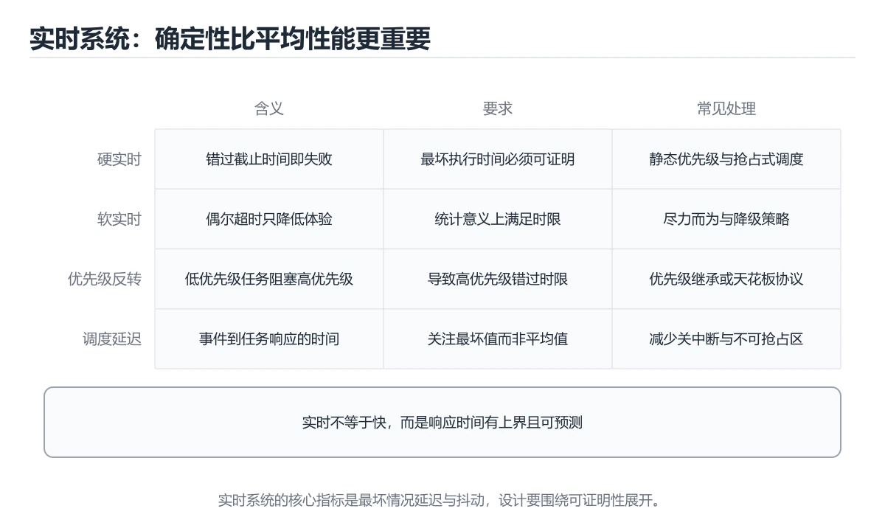
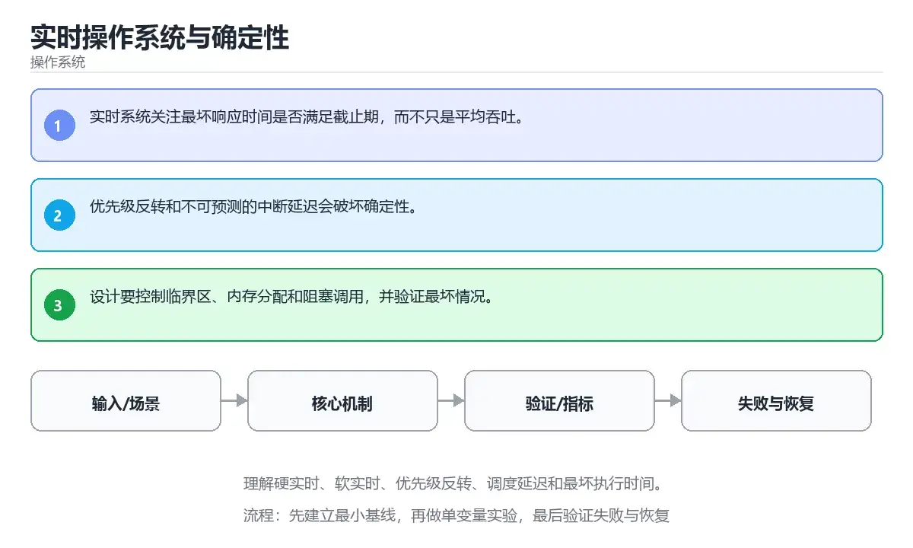

# 实时操作系统与确定性

> 内容更新时间：2026-10-06 · 学习阶段：高级 · 预计用时：30 分钟





## 本节知识框架

**课程定位**：所属分类 `os`（操作系统），课程主题 `实时操作系统与确定性`，学习阶段 高级，建议用时 30 分钟。

本课主线：理解硬实时、软实时、优先级反转、调度延迟和最坏执行时间。

**学完本课应当能够**
- 说清 `RTOS` 与 `实时性` 的含义与区别，并各举一个正例和一个反例。
- 用本课示例验证 `优先级反转` 的行为，记录输入、输出与失败条件。
- 遇到「把平均延迟当实时性指标」这类问题时，能说出触发条件与修复顺序。

### 复习清单

- [ ] 能不看正文复述 RTOS，并指出 实时性 的一个边界或反例。
- [ ] 能用「实时操作系统与确定性」的示例复现结果，并说明实时性出错时输出的第一条信息。
- [ ] 能完成一次自测，并把错题对照错误表定位原因。

## 核心概念定义

| 术语 | 操作性定义 | 常见边界与风险 |
| --- | --- | --- |
| RTOS | 面向实时任务的嵌入式操作系统，提供确定性调度、优先级和同步原语。 | 易错：把它当成「更快」的系统；RTOS 要的是最坏响应有上界，运行期动态内存分配与缺页会直接破坏上界。 |
| 实时性 | 系统从事件发生到完成响应的时间上限，硬实时要求错过截止时间即视为失败。 | 易错：最坏响应时间超标却没有发现；正确做法是关注最坏执行时间与抖动，而不只是平均值。 |
| 优先级反转 | 高优先级任务因等待低优先级任务持有的资源而阻塞，且可能被中优先级任务进一步延迟的现象。 | 易错：只提高任务优先级却不处理共享资源；正确做法是使用优先级继承或优先级天花板，并分析阻塞链。 |
| 确定性 | 系统在最坏情况下仍能在给定上界内完成响应的性质。 | 易错：拿平均延迟当指标；确定性要求最坏响应时间与抖动有上界，tickless 省电模式就会改动时间精度。 |
| 中断延迟 | 中断延迟由关中断时间、中断处理与调度开销共同决定 | 易错：在中断里做耗时操作或长时间关中断，延迟与抖动一起变大；中断只做最小处理，其余交给任务。 |

## 原理与运行机制

### 硬实时、软实时与固实时

- **硬实时**：错过截止时间就是系统失败。安全气囊、电机伺服控制、起搏器属于此类。
- **固实时**：偶发错过可以接受，但结果会贬值。视频解码偶尔丢帧、交易撮合偶尔延迟属于此类。
- **软实时**：尽量及时，偶尔延迟只影响体验。音频播放卡顿、界面刷新属于此类。

实时性不是"快"，而是"可预测"：一个平均 1 ms、最坏 50 ms 的系统，对硬实时任务可能不合格；一个平均 10 ms、最坏 12 ms 的系统反而更可用。

### 固定优先级抢占与 RMS

大多数 RTOS 使用固定优先级抢占式调度：每个任务有固定优先级，高优先级任务就绪时立即抢占低优先级任务。

Rate Monotonic Scheduling（RMS）按周期分配优先级：周期越短，优先级越高。n 个周期任务在单核上可调度的充分条件是：

U = Σ(C_i / T_i) ≤ n × (2^(1/n) − 1)

其中 C_i 是最坏执行时间（WCET），T_i 是周期。n=1 时上界是 1.0，n=2 约 0.828，n=3 约 0.780，n→∞ 时趋近 ln2 ≈ 0.693。利用率低于上界一定可调度；高于上界不一定不可调度，需要做响应时间分析。

EDF（最早截止期优先）在利用率不超过 100% 时可调度，但过载时行为不如固定优先级可预测，混合关键系统中要谨慎。

### 响应时间分析与 WCET

对固定优先级任务，最坏响应时间 R 满足：

R = C + Σ(高优先级任务 j) ceil(R / T_j) × C_j

从 R = C 开始迭代，直到收敛；若 R 超过截止期或发散，任务不可调度。举例：低优先级任务 C=5、T=30，高优先级任务分别为 (C=2,T=10) 和 (C=3,T=15)，迭代得到 R=5→10→10，远小于 30，可调度。

这套计算依赖 WCET。WCET 必须实测加静态分析：在目标硬件上覆盖最坏分支、缓存与中断状态，取多轮测量的上界并留安全余量。拿平均执行时间代入，等于把实时保证建立在运气上。

### 优先级反转与优先级继承

典型三任务场景：

1. 低优先级任务 L 持有互斥锁。
2. 高优先级任务 H 就绪，等待该锁，被迫阻塞。
3. 中优先级任务 M 就绪，抢占 L，导致 H 的等待被无限拉长。

这就是优先级反转。解决办法：

- **优先级继承**：L 持锁期间临时提升到 H 的优先级，释放后恢复，M 无法插队。
- **优先级天花板**：锁的优先级设为所有可能使用者的最高优先级，任务一拿锁就提升到天花板。
- **关中断或关调度**：只适合极短临界区，时间稍长就会破坏整体实时性。

火星探路者的经典事故是：高优先级的信息总线任务等待低优先级通信任务持有的锁，又被中优先级任务抢占，导致反复重启。修复方式是启用优先级继承。

### 中断延迟与 ISR 设计

中断响应时间由几段组成：

中断延迟 = 最长关中断时间 + 中断入口与向量跳转 + ISR 前段执行 + 调度器切换开销

- 关中断时间要尽量短，临界区只保护必要的几行代码。
- ISR 只做最小处理：清中断标志、拷贝数据、释放信号量，把耗时工作交给任务。
- 中断嵌套会拉长最坏延迟，要按优先级配置并限制嵌套层数。
- 高频中断要合并或使用 DMA，避免 CPU 被中断淹没。

### 时间基准、内存与 tickless

- 传统 RTOS 用周期性 tick（如 1 kHz）驱动延时与超时，tick 精度决定最小延时粒度，也带来空闲唤醒功耗。
- **tickless** 模式在空闲时关闭周期 tick，按下一个到期事件编程定时器，省电但会改变时间精度与唤醒抖动，选型时要实测。
- 运行期动态内存分配可能触发碎片整理或加锁，造成不可预测延迟；实时任务优先使用静态分配或固定大小内存池。
- 任务栈要按最坏调用链估算，并留出中断嵌套余量；栈溢出是嵌入式系统最常见的随机崩溃原因之一。

## 典型应用场景

### 五类典型系统

| 系统 | 实时类型 | 关键约束 | 设计重点 |
| --- | --- | --- | --- |
| 汽车 ECU 与电机控制 | 硬实时 | 控制周期 1~10 ms，抖动小 | 固定优先级、静态内存、WCET 可测 |
| 工业 PLC | 硬实时 | 扫描周期稳定，故障可预测 | 看门狗、冗余、确定性 I/O |
| 音频与视频处理 | 软实时或固实时 | 缓冲欠载会卡顿或丢帧 | 双缓冲、优先级继承、避免长临界区 |
| 医疗设备 | 硬实时 | 报警与执行链路上界严格 | 认证、冗余、最坏路径验证 |
| 车载信息娱乐 | 软实时 | 交互响应与启动时间 | 与安全域隔离，避免抢占关键任务 |

### 选型与验证

1. 先确定截止时间与失败后果：硬实时、固实时还是软实时。
2. 列出任务集：周期、WCET、截止期与共享资源。
3. 计算利用率，再用响应时间分析验证最坏情况。
4. 在目标硬件上测中断延迟、上下文切换与抖动，而不是在开发机上测。
5. 做压力测试：所有任务同时就绪、中断风暴、内存耗尽、栈接近上限。

### 最小验证场景

- 准备：选一个周期任务集，记录每个任务的 C 与 T。
- 观察：先算利用率，再用响应时间迭代算出最低优先级任务的 R。
- 判定：R 小于截止期且留有余量才算通过；利用率高但 R 未验证，不能下结论。
- 失败信号：平均延迟达标但 P99 超标、长时间关中断后抖动变大，说明最坏路径没有被覆盖。

### 选择与边界

- `RTOS` 适合有明确截止时间的嵌入式控制；高吞吐服务器并不是它的目标场景。
- `实时性` 要用最坏响应时间与抖动衡量，平均值只能作为参考。
- `优先级反转` 要通过优先级继承或天花板治理，单靠调高优先级无法解决共享资源阻塞。
- `确定性` 依赖静态内存、短临界区和可预测中断；任何运行期动态行为都可能破坏上界。
- `中断延迟` 要在目标板实测，开发机上的数据不能代表真实中断路径。

## 代码/协议/SQL 示例

### 环境与基线

**教材衔接：最小可运行示例**

先用 `os.getpid()` 确认 Python 进程可用，再用同一份脚本对三个周期任务做 RMS 利用率检查和响应时间迭代：

```python
import math
import os

print("pid>0:", os.getpid() > 0)

tasks = [
    {"name": "控制", "C": 2, "T": 10},
    {"name": "采样", "C": 3, "T": 15},
    {"name": "日志", "C": 5, "T": 30},
]

utilization = sum(t["C"] / t["T"] for t in tasks)
bound = len(tasks) * (2 ** (1 / len(tasks)) - 1)
print(f"U={utilization:.3f} bound={bound:.3f} rms_ok={utilization <= bound}")


def response_time(low, higher):
    R = low["C"]
    while True:
        next_R = low["C"] + sum(math.ceil(R / t["T"]) * t["C"] for t in higher)
        if next_R == R:
            return R
        R = next_R


R = response_time(tasks[-1], tasks[:2])
print(f"低优先级任务最坏响应={R} ms deadline={tasks[-1]['T']} ok={R <= tasks[-1]['T']}")
```

**教材衔接：预期输出**

```text
pid>0: True
U=0.567 bound=0.780 rms_ok=True
低优先级任务最坏响应=10 ms deadline=30 ok=True
```

`U=0.567` 低于 n=3 的 RMS 上界 0.780，所以一定可调度；响应时间迭代收敛到 10 ms，低于 30 ms 的截止期，两条结论互相印证。

### 只改一个值：把日志任务拉长

把 `日志` 的 `C` 从 5 改成 12 后重跑：利用率变成 0.800，超过上界，`rms_ok` 打印 `False`；但响应时间仍收敛到 24 ms，小于 30 ms。这组对比说明 RMS 上界是充分条件而不是必要条件——利用率超标时不能直接判定失败，必须继续做响应时间分析。若把 `C` 改成 19，响应时间迭代收敛到 36 ms，超过 30 ms，此时才能确认不可调度。

## 时间/空间复杂度或性能分析

**调度分析的计算量**：RMS 利用率检查是 O(n)；响应时间迭代每轮 O(n)，通常几轮收敛，临界利用率附近轮数增多，整体按 O(n·k) 记。任务数上百时仍是微秒级计算，真正的成本在把 WCET 测准。

**中断延迟预算示例**：以 168 MHz Cortex-M4 估算，中断入口约 12 个周期（≈0.07 µs），关中断临界区 2 µs，ISR 前段 3 µs，调度器切换 1.5 µs，合计约 6.6 µs。控制周期 1 ms 时这只占 0.66%；若把临界区从 2 µs 改成 20 µs，最坏延迟立刻升到约 24.6 µs，抖动被放大数倍。平均值不变没有意义，必须盯最长关中断路径。

**上下文切换与内存**：Cortex-M 上一次上下文切换约 1~3 µs；任务栈按最坏调用链加中断嵌套估算，常见每任务 512 B~4 KB。100 个任务各 2 KB 栈就是 200 KB RAM，64 KB 的 MCU 根本放不下——任务数量本身就是资源约束。

**抖动从哪来**：缓存命中率变化、DMA 与总线争用、tickless 定时器重编程、串口日志输出都会引入抖动。测量要在目标板上用 GPIO 翻转配示波器，或用 DWT 周期计数器统计最大值与 P99；开发机上的平均值不能代表目标板的最坏路径。

**测量方法**：固定任务集与优先级，先记录基线的最坏响应时间、中断延迟和切换次数；再把周期缩短一半或增加一个中断源复测，比较最大值与 P99 的变化，而不是只比较平均值。

## 常见误区与易错点

| 容易写错的做法 | 实际现象 | 原因与正确做法 |
| --- | --- | --- |
| 把平均延迟当实时性指标 | 最坏响应时间超标却没有发现。 | 关注最坏执行时间与抖动，而不只是平均值。 |
| 任务优先级设置不合理 | 优先级反转导致错过截止时间。 | 使用优先级继承并分析阻塞链。 |
| 在中断里做耗时操作 | 响应抖动变大。 | 中断只做最小处理，其余交给任务完成。 |
| 只用 RMS 上界判定可调度 | 利用率没超标，任务仍然偶尔超时 | 上界只覆盖独立周期任务；把阻塞时间、中断与抖动计入响应时间分析。 |
| 运行期动态分配内存 | 延迟出现不可预测的长尾 | 实时任务改用静态分配或固定大小内存池。 |
| tickless 模式不看唤醒精度 | 省电后超时与采样周期出现偏差 | 实测唤醒抖动，重新标定定时器并确认最小分辨率。 |

### 现场 1：把平均延迟当实时性指标

**症状**：最坏响应时间超标却没有发现。

**根因与修复**：关注最坏执行时间与抖动，而不只是平均值。

**自检**：在本课示例里复现「把平均延迟当实时性指标」，改成关注最坏执行时间与抖动，而不只是平均值后重跑；如果症状消失且失败路径按预期变化，说明定位正确。

### 现场 2：任务优先级设置不合理

**症状**：优先级反转导致错过截止时间。

**根因与修复**：使用优先级继承并分析阻塞链。

**自检**：在本课示例里复现「任务优先级设置不合理」，改成使用优先级继承并分析阻塞链后重跑；如果症状消失且失败路径按预期变化，说明定位正确。

### 现场 3：在中断里做耗时操作

**症状**：响应抖动变大。

**根因与修复**：中断只做最小处理，其余交给任务完成。

**自检**：在本课示例里复现「在中断里做耗时操作」，改成中断只做最小处理，其余交给任务完成后重跑；如果症状消失且失败路径按预期变化，说明定位正确。

### 现场 4：只用 RMS 上界判定可调度

**症状**：三个任务利用率只有 0.6，远低于 0.780 的上界，但线上仍偶尔超时。

**根因与修复**：上界假设任务相互独立、周期固定且没有阻塞。真实系统里有互斥锁、中断和缓存抖动，低优先级任务的实际响应时间 = 自身执行 + 高优先级抢占 + 阻塞时间 + 中断开销。修复是把阻塞时间 B 加入响应时间公式 R = C + B + Σceil(R/T_j)×C_j，重新迭代，并实测最坏值。

### 现场 5：运行期 malloc 拖出长尾

**症状**：绝大多数控制周期都在 200 µs 内完成，每隔几分钟出现一次 2 ms 的尖峰。

**根因与修复**：日志任务在运行期动态申请内存，堆碎片整理或分配锁把临界路径拉长。修复是启动时预分配固定大小内存池，日志走环形缓冲区，由低优先级任务批量落盘。

## 与其他知识点的关系

| 关系 | 课程 | 为什么 |
| --- | --- | --- |
| 先修 | 《进程调度》 | 固定优先级、抢占与响应时间是本课分析工具的直接来源。 |
| 先修 | 《同步机制与经典问题》 | 优先级反转来自锁与阻塞链，本课用继承和天花板治理。 |
| 关联 | 《操作系统内核架构》 | 把中断、调度器与内存管理放回内核整体结构。 |
| 后续 | 《Linux 性能与故障排查》 | 用 cyclictest、ftrace 观测延迟与抖动，验证本课结论。 |

## 自测题与参考答案

> 先独立作答，再对照参考答案；答案都能在本课正文、术语表或错误表里找到依据。

### 自测 1（概念复述）

不看正文，写出 `RTOS` 的操作性定义，并说明它与 `实时性` 的区别。

**参考答案**：面向实时任务的嵌入式操作系统，提供确定性调度、优先级和同步原语。

`实时性` 的定位是：系统从事件发生到完成响应的时间上限，硬实时要求错过截止时间即视为失败；两者的差别要从适用对象与失败模式上说明。

### 自测 2（排错）

本课错误表记录了「把平均延迟当实时性指标」这类做法。请写出它会出现的现象、根因，以及修复顺序。

**参考答案**：现象是最坏响应时间超标却没有发现；正确做法是关注最坏执行时间与抖动，而不只是平均值。修复时先复现现象并保留证据，再改动一处假设重跑，确认现象消失。

### 自测 3（动手验证）

运行本课的 Python 示例，把 `日志` 任务的 `C` 从 5 依次改成 12 和 19，记录 `U`、`rms_ok` 与最坏响应时间的变化。

**参考答案**：`C=12` 时 `U=0.800`、`rms_ok=False`，但响应时间仍为 24 ms，小于 30 ms；`C=19` 时响应时间收敛到 36 ms，超过截止期，才真正不可调度。这说明 RMS 上界只是充分条件，最终结论要看响应时间分析。

### 自测 4（代码阅读）

阅读本课的 Python 示例，说明 `response_time` 的迭代为什么从 `R = C` 开始，以及哪个输入会让任务不可调度。

**参考答案**：`R = C` 是只有一个任务时的响应时间下界；每轮把高优先级任务在 `R` 时间窗内的到达次数 `ceil(R/T_j)` 乘以 `C_j` 累加，直到 R 不再变化。把低优先级任务的 `C` 提高到 19 后，迭代收敛到 36 ms，超过 30 ms 的截止期，任务不可调度。

### 自测 5（迁移）

把 `实时操作系统与确定性` 的方法迁移到自己的项目：围绕 `RTOS` 写出一个与错误表同类的风险点，并说明触发条件和检验方式。

**参考答案**：例如「在中断里做耗时操作」，它会导致响应抖动变大；检验方式是按中断只做最小处理，其余交给任务完成改一处再复现，确认现象消失且没有引入新的失败分支。

### 自测 6（对比）

用一个表格对比 `RTOS` 与 `实时性`：各写一行适用场景、一行失败表现。

**参考答案**：`RTOS` 的定义是面向实时任务的嵌入式操作系统，提供确定性调度、优先级和同步原语；`实时性` 的定义是系统从事件发生到完成响应的时间上限，硬实时要求错过截止时间即视为失败。两者的失败表现分别对应本课错误表里与本术语相关的行。

### 自测 7（排错顺序）

面对「把平均延迟当实时性指标」引发的问题，请把“复现 最坏响应时间超标却没有发现 → 保留证据 → 关注最坏执行时间与抖动，而不只是平均值 → 回归验证”四步写成可执行的检查清单。

**参考答案**：第一步按最坏响应时间超标却没有发现复现；第二步记录输入、版本与完整报错；第三步按关注最坏执行时间与抖动，而不只是平均值只改一处；第四步重跑并确认失败路径也按预期变化。

### 自测 8（边界判断）

针对 `中断延迟`，分别写出“可以使用”的条件和“结论不再成立”的条件。

**参考答案**：可以使用：在目标板上实测的最长关中断时间、ISR 前段与调度切换之和，小于截止期余量，且中断嵌套层数与优先级配置已固定。不再成立：新增高频中断源、拉长临界区、启用 tickless 或更换硬件后，原来的延迟上界失效，必须重新测量并重算响应时间。

### 自测 9（机制重建）

不看正文，按输入、转换、输出、验证四段重建 `RTOS` → `实时性` → `优先级反转` → `确定性` 的作用链。

**参考答案**：起点是 `RTOS` 的定义 面向实时任务的嵌入式操作系统，提供确定性调度、优先级和同步原语；中间每一步都保留可观察状态；终点由 `中断延迟` 检查，失败时回到错误表定位第一个偏离定义的步骤。

### 自测 10（综合排错）

在 `实时操作系统与确定性` 中，现象是 响应抖动变大。请围绕 在中断里做耗时操作 写出最小复现、关键证据、修复动作和回归验证，并说明为什么不能只凭一次运行下结论。

**参考答案**：先复现 在中断里做耗时操作，记录输入与完整错误；再按 中断只做最小处理，其余交给任务完成 只改一处。回归时同时跑正常路径和边界路径，只有两次结果都可解释，才把修复视为完成。

### 自测 11（一分钟复述）

用每分钟约 200 字的速度复述 `实时操作系统与确定性`：先给主问题，再按顺序说出 `RTOS`、`实时性`、`优先级反转`、`确定性`，最后给一个失败案例。

**自评标准**：主问题必须对应 理解硬实时、软实时、优先级反转、调度延迟和最坏执行时间；每个术语都要能接上一句定义或边界；失败案例必须写成可观察现象，不能用“可能有风险”代替证据。

## 术语速查

| 术语 | 一句话说明 |
| --- | --- |
| `RTOS` | 面向实时任务的嵌入式操作系统，提供确定性调度、优先级和同步原语。 |
| `实时性` | 系统从事件发生到完成响应的时间上限，硬实时要求错过截止时间即视为失败。 |
| `硬实时` | 任何一次错过截止时间都构成系统失败，安全气囊与电机控制属于此类。 |
| `软实时` | 偶尔延迟只降低体验、不构成失败，音频播放与界面刷新属于此类。 |
| `WCET` | 任务在最坏输入与最坏硬件状态下执行一次所需的时间上界。 |
| `RMS` | 按周期分配优先级的调度算法，周期越短优先级越高，并有经典利用率上界。 |
| `优先级反转` | 高优先级任务因等待低优先级任务持有的资源而被阻塞，并被中优先级任务进一步延迟。 |
| `优先级继承` | 持锁任务在阻塞高优先级任务期间临时提升到等待者的优先级。 |
| `确定性` | 系统在最坏情况下仍能在给定上界内完成响应的性质。 |
| `中断延迟` | 从中断发生到 ISR 第一条指令执行的时间，由关中断时间、入口与调度开销共同决定。 |
| `抖动` | 同一事件多次响应时间的波动范围，实时系统通常约束最大值与 P99。 |

**术语关系**：`RTOS`（提供确定性调度原语） → `实时性`（截止时间约束） → `WCET`（分析所需的最坏执行时间） → `RMS`（用利用率与周期判断可调度性） → `优先级反转`（共享资源带来的阻塞风险） → `优先级继承`（修复手段） → `确定性`（最坏响应有上界） → `中断延迟` 与 `抖动`（需要实测的破坏源）。

## 考点精讲

`实时操作系统与确定性` 的题库有 5 道题，下面逐题给出题干、正确项与判断依据：先自己作答，再核对正确项，最后回到正文对应小节复核。

### 考点 1：第 1 题

- **题目**：在 `实时操作系统与确定性` 里，与 `RTOS` 有关的说法中，哪一项最符合理解硬实时、软实时、优先级反转、调度延迟和最坏执行时间？
- **正确项**：实时系统关注最坏响应时间是否满足截止期，而不只是平均吞吐。
- **判断依据**：本题正确项是「实时系统关注最坏响应时间是否满足截止期，而不只是平均吞吐」。术语 RTOS（实时操作系统与确定性）：面向实时任务的嵌入式操作系统，提供确定性调度、优先级和同步原语，本题取「实时系统关注最坏响应时间是否满足截止期，而不只是平均吞吐」这条。易错点是把平均延迟当实时性指标，会造成最坏响应时间超标却没有发现，改法是关注最坏执行时间与抖动，而不只是平均值。

### 考点 2：第 2 题

- **题目**：按“实时操作系统与确定性”中 RTOS、实时性、优先级反转 的实践顺序，把四个步骤排成从准备到复盘的合理顺序。
- **正确项**：先明确 RTOS 的输入、输出与约束 → 写出最小示例并核对 实时性 的基线结果 → 只改一个变量，记录边界与失败路径的变化 → 固定版本与证据，把“实时操作系统与确定性”的结论写成可复现记录
- **判断依据**：按《实时操作系统与确定性》正文的先后，本题顺序是「先明确 RTOS 的输入、输出与约束」 → 「写出最小示例并核对 实时性 的基线结果」 → 「只改一个变量，记录边界与失败路径的变化」 → 「固定版本与证据，把“实时操作系统与确定性”的结论写成可复现记录」。术语 RTOS（实时操作系统与确定性）：面向实时任务的嵌入式操作系统，提供确定性调度、优先级和同步原语。易错点是把平均延迟当实时性指标会造成最坏响应时间超标却没有发现，改法是关注最坏执行时间与抖动，而不只是平均值。

### 考点 3：第 3 题

- **题目**：在 `实时操作系统与确定性` 里，与 `RTOS` 有关的说法中，哪一项最符合理解硬实时、软实时、优先级反转、调度延迟和最坏执行时间？（实时操作系统与确定性·操作系统 第 3 题）
- **正确项**：设计要控制临界区、内存分配和阻塞调用，并验证最坏情况。
- **判断依据**：本题正确项是「设计要控制临界区、内存分配和阻塞调用，并验证最坏情况」。术语 RTOS（实时操作系统与确定性）：面向实时任务的嵌入式操作系统，提供确定性调度、优先级和同步原语，本题取「设计要控制临界区、内存分配和阻塞调用，并验证最坏情况」这条。易错点是在中断里做耗时操作，会造成响应抖动变大，改法是中断只做最小处理，其余交给任务完成。

### 考点 4：第 4 题

- **题目**：`实时操作系统与确定性` 的示例代码用于验证 `RTOS`，其背景是理解硬实时、软实时、优先级反转、调度延迟和最坏执行时间。代码的真实内容是下面哪一项？
- **正确项**：调用了 `getpid()`
- **判断依据**：本题正确项是「调用了 `getpid()`」（实时操作系统与确定性）。术语 RTOS（实时操作系统与确定性）：面向实时任务的嵌入式操作系统，提供确定性调度、优先级和同步原语，本题取「调用了 `getpid()`」这条。易错点是把平均延迟当实时性指标，会造成最坏响应时间超标却没有发现，改法是关注最坏执行时间与抖动，而不只是平均值。本题干扰项「调用了 `mavenCentral()`」不成立：展示代码里找不到 `mavenCentral()`。

### 考点 5：第 5 题

- **题目**：课程 `理解硬实时、软实时、优先级反转、调度延迟和最坏执行时间。`。在 `实时操作系统与确定性` 里，`RTOS`、`实时性` 与下面哪些选项属于同一层概念？（多选）
- **正确项**：RTOS；实时性
- **判断依据**：按《实时操作系统与确定性》的正文口径，本题要同时选中「RTOS」、「实时性」，漏掉任一项都算没答全。术语 RTOS（实时操作系统与确定性）：面向实时任务的嵌入式操作系统，提供确定性调度、优先级和同步原语。易错点是任务优先级设置不合理，会造成优先级反转导致错过截止时间，改法是使用优先级继承并分析阻塞链。

## 内容元数据

- 内容版本：v2.0
- 最后更新：2026-10-06
- 学习阶段：高级
- 适用环境：Linux 6.x / POSIX；本课聚焦 RTOS。
- 内容来源：内置结构化课程与工程实践整理
- 相关主题：RTOS、实时性、优先级反转、确定性
- 质量版本：P0 测验标准 + P1 覆盖扩展 + P2 体验补全

## 参考资料与复核

- 最后复核：2026-10-04
- 下次复核：2027-07-24
- 复核范围：版本兼容、API 行为、安全建议与工程实践
- 来源性质：官方文档、标准或权威教材；本课核对关键词：RTOS、实时性、优先级反转、确定性。

| 参考资料 | 本课用途 |
| --- | --- |
| [Linux 内核文档](https://docs.kernel.org/) | 调度、内存、文件系统与 I/O |
| [OSTEP](https://pages.cs.wisc.edu/~remzi/OSTEP/) | 操作系统导论教材 |
| [systemd 文档](https://www.freedesktop.org/software/systemd/man/latest/) | 服务、日志与资源控制 |

| [本课术语索引：实时操作系统与确定性](#核心概念定义) | 按本课输入、术语边界和错误表现逐项核对 |
> 「实时操作系统与确定性」的链接用于离线阅读后的延伸核对；App 不会自动联网。