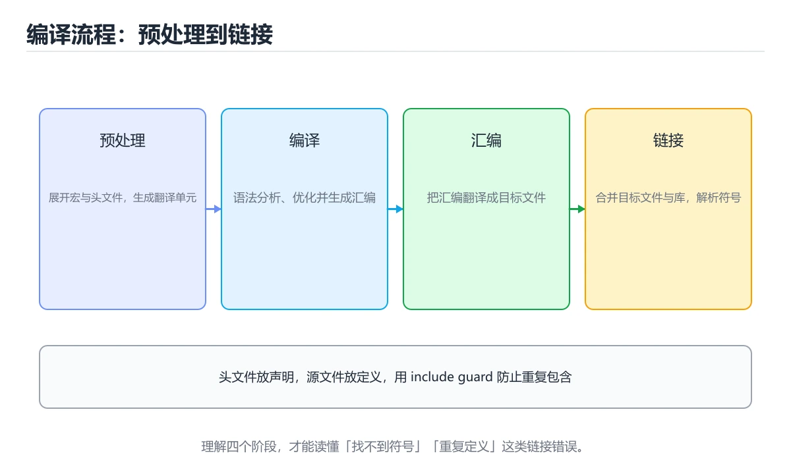
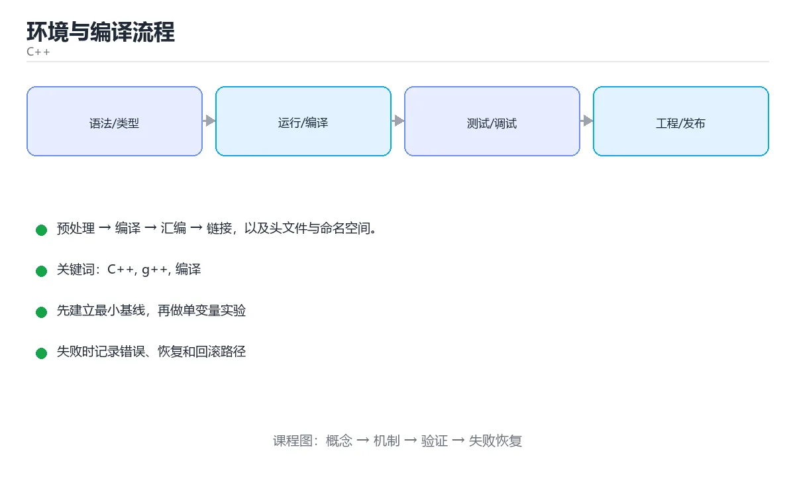

# 环境与编译流程

> 内容更新时间：2026-10-06 · 学习阶段：基础 · 预计用时：35 分钟





## 本节知识框架

前几课你已经能写简单的 C++ 程序了。但你有没有想过：你写的文字是怎么变成计算机能跑的程序的？这一课我们深入理解这个过程。

学完这一课，你会：
- 理解 C++ 是编译型语言：源码要先整体翻译成机器码才能运行
- 知道预处理、编译、汇编、链接四个阶段分别做了什么
- 会用 `g++` 的各种选项控制编译过程
- 理解头文件和命名空间的作用
- 知道多文件编译的好处

**先修与衔接**：先修《C++ 第一个程序》。本课是对编译流程的深入理解。后续课程：《变量、类型与运算符》。

### 复习清单

- [ ] 能说出预处理、编译、汇编、链接各做了什么
- [ ] 能解释 `#include` 和 `namespace` 的作用
- [ ] 能用 `g++` 的 `-Wall -std=c++17` 选项编译程序

## 核心概念定义

| 术语 | 一句话说明 |
| --- | --- |
| main | `main` 忘记 `return` 时 C++ 会隐式返回 0，但其他有返回值的函数不写 `return` 是未定义行为。 |
| C++ | C++ 是编译型语言：你写的源码要先整体"翻译"成机器码，才能运行。 |
| 编译 | 把源代码转换成目标机器代码或中间表示，并在此过程中检查语法和类型。 |
| 链接 | 把多个目标文件和库合并成一个可执行程序的过程。 |
| namespace | 把标识符组织到独立作用域、避免命名冲突的语言结构。 |
| 预处理 | 编译的第一步，处理 `#include`、`#define` 等以 `#` 开头的指令。 |
| 目标文件 | 单个 `.cpp` 走完编译和汇编得到的 `.o`（Windows 下是 `.obj`），里面有机器码，但可能还缺别人的实现，不能独立运行。 |
| 声明与定义 | 声明只说"有这个函数、参数长这样"，可以出现在很多处；定义给出真正的实现，链接器负责把两边对上。 |
| include guard | 用 `#ifndef`、`#define`、`#endif` 三件套把头文件内容围起来，第二次展开时整段被跳过的写法。 |
| `undefined reference` | 链接阶段的典型报错：每个编译单元都看见了声明，却没有任何一个文件提供定义。 |

## 原理与运行机制

### 从源码到可执行文件的四个阶段

```text
hello.cpp（源代码）
    ↓ ① 预处理（Preprocessing）
    ↓    展开 #include，替换 #define，删除注释
hello.i（预处理后的源码）
    ↓ ② 编译（Compilation）
    ↓    检查语法和类型，翻译成汇编语言
hello.s（汇编代码）
    ↓ ③ 汇编（Assembly）
    ↓    把汇编翻译成机器码
hello.o（目标文件）
    ↓ ④ 链接（Linking）
    ↓    合并多个 .o 文件和库
hello.exe（可执行程序）
```

就像出版一本书：预处理是把所有"参见附录 A"替换成真正的附录内容；编译是把中文翻译成印刷排版；汇编是制作印刷模板；链接是把所有章节装订在一起。

### 预处理：展开头文件

```cpp
#include <iostream>
```

预处理阶段，编译器把这行替换成 `iostream` 头文件的完整内容。这就是为什么忘了 `#include` 就会报"未声明的标识符"——因为编译器不知道 `std::cout` 是什么。

你可以用 `g++ -E hello.cpp` 只看预处理的结果，会看到一大段展开后的代码。

### 编译：检查语法和类型

编译器读取预处理后的代码，检查：
- 语法是否正确（分号、花括号是否匹配）
- 类型是否合法（不能把字符串赋给 int 变量）
- 函数是否声明了再调用

如果一切正常，编译器输出汇编代码。

### 汇编：生成目标文件

汇编器把汇编代码翻译成 CPU 能直接执行的机器码，保存在 `.o`（或 `.obj`）文件里。这个文件还不能直接运行——它可能引用了其他文件里的函数。

### 链接：合并成可执行程序

链接器把所有 `.o` 文件和需要的库（如标准库）合并成一个完整的可执行程序。它会：
- 把函数调用指向真正的函数地址
- 检查是否有"声明了但没定义"的符号
- 处理库之间的依赖关系

### 命名空间：避免名字冲突

```cpp
namespace app {
    std::string name = "demo";
}

int main() {
    std::cout << app::name << '\n';
}
```

想象两个人都叫"小明"——在一个班里会混乱。命名空间就像给每个人加了一个姓氏前缀：`app::name` 和 `other::name` 就不会冲突了。`std` 就是标准库的"姓氏"。

### 头文件保护

```cpp
#pragma once  // 防止头文件被重复包含
#ifndef MY_HEADER_H
#define MY_HEADER_H
// 头文件内容
#endif
```

如果一个头文件被多个源文件包含，或者被间接包含多次，里面的声明就会重复出现导致编译错误。`#pragma once` 或 include guard 防止头文件被重复包含。

### 声明管编译，定义管链接

这是理解四步流程最关键的一对概念。编译器每次只看一个 `.cpp`（一个"翻译单元"），它在编译阶段只需要知道"存在一个叫 `add` 的函数，收两个 int，回一个 int"——这句在 `math_utils.h` 里就够了，语法和类型检查都能往下走。真正"函数体在哪儿"这个问题，编译器不管，留给链接器。

于是分工就清楚了：

- 声明缺失 → 编译阶段就停，报的是不认识这个名字。
- 定义缺失 → 一路顺利到链接阶段才停，报的是 `undefined reference`。

看到 `undefined reference to 'add(int, int)'`，别去翻头文件，去确认提供实现的那个 `.cpp` 有没有出现在命令行里。

### 报错落在哪个阶段，修法就完全不同

| 你看到的字样 | 出事的阶段 | 该动的地方 |
| --- | --- | --- |
| `fatal error: foo.h: No such file or directory` | 预处理 | 补 `-I` 指向头文件目录，或把文件放对位置 |
| `error: expected ';' before ...` | 编译 | 回到报错行的上一行找漏掉的分号 |
| `warning: unused variable ...` | 编译 | 现在不致命，但 `-Wall` 打开后应当一条条处理掉 |
| `undefined reference to ...` | 链接 | 把缺实现的那个源文件一起交给 g++ |
| 程序能跑但段错误 | 运行期 | 编译流程全过了，问题在代码逻辑，跟这四步无关 |

先判断阶段，再决定改哪一类文件，比从头猜到尾省时间得多。

### `#pragma once` 和 include guard 的取舍

两种写法解决的是同一个问题，但性质不同：`#pragma once` 由编译器认得，一行搞定，主流 GCC 和 Clang 都支持，却不是 C++ 标准的一部分；include guard 完全走标准，靠宏名保证唯一，代价是要手写且宏名撞车时会失效。

实际项目里常见的做法是：新文件用 `#pragma once`，需要保证跨编译器可移植、或者可能被非主流工具链处理的公共头文件用三件套。两种都写在一个文件里也不算错误，只是多余。

### 分开编译为什么省时间

把 5000 行代码塞进一个 `.cpp`，每次改一行都要把这 5000 行重新展开头文件、重新检查类型、重新生成机器码。拆成 20 个文件后，只有改动那个文件重走编译和汇编，其余 19 个 `.o` 直接复用，最后链接一遍。

进一步还能并行：构建系统同时开多个 `g++ -c`，多核就都用上了。再配一层缓存（改动前后内容相同的文件直接取上次的 `.o`），日常小改动的等待时间还能压下去。这正是下一节多文件示例存在的理由。

## 典型应用场景

理解编译流程对日常开发非常重要：

- **多文件项目**：大型项目把代码分成多个 `.cpp` 文件分别编译，改动一个文件只需重编该文件
- **第三方库**：使用别人的库时需要正确链接，否则报"未定义引用"
- **编译选项**：`-Wall` 打开所有警告，`-O2` 优化性能，`-g` 加入调试信息
- **跨平台开发**：不同平台的编译器和标准库实现可能有差异
- **调试编译错误**：知道错误发生在哪个阶段（预处理/编译/链接），才能对症下药

### 一个实际的小例子

```cpp
// math_utils.h
#pragma once
int add(int a, int b);

// math_utils.cpp
#include "math_utils.h"
int add(int a, int b) { return a + b; }

// main.cpp
#include <iostream>
#include "math_utils.h"
int main() {
    std::cout << "Hello, C++!" << "\n";
    std::cout << add(3, 5) << "\n";
    return 0;
}
```

编译命令：

```bash
g++ -std=c++17 -Wall main.cpp math_utils.cpp -o demo
./demo
```

## 代码/协议/SQL 示例

### 最小可运行示例

```cpp
#include <iostream>
#include <string>

namespace app {
    std::string name = "demo";
}

int main() {
    std::cout << app::name << '\n';
    // 不推荐在头文件里写 using namespace std;
    return 0;
}
```

输出：

```text
Hello, C++!
```

### 多文件编译示例

```bash
# 分别编译
g++ -c main.cpp -o main.o
g++ -c math_utils.cpp -o math_utils.o

# 链接
g++ main.o math_utils.o -o demo

# 或者一步完成
g++ main.cpp math_utils.cpp -o demo
```

分开编译的好处是：改动一个文件只需重编该文件，其他文件的 `.o` 可以复用。大型项目中这能节省大量编译时间。

### 常用编译选项

```bash
g++ -std=c++17    # 使用 C++17 标准
    -Wall          # 打开所有警告
    -Wextra        # 打开额外警告
    -O2            # 优化等级 2
    -g             # 加入调试信息
    -o output      # 指定输出文件名
```

### 动手练一练

- 把上面的多文件示例编译运行，确认输出正确
- 故意忘写分号，观察报错指向哪一行
- 用 `g++ -E` 查看预处理后的完整代码

### 本课速查卡

| 复习项 | 本课要点 |
| --- | --- |
| 核心结论 | C++ 经过预处理→编译→汇编→链接四步变成可执行程序 |
| 最常用的编译命令 | `g++ -std=c++17 -Wall main.cpp -o demo` |
| 最常见的错误 | 忘写分号（报错指向下一行）；头文件未包含 |
| 出错先查什么 | 看第一条报错信息，确认错误发生在哪个阶段 |

### 分阶段把四个中间产物留下来

```bash
g++ -std=c++17 -Wall -E main.cpp -o main.i   # 只做预处理
g++ -std=c++17 -Wall -S main.cpp -o main.s   # 预处理 + 编译
g++ -std=c++17 -Wall -c main.cpp -o main.o   # 再加上汇编
g++ main.o math_utils.o -o demo              # 只做链接
```

顺手 `wc -l main.i` 看一眼展开后的行数：源码只写了三行 `#include`，展开后常常上万行。编译器"慢"多半不在你这几行代码，而在它每次都要重新读完的那一大叠声明。

### 亲手制造一次链接失败

```bash
g++ -c main.cpp -o main.o
g++ main.o -o demo            # 命令行里漏了 math_utils
```

预期停在链接阶段，报 `undefined reference to 'add(int, int)'`。它和"头文件没包含"长得完全不一样：后者连 `.o` 都生不出来，因为编译器那一关就没过。把 `math_utils.cpp` 或它的 `.o` 补回命令行，问题立即消失。

### 练习：改动一个文件，观察重编范围

先把 `main.cpp` 里的一行字符串改掉，只执行 `g++ -c main.cpp -o main.o`，再重新链接。观察 `math_utils.o` 的修改时间没有变，说明它没有被重新处理。增量编译的全部原理就在这里：没被改动的文件，它的目标文件可以直接复用。

## 时间/空间复杂度或性能分析

编译流程的性能关注点：

- **编译时间**：头文件越多、模板越复杂，预处理和编译越慢。`#pragma once` 可以避免重复处理
- **增量编译**：分开编译多个 `.cpp` 文件，改动一个只重编该文件，大幅节省时间
- **优化等级**：`-O0`（不优化，编译快）→ `-O2`（平衡）→ `-O3`（激进优化，编译慢但运行快）
- **链接时间**：库越多链接越慢；使用 `-flto`（链接时优化）可以改善运行时性能

### 让编译时间这种数字可以比较

- 记下 `g++ --version` 和完整命令行，包括 `-std` 与优化等级
- 固定输入：同一份源码、同一种 `.o` 状态——干净全量重编和增量重编是两个完全不同的数字
- 用 `time g++ ...` 取值，同一条件连跑三遍，取中间那次
- 补上边界情况：空源文件、只有一个头文件的小项目、以及依赖最重的那个翻译单元

条件写全了，"拆成四个文件后省了 40 秒"才对别人有意义。换一台机器、换一个 `-O` 等级，这个倍数一般不会复现。

### 优化等级不该改变程序的对错

从 `-O0` 到 `-O2`，变的是生成代码的质量和编译耗时，不该变的是结果。如果你在 `-O0` 下正常、`-O2` 下答案变了，问题几乎总在你的代码里：未初始化的变量、越界的下标、依赖求值顺序的写法。这些都属于未定义行为，高优化只是把它们提前暴露出来，用降优化等级去"修"只会把雷埋得更深。

## 常见误区与易错点

| 容易犯的错误 | 会出现什么 | 怎么修 |
| --- | --- | --- |
| 忘写分号 | 报错常常指向下一行 | 看报错行号的上一行 |
| 头文件重复包含 | 编译报"重复定义" | 使用 `#pragma once` 或 include guard |
| 在头文件里写 `using namespace std;` | 所有包含该头文件的文件都被污染 | 头文件里只用 `std::` 前缀 |
| 链接时找不到符号 | 报 `undefined reference` | 确认所有 `.cpp` 文件都参与编译 |
| 忽略编译器警告 | 隐藏潜在的未定义行为 | 打开 `-Wall -Wextra`，把警告当错误修 |

### 现场 1：忘写分号

**症状**：编译器报错指向某一行，但那一行看起来没问题。

**根因与修复**：分号漏写时，编译器把下一行当作同一语句的延续。看报错行号的上一行，补上分号。

## 与其他知识点的关系

- **对照着学**：《C++ 第一个程序》——那门课先让你把程序跑起来，本课解释它凭什么能跑起来，两课互为表里。
- **后续课**：《变量、类型与运算符》——日常报错里绝大多数是类型不匹配，先理解编译期检查，再看类型系统才不吃力。
- **相关概念**：《编译与程序运行原理》《词法分析与语法分析》《链接与加载》——预处理、编译、汇编、链接四步在编译原理方向有逐阶段的展开，分号漏写、声明未定义这类报错正好落在这四步的不同阶段。
- **相关概念**：《C 基础语法与编译流程》——`gcc` 与 `g++` 的差别、`-Wall -Wextra -std=c++17` 这些开关的出处，以及为什么 C++ 还要额外链接标准库。
- **动手延伸**：单文件命令升级为多目标构建见《实战：CMake 多文件项目》；从源码一直到进程退出的端到端追踪见《实战：追踪程序的全生命周期》。

## 自测题与参考答案

### 自测 1

说出 C++ 程序从源码到可执行文件经历的四个阶段。

**参考答案**：预处理（展开头文件和宏）→ 编译（翻译成汇编）→ 汇编（生成目标文件）→ 链接（合并成可执行程序）。

### 自测 2

解释 `#pragma once` 的作用。

**参考答案**：防止头文件被重复包含。没有它，同一个头文件被多次 `#include` 会导致重复定义的编译错误。

## 延伸阅读

想更直观地理解本课概念？推荐参阅以下图解专题：

- [图解内存布局：栈、堆与引用](visual_memory_layout.md)

## 术语速查

| 术语 | 一句话说明 |
| --- | --- |
| `main` | `main` 忘记 `return` 时 C++ 隐式返回 0，其他函数不写 `return` 是未定义行为。 |
| `C++` | C++ 是编译型语言，源码要先翻译成机器码才能运行。 |
| `编译` | 把源代码转换成目标机器代码或中间表示，并检查语法和类型。 |
| `链接` | 把多个目标文件和库合并成一个可执行程序。 |
| `namespace` | 把标识符组织到独立作用域、避免命名冲突的语言结构。 |
| `预处理` | 编译第一步，处理 `#include`、`#define` 等指令。 |

## 考点精讲

本课题库共 6 道题，下面逐题给出题干、正确项与判断依据。

### 考点 1

- **题目**：围绕“环境与编译流程”中的 C++、g++、编译，下列哪两项是本课强调的实践判断？
- **选项**：把 g++ 的单次运行结果当成所有版本和规模都成立 / 学习 C++ 时要同时说明输入、输出和失败路径，不能只看正常流程 / 只要 C++ 的常规示例通过，就可以跳过边界与异常路径 / 验证 g++ 时要固定版本并覆盖边界输入，结论才可复现
- **正确项**：学习 C++ 时要同时说明输入、输出和失败路径，不能只看正常流程；验证 g++ 时要固定版本并覆盖边界输入，结论才可复现
- **判断依据**：按《环境与编译流程》的正文口径，本题要同时选中「学习 C++ 时要同时说明输入、输出和失败路径，不能只看正常流程」、「验证 g++ 时要固定版本并覆盖边界输入，结论才可复现」，漏掉任一项都算没答全。术语 C++（环境与编译流程）：C++ 是编译型语言：你写的源码要先整体「翻译」成机器码，才能运行。易错点是忘写分号，会造成报错常常指向下一行，改法是看报错行号的上一行。

### 考点 2

- **题目**：这段 `cpp` 代码对应 `环境与编译流程` 的 `main`。课程要解决的是预处理 → 编译 → 汇编 → 链接，以及头文件与命名空间。关于代码内容，哪一项说法准确？
- **代码**：`namespace app { std::string name = "demo"; }` 然后 `int main() { std::cout << app::name << '\n'; }`
- **选项**：出现字面量 `请解释一下什么是二分查找` / 出现字面量 `$allowed_root` / 出现字面量 `a str) -> &` / 出现字面量 `Hello, C++!`
- **正确项**：出现字面量 `Hello, C++!`
- **判断依据**：本题正确项是「出现字面量 `Hello, C++!`」。术语 main（环境与编译流程）：`main` 忘记 `return` 时 C++ 会隐式返回 0，但其他有返回值的函数不写 `return` 是未定义行为，本题取「出现字面量 `Hello, C++!`」这条。易错点是头文件重复包含，会造成编译报"重复定义"，改法是使用 `#pragma once` 或 include guard。本题干扰项「出现字面量 `请解释一下什么是二分查找`」不成立：展示代码里找不到 `请解释一下什么是二分查找`。

### 考点 3

- **题目**：防止头文件被重复包含的常见做法是？
- **选项**：加 inline / 把实现写进头文件 / #pragma once 或 include guard / 使用 namespace
- **正确项**：#pragma once 或 include guard
- **判断依据**：本题正确项是「#pragma once 或 include guard」。术语 main（环境与编译流程）：`main` 忘记 `return` 时 C++ 会隐式返回 0，但其他有返回值的函数不写 `return` 是未定义行为，本题取「#pragma once 或 include guard」这条。易错点是在头文件里写 `using namespace std;`，会造成所有包含该头文件的文件都被污染，改法是头文件里只用 `std::` 前缀。

### 考点 4

- **题目**：#include 的头文件展开发生在编译流程的哪个阶段？
- **选项**：链接 / 预处理 / 汇编 / 编译
- **正确项**：预处理
- **判断依据**：术语 编译（环境与编译流程）：把源代码转换成目标机器代码或中间表示，并在此过程中检查语法和类型，本题取「预处理」这条。易错点是忘写分号会造成报错常常指向**下一行**，改法是看报错行号的上一行，判断时先确认输入和适用范围，对照 `C++`、`g++`、`编译`、`链接` 复现一次，最后把错误表现与正确做法逐项对照。

### 考点 5

- **题目**：把多个源文件分开编译的主要好处是？
- **选项**：运行时更省内存，但这会加重回收压力 / 不再需要链接器 / 改动一个文件只需重编该文件 / 可以省略头文件
- **正确项**：改动一个文件只需重编该文件
- **判断依据**：本题正确项是「改动一个文件只需重编该文件」。术语 编译（环境与编译流程）：把源代码转换成目标机器代码或中间表示，并在此过程中检查语法和类型，本题取「改动一个文件只需重编该文件」这条。易错点是忽略编译器警告，会造成隐藏潜在的未定义行为，改法是打开 `-Wall -Wextra`，把警告当错误修。

### 考点 6

- **题目**：填空：补齐下面这段术语说明中的空缺。课程 `预处理 → 编译 → 汇编 → 链接，以及头文件与命名空间。`，这段说明是：`____`：把标识符组织到独立作用域、避免命名冲突的语言结构。空缺处应填哪个术语？
- **正确项**：namespace
- **判断依据**：正确项：「namespace」。涉及术语 编译：把源代码转换成目标机器代码或中间表示，并在此过程中检查语法和类型。易错点：忘写分号会造成报错常常指向**下一行**。正确做法：看报错行号的上一行。判断时先确认输入和适用范围，对照 `C++`、`g++`、`编译`、`链接` 复现一次，最后把错误表现与正确做法逐项对照。

## 内容元数据

- 内容版本：v2.0
- 最后更新：2026-10-06
- 学习阶段：基础
- 适用环境：C++17 / GCC 13+ 或 Clang 17+
- 内容来源：内置结构化课程与工程实践整理
- 相关主题：C++、g++、编译、链接、头文件、namespace

## 参考资料与复核

- 最后复核：2026-10-04
- 下次复核：2027-05-10
- 复核范围：编译流程语义、头文件保护机制、命名空间规则

| 参考资料 | 本课用途 |
| --- | --- |
| [cppreference - Preprocessor](https://en.cppreference.com/w/cpp/preprocessor) | 预处理指令详解 |
| [Learn C++ - Compiling](https://www.learncpp.com/cpp-tutorial/compiling-your-first-program/) | 编译流程入门 |
| [GCC Manual - Invoking G++](https://gcc.gnu.org/onlinedocs/gcc/Invoking-G.html) | g++ 编译选项参考 |
