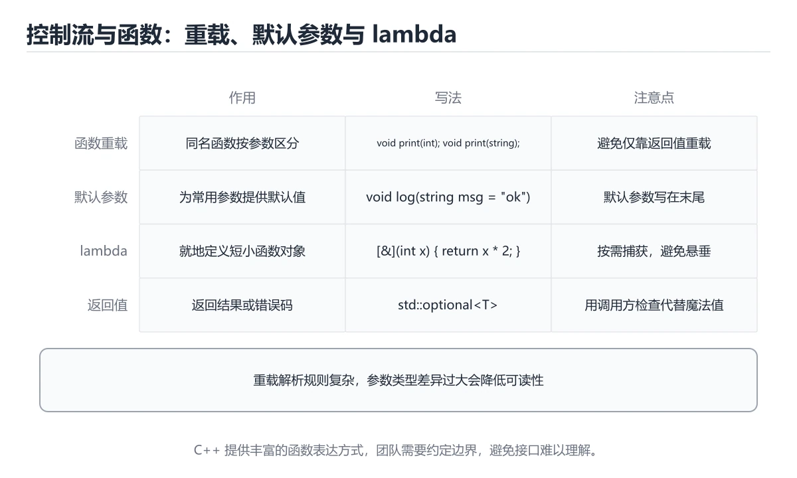
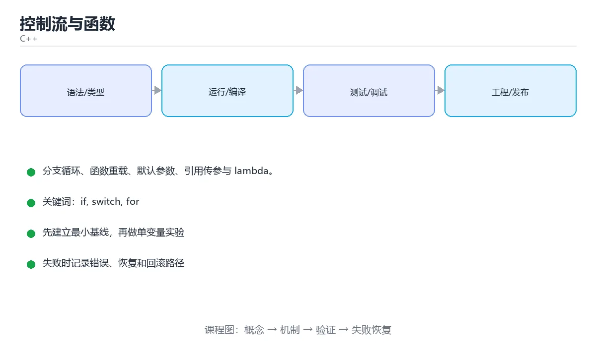

# 控制流与函数

> 内容更新时间：2026-10-06 · 学习阶段：进阶 · 预计用时：40 分钟





## 本节知识框架

欢迎来到 C++ 的「交通指挥中心」。如果说变量和类型是你手里的零件，那么控制流就是决定零件怎么组装、什么时候运转的蓝图。

本课我们会聊五件事：

1. **分支**：`if` 和 `switch`——程序遇到岔路口时怎么走。
2. **循环**：`for`、`while`、范围 `for`——让程序重复做一件事。
3. **函数基础**：重载、默认参数、`inline`——把一段逻辑打包成可复用的「小工具」。
4. **引用传参**：用 `&` 把实参的「本体」交给函数，而不是递一份复印件。
5. **lambda 表达式**：匿名的小函数，随手写随手用。

打个比方：分支像地铁的换乘站，根据目的地选不同线路；循环像跑步圈的计数器，跑够圈数才停；函数像厨房里的菜谱，写一次、做很多次。把这三样组合起来，你就能写出结构清晰的程序了。

**先修衔接**：本课假设你已经学过《变量、类型与运算符》，知道 `auto`、`constexpr` 是什么。后续会衔接《指针与引用》。

## 核心概念定义

| 术语 | 操作性定义 | 常见边界与风险 |
| --- | --- | --- |
| `break` | `break` 跳出循环，`continue` 跳过本轮；范围 for 内部不要修改容器大小。 | 易错：逻辑提前结束；正确做法是`break` 跳出整体，`continue` 只跳本轮。 |
| 声明与定义 | 声明告诉编译器名字与类型，定义真正分配存储；分开写才能多文件编译，最后由链接器合并。 | 易错：链接错误；正确做法是保持完全一致，开 `-Wall` 及早发现。 |
| 函数重载 | 同名函数按参数列表区分，编译器在调用点选择最匹配的一个。 | 静态检查只在编译期成立，运行期输入仍需校验。 |
| 引用传递 | 形参是实参的别名，避免拷贝且能写回原值；只读场景应当传常量引用。 | 越界、悬垂引用与释放顺序会破坏结论，必须在边界输入下复验。 |

## 原理与运行机制

### 分支：`if` 和 `switch`

想象你在帮一位朋友判断考试成绩等级。逻辑很简单：

```cpp
int score = 78;

if (score >= 90) {
    std::cout << "优秀";
} else if (score >= 60) {
    std::cout << "及格";
} else {
    std::cout << "不及格";
}
```

程序从上往下逐个条件检查，一旦命中就跳过剩余分支。这里输出的是「及格」——因为 78 分落在 60~89 区间。

> 新手最常见的坑：写 `if (a = b)` 而不是 `if (a == b)`。`=` 是赋值，会把 `b` 的值赋给 `a`，然后判断 `a` 是否为非零。解决办法是写成 `if (a == b)`，或者把常量放左边 `if (90 == score)`，这样少写一个 `=` 时编译器会直接报错。

当分支很多且都是对同一个整数或枚举的等值判断时，`switch` 更清晰：

```cpp
switch (score / 10) {
    case 10:
    case 9:  std::cout << "A"; break;   // 忘记 break 会贯穿到下一个 case
    case 8:  std::cout << "B"; break;
    default: std::cout << "C"; break;
}
```

每个 `case` 就像一个门牌号，程序跳到匹配的门牌后开始执行，直到遇到 `break` 才停下来。忘了 `break`？程序会一路「穿透」到下面的分支——这是初学者最常踩的坑之一。

### 循环：`for`、`while` 与范围 `for`

循环的本质是「重复做某件事，直到条件不满足」。

```cpp
for (int i = 0; i < 5; ++i) { /* ... */ }

int n = 3;
while (n-- > 0) { /* ... */ }          // 先判断后执行

do {
    /* 至少执行一次 */
} while (false);

int nums[] = {1, 2, 3};
for (int value : nums) {               // 范围 for（C++11）
    std::cout << value << ' ';
}
for (int& value : nums) { value *= 2; } // 用引用才能修改元素
```

三种循环怎么选？

| 循环 | 适合场景 | 特点 |
| --- | --- | --- |
| `for` | 次数明确、遍历容器 | 初始化、条件、更新写在一行 |
| `while` | 不知道循环几次，靠条件停 | 条件为假一次都不执行 |
| `do...while` | 至少要执行一次 | 先做后判断，例如重试输入 |

范围 `for` 是 C++11 引入的语法糖，写起来像 Python 的 `for x in list`。注意：如果要修改元素，必须写 `int& v` 而不是 `int v`——后者只是改了一份拷贝。

> 一个隐蔽的坑：用 `size_t i` 做倒序循环时写 `i >= 0` 会死循环，因为 `size_t` 是无符号类型，永远不会小于 0。

### 函数：重载、默认参数与 inline

函数就像一份菜谱——写好步骤，取个名字，以后想做就叫一声。

```cpp
int add(int a, int b) { return a + b; }
double add(double a, double b) { return a + b; }   // 重载：参数列表不同

int add(int a, int b, int c = 0);                  // 默认参数只能写在声明里

void swap_by_value(int a, int b);        // 改不了实参
void swap_by_ref(int& a, int& b) {       // 引用传参，能改实参且无拷贝
    int tmp = a; a = b; b = tmp;
}

void print(const std::string& text);     // 只读 + 避免拷贝：const 引用
```

**函数重载**：同名函数靠参数列表区分。注意，仅仅返回值不同不算重载。

**默认参数**：一旦某个参数有默认值，它右边的所有参数也必须要有默认值。默认值只能写在声明处，别在声明和定义里各写一次。

**`inline` 关键字**：允许函数定义出现在多个编译单元而只保留一份，并给编译器内联建议。它不是强制命令——编译器会根据实际情况决定是否真正展开。

### 引用传参：告别不必要的拷贝

传参方式决定了函数拿到的是「原件」还是「复印件」：

| 传参方式 | 写法 | 是否拷贝 | 能否修改原值 | 什么时候用 |
| --- | --- | --- | --- | --- |
| 值传递 | `void f(int x)` | 拷贝 | 不能 | 小类型、只读 |
| 引用传递 | `void f(int& x)` | 不拷贝 | 能 | 需要把结果写回 |
| 常量引用 | `void f(const Foo& x)` | 不拷贝 | 不能 | 传大对象只读，**首选** |
| 指针传递 | `void f(Foo* p)` | 拷贝指针 | 能 | 允许为空、需要改指向 |

```cpp
void addOne(int x)  { x += 1; }        // 改了副本，外面不变
void addOne(int& x) { x += 1; }        // 改了本体，外面跟着变

int n = 1;
addOne(n);
std::cout << n;                        // 2
```

### 声明与定义：编译器和链接器各管一段

```cpp
// 声明：告诉编译器「有这么个函数」
int add(int a, int b);

// 定义：告诉链接器「它的实现在这里」
int add(int a, int b) { return a + b; }
```

多文件项目里，声明放头文件（`.h`）、定义放源文件（`.cpp`），这是 C++ 的基本分工。

### lambda 表达式：随手写的小函数

```cpp
auto add = [](int a, int b) { return a + b; };   // lambda（C++11）
int base = 10;
auto plus_base = [base](int x) { return x + base; };   // 按值捕获
auto modify = [&base](int x) { base += x; };           // 按引用捕获
```

lambda 就像贴在便利贴上的临时函数——不需要正式取名，用过就可以丢掉。方括号 `[]` 是捕获列表，决定外部变量是「复印一份」还是「直接引用」。

### 递归：函数调用自己

```cpp
int fib(int n) {                              // 递归要有终止条件
    return n < 2 ? n : fib(n - 1) + fib(n - 2);
}
```

递归的两个要素：终止条件 + 递归步骤。忘了终止条件？栈溢出崩溃在等着你。

## 典型应用场景

### 成绩判断与等级统计

这是分支和循环最经典的组合场景——根据分数范围输出等级，同时统计各等级人数。

```cpp
#include <iostream>
#include <vector>

char levelOf(int score) {
    if (score >= 90) return 'A';
    if (score >= 80) return 'B';
    if (score >= 60) return 'C';
    return 'D';
}

int main() {
    std::vector<int> scores{95, 82, 60, 41};
    int aCount = 0;
    for (int s : scores) {
        const char level = levelOf(s);
        if (level == 'A') ++aCount;
        std::cout << s << " -> " << level << '\n';
    }
    std::cout << "A 等级共 " << aCount << " 人\n";
    return 0;
}
```

### 用 `switch` 做菜单分发

当你需要根据用户输入的一个字符或整数做不同操作时，`switch` 比一串 `if-else` 更直观：

```cpp
switch (grade) {
    case 'A':
        std::cout << "优秀\n";
        break;              // 忘了 break 会「穿透」到下一个分支
    case 'B':
        std::cout << "良好\n";
        break;
    default:
        std::cout << "未知等级\n";
        break;
}
```

### 函数重载处理不同类型

同一个操作对不同类型有不同实现——这就是重载的价值：

```cpp
void print(int n);
void print(const std::string& s);      // 同名不同参：重载

void greet(const std::string& name = "朋友");   // 默认参数
greet();          // 朋友
greet("小明");    // 小明
```

### 用 lambda 做自定义排序

```cpp
#include <algorithm>
#include <vector>
#include <string>

std::vector<std::string> names{"Charlie", "Alice", "Bob"};
std::sort(names.begin(), names.end(),
    [](const std::string& a, const std::string& b) {
        return a.size() < b.size();   // 按名字长度排序
    });
```

## 代码/协议/SQL 示例

### 完整示例：分支 + 循环 + 函数协作

```cpp
#include <algorithm>
#include <cctype>
#include <string>
#include <vector>

// 只读大对象用 const 引用，避免拷贝
double average(const std::vector<int>& nums) {
    if (nums.empty()) return 0.0;
    long long sum = 0;
    for (int n : nums) sum += n;
    return static_cast<double>(sum) / nums.size();
}

// 就地修改传入对象
void trim(std::string& s) {
    const auto notSpace = [](unsigned char c) { return !std::isspace(c); };
    s.erase(s.begin(), std::find_if(s.begin(), s.end(), notSpace));
}
```

### 函数参数与返回速查

| 目的 | 写法 | 说明 |
| --- | --- | --- |
| 小类型只读 | `void f(int x)` | 复制成本低 |
| 大对象只读 | `void f(const std::string& s)` | 避免拷贝 |
| 需要修改实参 | `void f(std::string& s)` | 明确可写 |
| 需要转移所有权 | `void f(std::string s)` + `std::move` | 值传递 + 移动语义 |
| 返回大对象 | `std::vector<int> make()` | 依赖 RVO，不要 `std::move` 局部变量 |
| 可能失败 | `std::optional<T>` / `bool` + 出参 | 比抛异常更显式 |
| 不抛异常承诺 | `void f() noexcept` | 供容器与优化使用 |
| 默认参数 | `void f(int a, int b = 1)` | 默认值只能写在声明处 |

### 控制流速查

| 结构 | 写法 | 注意 |
| --- | --- | --- |
| `if / else` | 条件分支 | 条件必须是 `bool` |
| `switch` | 多等值分支 | 忘了 `break` 会穿透 |
| `for` | 计次循环 | 用 `size_t` 遍历时注意 `i >= 0` 恒真 |
| 范围 for | `for (const auto& x : v)` | 只读加 `const&`，修改加 `&` |
| `while` / `do...while` | 条件循环 | `do...while` 至少执行一次 |
| `break` / `continue` | 跳出 / 跳过 | 只影响最近一层循环 |
| `goto` | 跳转 | 仅用于跳出多层循环的少数场景 |

### 新手最容易踩的六个坑

| 坑 | 现象 | 正确做法 |
| --- | --- | --- |
| `if (a = b)` | 赋值被当成条件，永远为真 | 写 `if (a == b)`，或把常量写左边 |
| 循环条件写死 | 程序卡住 | 检查循环变量是否真的在变化 |
| `continue` 与 `break` 混用 | 逻辑提前结束 | `break` 跳出整体，`continue` 只跳本轮 |
| 忘了 `return` | 返回值是随机值 | 有返回类型的函数所有分支都要返回 |
| 递归没有终止条件 | 栈溢出崩溃 | 先写终止条件，再写递归调用 |
| 函数太长 | 难以阅读和测试 | 超过一屏就按职责拆分 |

**运行方式**：用 `g++ -std=c++17 文件名.cpp -o demo` 编译后运行。遇到报错先看编译器提示的第一条——它通常就是根本原因。

## 时间/空间复杂度或性能分析

**性能关注点（控制流与函数）**：编译优化与内存布局决定上限。记录构建时间、运行时间与峰值内存，并区分 Debug 与 Release。

**本课特有开销**：

- **函数调用开销**：值传递大对象会触发拷贝构造，用 `const&` 可以消除这部分开销。
- **递归深度**：每次递归调用都在栈上分配一帧，深度过大会栈溢出。一般来说几千层就会出问题。
- **内联的收益**：`inline` 建议编译器把短小函数直接展开到调用处，消除函数调用的压栈开销。但过度内联会让代码体积膨胀。
- **循环中的容器修改**：范围 for 遍历时修改容器大小会导致迭代器失效、程序崩溃。

**测量方法**：固定输入跑一遍记录基线，再把规模提高一个数量级复测；两次结果的差值与波动范围才是结论依据。

## 常见误区与易错点

| 容易写错的做法 | 实际现象 | 原因与正确做法 |
| --- | --- | --- |
| `if (a = b)` | 赋值被当成条件，永远为真 | 写 `if (a == b)`，或把常量写左边 |
| `switch` 忘记 `break` | 穿透执行多个分支 | 每个分支结束加 `break` 或 `return` |
| 范围 for 里 `auto x` 修改 | 改的是副本 | 需要修改写 `auto& x` |
| 范围 for 遍历时修改容器 | 迭代器失效、崩溃 | 先收集要改的内容，循环结束后统一处理 |
| `size_t i` 写 `i >= 0` 作条件 | 死循环 | 无符号不会小于 0，改用有符号或改判断 |
| 大对象按值传参 | 多余的深拷贝 | 用 `const&` |
| 返回局部变量的引用 | 悬空引用 | 按值返回，或返回智能指针 |
| 默认参数写在定义处并重复 | 编译错误 | 只在声明里写一次 |
| 函数声明与定义签名不一致 | 链接错误 | 保持完全一致，开 `-Wall` 及早发现 |
| 在头文件定义非 inline 函数 | 多重定义 | 加 `inline`，或放源文件 |

### 现场 1：`if (a = b)`

**症状**：赋值被当成条件，永远为真。

**根因与修复**：写 `if (a == b)`，或把常量写左边。

### 现场 2：`switch` 穿透

**症状**：匹配了一个 `case` 后，继续执行后面的 `case`。

**根因与修复**：每个分支结束加 `break` 或 `return`。

### 现场 3：范围 for 里修改副本

**症状**：以为改了容器里的元素，其实改的是临时拷贝。

**根因与修复**：需要修改时写 `for (auto& x : v)` 而不是 `for (auto x : v)`。

## 与其他知识点的关系

- **先修**：`变量、类型与运算符`。本课默认 `auto`、`constexpr` 等概念已经掌握。
- **相关或后续**：`指针与引用`、`控制流与推导式`、`控制流与方法`。本课术语会在这些课程里继续使用。
- **术语归属**：`break`、`声明与定义`、`函数重载` 的定义以本课「核心概念定义」为准，换到其他课程时先确认定义是否被改写。

## 自测题与参考答案

> 先独立作答，再对照参考答案。

### 自测 1（概念复述）

不看正文，写出 `break` 的含义，并说明它与 `continue` 的区别。

**参考答案**：`break` 跳出循环，`continue` 跳过本轮；范围 for 内部不要修改容器大小。

### 自测 2（排错）

写出 `if (a = b)` 的现象、根因与修复方式。

**参考答案**：现象是赋值被当成条件，永远为真；正确做法是写 `if (a == b)`，或把常量写左边。

### 自测 3（动手验证）

运行本课的成绩判断示例，把 `78` 换成 `60` 和 `90` 后重新运行，记录输出。

**参考答案**：`60` 应输出「及格」，`90` 应输出「优秀」。如果结果不符，检查 `>=` 是否写成了 `>`。

### 自测 4（代码阅读）

阅读本课的 `swap_by_ref` 函数，说明为什么用引用传参而不是值传递。

**参考答案**：值传递只能改副本，引用传递能直接修改实参。`swap` 的目的就是交换两个变量的值，必须用引用。

### 自测 5（迁移）

把本课的分支和循环方法用到一个新场景：统计一段文本中大写字母的数量。写出关键代码。

**参考答案**：用范围 `for` 遍历每个字符，用 `if (std::isupper(c))` 判断并计数。

## 复习清单

- [ ] 能不看正文复述 `break`、`声明与定义`、`函数重载`、`引用传递` 的含义，并各举一个反例。
- [ ] 能运行本课的 `cpp` 示例，把 `"优秀"` 换成边界值后记录输出变化。
- [ ] 能完成一次自测，并把错题对照错误表定位原因。

## 术语速查

| 术语 | 一句话说明 |
| --- | --- |
| `break` | `break` 跳出循环，`continue` 跳过本轮；范围 for 内部不要修改容器大小。 |
| `声明与定义` | 声明告诉编译器名字与类型，定义真正分配存储；分开写才能多文件编译，最后由链接器合并。 |
| `函数重载` | 同名函数按参数列表区分，编译器在调用点选择最匹配的一个。 |
| `引用传递` | 形参是实参的别名，避免拷贝且能写回原值；只读场景应当传常量引用。 |
| `lambda` | 匿名函数，用 `[]` 捕获外部变量，适合短小的回调与排序规则。 |
| `默认参数` | 在声明处为形参指定默认值，调用时可以省略，从右向左连续生效。 |

## 考点精讲

本课的题库有 6 道题，下面逐题给出题干、正确项与判断依据。先自己作答，再核对正确项，最后回到正文对应小节复核。

### 考点 1：第 1 题

- **题目**：围绕“控制流与函数”中的 if、switch、for，下列哪两项是本课强调的实践判断？
- **正确项**：学习 if 时要同时说明输入、输出和失败路径，不能只看正常流程；验证 switch 时要固定版本并覆盖边界输入，结论才可复现
- **判断依据**：本题正确项是学习 if 时要同时说明输入、输出和失败路径，不能只看正常流程。术语 break（控制流与函数）：`break` 跳出循环，`continue` 跳过本轮，范围 for 内部不要修改容器大小，本题取学习 if 时要同时说明输入、输出和失败路径，不能只看正常流程这条。易错点是`if (a = b)`会造成赋值被当成条件，永远为真，改法是写 `if (a == b)`，或把常量写左边，干扰项把 switch 的单次运行结果当成所有版本和规模都成立正踩在这条上。

### 考点 2：第 2 题

- **题目**：阅读 `控制流与函数` 的 `break` 示例。它服务于分支循环、函数重载、默认参数、引用传参与 lambda。代码中实际包含下列哪一项？
- **正确项**：出现字面量 `不及格`
- **判断依据**：本题正确项是出现字面量 `不及格`。术语 break（控制流与函数）：`break` 跳出循环，`continue` 跳过本轮，范围 for 内部不要修改容器大小，本题取出现字面量 `不及格`这条。易错点是`continue` 与 `break` 混用会造成逻辑提前结束，改法是`break` 跳出整体，`continue` 只跳本轮，干扰项出现字面量 `: true, `正踩在这条上。

### 考点 3：第 3 题

- **题目**：范围 for 中要修改元素，应写成？
- **正确项**：for (int& v : nums)
- **判断依据**：本题正确项是for (int& v : nums)。术语 break（控制流与函数）：`break` 跳出循环，`continue` 跳过本轮，范围 for 内部不要修改容器大小，本题取for (int& v : nums)这条。易错点是`if (a = b)`会造成赋值被当成条件，永远为真，改法是写 `if (a == b)`，或把常量写左边，干扰项for (const int& v : nums)正踩在这条上。

### 考点 4：第 4 题

- **题目**：inline 关键字在现代 C++ 中的主要含义是？
- **正确项**：允许函数定义出现在多个编译单元而只保留一份，并给编译器内联建议
- **判断依据**：本题正确项是允许函数定义出现在多个编译单元而只保留一份，并给编译器内联建议。术语 break（控制流与函数）：`break` 跳出循环，`continue` 跳过本轮，范围 for 内部不要修改容器大小，本题取允许函数定义出现在多个编译单元而只保留一份，并给编译器内联建议这条。易错点是`if (a = b)`会造成赋值被当成条件，永远为真，改法是写 `if (a == b)`，或把常量写左边，干扰项让函数在运行时更慢正踩在这条上。

### 考点 5：第 5 题

- **题目**：关于默认参数，下面说法正确的是？
- **正确项**：一旦某个参数有默认值
- **判断依据**：本题正确项是一旦某个参数有默认值。术语 break（控制流与函数）：`break` 跳出循环，`continue` 跳过本轮，范围 for 内部不要修改容器大小，本题取一旦某个参数有默认值这条。易错点是`if (a = b)`会造成赋值被当成条件，永远为真，改法是写 `if (a == b)`，或把常量写左边，干扰项默认参数必须在调用处指定正踩在这条上。

### 考点 6：第 6 题

- **题目**：填空：补齐下面这段术语说明中的空缺。课程 `分支循环、函数重载、默认参数、引用传参与 lambda。`，这段说明是：`____`：声明告诉编译器名字与类型，定义真正分配存储；分开写才能多文件编译，最后由链接器合并。空缺处应填哪个术语？
- **正确项**：声明与定义
- **判断依据**：涉及术语 声明与定义：声明告诉编译器名字与类型，定义真正分配存储，分开写才能多文件编译，最后由链接器合并。易错点：`if (a = b)`会造成赋值被当成条件，永远为真。正确做法：写 `if (a == b)`，或把常量写左边。判断时先确认输入和适用范围，对照 `if`、`switch`、`for`、`函数重载` 复现一次，最后把错误表现与正确做法逐项对照。

## 内容元数据

- 内容版本：v2.0
- 最后更新：2026-10-06
- 学习阶段：进阶
- 适用环境：C++20 / GCC 13+ 或 Clang 17+
- 内容来源：内置结构化课程与工程实践整理
- 相关主题：if、switch、for、函数重载、lambda、引用传参

## 参考资料与复核

- [本课资料锚点 cpp_control_functions](https://zh.wikipedia.org/w/index.php?search=cpp_control_functions)

- 最后复核：2026-10-04
- 下次复核：2027-05-10
- 复核范围：版本兼容、API 行为、安全建议与工程实践

| 参考资料 | 本课用途 |
| --- | --- |
| [C++ 控制流 - cppreference](https://en.cppreference.com/w/cpp/language/statements) | if、switch、for、while 的语法规范 |
| [Google C++ 风格指南](https://google.github.io/styleguide/cppguide.html) | 命名、接口与工程约束 |
| [CMake 文档](https://cmake.org/documentation/) | 跨平台构建与依赖管理 |
