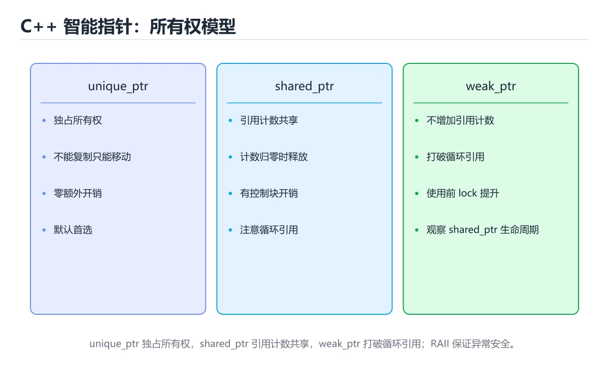
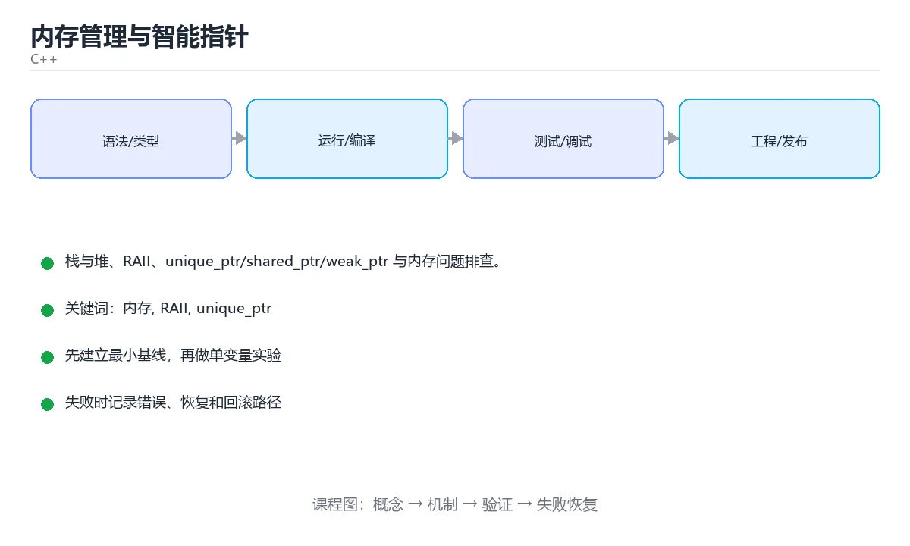

# 内存管理与智能指针

> 内容更新时间：2026-10-06 · 学习阶段：进阶 · 预计用时：50 分钟





## 本节知识框架

C++ 的内存管理就像租房：你可以住酒店（栈，自动退房），也可以租公寓（堆，手动退租）。住酒店省心但空间有限；租公寓空间大但忘了退租就要一直付房租——这就是「内存泄漏」。

本课我们会聊四件事：

1. **栈与堆**：两种不同的内存区域。栈自动管理，堆手动管理。
2. **RAII**：把资源生命周期绑定到对象生命周期——C++ 内存管理的核心哲学。
3. **智能指针**：`unique_ptr`、`shared_ptr`、`weak_ptr`，让编译器帮你「退租」。
4. **内存问题排查**：泄漏、悬垂、双重释放——怎么发现和修复。

打个比方：RAII 就像酒店的前台系统——你入住（对象创建）时自动分配房间，退房（对象销毁）时自动回收房间。你不需要手动去关空调、锁门——系统全包了。智能指针就是 RAII 在指针世界的具体实现。

**先修衔接**：本课假设你已经学过《指针与引用》，知道指针、引用、`nullptr` 的含义。

## 核心概念定义

| 术语 | 操作性定义 | 常见边界与风险 |
| --- | --- | --- |
| 栈 | 函数调用时自动分配的内存区域，局部变量随函数返回而释放。 | 空间有限，大对象放栈上会栈溢出。 |
| 堆 | 通过 `new` 手动分配的内存区域，必须用 `delete` 手动释放。 | 忘了释放就泄漏；释放两次就崩溃。 |
| RAII | 把资源生命周期绑定到对象生命周期；构造时获取，析构时释放。 | 易错：手动 new/delete；正确做法是用智能指针或容器。 |
| 智能指针 | `unique_ptr` 独占、`shared_ptr` 共享、`weak_ptr` 观察，用 RAII 管理堆内存。 | 易错：循环引用导致泄漏；正确做法是用 `weak_ptr` 打破循环。 |

## 原理与运行机制

### 栈与堆：两种租房方式

```cpp
void example() {
    int a = 42;                  // 栈上：函数返回返回时自动释放
    int* p = new int(7);        // 堆上：必须手动 delete
    delete p;                    // 手动释放
}
```

| 对比项 | 栈 | 堆 |
| --- | --- | --- |
| 分配方式 | 自动（编译器管理） | | 手动（`new` / `delete`） |
| 速度 | 极快（移动栈指针） | 较慢（堆管理器分配） |
| 大小 | 有限（通常 1~8 MB） | 很大（受系统内存限制限制） |
|  | 生命周期 | 随函数返回结束 | | 直到 `delete` 或程序结束 |
| 风险 | 栈溢出 | 内存泄漏、悬垂指针 |

### RAII：C++ 的核心哲学

RAII 的核心思想是把资源生命周期绑定到对象生命周期。构造时获取资源，析构时释放资源。你不需要手动管理资源——对象销毁时一切自动清理。

```cpp
// 文件句柄：构造时打开，析构时自动关闭
class FileHandle {
    FILE* fp;
public:
    FileHandle(const char* path) : fp(fopen(path, "r")) {}
    ~FileHandle() { if (fp) fclose(fp); }   // 析构时自动关闭
};

// 使用：离开作用域时自动释放
void process() {
    FileHandle file("data.txt");
    // ... 使用 file ...
}   // file 的析构函数自动调用 fclose
```

### new/delete vs malloc/free

new/delete 与 malloc/free 的关键区别是 new 会调用构造函数并返回正确类型。malloc 只管分配原始字节，不知道类型和构造。

```cpp
// C 风格
int* p1 = (int*)malloc(sizeof(int));
free(p1);

// C++ 风格
int* p2 = new int(42);
delete p2;

// 用 new[] 分配的数组，必须用 delete[] 释放
int* arr = new int[10];
delete[] arr;    // 正确！用 delete 会导致未定义行为
```

### 智能指针：让编译器帮你管理内存

```cpp
#include <memory>

// unique_ptr：独占所有权，离开作用域自动释放
void example1() {
    auto ptr = std::make_unique<int>(42);
    std::cout << *ptr << '\n';
}   // 自动 delete

// shared_ptr：共享所有权，最后一个持有者销毁时释放
void example2() {
    auto shared1 = std::make_shared<int>(7);
    {
        auto shared2 = shared1;       // 引用计数 +1
        std::cout << *shared2 << '\n';
    }   // shared2 销毁，引用计数 -1
    std::cout << *shared1 << '\n';
}   // shared1 销毁，引用计数归零，内存释放

// weak_ptr：观察但不增加引用计数，打破循环引用
void example3() {
    auto shared = std::make_shared<int>(10);
    std::weak_ptr<int> observer = shared;
    
    if (auto locked = observer.lock()) {   // 临时提升为 shared_ptr
        std::cout << *locked << '\n';
    }
}
```

以下哪组做法有助于避免内存泄漏？使用智能指针并避免循环引用。

### 循环引用的陷阱

```cpp
struct Node {
    std::shared_ptr<Node> next;
    std::shared_ptr<Node> prev;   // 循环引用！两个节点互相持有对方
};

// 修复：用 weak_ptr 打破循环
struct FixedNode {
    std::shared_ptr<FixedNode> next;
    std::weak_ptr<FixedNode> prev;   // 不增加引用计数
};
```

### 智能指针速查

| 类型 | 所有权 | 引用计数 | 典型用途 |
| --- | --- | --- | --- |
| `unique_ptr` | 独占 | 无 | 工厂函数返回值、成员变量 |
| `shared_ptr` | 共享 | 有（原子操作） | 多个持有者共享同一对象 |
| `weak_ptr` | 观察 | 不增加 | 打破循环引用、缓存 |

### 一段代码看清生命周期

```cpp
#include <iostream>
#include <string>

struct Tracer {
    std::string name;
    explicit Tracer(std::string n) : name(std::move(n)) {
        std::cout << "构造 " << name << '\n';
    }
    ~Tracer() {
        std::cout << "析构 " << name << '\n';
    }
};

void demo() {
    Tracer a("a");
    {
        Tracer b("b");
    }                       // 先析构 b
    Tracer c("c");
}                           // 再析构 c，最后析构 a

int main() { demo(); }
```

输出顺序体现两条规则：**先构造的后析构**，**离开作用域就析构**。

## 典型应用场景

### 用 unique_ptr 管理动态创建的对象

```cpp
#include <memory>
#include <string>

struct Config {
    std::string name;
    int value;
};

std::unique_ptr<Config> loadConfig() {
    auto cfg = std::make_unique<Config>();
    cfg->name = "default";
    cfg->value = 42;
    return cfg;   // 移动语义，零拷贝
}

int main() {
    auto config = loadConfig();
    std::cout << config->name << ": " << config->value << '\n';
}   // config 自动释放
```

### 用 shared_ptr 共享缓存

```cpp
#include <memory>
#include <unordered_map>
#include <string>

class ImageCache {
    std::unordered_map<std::string, std::shared_ptr<std::vector<char>>> cache;
public:
    std::shared_ptr<std::vector<char>> get(const std::string& path) {
        auto it = cache.find(path);
        if (it != cache.end()) return it->second;
        auto data = std::make_shared<std::vector<char>>();
        // ... 加载图片到 data ...
        cache[path] = data;
        return data;
    }
};
```

### 排查内存泄漏

```text
// 用 Valgrind 检测内存泄漏
// $ valgrind --leak-check=full ./my_program

// 用 AddressSanitizer 检测（编译时加 -fsanitize=address）
// $ g++ -fsanitize=address -g main.cpp -o main
// $ ./main
```

## 代码/协议/SQL 示例

### 完整示例：RAII 文件处理

```cpp
#include <iostream>
#include <fstream>
#include <string>

class ScopedFile {
    std::ifstream file;
    std::string path;
public:
    ScopedFile(const std::string& p) : path(p), file(p) {
        if (!file.is_open()) {
            throw std::runtime_error("Cannot open: " + path);
        }
    }
    ~ScopedFile() = default;   // ifstream 析构时自动关闭
    
    void forEachLine(auto callback) {
        std::string line;
        while (std::getline(file, line)) {
            callback(line);
        }
    }
};

int main() {
    ScopedFile sf("data.txt");
    int count = 0;
    sf.forEachLine([&count](const std::string& line) {
        ++count;
        std::cout << count << ": " << line << '\n';
    });
    return 0;
}
```

### 内存分配方式速查

| 方式 | 头文件 | 调用构造 | 类型安全 | 推荐度 |
| --- | --- | --- | --- | --- |
| `new T` | 内置 | 是 | 是 | 用 `make_unique` 替代 |
| `new T[n]` | 内置 | 是 | 是 | 用 `vector` 替代 |
| `malloc(size)` | `<cstdlib>` | 否 | 否 | C 代码用，C++ 不推荐 |
| `make_unique<T>()` | `<memory>` | 是 | 是 | **首选** |
| `make_shared<T>()` | `<memory>` | 是 | 是 | 共享所有权时首选 |

### 排查工具速查

| 工具 | 能发现的问题 | 使用方式 |
| --- | --- | --- |
| `-fsanitize=address`（ASan） | 越界、UAF、内存泄漏 | 编译加参数后运行程序 |
| `-fsanitize=undefined`（UBSan） | 整数溢出、空指针解引用等 UB | 常与 ASan 同时开启 |
| `valgrind --leak-check=full` | 泄漏、非法访问（无需重编译） | 运行变慢，适合调试 |
| `-Wall -Wextra` | 未使用变量、可疑比较 | 编译期即可发现 |

### 新手最容易踩的六个坑

| 坑 | 现象 | 正确做法 |
| --- | --- | --- |
| `new` 了忘 `delete` | 内存泄漏 | 用 `unique_ptr` |
| `delete` 两次 | 程序崩溃 | 只释放一次，或改用智能指针 |
| `delete` 后继续用 | 悬垂指针 | 置 `nullptr` 或改用智能指针 |
| `new[]` 配 `delete` | 未定义行为 | `new[]` 必须配 `delete[]` |
| `shared_ptr` 循环引用 | 内存泄漏 | 用 `weak_ptr` 打破循环 |
| 返回局部变量地址 | 悬垂指针 | 返回值或返回智能指针 |

**运行方式**：用 `g++ -std=c++17 -fsanitize=address 文件名.cpp -o demo` 编译后运行，AddressSanitizer 会在运行时检测内存错误。

## 时间/空间复杂度或性能分析

**性能关注点（内存管理与智能指针）**：内存管理的性能瓶颈在分配和释放的频率，而非单次操作的开销。

**本课特有开销**：

- **`new` / `delete`**：堆分配涉及锁竞争和碎片整理，单次开销约几十到几百纳秒。
- **`unique_ptr`**：零开销——和裸指针一样快，因为析构函数在编译期展开。
- **`shared_ptr`**：引用计数使用原子操作，每次拷贝/销毁有额外开销。在多线程环境下尤其明显。
- **`make_shared` vs `new` + `shared_ptr`**：`make_shared` 只分配一次内存（对象 + 控制块），比分开分配更高效。
- **内存碎片**：频繁 `new`/`delete` 不同大小的对象会导致堆碎片化，降低后续分配效率。

**测量方法**：固定输入跑一遍记录基线（峰值内存 + 分配次数），再提高规模复测。

## 常见误区与易错点

| 容易写错的做法 | 实际现象 | 原因与正确做法 |
| --- | --- | --- |
| 手动 `new`/`delete` | 容易忘记释放或双重释放 | 用 `unique_ptr` / `shared_ptr` |
| `shared_ptr` 循环引用 | 内存泄漏 | 用 `weak_ptr` 打破循环 |
| `new[]` 配 `delete` | 未定义行为 | `new[]` 必须配 `delete[]` |
| 返回局部变量地址 | 悬垂指针 | 按值返回或返回智能指针 |
| 在栈上放超大对象 | 栈溢出 | 大对象放堆上，用智能指针管理 |
| 混用 `malloc` 和 `delete` | 未定义行为 | `malloc` 配 `free`，`new` 配 `delete` |
| `std::move` 之后再使用源对象 | 值不确定 | move 后只能重新赋值或销毁，不能读值 |
| 用 `std::vector<T*>` 存 `new` 出来的对象 | 容器销毁不释放元素 | 存 `std::unique_ptr<T>` 或直接存值 |

### 现场 1：内存泄漏

**症状**：程序运行时间越长，内存占用越高。

**根因与修复**：用智能指针代替裸 `new`，确保所有路径都能释放。

### 现场 2：双重释放

**症状**：程序崩溃，通常报 `double free or corruption`。

**根因与修复**：确保每个 `new` 只对应一次释放，或改用智能指针。

### 现场 3：循环引用

**症状**：`shared_ptr` 互相持有，引用计数永不归零。

**根因与修复**：其中一侧改成 `weak_ptr`。

## 与其他知识点的关系

- **先修**：`指针与引用`。本课默认指针、`nullptr`、`delete` 等概念已经掌握。
- **相关或后续**：`类与面向对象`（析构函数是 RAII 的基础）、`现代 C++ 特性`（移动语义让智能指针更高效）。
- **术语归属**：`RAII`、`智能指针` 的定义以本课「核心概念定义」为准。

### 容易混淆的相邻概念

- `栈` 与 `堆`：栈自动管理、速度快但空间小；堆手动管理、空间大但需要操心。
- `unique_ptr` 与 `shared_ptr`：前者独占、零开销；后者共享、有引用计数开销。
- `RAII` 与 `垃圾回收`：RAII 是编译期的确定性析构，垃圾回收是运行时的自动回收。C++ 选择 RAII。

## 自测题与参考答案

> 先独立作答，再对照参考答案。

### 自测 1（概念复述）

不看正文，写出 RAII 的核心思想。

**参考答案**：把资源生命周期绑定到对象生命周期。构造时获取资源，析构时释放资源。

### 自测 2（排错）

写出 `new[]` 配 `delete` 的现象与修复方式。

**参考答案**：现象是未定义行为（可能崩溃或数据损坏）；正确做法是使用 `delete[]`。

### 自测 3（对比）

对比 `unique_ptr` 和 `shared_ptr` 的所有权模型和开销。

**参考答案**：`unique_ptr` 独占所有权，零开销；`shared_ptr` 共享所有权，有原子引用计数开销。

### 自测 4（迁移）

把本课的智能指针方法用到新场景：实现一个缓存，多个模块共享同一份数据。

**参考答案**：用 `shared_ptr` 管理缓存数据，各模块持有 `shared_ptr` 拷贝。当最后一个模块释放时，数据自动销毁。

## 复习清单

- [ ] 能不看正文复述 RAII 的核心思想，并说出 `unique_ptr` 和 `shared_ptr` 的区别。
- [ ] 能运行本课的示例，用 AddressSanitizer 检测是否有内存错误。
- [ ] 能完成一次自测，并把错题对照错误表定位原因。


## 延伸阅读

想更直观地理解本课概念？推荐参阅以下图解专题：

- [图解内存布局：栈、堆与引用](visual_memory_layout.md)

## 术语速查

| 术语 | 一句话说明 |
| --- | --- |
| `栈` | 函数调用时自动分配的内存区域，局部变量随函数返回而释放。 |
| `堆` | 通过 `new` 手动分配的内存区域，必须用 `delete` 手动释放。 |
| `RAII` | 把资源生命周期绑定到对象生命周期；构造时获取，析构时释放。 |
| `unique_ptr` | 独占所有权的智能指针，离开作用域自动释放，零开销。 |
| `shared_ptr` | 共享所有权的智能指针，用引用计数追踪持有者数量。 |
| `weak_ptr` | 观察但不增加引用计数的智能指针，用于打破循环引用。 |

## 考点精讲

本课的题库有 6 道题，下面逐题给出题干、正确项与判断依据。

### 考点 1：第 1 题

- **题目**：RAII 的核心思想是？
- **正确项**：把资源生命周期绑定到对象生命周期
- **判断依据**：RAII 的全称是 Resource Acquisition Is Initialization，核心思想是在对象构造时获取资源、析构时释放资源，让编译器自动管理资源的生命周期。复习时回到正文「RAII」一节。

### 考点 2：第 2 题

- **题目**：以下哪组做法有助于避免内存泄漏？
- **正确项**：使用智能指针并避免循环引用
- **判断依据**：智能指针（`unique_ptr`、`shared_ptr`）用 RAII 自动管理内存，配合 `weak_ptr` 打破循环引用，是避免内存泄漏的最佳实践。复习时对照正文「循环引用的陷阱」一节。

### 考点 3：第 3 题

- - **题目**：按“内存管理与智能指针”中 内存、RAII、unique_ptr 的实践顺序，把四个步骤排成从准备到复盘的合理顺序。
- **正确项**：先明确 内存 的输入、输出与约束 → 写出最小示例并核对 RAII 的基线结果 → 只改一个变量，记录边界与失败路径的变化 → 固定版本与证据，把“内存管理与智能指针”的结论写成可复现记录
- **判断依据**：这道题检验工程实践的系统方法——先明确约束，再建基线，然后单变量修改，最后记录结论。复习时对照正文各节的逻辑顺序。

### 考点 4：第 4 题

- **题目**：new/delete 与 malloc/free 的关键区别是？
- **正确项**：new 会调用构造函数并返回正确类型
- **判断依据**：`new` 不仅分配内存，还会调用构造函数初始化对象；`malloc` 只管分配原始字节。这是 C++ 和 C 内存管理的根本区别。复习时对照正文「new/delete vs malloc/free」一节。

### 考点 5：第 5 题

- **题目**：下面代码用 new[] 分配数组，却可能产生未定义行为。应怎样修复？
- **正确项**：使用 delete[] p;
- **判断依据**：用 `new[]` 分配的数组必须用 `delete[]` 释放。用 `delete`（不带 `[]`）释放数组是未定义行为，可能导致析构函数不被调用或堆管理出错。复习时对照正文「new/delete vs malloc/free」一节。

### 考点 6：第 6 题

- **题目**：关于 `unique_ptr`，下列哪些说法与 `内存管理与智能指针` 的正文一致？判断时以栈与堆、RAII、unique_ptr/shared_ptr/weak_ptr 与内存问题排查。为主线。（多选）
- **正确项**：使用智能指针并避免循环引用；把资源生命周期绑定到对象生命周期
- **判断依据**：`unique_ptr` 是 RAII 的具体实现，用独占所有权管理堆内存。结合 `shared_ptr` 和 `weak_ptr` 的使用，可以避免循环引用导致的内存泄漏。复习时回到正文「智能指针」一节。

## 内容元数据

- 内容版本：v2.0
- 最后更新：2026-10-06
- 学习阶段：进阶
- 适用环境：C++20 / GCC 13+ 或 Clang 17+
- 内容来源：内置结构化课程与工程实践整理
- 相关主题：内存、RAII、unique_ptr、shared_ptr、内存泄漏

## 参考资料与复核

- 最后复核：2026-10-04
- 下次复核：2027-05-10
- 复核范围：版本兼容、API 行为、安全建议与工程实践

| 参考资料 | 本课用途 |
| --- | --- |
| [C++ 智能指针 - cppreference](https://en.cppreference.com/w/cpp/memory) | unique_ptr、shared_ptr、weak_ptr 的规范定义 |
| [C++ Core Guidelines - 资源管理](https://isocpp.github.io/CppCoreGuidelines/CppCoreGuidelines#S-resource) | RAII 与智能指针的最佳实践 |
| [Valgrind 文档](https://valgrind.org/docs/manual/mc-manual.html) | 内存错误检测与泄漏排查 |
