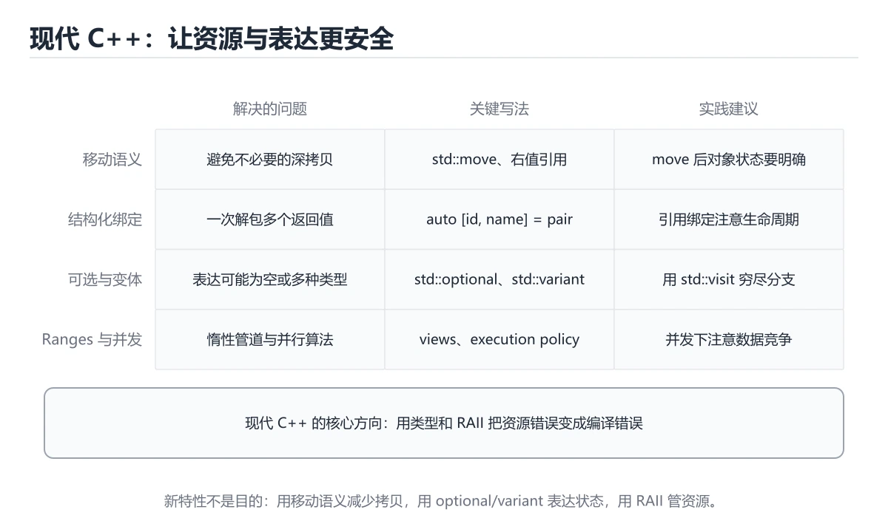
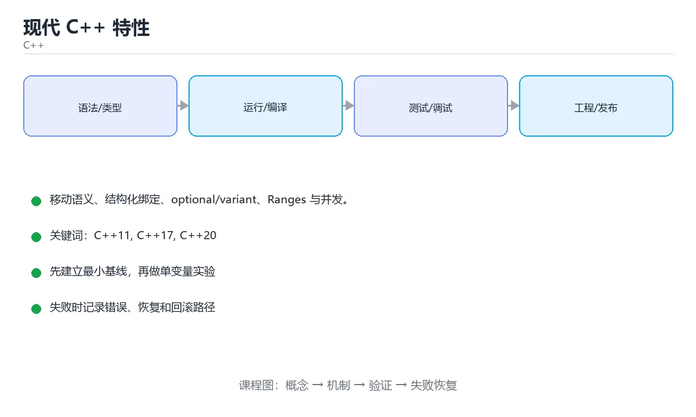

# 现代 C++ 特性





> 内容更新时间：2026-10-06 · 学习阶段：进阶 · 预计用时：55 分钟

## 本节知识框架

C++11 之后的世界和之前判若两门语言。如果用一句话概括现代 C++ 的目标，那就是：**少写裸指针、少写循环、让编译器替你检查**。

想象你在搬家：
- **移动语义**就像把整箱东西直接搬过去，而不是先复印一份再扔原件。
- **auto** 就像让助手替你猜东西是什么——你不用写一长串类型名，编译器自己推导。
- **结构化绑定**就像一次拆开一个快递包裹里的多件商品——`auto [key, value] = pair`。
- **optional** 就像说「可能有，可能没有」——比返回 -1 或 nullptr 清楚得多。
- **智能指针**就像请了个管家帮你自动收拾——对象不用了自动释放。

本课主线：**移动语义、结构化绑定、optional/variant、Ranges 与并发**。

学完这课你会：
- 理解 `auto`、`nullptr`、`enum class` 等基础现代写法
- 掌握移动语义和 `std::move` 的正确用法
- 会用 `optional`、`string_view`、结构化绑定写出简洁安全的代码

## 核心概念定义

| 术语 | 一句话说明 |
| --- | --- |
| auto | C++11 引入的编译期类型推导关键字，让编译器替你写类型。简洁但要注意别悄悄拷贝。 |
| make_unique | C++14 引入的智能指针工厂函数，一行代码创建 `unique_ptr`，比裸 `new` 安全。 |
| if constexpr | C++17 引入的编译期分支，模板里按类型走不同逻辑，不命中的分支不实例化。 |
| atomic | C++ 原子类型，保证并发读写不可分割，是多线程编程的基础。 |
| 移动语义 | 把资源「搬」过去而不是复制，用 `std::move` 标记一个对象可以被「掏空」。 |
| 结构化绑定 | C++17 引入的语法，一次解包多个值：`auto [key, value] = pair`。 |

## 原理与运行机制

### 版本演进速览

C++ 每隔几年就会出一版新标准，每次加入一批实用特性：

- **C++11**：`auto`、lambda、右值引用与移动语义、智能指针、范围 for、`nullptr`
- **C++14**：泛型 lambda、`make_unique`、返回值类型推导
- **C++17**：结构化绑定、`if constexpr`、`optional` / `variant` / `string_view`、并行算法
- **C++20**：Concepts、Ranges、协程、`span`、三路比较 `<=>`
- **C++23**：`expected`、`print`、更多 ranges 支持

### auto：让编译器替你写类型

```cpp
auto it = v.begin();          // 不用写 std::vector<int>::iterator
auto x = 42;                  // int
const auto& ref = someObj;    // 只读引用，不拷贝
```

注意：`auto x = expr;` 按值推导，会拷贝。需要引用时写 `const auto&`。

### 范围 for：告别下标循环

```cpp
for (const auto& item : container) {   // 只读
    std::cout << item << '\n';
}
for (auto& item : container) {         // 需要修改
    item *= 2;
}
```

### nullptr：类型安全的空指针

```cpp
int* p = nullptr;   // 好：类型安全
// int* q = NULL;   // 旧写法：可能和 0 混淆
```

### 移动语义：把资源「搬」过去

```cpp
std::vector<int> makeData() {
    std::vector<int> v(1'000'000, 1);
    return v;                          // 编译器自动移动，不拷贝
}

std::vector<int> data = makeData();
std::vector<int> moved = std::move(data);   // 转移所有权
// 此后不要再读 data 的内容
```

`std::move` 本身不做任何事，它只是把左值转成右值引用，告诉编译器「这个对象可以被搬走」。搬完之后原对象处于「有效但未定义」状态。

### 结构化绑定：一次拆多个值

```cpp
#include <map>

std::map<std::string, int> scores{{"math", 90}};
if (auto [it, inserted] = scores.emplace("english", 85); inserted) {
    std::cout << it->first;
}

for (const auto& [name, score] : scores) {
    std::cout << name << ':' << score << '\n';
}
```

### optional 与 variant：表达「可能有」和「是其一」

```cpp
#include <optional>
#include <variant>

std::optional<int> findIndex(const std::vector<int>& v, int target) {
    for (size_t i = 0; i < v.size(); ++i)
        if (v[i] == target) return i;
    return std::nullopt;      // 明确表达「没有」
}

std::variant<int, std::string> v = 42;
if (std::holds_alternative<int>(v)) {
    std::cout << std::get<int>(v);
}
std::visit([](const auto& x) { std::cout << x; }, v);
```

### string_view：零拷贝只读字符串

```cpp
void log(std::string_view msg);       // 不需要拷贝

log("字面量");                         // 不产生临时 std::string
std::string s = "abc";
log(s);
```

**注意**：`string_view` 不持有数据，不能返回指向已销毁数据的视图。

### Ranges 与算法组合（C++20）

```cpp
#include <ranges>
#include <vector>

std::vector<int> nums{1, 2, 3, 4, 5, 6};

auto even_squares = nums
    | std::views::filter([](int x) { return x % 2 == 0; })
    | std::views::transform([](int x) { return x * x; });

for (int value : even_squares) std::cout << value << ' ';   // 4 16 36
```

## 典型应用场景

- **类型冗长或明显时**：用 `auto` 推导，比如迭代器、`make_unique` 返回值。
- **遍历 map 或解包 pair/tuple**：用结构化绑定 `auto [key, value] = ...`。
- **表达「可能没有值」**：用 `optional`，不要返回 -1 或 nullptr。
- **只读字符串参数**：用 `string_view`，零拷贝。
- **组合过滤/转换**：用 Ranges 管道语法。

## 代码/协议/SQL 示例

### 现代写法综合示例

```cpp
#include <iostream>
#include <memory>
#include <optional>
#include <string_view>
#include <vector>

enum class Status { Ok, Warn, Error };            // enum class
constexpr double kPi = 3.14159;                   // constexpr
struct Point { double x; double y; };

std::optional<Point> parsePoint(std::string_view text) {
    if (text.empty()) return std::nullopt;
    return Point{1.0, 2.0};
}

int main() {
    auto items = std::vector{1, 2, 3, 4};         // auto 与类模板推导
    int total = 0;
    for (const auto& n : items) total += n;       // 范围 for

    auto ptr = std::make_unique<Point>(Point{1, 2});   // 智能指针

    if (auto p = parsePoint("1,2")) {             // if 带初始化
        auto [x, y] = *p;                         // 结构化绑定
        std::cout << x << ',' << y << '\n';
    }

    const Status st = Status::Warn;
    if (st == Status::Warn) std::cout << "warn\n";
    std::cout << "pi=" << kPi << " total=" << total << '\n';
}
```

### 现代写法重写统计

```cpp
#include <algorithm>
#include <iostream>
#include <optional>
#include <span>
#include <vector>

std::optional<double> average(std::span<const int> data) {
    if (data.empty()) return std::nullopt;
    double sum = 0;
    for (int n : data) sum += n;
    return sum / static_cast<double>(data.size());
}

int main() {
    const std::vector<int> scores{88, 92, 79, 95};

    if (const auto avg = average(scores)) {
        std::cout << "avg " << *avg << '\n';
    } else {
        std::cout << "no data\n";
    }

    const auto [lo, hi] = std::ranges::minmax(scores);
    std::cout << "range " << lo << " ~ " << hi << '\n';
}
```

编译运行：`g++ -std=c++20 stats.cpp -o stats && ./stats`

### optional 与 map 配合

```cpp
#include <map>
#include <optional>
#include <string>

std::map<std::string, int> scores{{"math", 90}};
if (auto [it, inserted] = scores.emplace("english", 85); inserted) {
    std::cout << it->first;
}

std::optional<int> maybe = std::nullopt;
std::cout << maybe.value_or(-1);
```

## 时间/空间复杂度或性能分析

现代 C++ 特性的性能影响：

- **移动语义**：把 O(n) 的深拷贝变成 O(1) 的指针转移，对大对象（vector、string）效果显著。
- **auto**：零开销，编译期推导，生成的代码和手写类型一样。
- **结构化绑定**：零开销，只是语法糖。
- **string_view**：构造 O(1)，不拷贝字符串。但要注意生命周期。
- **optional/variant**：有少量额外空间开销（存一个标记），但比指针方案好。
- **Ranges**：惰性求值，不产生中间容器，但可能增加编译时间。

## 常见误区与易错点

| 容易写错的做法 | 实际现象 | 原因与正确做法 |
| --- | --- | --- |
| `std::move` 后继续用原对象 | 内容不确定 | 只把它当「已完成使命」，不要再读其值 |
| 返回局部变量的 `string_view` | 悬垂引用 | 返回 `std::string` |
| `auto` 推导出意外类型 | 悄悄发生拷贝 | 需要引用时写 `const auto&` |
| `optional` 直接解引用 | 空值未定义行为 | 先判断或用 `value_or` |
| `enum` 不带 class | 名字冲突 | 用 `enum class` |
| `constexpr` 函数里做 IO | 编译不过 | 保持纯计算 |
| 头文件里写 `using namespace std;` | 污染使用方 | 写全限定名 |
| `return std::move(local);` | 反而阻止返回值优化 | 直接 `return local;` |

## 与其他知识点的关系

- **先修**：《STL 容器与算法》——本课会用到 vector、map 等容器。
- **后续**：《构建、调试与工程实践》——现代写法需要正确的编译选项和工具链支持。
- **关联**：《C++ 移动语义与右值引用》——本课是入门，那课是深入。
- **术语衔接**：本课的 `auto`、`make_unique`、`移动语义` 在后续课程中会继续使用。

## 自测题与参考答案

### 自测 1

`std::move` 之后原对象还能用吗？

**参考答案**：原对象处于「有效但未定义」状态。技术上不会崩溃，但内容不可预测。正确做法是 move 之后不再使用原对象的值，或者重新赋值。

### 自测 2

`optional` 和返回特殊值（如 -1）相比有什么优势？

**参考答案**：`optional` 明确表达「可能有值，可能没有」的语义。调用者必须显式处理空值情况（用 `if (opt)` 或 `value_or`），不会像返回 -1 那样被忽略或和合法值混淆。

### 自测 3

`string_view` 有什么使用禁忌？

**参考答案**：`string_view` 不持有数据，只是一个指向外部字符串的视图。绝对不能返回指向局部变量的 `string_view`（悬垂引用），也要确保被引用的字符串生命周期长于视图。

## 考点精讲

本课的题库有 6 道题，下面逐题讲解。

### 考点 1

**题目**：阅读 `现代 C++ 特性` 的 `auto` 示例。它服务于移动语义、结构化绑定、optional/variant、Ranges 与并发。代码中实际包含下列哪一项？

**正确项**：调用了 `emplace()`

**讲解**：本课的示例代码中出现了 `scores.emplace("english", 85)` 调用，展示了 map 的 emplace 用法和结构化绑定的配合。

### 考点 2

- **题目**：围绕“现代 C++ 特性”中的 C++11、C++17、C++20，下列哪两项是本课强调的实践判断？

**正确项**：
- 验证 C++17 时要固定版本并覆盖边界输入，结论才可复现
- 学习 C++11 时要同时说明输入、输出和失败路径，不能只看正常流程

**讲解**：学习现代 C++ 不能只跑通正常例子。验证 C++17 特性时要固定编译器版本、覆盖边界输入；学习 C++11 特性时要同时考虑正常流程和失败路径（比如 move 后的状态）。

### 考点 3

**题目**：for (const auto& [key, value] : map) 用到了哪个特性？

**正确项**：结构化绑定

**讲解**：`auto [key, value] = ...` 就是结构化绑定语法，C++17 引入。它让你一次解包 pair、tuple 或结构体的多个成员，不用手写 `.first` 和 `.second`。

### 考点 4

**题目**：模板参数中的 T&& 通常被称为？

**正确项**：转发引用（universal reference）

**讲解**：在模板参数中，`T&&` 被称为转发引用（也叫万能引用）。它既能绑定左值也能绑定右值，配合 `std::forward<T>` 可以完美转发参数的值类别。

### 考点 5

**题目**：std::string_view 的特点是？

**正确项**：不拥有内存的字符串视图

**讲解**：`string_view` 只是一个指向外部字符串的「窗口」，它不持有数据、不分配内存。优点是零拷贝传参，缺点是要确保底层字符串的生命周期长于视图。

### 考点 6

**题目**：填空：补齐下面这段术语说明中的空缺。课程 `移动语义、结构化绑定、optional/variant、Ranges 与并发。`，这段说明是：C++14**：泛型 lambda、``____``、返回值类型推导。空缺处应填哪个术语？

**正确项**：make_unique

**讲解**：`make_unique` 是 C++14 引入的智能指针工厂函数。它和泛型 lambda、返回值类型推导一起，构成了 C++14 最实用的三个新特性。

## 延伸阅读

想更直观地理解本课概念？推荐参阅以下图解专题：

- [图解内存布局：栈、堆与引用](visual_memory_layout.md)

## 术语速查

| 术语 | 一句话说明 |
| --- | --- |
| auto | 编译期类型推导关键字，让编译器替你写类型。 |
| make_unique | C++14 智能指针工厂函数，比裸 new 更安全。 |
| if constexpr | C++17 编译期分支，不命中的模板分支不实例化。 |
| atomic | C++ 原子类型，保证并发读写不可分割。 |
| 移动语义 | 把资源「搬」过去而不是复制，用 std::move 标记。 |
| 结构化绑定 | C++17 语法，一次解包多个值。 |

## 复习清单

- [ ] 能解释 `std::move` 之后为什么不该再用原对象，以及返回值优化的原理。
- [ ] 能运行或推演本课的现代写法综合示例，记录输入、输出与失败现象。
- [ ] 能完成一次自测，并把错题对照错误表定位原因。

## 参考资料与复核

- [本课资料锚点 cpp_modern](https://zh.wikipedia.org/w/index.php?search=cpp_modern)

- 最后复核：2026-10-04
- 下次复核：2027-05-10
- 复核范围：版本兼容、API 行为、安全建议与工程实践

| 参考资料 | 本课用途 |
| --- | --- |
| [C++ Core Guidelines](https://isocpp.github.io/CppCoreGuidelines/) | 现代 C++ 工程规范 |
| [cppreference C++ 语言](https://en.cppreference.com/w/cpp/language) | C++ 语言规则与语义 |
| [C++ 标准委员会](https://isocpp.org/) | 标准演进与提案动态 |

## 内容元数据

- 内容版本：v2.0
- 最后更新：2026-10-06
- 学习阶段：进阶
- 适用环境：C++20 / GCC 13+ 或 Clang 17+
- 内容来源：内置结构化课程与工程实践整理
- 相关主题：C++11、C++17、C++20、移动语义、Ranges、atomic
- 质量版本：P0 测验标准 + P1 覆盖扩展 + P2 体验补全
