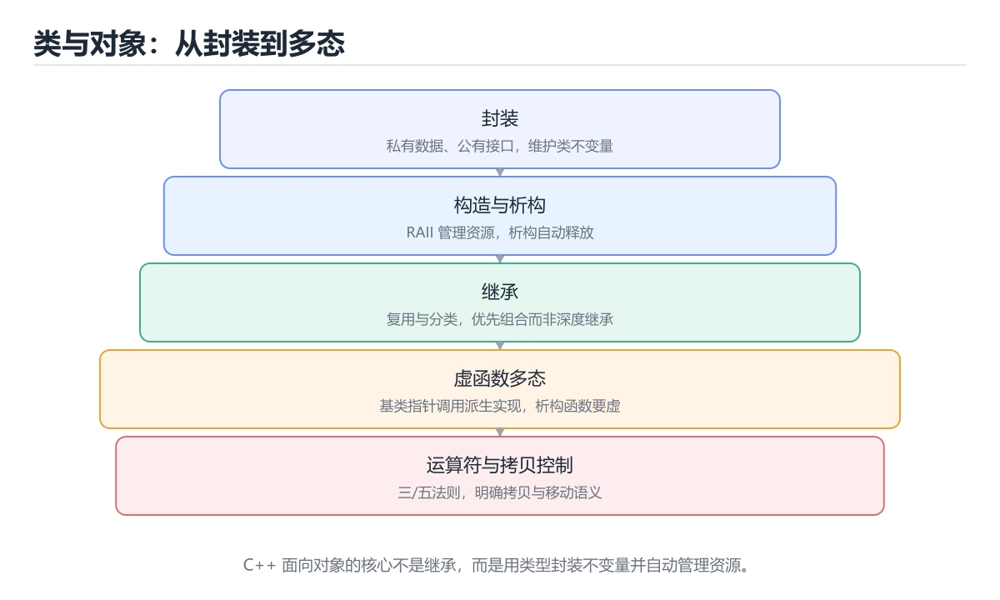
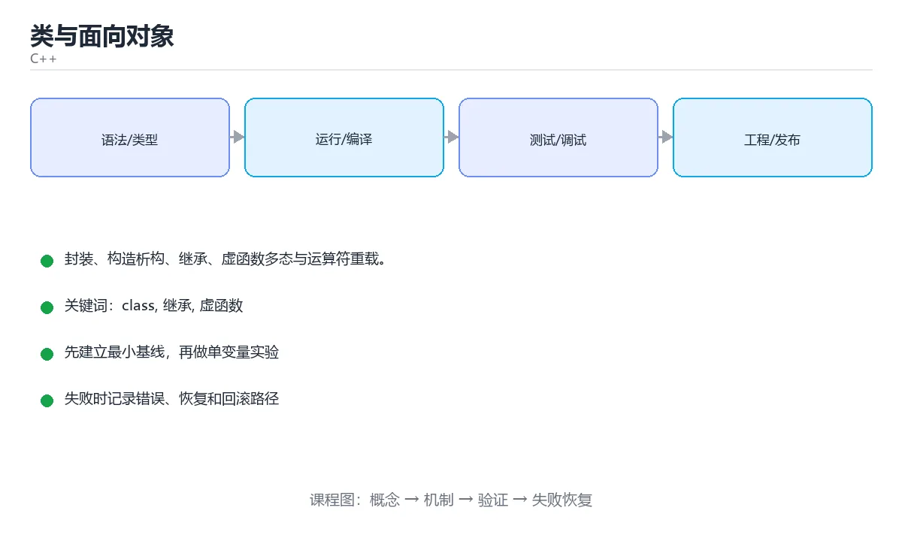

# 类与面向对象





> 内容更新时间：2026-10-06 · 学习阶段：进阶 · 预计用时：55 分钟

## 本节知识框架

想象你在造一栋大楼。你需要**图纸**（class）来定义每个房间长什么样，**施工队**按图纸盖出一个个**房间**（对象）。图纸上写着「承重墙不能动」（private），但留了门和窗户给外面用（public）。如果几种房间有共同结构，你可以画一张**母图纸**（基类），然后派生出「带阳台版」「带飘窗版」（继承）。最妙的是，物业只需喊一句「请报面积」（虚函数），圆形房间和方形房间各自回答——这就是**多态**。

本课就围绕这五件事展开：**封装、构造析构、继承、虚函数多态、运算符重载**。

学完这课你会：
- 知道 `class` 怎么把数据和操作打包在一起，并理解 `const` 成员函数的意义
- 能用 `override` 让编译器帮你检查虚函数签名
- 分清「是一种」和「有一个」两种关系，选对继承还是组合

## 核心概念定义

| 术语 | 一句话说明 |
| --- | --- |
| class | 定义对象属性与行为的类型模板，实例化后得到具体对象。就像一张建筑图纸，可以盖出很多间房。 |
| const 成员函数 | 标记为 `const` 的成员函数承诺不修改对象状态，因此常量对象也能调用它。 |
| override | 告诉编译器「我确实在覆盖基类的虚函数」，如果签名写错，编译器会直接报错。 |
| 虚函数 | 用 `virtual` 声明的成员函数，允许在运行时根据对象的实际类型调用对应实现。 |
| 多态 | 同一句调用在不同对象上产生不同行为，靠虚函数表（vtable）在运行时决定。 |
| 抽象类 | 含有纯虚函数（`= 0`）的类，不能直接创建对象，只能被继承。 |

## 原理与运行机制

### 封装：把数据藏起来

封装就像自动售货机——你只能按按钮（公开接口），看不到里面的齿轮和弹簧（私有数据）。这样做的好处是：内部怎么改都不影响外面的人。

```cpp
#include <string>

class Account {
public:
    Account(std::string owner, double balance)
        : owner_(std::move(owner)), balance_(balance) {}

    void deposit(double amount) {
        if (amount > 0) balance_ += amount;
    }

    double balance() const { return balance_; }

private:
    std::string owner_;
    double balance_;
};
```

要点：
- 成员初始化列表按声明顺序执行
- `const` 成员函数可以被常量对象调用
- 数据成员一般私有，通过公有方法访问

### 构造与析构：对象的生与死

每个对象都有「出生」（构造）和「死亡」（析构）。C++ 提供了几个特殊的成员函数：

| 函数 | 何时生成 | 建议 |
| --- | --- | --- |
| 默认构造 | 没声明任何构造器时 | 需要时显式 `= default` |
| 析构函数 | 总是 | 有资源时用 RAII，或 `virtual` |
| 拷贝构造 | 总是 | 拥有资源时明确实现或 `= delete` |
| 拷贝赋值 | 总是 | 同上，注意自赋值 |
| 移动构造 / 移动赋值 | C++11 起 | 需要高性能转移时实现 |

**三法则与零法则**：

| 法则 | 内容 |
| --- | --- |
| 三法则 | 需要自定义析构、拷贝构造、拷贝赋值中的任何一个，通常三个都要 |
| 五法则 | 再加上移动构造与移动赋值 |
| 零法则 | **首选**：用智能指针与容器，自己不写任何析构与拷贝逻辑 |

### 继承与多态：「是一种」关系

继承表达的是「Circle **是一种** Shape」的关系。子类自动拥有父类的公开能力，还能加上自己的特色。

```cpp
class Shape {
public:
    virtual ~Shape() = default;
    virtual double area() const = 0;
    virtual std::string name() const { return "shape"; }
};

class Circle final : public Shape {
public:
    explicit Circle(double r) : r_(r) {}
    double area() const override { return 3.141592653589793 * r_ * r_; }
    std::string name() const override { return "circle"; }

private:
    double r_;
};
```

多态通过虚函数表（vtable）在运行时决定调用哪个实现。`override` 让编译器帮你检查签名是否写错。

### 运算符重载：让自定义类型像内置类型一样使用

```cpp
struct Vector2 {
    double x = 0, y = 0;

    Vector2 operator+(const Vector2& other) const {
        return {x + other.x, y + other.y};
    }

    bool operator==(const Vector2& other) const {
        return x == other.x && y == other.y;
    }
};
```

不要滥用运算符重载：只有当语义直观（数学运算、比较、流输出）时才用。

## 典型应用场景

- **「是一种」关系**：例如 Circle 是一种 Shape，用公有继承。
- **「有一个」关系**：例如 Car 有一个 Engine，用组合。
- **只想复用代码**：用组合，因为继承会带来强耦合。
- **需要运行时多态**：用继承加虚函数，或考虑 `std::variant` 等替代方案。

## 代码/协议/SQL 示例

### 构造、析构与拷贝控制

```cpp
class Buffer {
public:
    explicit Buffer(std::size_t size) : data_(new char[size]), size_(size) {}
    ~Buffer() { delete[] data_; }

    Buffer(const Buffer& other)
        : data_(new char[other.size_]), size_(other.size_) {
        std::copy(other.data_, other.data_ + size_, data_);
    }

    Buffer& operator=(const Buffer& other) {
        if (this != &other) {
            Buffer tmp(other);
            std::swap(data_, tmp.data_);
            std::swap(size_, tmp.size_);
        }
        return *this;
    }

    Buffer(Buffer&& other) noexcept
        : data_(other.data_), size_(other.size_) {
        other.data_ = nullptr;
        other.size_ = 0;
    }

private:
    char* data_;
    std::size_t size_;
};
```

### 继承与多态实战

```cpp
class Shape {
public:
    virtual ~Shape() = default;
    virtual double area() const = 0;
    virtual std::string name() const { return "Shape"; }
};

class Circle : public Shape {
public:
    explicit Circle(double r) : radius_(r) {}
    double area() const override { return 3.14159 * radius_ * radius_; }
    std::string name() const override { return "Circle"; }
private:
    double radius_;
};

void print_area(const Shape& shape) {
    std::cout << shape.name() << ": " << shape.area();
}
```

### 员工薪资多态示例

```cpp
#include <iomanip>
#include <iostream>
#include <memory>
#include <string>
#include <vector>

class Employee {
public:
    explicit Employee(std::string name) : name_(std::move(name)) {}
    virtual ~Employee() = default;
    virtual double monthlyPay() const = 0;

    void print() const {
        std::cout << std::setw(8) << name_ << "月薪 "
                  << std::fixed << std::setprecision(2)
                  << monthlyPay() << '\n';
    }

private:
    std::string name_;
};

class Salaried : public Employee {
public:
    Salaried(std::string name, double monthly)
        : Employee(std::move(name)), monthly_(monthly) {}
    double monthlyPay() const override { return monthly_; }
private:
    double monthly_;
};

class Hourly : public Employee {
public:
    Hourly(std::string name, double rate, double hours)
        : Employee(std::move(name)), rate_(rate), hours_(hours) {}
    double monthlyPay() const override { return rate_ * hours_; }
private:
    double rate_, hours_;
};

int main() {
    std::vector<std::unique_ptr<Employee>> staff;
    staff.push_back(std::make_unique<Salaried>("小明", 12000));
    staff.push_back(std::make_unique<Hourly>("小红", 80, 160));

    double total = 0;
    for (const auto& e : staff) {
        e->print();
        total += e->monthlyPay();
    }
    std::cout << "合计 " << total << '\n';
}
```

编译运行：`g++ -std=c++17 employee.cpp -o employee && ./employee`

## 时间/空间复杂度或性能分析

面向对象设计的性能考量：

- **虚函数调用**：比直接函数调用多一次间接寻址（查 vtable），但现代 CPU 的分支预测器通常能处理好。
- **对象大小**：含虚函数的对象会多一个 vptr（通常 8 字节），指向虚函数表。
- **多态 vs std::variant**：如果类型集合有限且固定，`std::variant` 可以避免堆分配和虚函数开销。
- **编译优化**：Release 模式下编译器可能内联虚函数调用（如果能确定实际类型）。

测量方法：以具体的类层次为对象，固定输入跑一遍记录基线，再把规模提高一个数量级复测。

## 常见误区与易错点

| 容易写错的做法 | 实际现象 | 原因与正确做法 |
| --- | --- | --- |
| 基类析构不写 `virtual` | 通过基类指针删除子类时资源泄漏 | 基类析构声明 `virtual` |
| 子类重写忘写 `override` | 拼错签名后不生效 | 一律加 `override` |
| 构造函数中调用虚函数 | 调用到基类版本 | 构造或析构期间不调用虚函数 |
| 成员初始化顺序与声明顺序不一致 | 初始化值不符合预期 | 按声明顺序初始化，开 `-Wreorder` |
| 拷贝构造只做浅拷贝 | 双重释放 | 深拷贝或 `= delete`，优先零法则 |
| 按值传递基类对象 | 对象切片，多态失效 | 用 `Shape&` 或 `Shape*` |
| 忘记 `explicit` | 隐式转换引发意外调用 | 单参数构造器加 `explicit` |
| 在类里 `new` 却不在析构里 `delete` | 内存泄漏 | 用智能指针成员 |

## 与其他知识点的关系

- **先修**：《内存管理与智能指针》——本课会用到 `unique_ptr`、RAII 等概念。
- **后续**：《模板与泛型编程》——模板和类结合才能写出 `std::vector<T>` 这样的通用容器。
- **关联**：《继承、接口与多态》——本课是入门，那课是深入。
- **术语衔接**：本课的 `class`、`继承`、`虚函数`、`多态` 在后续课程中会继续使用。

## 自测题与参考答案

### 自测 1

不看正文，写出 `const` 成员函数的含义，并说明为什么常量对象需要它。

**参考答案**：`const` 成员函数承诺不修改对象的数据成员。常量对象（`const Account a;`）只能调用 `const` 成员函数，否则编译器无法保证对象不被修改。

### 自测 2

为什么基类的析构函数要声明为 `virtual`？

**参考答案**：如果通过基类指针删除子类对象，析构函数不是 `virtual` 的话，只会调用基类析构，子类资源（如动态分配的内存）就泄漏了。

### 自测 3

`override` 和 `virtual` 有什么区别？

**参考答案**：`virtual` 用在基类中，声明一个可以被覆盖的函数。`override` 用在子类中，告诉编译器「我在覆盖基类的虚函数」，如果签名不匹配编译器会报错。

## 考点精讲

本课的题库有 6 道题，下面逐题讲解。

### 考点 1

- **题目**：围绕“类与面向对象”中的 class、继承、虚函数，下列哪两项是本课强调的实践判断？

**正确项**：
- 验证 继承 时要固定版本并覆盖边界输入，结论才可复现
- 学习 class 时要同时说明输入、输出和失败路径，不能只看正常流程

**讲解**：学习面向对象不能只跑通正常例子。验证继承行为时要固定编译器版本、覆盖边界输入；学习 class 时要同时考虑正常流程和失败路径。

### 考点 2

**题目**：override 关键字的作用是？

**正确项**：让编译器检查是否真的覆盖了基类虚函数

**讲解**：`override` 放在子类虚函数签名后面。如果签名和基类不一致（比如参数类型写错），编译器会直接报错，而不是悄悄创建一个新函数。

### 考点 3

**题目**：含有纯虚函数（= 0）的类是？

**正确项**：抽象类，不能直接实例化

**讲解**：纯虚函数用 `= 0` 声明，表示「这个函数没有默认实现，子类必须自己写」。含有纯虚函数的类叫抽象类，不能创建它的对象，只能被继承。

### 考点 4

**题目**：拷贝构造函数的典型签名是？

**正确项**：ClassName(const ClassName& other)

**讲解**：拷贝构造用一个同类型的常量引用来初始化新对象。参数必须是引用（否则无限递归），通常加 `const`（不修改源对象）。

### 考点 5

**题目**：这段 `cpp` 代码对应 `类与面向对象` 的 `const`。课程要解决的是封装、构造析构、继承、虚函数多态与运算符重载。关于代码内容，哪一项说法准确？

**正确项**：调用了 `Buffer()`

**讲解**：本课的示例代码中出现了 `Buffer` 类的构造和拷贝控制，展示了零法则和三法则的实现。

### 考点 6

**题目**：填空：补齐下面这段术语说明中的空缺。课程 `封装、构造析构、继承、虚函数多态与运算符重载。`，这段说明是：`____`：定义对象属性与行为的类型模板，实例化后得到具体对象。空缺处应填哪个术语？

**正确项**：class

**讲解**：`class` 就是定义对象属性与行为的类型模板。你用 `class` 画好图纸，然后用它实例化出具体的对象。

## 延伸阅读

想更直观地理解本课概念？推荐参阅以下图解专题：

- [图解内存布局：栈、堆与引用](visual_memory_layout.md)

## 术语速查

| 术语 | 一句话说明 |
| --- | --- |
| class | 定义对象属性与行为的类型模板，实例化后得到具体对象。 |
| const 成员函数 | 承诺不修改对象状态的成员函数，常量对象也能调用。 |
| override | 让编译器检查是否真的覆盖了基类虚函数，防止签名写错。 |
| 虚函数 | 用 `virtual` 声明，允许运行时按实际类型调用对应实现。 |
| 多态 | 同一句调用在不同对象上产生不同行为。 |
| 抽象类 | 含纯虚函数的类，不能直接实例化，只能被继承。 |

## 复习清单

- [ ] 能解释虚函数与多态的关系，并说出为什么基类析构要 virtual。
- [ ] 能运行或推演本课的 Buffer 和 Shape 示例，记录输入、输出与失败现象。
- [ ] 能完成一次自测，并把错题对照错误表定位原因。

## 参考资料与复核

- [本课资料锚点 cpp_oop](https://zh.wikipedia.org/w/index.php?search=cpp_oop)

- 最后复核：2026-10-04
- 下次复核：2027-05-10
- 复核范围：版本兼容、API 行为、安全建议与工程实践

| 参考资料 | 本课用途 |
| --- | --- |
| [C++ 类与对象](https://en.cppreference.com/w/cpp/language/class) | class 语法、访问控制、成员函数 |
| [C++ 虚函数](https://en.cppreference.com/w/cpp/language/virtual) | 虚函数、多态、override 机制 |
| [C++ Core Guidelines](https://isocpp.github.io/CppCoreGuidelines/) | 现代 C++ 类设计最佳实践 |

## 内容元数据

- 内容版本：v2.0
- 最后更新：2026-10-06
- 学习阶段：进阶
- 适用环境：C++20 / GCC 13+ 或 Clang 17+
- 内容来源：内置结构化课程与工程实践整理
- 相关主题：class、继承、虚函数、多态、运算符重载、RAII
- 质量版本：P0 测验标准 + P1 覆盖扩展 + P2 体验补全
