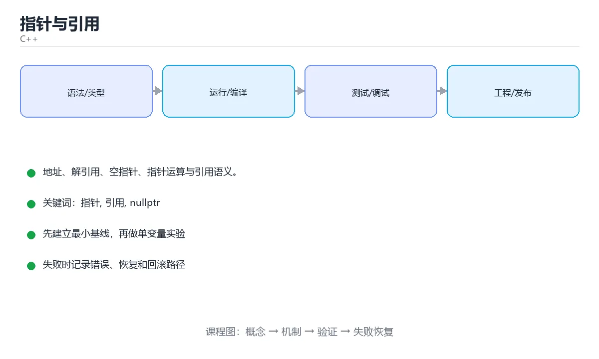

# 指针与引用

> 内容更新时间：2026-10-06 · 学习阶段：进阶 · 预计用时：50 分钟




## 本节知识框架

如果说变量是住在门牌号码里的数据，那么**指针就是写着地址的纸条**，**引用是给房子起的第二个门牌**。

本课我们会聊四件事：

1. **指针**：保存内存地址，通过解引用访问目标对象。可以为空、可以改指向。
2. **引用**：变量的别名，一旦绑定就不能改。用起来就像原来的变量本身。
3. **空指针与野指针**：`nullptr` 表示「不指向任何东西」，野指针指向随机地址——后者是崩溃的温床。
4. **智能指针**：`unique_ptr` 独占、`shared_ptr` 共享、`weak_ptr` 观察，用所有权表达生命周期。

打个比方：指针像一张便签纸，上面写着一个房间的地址。你可以擦掉重写（改指向），也可以留空（`nullptr`）。引用则像是给房间挂了第二块门牌——它永远指着那个房间，你通过新门牌进去，看到的就是原来的东西。

**先修衔接**：本课假设你已经学过《控制流与函数》，知道 `break`、`声明与定义` 的含义。后续衔接《内存管理与智能指针》。

## 核心概念定义

| 术语 | 操作性定义 | 常见边界与风险 |
| --- | --- | --- |
| 指针 | 保存内存地址并可通过解引用访问目标对象的变量。 | 易错：随机崩溃；正确做法是定义时就赋 `nullptr`。 |
| 引用 | 指向另一个值或资源的别名；在存储语境中也可能指数据来源。 | 易错：段错误；正确做法是用前判空。 |
| 悬垂指针 | 指向已释放内存的指针，解引用属于未定义行为，是崩溃与安全漏洞的常见来源。 | 易错：悬垂指针；正确做法是返回值或改用智能指针。 |
| 智能指针 | unique_ptr 独占、shared_ptr 共享、weak_ptr 观察，用所有权表达生命周期。 | 易错：数据错乱；正确做法是置空或改用智能指针。 |

## 原理与运行机制

### 指针：写着地址的纸条

每个变量都住在内存的某个地址上。用 `&` 取地址，用 `*` 解引用（找上门去）：

```cpp
int value = 42;
int* p = &value;        // & 取地址，p 保存 value 的地址

std::cout << *p;        // * 解引用，得到 42
*p = 100;               // 通过指针修改原变量
p = nullptr;            // 空指针，表示「不指向任何对象」
```

nullptr 表示空指针，不指向任何对象。访问空指针或未初始化指针是未定义行为，使用前先判空：

```cpp
if (p != nullptr) {
    std::cout << *p;
}
```

### 引用：变量的别名

引用是变量的别名，必须在定义时绑定，之后不能改绑。用起来就像原来的变量：

```cpp
int a = 1;
int& ref = a;
ref = 2;                 // 等价于 a = 2

void increase(int& x) { ++x; }        // 传引用：函数内修改影响实参
void print(const std::string& s);     // const 引用：只读且避免拷贝
```

### 指针与引用的区别

| 对比项 | 指针 | 引用 |
| --- | --- | --- |
| 能否为空 | 可以 `nullptr` | 一般不能 |
| 能否改绑 | 可以指向别的对象 | 不可以 |
| 是否需要解引用 | 需要 `*p` | 直接当变量用 |
| 典型用途 | 可选对象、动态内存、数组遍历 | 函数参数、返回值 |

经验法则：**函数参数能用引用就用引用，只有「可能没有对象」时才用指针**。

### 指针与数组

数组名在大多数表达式中会退化成指向首元素的指针：

```cpp
int nums[3] = {10, 20, 30};
int* first = nums;              // 数组名退化为指向首元素的指针
std::cout << *(first + 1);      // 20，指针运算按元素大小移动
std::cout << first[2];          // 等价写法
```

C++ 中更推荐 `std::array` 和 `std::vector`，它们自带大小信息，不容易越界。

### `const` 与指针的四种组合

| 写法 | 能否改指向 | 能否改内容 |
| --- | --- | --- |
| `int* p` | 能 | 能 |
| `const int* p` | 能 | 不能（指向常量） |
| `int* const p` | 不能 | 能 |
| `const int* const p` | 不能 | 不能 |

记忆方法：**看 `const` 在 `*` 的左边还是右边**。`const int* p` 中 `const` 在 `*` 左边，所以不能通过 `p` 改值；`int* const p` 中 `const` 在 `*` 右边，所以 `p` 不能改指向。

### 空指针、野指针与悬垂指针

```cpp
int* a = nullptr;        // 空指针：明确表示「不指向任何东西」
if (a != nullptr) { }    // 用前判空

int* b;                  // 野指针：指向随机地址
// *b = 1;               // 未定义行为，可能直接崩溃

int* c = new int(5);
delete c;
c = nullptr;             // 释放后置空，避免悬垂
```

| 名词 | 含义 | 后果 |
| --- | --- | --- |
| 空指针 | 指向 `nullptr` | 解引用会崩溃，是可检测的错误 |
| 野指针 | 未初始化，指向随机地址 | 未定义行为，最难排查 |
| 悬垂指针 | 指向已释放的内存 | 数据被改写，静默出错 |
| 内存泄漏 | `new` 了没 `delete` | 内存持续增长 |

### 现代 C++ 的建议

```cpp
#include <memory>
#include <vector>

// 1. 用容器代替裸数组
std::vector<int> nums{1, 2, 3};

// 2. 用智能指针代替 new / delete
auto ptr = std::make_unique<int>(42);      // 独占所有权
auto shared = std::make_shared<int>(7);    // 共享所有权

// 3. 只在「可选」语义时用裸指针，并且不做所有权管理
void print(const int* maybe) {
    if (maybe != nullptr) std::cout << *maybe;
}
```

### 函数参数怎么选

| 参数类型 | 是否拷贝 | 能否为空 | 能否修改 | 什么时候用 |
| --- | --- | --- | --- | --- |
| `T x` | 拷贝 | 否 | 只改副本 | 小类型 |
| `T& x` | 不拷贝 | 否 | 能 | 需要写回结果 |
| `const T& x` | 不拷贝 | 否 | 不能 | **传大对象只读，首选** |
| `T* x` | 拷贝指针 | 能 | 能 | 允许为空 |

## 典型应用场景

### 安全地交换两个变量

引用传参的经典场景——交换函数的参数必须是引用，否则改的只是副本：

```cpp
#include <iostream>
#include <vector>

void swapValues(int& a, int& b) {      // 引用：一定要改到本体
    int tmp = a;
    a = b;
    b = tmp;
}

const int* findValue(const std::vector<int>& nums, int target) {
    for (const int& n : nums) {
        if (n == target) return &n;    // 返回指向容器元素的指针，容器还在
    }
    return nullptr;                    // 用空指针表达「没找到」
}

int main() {
    int x = 1, y = 2;
    swapValues(x, y);
    std::cout << x << " " << y << '\n';    // 2 1

    std::vector<int> nums{3, 5, 7};
    if (const int* p = findValue(nums, 5)) {
        std::cout << "找到 " << *p << '\n';
    } else {
        std::cout << "没找到\n";
    }
}
```

### 用指针表达「可选」

当一个参数可能没有值时，用指针表达「可选」语义：

```cpp
void greet(const std::string* name) {
    if (name != nullptr) {
        std::cout << "Hello, " << *name << '\n';
    } else {
        std::cout << "Hello, stranger\n";
    }
}
```

### 用智能指针管理动态对象

现代 C++ 中，`new` 出来的对象应该立刻交给智能指针：

```cpp
#include <memory>

std::unique_ptr<int> makeValue(int v) {
    return std::make_unique<int>(v);
}
```

## 代码/协议/SQL 示例

### 指针与引用速查

| 概念 | 写法 | 能否为空 | 能否改指向 | 说明 |
| --- | --- | --- | --- | --- |
| 对象 | `T obj;` | 否 | 不适用 | 优先使用 |
| 引用 | `T& r = obj;` | 否 | 否 | 使用像对象，必须初始化 |
| 常量引用 | `const T& r = obj;` | 否 | 否 | 传参首选 |
| 指针 | `T* p = &obj;` | 是 | 是 | 需要可空或可改指向时用 |
| 常量指针 | `T* const p = &obj;` | 是 | 否 | 指针本身不可改 |
| 指向常量 | `const T* p = &obj;` | 是 | 是 | 不能通过 p 改值 |

### 数组与指针速查

| 写法 | 含义 | 风险 |
| --- | --- | --- |
| `int a[5];` | 栈上固定数组 | 越界不会检查 |
| `int* p = a;` | 数组退化为指针 | 丢失长度信息 |
| `std::array<int,5> a;` | 固定大小容器 | 推荐替代裸数组 |
| `std::vector<int> v;` | 动态数组 | 首选 |
| `std::span<int> s` | 连续内存视图 | C++20，注意生命周期 |
| `sizeof(a) / sizeof(a[0])` | 求数组长度 | 退化后失效 |

### 新手最容易踩的八个坑

| 坑 | 现象 | 正确做法 |
| --- | --- | --- |
| 未初始化指针 | 随机崩溃 | 定义时就赋 `nullptr` |
| 解引用空指针 | 段错误 | 用前判空 |
| `delete` 后继续用 | 数据错乱 | 置空或改用智能指针 |
| `delete` 两次 | 程序崩溃 | 只释放一次 |
| `new` 之后忘 `delete` | 内存泄漏 | 用 `std::unique_ptr` |
| 返回局部变量的地址 | 悬垂指针 | 返回值或改用智能指针 |
| 指针与引用混用不清 | 代码难读 | 可空用指针，必存在用引用 |
| 忘了数组长度 | 越界读写 | 用 `std::vector` 或 `std::span` |

**运行方式**：用 `g++ -std=c++17 文件名.cpp -o demo` 编译后运行。遇到段错误先用 `-fsanitize=address` 重新编译定位问题。

## 时间/空间复杂度或性能分析

**性能关注点（指针与引用）**：指针和引用本身几乎零开销——它们只是地址的别名。真正的开销来自解引用后的缓存未命中和内存分配。

**本课特有开销**：

- **指针解引用**：每次 `*p` 都是一次内存访问。如果目标数据不在缓存里，代价可能是几十到几百个时钟周期。
- **动态分配**：`new` 和 `delete` 涉及堆管理器的锁竞争，频繁使用会拖慢性能。
- **智能指针开销**：`unique_ptr` 零开销（和裸指针一样快）；`shared_ptr` 需要维护引用计数，每次拷贝和销毁都有原子操作开销。
- **缓存友好性**：连续内存（如 `vector`）的缓存命中率远高于链表式结构。

**测量方法**：固定输入跑一遍记录基线，再把规模提高一个数量级复测。

## 常见误区与易错点

| 容易写错的做法 | 实际现象 | 原因与正确做法 |
| --- | --- | --- |
| 使用未初始化的指针 | 随机崩溃 | 定义就初始化为 `nullptr` |
| `delete` 后继续使用 | 悬空指针 | 置 `nullptr` 或用智能指针 |
| 忘记释放 `new` 出的对象 | 内存泄漏 | 用 `unique_ptr` / `shared_ptr` |
| 返回局部变量地址 | 悬空指针 | 按值返回或返回智能指针 |
| `p + 1` 越界访问 | 未定义行为 | 用 `vector` 与迭代器，注意边界 |
| 用 `==` 比较 C 字符串 | 比较的是地址 | 用 `std::string` 或 `strcmp` |
| 传数组给函数并 `sizeof` | 得到指针大小 | 额外传长度或用 `std::span` |
| 引用绑定临时对象后长期保存 | 悬空引用 | 值接收或延长生命周期 |
| 多层指针 `T**` | 复杂度高、易错 | 用容器、智能指针或引用替代 |

### 现场 1：未初始化指针

**症状**：随机崩溃。

**根因与修复**：定义时就赋 `nullptr`。

### 现场 2：解引用空指针

**症状**：段错误。

**根因与修复**：用前判空。

### 现场 3：`delete` 后继续用

**症状**：数据错乱或崩溃。

**根因与修复**：置空或改用智能指针。

## 与其他知识点的关系

- **先修**：`控制流与函数`。本课默认 `break`、`声明与定义` 等概念已经掌握。
- **相关或后续**：`内存管理与智能指针`、`C 指针与内存模型`。本课术语会在这些课程里继续使用。
- **术语归属**：`指针`、`引用`、`悬垂指针` 的定义以本课「核心概念定义」为准。

### 容易混淆的相邻概念

- `指针` 与 `引用`：前者可以为空、可以改指向；后者必须绑定、不能改绑。
- `引用` 与 `悬垂指针`：前者是安全的别名；后者是危险的「地址纸条指向了已拆的房子」。
- `悬垂指针` 与 `智能指针`：前者是问题，后者是解决方案。

## 自测题与参考答案

> 先独立作答，再对照参考答案。

### 自测 1（概念复述）

不看正文，写出指针与引用的三点区别。

**参考答案**：指针可以为空（`nullptr`）而引用一般不能；指针可以改指向而引用不能；指针需要解引用 `*p` 而引用直接使用。

### 自测 2（排错）

写出「未初始化指针」的现象、根因与修复方式。

**参考答案**：现象是随机崩溃；正确做法是定义时就赋 `nullptr`。

### 自测 3（代码阅读）

阅读 `const int* p` 和 `int* const p`，说明它们的区别。

**参考答案**：`const int* p` 中 `const` 在 `*` 左边，不能通过 `p` 改值但可以改指向；`int* const p` 中 `const` 在 `*` 右边，`p` 不能改指向但可以改值。前者不能通过 p 改值。

### 自测 4（迁移）

把本课的智能指针方法用到新场景：管理一个动态创建的 `std::vector<int>`。

**参考答案**：用 `auto ptr = std::make_unique<std::vector<int>>();` 创建，离开作用域时自动释放。

## 复习清单

- [ ] 能不看正文复述指针与引用的区别，并各举一个使用场景。
- [ ] 能运行本课的交换与查找示例，记录输入与输出。
- [ ] 能完成一次自测，并把错题对照错误表定位原因。


## 延伸阅读

想更直观地理解本课概念？推荐参阅以下图解专题：

- [图解内存布局：栈、堆与引用](visual_memory_layout.md)

## 术语速查

| 术语 | 一句话说明 |
| --- | --- |
| `指针` | 保存内存地址并可通过解引用访问目标对象的变量。 |
| `引用` | 指向另一个值或资源的别名；在存储语境中也可能指数据来源。 |
| `悬垂指针` | 指向已释放内存的指针，解引用属于未定义行为，是崩溃与安全漏洞的常见来源。 |
| `智能指针` | unique_ptr 独占、shared_ptr 共享、weak_ptr 观察，用所有权表达生命周期。 |
| `nullptr` | C++11 引入的空指针常量，替代了不安全的 `NULL` 宏。 |
| `解引用` | 通过 `*p` 访问指针所指向的对象的值。 |

## 考点精讲

本课的题库有 6 道题，下面逐题给出题干、正确项与判断依据。

### 考点 1：第 1 题

- **题目**：nullptr 表示什么？
- **正确项**：空指针，不指向任何对象
- **判断依据**：`nullptr` 是 C++11 引入的类型安全的空指针常量。它明确表示「不指向任何对象」，替代了 C 时代的 `NULL` 宏。复习时回到正文「空指针、野指针与悬垂指针」一节。

### 考点 2：第 2 题

- **题目**：下面这段 `cpp` 代码来自 `指针与引用`。课程主线是地址、解引用、空指针、指针运算与引用语义。代码与 `指针` 有关。哪一项是代码里真实出现的内容？
- **正确项**：代码里出现了 `引用` 这个名字
- **判断依据**：本课代码中多处出现引用（`int& ref`、`int& x` 等），引用是指针与引用课程的核心概念之一。复习时回到正文「引用」一节核对原文。

### 考点 3：第 3 题

- - **题目**：围绕“指针与引用”中的 指针、引用、nullptr，下列哪两项是本课强调的实践判断？
- **正确项**：学习 指针 时要同时说明输入、输出和失败路径，不能只看正常流程；验证 引用 时要固定版本并覆盖边界输入，结论才可复现
- **判断依据**：这道题检验本课的核心学习方法——每个概念都要同时覆盖正常路径和失败路径。复习时先复述指针与引用的主线，再举一个会让结论失效的边界输入。

### 考点 4：第 4 题

- **题目**：数组名在大多数表达式中会退化（decay）成什么？
- **正确项**：指向首元素的指针
- **判断依据**：数组名在大多数表达式中会退化为指向首元素的指针。这就是为什么 `sizeof(arr)` 和 `sizeof(p)` 结果不同——前者是整个数组的大小，后者只是一个指针的大小。复习时对照正文「指针与数组」一节。

### 考点 5：第 5 题

- **题目**：const int* p 与 int* const p 的区别是？
- **正确项**：前者不能通过 p 改值
- **判断依据**：`const int* p` 中 `const` 在 `*` 左边，表示不能通过 `p` 修改所指向的值，但 `p` 可以改指向别的对象。`int* const p` 则相反。记忆方法：看 `const` 在 `*` 的哪一边。复习时对照正文「`const` 与指针的四种组合」表格。

### 考点 6：第 6 题

- **题目**：填空：补齐下面这段术语说明中的空缺。课程 `地址、解引用、空指针、指针运算与引用语义。`，这段说明是：`____`：unique_ptr 独占、shared_ptr 共享、weak_ptr 观察，用所有权表达生命周期。空缺处应填哪个术语？
- **正确项**：智能指针
- **判断依据**：这段说明精确对应「智能指针」的操作性定义。智能指针用 RAII 机制管理动态内存的生命周期。复习时回到「核心概念定义」表格核对原文。

## 内容元数据

- 内容版本：v2.0
- 最后更新：2026-10-06
- 学习阶段：进阶
- 适用环境：C++20 / GCC 13+ 或 Clang 17+
- 内容来源：内置结构化课程与工程实践整理
- 相关主题：指针、引用、nullptr、解引用、悬垂指针

## 参考资料与复核

- 最后复核：2026-10-04
- 下次复核：2027-05-10
- 复核范围：版本兼容、API 行为、安全建议与工程实践

| 参考资料 | 本课用途 |
| --- | --- |
| [C++ 内存管理 - cppreference](https://en.cppreference.com/w/cpp/memory) | RAII、智能指针与所有权 |
| [C++ 指针教程 - learncpp.com](https://www.learncpp.com/cpp-tutorial/introduction-to-pointers/) | 指针基础与常见陷阱 |
| [GDB 文档](https://sourceware.org/gdb/documentation/) | 断点、调用栈与内存调试 |
