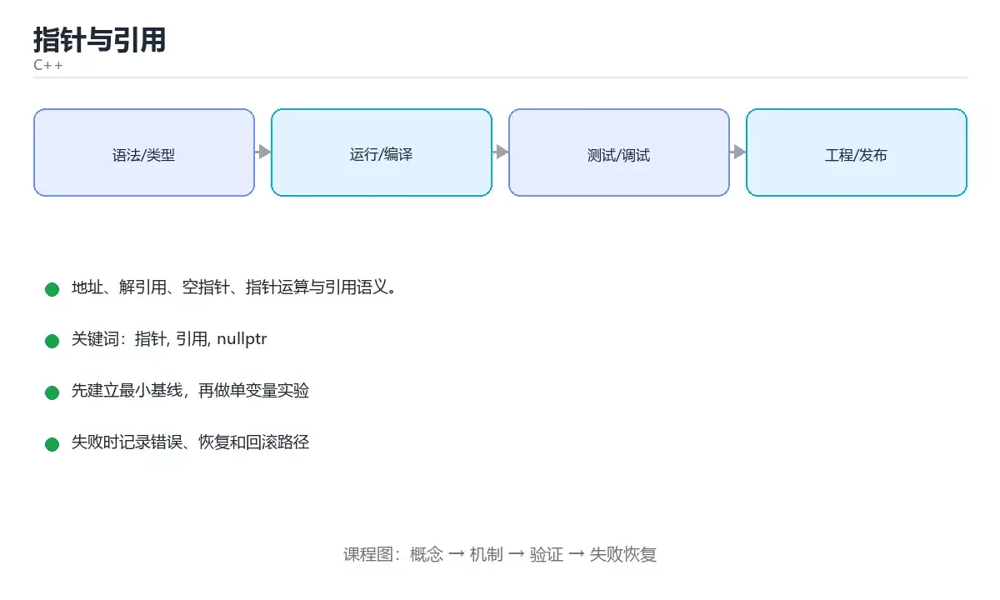

# 指针与引用

> 内容更新时间：2026-10-06 · 学习阶段：进阶 · 预计用时：45 分钟




## 本节知识框架

如果说变量是住在门牌号码里的数据，那么**指针就是写着地址的纸条**，**引用是给房子起的第二个门牌**。

本课我们会聊四件事：

1. **指针**：保存内存地址，通过解引用访问目标对象。可以为空、可以改指向。
2. **引用**：变量的别名，一旦绑定就不能改。用起来就像原来的变量本身。
3. **空指针与野指针**：`nullptr` 表示「不指向任何东西」，野指针指向随机地址——后者是崩溃的温床。
4. **智能指针**：`unique_ptr` 独占、`shared_ptr` 共享、`weak_ptr` 观察，用所有权表达生命周期。

打个比方：指针像一张便签纸，上面写着一个房间的地址。你可以擦掉重写（改指向），也可以留空（`nullptr`）。引用则像是给房间挂了第二块门牌——它永远指着那个房间，你通过新门牌进去，看到的就是原来的东西。

**先修衔接**：本课假设你已经学过《控制流与函数》，知道 `break`、`声明与定义` 的含义。后续衔接《内存管理与智能指针》。

## 核心概念定义

| 术语 | 操作性定义 | 常见边界与风险 |
| --- | --- | --- |
| 指针 | 保存内存地址并可通过解引用访问目标对象的变量。 | 易错：随机崩溃；正确做法是定义时就赋 `nullptr`。 |
| 引用 | 指向另一个值或资源的别名；在存储语境中也可能指数据来源。 | 易错：段错误；正确做法是用前判空。 |
| 悬垂指针 | 指向已释放内存的指针，解引用属于未定义行为，是崩溃与安全漏洞的常见来源。 | 易错：悬垂指针；正确做法是返回值或改用智能指针。 |
| 智能指针 | unique_ptr 独占、shared_ptr 共享、weak_ptr 观察，用所有权表达生命周期。 | 易错：数据错乱；正确做法是置空或改用智能指针。 |

## 原理与运行机制

### 指针：写着地址的纸条

每个变量都住在内存的某个地址上。用 `&` 取地址，用 `*` 解引用（找上门去）：

```cpp
int value = 42;
int* p = &value;        // & 取地址，p 保存 value 的地址

std::cout << *p;        // * 解引用，得到 42
*p = 100;               // 通过指针修改原变量
p = nullptr;            // 空指针，表示「不指向任何对象」
```

nullptr 表示空指针，不指向任何对象。访问空指针或未初始化指针是未定义行为，使用前先判空：

```cpp
if (p != nullptr) {
    std::cout << *p;
}
```

### 引用：变量的别名

引用是变量的别名，必须在定义时绑定，之后不能改绑。用起来就像原来的变量：

```cpp
int a = 1;
int& ref = a;
ref = 2;                 // 等价于 a = 2

void increase(int& x) { ++x; }        // 传引用：函数内修改影响实参
void print(const std::string& s);     // const 引用：只读且避免拷贝
```

### 指针与引用的区别

| 对比项 | 指针 | 引用 |
| --- | --- | --- |
| 能否为空 | 可以 `nullptr` | 一般不能 |
| 能否改绑 | 可以指向别的对象 | 不可以 |
| 是否需要解引用 | 需要 `*p` | 直接当变量用 |
| 典型用途 | 可选对象、动态内存、数组遍历 | 函数参数、返回值 |

经验法则：**函数参数能用引用就用引用，只有「可能没有对象」时才用指针**。

### 指针与数组

数组名在大多数表达式中会退化成指向首元素的指针：

```cpp
int nums[3] = {10, 20, 30};
int* first = nums;              // 数组名退化为指向首元素的指针
std::cout << *(first + 1);      // 20，指针运算按元素大小移动
std::cout << first[2];          // 等价写法
```

C++ 中更推荐 `std::array` 和 `std::vector`，它们自带大小信息，不容易越界。

### `const` 与指针的四种组合

| 写法 | 能否改指向 | 能否改内容 |
| --- | --- | --- |
| `int* p` | 能 | 能 |
| `const int* p` | 能 | 不能（指向常量） |
| `int* const p` | 不能 | 能 |
| `const int* const p` | 不能 | 不能 |

记忆方法：**看 `const` 在 `*` 的左边还是右边**。`const int* p` 中 `const` 在 `*` 左边，所以不能通过 `p` 改值；`int* const p` 中 `const` 在 `*` 右边，所以 `p` 不能改指向。

### 空指针、野指针与悬垂指针

```cpp
int* a = nullptr;        // 空指针：明确表示「不指向任何东西」
if (a != nullptr) { }    // 用前判空

int* b;                  // 野指针：指向随机地址
// *b = 1;               // 未定义行为，可能直接崩溃

int* c = new int(5);
delete c;
c = nullptr;             // 释放后置空，避免悬垂
```

| 名词 | 含义 | 后果 |
| --- | --- | --- |
| 空指针 | 指向 `nullptr` | 解引用会崩溃，是可检测的错误 |
| 野指针 | 未初始化，指向随机地址 | 未定义行为，最难排查 |
| 悬垂指针 | 指向已释放的内存 | 数据被改写，静默出错 |
| 内存泄漏 | `new` 了没 `delete` | 内存持续增长 |

### 现代 C++ 的建议

```cpp
#include <memory>
#include <vector>

// 1. 用容器代替裸数组
std::vector<int> nums{1, 2, 3};

// 2. 用智能指针代替 new / delete
auto ptr = std::make_unique<int>(42);      // 独占所有权
auto shared = std::make_shared<int>(7);    // 共享所有权

// 3. 只在「可选」语义时用裸指针，并且不做所有权管理
void print(const int* maybe) {
    if (maybe != nullptr) std::cout << *maybe;
}
```

### 栈、堆与静态区：对象住在哪里

内存像一栋分层的楼：**栈**是前台的小抽屉，函数一进门就分配、一出门就清空；**堆**是仓库，钥匙在自己手里，不还就一直占着；**静态区**是墙上的固定招牌，程序启动时挂上，进程结束才摘。

| 区域 | 谁分配 | 生命周期 | 存放什么 |
| --- | --- | --- | --- |
| 栈 | 编译器自动 | 随作用域结束 | 局部变量、函数参数、返回地址 |
| 堆 | `new` / 分配器 | 手动释放或智能指针接管 | 动态数组、多态对象、大对象 |
| 静态/全局区 | 加载时 | 整个进程 | 全局变量、`static` 局部变量 |
| 只读段 | 加载时 | 整个进程 | 字符串字面量、常量全局量 |

```cpp
#include <iostream>

int global = 1;                  // 静态区：进程活着它就在

int main() {
    int local = 2;               // 栈：main 返回即消失
    static int counter = 0;      // 静态区：只初始化一次
    ++counter;
    auto* heap = new int(3);     // 堆：地址由分配器给出
    const char* text = "hello";  // 指针在栈上，字面量在只读段

    std::cout << &global << ' ' << &local << ' ' << heap << ' '
              << static_cast<const void*>(text) << ' ' << counter << '\n';
    delete heap;
}
```

三个地址打印出来通常相差很远：64 位 Linux 上栈与堆往往隔着数 GB。这解释了两件事：

- 返回局部变量的地址，函数一返回那块栈帧就被后来者复用，指针看似有效、内容却已经换人——这是悬垂指针最典型的来源。
- `static` 局部变量不在栈上，初始化只发生一次，而且 C++11 起这个初始化是线程安全的（所谓 magic static），可以放心用来实现惰性单例。

### 指针算术：尾后指针是唯一例外

数组像一排连号的储物柜，`p + 1` 就是走到下一格。加法加的不是 1 个字节，而是 `sizeof(T)` 个字节；两个指针相减得到的是**元素个数**，类型为 `std::ptrdiff_t`。

```cpp
#include <cstddef>
#include <iostream>

int main() {
    int a[4] = {10, 20, 30, 40};
    int* p = a;
    int* end = a + 4;                  // 尾后指针：可以比较，不能解引用

    std::cout << *(p + 2) << '\n';     // 30，等价于 a[2]
    std::cout << (end - p) << '\n';    // 4，是元素个数而不是字节数

    for (int* it = p; it != end; ++it) std::cout << *it << ' ';
    std::cout << '\n';
    // *end = 0;                       // 未定义行为：它没有指向任何 int 对象
}
```

标准只允许指针走到「最后一个元素的下一个位置」，再多一步就是未定义行为，哪怕不解引用。所以 `it != end` 这种循环是合法的，而 `it <= end` 虽然常见却更脆弱。另外，来自不同数组的两个指针相减没有定义，用 `<` 比较它们也只是未指明行为，别拿来做逻辑判断。

### 函数指针与回调

回调就是把「待会儿要做的事」写成一张纸条交给别人。函数指针是这张纸条的原始形态：只记函数地址，不携带状态，调用开销和普通函数一样。

```cpp
#include <functional>
#include <iostream>

int add(int a, int b) { return a + b; }
int mul(int a, int b) { return a * b; }

int apply(int x, int y, int (*op)(int, int)) {   // 裸函数指针
    return op(x, y);
}

int main() {
    std::cout << apply(3, 4, add) << ' ' << apply(3, 4, mul) << '\n';  // 7 12

    int base = 10;
    std::function<int(int)> withState = [base](int v) { return base + v; };
    std::cout << withState(5) << '\n';           // 15，捕获了 base
}
```

| 形式 | 能携带状态 | 调用开销 | 适用场合 |
| --- | --- | --- | --- |
| 裸函数指针 `int(*)(int,int)` | 否 | 一次间接跳转，可内联 | C 接口、排序比较器 |
| 无捕获 lambda | 否（可隐式转成函数指针） | 同上 | 临时传给 C 风格 API |
| `std::function` | 是 | 类型擦除，捕获大时堆分配 | 存进成员、回调注册表 |
| 模板参数 `F` | 是 | 零开销，完全内联 | 泛型算法、热路径 |

`std::function` 的代价来自类型擦除：它要能装下任意可调用对象，捕获较大时会在堆上分配，调用时还多一层间接跳转。注册一次、调用百万次的场景，优先把可调用对象做成模板参数。

### 严格别名：同一块内存不能随便换身份

编译器把内存当成贴了标签的柜子。你声明「这格是 `int`」，就不能用 `float*` 从同一格取出来再当 `int` 用——优化器会按标签重排读写顺序，两边看到的可能不是同一份数据，这就是**严格别名规则**。违反它的代码在 `-O0` 下常常「正常」，一开 `-O2` 就出错。

标准允许的别名只有几类：同类型、加了 `const`/`volatile` 的版本、有符号与无符号的对应版本、`char`/`unsigned char`/`std::byte`，以及包含该类型的聚合体。要在类型之间搬运位模式，用 C++20 的 `std::bit_cast`：

```cpp
#include <bit>
#include <cstdint>
#include <cstring>

float toFloat(std::uint32_t bits) {
    return std::bit_cast<float>(bits);        // 合法，且能在编译期求值
}

std::uint32_t toBits(float f) {
    std::uint32_t out{};
    std::memcpy(&out, &f, sizeof out);        // C++20 之前的标准做法
    return out;
}
```

`*reinterpret_cast<float*>(&bits)` 这类写法正是典型的违规示例：看起来只多一个星号，实际把优化器的假设打碎了。

### std::span：指针加长度，但更安全

传数组给函数时，指针会丢掉长度，只能再补一个 `size` 参数，两者很容易对不上。`std::span` 把「起始地址 + 长度」打包成一个不拥有数据的视图，签名一眼就能看出它要一段连续内存。

```cpp
#include <span>
#include <vector>

int sum(std::span<const int> data) {          // 数组、vector、std::array 都能直接传
    int total = 0;
    for (int v : data) total += v;
    return total;
}

int main() {
    int raw[4] = {1, 2, 3, 4};
    std::vector<int> vec{5, 6};
    return sum(raw) + sum(vec) - 21;          // 10 + 11 - 21 = 0
}
```

| 写法 | 知道长度 | 拥有数据 | 能否接任意连续区间 |
| --- | --- | --- | --- |
| `const int*` + `size_t` | 靠调用方约定 | 否 | 能，但要自己管长度 |
| `const std::vector<int>&` | 是 | 否（只借用） | 不能，只接受 vector |
| `std::span<const int>` | 是 | 否 | 能，数组 / vector / array 都行 |

`std::span<int, 4>` 把长度写进类型，编译期就能检查；默认的 `std::span<int>` 长度在运行时确定。它不拥有数据，因此**永远不要返回指向局部数组的 span**，也不要让它的寿命超过源容器。

### 函数参数怎么选

| 参数类型 | 是否拷贝 | 能否为空 | 能否修改 | 什么时候用 |
| --- | --- | --- | --- | --- |
| `T x` | 拷贝 | 否 | 只改副本 | 小类型 |
| `T& x` | 不拷贝 | 否 | 能 | 需要写回结果 |
| `const T& x` | 不拷贝 | 否 | 不能 | **传大对象只读，首选** |
| `T* x` | 拷贝指针 | 能 | 能 | 允许为空 |

## 典型应用场景

### 安全地交换两个变量

引用传参的经典场景——交换函数的参数必须是引用，否则改的只是副本：

```cpp
#include <iostream>
#include <vector>

void swapValues(int& a, int& b) {      // 引用：一定要改到本体
    int tmp = a;
    a = b;
    b = tmp;
}

const int* findValue(const std::vector<int>& nums, int target) {
    for (const int& n : nums) {
        if (n == target) return &n;    // 返回指向容器元素的指针，容器还在
    }
    return nullptr;                    // 用空指针表达「没找到」
}

int main() {
    int x = 1, y = 2;
    swapValues(x, y);
    std::cout << x << " " << y << '\n';    // 2 1

    std::vector<int> nums{3, 5, 7};
    if (const int* p = findValue(nums, 5)) {
        std::cout << "找到 " << *p << '\n';
    } else {
        std::cout << "没找到\n";
    }
}
```

### 用指针表达「可选」

当一个参数可能没有值时，用指针表达「可选」语义：

```cpp
void greet(const std::string* name) {
    if (name != nullptr) {
        std::cout << "Hello, " << *name << '\n';
    } else {
        std::cout << "Hello, stranger\n";
    }
}
```

### 用智能指针管理动态对象

现代 C++ 中，`new` 出来的对象应该立刻交给智能指针：

```cpp
#include <memory>

std::unique_ptr<int> makeValue(int v) {
    return std::make_unique<int>(v);
}
```

## 代码/协议/SQL 示例

### 指针与引用速查

| 概念 | 写法 | 能否为空 | 能否改指向 | 说明 |
| --- | --- | --- | --- | --- |
| 对象 | `T obj;` | 否 | 不适用 | 优先使用 |
| 引用 | `T& r = obj;` | 否 | 否 | 使用像对象，必须初始化 |
| 常量引用 | `const T& r = obj;` | 否 | 否 | 传参首选 |
| 指针 | `T* p = &obj;` | 是 | 是 | 需要可空或可改指向时用 |
| 常量指针 | `T* const p = &obj;` | 是 | 否 | 指针本身不可改 |
| 指向常量 | `const T* p = &obj;` | 是 | 是 | 不能通过 p 改值 |

### 数组与指针速查

| 写法 | 含义 | 风险 |
| --- | --- | --- |
| `int a[5];` | 栈上固定数组 | 越界不会检查 |
| `int* p = a;` | 数组退化为指针 | 丢失长度信息 |
| `std::array<int,5> a;` | 固定大小容器 | 推荐替代裸数组 |
| `std::vector<int> v;` | 动态数组 | 首选 |
| `std::span<int> s` | 连续内存视图 | C++20，注意生命周期 |
| `sizeof(a) / sizeof(a[0])` | 求数组长度 | 退化后失效 |

### 新手最容易踩的八个坑

| 坑 | 现象 | 正确做法 |
| --- | --- | --- |
| 未初始化指针 | 随机崩溃 | 定义时就赋 `nullptr` |
| 解引用空指针 | 段错误 | 用前判空 |
| `delete` 后继续用 | 数据错乱 | 置空或改用智能指针 |
| `delete` 两次 | 程序崩溃 | 只释放一次 |
| `new` 之后忘 `delete` | 内存泄漏 | 用 `std::unique_ptr` |
| 返回局部变量的地址 | 悬垂指针 | 返回值或改用智能指针 |
| 指针与引用混用不清 | 代码难读 | 可空用指针，必存在用引用 |
| 忘了数组长度 | 越界读写 | 用 `std::vector` 或 `std::span` |

**运行方式**：用 `g++ -std=c++17 文件名.cpp -o demo` 编译后运行。遇到段错误先用 `-fsanitize=address` 重新编译定位问题。

## 时间/空间复杂度或性能分析

**性能关注点（指针与引用）**：指针和引用本身几乎零开销——它们只是地址的别名。真正的开销来自解引用后的缓存未命中和内存分配。

**本课特有开销**：

- **指针解引用**：每次 `*p` 都是一次内存访问。如果目标数据不在缓存里，代价可能是几十到几百个时钟周期。
- **动态分配**：`new` 和 `delete` 涉及堆管理器的锁竞争，频繁使用会拖慢性能。
- **智能指针开销**：`unique_ptr` 零开销（和裸指针一样快）；`shared_ptr` 需要维护引用计数，每次拷贝和销毁都有原子操作开销。
- **缓存友好性**：连续内存（如 `vector`）的缓存命中率远高于链表式结构。

**测量方法**：固定输入跑一遍记录基线，再把规模提高一个数量级复测。

## 常见误区与易错点

| 容易写错的做法 | 实际现象 | 原因与正确做法 |
| --- | --- | --- |
| 使用未初始化的指针 | 随机崩溃 | 定义就初始化为 `nullptr` |
| `delete` 后继续使用 | 悬空指针 | 置 `nullptr` 或用智能指针 |
| 忘记释放 `new` 出的对象 | 内存泄漏 | 用 `unique_ptr` / `shared_ptr` |
| 返回局部变量地址 | 悬空指针 | 按值返回或返回智能指针 |
| `p + 1` 越界访问 | 未定义行为 | 用 `vector` 与迭代器，注意边界 |
| 用 `==` 比较 C 字符串 | 比较的是地址 | 用 `std::string` 或 `strcmp` |
| 传数组给函数并 `sizeof` | 得到指针大小 | 额外传长度或用 `std::span` |
| 引用绑定临时对象后长期保存 | 悬空引用 | 值接收或延长生命周期 |
| 多层指针 `T**` | 复杂度高、易错 | 用容器、智能指针或引用替代 |

### 现场 1：未初始化指针

**症状**：随机崩溃。

**根因与修复**：定义时就赋 `nullptr`。

### 现场 2：解引用空指针

**症状**：段错误。

**根因与修复**：用前判空。

### 现场 3：`delete` 后继续用

**症状**：数据错乱或崩溃。

**根因与修复**：置空或改用智能指针。

## 与其他知识点的关系

- **先修**：`控制流与函数`。本课默认 `break`、`声明与定义` 等概念已经掌握。
- **相关或后续**：`内存管理与智能指针`、`C 指针与内存模型`。本课术语会在这些课程里继续使用。
- **术语归属**：`指针`、`引用`、`悬垂指针` 的定义以本课「核心概念定义」为准。

## 自测题与参考答案

> 先独立作答，再对照参考答案。

### 自测 1（概念复述）

不看正文，写出指针与引用的三点区别。

**参考答案**：指针可以为空（`nullptr`）而引用一般不能；指针可以改指向而引用不能；指针需要解引用 `*p` 而引用直接使用。

### 自测 2（排错）

写出「未初始化指针」的现象、根因与修复方式。

**参考答案**：现象是随机崩溃；正确做法是定义时就赋 `nullptr`。

### 自测 3（代码阅读）

阅读 `const int* p` 和 `int* const p`，说明它们的区别。

**参考答案**：`const int* p` 中 `const` 在 `*` 左边，不能通过 `p` 改值但可以改指向；`int* const p` 中 `const` 在 `*` 右边，`p` 不能改指向但可以改值。前者不能通过 p 改值。

### 自测 4（迁移）

把本课的智能指针方法用到新场景：管理一个动态创建的 `std::vector<int>`。

**参考答案**：用 `auto ptr = std::make_unique<std::vector<int>>();` 创建，离开作用域时自动释放。

## 复习清单

- [ ] 能不看正文复述指针与引用的区别，并各举一个使用场景。
- [ ] 能运行本课的交换与查找示例，记录输入与输出。
- [ ] 能完成一次自测，并把错题对照错误表定位原因。

## 延伸阅读

想更直观地理解本课概念？推荐参阅以下图解专题：

- [图解内存布局：栈、堆与引用](visual_memory_layout.md)

## 术语速查

| 术语 | 一句话说明 |
| --- | --- |
| `指针` | 保存内存地址并可通过解引用访问目标对象的变量。 |
| `引用` | 指向另一个值或资源的别名；在存储语境中也可能指数据来源。 |
| `悬垂指针` | 指向已释放内存的指针，解引用属于未定义行为，是崩溃与安全漏洞的常见来源。 |
| `智能指针` | unique_ptr 独占、shared_ptr 共享、weak_ptr 观察，用所有权表达生命周期。 |
| `nullptr` | C++11 引入的空指针常量，替代了不安全的 `NULL` 宏。 |
| `解引用` | 通过 `*p` 访问指针所指向的对象的值。 |

## 考点精讲

本课的题库有 6 道题，下面逐题给出题干、正确项与判断依据。

### 考点 1：第 1 题

- **题目**：nullptr 表示什么？
- **正确项**：空指针，不指向任何对象
- **判断依据**：本题正确项是「空指针，不指向任何对象」。术语 指针（指针与引用）：保存内存地址并可通过解引用访问目标对象的变量，本题取「空指针，不指向任何对象」这条。易错点是使用未初始化的指针，会造成随机崩溃，改法是定义就初始化为 `nullptr`。易错点是`delete` 后继续使用，会造成悬空指针，改法是置 `nullptr` 或用智能指针。本课《指针与引用》要解决的是地址、解引用、空指针、指针运算与引用语义，本题按「空指针，不指向任何对象」这条判断。

### 考点 2：第 2 题

- **题目**：下面这段 `cpp` 代码来自 `指针与引用`。课程主线是地址、解引用、空指针、指针运算与引用语义。代码与 `指针` 有关。哪一项是代码里真实出现的内容？
- **正确项**：代码里出现了 `引用` 这个名字
- **判断依据**：本题正确项是「代码里出现了 `引用` 这个名字」。术语 指针（指针与引用）：保存内存地址并可通过解引用访问目标对象的变量，本题取「代码里出现了 `引用` 这个名字」这条。易错点是`delete` 后继续使用，会造成悬空指针，改法是置 `nullptr` 或用智能指针。本题干扰项「代码里出现了 `假设检验` 这个名字」不成立：展示代码里找不到 `假设检验`。

### 考点 3：第 3 题

- **题目**：围绕“指针与引用”中的 指针、引用、nullptr，下列哪两项是本课强调的实践判断？
- **正确项**：学习 指针 时要同时说明输入、输出和失败路径，不能只看正常流程；验证 引用 时要固定版本并覆盖边界输入，结论才可复现
- **判断依据**：按《指针与引用》的正文口径，本题要同时选中「学习 指针 时要同时说明输入、输出和失败路径，不能只看正常流程」、「验证 引用 时要固定版本并覆盖边界输入，结论才可复现」，漏掉任一项都算没答全。术语 指针（指针与引用）：保存内存地址并可通过解引用访问目标对象的变量。易错点是忘记释放 `new` 出的对象，会造成内存泄漏，改法是用 `unique_ptr` / `shared_ptr`。

### 考点 4：第 4 题

- **题目**：数组名在大多数表达式中会退化（decay）成什么？
- **正确项**：指向首元素的指针
- **判断依据**：本题正确项是「指向首元素的指针」。术语 指针（指针与引用）：保存内存地址并可通过解引用访问目标对象的变量，本题取「指向首元素的指针」这条。易错点是返回局部变量地址，会造成悬空指针，改法是按值返回或返回智能指针。易错点是`p + 1` 越界访问，会造成未定义行为，改法是用 `vector` 与迭代器，注意边界。

### 考点 5：第 5 题

- **题目**：const int* p 与 int* const p 的区别是？
- **正确项**：前者不能通过 p 改值
- **判断依据**：本题正确项是「前者不能通过 p 改值」。术语 指针（指针与引用）：保存内存地址并可通过解引用访问目标对象的变量，本题取「前者不能通过 p 改值」这条。易错点是`p + 1` 越界访问，会造成未定义行为，改法是用 `vector` 与迭代器，注意边界。本课《指针与引用》要解决的是地址、解引用、空指针、指针运算与引用语义，本题按「前者不能通过 p 改值」这条判断。

### 考点 6：第 6 题

- **题目**：填空：补齐下面这段术语说明中的空缺。课程 `地址、解引用、空指针、指针运算与引用语义。`，这段说明是：`____`：unique_ptr 独占、shared_ptr 共享、weak_ptr 观察，用所有权表达生命周期。空缺处应填哪个术语？
- **正确项**：智能指针
- **判断依据**：《指针与引用》这题的填空口径是「智能指针」，正文写法与其中任一项一致即可。术语「指针」在本课里的界定是保存内存地址并可通过解引用访问目标对象的变量，题干问的就是这一条。常见错法是未初始化指针，其后果是随机崩溃。正确做法是定义时就赋 `nullptr`。

## 内容元数据

- 内容版本：v2.0
- 最后更新：2026-10-06
- 学习阶段：进阶
- 适用环境：C++20 / GCC 13+ 或 Clang 17+；本课聚焦 指针。
- 内容来源：内置结构化课程与工程实践整理
- 相关主题：指针、引用、nullptr、解引用、悬垂指针

## 参考资料与复核

- 最后复核：2026-10-04
- 下次复核：2027-05-10
- 复核范围：版本兼容、API 行为、安全建议与工程实践

| 参考资料 | 本课用途 |
| --- | --- |
| [C++ 内存管理 - cppreference](https://en.cppreference.com/w/cpp/memory) | RAII、智能指针与所有权 |
| [C++ 指针教程 - learncpp.com](https://www.learncpp.com/cpp-tutorial/introduction-to-pointers/) | 指针基础与常见陷阱 |
| [GDB 文档](https://sourceware.org/gdb/documentation/) | 断点、调用栈与内存调试 |
