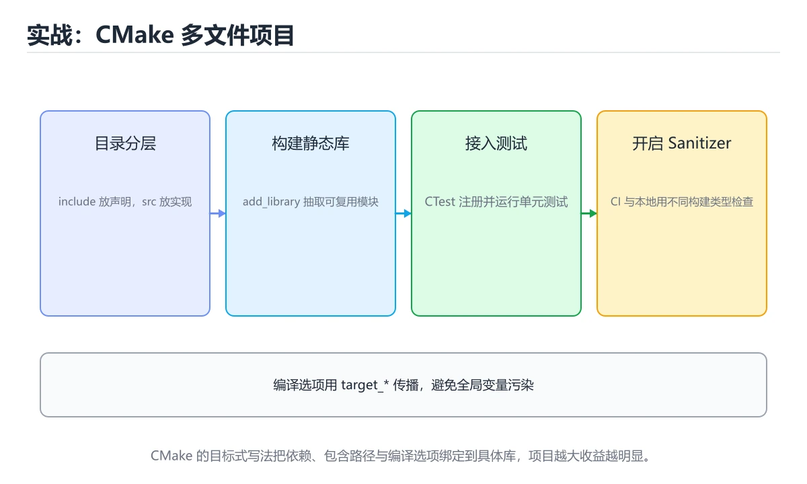
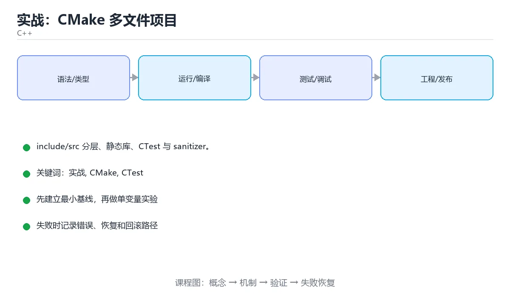

# 实战：CMake 多文件项目

> 内容更新时间：2026-10-06 · 学习阶段：高级 · 预计用时：120 分钟





## 本节知识框架

想象你要盖一栋房子。一个人搬砖、和水泥、砌墙、布线、装修全干——能盖起来，但效率低、容易出错。真正的建筑工地是怎么做的？分工：有人打地基，有人砌墙，有人走水电，最后有人验收。CMake 多文件项目的思路一模一样：把代码拆成头文件、源文件、测试、第三方库，每个部分各司其职，CMake 负责把它们「调度」起来。

本课是 C++ 工程化第一站。你将亲手搭建一个包含 `include/`、`src/`、`tests/` 三层目录的项目，用 CMake 把它编成静态库和可执行文件，再接入 CTest 跑自动化测试，最后给代码做一次「体检」——用 Sanitizer 查出内存越界和未定义行为。

**学完本课你会掌握：**
- 用 include/src 分层组织代码，让接口和实现各归各位
- 用 CMake 把代码编成静态库，让其他目标可以复用
- 用 CTest 接入自动化测试，每次提交都自动验证
- 用 AddressSanitizer 和 UndefinedBehaviorSanitizer 在编译期就抓住隐患
- 避免「头文件里 `using namespace std`」这类新手陷阱

**先修知识：** 《构建、调试与工程实践》里的 CMake 基础、gdb 调试和 vcpkg 管理依赖是本课的前提。后续课程《实战：C++ HTTP JSON 服务》会在此基础上加入网络与数据库。

### 复习清单

- [ ] 能说出 include/src 分层的好处，并解释为什么头文件不能写 `using namespace std`
- [ ] 能用 CMake 搭建一个包含静态库、可执行文件和测试的项目
- [ ] 能在 Debug 和 Release 两种模式下分别跑测试和 Sanitizer

## 核心概念定义

| 术语 | 一句话说明 |
| --- | --- |
| `ctest` | CMake 自带的测试运行器，一条命令就能跑完所有单元测试并报告结果。 |
| `实战` | 把 include/src 分层、静态库、CTest 与 Sanitizer 串成一个可交付的完整项目。 |
| `CMake 目标` | 用 `add_library` 和 `add_executable` 声明的构建单元，每个目标自带依赖和编译选项。 |
| `断言` | 测试里用 `assert` 或 `REQUIRE` 表达期望，失败时输出实际值与期望值，便于快速定位。 |

## 原理与运行机制

### 为什么要把代码拆开？

一个 `main.cpp` 塞满所有逻辑，就像把所有家具堆在客厅——能住，但找个遥控器要翻半天。C++ 项目的经典分法是：

```text
project/
├── CMakeLists.txt          # 顶层构建脚本（施工总调度）
├── include/app/            # 对外头文件（门牌号目录）
│   └── calculator.h
├── src/
│   ├── calculator.cpp      # 实现（房间内部）
│   └── main.cpp            # 程序入口（大门）
├── tests/
│   └── calculator_test.cpp # 测试（验收员）
├── third_party/            # 第三方依赖
└── build/                  # 构建产物（加入 .gitignore）
```

`include/` 放对外接口，就像菜单——顾客只看菜单点菜，不需要知道厨房里怎么做。`src/` 放具体实现，就像厨房——只有厨师（编译器）需要看到。`tests/` 独立于源码，就像质检部门——不参与生产，但负责把关。

### 第一步：写一个静态库

把核心逻辑抽成库，`main.cpp` 只做参数解析和调用。这就像把「计算」功能封装成一个独立模块，谁都能用：

```cpp
// include/stats.h
#pragma once
#include <vector>

double mean(const std::vector<double>& values);
double median(std::vector<double> values);
double stddev(const std::vector<double>& values);
```

```cpp
// src/stats.cpp
#include "stats.h"
#include <algorithm>
#include <cmath>
#include <numeric>
#include <stdexcept>

double mean(const std::vector<double>& values) {
    if (values.empty()) throw std::invalid_argument("empty");
    return std::accumulate(values.begin(), values.end(), 0.0) / values.size();
}

double median(std::vector<double> values) {
    if (values.empty()) throw std::invalid_argument("empty");
    std::sort(values.begin(), values.end());
    const auto n = values.size();
    return n % 2 ? values[n / 2] : (values[n / 2 - 1] + values[n / 2]) / 2.0;
}

double stddev(const std::vector<double>& values) {
    const double m = mean(values);
    double sum = 0.0;
    for (double v : values) sum += (v - m) * (v - m);
    return std::sqrt(sum / values.size());
}
```

### 第二步：用 CMake 把它们串起来

```cmake
cmake_minimum_required(VERSION 3.20)
project(stats LANGUAGES CXX)
set(CMAKE_CXX_STANDARD 20)
set(CMAKE_CXX_STANDARD_REQUIRED ON)
set(CMAKE_EXPORT_COMPILE_COMMANDS ON)

# 静态库：把核心逻辑封装成可复用的单元
add_library(stats_core src/stats.cpp)
target_include_directories(stats_core PUBLIC include)
target_compile_options(stats_core PRIVATE -Wall -Wextra -Wpedantic)

# 可执行文件：只做参数解析和调用
add_executable(app src/main.cpp)
target_link_libraries(app PRIVATE stats_core)

# 测试：接入 CTest
enable_testing()
add_executable(stats_test tests/stats_test.cpp)
target_link_libraries(stats_test PRIVATE stats_core)
add_test(NAME stats_test COMMAND stats_test)
```

`target_link_libraries(app PRIVATE stats_core)` 这句的意思是：app 需要用 stats_core 里的代码。就像餐厅需要厨房做好的菜——`PRIVATE` 表示这种依赖不传递给 app 的使用者。

### 第三步：写测试

```cpp
// tests/stats_test.cpp
#include "stats.h"
#include <cassert>
#include <iostream>

int main() {
    assert(std::abs(mean({1, 2, 3}) - 2.0) < 1e-9);
    assert(std::abs(median({3, 1, 2}) - 2.0) < 1e-9);
    assert(std::abs(median({4, 1, 2, 3}) - 2.5) < 1e-9);
    std::cout << "all tests passed\n";
}
```

测试里用 `assert` 表达期望——「我认为 `mean({1,2,3})` 应该等于 2.0」。如果实际值不等于期望值，程序立刻崩溃并告诉你哪一行出了问题。这就是断言的力量：失败时输出实际值与期望值，便于快速定位。

### 第四步：开启 Sanitizer 做体检

Sanitizer 就像给代码做 X 光——编译时插入检查代码，运行时自动报告内存问题。

| Sanitizer | 查什么 | 编译参数 |
| --- | --- | --- |
| AddressSanitizer (ASan) | 数组越界、释放后使用、内存泄漏 | `-fsanitize=address` |
| UndefinedBehaviorSanitizer (UBSan) | 整数溢出、空指针解引用、未对齐访问 | `-fsanitize=undefined` |
| ThreadSanitizer (TSan) | 数据竞争 | `-fsanitize=thread` |

在 CMake 项目中开启 AddressSanitizer 和 UndefinedBehaviorSanitizer，最合理的做法是在 Debug/CI 构建中开启并链接运行时：

```bash
g++ -fsanitize=address,undefined -g -std=c++20 src/stats.cpp src/main.cpp -o app
```

注意：ASan 与 TSan 不能同时开，需要分成两个预设分别跑。

### 运行整个项目

```bash
cmake -S . -B build -G Ninja -DCMAKE_BUILD_TYPE=Debug
cmake --build build -j
ctest --test-dir build --output-on-failure
```

### 新手最容易踩的坑

| 坑 | 现象 | 正确做法 |
| --- | --- | --- |
| 头文件里 `using namespace std` | 污染使用方，别的文件包含后名字冲突 | 写全限定名 `std::vector` |
| 目录结构混乱 | 找不到头文件 | `include/` 与 `src/` 分离 |
| 每次手工敲编译参数 | 结果不一致 | 用 CMakePresets.json |
| 不开警告 | 隐患积累 | `-Wall -Wextra -Werror` |
| 只在 Release 测 | 断言被优化掉 | Debug 与 Release 都跑 |
| 依赖版本不固定 | 今天能编明天不行 | 固定 tag 或用 vcpkg 清单 |

## 典型应用场景

### 场景一：统计计算库

本课的核心示例就是一个「统计计算库」——接受一组数字，算出均值（`mean`）、中位数（`median`）和标准差（`stddev`）。代码被拆成头文件（`include/stats.h`）和实现（`src/stats.cpp`），测试独立放在 `tests/` 目录下。

### 场景二：日志解析器

把同样的模式用在一个更实际的项目上——日志解析库 `logparser`：

```text
logparser/
  CMakeLists.txt
  CMakePresets.json
  include/logparser/parser.hpp
  src/parser.cpp
  tests/parser_test.cpp
  benchmarks/parse_bench.cpp
  cmake/
```

`include/` 暴露给使用方，`src/` 只放实现。这就是 include/src 分层的核心思想。

### 场景三：CI 集成

把单元测试接入 CI 的主要价值是每次提交自动验证——代码一推上去，CI 自动跑 `cmake --build` + `ctest` + sanitizer，有问题立刻报警，不用等到人工发现。

```yaml
name: cpp-ci
on: [push, pull_request]
jobs:
  build-and-test:
    strategy:
      matrix:
        preset: [debug, release, asan]
    runs-on: ubuntu-latest
    steps:
      - uses: actions/checkout@v4
      - run: cmake --preset ${{ matrix.preset }}
      - run: cmake --build build/${{ matrix.preset }} -j
      - run: ctest --test-dir build/${{ matrix.preset }} --output-on-failure
```

### 项目专属规格

本项目目标是把「实战、CMake、CTest、sanitizer、工程结构」落实为可运行、可测试、可回滚的交付物。核心场景：include/src 分层、静态库、CTest 与 sanitizer。

验收场景：
1. 正常路径：最小输入得到预期输出，并留下日志与指标
2. 边界路径：把 `CMAKE_CXX_STANDARD` 的输入推到上下限，确认返回结果可解释
3. 失败路径：依赖超时或不可用时能快速失败、重试或降级
4. 幂等路径：同一请求执行两次不会产生重复副作用
5. 回滚路径：实战回滚后数据一致，且能说明恢复时间和影响范围

### 项目交付物

建议仓库结构：

```text
src/
include/
tests/
CMakeLists.txt
CMakePresets.json
.gitignore
```

### 验证命令与预期输出

| 阶段 | 命令 | 预期输出 |
| --- | --- | --- |
| 配置构建 | `cmake -S . -B build -DCMAKE_BUILD_TYPE=Debug` | 生成 CMake 缓存且无错误 |
| 编译 | `cmake --build build --parallel` | 目标全部编译成功且无警告 |
| 运行测试 | `ctest --test-dir build --output-on-failure` | 所有 CTest 用例通过 |

## 代码/协议/SQL 示例

### 完整 CMakeLists.txt 参考

```cmake
cmake_minimum_required(VERSION 3.20)
project(code_learn LANGUAGES CXX)

set(CMAKE_CXX_STANDARD 20)
set(CMAKE_CXX_STANDARD_REQUIRED ON)
set(CMAKE_EXPORT_COMPILE_COMMANDS ON)

add_library(calc STATIC src/calculator.cpp)
target_include_directories(calc PUBLIC include)
target_compile_options(calc PRIVATE -Wall -Wextra -Werror)

add_executable(app src/main.cpp)
target_link_libraries(app PRIVATE calc)

enable_testing()
add_executable(calc_test tests/calculator_test.cpp)
target_link_libraries(calc_test PRIVATE calc)
add_test(NAME calc_test COMMAND calc_test)
```

### 测试与 CI 速查

| 目的 | 做法 |
| --- | --- |
| 单元测试框架 | GoogleTest、Catch2、doctest |
| 运行测试 | `ctest --test-dir build --output-on-failure` |
| 覆盖率 | `-fprofile-instr-generate -fcoverage-mapping` 或 gcov |
| 静态检查 | clang-tidy + `compile_commands.json` |
| 流水线步骤 | 配置 → 构建 → 测试 → 静态检查 → 打包 |

### 代码阅读：示例中的关键调用

在这个统计库的示例里，`mean()` 函数调用了 `begin()` 和 `end()` 获取迭代器，用 `std::accumulate()` 求和，然后除以 `values.size()` 得到均值。`median()` 函数先排序再取中间值。`stddev()` 函数先算均值，再算每个值与均值的差的平方和。这些函数都通过 `empty()` 检查空输入并抛出 `invalid_argument` 异常。

```cpp
// 关键代码片段：mean 函数
double mean(const std::vector<double>& values) {
    if (values.empty()) throw std::invalid_argument("empty");
    return std::accumulate(values.begin(), values.end(), 0.0) / values.size();
}
```

## 时间/空间复杂度或性能分析

**构建性能**：CMake 的增量构建只重新编译修改过的文件。项目越大，include/src 分层的优势越明显——改一个 `.cpp` 不会重新编译所有头文件。

**测试性能**：`ctest` 支持并行执行测试（`-j` 参数），10 个测试文件用 4 核跑，时间大约缩短到 1/3。

**Sanitizer 开销**：ASan 会让程序慢 2-3 倍，内存占用翻倍。所以只在 Debug 和 CI 中开启，Release 发布时关掉。

**测量方法**：固定输入跑一遍记录基线，再把项目规模提高一个数量级复测；两次结果的差值才是结论依据。Debug 与 Release 分别测量，因为优化等级会显著影响结果。

## 常见误区与易错点

| 容易写错的做法 | 实际现象 | 原因与正确做法 |
| --- | --- | --- |
| 头文件里 `using namespace std` | 污染使用方，名字冲突 | 写全限定名 `std::vector` |
| 目录结构混乱 | 找不到头文件 | `include/` 与 `src/` 分离 |
| 每次手工敲编译参数 | 结果不一致 | 用 CMakePresets.json |
| 不开警告 | 隐患积累 | `-Wall -Wextra -Werror` |
| 只在 Release 测 | 断言被优化掉 | Debug 与 Release 都跑 |
| 不跑 Sanitizer | 越界与泄漏漏检 | CI 加 asan 预设 |
| 依赖版本不固定 | 今天能编明天不行 | 固定 tag 或用 vcpkg 清单 |
| 忘记提交 `.clang-format` | 格式各写一套 | 提交配置文件到仓库 |
| 测试可执行文件找不到头文件 | 编译报错 | 用 `target_include_directories` 声明 |
| `main.cpp` 里塞满业务逻辑 | 无法测试 | 逻辑抽到库，`main` 只做编排 |

### 现场排错：头文件里 `using namespace std`

**症状**：某个文件包含了你的头文件后，突然出现一堆「ambiguous」编译错误。

**根因**：`using namespace std` 会把 `std` 里所有名字倒进全局命名空间，污染所有包含这个头文件的源文件。

**修复**：把头文件里的 `using namespace std` 删掉，改成写全限定名 `std::vector`、`std::string` 等。如果实在想偷懒，可以在 `.cpp` 文件内部局部使用，但绝不要放在 `.h` 里。

### 现场排错：只在 Release 测

**症状**：本地 Release 跑得好好的，CI 的 Debug 构建却崩溃了。

**根因**：`assert` 在 Release 模式下可能被预处理器优化掉（`NDEBUG` 宏），测试形同虚设。

**修复**：Debug 与 Release 都跑测试。用 CMake 的不同构建类型分别验证。

## 与其他知识点的关系

- **先修**：《构建、调试与工程实践》。本课默认你已经会用 CMake 编译单个文件、用 gdb 设断点、用 vcpkg 装依赖。
- **后续**：《实战：C++ HTTP JSON 服务》。下一课会在这个项目骨架上加网络服务和数据库。
- **术语衔接**：《构建、调试与工程实践》里的 `CMake` 和 `sanitizer` 在本课继续使用，但本课更强调工程组织——不只是「怎么编」，而是「怎么组织一个多人协作的项目」。

### 知识脉络

```text
构建、调试与工程实践（单文件编译、gdb、vcpkg）
    ↓
实战：CMake 多文件项目（include/src 分层、静态库、CTest、Sanitizer）  ← 你在这里
    ↓
实战：C++ HTTP JSON 服务（网络服务、JSON API、线程安全）
```

## 自测题与参考答案

> 先独立作答，再对照参考答案。

### 自测 1：include/src 分层的好处是什么？

**参考答案**：头文件放接口（`include/`），实现放源文件（`src/`）。好处是：使用方只需要看头文件就知道怎么用，不需要关心实现细节；修改实现不需要重新编译所有使用方；避免循环依赖。

### 自测 2：为什么头文件不能写 `using namespace std`？

**参考答案**：头文件会被多个 `.cpp` 文件包含。如果头文件里写了 `using namespace std`，所有包含它的文件都会被「污染」——`std::vector` 和可能自定义的 `vector` 产生名字冲突。正确做法是在头文件里写全限定名。

### 自测 3：`target_link_libraries(app PRIVATE fmt)` 的作用是什么？

**参考答案**：给 app 目标声明需要链接的库及其传递属性。`PRIVATE` 表示 fmt 只是 app 自己的依赖，不会传递给使用 app 的其他目标。

### 自测 4：怎么在 CMake 项目里开启 Sanitizer？

**参考答案**：在 Debug/CI 构建中开启并链接运行时。具体做法是给目标添加编译选项 `-fsanitize=address,undefined`，或者用 CMakePresets.json 定义一个 asan 预设。

### 自测 5：把单元测试接入 CI 的主要价值是什么？

**参考答案**：每次提交自动验证。开发者推代码后，CI 自动跑 `cmake --build` + `ctest` + sanitizer，有问题立刻报警，不用等到人工发现。

## 考点精讲

本课题库有 6 道题，下面逐题讲解。先自己试着回答，再核对答案。

### 考点 1

- **题目**：围绕“实战：CMake 多文件项目”中的 实战、CMake、CTest，下列哪两项是本课强调的实践判断？

**答案**：学习 实战 时要同时说明输入、输出和失败路径，不能只看正常流程；验证 CMake 时要固定版本并覆盖边界输入，结论才可复现

**讲解**：「实战」不只是跑通代码，还要能说清什么输入会产生什么输出、什么条件会导致失败。「CMake」验证要固定版本号，因为不同版本的 CMake 行为可能有差异。

### 考点 2

**题目**：这段 `cpp` 代码对应 `实战：CMake 多文件项目` 的 `ctest`。课程要解决的是include/src 分层、静态库、CTest 与 sanitizer。关于代码内容，哪一项说法准确？

**答案**：调用了 `begin()`

**讲解**：在 `mean()` 函数的实现中，`std::accumulate(values.begin(), values.end(), 0.0)` 调用了 `begin()` 来获取迭代器起点。这是统计库代码中一个关键的 STL 调用。

### 考点 3

**题目**：在 CMake 项目中开启 AddressSanitizer 和 UndefinedBehaviorSanitizer，最合理的做法是？

**答案**：在 Debug/CI 构建中开启并链接运行时

**讲解**：Sanitizer 会带来 2-3 倍的性能开销，所以不适合在 Release 中开启。最佳实践是用 CMakePresets 定义一个专门的 asan 预设，在 Debug 和 CI 中使用。

### 考点 4

**题目**：CMake 中 target_link_libraries(app PRIVATE fmt) 的作用是？

**答案**：给 app 目标声明需要链接的库及其传递属性

**讲解**：`target_link_libraries` 是现代 CMake 的核心命令之一。`PRIVATE` 关键字表示这个依赖不会传递给 app 的使用者——只有 app 自己需要 fmt。

### 考点 5

**题目**：把单元测试接入 CI 的主要价值是？

**答案**：每次提交自动验证

**讲解**：CI 的核心价值不是「跑得快」，而是「每次改动都自动验证」。没有 CI，测试只能靠人记得去跑——而人总会忘记。

### 考点 6

**题目**：填空：补齐下面这段术语说明中的空缺。课程 `include/src 分层、静态库、CTest 与 sanitizer。`，这段说明是：测试里用`____`表达期望，失败时输出实际值与期望值，便于快速定位。空缺处应填哪个术语？

**答案**：断言

**讲解**：断言（assert）是测试的基础设施。`assert(std::abs(mean({1,2,3}) - 2.0) < 1e-9)` 就是在说「我认为结果应该接近 2.0，如果不是就报错」。

## 延伸阅读

想更直观地理解本课概念？推荐参阅以下图解专题：

- [图解一次网页请求的完整链路](visual_http_timeline.md)

## 术语速查

| 术语 | 一句话说明 |
| --- | --- |
| `ctest` | CMake 自带的测试运行器，一条命令跑完所有单元测试。 |
| `CMake 目标` | 用 `add_library` 或 `add_executable` 声明的构建单元，自带依赖和编译选项。 |
| `断言` | 测试里用 assert 表达期望，失败时输出实际值与期望值。 |
| `CMakePresets` | 用 JSON 文件固定构建参数，团队成员不用手工敲编译选项。 |
| `Sanitizer` | 编译时插入检查代码，运行时自动检测内存越界、泄漏和未定义行为。 |
| `FetchContent` | CMake 内置的依赖下载机制，小项目用它代替 vcpkg 也够用。 |

## 内容元数据

- 内容版本：v2.0
- 最后更新：2026-10-06
- 学习阶段：高级
- 适用环境：C++20 / GCC 13+ 或 Clang 17+
- 内容来源：内置结构化课程与工程实践整理
- 相关主题：实战、CMake、CTest、sanitizer、工程结构

## 参考资料与复核

- [本课资料锚点 cpp_project](https://zh.wikipedia.org/w/index.php?search=cpp_project)

- 最后复核：2026-10-04
- 下次复核：2027-05-10
- 复核范围：CMake 版本兼容、Sanitizer 行为、CTest 配置与工程实践
- 来源性质：官方文档、标准或权威教材

| 参考资料 | 本课用途 |
| --- | --- |
| [Catch2 文档](https://catchorg.github.io/Catch2/latest/) | 单元测试框架的使用方法与最佳实践 |
| [C++ 核心指南](https://isocpp.github.io/CppCoreGuidelines/) | 工程规范、命名约定与资源管理 |
| [GCC 在线文档](https://gcc.gnu.org/onlinedocs/) | 编译器选项、Sanitizer 参数与警告控制 |
