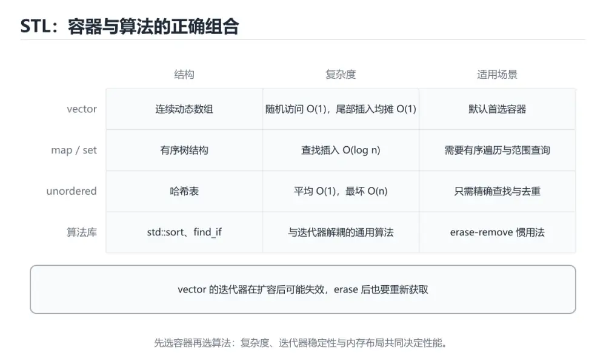
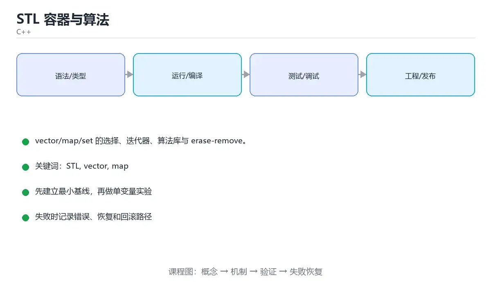

# STL 容器与算法





> 内容更新时间：2026-10-06 · 学习阶段：进阶 · 预计用时：50 分钟

## 本节知识框架

STL 的设计思路其实很简单：**把「存数据」和「处理数据」分开**。

想象一个厨房：
- **容器**（vector、map、set）是各种收纳盒——有的按顺序排（vector），有的按标签找（map），有的自动去重（set）。
- **迭代器**是你的手指——指向收纳盒里的某个位置，能前后移动。
- **算法**（sort、find、transform）是加工机器——不管食材从哪个收纳盒来，只要手指能指到，机器就能加工。

三者用统一的接口拼在一起，所以你学会一套就能通用。不确定用什么容器？先选 `vector`，它就像厨房里的万能砧板。

本课主线：**vector/map/set 的选择、迭代器、算法库与 erase-remove**。

学完这课你会：
- 知道什么时候用 vector、什么时候用 map 或 unordered_map
- 理解迭代器失效的原因和预防方法
- 熟练使用 sort、find、accumulate 等常用算法

## 核心概念定义

| 术语 | 一句话说明 |
| --- | --- |
| STL | 标准模板库，把「存数据」（容器）和「处理数据」（算法）通过迭代器连接起来。 |
| vector | C++ 标准库中的动态数组，连续存储元素并支持自动扩容。默认容器首选。 |
| 迭代器 | 容器与算法之间的统一接口，像一个能前后移动的手指，指向某个元素。 |
| algorithm | C++ 标准库算法头文件 `<algorithm>`，提供排序、查找、变换等泛型算法。 |
| erase-remove | 删除容器中满足条件元素的惯用法：先用 `remove_if` 移动元素，再用 `erase` 截断。 |
| 迭代器失效 | 容器结构变化（如扩容、插入、删除）后，原有迭代器不再有效，继续使用会崩溃。 |
| map | 按键排序的关联容器，底层通常是红黑树，查找 O(log n)，能有序遍历。 |
| unordered_map | 哈希表实现的关联容器，无序但平均 O(1) 查找，需要键可哈希且可比较。 |

## 原理与运行机制

### 容器选型：不确定就用 vector

选容器的思路就像选收纳工具：

1. **不确定就用 `vector`**——连续内存、缓存友好、随机访问快。
2. **需要按键查找** → `unordered_map`（无需有序，最快）或 `map`（需要有序遍历）。
3. **需要去重** → `set` / `unordered_set`。
4. **频繁在中间插删** → `list`（但缓存不友好，往往仍不如 vector）。

| 容器 | 结构 | 查找 | 插入删除 | 典型用途 |
| --- | --- | --- | --- | --- |
| `vector` | 动态数组 | O(n) | 尾部 O(1) | **默认选择** |
| `deque` | 双端队列 | O(n) | 两端 O(1) | 双端进出 |
| `list` | 双向链表 | O(n) | 已知位置 O(1) | 频繁中间插入 |
| `map` / `set` | 红黑树 | O(log n) | O(log n) | 需要有序 |
| `unordered_map` | 哈希表 | 平均 O(1) | 平均 O(1) | 需要极速查找 |
| `array` | 固定数组 | O(n) | 长度不可变 | 编译期确定大小 |

### vector 扩容：capacity 为什么总比 size 大

`size()` 是住了多少人，`capacity()` 是房子能住多少人。人满了就换一间更大的房子，把所有人搬过去、旧房退租——这一步既分配又搬家，还会让所有指向旧地址的指针、引用、迭代器同时失效。

```cpp
#include <iostream>
#include <vector>

int main() {
    std::vector<int> v;
    std::size_t last = v.capacity();
    for (int i = 0; i < 10; ++i) {
        v.push_back(i);
        if (v.capacity() != last) {
            std::cout << "size=" << v.size() << " capacity=" << v.capacity() << '\n';
            last = v.capacity();
        }
    }
}
```

典型输出是 1、2、4、8、16：libstdc++ 与 libc++ 按 2 倍增长，MSVC 按 1.5 倍。为什么不是每次 +1？按倍数增长时搬运总量是 n + n/2 + n/4 + … < 2n，均摊到每次 `push_back` 就是 O(1)；按 +1 增长则总拷贝次数退化成 O(n²)。

三条实用推论：

- 已知规模就 `reserve(n)`，一次分配到位，后续 `push_back` 不再触发扩容。
- `clear()` 只把 size 归零，capacity 原封不动；真想还内存用 `shrink_to_fit()`（非强制）或 `std::vector<T>(v).swap(v)`。
- `reserve` 之后 `size()` 仍然是 0，别拿它当「已有多少元素」用。

### 迭代器：容器与算法的桥梁

迭代器是容器与算法之间的统一接口。不管数据存在 vector 还是 list 里，只要提供迭代器，算法就能工作。

```cpp
for (auto it = nums.begin(); it != nums.end(); ++it) {
    std::cout << *it << ' ';
}

nums.erase(std::remove(nums.begin(), nums.end(), 1), nums.end());  // erase-remove
```

注意：修改容器结构（如 `push_back`）可能让迭代器失效。

### 迭代器失效规则速查

| 容器 | 插入 | 删除 | 补充 |
| --- | --- | --- | --- |
| `vector` | 扩容则全部失效；否则插入点之后的失效 | 删除点及之后失效 | `reserve` 后尾部插入只有 `end()` 变 |
| `deque` | 两端插入使迭代器失效，引用仍有效 | 两端删除只失效被删的 | 中间插入/删除全部失效 |
| `list` / `forward_list` | 都不失效 | 只有被删元素失效 | 适合「边遍历边删」 |
| `map` / `set` | 都不失效 | 只有被删元素失效 | 节点式存储，元素地址稳定 |
| `unordered_*` | rehash 时迭代器全部失效 | 只有被删元素失效 | rehash 后指针与引用仍有效 |

「插入一定失效」是常见误解：`vector` 不扩容时，插入点之前的迭代器照样能用。反过来，`unordered_map` 的引用在 rehash 后仍然有效（标准明确保证），失效的只有迭代器——两者要分开记。

```cpp
#include <vector>

void removeEvens(std::vector<int>& v) {
    for (auto it = v.begin(); it != v.end(); ) {
        if (*it % 2 == 0) it = v.erase(it);   // 用返回值接住新位置
        else ++it;
    }
}
```

`erase` 返回被删元素的下一个位置；写成 `v.erase(it); ++it;` 时 `it` 已经失效，`++it` 就是未定义行为。

### 算法库：加工机器

```cpp
#include <algorithm>
#include <numeric>

std::sort(nums.begin(), nums.end());                   // 升序
auto it = std::find(nums.begin(), nums.end(), 4);      // 查找
int total = std::accumulate(nums.begin(), nums.end(), 0); // 累加
std::reverse(nums.begin(), nums.end());                 // 反转
auto [min_it, max_it] = std::minmax_element(nums.begin(), nums.end());

bool all_positive = std::all_of(nums.begin(), nums.end(),
                                [](int x) { return x > 0; });
```

### lambda 与算法配合

```cpp
std::vector<std::string> names{"tom", "alice", "bob"};

std::sort(names.begin(), names.end(),
          [](const std::string& a, const std::string& b) {
              return a.size() < b.size();
          });

auto count = std::count_if(names.begin(), names.end(),
                           [](const auto& n) { return n.size() > 3; });
```

### erase-remove 为什么要两步

算法只通过迭代器读写元素，拿不到容器所有权，**不能改变长度**。`std::remove_if` 把要留的元素逐个往前挪、把该删的挤到尾部，再返回新的逻辑末尾；真正的删除必须由容器自己做：

```cpp
std::vector<int> v{1, 2, 3, 4, 5, 2};
auto nxt = std::remove_if(v.begin(), v.end(), [](int x) { return x == 2; });
// 此刻 v.size() 仍是 6，尾部是 {1,3,4,5,2,2} 这类残留值
v.erase(nxt, v.end());          // 现在才是真的删掉，size() 变成 4
```

C++20 把这两步封成了一个函数，读起来更直白，也不再有人漏掉 `erase`：

```cpp
std::erase_if(v, [](int x) { return x % 2 == 1; });
```

另外 `list` 请用它自己的成员函数 `lst.remove(2)`，一次调用真删且沿途迭代器不失效。

### 自定义类型当键：两种容器要求不同

`map` 只要能「比大小」，写一个比较器丢进第三个模板参数即可；`unordered_map` 同时要能「算哈希」和「判等」——既要特化 `std::hash<Point>`（提供 `operator()` 且标 `noexcept`），又要给出 `operator==`，缺一个就在编译期报错。哈希函数把键映到桶编号，`operator==` 用来在同一桶内确认是不是同一个键，两者职责不同，不能互相替代。

### ranges 视图：不拷贝的流水线

传统算法每一步要么原地改容器，要么生成一个新容器；视图（view）只描述「怎么取」，元素一个都不复制，遍历到哪算到哪。像在水管上装滤网和加压泵，水还是那根管子里的水。

```cpp
#include <iostream>
#include <ranges>
#include <vector>

int main() {
    std::vector<int> nums{1, 2, 3, 4, 5, 6, 7, 8};

    auto view = nums
              | std::views::filter([](int x) { return x % 2 == 0; })
              | std::views::transform([](int x) { return x * x; })
              | std::views::take(3);

    for (int v : view) std::cout << v << ' ';   // 4 16 36
}
```

要点是三条：视图是**惰性**的，构造 `view` 时没有做任何计算，遍历几次就算几次；视图**不拥有数据**，源容器销毁后再用就是悬垂；`filter` 里捕获的 lambda 同样受生命周期约束。常用的还有 `views::reverse`、`views::drop`、`views::iota`、`views::join`，C++23 补上了 `views::enumerate` 与 `views::zip`。

### optional 与 variant：把「可能没有」写进类型

函数「找不到」有几种老办法：返回 -1（那 -1 是合法值怎么办）、返回指针（谁 new、谁释放）、抛异常（这真的算异常吗）。`std::optional<T>` 把「有值 / 没有值」写进类型，调用方必须显式处理。

```cpp
#include <iostream>
#include <optional>
#include <string>
#include <variant>

std::optional<int> parsePort(const std::string& s) {
    try {
        return std::stoi(s);        // 有值
    } catch (...) {
        return std::nullopt;        // 没有值，不把异常甩给调用方
    }
}

using Field = std::variant<int, double, std::string>;

void print(const Field& f) {
    std::visit([](const auto& v) { std::cout << v << '\n'; }, f);
}
```

| 类型 | 表达什么 | 空间开销 | 典型用法 |
| --- | --- | --- | --- |
| `T*` | 可能没有对象 | 8 字节 | 指向已有对象，不表达所有权 |
| `std::optional<T>` | 可能有一个 `T` | `sizeof(T)` + 对齐填充 | 函数返回值 |
| `std::variant<A,B,C>` | 恰好是其中之一 | 最大成员 + 判别标签 | 替代小规模类层次 |

`std::optional<T&>` 不合法（引用必须绑定到对象），需要「可能没有的引用」就用指针或 `std::reference_wrapper`。`variant` 的大小由最大成员决定，别把它和巨大的类型塞在一起，否则每个值都要为那个最大成员买单。

### allocator：容器的内存从哪来

容器自己不直接 `new`，而是通过分配器申请内存。分配器是容器背后的仓管：`allocate(n)` 给一块能放 n 个元素的原始内存，`deallocate` 收回去，元素的构造与析构由容器另外调用。换分配器就能换掉整套内存来源，这正是 `std::pmr`（多态内存资源）的用途。

```cpp
#include <cstddef>
#include <memory_resource>
#include <vector>

int main() {
    alignas(std::max_align_t) char buffer[4096];
    std::pmr::monotonic_buffer_resource pool{buffer, sizeof buffer};
    std::pmr::vector<int> nums{&pool};        // 内存只来自上面这块栈空间

    for (int i = 0; i < 10; ++i) nums.push_back(i);
    return static_cast<int>(nums.size()) - 10;   // 0
}
```

`monotonic_buffer_resource` 只把指针往前推、不做回收，析构时一次性释放，所以 `push_back` 几乎没有分配开销，适合「活一小段时间、元素很多」的场合。注意 `std::pmr::vector<int>` 与 `std::vector<int>` 是**不同类型**，不能直接互相赋值；跨类型传数据用迭代器或 `span`，或者在接口层统一用 `pmr`。

## 典型应用场景

- **默认排序容器**：用 `vector` + `std::sort`。
- **词频统计**：用 `unordered_map<string, int>`。
- **需要有序遍历**：用 `map` 或先 sort vector。
- **删除满足条件的元素**：用 erase-remove 惯用法或 C++20 的 `std::erase_if`。

## 代码/协议/SQL 示例

### 基本容器操作

```cpp
#include <vector>
#include <unordered_map>
#include <string>

std::vector<int> nums{3, 1, 2};
nums.push_back(4);
nums[0] = 9;

std::unordered_map<std::string, int> ages;
ages["小明"] = 18;
if (auto it = ages.find("小明"); it != ages.end()) {
    std::cout << it->second;
}
```

### 一段代码走完常用操作

```cpp
#include <algorithm>
#include <iostream>
#include <map>
#include <numeric>
#include <string>
#include <unordered_map>
#include <vector>

int main() {
    std::vector<int> nums{5, 3, 1, 4, 2};
    std::sort(nums.begin(), nums.end());
    auto it = std::find(nums.begin(), nums.end(), 4);
    int sum = std::accumulate(nums.begin(), nums.end(), 0);
    std::cout << "sum=" << sum << " found=" << *it << '\n';

    std::unordered_map<std::string, int> freq;
    for (const auto& word : {"a", "b", "a", "c", "a"}) {
        ++freq[word];
    }
    for (const auto& [word, count] : freq) {
        std::cout << word << '=' << count << ' ';
    }
    std::cout << '\n';

    std::map<std::string, int> ordered(freq.begin(), freq.end());
    for (const auto& [word, count] : ordered) {
        std::cout << word << ':' << count << ' ';
    }
}
```

### 词频统计前五名

```cpp
#include <algorithm>
#include <iostream>
#include <sstream>
#include <string>
#include <unordered_map>
#include <vector>

int main() {
    const std::string text = "the quick brown fox jumps over the lazy dog the fox";
    std::unordered_map<std::string, int> freq;

    std::istringstream stream(text);
    for (std::string word; stream >> word; ) {
        ++freq[word];
    }

    std::vector<std::pair<std::string, int>> items(freq.begin(), freq.end());
    std::sort(items.begin(), items.end(), [](const auto& a, const auto& b) {
        return a.second != b.second ? a.second > b.second : a.first < b.first;
    });

    for (std::size_t i = 0; i < std::min<std::size_t>(5, items.size()); ++i) {
        std::cout << items[i].first << ": " << items[i].second << '\n';
    }
    std::cout << "unique words: " << freq.size() << '\n';
}
```

编译运行：`g++ -std=c++17 wordcount.cpp -o wordcount && ./wordcount`

### 性能与安全习惯

```cpp
std::vector<int> v;
v.reserve(1000);          // 预分配，避免多次扩容与拷贝
v.push_back(1);
v.emplace_back(2);        // 原地构造，少一次移动
v.at(0);                  // 带越界检查，越界抛异常
v[0];                     // 不检查，追求速度时用
```

### 迭代器失效的现场复现

```cpp
std::vector<int> v{1, 2, 3};
auto it = v.begin();
v.push_back(4);          // 可能触发扩容，it 从此指向已释放的旧缓冲区
std::cout << *it;        // 未定义行为：Debug 版直接断言，Release 版随机崩溃
```

改成先 `v.reserve(8);` 再 `push_back` 就没事——「插入不一定失效，扩容才失效」这条可以自己验证。练习：把 `*it` 换成 `v[0]` 再跑一次，比较结果。

## 时间/空间复杂度或性能分析

各容器和算法的复杂度是选择容器的关键依据：

| 操作 | vector | map | unordered_map |
| --- | --- | --- | --- |
| 随机访问 | O(1) | O(log n) | 平均 O(1) |
| 插入（尾部/键） | 尾部均摊 O(1) | O(log n) | 平均 O(1) |
| 查找 | O(n) | O(log n) | 平均 O(1) |
| 删除 | O(n) | O(log n) | 平均 O(1) |

- **sort**：平均 O(n log n)
- **find**：O(n)
- **lower_bound**（需已排序）：O(log n)
- **accumulate**：O(n)

性能建议：已知规模就 `reserve`；传容器用 `const&` 避免拷贝；`emplace_back` 比 `push_back` 少一次移动。

### 哈希表的隐藏常数

`unordered_map` 的 O(1) 只描述「桶定位」，每个元素的真实成本还包括：一个节点的堆分配（键、值、next 指针）、一次指针追逐、一次键比较。规模只有几十个键时，`map` 往往更快——节点少，遍历时的局部性反而更好。

- **负载因子**：默认 1.0，元素数超过「桶数 × 负载因子」就 rehash，桶数组整体重建，迭代器全部失效。
- **预留**：`reserve(n)` 按当前负载因子一次开够桶，避免边插边 rehash。
- **调松**：`max_load_factor(0.7f)` 让桶更稀疏、冲突更少，代价是内存。要先调负载因子再 `reserve`，否则预留的桶数还是按旧值算的。
- **键的哈希**：`std::string` 键每次求哈希都要扫一遍字符，热路径上可以改用 `string_view` 或整数 ID 当键。

## 常见误区与易错点

| 容易写错的做法 | 实际现象 | 原因与正确做法 |
| --- | --- | --- |
| 扩容后继续用旧迭代器 | 迭代器失效，崩溃 | 扩容后重新获取迭代器 |
| 遍历中删元素 | 迭代器失效 | 用 erase 的返回值或 erase_if |
| 在 `unordered_map` 里存自定义键 | 编译错误 | 提供 `std::hash` 与 `operator==` |
| 用 `map` 当极速查找 | 比哈希慢 | 无顺序需求就用 `unordered_map` |
| 忘了 `reserve` | 反复扩容影响性能 | 已知规模就预留 |
| `vector<bool>` 当普通容器 | 行为特殊 | 用 `deque<bool>` 或 `vector<char>` |
| 用 `[]` 越界访问 | 未定义行为 | 关键路径用 `at()` |
| 拷贝大容器 | 性能差 | 传 `const&`，或用移动 |
| 以为 `remove_if` 已经删掉了元素 | 容器长度不变，尾部留着旧值 | 再 `erase` 到 `end()`，或直接用 C++20 的 `std::erase_if` |
| 在 `set` / `map` 上用 `operator[]` | 编译不过，或凭空插入一个默认值 | 关联容器改用 `find`、`count` 或 `contains` |

### 比较器必须是严格弱序

`sort`、`map`、`set` 都要求比较器构成**严格弱序**：`comp(x, x)` 必须为假、传递性成立，并且能区分「小于」与「等价」。最常见的错误是把 `<=` 当比较器——它让 `comp(x, x)` 为真，快排的分区会越界，MSVC 的 Debug 版直接抛 `invalid comparator`，Release 版则可能悄悄写坏内存。

```cpp
std::sort(v.begin(), v.end(), [](int a, int b) { return a > b; });    // 降序，正确
std::sort(v.begin(), v.end(), [](int a, int b) { return a >= b; });   // 错误：不是严格弱序
```

多字段排序也别写成 `a.x <= b.x && a.y <= b.y`，用 `std::tie` 逐字段做字典序比较，语义和正确性都不用自己操心：

```cpp
std::sort(people.begin(), people.end(), [](const Person& a, const Person& b) {
    return std::tie(a.age, a.name) < std::tie(b.age, b.name);
});
```

另一个隐蔽的坑：比较器里捕获了会在排序期间变化的变量（比如 `std::sort` 内部又改了计数器），会让同一元素在不同时刻比出不同结果，同样违反严格弱序。比较器应当是纯函数。

## 与其他知识点的关系

- **先修**：《模板与泛型编程》——STL 的容器和算法全是模板实现的。
- **后续**：《现代 C++ 特性》——C++17/20 给 STL 加了 `string_view`、`span`、`erase_if` 等新接口。
- **术语衔接**：本课的 `STL`、`vector`、`迭代器` 在后续课程中会继续使用。
- **关联**：《C++ Concepts 与 Ranges》——Ranges 是 STL 算法的下一代写法。

## 自测题与参考答案

### 自测 1

vector 和 map 的区别是什么？什么时候用哪个？

**参考答案**：`vector` 是动态数组，随机访问 O(1)，查找 O(n)。`map` 是红黑树，查找 O(log n)，自动按键排序。不确定就用 vector；需要按键查找用 unordered_map；需要有序遍历用 map。

### 自测 2

什么是迭代器失效？怎么避免？

**参考答案**：容器结构变化（如 push_back 触发扩容、erase 删除元素）后，原有迭代器不再指向有效位置。避免方法：扩容后重新获取迭代器；遍历时用 erase 的返回值更新迭代器。

### 自测 3

erase-remove 惯用法是怎么工作的？

**参考答案**：`std::remove_if` 把不需要删除的元素移到前面，返回新的逻辑末尾迭代器。然后 `vector::erase` 从该位置截断到 `end()`，真正删除多余元素。C++20 起可以直接用 `std::erase_if`。

## 考点精讲

本课的题库有 6 道题，下面逐题讲解。

### 考点 1

**题目**：`STL 容器与算法` 的示例代码用于验证 `STL`，其背景是vector/map/set 的选择、迭代器、算法库与 erase-remove。代码的真实内容是下面哪一项？

**正确项**：调用了 `reverse()`

**讲解**：本课的示例代码中出现了 `std::reverse()` 算法调用，展示了 STL 算法库的用法。

### 考点 2

- **题目**：围绕“STL 容器与算法”中的 STL、vector、map，下列哪两项是本课强调的实践判断？

**正确项**：
- 验证 vector 时要固定版本并覆盖边界输入，结论才可复现
- 学习 STL 时要同时说明输入、输出和失败路径，不能只看正常流程

**讲解**：学习 STL 不能只跑通正常例子。验证 vector 行为时要固定编译器版本、覆盖边界输入；学习 STL 时要同时考虑正常流程和失败路径（比如迭代器失效）。

### 考点 3

**题目**：erase-remove 惯用法的作用是？

**正确项**：删除满足条件的元素

**讲解**：erase-remove 先用 `remove_if` 把不删除的元素移到前面，再用 `erase` 截掉尾部多余部分。效果就是删除容器中所有满足条件的元素。

### 考点 4

**题目**：std::map 与 std::unordered_map 的底层结构区别是？

**正确项**：map 通常用红黑树（有序）

**讲解**：`map` 底层是红黑树，元素按键有序排列，查找 O(log n)。`unordered_map` 底层是哈希表，无序但查找平均 O(1)。需要排序用 map，追求速度用 unordered_map。

### 考点 5

**题目**：下面哪种操作最容易让 vector 的迭代器失效？

**正确项**：插入元素触发扩容

**讲解**：vector 扩容时会把数据搬到新的内存位置，所有指向旧位置的迭代器、指针、引用全部失效。预防方法：提前 `reserve` 足够的空间。

### 考点 6

**题目**：填空：补齐下面这段术语说明中的空缺。课程 `vector/map/set 的选择、迭代器、算法库与 erase-remove。`，这段说明是：`____`：C++ 标准库中的动态数组，连续存储元素并支持自动扩容。空缺处应填哪个术语？

**正确项**：vector

**讲解**：`vector` 就是 C++ 标准库中的动态数组。它连续存储元素，尾部插入均摊 O(1)，满了就自动扩容。

## 延伸阅读

想更直观地理解本课概念？推荐参阅以下图解专题：

- [图解内存布局：栈、堆与引用](visual_memory_layout.md)

## 术语速查

| 术语 | 一句话说明 |
| --- | --- |
| STL | 标准模板库，把容器、迭代器、算法三者解耦。 |
| vector | 动态数组，连续存储，默认容器首选。 |
| 迭代器 | 容器与算法之间的统一接口，像能移动的手指。 |
| algorithm | 标准库算法头文件，提供排序、查找、变换等泛型算法。 |
| erase-remove | 删除容器中满足条件元素的惯用法。 |
| 迭代器失效 | 容器结构变化后原有迭代器不再有效。 |
| 自动扩容 | vector 装满后开一块更大的连续内存，把旧元素搬过去再释放旧的。 |
| `reserve` | 提前把容量开到指定值，避开反复扩容带来的搬运与迭代器失效。 |
| 严格弱序 | `map` 与 `sort` 要求的比较规则：不自比、可传递，且能区分「小于」与「相等」。 |

## 复习清单

- [ ] 能说出 vector、map、unordered_map 各自的复杂度和适用场景。
- [ ] 能运行或推演本课的 wordcount 示例，记录输入、输出与失败现象。
- [ ] 能完成一次自测，并把错题对照错误表定位原因。

## 参考资料与复核

- 最后复核：2026-10-04
- 下次复核：2027-05-10
- 复核范围：版本兼容、API 行为、安全建议与工程实践

| 参考资料 | 本课用途 |
| --- | --- |
| [cppreference 标准库](https://en.cppreference.com/w/cpp/standard_library) | 标准库组件索引 |
| [C++ 容器](https://en.cppreference.com/w/cpp/container) | 各容器的接口与复杂度 |
| [C++ 算法](https://en.cppreference.com/w/cpp/algorithm) | 算法库完整列表与用法 |

## 内容元数据

- 内容版本：v2.0
- 最后更新：2026-10-06
- 学习阶段：进阶
- 适用环境：C++20 / GCC 13+ 或 Clang 17+；本课聚焦 STL。
- 内容来源：内置结构化课程与工程实践整理
- 相关主题：STL、vector、map、unordered_map、迭代器、algorithm
- 质量版本：P0 测验标准 + P1 覆盖扩展 + P2 体验补全
