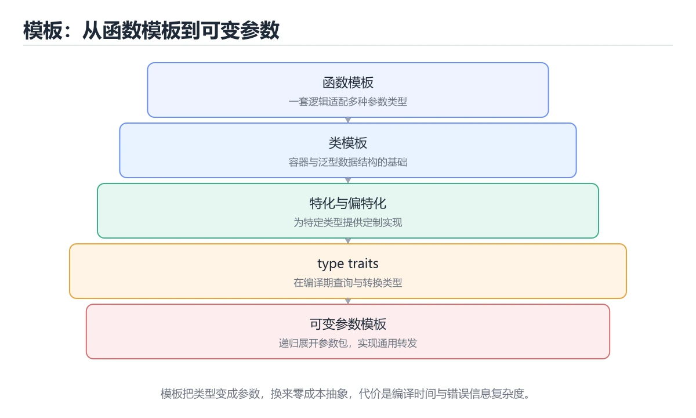

# 模板与泛型编程




> 内容更新时间：2026-10-06 · 学习阶段：进阶 · 预计用时：45 分钟

## 本节知识框架

想象你有一个做饼干的**模具**。你只需要做一套模具（模板），就能用不同口味的面团（int、double、string）压出形状相同但口味不同的饼干。C++ 编译器会在编译期帮你「批量生产」这些代码——每种类型一份，零运行时开销。

但模具也有代价：每换一种面团，烤箱就要多烤一份（编译时间变长、代码体积变大）。如果面团不合适（类型不满足要求），报错信息可能长达几百行。C++20 的 Concepts 就像给模具加了「使用说明」，让报错变得清晰。

本课主线：**函数与类模板、特化、type traits、可变参数与 Concepts**。

学完这课你会：
- 写出自己的函数模板和类模板
- 理解模板特化和 type_traits 的作用
- 用 C++20 Concepts 给模板参数加约束，告别几百行报错

## 核心概念定义

| 术语 | 一句话说明 |
| --- | --- |
| template | C++ 声明模板的关键字，让函数或类按类型和值参数生成具体版本。就像饼干模具。 |
| 泛型 | 把类型作为参数复用同一套逻辑，同时让编译器保留类型检查。 |
| 特化 | 为特定类型提供更高效或更合适的实现。比如对 `bool` 类型单独处理输出 "true"/"false"。 |
| type_traits | C++ 标准库头文件 `<type_traits>`，用模板在编译期查询和变换类型属性。 |
| Concepts | C++20 的编译期约束：用命名要求限定模板参数，让报错指向真正不满足的条件。 |
| CRTP | 派生类作为模板参数传回基类，实现零开销的静态多态（接口复用）。 |
| 实例化 | 编译器按具体模板参数生成函数或类版本的过程。`std::vector<int>` 就是 `vector` 这个模具压出来的一块饼干。 |
| 显式实例化 | 写 `template class Array<int, 4>;` 命令编译器生成指定的一份，好让别的翻译单元能链接到它。 |
| CTAD | C++17 的类模板实参推导：`std::vector v{1, 2, 3};` 不用写尖括号，元素类型由初值反推。 |
| SFINAE | 候选签名替换失败时，编译器只把它从重载名单里划掉而不报错。Concepts 出现前主要靠它挑实现。 |
| if constexpr | 编译期分支。没被选中的那一段根本不会实例化，所以不会在错误的类型上报错。 |

## 原理与运行机制

### 函数模板：一套逻辑，多种类型

函数模板就像一个「万能函数」——你写一份逻辑，编译器按实际类型生成多份具体实现。

```cpp
#include <iostream>

template <typename T>
T max_of(T a, T b) {
    return a > b ? a : b;
}

int main() {
    std::cout << max_of(3, 7);          // 推导 T = int，输出 7
    std::cout << max_of(3.5, 1.2);      // 推导 T = double，输出 3.5
    std::cout << max_of<int>(3, 7);     // 显式指定 T = int
}
```

编译器在编译期为每种类型生成一份代码，所以**零运行时开销**，但也可能让编译变慢、体积变大。

### 类模板：写一个自己的容器

```cpp
template <typename T, std::size_t N>
class Array {
public:
    T& operator[](std::size_t index) { return data_[index]; }
    constexpr std::size_t size() const { return N; }
private:
    T data_[N]{};
};

Array<int, 4> values;   // T = int, N = 4
```

`std::array` 就是这个思路的工业级实现。

### 模板特化：特殊类型特殊处理

```cpp
template <typename T>
struct Printer {
    static void print(const T& value) { std::cout << value; }
};

template <>                                    // 全特化
struct Printer<bool> {
    static void print(bool value) { std::cout << (value ? "true" : "false"); }
};

#include <type_traits>
static_assert(std::is_integral_v<int>);        // true
static_assert(!std::is_integral_v<double>);    // true
```

常见 traits：`is_integral`、`is_same`、`is_base_of`、`enable_if`。它们让模板根据类型属性选择不同实现。

### 可变参数模板与折叠表达式

```cpp
template <typename... Args>
void print_all(const Args&... args) {
    ((std::cout << args << ' '), ...);        // C++17 折叠表达式
}
```

### Concepts（C++20）：让报错看得懂

```cpp
#include <concepts>

template <typename T>
concept Addable = requires(T a, T b) {
    { a + b } -> std::convertible_to<T>;
};

template <Addable T>
T add(T a, T b) { return a + b; }
```

传不支持的类型时，报错会明确指出「不满足 Addable」，而不是几百行模板栈。

### 静态多态与 CRTP

模板实现的是**编译期多态**（静态多态），虚函数是运行期多态。CRTP 让派生类作为模板参数传回基类，实现零开销的接口复用：

```cpp
template <typename Derived>
struct Comparable {
    bool operator!=(const Derived& other) const {
        return !(static_cast<const Derived&>(*this) == other);
    }
};
```

### 从一次调用看清「实例化」到底做了什么

写 `max_of(3, 7)` 时，编译器并没有造出一个「什么类型都能装」的通用函数，而是分三步干活：把实参 `3`、`7` 匹配到 `T`（得到 `int`）、用 `int` 替换模板体里每一处 `T`、再生成一个只接受两个 `int` 的具体函数并给它一个内部名字。你在报错里看到的 `required from here` 和 `with T = int`，其实就是这三步被卡住时留下的脚印。

`std::vector<int>` 是同一件事：`std::vector` 本身不是类型，它只是模具，不能拿它声明变量；`std::vector<int>`、`std::vector<std::string>` 才是编译器生成出来的具体类型。所以 `std::vector<int>` 和 `std::vector<long>` 哪怕元素一样大也是两种类型，不能直接互相赋值。

### 推导失败时的三条退路

```cpp
template <typename T>
T max_of(T a, T b);

max_of(3, 3.5);          // 失败：一个实参推 T = int，另一个推 T = double
max_of<double>(3, 3.5);  // 退路 1：显式指定，int 实参自动提升
max_of(3.0, 3.5);        // 退路 2：把实参写成同一种类型

template <typename A, typename B>
auto max_of2(A a, B b) { return a < b ? b : a; }   // 退路 3：允许两种类型，返回值取公共类型
```

编译器报的是「没有匹配的函数」，因为两个候选推导结果互相矛盾。如果再加一句 `std::common_type_t<A, B>` 之类的约束，「允许混合类型但要说明结果类型」这件事就写进了签名，而不是留给读代码的人猜。

### 模板定义放哪儿：链接器视角

普通函数可以把实现藏进 `.cpp`，因为调用方编译时不需要看见别人的函数内部。模板不一样——**使用点才是真正生成代码的地方**。`main.cpp` 里写 `max_of(3, 7)` 时，编译器必须看到函数体才能为 `int` 生成任何东西；`templates.cpp` 里的实现对它不可见，于是 `max_of<int>` 这个符号谁都没生成，链接阶段报 undefined reference。

```text
解法 1：定义直接写在头文件里            —— 最常用，标准库和第三方模板库都这么做
解法 2：在 .cpp 里补显式实例化定义      —— template class Array<int, 4>;
         代价：新出现的类型仍要回来补一行
解法 3：实现挪进 .ipp，由少数 .cpp 包含 —— 减少重复生成，同时把编译耗时集中
```

### 读几百行模板报错的固定顺序

报错长不等于问题复杂。按这个顺序读：先定位**最上面第一条**错误，后面几百行常常是它的连锁反应；再往下找 `required from here` 或 `in instantiation of '...'`，它会告诉你编译器正在生成哪个具体版本；只有前两步都确认无误，才去看展开细节。

要验证一个结论（比如「这个模板在 C++20 下行为变了」），把三样东西固定下来再对比：编译器版本、`-std=` 参数、触发问题的最小实参类型。同一份代码在 GCC 13 和 Clang 17 上各编译一次，只留一份记录是不够的——两次的首条错误原文都要保存，才能判断是真差异还是环境漂移。

### Concepts 与 SFINAE 的分工

SFINAE 的思路是「让不合适的候选自己消失」，写法绕但兼容老标准；Concepts 的思路是「事先声明什么算合适」，报错直接指向没满足的那条要求。维护老项目时两者会共存，新写的接口优先用 Concepts，因为它把约束放在了签名上，读的人一眼看得见。

## 典型应用场景

- **写通用容器或算法**：类模板让你写一份逻辑适配多种类型。
- **编译期类型判断**：type_traits 让你在编译期查询类型属性。
- **约束模板参数**：Concepts 让报错信息从「几百行模板栈」变成一行「T 不满足 Addable」。
- **零开销抽象**：模板在编译期展开，运行时没有额外开销。
- **给第三方接口包一层统一入口**：同一个日志函数要接收 `int`、`const char*`、`std::string`，写一次转发逻辑就够了，不必为每种类型重复写重载。
- **按类型走不同算法**：容器支持随机访问就用二分，只支持前向遍历就退回线性扫描。这类判断放进 `if constexpr`，运行时连分支都不会留下。
- **通用的数值统计工具**：像本课的 `analyze`，一份代码同时服务成绩、温度、销售额；代价是新接一种类型就要重新编译一次，这是要提前算进去的成本。

## 代码/协议/SQL 示例

### 函数模板与类型推导

```cpp
#include <iostream>
#include <string>
#include <vector>

template <typename T>
T maxOf(const T& a, const T& b) {
    return a > b ? a : b;
}

template <typename T>
void printAll(const std::vector<T>& items) {
    for (const auto& item : items) std::cout << item << ' ';
    std::cout << '\n';
}

int main() {
    std::cout << maxOf(3, 7) << '\n';
    std::cout << maxOf(std::string("a"), std::string("b")) << '\n';
    printAll(std::vector{1, 2, 3});
}
```

**注意**：模板的定义通常要放在头文件里，因为编译器需要在实例化时看到完整实现。

### 可变参数与折叠表达式

```cpp
template <typename... Args>
auto sum(Args... args) {
    return (args + ...);            // C++17 折叠表达式
}

std::cout << sum(1, 2, 3, 4);       // 10
std::cout << sum(1.5, 2.5);         // 4
```

### C++20 Concepts 实战

```cpp
#include <concepts>
#include <string>
#include <type_traits>

template <std::integral T>
T gcd(T a, T b) {
    while (b != 0) {
        T t = a % b;
        a = b;
        b = t;
    }
    return a;
}

template <typename T>
concept Printable = requires(const T& value, std::ostream& os) {
    { os << value } -> std::same_as<std::ostream&>;
};

template <Printable T>
void printAll(const std::vector<T>& items) {
    for (const auto& item : items) std::cout << item << '\n';
}
```

### 泛型统计函数练习

```cpp
#include <concepts>
#include <iostream>
#include <numeric>
#include <vector>

template <typename T>
concept Numeric = std::integral<T> || std::floating_point<T>;

template <Numeric T>
struct Stats {
    T min;
    T max;
    double average;
};

template <Numeric T>
Stats<T> analyze(const std::vector<T>& data) {
    if (data.empty()) throw std::invalid_argument("data cannot be empty");
    const auto [lo, hi] = std::minmax_element(data.begin(), data.end());
    const double avg =
        static_cast<double>(std::accumulate(data.begin(), data.end(), T{0})) /
        static_cast<double>(data.size());
    return {*lo, *hi, avg};
}

int main() {
    const auto s = analyze(std::vector{88, 92, 79, 95});
    std::cout << "min " << s.min << " max " << s.max
              << " avg " << s.average << '\n';
}
```

编译运行：`g++ -std=c++20 stats.cpp -o stats && ./stats`

### 最小可跑：先看清「一个模具，两块饼干」

```cpp
#include <iostream>

template <typename T>
void show(const char* label, T value) {
    std::cout << label << " -> " << value << '\n';
}

int main() {
    show("整数", 42);
    show("小数", 3.14);
    show("文本", "模板");
}
```

预期输出：

```text
整数 -> 42
小数 -> 3.14
文本 -> 模板
```

三行调用生成两份函数：`T = int` 与 `T = double`。第三行的字符串字面量被推成 `const char*`，所以 `show` 的第三份实现里 `value` 是个指针，打印的仍是内容。想验证这件事，把 `42` 换成 `42.0f` 再编译一次，观察首条错误是否变化——一次只改一个类型，才能确认是哪份实例化出了问题。

### 练习：用折叠表达式数正数（顺手处理空包）

任务：写 `count_positive(1, -2, 3)` 返回 `2`，并且 `count_positive()` 不写参数时也要能编译。

```cpp
template <typename... Args>
int count_positive(Args... args) {
    int total = 0;
    ((total += (args > 0 ? 1 : 0)), ...);   // 逗号折叠：空包也合法
    return total;
}

int main() {
    std::cout << count_positive(1, -2, 3) << '\n';   // 2
    std::cout << count_positive() << '\n';           // 0
}
```

如果写成 `return ((args > 0 ? 1 : 0) + ...);`，实参列表一空就会编译失败——`+` 的一元折叠不允许空参数包，只有 `&&`、`||` 和逗号这三个运算符规定了空包结果。这类「调用方一个参数都不传」的边界，正是固定版本做回归时最容易暴露的差异。

## 时间/空间复杂度或性能分析

模板的性能特点：

- **运行时无开销**：模板在编译期展开，生成的代码和手写具体类型一样快。
- **编译时间增加**：每实例化一种类型，编译器就要多做一份工作。大量模板嵌套会让编译显著变慢。
- **代码体积增大**：每种类型生成一份代码，二进制体积可能变大。
- **优化建议**：把与类型无关的逻辑抽到非模板函数，减少实例化份数。

测量方法：固定输入跑一遍记录基线编译时间，再增加模板实例化的类型数量复测。

### 实例化份数怎么估

要生成的版本数量近似等于**模板参数的组合数**。`Array<T, N>` 里换一种 `T` 或换一个 `N` 都是新的一份，10 种类型乘 8 个长度就是 80 份；嵌套使用时是相乘而不是相加，`std::vector<std::array<int, 4>>` 和 `std::vector<std::array<int, 8>>` 会把内层模板各生成一遍。

三条削减手段：把与类型无关的逻辑（参数校验、前缀打印）抽进普通函数，让所有实例共享同一段目标代码；确定只用少数几种类型时，集中做显式实例化并配 `extern template` 抑制重复生成；改动频繁的实现挪进 `.ipp`，只让少数 `.cpp` 包含它。

对比数字时别只跑一次：固定编译器版本与 `-std=`，连续编译三回取中间那次，再用 `size -A` 看 `.text` 段是否随实例化数量同步增长——单次编译受机器负载影响，拿它当结论会误判。

## 常见误区与易错点

| 容易写错的做法 | 实际现象 | 原因与正确做法 |
| --- | --- | --- |
| 模板定义放 `.cpp` | 链接错误 undefined reference | 放头文件或显式实例化 |
| 忘写 `typename` | 依赖名解析失败 | 模板内的嵌套类型前加 `typename` |
| 报错几百行 | 找不到真正原因 | 从最上面第一条错误看起 |
| 模板参数推导失败 | 提示没有匹配的函数 | 显式指定类型或加约束 |
| 过度使用模板 | 编译慢、难调试 | 能用普通函数就别模板 |
| 递归模板太深 | 编译期爆栈 | 用折叠表达式或循环 |
| 特化与主模板不一致 | 行为诡异 | 保持接口一致 |
| 头文件里用 `using namespace` | 污染使用方 | 写全限定名 |
| 给函数模板做偏特化 | 报「函数模板的偏特化不允许」 | 函数模板不能偏特化，改用重载或多带一个标签类型参数 |
| 用 `if` 而不是 `if constexpr` 做编译期分支 | 没走的那条分支也被实例化并报错 | 按类型裁剪代码一律写 `if constexpr` |
| `static_assert` 条件里漏掉 `_v` | 报的是类型不匹配，看不出断言意图 | traits 取值写 `std::is_integral_v<T>` 或 `::value` |
| 空参数包用 `+` 折叠 | 一个实参都不传时直接编译失败 | 换逗号折叠，或先给累加变量一个初值 |
| 只在本机编译一次就下结论 | 换编译器版本后同一份模板报错 | 固定 `-std=` 与版本，两个版本各编译一次并留存首条错误 |

## 与其他知识点的关系

- **先修**：《类与面向对象》——本课会用到 class、继承等概念。
- **后续**：《STL 容器与算法》——STL 的容器和算法全是模板实现的。
- **术语衔接**：本课的 `template`、`泛型`、`特化` 在 STL 课程中会继续使用。
- **关联**：《C++ Concepts 与 Ranges》——本课是 Concepts 入门，那课是深入。
- **横向**：《移动语义与完美转发》——`max_of(3, 3.5)` 这类推导失败和那课的转发引用塌陷，遵守的是同一套推导规则。
- **横向**：《编译与链接》——模板的 undefined reference 发生在链接阶段，不理解翻译单元就选不对解法。
- **工程侧**：《CMake 与构建系统》——实例化份数最终体现为编译耗时和目标文件体积，`extern template`、预编译头都是为它服务的开关。

## 自测题与参考答案

### 自测 1

模板为什么没有运行时开销？

**参考答案**：因为模板在编译期为每种类型生成一份具体代码，运行时执行的就是普通函数/类，没有额外的间接调用或类型擦除。

### 自测 2

模板定义为什么通常要放在头文件里？

**参考答案**：因为编译器在实例化模板时需要看到完整的定义。如果放在 .cpp 文件里，其他翻译单元看不到实现，会导致链接错误。

### 自测 3

Concepts 解决了什么问题？

**参考答案**：Concepts 给模板参数加了明确的约束。当传入不满足约束的类型时，报错信息会直接说「T 不满足 Addable」，而不是展开几百行模板实例化栈。

## 考点精讲

本课的题库有 6 道题，下面逐题讲解。

### 考点 1

- **题目**：围绕“模板与泛型编程”中的 template、泛型、特化，下列哪两项是本课强调的实践判断？

**正确项**：
- 学习 template 时要同时说明输入、输出和失败路径，不能只看正常流程
- 验证 泛型 时要固定版本并覆盖边界输入，结论才可复现

**讲解**：学习模板不能只跑通正常例子。学习 template 时要同时考虑正常流程和失败路径；验证泛型行为时要固定编译器版本、覆盖边界输入。

### 考点 2

**题目**：C++20 中用于给模板参数加约束的特性是？

**正确项**：Concepts

**讲解**：Concepts 是 C++20 引入的特性，用 `concept` 关键字定义一组类型要求，然后用它约束模板参数。比如 `template <std::integral T>` 限制 T 必须是整数类型。

### 考点 3

**题目**：C++ 模板换来通用性的同时，主要付出的代价是什么？

**正确项**：编译时间变长、代码体积可能变大

**讲解**：模板在编译期为每种类型生成一份代码，所以类型越多，编译时间越长，二进制体积也可能越大。但运行时性能不受影响。

### 考点 4

**题目**：这段 `cpp` 代码对应 `模板与泛型编程` 的 `template`。课程要解决的是函数与类模板、特化、type traits、可变参数与 Concepts。关于代码内容，哪一项说法准确？

**正确项**：调用了 `max_of()`

**讲解**：本课的示例代码中出现了 `max_of()` 函数模板，展示了模板的类型推导和显式指定。

### 考点 5

**题目**：std::vector<int> 在编译过程中属于？

**正确项**：由类模板实例化出来的具体类型

**讲解**：`std::vector` 是一个类模板，`std::vector<int>` 是把 `int` 作为模板参数传入后，编译器生成的具体类型。就像用模具和特定面团做出了一块具体的饼干。

### 考点 6

**题目**：填空：补齐下面这段术语说明中的空缺。课程 `函数与类模板、特化、type traits、可变参数与 Concepts。`，这段说明是：`____`：C++ 声明模板的关键字，让函数或类按类型和值参数生成具体版本。空缺处应填哪个术语？

**正确项**：template

**讲解**：`template` 是 C++ 中声明模板的关键字。你在它后面写 `<typename T>` 或 `<int N>`，告诉编译器这里有个参数化的模具。

## 延伸阅读

想更直观地理解本课概念？推荐参阅以下图解专题：

- [图解调用栈与递归](visual_call_stack.md)

## 术语速查

| 术语 | 一句话说明 |
| --- | --- |
| template | C++ 声明模板的关键字，让函数或类按类型和值参数生成具体版本。 |
| 泛型 | 把类型作为参数复用同一套逻辑，同时保留类型检查。 |
| 特化 | 为特定类型提供更高效或更合适的实现。 |
| type_traits | 标准库头文件，用模板在编译期查询和变换类型属性。 |
| Concepts | C++20 的编译期约束，用命名要求限定模板参数。 |
| CRTP | 派生类作为模板参数传回基类，实现零开销的接口复用。 |
| 实例化 | 编译器按具体模板参数生成一份函数或类的过程，`std::vector<int>` 就是产物。 |
| 显式实例化 | `template class Array<int, 4>;`，手动生成指定版本供其它翻译单元链接。 |
| CTAD | C++17 的类模板实参推导，`std::vector v{1, 2, 3};` 省掉尖括号。 |
| 逗号折叠 | `((f(args)), ...)`，空参数包时结果为 void，比 `+` 折叠更安全。 |
| 转发引用 | 形如 `T&&` 的推导型参数，左值右值都收，需配 `std::forward` 才不丢值类别。 |

## 复习清单

- [ ] 能解释模板为什么没有运行时开销，以及它的编译期代价是什么。
- [ ] 能运行或推演本课的 max_of 和 analyze 示例，记录输入、输出与失败现象。
- [ ] 能完成一次自测，并把错题对照错误表定位原因。

## 参考资料与复核

- 最后复核：2026-10-04
- 下次复核：2027-05-10
- 复核范围：版本兼容、API 行为、安全建议与工程实践

| 参考资料 | 本课用途 |
| --- | --- |
| [C++ 模板](https://en.cppreference.com/w/cpp/language/templates) | 模板语法、推导规则与特化 |
| [cppreference C++ 语言](https://en.cppreference.com/w/cpp/language) | C++ 语言规则与语义 |
| [C++ 标准委员会](https://isocpp.org/) | 标准演进与提案动态 |

## 内容元数据

- 内容版本：v2.0
- 最后更新：2026-10-06
- 学习阶段：进阶
- 适用环境：C++20 / GCC 13+ 或 Clang 17+
- 内容来源：内置结构化课程与工程实践整理
- 相关主题：template、泛型、特化、type_traits、Concepts、CRTP
- 质量版本：P0 测验标准 + P1 覆盖扩展 + P2 体验补全
