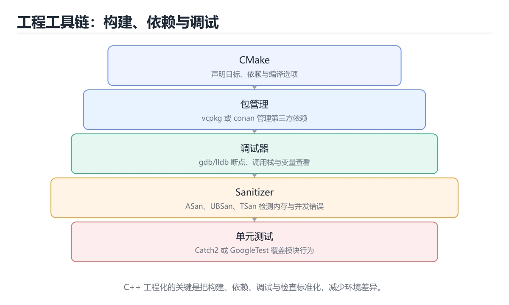
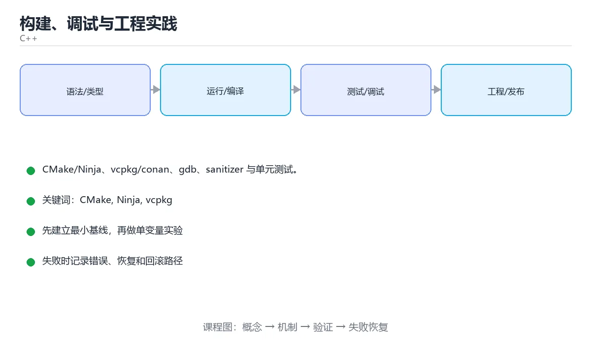

# 构建、调试与工程实践

> 内容更新时间：2026-10-06 · 学习阶段：进阶 · 预计用时：60 分钟





## 本节知识框架

写完了 C++ 代码，接下来要面对一个现实问题：代码不会自己编译自己。Python 有 `pip`、JavaScript 有 `npm`，而 C++ 的世界里，从编译到调试，每一环都需要你自己搭好脚手架。

本课就像带你逛一遍「C++ 工程厨房」——从食材进货（vcpkg/conan 管理依赖）、到施工图纸（CMake 描述构建流程）、再到质检仪器（gdb 调试、sanitizer 检测内存问题），最后到验收报告（单元测试）。

**学完本课你会掌握：**
- 用 CMake + Ninja 搭建一个跨平台的构建流程
- 用 vcpkg 或 Conan 锁定依赖版本，告别「我这儿能编」
- 用 gdb 设断点、看调用栈、查变量
- 用 AddressSanitizer 和 clang-tidy 在编译期就抓住隐患
- 用 Catch2 写单元测试，让 CI 替你把关

**先修知识：** 《现代 C++ 特性》里的 `auto`、`make_unique` 等是本课的前提。后续课程《实战：CMake 多文件项目》会把这些工具串成一个完整工程。

### 复习清单

- [ ] 能说出 CMake、Ninja、vcpkg 各自负责什么环节
- [ ] 能独立配置一次 Debug 和 Release 构建，并解释差异
- [ ] 能用 gdb 设断点、单步执行、查看调用栈

## 核心概念定义

| 术语 | 一句话说明 |
| --- | --- |
| `vcpkg.json` | 团队中应固定依赖版本（`vcpkg.json` / `conanfile.txt`），避免「我这儿能编译」。 |
| `break main` | 常用命令：`break main`、`run`、`next`、`step`、`print var`、`bt`（调用栈）。 |
| `编译数据库` | compile_commands.json 记录每个文件真实的编译命令，供 clangd 等工具做跳转与补全。 |
| `调试符号` | 编译时加上 -g 生成符号信息，调试器才能把地址映射回函数名与行号。 |

## 原理与运行机制

### 从零搭建你的 C++ 工具链

C++ 没有「官方全家桶」，工具链由几件独立工具拼成。把它想象成装修房子：你需要施工队（编译器）、施工图纸（构建系统）、进货渠道（包管理）、质检员（静态分析）、现场勘查（调试器）和安检仪（sanitizer）。

### 编译器三巨头

| 编译器 | 平台 | 特点 |
| --- | --- | --- |
| GCC | Linux 通用 | 兼容性最好，报错偏保守 |
| Clang | 跨平台 | 报错友好，工具链完整 |
| MSVC | Windows | 与 Visual Studio 集成最好 |

**建议**：本地用 Clang 开发（报错清晰），CI 上三个都跑一遍（发现可移植性问题）。

```cpp
// 查看编译器是否支持 C++20
// 在终端运行：
// echo | clang++ -std=c++20 -x c++ - -fsyntax-only && echo "支持 C++20"
#include <iostream>
int main() {
    std::cout << "Hello from C++20!\n";
}
```

### CMake：最通用的构建系统

CMake 就像施工图纸——你用 `CMakeLists.txt` 描述「要编译什么、链接什么、依赖什么」，CMake 帮你生成对应平台的构建文件（Makefile 或 Ninja）。

```cpp
// CMakeLists.txt 示例
// cmake_minimum_required(VERSION 3.20)
// project(code_learn LANGUAGES CXX)
// set(CMAKE_CXX_STANDARD 20)
// set(CMAKE_CXX_STANDARD_REQUIRED ON)
// add_executable(app src/main.cpp src/math_utils.cpp)
// target_include_directories(app PRIVATE include)
// target_compile_options(app PRIVATE -Wall -Wextra)
// find_package(fmt CONFIG REQUIRED)
// target_link_libraries(app PRIVATE fmt::fmt)
```

常用命令速查：

| 目的 | 命令 |
| --- | --- |
| 配置（生成构建文件） | `cmake -S . -B build -DCMAKE_BUILD_TYPE=Release` |
| 构建 | `cmake --build build -j` |
| 运行测试 | `ctest --test-dir build --output-on-failure` |
| 安装 | `cmake --install build --prefix dist` |
| 清理 | `rm -rf build` |

### 依赖管理：三种方式

想象你要开餐厅，食材从哪来？你可以每次去市场现买（FetchContent），也可以签长期供货合同（vcpkg 清单模式），或者用一个更灵活的供应商系统（Conan）。

```cpp
// vcpkg.json 示例
// {
//   "name": "demo",
//   "version": "0.1.0",
//   "dependencies": ["fmt", "spdlog", "catch2"]
// }
```

| 方式 | 适合 | 优缺点 |
| --- | --- | --- |
| `FetchContent` | 少量依赖、小项目 | 简单直接，但每次都要下载 |
| vcpkg 清单模式 | 中大型项目 | 版本集中声明，跨平台好 |
| Conan | 复杂依赖与二进制包 | 功能强，学习成本高 |

### 调试：gdb 是你的现场勘查工具

程序崩了怎么办？gdb 就像犯罪现场勘查——你可以在关键位置设路障（断点），让时间停下来（暂停执行），然后检查每个嫌疑人的行踪（变量值）。

```cpp
// 带调试符号编译
// g++ -g -O0 main.cpp -o main
// 启动 gdb：gdb ./main
// 常用命令：
// break main    在 main 函数设断点
// run           开始运行
// next          执行下一行（不进入函数）
// step          执行下一行（进入函数）
// print var     查看变量 var 的值
// bt            查看调用栈
// continue      继续运行到下一个断点
```

### Sanitizer：运行时安检仪

有些 bug 编译时抓不到，运行时才会暴露。Sanitizer 就像在程序里装了安检仪，每次内存操作都会过一遍扫描。

```cpp
// AddressSanitizer + UBSan
// g++ -fsanitize=address,undefined -g main.cpp -o main

// ThreadSanitizer
// g++ -fsanitize=thread -g main.cpp -o main

// valgrind（更慢但更全面）
// valgrind --leak-check=full ./main
```

| Sanitizer | 检查什么 | 编译参数 |
| --- | --- | --- |
| AddressSanitizer | 越界、释放后使用、泄漏 | `-fsanitize=address` |
| UndefinedBehaviorSanitizer | 整数溢出、空指针、未对齐 | `-fsanitize=undefined` |
| ThreadSanitizer | 数据竞争 | `-fsanitize=thread` |

### 静态分析与格式化

`clang-format` 是排版员——统一代码风格，让团队的代码看起来像一个人写的。`clang-tidy` 是审查员——在代码运行之前就发现潜在问题。

```cpp
// 使用 Catch2 的示例
#define CATCH_CONFIG_MAIN
#include <catch2/catch.hpp>

int add(int a, int b) { return a + b; }

TEST_CASE("add works") {
    REQUIRE(add(2, 3) == 5);
}
```

### 编译器选项速查

| 选项 | 作用 |
| --- | --- |
| `-std=c++20` | 指定语言标准 |
| `-Wall -Wextra` | 打开常用告警 |
| `-Werror` | 告警视为错误（CI 推荐） |
| `-g` | 生成调试信息 |
| `-O0` / `-O2` / `-O3` | 优化级别 |
| `-fsanitize=address` | 内存错误检测 |
| `-pthread` | 启用线程支持 |
| `-I path` | 头文件搜索路径 |
| `-L path` / `-lname` | 库路径与库名 |

## 典型应用场景

### 场景一：新项目从零搭建工具链

拿到一个新项目，第一步不是写代码，而是搭脚手架。先选编译器（推荐 Clang），再写 CMakeLists.txt，然后配好 vcpkg.json 锁定依赖，最后开启 `-Wall -Wextra -Werror` 从源头保证质量。

### 场景二：Debug 与 Release 行为不同

典型现象是只在 Release 崩溃。原因是 Debug 模式下内存未释放、优化器没有重排指令，掩盖了 bug。正确做法是两种配置都测，不要只跑一种。

### 场景三：团队协作时依赖版本不一致

典型现象是「今天能编明天不行」或「我这儿能编你那儿不行」。正确做法是用 `vcpkg.json` 或 `conanfile.txt` 固定版本，让每个人的环境完全一致。

### 场景四：编辑器补全不准

典型现象是 clangd 找不到头文件或补全乱报。原因是缺少 compile_commands.json。正确做法是在 CMake 里加 `set(CMAKE_EXPORT_COMPILE_COMMANDS ON)`，然后建一个软链接到项目根目录。

## 代码/协议/SQL 示例

### 完整的最小 CMake 项目

```cpp
// include/math_utils.h
#pragma once
#include <vector>

double mean(const std::vector<double>& values);
double median(std::vector<double> values);
```

```cpp
// src/math_utils.cpp
#include "math_utils.h"
#include <algorithm>
#include <numeric>
#include <stdexcept>

double mean(const std::vector<double>& values) {
    if (values.empty()) throw std::invalid_argument("empty");
    return std::accumulate(values.begin(), values.end(), 0.0) / values.size();
}

double median(std::vector<double> values) {
    if (values.empty()) throw std::invalid_argument("empty");
    std::sort(values.begin(), values.end());
    const auto n = values.size();
    return n % 2 ? values[n / 2] : (values[n / 2 - 1] + values[n / 2]) / 2.0;
}
```

```cpp
// src/main.cpp
#include <iostream>
#include <vector>
#include "math_utils.h"

int main() {
    std::vector<double> data = {3.0, 1.0, 4.0, 1.0, 5.0};
    std::cout << "mean = " << mean(data) << "\n";
    std::cout << "median = " << median(data) << "\n";
    return 0;
}
```

### CMakeLists.txt 完整示例

```cpp
// CMakeLists.txt
// cmake_minimum_required(VERSION 3.20)
// project(code_learn LANGUAGES CXX)
// set(CMAKE_CXX_STANDARD 20)
// set(CMAKE_CXX_STANDARD_REQUIRED ON)
// set(CMAKE_EXPORT_COMPILE_COMMANDS ON)
// add_executable(app src/main.cpp src/math_utils.cpp)
// target_include_directories(app PRIVATE include)
// target_compile_options(app PRIVATE -Wall -Wextra)
// find_package(fmt CONFIG REQUIRED)
// target_link_libraries(app PRIVATE fmt::fmt)
```

### 推荐的开发期编译命令

```cpp
// 开发期（带调试符号和 sanitizer）
// g++ -std=c++20 -Wall -Wextra -Werror -g -O0 \
//     -fsanitize=address,undefined \
//     src/main.cpp src/util.cpp -o build/app

// 发布构建
// g++ -std=c++20 -O2 -DNDEBUG src/*.cpp -o build/app
```

### 调试与诊断速查

| 目的 | 工具 / 命令 |
| --- | --- |
| 断点调试 | `gdb ./app`，`break file:line`、`run`、`bt`、`print var` |
| 查看崩溃栈 | `gdb -batch -ex run -ex bt ./app` |
| 静态检查 | `clang-tidy src/*.cpp -- -std=c++20` |
| 格式化 | `clang-format -i src/*.cpp` |
| 内存泄漏 | `valgrind --leak-check=full ./app` |
| 性能剖析 | `perf record ./app` + `perf report` |

## 时间/空间复杂度或性能分析

### 构建性能

C++ 项目的编译时间直接影响开发效率。小项目看单文件编译速度，大项目看增量编译和并行度。

**测量方法**：固定输入跑一遍记录基线，再改变规模或并发度复测。两次结果的差值才是结论依据。

| 指标 | Debug 构建 | Release 构建 |
| --- | --- | --- |
| 编译速度 | 较快（无优化） | 较慢（优化器耗时） |
| 运行速度 | 较慢 | 快 |
| 二进制体积 | 较大（含调试符号） | 较小 |
| 内存占用 | 较高 | 较低 |

**关键观察**：Ninja 比 Make 快在增量编译——它只重编改动的文件，而 Make 有时会多编。大项目差距更明显。

### Sanitizer 的开销

AddressSanitizer 通常带来 2x 的运行开销和 2-3x 的内存开销。ThreadSanitizer 更重，可达 5-10x。所以性能测试一定要用 Release 构建，sanitizer 只在测试阶段跑。

## 常见误区与易错点

| 容易写错的做法 | 实际现象 | 原因与正确做法 |
| --- | --- | --- |
| Debug 与 Release 行为不同 | 只在 Release 崩溃 | 两种配置都测 |
| 忘了 `-g` | 调试看不到变量 | Debug 配置加调试符号 |
| 手工敲编译命令 | 参数不一致 | 全部走 CMake |
| 依赖版本不固定 | 今天能编明天不行 | 固定 tag 或用清单 |
| 不提交 `.clang-format` | 格式各写一套 | 提交配置文件 |
| 只在 GCC 上测 | Clang 或 MSVC 编不过 | CI 跑三种编译器 |
| 忽略警告 | 隐患积累 | `-Wall -Wextra` 并逐步收敛 |
| 不用 compile_commands | 编辑器补全不准 | 开启 `CMAKE_EXPORT_COMPILE_COMMANDS` |
| 编译通过但运行时崩溃 | 未定义行为 | 开启 ASan/UBSan 重新运行 |
| `undefined reference` | 缺源文件或库顺序不对 | 补文件；被依赖的库放在后面 |

### 误区详解：以为 `-O2` 只是「快一点」

优化等级不只是速度差异——`-O2` 会重排指令、内联函数、消除「无用」代码。如果你的代码依赖了未定义行为（比如读未初始化的变量），Debug 下可能「碰巧」得到正确结果，Release 下就会崩溃。这就是为什么两种配置都要测。

### 误区详解：以为 vcpkg install 一次就够了

vcpkg 的依赖树会随时间变化。如果你的 `vcpkg.json` 没有锁定版本（比如只写了 `"fmt"` 而不是 `"fmt": "11.0.2"`），下次安装可能拉到新版本，导致行为变化。正确做法是始终用 `vcpkg.json` 清单模式管理版本。

## 与其他知识点的关系

- **先修**：《现代 C++ 特性》——本课会用到 `auto`、`make_unique` 等现代语法。
- **后续**：《实战：CMake 多文件项目》——本课的工具会在真实项目中串起来。
- **相关**：《实战：C++ HTTP JSON 服务》也涉及 CMake 构建流程。

### 术语关联

`vcpkg.json` 管依赖版本 → `break main` 调试程序 → `编译数据库` 让编辑器理解项目 → `调试符号` 让调试器映射地址到源码。这四者构成一个从构建到调试的完整链条。

## 自测题与参考答案

### 自测 1

**问题**：CMake 中 `find_package(fmt REQUIRED)` 的作用是什么？

**答案**：告诉 CMake 去查找已安装的 fmt 库，如果找不到就报错终止配置。找到后生成 `fmt::fmt` 目标，可以用 `target_link_libraries` 链接。

### 自测 2

**问题**：为什么 Debug 和 Release 都要测？

**答案**：Debug 不优化，保留了调试信息和未定义行为的「巧合正确」；Release 优化后可能暴露内存越界、未初始化变量等问题。只测一种等于只看到一半的 bug。

### 自测 3

**问题**：compile_commands.json 有什么用？

**答案**：它记录了每个源文件的完整编译命令（包括头文件路径、宏定义、编译选项）。clangd 等语言服务器用它来提供代码跳转、补全和诊断。没有它，编辑器的 C++ 支持基本是瞎猜。

## 考点精讲

本课题库有 6 道题，下面逐题覆盖。

### 考点 1

- **题目**：`构建、调试与工程实践` 的示例代码用于验证 `vcpkg.json`，其背景是CMake/Ninja、vcpkg/conan、gdb、sanitizer 与单元测试。代码的真实内容是下面哪一项？
- **正确项**：调用了 `find_package()`
- **判断依据**：示例代码中调用了 `find_package(fmt CONFIG REQUIRED)` 来查找 fmt 库，这正是 vcpkg 依赖管理的体现——通过 CMake 的 find_package 机制把 vcpkg 安装的库引入项目。

### 考点 2

- - **题目**：围绕“构建、调试与工程实践”中的 CMake、Ninja、vcpkg，下列哪两项是本课强调的实践判断？
- **正确项**：学习 CMake 时要同时说明输入、输出和失败路径，不能只看正常流程；验证 Ninja 时要固定版本并覆盖边界输入，结论才可复现
- **判断依据**：CMake 的配置（输入）→ 构建文件生成（输出）→ 编译失败（失败路径）构成完整链条。Ninja 的版本差异会影响构建行为，固定版本才能复现结论。

### 考点 3

- **题目**：用 gdb 调试时，编译需要加哪个选项？
- **正确项**：-g
- **判断依据**：`-g` 选项让编译器在二进制文件中嵌入调试符号（函数名、变量名、行号映射）。没有它，gdb 只能看到内存地址，无法显示源码级别的调试信息。

### 考点 4

- **题目**：clang-format 的典型用途是？
- **正确项**：按统一配置自动格式化代码风格
- **判断依据**：clang-format 读取 `.clang-format` 配置文件，自动调整缩进、换行、空格等格式细节。团队协作时提交这个配置文件，就能保证所有人的代码风格一致。

### 考点 5

- **题目**：clang-tidy 与 AddressSanitizer 的区别是？
- **正确项**：clang-tidy 做静态检查
- **判断依据**：clang-tidy 在编译期分析源码，发现潜在 bug 和代码风格问题（静态分析）。AddressSanitizer 在运行时检测内存越界和释放后使用等问题（动态分析）。两者互补，不能替代。

### 考点 6

- **题目**：填空：补齐下面这段术语说明中的空缺。课程 `CMake/Ninja、vcpkg/conan、gdb、sanitizer 与单元测试。`，这段说明是：团队中应固定依赖版本（``____`` / `conanfile.txt`），避免「我这儿能编译」。空缺处应填哪个术语？
- **正确项**：vcpkg.json
- **判断依据**：vcpkg.json 是 vcpkg 包管理器的清单文件，用来声明项目依赖及其版本。和 Conan 的 conanfile.txt 一样，它们都是锁定依赖版本的工具，确保团队成员和 CI 环境使用完全相同的依赖。

## 术语速查

| 术语 | 一句话说明 |
| --- | --- |
| `vcpkg.json` | 团队中应固定依赖版本（`vcpkg.json` / `conanfile.txt`），避免「我这儿能编译」。 |
| `break main` | 常用命令：`break main`、`run`、`next`、`step`、`print var`、`bt`（调用栈）。 |
| `编译数据库` | compile_commands.json 记录每个文件真实的编译命令，供 clangd 等工具做跳转与补全。 |
| `调试符号` | 编译时加上 -g 生成符号信息，调试器才能把地址映射回函数名与行号。 |
| `CMake` | 跨平台构建系统生成器，用 CMakeLists.txt 描述目标与依赖。 |
| `Sanitizer` | 运行时检测工具，能发现内存越界、未定义行为和数据竞争。 |

## 复习清单

- [ ] 能不看正文复述本课核心术语，并指出一个边界或反例。
- [ ] 能运行或推演本课示例，记录输入、输出与失败现象。
- [ ] 能完成一次自测，并把错题对照错误表定位原因。

## 参考资料与复核

- [本课资料锚点 cpp_tooling](https://zh.wikipedia.org/w/index.php?search=cpp_tooling)

- 最后复核：2026-10-04
- 下次复核：2027-05-10
- 复核范围：版本兼容、API 行为、安全建议与工程实践

| 参考资料 | 本课用途 |
| --- | --- |
| [CMake 文档](https://cmake.org/documentation/) | 跨平台构建与依赖管理 |
| [Google C++ 风格指南](https://google.github.io/styleguide/cppguide.html) | 命名、接口与工程约束 |
| [C++ 模板](https://en.cppreference.com/w/cpp/language/templates) | 模板、推导与泛型编程 |

## 内容元数据

- 内容版本：v2.0
- 最后更新：2026-10-06
- 学习阶段：进阶
- 适用环境：C++20 / GCC 13+ 或 Clang 17+
- 内容来源：内置结构化课程与工程实践整理
- 相关主题：CMake、Ninja、vcpkg、gdb、sanitizer、Catch2
