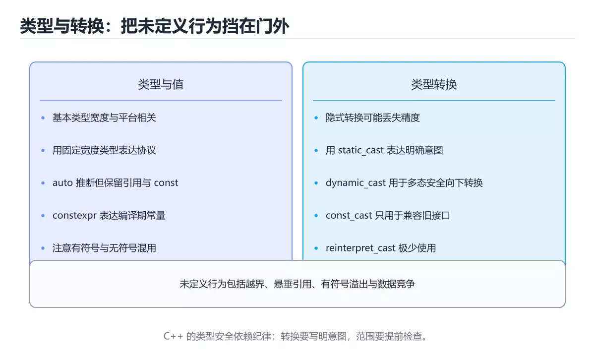
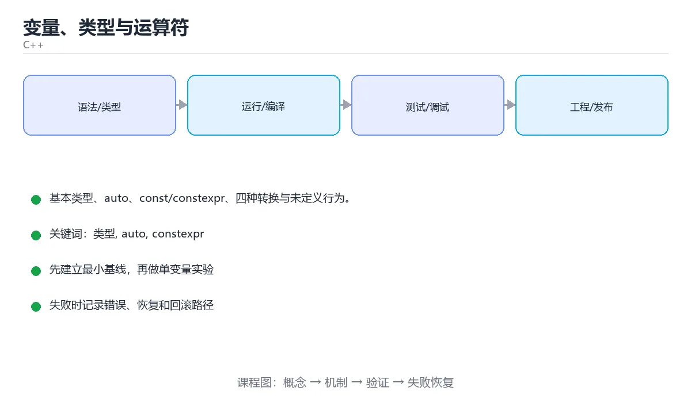

# 变量、类型与运算符

> 内容更新时间：2026-10-06 · 学习阶段：基础 · 预计用时：40 分钟





## 本节知识框架

前几课你用了 `int`、`double`、`string` 这些类型。这一课我们要深入理解 C++ 的类型系统——它比 Python 严格得多，但也正因为严格，很多错误在编译时就能发现。

学完这一课，你会：
- 理解 `auto` 让编译器帮你推导类型
- 知道 `const` 和 `constexpr` 的区别
- 掌握四种类型转换：`static_cast`、`const_cast`、`dynamic_cast`、`reinterpret_cast`
- 了解未定义行为的危害
- 避免整数除法和溢出等常见陷阱

**先修与衔接**：先修《环境与编译流程》。后续课程：《控制流与函数》。

### 复习清单

- [ ] 能解释 `auto` 的含义并正确使用它
- [ ] 能区分 `const` 和 `constexpr`
- [ ] 能说出四种类型转换各自的用途

## 核心概念定义

| 术语 | 一句话说明 |
| --- | --- |
| auto | `auto` 只是让编译器推导类型，不会降低类型安全，`decltype(x)` 用于取表达式的类型。 |
| constexpr | 能用 `constexpr` 就优先用它，编译期计算不占运行时开销。 |
| 类型 | 值允许的表示、取值范围和可执行操作集合。 |
| 类型推导 | `auto` 与模板按初始化表达式推断类型，注意引用与常量限定会被剥掉一部分。 |
| static_cast | 编译期类型转换，用于安全的向上/向下转换和数值类型转换。 |
| 未定义行为 | 程序行为不可预测：可能崩溃、可能产生错误结果、可能看似正常但换编译器就出问题。 |

## 原理与运行机制

### 类型就是规则

想象你有一个只能装整数的盒子和一个只能装小数的盒子。C++ 的类型系统就是这些"盒子规则"——它在你写代码时就告诉你"这个值不能放进那个盒子"，而不是等到运行时才炸。

```cpp
int count = 42;        // 整数盒子
double price = 9.99;   // 小数盒子
char grade = 'A';      // 单个字符盒子
bool flag = true;      // 真/假盒子
```

### auto：让编译器帮你填类型

```cpp
auto x = 42;         // 编译器推导 x 是 int
auto pi = 3.14;      // 编译器推导 pi 是 double
auto name = "hello"; // 编译器推导 name 是 const char*
```

`auto` 不是"任意类型"——它是由编译器根据初始化表达式推导出的静态类型。一旦推导出来，就和你手写类型完全一样。`auto` 的好处是代码更简洁，尤其是类型名很长的时候（比如 `std::vector<std::pair<int, std::string>>::iterator`）。

### const 与 constexpr

```cpp
const int max_size = 100;       // 运行时不能改的常量
constexpr int buffer_size = 256; // 编译期就能算出的常量
```

- `const`：表示"这个值不能被修改"，但它的值可能在运行时才确定
- `constexpr`：表示"这个值在编译期就能算出来"，编译器会直接替换成数字

能用 `constexpr` 就优先用它，编译期计算不占运行时开销。

### 四种类型转换

```cpp
double d = 3.9;
int i = static_cast<int>(d);        // 3，明确的截断

const char* text = "hello";
void* raw = const_cast<void*>(static_cast<const void*>(text));

Base* base = new Derived();
Derived* derived = dynamic_cast<Derived*>(base);   // 多态类型的安全向下转换

auto bits = reinterpret_cast<std::uintptr_t>(base); // 重新解释位模式，慎用
```

- `static_cast`：最常用的转换，用于数值类型之间、指针向上/向下转换
- `const_cast`：去掉或添加 `const` 限定
- `dynamic_cast`：运行时检查的多态类型转换，失败返回 `nullptr`
- `reinterpret_cast`：重新解释位模式，非常危险，慎用

### 未定义行为（UB）

```cpp
int arr[5];
arr[10] = 42;  // 越界！未定义行为

int x = INT_MAX + 1;  // 有符号整数溢出！未定义行为
```

未定义行为意味着编译器可以做任何事情——程序可能崩溃、可能产生错误结果、可能看似正常但换一个编译器就出问题。C++ 标准对 UB 不做任何保证。

### 整数除法

```cpp
std::cout << 5 / 2;      // 输出 2，不是 2.5！
std::cout << 5.0 / 2;    // 输出 2.5
std::cout << 5 / 2.0;    // 输出 2.5
```

两个整数相除，结果还是整数——小数部分直接截断。至少一侧转成 `double` 才能得到小数结果。

### 无符号数的陷阱

```cpp
size_t n = 0;
n = n - 1;  // n 变成 18446744073709551615（最大值），不是 -1！
```

把负数赋给 `size_t` 或无符号变量时会发生按模转换成一个很大的正数。这是 C++ 的一个经典陷阱。

## 典型应用场景

类型系统在日常开发中的应用：

- **数值计算**：用 `double` 处理小数，用 `int64_t` 处理大整数，避免溢出
- **常量定义**：用 `constexpr` 定义数组大小、缓冲区尺寸等编译期常量
- **类型安全**：用 `static_cast` 替代 C 风格强制转换，让转换意图明确
- **避免 UB**：检查数组边界、避免整数溢出、不访问空指针
- **代码可读性**：用 `auto` 简化冗长的类型名，但不滥用

### 一个实际的小例子

```cpp
#include <iostream>

constexpr double PI = 3.14159265358979;

double circleArea(double radius) {
    return PI * radius * radius;
}

int main() {
    auto r = 5.0;
    std::cout << "半径 " << r << " 的圆面积是 " << circleArea(r) << "\n";
    return 0;
}
```

## 代码/协议/SQL 示例

### 最小可运行示例

```cpp
#include <iostream>
#include <cstdint>

int main() {
    double d = 3.9;
    int i = static_cast<int>(d);
    std::cout << "d=" << d << " i=" << i << "\n";

    constexpr int size = 10;
    auto x = size * 2;
    std::cout << "x=" << x << "\n";

    return 0;
}
```

输出：

```text
d=3.9 i=3
x=20
```

### 完整示例：类型转换对比

```cpp
#include <iostream>
#include <string>
#include <cstdint>

int main() {
    // static_cast：数值转换
    double pi = 3.14159;
    int n = static_cast<int>(pi);  // 截断为 3
    std::cout << "static_cast: " << n << "\n";

    // 整数除法陷阱
    std::cout << "5/2 = " << 5 / 2 << "\n";       // 2
    std::cout << "5.0/2 = " << 5.0 / 2 << "\n";   // 2.5

    // 无符号数陷阱
    unsigned int u = 0;
    u = u - 1;  // 回绕成最大值
    std::cout << "unsigned underflow: " << u << "\n";

    return 0;
}
```

### 动手练一练

- 用 `auto` 声明几个变量，然后用 `typeid` 或编译器错误查看推导出的类型
- 故意制造一次整数溢出，观察结果
- 把 `5 / 2` 改成 `5.0 / 2`，比较结果差异

### 本课速查卡

| 复习项 | 本课要点 |
| --- | --- |
| 核心结论 | C++ 类型系统严格，编译期就能发现很多错误 |
| 最常用的关键字 | `auto`、`const`、`constexpr`、`static_cast` |
| 最常见的错误 | 整数除法丢小数；无符号数下溢 |
| 出错先查什么 | 检查变量类型是否符合预期 |

## 时间/空间复杂度或性能分析

类型选择影响内存和性能：

| 类型 | 典型大小 | 适用场景 |
| --- | --- | --- |
| `bool` | 1 字节 | 标志位 |
| `int` | 4 字节 | 一般整数 |
| `long long` | 8 字节 | 大整数 |
| `float` | 4 字节 | 低精度小数 |
| `double` | 8 字节 | 高精度小数 |
| `std::string` | 32+ 字节 | 文本 |

`constexpr` 在编译期计算，零运行时开销。`auto` 不引入额外开销——它只是让编译器帮你写类型。

## 常见误区与易错点

| 容易犯的错误 | 会出现什么 | 怎么修 |
| --- | --- | --- |
| 整数除法丢小数 | `5 / 2 == 2` | 至少一侧转成 `double` |
| 整数溢出 | 结果变成负数或不正确的值 | 换 `long long`，或提前判断范围 |
| 把负数赋给无符号变量 | 按模转换成一个很大的正数 | 用有符号类型，或先检查值 |
| 有符号整数溢出 | 未定义行为 | 避免溢出，用更大类型或检查范围 |
| 用 C 风格强制转换 | 跳过类型安全检查 | 用 `static_cast` 等 C++ 转换 |
| 滥用 auto | 类型不明确，可读性下降 | 只在类型名很长或明显时使用 |

### 现场 1：整数除法丢小数

**症状**：`5 / 2` 结果是 `2` 而不是 `2.5`。

**根因与修复**：两个整数相除结果是整数。至少一侧转成 `double`：`5.0 / 2`。

### 现场 2：整数溢出

**症状**：计算结果突然变成负数或一个很大的数。

**根因与修复**：换 `long long`，或提前判断范围。

## 与其他知识点的关系

### 概念复述

- 用一句话说明 `auto` 的含义：由编译器根据初始化表达式推导出的静态类型。
- 说出 `const` 和 `constexpr` 的区别。
- 解释四种类型转换各自的用途。

### 迁移练习

- **下一课**：《控制流与函数》会用到类型系统来约束参数和返回值。
- **术语归属**：`auto`、`constexpr`、`类型` 的定义以本课为准。

### 容易混淆的相邻概念

- `const` vs `constexpr`：前者运行时不可变，后者编译期就能算出。
- `static_cast` vs `reinterpret_cast`：前者安全转换，后者重新解释位模式。

## 自测题与参考答案

### 自测 1

解释 `auto x = 42;` 中 `x` 的类型是什么。

**参考答案**：`x` 的类型是 `int`。`auto` 让编译器根据初始化表达式 `42`（int 字面量）推导出 `x` 的类型。

### 自测 2

`5 / 2` 的结果是什么？怎样才能得到 `2.5`？

**参考答案**：结果是 `2`（整数除法截断小数）。改成 `5.0 / 2` 或 `5 / 2.0` 或 `static_cast<double>(5) / 2`。


## 延伸阅读

想更直观地理解本课概念？推荐参阅以下图解专题：

- [图解内存布局：栈、堆与引用](visual_memory_layout.md)

## 术语速查

| 术语 | 一句话说明 |
| --- | --- |
| `auto` | 让编译器根据初始化表达式推导类型，不降低类型安全。 |
| `constexpr` | 编译期常量，能在编译时计算出值，零运行时开销。 |
| `类型` | 值允许的表示、取值范围和可执行操作集合。 |
| `类型推导` | `auto` 与模板按初始化表达式推断类型。 |
| `static_cast` | 最常用的编译期类型转换，用于安全的数值和指针转换。 |
| `未定义行为` | 程序行为不可预测，C++ 标准不做任何保证。 |

## 考点精讲

本课题库共 6 道题，下面逐题给出题干、正确项与判断依据。

### 考点 1

- **题目**：代码语言为 `cpp`，选自 `变量、类型与运算符` 的 `auto` 部分。课程问题为基本类型、auto、const/constexpr、四种转换与未定义行为。哪一项描述与代码一致？
- **代码**：`double d = 3.9; int i = static_cast<int>(d);` ... `Base* base = new Derived(); Derived* derived = dynamic_cast<Derived*>(base);`
- **选项**：调用了 `parseAmount()` / 调用了 `max()` / 调用了 `LaunchedEffect()` / 调用了 `Derived()`
- **正确项**：调用了 `Derived()`
- **判断依据**：代码中 `new Derived()` 创建了 Derived 类型的对象，`dynamic_cast<Derived*>(base)` 进行了向下转换。

### 考点 2

- **题目**：有符号整数溢出在 C++ 中属于？
- **选项**：自动取模 / 编译错误 / 抛出异常 / 未定义行为
- **正确项**：未定义行为
- **判断依据**：C++ 标准规定有符号整数溢出是未定义行为（UB），编译器可以做任何事情。无符号整数溢出才是按模运算。

### 考点 3

- - **题目**：围绕“变量、类型与运算符”中的 类型、auto、constexpr，下列哪两项是本课强调的实践判断？
- **选项**：把 auto 的单次运行结果当成所有版本和规模都成立 / 学习 类型 时要同时说明输入、输出和失败路径，不能只看正常流程 / 只要 类型 的常规示例通过，就可以跳过边界与异常路径 / 验证 auto 时要固定版本并覆盖边界输入，结论才可复现
- **正确项**：学习 类型 时要同时说明输入、输出和失败路径，不能只看正常流程；验证 auto 时要固定版本并覆盖边界输入，结论才可复现
- **判断依据**：类型行为可能因编译器和平台而异，需要固定版本并覆盖边界。

### 考点 4

- **题目**：C++ 中 auto 的含义是？
- **选项**：由编译器根据初始化表达式推导出的静态类型 / 等同于 void / 任意类型（不做检查），但这会引入新的复杂度 / 运行时动态类型
- **正确项**：由编译器根据初始化表达式推导出的静态类型
- **判断依据**：`auto` 不是"任意类型"也不是"动态类型"——它让编译器在编译期根据初始化表达式推导出一个确定的静态类型。

### 考点 5

- **题目**：把负数赋给 size_t 或无符号变量时会发生什么？
- **选项**：编译直接失败 / 按模转换成一个很大的正数 / 运行时抛出异常，但这会引入新的复杂度 / 自动取绝对值
- **正确项**：按模转换成一个很大的正数
- **判断依据**：C++ 规定负数赋给无符号类型时按 2^n 取模，结果是一个很大的正数。编译不会报错，运行时也不会抛异常。

### 考点 6

- **题目**：填空：补齐下面这段术语说明中的空缺。课程 `基本类型、auto、const/constexpr、四种转换与未定义行为。`，这段说明是：`____`：值允许的表示、取值范围和可执行操作集合。空缺处应填哪个术语？
- **正确项**：类型
- **判断依据**：类型定义了一个值能怎么表示、能取什么范围的值、能做哪些操作。这是 C++ 类型系统的核心概念。

## 内容元数据

- 内容版本：v2.0
- 最后更新：2026-10-06
- 学习阶段：基础
- 适用环境：C++17 / GCC 13+ 或 Clang 17+
- 内容来源：内置结构化课程与工程实践整理
- 相关主题：类型、auto、constexpr、static_cast、未定义行为

## 参考资料与复核

- 最后复核：2026-10-04
- 下次复核：2027-05-10
- 复核范围：类型系统语义、转换规则、未定义行为定义

| 参考资料 | 本课用途 |
| --- | --- |
| [cppreference - Type System](https://en.cppreference.com/w/cpp/language/type) | C++ 类型系统详解 |
| [Learn C++ - Type Conversion](https://www.learncpp.com/cpp-tutorial/implicit-type-conversion-coercion/) | 类型转换入门 |
| [C++ Core Guidelines - Type](https://isocpp.github.io/CppCoreGuidelines/CppCoreGuidelines#S-type) | 类型安全最佳实践 |
