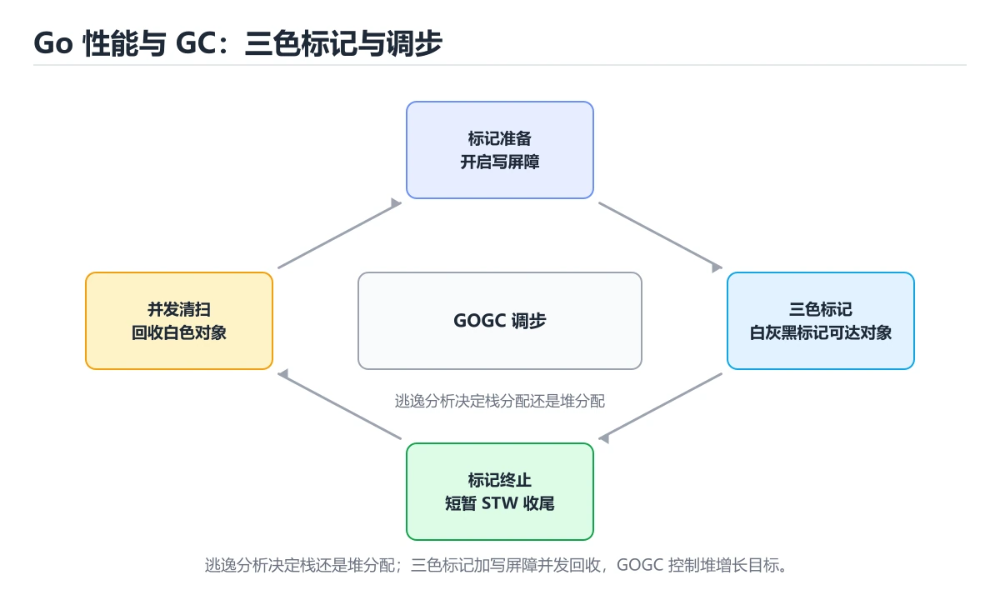
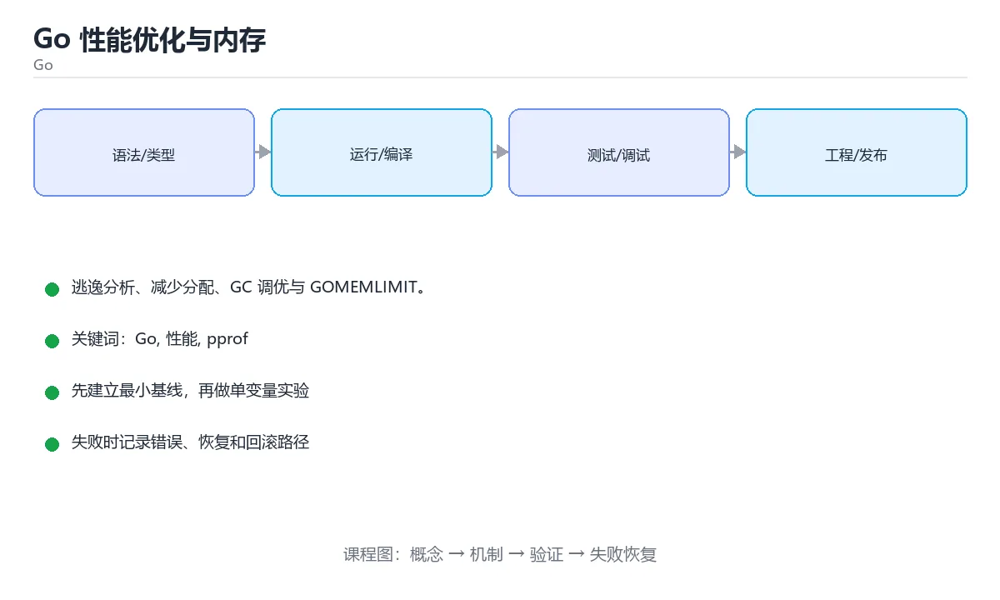

# Go 性能优化与内存

> 内容更新时间：2026-10-06 · 学习阶段：进阶 · 预计用时：30 分钟





## 本节知识框架

**课程定位**：所属分类 `go`（Go），课程主题 `Go 性能优化与内存`，学习阶段 进阶，建议用时 50 分钟。

本课主线：逃逸分析、减少分配、GC 调优与 GOMEMLIMIT。

**学完本课应当能够**
- 说清 `Go` 与 `性能` 的含义与区别，并各举一个正例和一个反例。
- 用本课示例验证 `pprof` 的行为，记录输入、输出与失败条件。
- 遇到「返回局部变量的指针」这类问题时，能说出触发条件与修复顺序。

### 复习清单

- [ ] 能不看正文复述本课核心术语，并指出一个边界或反例。
- [ ] 能运行或推演本课示例，记录输入、输出与失败现象。
- [ ] 能完成一次自测，并把错题对照错误表定位原因。

## 核心概念定义

| 术语 | 操作性定义 | 常见边界与风险 |
| --- | --- | --- |
| Go | 由 Google 设计的静态编译语言，强调简单语法、并发和部署便利。 | 共享状态与调度顺序会改变结论，单线程或串行测试通过不等于并发下成立。 |
| 性能 | 系统在给定负载下表现出的吞吐、延迟、资源占用和稳定性。 | 结论随输入规模变化，小规模成立不代表大规模成立，需要重新测量。 |
| pprof | 过早用 unsafe 或手写汇编；2. 无脑加缓存导致内存膨胀；3. 用互斥锁保护高频只读数据（应用 atomic 或 RWMutex）；4. 忽略 pprof 结论凭经验改。 | 易错：改了半天没效果；正确做法是先 pprof 定位。 |
| 逃逸分析 | 判断对象是否可能离开当前函数或线程，以决定栈分配和同步优化。 | 共享状态与调度顺序会改变结论，单线程或串行测试通过不等于并发下成立。 |
| GOMEMLIMIT | Go 性能优化三件事：基准与 pprof 定位热点、减少堆分配与 GC 压力、用 GOMEMLIMIT 控制内存上限。 | 结论随输入规模变化，小规模成立不代表大规模成立，需要重新测量。 |

## 原理与运行机制

### 机制总览

**教材衔接：版本与时效**

- 升级「Go 性能优化与内存」涉及的依赖前，先用 BenchmarkParse 复现当前行为，再逐项核对版本说明与破坏性变更。
- 模块校验、最小版本选择与供应链安全是生产升级的重点
- 官方发布说明：https://go.dev/doc/devel/release

## 典型应用场景

- **返回局部变量的指针**：典型现象是`return &x`；正确做法是尽量返回值。
- **存进 interface**：典型现象是`fmt.Println(x)`；正确做法是热点路径避免频繁装箱。
- **闭包捕获**：典型现象是`go func() { use(x) }()`；正确做法是明确传参。
- **切片增长过大**：典型现象是`append` 反复扩容；正确做法是预分配容量。

### 最小验证场景

- 准备：保留 `go` 示例的原始输入，先记录 `Go 性能优化与内存` 的基线输出和完整运行命令。
- 观察：先核对 调用了 `BenchmarkParse()`，再改变一个与 `Go` 相关的条件。
- 判定：新结果与 `Go 性能优化与内存` 的基线不同不等于错误；只有当差异破坏了 `Go` 的定义或错误表中的约束，才判定为失败。

### 选择与边界

- 使用 `Go` 时，先满足它的定义：由 Google 设计的静态编译语言，强调简单语法、并发和部署便利；共享状态与调度顺序会改变结论，单线程或串行测试通过不等于并发下成立。
- 使用 `性能` 时，先满足它的定义：系统在给定负载下表现出的吞吐、延迟、资源占用和稳定性；结论随输入规模变化，小规模成立不代表大规模成立，需要重新测量。
- 使用 `pprof` 时，先满足它的定义：过早用 unsafe 或手写汇编；2. 无脑加缓存导致内存膨胀；3. 用互斥锁保护高频只读数据（应用 atomic 或 RWMutex）；4. 忽略 pprof 结论凭经验改；易错：改了半天没效果；正确做法是先 pprof 定位。
- 使用 `逃逸分析` 时，先满足它的定义：判断对象是否可能离开当前函数或线程，以决定栈分配和同步优化；共享状态与调度顺序会改变结论，单线程或串行测试通过不等于并发下成立。
- 使用 `GOMEMLIMIT` 时，先满足它的定义：Go 性能优化三件事：基准与 pprof 定位热点、减少堆分配与 GC 压力、用 GOMEMLIMIT 控制内存上限；结论随输入规模变化，小规模成立不代表大规模成立，需要重新测量。

## 代码/协议/SQL 示例

### 最小可验证示例

```go
// 基准测试：同时报告内存分配
func BenchmarkParse(b *testing.B) {
	input := []byte(`{"id":1,"name":"小明"}`)
	b.ReportAllocs()
	b.ResetTimer()

	for i := 0; i < b.N; i++ {
		var user User
		if err := json.Unmarshal(input, &user); err != nil {
			b.Fatal(err)
		}
	}
}

// 并发处理 + 限制并发度 + 错误传播
func processAll(ctx context.Context, items []Item) error {
	g, ctx := errgroup.WithContext(ctx)
	g.SetLimit(8)                 // 最多 8 个并发

	for _, item := range items {
		item := item
		g.Go(func() error {
			return process(ctx, item)
		})
	}
	return g.Wait()
}
```

**教材衔接：原文最小示例**

**运行方式**：运行 `Go 性能优化与内存` 的示例时，用 `go run 文件名.go` 运行；模块依赖由 `go mod` 管理。

## 时间/空间复杂度或性能分析

顺序是：基准测试（`go test -bench`）→ pprof（CPU/内存/阻塞）→ 定位热点 → 改代码 → 复测。没有基准的优化都是猜测。

**教材衔接：逃逸分析与内存分配**

Go 的并发三色标记 GC 停顿很短（亚毫秒级），主要成本在 CPU 占用与内存放大。可用 `GOGC` 调整触发阈值（默认 100），或 `GOMEMLIMIT` 设置内存上限——容器环境推荐用 GOMEMLIMIT 防止 OOM。

| 目的 | 命令 / 写法 |
| --- | --- |
| 逃逸分析 | `go build -gcflags="-m -l" ./...` |
| 基准测试 | `go test -bench=. -benchmem ./...` |
| 与旧结果对比 | `go test -bench=. -count=10 > new.txt` + `benchstat old.txt new.txt` |
| CPU 剖析 | 测试中加 `-cpuprofile=cpu.out`，再 `go tool pprof -http=:8080 cpu.out` |
| 内存剖析 | `-memprofile=mem.out` |
| 阻塞剖析 | `runtime.SetBlockProfileRate` + `-blockprofile` |
| 互斥锁剖析 | `runtime.SetMutexProfileFraction` |
| 追踪 | `go test -trace=trace.out` + `go tool trace trace.out` |
| 线上剖析 | 引入 `net/http/pprof`，访问 `/debug/pprof/` |

| 手段 | 收益 | 注意点 |
| --- | --- | --- |
| 预分配切片容量 | 减少扩容与拷贝 | `make([]T, 0, n)` |
| 用 `strings.Builder` | 减少字符串拼接分配 | 提前 `Grow` |
| 避免不必要的接口装箱 | 减少分配与间接调用 | 热点路径避免 `any` |
| 用值接收或指针接收统一 | 减少拷贝 | 小结构体传值，大结构体传指针 |
| 复用对象（`sync.Pool`） | 降低 GC 压力 | 池中对象可能被回收 |
| 批量处理 | 减少系统调用与锁竞争 | 注意批次大小的延迟权衡 |
| 并发处理 | 利用多核 | 用 `errgroup` 限制并发 |
| 设置 `GOMEMLIMIT` | 容器中避免 OOM | 结合 `GOGC` 调整 |
| 减少锁粒度 | 提升并发 | 注意一致性 |
| 用 `atomic` 替代互斥锁 | 计数场景更快 | 只适用于简单操作 |

| 工具 | 比喻 | 说明 |
| --- | --- | --- |
| pprof | 体检报告 | 告诉你哪里真的慢 |
| 基准测试 | 对照实验 | 改动前后对比数据 |
| 逃逸分析 | 判断住哪里 | 变量在栈上还是堆上 |
| sync.Pool | 共享储物柜 | 复用临时对象，减轻 GC |
| GOMEMLIMIT | 预算上限 | 告诉运行时内存天花板 |

| 类型 | 采集方式 | 回答什么问题 |
| --- | --- | --- |
| CPU | `pprof.StartCPUProfile` | 时间花在哪些函数 |
| 内存 | `pprof.WriteHeapProfile` | 谁在分配、谁在占用 |
| goroutine | `pprof.Lookup("goroutine")` | 是否泄漏、卡在哪 |
| 阻塞 | `pprof.Lookup("block")` | 谁在等待锁或 channel |

### 基准测试：优化的前提

看三个数字：**每次耗时 ns/op、每次分配次数 allocs/op、每次分配字节 B/op**。

### 容器里的内存设置

```bash
# 让运行时知道容器内存上限，避免被 OOM Kill
GOMEMLIMIT=800MiB
GOMAXPROCS=4
```

| 环境变量 | 作用 |
| --- | --- |
| `GOMEMLIMIT` | 软性内存上限，比只调 GOGC 更可控 |
| `GOMAXPROCS` | 并行执行的 P 数量 |
| `GOGC` | GC 触发比例，默认 100 |

| 坑 | 现象 | 正确做法 |
| --- | --- | --- |
| 凭感觉优化 | 改了半天没效果 | 先 pprof 定位 |
| 只测一次 | 数据波动误判 | `-count=5` 取多次结果 |
| 把 pprof 暴露公网 | 信息泄露 | 只监听内网或加鉴权 |
| 滥用 `sync.Pool` | 对象丢失导致 bug | 只放可重建的临时对象 |
| 忘记 `Grow` 或 `reserve` | 反复扩容 | 已知规模就预留 |
| 在热路径做字符串拼接 | 分配量巨大 | 用 `Builder` |
| 把大结构按值传 | 每次调用都拷贝 | 传指针或切片 |
| 忽略 GC 指标 | 延迟毛刺查不出 | 看 heap 与 GC 频率 |

配合两个基准测试对比 `ns/op` 与 `allocs/op`，就能看到明确差距。

- [ ] 能说出 CPU、内存、goroutine 三类 profile 各回答什么问题。
- [ ] 知道 `-benchmem` 输出的三个关键指标。
- [ ] 能列出至少四个常见逃逸原因。
- [ ] 知道 `sync.Pool` 适合放什么、不适合放什么。
- [ ] 能说出容器里为什么要设置 `GOMEMLIMIT`。

**测量方法**：以 `Go 性能优化与内存` 的 `Go` 场景为对象，固定输入跑一遍记录基线，再把规模或并发度提高一个数量级复测；两次结果的差值与波动范围才是结论依据。

## 常见误区与易错点

| 容易写错的做法 | 实际现象 | 原因与正确做法 |
| --- | --- | --- |
| 返回局部变量的指针 | `return &x` | 尽量返回值 |
| 存进 interface | `fmt.Println(x)` | 热点路径避免频繁装箱 |
| 闭包捕获 | `go func() { use(x) }()` | 明确传参 |
| 切片增长过大 | `append` 反复扩容 | 预分配容量 |
| 大小未知的栈对象 | 大数组局部变量 | 改用切片或降低体积 |
| 凭感觉优化 | 改了半天没效果 | 先 pprof 定位 |
| 只测一次 | 数据波动误判 | `-count=5` 取多次结果 |
| 把 pprof 暴露公网 | 信息泄露 | 只监听内网或加鉴权 |
| 滥用 `sync.Pool` | 对象丢失导致 bug | 只放可重建的临时对象 |
| 忘记 `Grow` 或 `reserve` | 反复扩容 | 已知规模就预留 |
| 在热路径做字符串拼接 | 分配量巨大 | 用 `Builder` |
| 把大结构按值传 | 每次调用都拷贝 | 传指针或切片 |
| 忽略 GC 指标 | 延迟毛刺查不出 | 看 heap 与 GC 频率 |
| 未做基准测试就优化 | 优化错地方，复杂度上升。 | 先剖析定位热点。 |
| 基准测试不计时重置 | 数据包含准备时间。 | b.ResetTimer()。 |
| 盲目使用 sync.Pool | 收益不明显甚至更慢。 | 只对高分配热点使用。 |

### 现场 1：返回局部变量的指针

**症状**：`return &x`。

**根因与修复**：尽量返回值。

**自检**：在本课示例里复现「返回局部变量的指针」，改成尽量返回值后重跑；如果症状消失且失败路径按预期变化，说明定位正确。

### 现场 2：存进 interface

**症状**：`fmt.Println(x)`。

**根因与修复**：热点路径避免频繁装箱。

**自检**：在本课示例里复现「存进 interface」，改成热点路径避免频繁装箱后重跑；如果症状消失且失败路径按预期变化，说明定位正确。

### 现场 3：闭包捕获

**症状**：`go func() { use(x) }()`。

**根因与修复**：明确传参。

**自检**：在本课示例里复现「闭包捕获」，改成明确传参后重跑；如果症状消失且失败路径按预期变化，说明定位正确。

### 现场 4：切片增长过大

**症状**：`append` 反复扩容。

**根因与修复**：预分配容量。

**自检**：在本课示例里复现「切片增长过大」，改成预分配容量后重跑；如果症状消失且失败路径按预期变化，说明定位正确。

### 现场 5：大小未知的栈对象

**症状**：大数组局部变量。

**根因与修复**：改用切片或降低体积。

**自检**：在本课示例里复现「大小未知的栈对象」，改成改用切片或降低体积后重跑；如果症状消失且失败路径按预期变化，说明定位正确。

### 现场 6：凭感觉优化

**症状**：改了半天没效果。

**根因与修复**：先 pprof 定位。

**自检**：在本课示例里复现「凭感觉优化」，改成先 pprof 定位后重跑；如果症状消失且失败路径按预期变化，说明定位正确。

### 现场 7：只测一次

**症状**：数据波动误判。

**根因与修复**：`-count=5` 取多次结果。

**自检**：在本课示例里复现「只测一次」，改成`-count=5` 取多次结果后重跑；如果症状消失且失败路径按预期变化，说明定位正确。

### 现场 8：把 pprof 暴露公网

**症状**：信息泄露。

**根因与修复**：只监听内网或加鉴权。

**自检**：在本课示例里复现「把 pprof 暴露公网」，改成只监听内网或加鉴权后重跑；如果症状消失且失败路径按预期变化，说明定位正确。

### 现场 9：滥用 `sync.Pool`

**症状**：对象丢失导致 bug。

**根因与修复**：只放可重建的临时对象。

**自检**：在本课示例里复现「滥用 `sync.Pool`」，改成只放可重建的临时对象后重跑；如果症状消失且失败路径按预期变化，说明定位正确。

## 与其他知识点的关系

- **相关或后续**：`Go 微服务与可观测`。本课术语会在这些课程里继续使用。
- **术语归属**：`Go`、`性能`、`pprof` 的定义以本课「核心概念定义」为准，换到其他课程时先确认定义是否被改写。
- 同一分类的《Go 第一个程序》也涉及 `Go`；两课衔接时先确认这个术语的定义是否一致。
- 同一分类的《Go 变量与输入》也涉及 `Go`；两课衔接时先确认这个术语的定义是否一致。

## 自测题与参考答案

> 先独立作答，再对照参考答案；答案都能在本课正文、术语表或错误表里找到依据。

### 自测 1（概念复述）

不看正文，写出 `Go` 的操作性定义，并说明它与 `性能` 的区别。

**参考答案**：由 Google 设计的静态编译语言，强调简单语法、并发和部署便利。

`性能` 的定位是：系统在给定负载下表现出的吞吐、延迟、资源占用和稳定性；两者的差别要从适用对象与失败模式上说明。

### 自测 2（排错）

本课错误表记录了「返回局部变量的指针」这类做法。请写出它会出现的现象、根因，以及修复顺序。

**参考答案**：现象是`return &x`；正确做法是尽量返回值。修复时先复现现象并保留证据，再改动一处假设重跑，确认现象消失。

### 自测 3（动手验证）

运行本课的 `go` 示例，把其中的 `"id"` 换成一个边界值后重新运行，记录输出与错误信息。

**参考答案**：正常输入下 `go` 示例应当复现正文给出的结果；把 `"id"` 换成边界值后，如果结果改变或报错，先核对它是否满足 `Go 性能优化与内存` 中`Go` 的适用范围，再检查错误表里是否有同类现象。

### 自测 4（代码阅读）

阅读本课开头的 `go` 示例，说明它体现了`Go` 的哪一条性质，并指出改动哪个输入会让这条性质不再成立。

**参考答案**：`Go` 的定义是 由 Google 设计的静态编译语言，强调简单语法、并发和部署便利，示例正是在实现这条定义。改动与 `Go` 有关的一个输入后，如果结果不再符合 `Go 性能优化与内存` 的正文描述，就说明该性质只在当前前提成立。

### 自测 5（迁移）

把 `Go 性能优化与内存` 的方法迁移到自己的项目：围绕 `Go` 写出一个与错误表同类的风险点，并说明触发条件和检验方式。

**参考答案**：例如「盲目使用 sync.Pool」，它会导致收益不明显甚至更慢；检验方式是按只对高分配热点使用改一处再复现，确认现象消失且没有引入新的失败分支。

### 自测 6（对比）

用一个表格对比 `Go` 与 `性能`：各写一行适用场景、一行失败表现。

**参考答案**：`Go` 的定义是由 Google 设计的静态编译语言，强调简单语法、并发和部署便利；`性能` 的定义是系统在给定负载下表现出的吞吐、延迟、资源占用和稳定性。两者的失败表现分别对应本课错误表里与本术语相关的行。

### 自测 7（排错顺序）

面对「返回局部变量的指针」引发的问题，请把“复现 `return &x` → 保留证据 → 尽量返回值 → 回归验证”四步写成可执行的检查清单。

**参考答案**：第一步按`return &x`复现；第二步记录输入、版本与完整报错；第三步按尽量返回值只改一处；第四步重跑并确认失败路径也按预期变化。

### 自测 8（边界判断）

针对 `GOMEMLIMIT`，分别写出“可以使用”的条件和“结论不再成立”的条件。

**参考答案**：结论随输入规模变化，小规模成立不代表大规模成立，需要重新测量。 同时要把 `GOMEMLIMIT` 的定义 Go 性能优化三件事：基准与 pprof 定位热点、减少堆分配与 GC 压力、用 GOMEMLIMIT 控制内存上限 与实际输入逐项对照。

### 自测 9（机制重建）

不看正文，按输入、转换、输出、验证四段重建 `Go` → `性能` → `pprof` → `逃逸分析` 的作用链。

**参考答案**：起点是 `Go` 的定义 由 Google 设计的静态编译语言，强调简单语法、并发和部署便利；中间每一步都保留可观察状态；终点由 `GOMEMLIMIT` 检查，失败时回到错误表定位第一个偏离定义的步骤。

### 自测 10（综合排错）

在 `Go 性能优化与内存` 中，现象是 收益不明显甚至更慢。请围绕 盲目使用 sync.Pool 写出最小复现、关键证据、修复动作和回归验证，并说明为什么不能只凭一次运行下结论。

**参考答案**：先复现 盲目使用 sync.Pool，记录输入与完整错误；再按 只对高分配热点使用 只改一处。回归时同时跑正常路径和边界路径，只有两次结果都可解释，才把修复视为完成。

### 自测 11（一分钟复述）

用每分钟约 200 字的速度复述 `Go 性能优化与内存`：先给主问题，再按顺序说出 `Go`、`性能`、`pprof`、`逃逸分析`，最后给一个失败案例。

**自评标准**：主问题必须对应 逃逸分析、减少分配、GC 调优与 GOMEMLIMIT；每个术语都要能接上一句定义或边界；失败案例必须写成可观察现象，不能用“可能有风险”代替证据。

## 术语速查

| 术语 | 一句话说明 |
| --- | --- |
| `Go` | 由 Google 设计的静态编译语言，强调简单语法、并发和部署便利。 |
| `性能` | 系统在给定负载下表现出的吞吐、延迟、资源占用和稳定性。 |
| `pprof` | 过早用 unsafe 或手写汇编；2. 无脑加缓存导致内存膨胀；3. 用互斥锁保护高频只读数据（应用 atomic 或 RWMutex）；4. 忽略 pprof 结论凭经验改。 |
| `逃逸分析` | 判断对象是否可能离开当前函数或线程，以决定栈分配和同步优化。 |
| `GOMEMLIMIT` | Go 性能优化三件事：基准与 pprof 定位热点、减少堆分配与 GC 压力、用 GOMEMLIMIT 控制内存上限。 |

**术语关系**：`Go`（由 Google 设计的静态编译语言） → `性能`（系统在给定负载下表现出的吞吐、延迟、资源占用和稳定性） → `pprof`（过早用 unsafe 或手写汇编） → `逃逸分析`（判断对象是否可能离开当前函数或线程）。

## 考点精讲

`Go 性能优化与内存` 的题库有 6 道题，下面逐题给出题干、正确项与判断依据：先自己作答，再核对正确项，最后回到正文对应小节复核。

### 考点 1：第 1 题

- **题目**：围绕“Go 性能优化与内存”中的 Go、性能、pprof，下列哪两项是本课强调的实践判断？
- **正确项**：学习 Go 时要同时说明输入、输出和失败路径，不能只看正常流程；验证 性能 时要固定版本并覆盖边界输入，结论才可复现
- **判断依据**：本题正确项是学习 Go 时要同时说明输入、输出和失败路径，不能只看正常流程。术语 Go（Go 性能优化与内存）：由 Google 设计的静态编译语言，强调简单语法、并发和部署便利，本题取学习 Go 时要同时说明输入、输出和失败路径，不能只看正常流程这条。易错点是返回局部变量的指针会造成`return &x`，改法是尽量返回值，干扰项把 性能 的单次运行结果当成所有版本和规模都成立正踩在这条上。

### 考点 2：第 2 题

- **题目**：下面这段 `go` 代码来自 `Go 性能优化与内存`。课程主线是逃逸分析、减少分配、GC 调优与 GOMEMLIMIT。代码与 `Go` 有关。哪一项是代码里真实出现的内容？
- **正确项**：调用了 `ReportAllocs()`
- **判断依据**：本题正确项是调用了 `ReportAllocs()`。术语 Go（Go 性能优化与内存）：由 Google 设计的静态编译语言，强调简单语法、并发和部署便利，本题取调用了 `ReportAllocs()`这条。易错点是返回局部变量的指针会造成`return &x`，改法是尽量返回值，干扰项调用了 `MAX()`正踩在这条上。

### 考点 3：第 3 题

- **题目**：减少切片扩容拷贝的常用做法是？
- **正确项**：make([]T, 0, n) 预分配容量
- **判断依据**：本题正确项是make([]T, 0, n) 预分配容量。术语 Go（Go 性能优化与内存）：由 Google 设计的静态编译语言，强调简单语法、并发和部署便利，本题取make([]T, 0, n) 预分配容量这条。易错点是切片增长过大会造成`append` 反复扩容，改法是预分配容量，干扰项每次重新创建正踩在这条上。

### 考点 4：第 4 题

- **题目**：sync.Pool 的典型用途是？
- **正确项**：复用临时对象
- **判断依据**：本题正确项是复用临时对象。术语 Go（Go 性能优化与内存）：由 Google 设计的静态编译语言，强调简单语法、并发和部署便利，本题取复用临时对象这条。易错点是返回局部变量的指针会造成`return &x`，改法是尽量返回值，干扰项替代互斥锁正踩在这条上。

### 考点 5：第 5 题

- **题目**：pprof 采集 CPU 性能数据的原理是？
- **正确项**：以固定频率采样 goroutine 调用栈并统计
- **判断依据**：本题正确项是以固定频率采样 goroutine 调用栈并统计。术语 性能（Go 性能优化与内存）：系统在给定负载下表现出的吞吐、延迟、资源占用和稳定性，本题取以固定频率采样 goroutine 调用栈并统计这条。易错点是返回局部变量的指针会造成`return &x`，改法是尽量返回值，干扰项记录每一次函数调用，但这会增加每帧的开销，同时这会让抖动更明显正踩在这条上。

### 考点 6：第 6 题

- **题目**：填空：补齐下面这段术语说明中的空缺。课程 `逃逸分析、减少分配、GC 调优与 GOMEMLIMIT。`，这段说明是：Go 性能优化三件事：基准与 pprof 定位热点、减少堆分配与 GC 压力、用 `____` 控制内存上限。空缺处应填哪个术语？
- **正确项**：GOMEMLIMIT
- **判断依据**：《Go 性能优化与内存》这题的填空口径是「GOMEMLIMIT」或「gomemlimit」，正文写法与其中任一项一致即可。术语「Go」在本课里的界定是由 Google 设计的静态编译语言，强调简单语法、并发和部署便利，题干「填空：补齐下面这段术语说明中的空缺，课程 `逃逸分析、减少分配、GC」问的就是这一条。

### 考点 7：`Go`

- **要点**：由 Google 设计的静态编译语言，强调简单语法、并发和部署便利。
- **Go 的边界**：共享状态与调度顺序会改变结论，单线程或串行测试通过不等于并发下成立。

### 考点 8：`性能`

- **要点**：系统在给定负载下表现出的吞吐、延迟、资源占用和稳定性。
- **性能 的边界**：结论随输入规模变化，小规模成立不代表大规模成立，需要重新测量。

### 考点 9：`pprof`

- **要点**：过早用 unsafe 或手写汇编；2. 无脑加缓存导致内存膨胀；3. 用互斥锁保护高频只读数据（应用 atomic 或 RWMutex）；4. 忽略 pprof 结论凭经验改。
- **pprof 的边界**：易错：改了半天没效果；正确做法是先 pprof 定位。

### 考点 10：`逃逸分析`

- **要点**：判断对象是否可能离开当前函数或线程，以决定栈分配和同步优化。
- **逃逸分析 的边界**：共享状态与调度顺序会改变结论，单线程或串行测试通过不等于并发下成立。

### 考点 11：`GOMEMLIMIT`

- **要点**：Go 性能优化三件事：基准与 pprof 定位热点、减少堆分配与 GC 压力、用 GOMEMLIMIT 控制内存上限。
- **GOMEMLIMIT 的边界**：结论随输入规模变化，小规模成立不代表大规模成立，需要重新测量。

### 考点 12：排错——返回局部变量的指针

- **现象**：`return &x`。
- **处理**：尽量返回值。

### 考点 13：排错——存进 interface

- **现象**：`fmt.Println(x)`。
- **处理**：热点路径避免频繁装箱。

### 考点 14：综合辨析——`Go` 与 `GOMEMLIMIT`

- **辨析点**：`Go` 的定义是 由 Google 设计的静态编译语言，强调简单语法、并发和部署便利；`GOMEMLIMIT` 的定义是 Go 性能优化三件事：基准与 pprof 定位热点、减少堆分配与 GC 压力、用 GOMEMLIMIT 控制内存上限。
- **答题要求**：面对 `Go 性能优化与内存` 的题目，先判断描述的是 `Go` 还是 `GOMEMLIMIT`，再归到对应定义，最后写出一个会让该定义失效的边界输入。

### 考点 15：排错评分点

- **现象分**：能写出 `return &x`，而不是只写“程序有错”。
- **证据分**：保留触发 返回局部变量的指针 的输入、版本和错误原文。
- **修复分**：按 尽量返回值 只改一处，并同时回归正常路径与边界路径。

## 内容元数据

- 内容版本：v2.0
- 最后更新：2026-10-06
- 学习阶段：进阶
- 适用环境：Go 1.24+；本课聚焦 Go。
- 内容来源：内置结构化课程与工程实践整理
- 相关主题：Go、性能、pprof、逃逸分析、GOMEMLIMIT
- 质量版本：P0 测验标准 + P1 覆盖扩展 + P2 体验补全

## 参考资料与复核

- [本课资料锚点 go_performance](https://zh.wikipedia.org/w/index.php?search=go_performance)

- 最后复核：2026-10-04
- 下次复核：2027-04-10
- 复核范围：版本兼容、API 行为、安全建议与工程实践
- 来源性质：官方文档、标准或权威教材；本课核对关键词：Go、性能、pprof、逃逸分析、GOMEMLIMIT。

| 参考资料 | 本课用途 |
| --- | --- |
| [Go pprof](https://pkg.go.dev/net/http/pprof) | 性能剖析与火焰图 |
| [Effective Go](https://go.dev/doc/effective_go) | 惯用写法与接口设计 |
| [database/sql](https://pkg.go.dev/database/sql) | 数据库连接、事务与预编译 |

| [本课术语索引：Go 性能优化与内存](#核心概念定义) | 按本课输入、术语边界和错误表现逐项核对 |
> 「Go 性能优化与内存」的链接用于离线阅读后的延伸核对；App 不会自动联网。