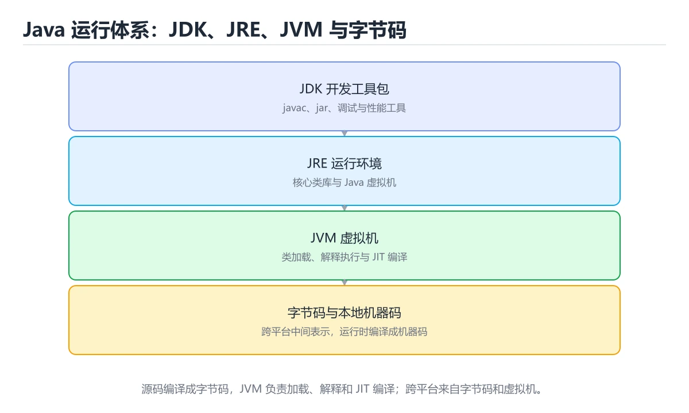
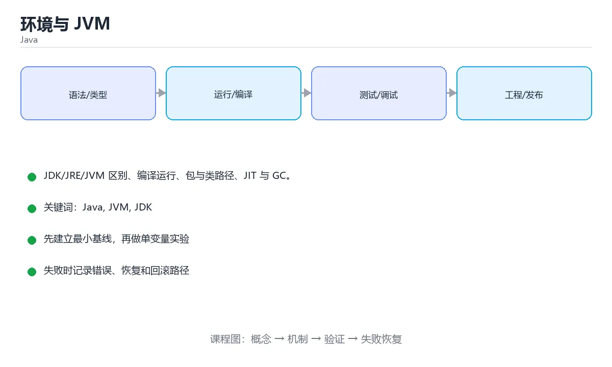

# 环境与 JVM

> 内容更新时间：2026-10-06 · 学习阶段：基础 · 预计用时：45 分钟





## 本节知识框架

学 Java 之前，你得先搞清楚几个缩写词：JDK、JRE、JVM。它们之间的关系就像一套工具箱——JDK 是完整工具箱（包含编译器、运行环境和各种调试工具），JRE 是运行环境（只有执行引擎和核心类库），JVM 是工具箱里的核心引擎（负责执行字节码）。

你可以这样理解：你写了一封信（Java 源码），JDK 里的编译器帮你把信翻译成世界语（字节码），然后世界上任何一个有翻译官（JVM）的国家都能读懂这封信。这就是 Java 那句著名的口号——「一次编写，到处运行」。

**学完这一课，你会**：
- 搞清楚 JDK、JRE、JVM 的区别和关系
- 知道 `javac` 编译和 `java` 运行是两步操作
- 理解字节码是什么、为什么 Java 能跨平台
- 配置好环境变量，独立编译运行一个带包名的 Java 程序

**先修**：无。本课是 Java 基础理论的起点。**后续**：《变量、类型与字符串》。

### 复习清单

- [ ] 能说出 JDK、JRE、JVM 各自包含什么、分别用来做什么。
- [ ] 能用 `javac` 和 `java` 命令编译运行一个带包名的程序。
- [ ] 能解释为什么 public 类的文件名必须和类名一致。

## 核心概念定义

| 术语 | 一句话说明 |
| --- | --- |
| `Java` | 编译带包名的代码：javac -d out src/com/example/app/Main.java，运行时用全限定名 java -cp out com.example.app.Main。 |
| `JVM` | public static void main(String[] args) 的每个部分都有含义：public 让 JVM 能访问、static 无需实例化、void 无返回值、String[] args 接收命令行参数。 |
| `JDK` | Java 开发工具包，包含编译器、运行时和标准工具。 |
| `字节码` | 源码编译后的中间指令，由虚拟机解释或即时编译执行。 |
| `包` | 把一组相关类型、函数或模块组织在一起的命名空间单元。 |
| `JAVA_HOME` | 指向 JDK 根目录的环境变量。 |
| `类路径（classpath）` | 包的根目录，`-cp` 用它定位 `.class`；`javac -d out` 与 `java -cp out` 里的 `out` 就是类路径的根。 |
| `--release` | 编译时锁定目标 Java 版本，语法和 API 都按那个版本校验，避免高版本 JDK 编出低版本 JVM 拒收的字节码。 |
| `JIT 编译器` | 运行期把被反复执行的热点字节码翻译成当前平台的机器码，所以要跑够轮数才看得到真实性能。 |
| `退出码` | 进程结束时交给操作系统的整数。`main` 正常返回或调用 `System.exit(0)` 表示成功，非 0 让脚本和 CI 判断失败。 |

## 原理与运行机制

### JDK、JRE、JVM 三兄弟

| 缩写 | 全称 | 包含什么 | 什么时候需要 |
| --- | --- | --- | --- |
| JVM | Java Virtual Machine | 字节码执行引擎 | 运行任何 Java 程序 |
| JRE | Java Runtime Environment | JVM + 核心类库 | 只想运行程序时够用 |
| JDK | Java Development Kit | JRE + 编译器 + 工具 | 开发者必须装这个 |

简单说：**写代码用 JDK，跑代码用 JRE 就够**。JVM 是两者共有的核心。

### 编译和运行是两步

Java 不像 Python 那样写完直接跑。它分两步：

1. **编译**：`javac Hello.java` 把源码翻译成字节码 `Hello.class`
2. **运行**：`java Hello` 启动 JVM 加载字节码并执行

```text
源码 .java → javac 编译 → 字节码 .class → JVM 执行
```

为什么多这一步？因为字节码是平台无关的——Windows、Linux、macOS 上的 JVM 都能跑同一份 `.class` 文件。

### public static void main 的含义

每个 Java 程序都有一个入口方法，签名固定为 `public static void main(String[] args)`。每个关键字都有用：

- `public`：让 JVM 能访问这个方法
- `static`：JVM 无需创建对象就能直接调用
- `void`：不返回值
- `String[] args`：接收命令行参数

### 包与类路径

包（package）用来组织代码，就像文件夹组织文件一样。包名通常用倒置域名：`com.example.app`。

编译带包名的代码：
```text
javac -d out src/com/example/app/Main.java
```

运行时用全限定名（包名 + 类名）：
```text
java -cp out com.example.app.Main
```

`-cp` 指定类路径（classpath），告诉 JVM 去哪里找 `.class` 文件。

### JIT 与 GC

JVM 执行字节码有两种方式：
- **解释执行**：一行一行翻译执行，启动快但运行慢
- **即时编译（JIT）**：把热点代码一次性编译成机器码，运行快但需要预热

**垃圾回收（GC）**：JVM 自动回收不再使用的对象占用的内存。你不需要像 C 语言那样手动 `free`。

### 环境变量怎么配

`javac` 和 `java` 都是 JDK 里的可执行文件，终端能不能找到它们取决于 `PATH`：

1. 把 JDK 解压到不含空格和中文的路径，例如 `D:\dev\jdk-21`。
2. 新建 `JAVA_HOME`，值写这个根目录本身；Windows 下不要以 `\bin` 或反斜杠结尾。
3. 在 `PATH` 里追加 `%JAVA_HOME%\bin`（Linux/macOS 写 `$JAVA_HOME/bin`）。
4. 重开一个终端验证：`java -version` 和 `javac -version` 都要能跑出来，而且版本号一致。

最后那条尤其重要。两个版本号不一致，就正好埋下了"编译版本高于运行版本"那个坑。

### 「跨平台」跨的到底是哪一层

字节码跨的是指令层，不是整个运行环境。同一份 `.class` 在三个系统上都能被执行，因为三边的 JVM 都认识同一套指令。但下面这些仍然各平台不同：

- 路径分隔符：`com/example/app` 与 `com\example\app`
- 文本换行：`\n` 与 `\r\n`
- 本机库：一旦用到 JNI，`.dll` 和 `.so` 得各准备一份

所以那句口号的准确版本是：**源码只编译一次，字节码在任何装了匹配版本 JVM 的机器上都能跑**，而不是"什么都不用管"。

### 每次运行都该留下三样记录

判断自己是不是真跑通了，看三处：

- **输入**：命令行参数给了什么、`-cp` 指向哪、JDK 哪个版本、当前工作目录在哪。
- **输出**：`System.out` 的正文、异常栈走到的 `System.err`、进程退出码。
- **失败路径**：类找不到时的 `ClassNotFoundException`、入口签名写错时 JVM 抛出的主方法相关提示、字节码版本不符时的 `UnsupportedClassVersionError`。

只写一句"运行成功"的笔记下次没法复用；把这三样抄下来，换台机器也照样能对上。

## 典型应用场景

### 场景一：编译运行第一个程序

```java
public class Hello {
    public static void main(String[] args) {
        System.out.println("Hello, Java!");
    }
}
```

保存为 `Hello.java`（文件名必须与 public 类名一致），然后：

```text
javac Hello.java     # 生成 Hello.class 字节码
java Hello           # 启动 JVM 执行
```

### 场景二：用 jshell 快速试验

```text
jshell               # JDK 9+ 交互式 REPL
jshell> 1 + 1
$1 ==> 2
jshell> /exit
```

jshell 适合快速试验语法，不需要创建文件和编译。

### 场景三：带包名的程序

```java
package com.example.app;

public class Main {
    public static void main(String[] args) {
        System.out.println("Hello from package!");
    }
}
```

文件必须放在 `com/example/app/` 目录下。编译和运行：

```text
javac -d out com/example/app/Main.java
java -cp out com.example.app.Main
```

### 场景四：接收参数并给出退出码

```java
public class Rename {
    public static void main(String[] args) {
        if (args.length < 2) {
            System.err.println("用法：java Rename 旧名 新名");
            System.exit(2);
        }
        System.out.println(args[0] + " → " + args[1]);
    }
}
```

`args` 拿到的是 `main` 后面那些以空格分隔的词，`System.err.println` 走错误流，`System.exit(2)` 立刻结束并把 2 交给操作系统。在 shell 里敲 `java Rename 只给一个名字` 再用 `echo $?` 查看，打印出的 2 就是"参数没给够"这件事被程序自己承认了；参数给齐时打印的才是 0。

### 场景五：确认手上的字节码是哪一代

```bash
javac --release 17 -d out src/com/example/app/Main.java
javap -v -cp out com.example.app.Main | grep "major version"
```

`major version: 61` 对应 Java 17、`52` 对应 Java 8、`65` 对应 Java 21。对方说"我这台机器只有 11"，你就用 `--release 11` 重编一次再把 jar 给他，而不是让对方升级 JDK——这是最容易在群里来回扯皮的场景，一条命令就能把版本差异钉死。

### 场景六：把编译产物交给别人

```bash
jar --create --file rename.jar --main-class Rename -C out .
java -jar rename.jar old.txt new.txt
```

`--main-class` 会把入口类写进 jar 里的清单文件，之后 `java -jar` 就不必再敲 `-cp` 和类名。分发给别人时给一个 jar，比给一堆散落的 `.class` 稳妥得多。

## 代码/协议/SQL 示例

### 最小可验证示例

```java
public class Hello {
    public static void main(String[] args) {
        System.out.println("Hello, Java!");
    }
}
```

编译运行：

```text
javac Hello.java
java Hello
```

预期输出：

```text
Hello, Java!
```

### 常用 JDK 工具

| 命令 | 用途 |
| --- | --- |
| `javac` | 编译源码 |
| `java` | 运行字节码 |
| `jshell` | 交互式 REPL |
| `jar` | 打包成 jar 文件 |
| `javap` | 反编译查看字节码 |
| `jstack` | 查看线程状态 |
| `jmap` | 查看堆内存 |

### 把三步连成一条可复现的记录

```bash
java -version
javac -d out src/com/example/app/Main.java
java -cp out com.example.app.Main
```

三行连着敲，不出意外就能看到输出。哪一行断了，问题就在哪一层：第一行失败说明 `PATH` 或 `JAVA_HOME` 没配对；第二行失败是源码本身或目录结构对不上包名；第三行失败几乎总是类名、包名或 `-cp` 的根目录写错。把这三行连同版本号一起抄进笔记，下次换机器照着核对即可。

### 反编译看一眼字节码里到底存了什么

```bash
javap -c -p -cp out com.example.app.Main
```

你会看到 `ldc` 往操作数栈上压字符串常量、`invokevirtual` 调用 `println` 这样的指令，而不是任何 CPU 机器码。`.class` 是"指令 + 常量池 + 符号表"的组合，方法名和类名以符号形式留在常量池中——这解释了为什么运行时要靠包名加类名去定位，也解释了 `-cp` 为什么必须指向包的根目录。

## 时间/空间复杂度或性能分析

JVM 的性能有几个关键指标：

- **启动时间**：JVM 启动需要加载类库、初始化堆内存，大约几十到几百毫秒。
- **JIT 预热**：前几次执行是解释模式，热点代码会被 JIT 编译成机器码。性能测试要先跑预热。
- **GC 停顿**：垃圾回收时会暂停程序执行。G1 回收器（JDK 9+ 默认）可以控制停顿目标。ZGC 可以做到亚毫秒级停顿。
- **内存占用**：JVM 本身需要一定内存（默认堆大小通常是物理内存的 1/4）。可以通过 `-Xmx` 设置最大堆。

测量方法：固定输入跑一遍记录基线，再提高规模复测，两次结果的差值才是结论依据。

### 下结论之前先固定这四样

- `java -version` 和 `javac -version` 的完整输出，包含厂商与构建号
- 启动参数：`-Xmx` 给了多少、用的是哪个回收器、有没有加 `-Xint`
- 输入规模：加载多少个类、循环多少轮，写成具体数字而不是"跑了一下"
- 预热轮次：解释执行阶段和 JIT 生效之后的差距，常常比你这次要测的那点优化本身还大

同一台机器、同一份参数、连跑三次取中间那次，才是能对别人复述的结果。只凭一次运行就断言"这样写快三倍"，换一个 JDK 版本大概率不成立。

### GC 停顿从哪里看

```bash
java -Xlog:gc*:file=gc.log -Xmx128m -cp out com.example.app.Main
```

日志里盯两个量：单次暂停的时长，以及回收之后老年代还剩多少。暂停只在流量高的短窗口变长，一般是分配速率上去了；如果暂停越来越长、回收后剩余量还降不下去，说明对象根本没死，该抓堆找引用链，继续调回收器参数不会有用。

## 常见误区与易错点

| 容易写错的做法 | 实际现象 | 原因与正确做法 |
| --- | --- | --- |
| 类名与文件名不一致 | `class X is public, should be declared in a file named X.java` | 文件名改成与类名完全一致 |
| 忘写分号 | `';' expected` | 语句结尾加分号 |
| 用了中文标点 | `illegal character` | 全部换成英文半角 |
| 包名与目录不一致 | `package does not exist` | 目录结构与包名一一对应 |

### 误区一：装了 JRE 就想写代码

JRE 只能运行程序，没有编译器。写代码必须装 JDK。

### 误区二：`java Hello.class`

`java` 命令后面跟的是类名，不是文件名。不要加 `.class` 后缀。

### 误区三：编译版本高于运行版本

如果 `javac` 用的是 JDK 21，但 `java` 用的是 JDK 17，运行时会报 `UnsupportedClassVersionError`。统一 JDK 版本或用 `--release` 降级编译。

## 与其他知识点的关系

- **先修**：无。本课是 Java 基础理论的起点。
- **后续**：《变量、类型与字符串》会用到本课的编译运行流程。
- **术语衔接**：本课定义的 `Java`、`JVM`、`JDK`、`字节码`、`包` 会在后续课程反复出现。

### 概念地图

```text
JDK（开发工具箱）
  └─ javac（编译器：源码 → 字节码）
       └─ 字节码（平台无关的中间指令）
            └─ JVM（执行字节码的虚拟机）
                 └─ 包（组织代码的命名空间）
```

## 自测题与参考答案

### 自测 1

**问**：JDK 和 JRE 有什么区别？

**答**：JDK 包含编译器、运行时和标准工具，用于开发。JRE 只包含 JVM 和核心类库，只能运行程序。

### 自测 2

**问**：`public class Hello` 的源文件名必须是什么？

**答**：Hello.java。public 类的名字必须与文件名完全一致。

### 自测 3

**问**：Java 实现「一次编写，到处运行」的关键是什么？

**答**：编译成字节码。字节码是平台无关的，各平台的 JVM 都能执行同一份字节码。

### 自测 4

**问**：Java 程序的入口方法签名是什么？

**答**：public static void main(String[] args)。每个关键字都不能少。

### 自测 5

**问**：什么是字节码？

**答**：源码编译后的中间指令，由虚拟机解释或即时编译执行。它是 Java 跨平台的关键。

## 考点精讲

`环境与 JVM` 的题库有 6 道题，下面逐题给出题干、正确项与判断依据：先自己作答，再核对正确项，最后回到正文对应小节复核。

### 考点 1：第 1 题

- **题目**：围绕“环境与 JVM”中的 Java、JVM、JDK，下列哪两项是本课强调的实践判断？
- **正确项**：学习 Java 时要同时说明输入、输出和失败路径，不能只看正常流程；验证 JVM 时要固定版本并覆盖边界输入，结论才可复现
- **判断依据**：按《环境与 JVM》的正文口径，本题要同时选中「学习 Java 时要同时说明输入、输出和失败路径，不能只看正常流程」、「验证 JVM 时要固定版本并覆盖边界输入，结论才可复现」，漏掉任一项都算没答全。术语 Java（环境与 JVM）：编译带包名的代码：javac -d out src/com/example/app/Main.java，运行时用全限定名 java -cp out com.example.app.Main。易错点是类名与文件名不一致，改法是文件名改成与类名完全一致。

### 考点 2：第 2 题

- **题目**：public class Hello 的源文件名必须是？
- **正确项**：Hello.java
- **判断依据**：本题正确项是「Hello.java」。术语 Java（环境与 JVM）：编译带包名的代码：javac -d out src/com/example/app/Main.java，运行时用全限定名 java -cp out com.example.app.Main，本题取「Hello.java」这条。易错点是忘写分号，改法是语句结尾加分号。

### 考点 3：第 3 题

- **题目**：Java 实现「一次编写，到处运行」的关键是？
- **正确项**：编译成字节码
- **判断依据**：本题正确项是「编译成字节码」。术语 Java（环境与 JVM）：编译带包名的代码：javac -d out src/com/example/app/Main.java，运行时用全限定名 java -cp out com.example.app.Main，本题取「编译成字节码」这条。易错点是用了中文标点，改法是全部换成英文半角。

### 考点 4：第 4 题

- **题目**：阅读 `环境与 JVM` 的 `Java` 示例。它服务于JDK/JRE/JVM 区别、编译运行、包与类路径、JIT 与 GC。代码中实际包含下列哪一项？
- **正确项**：出现字面量 `Hello, Java!`
- **判断依据**：本题正确项是「出现字面量 `Hello, Java!`」。术语 Java（环境与 JVM）：编译带包名的代码：javac -d out src/com/example/app/Main.java，运行时用全限定名 java -cp out com.example.app.Main，本题取「出现字面量 `Hello, Java!`」这条。易错点是包名与目录不一致，改法是目录结构与包名一一对应。本题干扰项「出现字面量 `关闭超时：%v`」不成立：展示代码里找不到 `关闭超时：%v`。

### 考点 5：第 5 题

- **题目**：Java 程序入口方法的正确签名是？
- **正确项**：public static void main(String[] args)
- **判断依据**：本题正确项是「public static void main(String[] args)」。术语 Java（环境与 JVM）：编译带包名的代码：javac -d out src/com/example/app/Main.java，运行时用全限定名 java -cp out com.example.app.Main，本题取「public static void main(String[] args)」这条。易错点是类名与文件名不一致，改法是文件名改成与类名完全一致。

### 考点 6：第 6 题

- **题目**：填空：补齐下面这段术语说明中的空缺。课程 `JDK/JRE/JVM 区别、编译运行、包与类路径、JIT 与 GC。`，这段说明是：`____`：源码编译后的中间指令，由虚拟机解释或即时编译执行。空缺处应填哪个术语？
- **正确项**：字节码
- **判断依据**：《环境与 JVM》这题的填空口径是「字节码」，正文写法与其中任一项一致即可。术语「JVM」在本课里的界定是public static void main(String[] args) 的每个部分都有含义：public 让 JVM 能访问、static 无需实例化、void 无返回值、String[] args 接收命令行参数，题干问的就是这一条。常见错法是类名与文件名不一致，其后果是`class X is public, should be declared in a file named X.java`。正确做法是文件名改成与类名完全一致。

## 延伸阅读

想更直观地理解本课概念？推荐参阅以下图解专题：

- [图解 JVM 内存模型与垃圾回收](visual_jvm_memory.md)

## 术语速查

| 术语 | 一句话说明 |
| --- | --- |
| `Java` | 编译带包名的代码：javac -d out src/com/example/app/Main.java，运行时用全限定名 java -cp out com.example.app.Main。 |
| `JVM` | public static void main(String[] args) 的每个部分都有含义：public 让 JVM 能访问、static 无需实例化、void 无返回值、String[] args 接收命令行参数。 |
| `JDK` | Java 开发工具包，包含编译器、运行时和标准工具。 |
| `字节码` | 源码编译后的中间指令，由虚拟机解释或即时编译执行。 |
| `包` | 把一组相关类型、函数或模块组织在一起的命名空间单元。 |
| `JAVA_HOME` | 指向 JDK 根目录的环境变量。 |

## 参考资料与复核

- 最后复核：2026-10-04
- 下次复核：2027-02-24
- 复核范围：版本兼容、API 行为、安全建议与工程实践

| 参考资料 | 本课用途 |
| --- | --- |
| [dev.java 学习](https://dev.java/learn/) | 现代 Java 官方教程 |
| [JVM 规范](https://docs.oracle.com/javase/specs/jvms/se21/html/index.html) | 字节码与运行时行为 |
| [Java GC 调优](https://docs.oracle.com/en/java/javase/21/gctuning/) | 垃圾回收与性能调优 |

## 内容元数据

- 内容版本：v2.0
- 最后更新：2026-10-06
- 学习阶段：基础
- 适用环境：Java 21+ / Maven 或 Gradle；本课聚焦环境与 JVM。
- 内容来源：内置结构化课程与工程实践整理
- 相关主题：Java、JVM、JDK、javac、字节码、包
