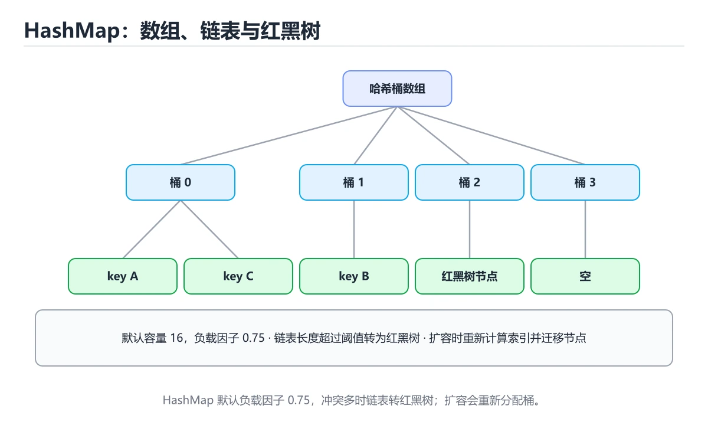
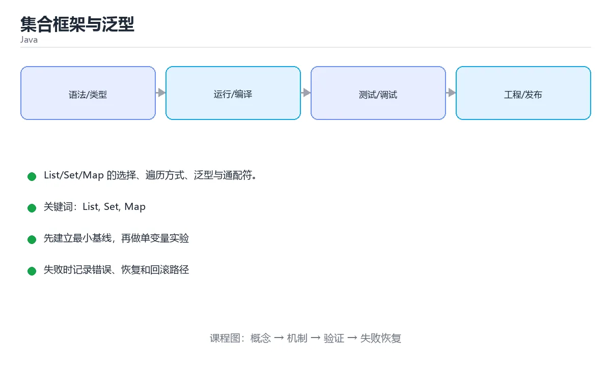

# 集合框架与泛型

> 内容更新时间：2026-10-06 · 学习阶段：进阶 · 预计用时：60 分钟





## 本节知识框架

想象你去超市购物：购物清单是有序的（List），会员名册不允许重复名字（Set），而通讯录把姓名映射到电话号码（Map）。Java 的集合框架就是这三类容器的统称，再加上**泛型**让你声明"这个容器只装某种类型"。

**本课你将学到：**
- List、Set、Map 各自适合什么场景
- 遍历集合时为什么不能直接删元素
- 泛型和通配符怎么用
- 线程安全的集合该选哪个

**先修要求：** 学完《继承、接口与多态》即可。

### 复习清单

- [ ] 能说出 ArrayList 和 LinkedList 的区别及选择依据
- [ ] 能解释为什么遍历 List 时直接 remove 会抛异常
- [ ] 能写出 HashMap 的基本用法并说出键的要求

## 核心概念定义

| 术语 | 一句话说明 |
| --- | --- |
| List | 有序、可重复的集合，按下标访问。ArrayList 是默认选择。 |
| Set | 不允许重复元素的集合。HashSet 基于 HashMap 实现。 |
| Map | 键值对映射接口。HashMap 不保序，LinkedHashMap 保插入序，TreeMap 按键排序。 |
| 泛型 | 编译期类型检查，运行时类型擦除。不能 new T[] 也不能 instanceof 泛型。 |

## 原理与运行机制

### 集合体系总览

```text
Collection ─┬─ List（有序、可重复）→ ArrayList / LinkedList
            ├─ Set（不可重复）    → HashSet / TreeSet / LinkedHashSet
            └─ Queue（队列）     → ArrayDeque / PriorityQueue
Map（键值对）→ HashMap / TreeMap / LinkedHashMap
```

### List：排队队伍

```java
List<String> names = new ArrayList<>();
names.add("tom");
names.add(1, "alice");
names.set(0, "bob");
names.remove("alice");
System.out.println(names.get(0));
names.sort(Comparator.naturalOrder());
```

ArrayList 随机访问快 O(1)，LinkedList 中间插删快但缓存不友好，日常默认选 ArrayList。

### Set：会员名册

```java
Set<String> tags = new HashSet<>();
tags.add("java");
tags.add("java");  // 重复不生效
System.out.println(tags.contains("java"));  // true
```

### Map：通讯录

```java
Map<String, Integer> scores = new HashMap<>();
scores.put("math", 90);
scores.putIfAbsent("english", 85);
System.out.println(scores.getOrDefault("history", 0));
scores.forEach((k, v) -> System.out.println(k + "=" + v));
```

### 泛型与通配符

```java
public class Box<T> {
    private T value;
    public void set(T value) { this.value = value; }
    public T get() { return value; }
}

List<? extends Number> numbers = List.of(1, 2.5);   // 上界：只读
List<? super Integer> sink = new ArrayList<Number>(); // 下界：可写
```

### 遍历与删除

```java
// 正确做法：用 removeIf
names.removeIf(n -> n.startsWith("小"));

// 错误做法：增强 for 里直接删 → ConcurrentModificationException
```

## 典型应用场景

| 场景 | 推荐做法 | 为什么 |
| --- | --- | --- |
| 有序列表、按下标访问 | ArrayList | 默认选择，读多写少 |
| 去重 | HashSet | 平均 O(1) 查找 |
| 键值映射 | HashMap | 日常首选 |
| 需要排序 | TreeMap | 按键有序 |
| 多线程并发 | ConcurrentHashMap | 分段锁，并发高 |
| 不可变集合 | List.of / Map.of | 防止意外修改 |

## 代码/协议/SQL 示例

### 集合选型速查

```text
需求              首选实现            关键复杂度
─────────────────────────────────────────────────
有序、按下标        ArrayList          访问 O(1)、中间插入 O(n)
去重不关心顺序      HashSet           平均 O(1)
去重且要排序        TreeSet           O(log n)
键值映射            HashMap           平均 O(1)
键有序              TreeMap           O(log n)
线程安全            ConcurrentHashMap  平均 O(1)
不可变              List.of / Map.of   只读
```

### 词频统计练习

```java
Map<String, Integer> counts = new HashMap<>();
for (String w : text.split(" ")) {
    counts.merge(w, 1, Integer::sum);
}
```

### 不可变集合

```java
List<String> fixed = List.of("a", "b");
List<String> copy = new ArrayList<>(fixed);  // 需要改就拷一份
```

## 时间/空间复杂度或性能分析

| 容器 | 随机访问 | 插入删除 | 适用 |
| --- | --- | --- | --- |
| ArrayList | O(1) | 尾部 O(1)，中间 O(n) | 默认选择 |
| LinkedList | O(n) | 已知位置 O(1) | 频繁两端操作 |
| HashMap | 平均 O(1) | 平均 O(1) | 键值查找 |
| TreeMap | O(log n) | O(log n) | 有序遍历 |
| ConcurrentHashMap | 平均 O(1) | 平均 O(1) | 并发读写 |

## 常见误区与易错点

| 容易写错的做法 | 实际现象 | 原因与正确做法 |
| --- | --- | --- |
| 遍历中删除 | ConcurrentModificationException | 用 removeIf 或迭代器 |
| List.of 后添加 | UnsupportedOperationException | 先 new ArrayList<>(...) |
| 用 == 比较元素 | 结果不确定 | 用 equals |
| HashMap 键是可变对象 | 改完后查不到 | 键用不可变类型 |
| list.remove(1) 想删元素 1 | 删掉的是下标 1 | 删对象写 remove(Integer.valueOf(1)) |
| Arrays.asList 当可变列表 | 长度固定增删报错 | 包一层 new ArrayList<> |
| HashMap 多线程并发写 | 数据错乱 | 改用 ConcurrentHashMap |

## 与其他知识点的关系

- **先修**：《继承、接口与多态》——集合大量使用接口和泛型
- **后续**：《异常处理与文件 IO》——文件读取结果常存进集合
- **关联**：《Lambda 与 Stream API》——Stream 就是集合的函数式处理方式

## 自测题与参考答案

1. **ArrayList 和 LinkedList 怎么选？** 绝大多数场景选 ArrayList，只有频繁头尾操作才考虑 LinkedList。
2. **为什么遍历 List 时直接 remove 会抛异常？** 内部迭代器检测到集合结构被意外修改，用 removeIf 替代。
3. **HashMap 的键有什么要求？** 必须正确实现 equals 和 hashCode，推荐用不可变类型。
4. **泛型类型擦除是什么意思？** 编译后泛型信息被擦除，运行时 List<String> 和 List<Integer> 是同一个类。
5. **ConcurrentHashMap 为什么比 Hashtable 快？** 分段锁机制，不同段可以并发访问。

## 考点精讲

`集合框架与泛型` 的题库有 6 道题，下面逐题给出题干、正确项与判断依据。

### 考点 1：第 1 题

- **题目**：不允许重复元素的集合是？
- **正确项**：Set
- **判断依据**：Set 的定义就是不允重复元素的集合，HashSet 基于 HashMap 实现。

### 考点 2：第 2 题

- **题目**：以下哪组集合类型更适合多线程并发访问？
- **正确项**：ConcurrentHashMap
- **判断依据**：ConcurrentHashMap 使用分段锁，支持高并发读写。

### 考点 3：第 3 题

- **题目**：这段 `java` 代码对应 `集合框架与泛型` 的 `List`。课程要解决的是List/Set/Map 的选择、遍历方式、泛型与通配符。关于代码内容，哪一项说法准确？
- **正确项**：调用了 `remove()`
- **判断依据**：本课 List 示例中包含 names.remove("alice") 调用。

### 考点 4：第 4 题

- **题目**：ArrayList 与 LinkedList 的选择依据是？
- **正确项**：随机访问多用 ArrayList
- **判断依据**：ArrayList 按下标访问 O(1)，LinkedList 需要 O(n) 遍历。

### 考点 5：第 5 题

- **题目**：下列哪些集合实现更适合高并发读写场景？请选择所有正确答案。
- **正确项**：ConcurrentHashMap；CopyOnWriteArrayList
- **判断依据**：ConcurrentHashMap 分段锁支持并发，CopyOnWriteArrayList 读多写少场景线程安全。

### 考点 6：第 6 题

- **题目**：下面几项都与 `List` 有关，请按 `集合框架与泛型` 的正文顺序排列；该课主线是List/Set/Map 的选择、遍历方式、泛型与通配符。
- **正确项**：集合体系 → List → Set → Map
- **判断依据**：本课按集合体系总览、List、Set、Map 的顺序展开讲解。

## 术语速查

| 术语 | 一句话说明 |
| --- | --- |
| List | 有序可重复集合，ArrayList 是默认选择 |
| Set | 不重复集合，HashSet 基于 HashMap |
| Map | 键值映射，HashMap 日常首选 |
| 泛型 | 编译期类型检查，运行时擦除 |
| ConcurrentHashMap | 线程安全的 HashMap 替代 |
| removeIf | 安全删除集合元素的正确方式 |

## 参考资料与复核

- 最后复核：2026-10-04
- 下次复核：2027-02-24
- 复核范围：版本兼容、API 行为、安全建议与工程实践

| 参考资料 | 本课用途 |
| --- | --- |
| [Java SE 官方教程：集合](https://docs.oracle.com/javase/tutorial/collections/) | 集合框架基础语法 |
| [Java SE API 文档](https://docs.oracle.com/en/java/javase/21/docs/api/) | 集合与泛型 API 查询 |
| [dev.java 学习路径](https://dev.java/learn/) | 现代 Java 官方入门教程 |

## 内容元数据

- 内容版本：v2.0
- 最后更新：2026-10-06
- 学习阶段：进阶
- 适用环境：Java 21+ / Maven 或 Gradle
- 内容来源：内置结构化课程与工程实践整理
- 相关主题：List、Set、Map、HashMap、泛型、ConcurrentHashMap
