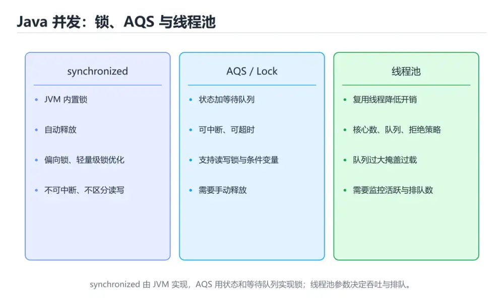
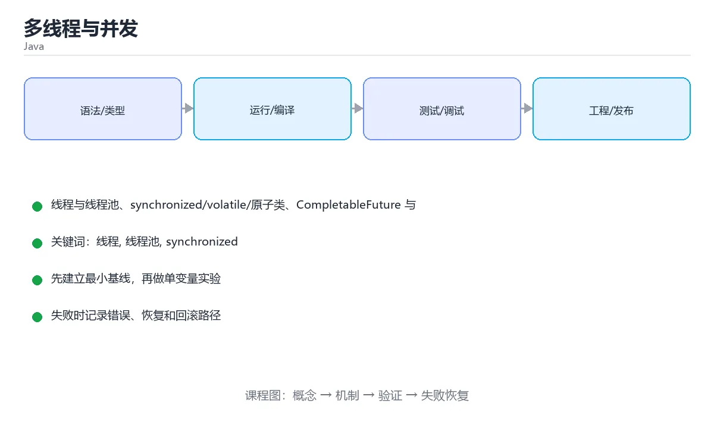

# 多线程与并发





> 内容更新时间：2026-10-06 · 学习阶段：高级 · 预计用时：50 分钟

## 本节知识框架

想象一家餐厅：厨房只有一位厨师（单线程），顾客得排队等。多请几位厨师（多线程），出菜速度就上去了——但厨师之间会抢同一口锅，搞不好还互相等着对方用完调料，最后谁也做不了菜（死锁）。本课就用 Java 的视角，带你一步步搞懂怎么让"多位厨师"高效协作。

本课会依次聊到六件事：

1. **线程是什么**——操作系统调度的最小执行单元，同一进程里的线程共享内存。
2. **线程池**——别每次都临时招厨师，养一支固定队伍更划算。
3. **synchronized 与 volatile**——厨师抢锅时怎么协调：锁保证原子性，volatile 保证大家能看到最新状态。
4. **原子类 AtomicInteger**——比锁更轻量的"自增计数器"。
5. **虚拟线程（Java 21+）**——轻量到可以同时开几万个，专治 IO 等待。
6. **内存模型**——多线程下"谁先看到谁写的值"的规则集。

先修内容：《Lambda 与 Stream API》里的 Optional 和函数式接口。后续会衔接《构建、测试与生态》。

### 复习清单

- [ ] 能不看正文说出线程、线程池、synchronized 各自的含义与一个易错点。
- [ ] 能运行或推演本课的 Java 示例，记录输入、输出和失败现象。
- [ ] 能完成一次自测，并把错题对照错误表定位原因。

## 核心概念定义

先记住下面六个词，后面所有讨论都围绕它们展开。每个词都用一句话讲清"它是什么"，再补一句"容易踩什么坑"。

| 术语 | 一句话说明 |
| --- | --- |
| `线程` | 操作系统调度的执行单元，同一进程内的线程共享地址空间和大部分资源。坑：手动 new 太多会内存暴涨。 |
| `线程池` | 复用固定数量线程处理任务，避免频繁创建销毁，需要定义队列和拒绝策略。坑：队列无界会导致 OOM。 |
| `synchronized` | 并发三件事：可见性、原子性、有序性。坑：锁 String 常量会全局串扰。 |
| `AtomicInteger` | volatile 保证可见性但不保证原子性，count++ 仍需 AtomicInteger。坑：用 volatile 自增会丢失更新。 |
| `虚拟线程` | Java 21+ 的轻量线程，适合大量 IO 等待。坑：长时间持 synchronized 会钉住载体线程。 |
| `内存模型` | 对多线程读写可见性、原子性和重排序给出的规则集合。坑：单线程通过不代表并发下成立。 |

## 原理与运行机制

### 线程和线程池：从"临时工"到"固定团队"

你可以把线程想象成餐厅里的厨师。每来一桌客人就临时招一位厨师（`new Thread()`），做完菜就开除——招人和开除本身也要时间，而且同时来 1000 桌客人你就得招 1000 人，厨房都挤不下了。

线程池的做法是：养一支固定规模的团队。来活了就从队列里取任务，做完继续取下一份。队列满了就触发"拒绝策略"——要么让 caller 自己干（`CallerRunsPolicy`），要么直接丢弃。

```java
// 方式一：实现 Runnable（推荐，组合优于继承）
Runnable task = () -> System.out.println("运行在 " + Thread.currentThread().getName());
Thread thread = new Thread(task);
thread.start();
thread.join();                 // 等待结束

// 方式二：线程池提交任务
ExecutorService pool = Executors.newFixedThreadPool(4);
Future<Integer> future = pool.submit(() -> 1 + 1);
System.out.println(future.get());
pool.shutdown();
```

### synchronized 与 volatile：厨师抢锅的两种协调方式

当多个线程同时修改一个变量，你需要三样东西：
- **可见性**：A 改了值，B 马上能看到 → `volatile` 或 `synchronized`
- **原子性**：count++ 这种"读-改-写"三步操作不能被中途打断 → `synchronized` 或原子类
- **有序性**：编译器和 CPU 不会把指令重排到你看不懂的顺序 → happens-before 规则

```java
class Counter {
    private int count = 0;

    public synchronized void increase() { count++; }   // 方法级同步

    public int get() { return count; }
}

// 显式锁
private final ReentrantLock lock = new ReentrantLock();
public void increase2() {
    lock.lock();
    try { count++; } finally { lock.unlock(); }
}
```

`volatile` 保证可见性与有序性，但**不保证原子性**，`count++` 仍需加锁或改用 `AtomicInteger`。

```java
private final AtomicInteger atomicCount = new AtomicInteger();
atomicCount.incrementAndGet();
```

### CompletableFuture：把异步任务像流水线一样串起来

```java
CompletableFuture<String> future = CompletableFuture
        .supplyAsync(() -> "结果")
        .thenApply(String::toUpperCase)
        .thenCompose(s -> CompletableFuture.completedFuture(s + "!"))
        .exceptionally(e -> "失败：" + e.getMessage());

System.out.println(future.join());
```

### 虚拟线程（Java 21+）：几万个厨师同时待命

```java
try (var executor = Executors.newVirtualThreadPerTaskExecutor()) {
    for (int i = 0; i < 10_000; i++) {
        executor.submit(() -> {
            Thread.sleep(1000);          // 阻塞不再是问题：虚拟线程自动让出载体线程
            return null;
        });
    }
}
```

虚拟线程极轻量，适合高并发 IO 场景，不需要再为了吞吐写复杂的异步回调。

## 典型应用场景

学完原理，我们来看几个真实场景，帮你把概念落地：

| 场景 | 你会遇到什么 | 怎么做 |
| --- | --- | --- |
| 高并发 Web 服务 | 每个请求一个线程，几千并发就扛不住 | 用虚拟线程或线程池 |
| 计数器自增 | 多线程 count++ 结果偏小 | 用 `AtomicInteger` |
| 读写共享 Map | HashMap 并发写导致死循环 | 用 `ConcurrentHashMap` |
| 定时任务 | 用 Timer 一个异常就全停 | 用 `ScheduledExecutorService` |
| 结果聚合 | 多个异步任务要合并结果 | 用 `CompletableFuture` |

**选择与边界**：
- 使用 `线程` 时，记住它是操作系统调度的执行单元，手动 new 太多会内存暴涨，正确做法是用线程池。
- 使用 `synchronized` 时，记住它同时保证可见性和原子性，但不要锁 String 常量，用专用 `private final Object lock = new Object()`。
- 使用 `虚拟线程` 时，记住它适合 IO 等待，避免长时间 `synchronized` 否则会钉住载体线程。

## 代码/协议/SQL 示例

### 完整最小示例

把下面的代码保存为 `ConcurrencyDemo.java`，用 `javac` 编译、`java` 运行：

```java
import java.util.concurrent.*;
import java.util.concurrent.atomic.*;

public class ConcurrencyDemo {
    public static void main(String[] args) throws Exception {
        // 1. 创建线程
        Runnable task = () -> System.out.println("运行在 " + Thread.currentThread().getName());
        Thread thread = new Thread(task);
        thread.start();
        thread.join();

        // 2. 线程池
        ExecutorService pool = Executors.newFixedThreadPool(4);
        Future<Integer> future = pool.submit(() -> 1 + 1);
        System.out.println("线程池结果: " + future.get());
        pool.shutdown();

        // 3. AtomicInteger vs volatile
        AtomicInteger safeCount = new AtomicInteger();
        for (int i = 0; i < 1000; i++) {
            new Thread(safeCount::incrementAndGet).start();
        }
        Thread.sleep(500);
        System.out.println("AtomicInteger: " + safeCount.get());
    }
}
```

```text
运行在 Thread-0
线程池结果: 2
AtomicInteger: 1000
```

运行方式：保存为 `.java` 后用 `javac` 编译、`java` 运行；注意类名与文件名一致。

## 时间/空间复杂度或性能分析

并发编程的性能不像算法题那样用大 O 衡量，更多关注"在给定硬件下，吞吐和延迟的拐点在哪里"。

| 需求 | 推荐工具 | 说明 |
| --- | --- | --- |
| 简单互斥 | `synchronized` | 语法内置，自动释放 |
| 需要超时 / 可中断 / 公平 | `ReentrantLock` | 记得在 `finally` 中 `unlock()` |
| 读多写少 | `ReentrantReadWriteLock` | 读并发，写互斥 |
| 原子计数 | `AtomicInteger` / `LongAdder` | 高并发下 `LongAdder` 吞吐更好 |
| 线程安全 Map | `ConcurrentHashMap` | 用 `computeIfAbsent` 做原子初始化 |
| 任务执行 | `ThreadPoolExecutor` | 明确核心数、队列与拒绝策略 |
| 定时任务 | `ScheduledExecutorService` | 别用 `Timer`（单线程、异常即终止） |
| 结果聚合 | `CompletableFuture` | 组合多个异步任务 |

| 参数 | 含义 | 设置建议 |
| --- | --- | --- |
| `corePoolSize` | 常驻线程数 | 按 QPS 与单任务耗时估算 |
| `maximumPoolSize` | 最大线程数 | CPU 密集 ≈ 核数；IO 密集可放大 |
| `keepAliveTime` | 空闲回收时间 | 结合流量波动设置 |
| `workQueue` | 任务队列 | **必须有界**，否则容易内存溢出 |

**测量方法**：固定输入跑一遍记录基线，再把并发度提高一个数量级复测；两次结果的差值才是结论依据。

## 常见误区与易错点

下面是新手最容易踩的坑，每个都给了"症状→根因→修复"三步对照：

| 容易写错的做法 | 实际现象 | 原因与正确做法 |
| --- | --- | --- |
| 用 `volatile` 做自增 | 结果偏小 | 用 `AtomicInteger` |
| 手动 new 大量线程 | 内存暴涨、切换频繁 | 用线程池 |
| 忘了 `shutdown` | 程序不退出 | `finally` 中关闭 |
| 在锁里做 IO | 其他线程全被拖住 | 缩小临界区 |
| 两把锁顺序不一致 | 死锁 | 统一加锁顺序 |
| 用 `HashMap` 并发写 | 数据错乱甚至死循环 | 用 `ConcurrentHashMap` |
| 忽略 `Future.get` 异常 | 任务失败被吞 | 捕获并处理 `ExecutionException` |
| 以为并行一定更快 | 小任务反而更慢 | 压测后决定 |
| `Executors.newFixedThreadPool(...)` | 队列无界，任务堆积导致 OOM | 手动 `ThreadPoolExecutor` 并指定有界队列 |
| 双重检查锁忘记 `volatile` | 可能拿到半初始化对象 | 单例用静态内部类或枚举更稳 |
| `synchronized` 锁 `String` 常量 | 全局串扰，性能极差 | 用专用 `private final Object lock = new Object()` |
| 虚拟线程里跑阻塞的本地锁 | 平台线程被钉住 | 虚拟线程适合 IO 等待，避免长时 `synchronized` |

**现场排错示范**：

**症状**：用 `volatile` 做自增，结果偏小。
**根因**：`volatile` 只保证可见性，不保证复合操作原子性。
**修复**：改用 `AtomicInteger`。
**自检**：在本课示例里复现该现象，改成 AtomicInteger 后重跑；如果症状消失说明定位正确。

## 与其他知识点的关系

- **先修**：`Lambda 与 Stream API`。本课默认 Optional 和函数式接口已经掌握。
- **相关或后续**：`构建、测试与生态`。本课术语会在这些课程里继续使用。
- 同一分类的《Java 虚拟线程与结构化并发》也涉及虚拟线程；两课衔接时先确认术语定义是否一致。

**容易混淆的相邻概念**：
- `线程` vs `线程池`：前者是操作系统调度单元，后者是复用固定数量线程处理任务的机制。
- `synchronized` vs `volatile`：前者同时保证可见性和原子性，后者只保证可见性和有序性。
- `虚拟线程` vs `平台线程`：虚拟线程由 JVM 管理、极轻量；平台线程对应操作系统线程、创建代价大。

## 自测题与参考答案

> 先独立作答，再对照参考答案；答案都能在本课正文、术语表或错误表里找到依据。

### 自测 1（概念复述）

不看正文，写出 `线程` 的操作性定义，并说明它与 `线程池` 的区别。

**参考答案**：操作系统调度的执行单元，同一进程内的线程共享地址空间和大部分资源。线程池的定位是：复用固定数量线程处理任务，避免频繁创建销毁，并需要定义队列和拒绝策略；两者的差别要从适用对象与失败模式上说明。

### 自测 2（排错）

本课错误表记录了「用 `volatile` 做自增」这类做法。请写出它会出现的现象、根因，以及修复顺序。

**参考答案**：现象是结果偏小；正确做法是用 `AtomicInteger`。修复时先复现现象并保留证据，再改动一处假设重跑，确认现象消失。

### 自测 3（动手验证）

运行本课的 Java 示例，把其中的 `"运行在 "` 换成一个边界值后重新运行，记录输出与错误信息。

**参考答案**：正常输入下 Java 示例应当复现正文给出的结果；把 `"运行在 "` 换成边界值后，如果结果改变或报错，先核对它是否满足多线程与并发中线程的适用范围，再检查错误表里是否有同类现象。

### 自测 4（代码阅读）

阅读本课开头的 Java 示例，说明它体现了线程的哪一条性质，并指出改动哪个输入会让这条性质不再成立。

**参考答案**：线程的定义是操作系统调度的执行单元，同一进程内的线程共享地址空间和大部分资源，示例正是在实现这条定义。改动与线程有关的一个输入后，如果结果不再符合正文描述，就说明该性质只在当前前提成立。

### 自测 5（迁移）

把多线程与并发的方法迁移到自己的项目：围绕线程写出一个与错误表同类的风险点，并说明触发条件和检验方式。

**参考答案**：例如「双重检查锁忘记 volatile」，它会导致可能拿到半初始化对象；检验方式是按单例用静态内部类或枚举更稳改一处再复现，确认现象消失且没有引入新的失败分支。

## 术语速查

| 术语 | 一句话说明 |
| --- | --- |
| `线程` | 操作系统调度的执行单元，同一进程内的线程共享地址空间和大部分资源。 |
| `线程池` | 复用固定数量线程处理任务，避免频繁创建销毁，并需要定义队列和拒绝策略。 |
| `synchronized` | 并发三件事：可见性（volatile/synchronized）、原子性（锁/原子类）、有序性（happens-before）。 |
| `AtomicInteger` | volatile 保证可见性与有序性，但不保证原子性，count++ 仍需加锁或改用 AtomicInteger。 |
| `虚拟线程` | Java 21+ 的轻量线程，适合大量 IO 等待，避免为每个请求绑定昂贵平台线程。 |
| `内存模型` | 编程语言或硬件对多线程读写可见性、原子性和重排序给出的规则集合。 |

## 考点精讲

`多线程与并发` 的题库有 6 道题，下面逐题给出题干、正确项与判断依据：先自己作答，再核对正确项，最后回到正文对应小节复核。

### 考点 1：第 1 题

- **题目**：volatile 关键字保证了什么？
- **正确项**：可见性与有序性
- **判断依据**：volatile 只保证可见性和有序性（通过内存屏障禁止重排序），但不保证原子性。原子性需要 synchronized 或原子类。回到正文「synchronized 与 volatile」一节复习。

### 考点 2：第 2 题

- **题目**：`多线程与并发` 的示例代码用于验证 `线程`，其背景是线程与线程池、synchronized/volatile/原子类、CompletableFuture 与虚拟线程。代码的真实内容是下面哪一项？
- **正确项**：调用了 `currentThread()`
- **判断依据**：本课示例中用 `Thread.currentThread().getName()` 获取当前线程名称，这是验证线程行为的基本手段。回到正文代码示例部分核对。

### 考点 3：第 3 题

- - **题目**：围绕“多线程与并发”中的 线程、线程池、synchronized，下列哪两项是本课强调的实践判断？
- **正确项**：学习 线程 时要同时说明输入、输出和失败路径，不能只看正常流程；验证 线程池 时要固定版本并覆盖边界输入，结论才可复现
- **判断依据**：并发编程的正确性取决于输入、调度和失败路径的综合验证，不能只看正常流程。回到正文「选择与边界」一节复习。

### 考点 4：第 4 题

- **题目**：synchronized 与 ReentrantLock 的关系是？
- **正确项**：synchronized 是语法内置锁
- **判断依据**：synchronized 是 JVM 内置的锁机制，自动释放；ReentrantLock 是 API 层面的锁，支持超时、可中断等高级功能。回到正文「synchronized 与 volatile」一节复习。

### 考点 5：第 5 题

- **题目**：使用线程池相比直接 new Thread 的优势是？
- **正确项**：复用线程，限制并发规模
- **判断依据**：线程池通过复用固定数量的线程避免频繁创建销毁的开销，同时通过队列和拒绝策略限制并发规模。回到正文「线程和线程池」一节复习。

### 考点 6：第 6 题

- **题目**：填空：补齐下面这段术语说明中的空缺。课程 `线程与线程池、synchronized/volatile/原子类、CompletableFuture 与虚拟线程。`，这段说明是：操作系统调度的执行单元，同一进程内的`____`共享地址空间和大部分资源。空缺处应填哪个术语？
- **正确项**：线程
- **判断依据**：这是线程的定义——操作系统调度的执行单元，同一进程内的线程共享地址空间和大部分资源。回到正文「核心概念定义」核对原文。

## 内容元数据

- 内容版本：v2.0
- 最后更新：2026-10-06
- 学习阶段：高级
- 适用环境：Java 21+ / Maven 或 Gradle；本课聚焦线程与并发。
- 内容来源：内置结构化课程与工程实践整理
- 相关主题：线程、线程池、synchronized、volatile、AtomicInteger、虚拟线程
- 质量版本：P0 测验标准 + P1 覆盖扩展 + P2 体验补全

## 参考资料与复核

- 最后复核：2026-10-04
- 下次复核：2027-02-24
- 复核范围：版本兼容、API 行为、安全建议与工程实践
- 来源性质：官方文档、标准或权威教材；本课核对关键词：线程、线程池、synchronized、volatile、AtomicInteger、虚拟线程。

| 参考资料 | 本课用途 |
| --- | --- |
| [Java 并发教程](https://docs.oracle.com/javase/tutorial/essential/concurrency/) | 线程、同步与并发工具 |
| [Java SE API 文档](https://docs.oracle.com/en/java/javase/21/docs/api/) | 标准库并发 API 查阅 |
| [JEP 444: Virtual Threads](https://openjdk.org/jeps/444) | 虚拟线程官方规范 |
