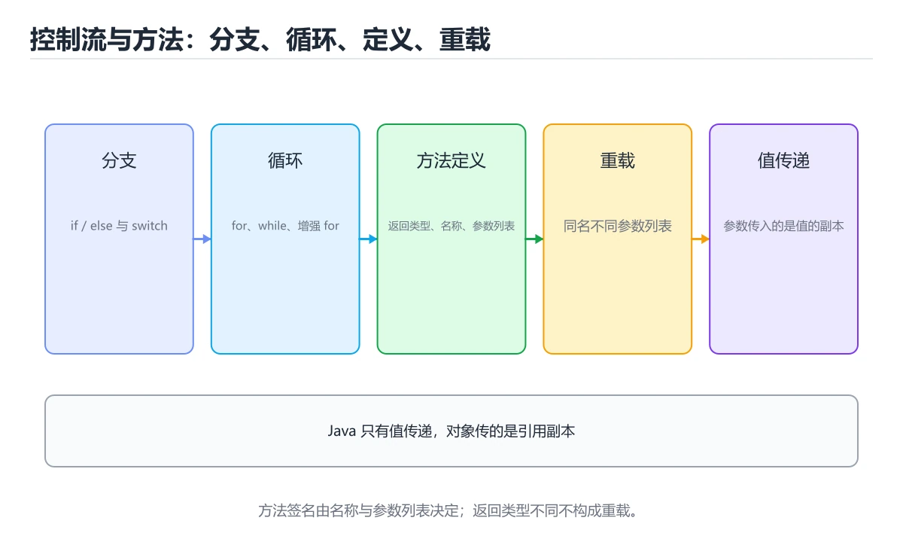
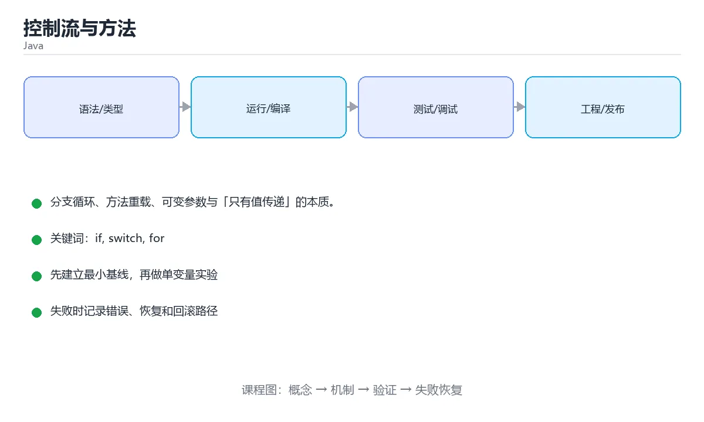

# 控制流与方法

> 内容更新时间：2026-10-06 · 学习阶段：基础 · 预计用时：50 分钟





## 本节知识框架

欢迎来到 Java 控制流与方法的世界！想象你在指挥交通——红灯停、绿灯行、遇到特殊情况还要临时改道。编程里的控制流就是这套"交通指挥系统"，它告诉程序在什么时候走哪条路。

**本课你将学到：**
- 用 `if/else` 和 `switch` 让程序做选择
- 用 `for`、`while` 让程序重复做事
- 把重复逻辑打包成方法，像给工具箱贴标签一样管理代码
- 理解 Java 的"值传递"——为什么方法里改了变量，外面却没变？

**先修要求：** 学完《变量、类型与字符串》即可。如果你知道什么是 `int`、`String` 和 `null`，就可以开始了。

### 复习清单

- [ ] 能不看正文说出 `break` 和 `continue` 的区别，并举一个用错的例子
- [ ] 能运行本课示例，修改一个条件后观察输出变化
- [ ] 能完成考点精讲自测，把错题对照错误表找到原因

## 核心概念定义

| 术语 | 一句话说明 |
| --- | --- |
| `break` | 用 `break` 跳出当前循环或 switch；`continue` 跳过本轮剩余代码，进入下一轮。带标签的 `break outer;` 可以跳出多层嵌套循环。 |
| `final` | 修饰变量表示不可重新赋值，修饰方法表示不可重写，修饰类表示不可继承。核心作用是"锁定意图"。 |
| 可变参数 | 用 `int... nums` 声明，调用时可以传 0 个或多个实参。本质是编译器帮你创建了一个数组。 |
| 值传递 | Java 只有值传递：基本类型传的是数据副本，对象类型传的是引用的副本。改副本指向的地址无效，改副本所指向对象的内容有效。 |

## 原理与运行机制

### 用生活场景理解控制流

把程序想象成你早上出门的过程：

1. **if/else** — 看天气决定穿什么：下雨穿雨衣，否则穿外套
2. **switch** — 到地铁站选线路：1 号线去东站，2 号线去机场，每条线路互不干扰
3. **for 循环** — 走 1000 步到公司，每一步都重复同样的动作
4. **方法** — 把"从家到公司"打包成一个指令，下次只需要说"上班"就行

### 分支：if 与 switch 的分工

```text
场景              推荐写法          原因
─────────────────────────────────────────────────
范围判断           if / else if     天然支持 >= <= 等条件组合
固定值分流         switch           结构清晰，编译器能检查遗漏
二选一             三元 ? :         一行搞定，但别嵌套
```

```java
int score = 78;
if (score >= 90) {
    System.out.println("优秀");
} else if (score >= 60) {
    System.out.println("及格");
} else {
    System.out.println("不及格");
}
```

switch 的新式写法（Java 14+）用箭头语法，不会再出现忘记 `break` 导致穿透的问题：

```java
switch (score / 10) {
    case 10, 9 -> System.out.println("A");
    case 8     -> System.out.println("B");
    default    -> System.out.println("C");
}
```

switch 表达式还能直接返回值：

```java
String level = switch (score / 10) {
    case 10, 9 -> "优秀";
    case 8     -> "良好";
    case 7     -> "中等";
    default    -> "需努力";
};
```

### 循环三兄弟

```java
// for：知道要跑多少次
for (int i = 0; i < 5; i++) {
    System.out.println("第 " + i + " 圈");
}

// 增强 for：遍历集合，不需要下标
String[] names = {"小明", "小红", "小刚"};
for (String name : names) {
    System.out.println(name);
}

// while：条件驱动，可能一次都不执行
int n = 0;
while (n < 3) {
    System.out.println(n);
    n++;
}
```

### 方法：把逻辑打包命名

```java
public static int add(int a, int b) { return a + b; }
//  |      |      |    |        |
//  |      |      |    |        参数列表
//  |      |      |    返回类型
//  |      |      方法名
//  |      static：属于类，不需要 new 对象
//  访问修饰符
```

方法重载就是同名不同参数列表，编译器根据你传的参数自动选哪个版本：

```java
int add(int a, int b) { return a + b; }
double add(double a, double b) { return a + b; }
int add(int a, int b, int c) { return a + b + c; }
```

判定依据只有**方法名 + 参数列表**，返回值类型不参与判断。只改返回类型不算重载，编译不过。

### Java 只有值传递

这是新手最容易绕晕的地方。记住一句话：**Java 传的永远是值的副本**。

```java
void change(int x) { x = 99; }              // 外面不变——改了副本
void change(int[] arr) { arr[0] = 99; }     // 外面会变——改的是堆里同一个数组
```

打个比方：你把家庭地址写在纸条上复印一份给朋友。朋友改了纸条上的字（重新赋值引用），你家的地址不会变。但朋友按地址找到你家，把门漆成红色（修改对象内容），你家的门就真的变了。

### 可变参数

```java
int sum(int... nums) {          // 调用时可以传 0 个或多个
    int total = 0;
    for (int n : nums) total += n;
    return total;
}
sum();                // 0
sum(1, 2, 3);         // 6
```

可变参数必须放在参数列表最后，一个方法只能有一个。

## 典型应用场景

| 场景 | 推荐写法 | 为什么 |
| --- | --- | --- |
| 分数段、金额区间判断 | `if / else if` | 天然支持范围与组合条件 |
| 枚举值、状态码分流 | `switch` 表达式 | 结构清晰，编译器能查漏 |
| 简单二选一 | 三元运算符 `? :` | 一行写完，但别嵌套 |
| 把重复逻辑打包复用 | 方法 + 重载 | 减少重复代码，提高可读性 |

## 代码/协议/SQL 示例

### 最小可验证示例

```java
int score = 78;
if (score >= 90) {
    System.out.println("优秀");
} else if (score >= 60) {
    System.out.println("及格");
} else {
    System.out.println("不及格");
}

switch (score / 10) {
    case 10, 9 -> System.out.println("A");
    case 8 -> System.out.println("B");
    default -> System.out.println("C");
}

for (int i = 0; i < 5; i++) { }
for (String name : names) { }
while (condition) { }
do { } while (condition);
```

### 值传递验证

```java
static void change(int x) { x = 100; }              // 不影响调用方

static void addItem(List<String> list) {
    list.add("new");                                // 修改对象内容：有效
}

static void reassign(List<String> list) {
    list = new ArrayList<>();                       // 重新赋值引用：无效
}
```

### 控制流速查

```text
结构               写法                     注意
────────────────────────────────────────────────────────
if / else if / else   条件分支               条件必须是 boolean
switch 语句          传统分支               别忘 break，否则穿透
switch 表达式        case X -> value;       Java 14+，无穿透且可赋值
for                 计次循环               注意边界 i < n
增强 for            for (String s : list)  遍历中不能改集合结构
while / do...while  条件循环               do...while 至少执行一次
标签 + break        break outer;           跳出多层循环
continue            跳过本次               配合条件过滤
```

### 方法速查

```text
概念             规则
──────────────────────────────────────────────────
重载             同名不同参数列表，返回值不参与判断
重写             子类重新实现父类方法，签名一致
参数传递         Java 只有值传递，对象传的是引用的副本
可变参数         int... nums 必须是最后一个参数
默认值           Java 不支持默认参数，用重载或建造者替代
返回值           所有分支都要有返回，或用 throw
static 方法      属于类，不能用实例成员
final 参数       方法内不能重新赋值
```

### 用重载替代默认参数

```java
public void log(String msg) {
    log(msg, false);
}

public void log(String msg, boolean verbose) {
    System.out.println(verbose ? "[DEBUG] " + msg : msg);
}

// 可变参数 + 边界校验
public int sum(int first, int... rest) {
    int total = first;
    for (int n : rest) {
        total += n;
    }
    return total;
}
```

### 练习：素数统计

```java
public class Demo {
    static boolean isPrime(int n) {
        if (n < 2) return false;
        for (int d = 2; d * d <= n; d++) {
            if (n % d == 0) return false;
        }
        return true;
    }

    static int countPrimes(int limit) {
        int count = 0;
        for (int i = 2; i <= limit; i++) {
            if (isPrime(i)) count++;
        }
        return count;
    }

    public static void main(String[] args) {
        System.out.println("100 以内素数有 " + countPrimes(100) + " 个");
    }
}
```

## 时间/空间复杂度或性能分析

控制流本身几乎不产生额外开销。需要关注的是：

- **循环体内的对象创建**：每次循环 `new` 一个对象会产生大量短命对象，增加 GC 压力。能提到循环外就提出来。
- **switch 表达式**：编译器会优化成跳转表或二分查找，性能远优于长串 `if/else if`。
- **方法调用**：JVM 的 JIT 编译器会自动内联小方法，不用担心方法调用的额外开销。

实际项目中，先用 JMH 基准测试跑一遍预热，再对比不同写法的吞吐量和 P99 延迟，才是可靠的性能判断依据。

## 常见误区与易错点

| 容易写错的做法 | 实际现象 | 原因与正确做法 |
| --- | --- | --- |
| `if (a = b)` | 编译报错或逻辑错 | 比较写 `==`，赋值才用 `=` |
| switch 忘记 break | 穿透执行后续分支 | 用 `->` 表达式或补 `break` |
| 循环里删集合元素 | `ConcurrentModificationException` | 用 `Iterator.remove()` 或 `removeIf` |
| 增强 for 里改数组 | 改了副本没效果 | 需要下标时用普通 for |
| 递归无终止条件 | `StackOverflowError` | 先写出口条件 |
| 方法名相同但只有返回类型不同 | 编译错误 | 重载必须参数列表不同 |
| 可变参数前面再加普通参数顺序错 | 编译错误 | 可变参数必须在最后 |
| `for (int i = 0; i <= list.size(); i++)` | `IndexOutOfBoundsException` | 用 `<` 或增强 for |
| 用 `==` 比较字符串 | 结果不可靠 | 用 `equals` |
| `while (true)` 没有退出条件 | 程序卡死 | 明确退出条件或 break |

## 与其他知识点的关系

- **先修**：《变量、类型与字符串》——本课默认你已经掌握 `null`、`equals` 等基础概念
- **后续**：《类与对象》——方法会写进类里，控制流决定对象的行为
- **关联**：《继承、接口与多态》——方法重写（Override）是这里方法概念的延伸

## 自测题与参考答案

> 先独立作答，再对照参考答案。

1. **新式 switch 表达式比传统写法好在哪？** 不会穿透、可以直接赋值、编译器能检查分支覆盖。
2. **为什么增强 for 里删元素会抛异常？** 因为内部迭代器检测到集合结构被意外修改，用 `removeIf` 替代。
3. **"Java 只有值传递"是什么意思？** 传的永远是值的副本。基本类型传数据副本，对象传引用的副本。
4. **可变参数有什么限制？** 必须在参数列表最后，一个方法只能有一个。
5. **方法重载怎么判定？** 只看方法名 + 参数列表，返回值不算。

## 考点精讲

`控制流与方法` 的题库有 6 道题，下面逐题给出题干、正确项与判断依据。

### 考点 1：第 1 题

- - **题目**：围绕“控制流与方法”中的 if、switch、for，下列哪两项是本课强调的实践判断？
- **正确项**：验证 switch 时要固定版本并覆盖边界输入，结论才可复现；学习 if 时要同时说明输入、输出和失败路径，不能只看正常流程
- **判断依据**：学习控制流不能只看 happy path，要同时覆盖边界输入和失败路径。

### 考点 2：第 2 题

- **题目**：可变参数（int... nums）必须放在？
- **正确项**：参数列表最后
- **判断依据**：可变参数本质是数组，编译器要求它必须在参数列表最后，否则无法判断哪些参数属于可变部分。

### 考点 3：第 3 题

- **题目**：方法重载的判定依据是？
- **正确项**：方法名 + 参数列表
- **判断依据**：返回值类型不参与重载判定，只看方法名和参数列表的组合。

### 考点 4：第 4 题

- **题目**：代码语言为 `java`，选自 `控制流与方法` 的 `break` 部分。课程问题为分支循环、方法重载、可变参数与「只有值传递」的本质。哪一项描述与代码一致？
- **正确项**：出现字面量 `不及格`
- **判断依据**：本课示例中 if/else 分支里出现了 `"不及格"` 字面量，用于 score < 60 的输出。

### 考点 5：第 5 题

- **题目**：带标签的 break（break outer;）的作用是？
- **正确项**：跳出被标记的外层循环
- **判断依据**：标签配合 break 可以直接跳出多层嵌套循环，避免使用额外的标志变量。

### 考点 6：第 6 题

- **题目**：填空：补齐下面这段术语说明中的空缺。课程 `分支循环、方法重载、可变参数与「只有值传递」的本质。`，这段说明是：用 ``____`` 跳出、`continue` 跳过本轮；带标签的 ``____` outer;` 可以跳出多层循环。空缺处应填哪个术语？
- **正确项**：break
- **判断依据**：break 用于跳出循环或 switch，continue 用于跳过本轮剩余代码。

## 术语速查

| 术语 | 一句话说明 |
| --- | --- |
| `break` | 跳出当前循环或 switch，带标签可跳多层 |
| `continue` | 跳过本轮剩余代码，进入下一轮循环 |
| `final` | 锁定变量、方法或类，防止被修改或继承 |
| 可变参数 | `int... nums`，调用时可传 0 个或多个参数 |
| 值传递 | Java 只传值的副本，对象传的是引用副本 |
| 方法重载 | 同名不同参数列表，返回值不参与判定 |

## 参考资料与复核

- 最后复核：2026-10-04
- 下次复核：2027-02-24
- 复核范围：版本兼容、API 行为、安全建议与工程实践

| 参考资料 | 本课用途 |
| --- | --- |
| [Java SE 官方教程](https://docs.oracle.com/javase/tutorial/java/nutsandbolts/) | 控制流与方法的基础语法 |
| [Java SE API 文档](https://docs.oracle.com/en/java/javase/21/docs/api/) | 标准库 API 查询 |
| [dev.java 学习路径](https://dev.java/learn/) | 现代 Java 官方入门教程 |

## 内容元数据

- 内容版本：v2.0
- 最后更新：2026-10-06
- 学习阶段：基础
- 适用环境：Java 21+ / Maven 或 Gradle
- 内容来源：内置结构化课程与工程实践整理
- 相关主题：if、switch、for、重载、可变参数、值传递
